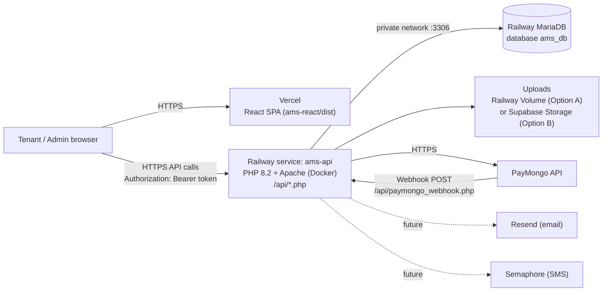
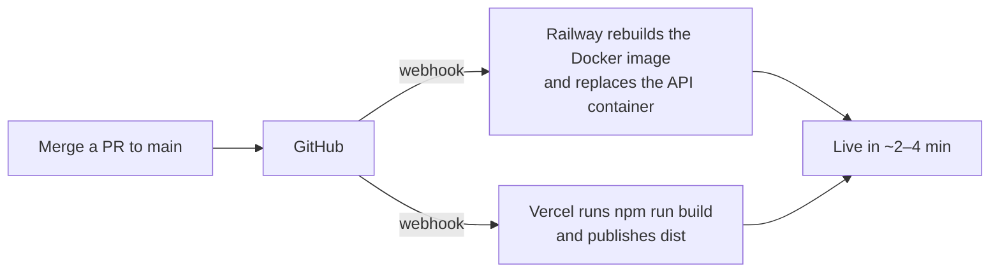

# AMS — SaaS Deployment Guide (Railway + Vercel)

> **Document:** Step-by-step setup and deployment for the SaaS fallback stack
> **Project:** Apartment Management System (AMS)
> **Stack:** React 19 + Vite 8 (Vercel) → PHP 8 on Apache (Railway) → MariaDB (Railway)
> **Last Updated:** September 2026
> **Companion docs:** [saas_fallback_strategy.md](saas_fallback_strategy.md) (why and when), [localhost_to_production.md](localhost_to_production.md) (self-hosted VPS), [database_schema.md](../documentation/database_schema.md), [security_audit.md](../security_audit.md)

---

## Table of Contents

0. [Before You Start — Readiness Status](#0-before-you-start--readiness-status)
1. [Target Architecture & Accounts](#1-target-architecture--accounts)
2. [Prepare the Code (Required)](#2-prepare-the-code-required)
3. [Database — Railway MariaDB](#3-database--railway-mariadb)
4. [PHP API — Railway Service](#4-php-api--railway-service)
5. [Frontend — Vercel](#5-frontend--vercel)
6. [File Storage](#6-file-storage)
7. [Payments — PayMongo](#7-payments--paymongo)
8. [Email (Resend) & SMS (Semaphore)](#8-email-resend--sms-semaphore)
9. [Scheduled Jobs](#9-scheduled-jobs)
10. [Custom Domains & HTTPS](#10-custom-domains--https)
11. [Post-Deployment Verification Checklist](#11-post-deployment-verification-checklist)
12. [Day-2 Operations](#12-day-2-operations)
13. [Troubleshooting](#13-troubleshooting)
14. [Rolling Back to XAMPP](#14-rolling-back-to-xampp)

---

## 0. Before You Start — Readiness Status

[`saas_fallback_strategy.md`](saas_fallback_strategy.md) decides **whether** to move to SaaS. This guide is the **how**: every click, command and setting needed to run AMS on Railway and Vercel.

> [!NOTE]
> **Closed — these §2 changes are now in the repository** (done 2026-09-16, after a Railway build failed with *"Railpack could not determine how to build the app"*):
>
> | Gap | Now |
> |---|---|
> | No container / runtime definition at the repository root | `Dockerfile` + `.dockerignore` exist — Railway builds with Docker, not Railpack. §2.4 documents them |
> | Database credentials only came from the gitignored `backend/config.env.php`, with no port | `backend/config.php` reads `config.env.php` → environment variables (`getenv`, then `$_ENV`/`$_SERVER`) → localhost defaults, and connects with `DB_PORT` (§2.1). XAMPP is unaffected |
> | API address hardcoded in `ams-react/src/api/axiosConfig.js` | Reads `import.meta.env.VITE_API_BASE_URL`, falling back to the XAMPP URL; `ams-react/.env.example` documents it (§2.2) |

> [!WARNING]
> **Still open — close these before the stack is fully usable.** [§2](#2-prepare-the-code-required) walks through each with code:
>
> | Gap | Where | Why it breaks in the cloud |
> |---|---|---|
> | 5 components still build `http://localhost:8080/…` file URLs by hand | `AdminPayments.jsx`, `AdminParking.jsx`, `AdminVisitors.jsx`, `UserPaymentHistory.jsx`, `TopBar.jsx` | Attachments and avatars point at the visitor's own computer — use the existing `src/api/fileUrl.js` helper (§2.2) |
> | Deep links such as `/admin-dashboard` have no server route | `ams-react` (`BrowserRouter`, no rewrite config) | Refreshing any page on Vercel returns 404 — add `vercel.json` (§2.3) |
> | Uploads are written to local disk | 7 endpoints + `store_maintenance_attachment()` | Railway's filesystem is wiped on every redeploy unless a volume is mounted at `/var/www/html/uploads` (§2.5) |
> | `SetupDB.sql` uses MariaDB-only syntax (`ADD COLUMN IF NOT EXISTS`) | `backend/api/migrations/` | Fails on a plain MySQL 8 server — use MariaDB |
> | Every `backend/api/*.php` sends `Access-Control-Allow-Origin: *` | 79 of 80 endpoints | Once the frontend is on a different origin, credentialed cross-origin calls need a real allowlist (§2.6) |

> [!NOTE]
> **Email and SMS are not implemented in the code yet.** There is no PHPMailer, Resend or Semaphore integration — password resets and reminders are in-app only. [§8](#8-email-resend--sms-semaphore) covers account setup so they are ready when the code is written, but deploying does not turn them on.

**Time needed:** roughly half a day for a first deployment (code prep 1–2 h, services 2 h, verification 1 h).

**Who this is for:** a developer or administrator comfortable with Git, a terminal, and editing PHP/JavaScript files.

---

## 1. Target Architecture & Accounts

### 1.1 Architecture



**Resulting URLs** (placeholders used throughout this guide):

| Placeholder | Example | What it is |
|---|---|---|
| `<APP_DOMAIN>` | `ams-app.vercel.app` or `app.yourapartment.com` | The website tenants and admins open |
| `<API_DOMAIN>` | `ams-api.up.railway.app` or `api.yourapartment.com` | The PHP backend |
| API base URL | `https://<API_DOMAIN>/api/` | What the frontend calls |
| Uploaded file URL | `https://<API_DOMAIN>/uploads/documents/…` | How uploaded documents are opened |

### 1.2 Accounts to create

| Service | Used for | Plan to start with | Sign up |
|---|---|---|---|
| GitHub | Source repository both platforms deploy from | Free | github.com |
| Railway | PHP API, MariaDB, upload volume | Hobby (US$5/month usage credit) | railway.app |
| Vercel | React frontend | Hobby (free) | vercel.com |
| Supabase | File storage — **only if you choose Option B** in §6 | Free (1 GB) | supabase.com |
| PayMongo | Online payments (GCash, Maya, card) | Test mode is free | paymongo.com |
| Resend | Email — setup only, see §8 | Free (3,000 emails/month) | resend.com |
| Semaphore | SMS — setup only, see §8 | Pay per message | semaphore.co |
| cron-job.org | Optional scheduled sweeps, see §9 | Free | cron-job.org |

### 1.3 Tools on your computer

| Tool | Version | Check with |
|---|---|---|
| Git | any recent | `git --version` |
| Node.js + npm | 20 or newer | `node -v` |
| MariaDB/MySQL client (`mysql`, `mysqldump`) | any — XAMPP's works | `C:\xampp\mysql\bin\mysql.exe --version` |
| Docker Desktop | optional, for testing the image locally | `docker --version` |
| Railway CLI | optional | `npm i -g @railway/cli` |

---

## 2. Prepare the Code (Required)

Make these changes on a branch, test locally on XAMPP (they are all backward-compatible), then merge to `main` before deploying.

```bash
git checkout -b chore/saas-deploy-prep
```

### 2.1 Read database settings from environment variables

**File:** `backend/config.php` — **already done**; this is what it now contains (kept here as the reference for a fresh checkout):

```php
// Settings come from, in order: config.env.php constants (XAMPP), environment
// variables (Railway / Docker), then local defaults. $_ENV/$_SERVER are checked
// too because some SAPI configurations leave getenv() empty.
$ams_env = function ($key, $default) {
    foreach ([getenv($key), $_ENV[$key] ?? false, $_SERVER[$key] ?? false] as $value) {
        if ($value !== false && $value !== '') return $value;
    }
    return $default;
};

if (!defined('DB_HOST')) define('DB_HOST', $ams_env('DB_HOST', 'localhost'));
if (!defined('DB_PORT')) define('DB_PORT', (int) $ams_env('DB_PORT', 3306));
if (!defined('DB_USER')) define('DB_USER', $ams_env('DB_USER', 'root'));
if (!defined('DB_PASS')) define('DB_PASS', $ams_env('DB_PASS', ''));
if (!defined('DB_NAME')) define('DB_NAME', $ams_env('DB_NAME', 'ams_db'));
if (!defined('APP_ENV')) define('APP_ENV', $ams_env('APP_ENV', 'development'));
```

…and change the connection line to include the port:

```php
$conn = new mysqli(DB_HOST, DB_USER, DB_PASS, DB_NAME, DB_PORT);
```

`backend/config.env.example.php` also carries `define('DB_PORT', 3306);` so local setups stay documented.

> [!TIP]
> XAMPP keeps working unchanged: `config.env.php` still wins when it exists. On Railway the file doesn't exist, so the environment variables from §4.3 are used.

### 2.2 Make the API address configurable

**File:** `ams-react/src/api/axiosConfig.js` — **already done** (`ams-react/.env.example` too):

```js
// Before
baseURL: "http://localhost:8080/ApartmentManagementSystem_React/backend/api/",

// After — Vite injects VITE_API_BASE_URL at build time; XAMPP is the fallback.
baseURL: import.meta.env.VITE_API_BASE_URL
    || "http://localhost:8080/ApartmentManagementSystem_React/backend/api/",
```

Create `ams-react/.env.example` to document it:

```bash
# Full URL of the PHP API folder, including the trailing slash.
VITE_API_BASE_URL=http://localhost:8080/ApartmentManagementSystem_React/backend/api/
```

**Replace the other hardcoded hosts** with the existing helper `ams-react/src/api/fileUrl.js`. It already derives the file host from the API base URL and strips `../` prefixes:

| File | Current hardcoded URL | Change to |
|---|---|---|
| `src/AdminPages/AdminPayments.jsx` | local helper returning `http://localhost:8080/…/backend/${clean}` | `return fileUrl(clean);` |
| `src/AdminPages/AdminParking.jsx` | `` href={`http://localhost:8080/…/backend/${res.documentPath…}`} `` | `href={fileUrl(res.documentPath)}` |
| `src/AdminPages/AdminVisitors.jsx` | `` href={`http://localhost:8080/…/backend/${v.idPhotoPath}`} `` | `href={fileUrl(v.idPhotoPath)}` |
| `src/UserPages/UserPaymentHistory.jsx` | `` href={`http://localhost:8080/…/backend/${receiptData.proofPath}`} `` | `href={fileUrl(receiptData.proofPath)}` |
| `src/Components/TopBar.jsx` | avatar URL `http://localhost/…/backend/${cleanPath}` (note: **no port** — already broken on XAMPP port 8080) | `return fileUrl(cleanPath);` |

In each file add `import fileUrl from '../api/fileUrl';` (adjust the relative path for `Components/`: `'../api/fileUrl'` also works from there).

Confirm nothing is left:

```bash
grep -rn "localhost" ams-react/src      # should only show the fallback in axiosConfig.js
```

### 2.3 Add the SPA rewrite for Vercel

The app uses `BrowserRouter`, so a direct visit to `/admin-dashboard` must still serve `index.html`.

**New file:** `ams-react/vercel.json`

```json
{
  "rewrites": [{ "source": "/(.*)", "destination": "/index.html" }]
}
```

### 2.4 Add the Railway runtime (Docker)

Railway deploys any repository with a `Dockerfile`. The official `php:8.2-apache` image is the closest match to XAMPP, so relative paths (`../config.php`, `../uploads/`), `getallheaders()` and the Authorization header all behave exactly as they do locally.

**File:** `Dockerfile` (repository root) — **already committed**; reproduced here for reference

```dockerfile
FROM php:8.2-apache

# mysqli (with mysqlnd) is the only extension not bundled in the base image;
# curl, openssl, fileinfo and json already are. ca-certificates lets
# create_checkout_session.php verify PayMongo's TLS certificate.
RUN apt-get update \
 && apt-get install -y --no-install-recommends ca-certificates \
 && docker-php-ext-install mysqli \
 && rm -rf /var/lib/apt/lists/*

# upload_max_filesize / post_max_size cannot be changed with ini_set() at
# runtime, so config.php's calls have no effect — set them here instead.
RUN { \
      echo "upload_max_filesize=10M"; \
      echo "post_max_size=12M"; \
      echo "memory_limit=128M"; \
      echo "expose_php=Off"; \
      echo "display_errors=Off"; \
      echo "log_errors=On"; \
    } > /usr/local/etc/php/conf.d/ams.ini

# Never execute scripts or list files inside uploads. This replaces
# backend/uploads/.htaccess, which a mounted volume would hide.
RUN { \
      echo "<Directory /var/www/html>"; \
      echo "  Options -Indexes"; \
      echo "</Directory>"; \
      echo "<Directory /var/www/html/uploads>"; \
      echo "  php_admin_flag engine off"; \
      echo "  Options -Indexes"; \
      echo "</Directory>"; \
    } > /etc/apache2/conf-enabled/ams.conf

# The backend becomes the web root: /api/login.php, /uploads/..., config.php one level up.
COPY backend/ /var/www/html/
RUN mkdir -p /var/www/html/uploads && chown -R www-data:www-data /var/www/html/uploads

# Railway provides $PORT. Re-own the uploads folder at start because a freshly
# mounted volume belongs to root.
CMD sed -i "s/Listen 80/Listen ${PORT:-80}/" /etc/apache2/ports.conf \
 && sed -i "s/<VirtualHost \*:80>/<VirtualHost *:${PORT:-80}>/" /etc/apache2/sites-available/000-default.conf \
 && chown -R www-data:www-data /var/www/html/uploads \
 && exec apache2-foreground
```

**File:** `.dockerignore` (repository root) — **already committed** (it also excludes `.agents`, `.claude`, `CLAUDE.md`, `TASK.md`)

```text
.git
.github
ams-react
docs
**/node_modules
backend/config.env.php
backend/uploads/**
backend/api/migrations
backend/api/*.log
```

> [!IMPORTANT]
> `backend/api/migrations` **must** stay out of the image. It sits inside the web root, and `SetupDB.sql` contains the admin password hash and full schema. `config.env.php` and local uploads are excluded for the same reason.

**Optional local test** before pushing:

```bash
docker build -t ams-api .
docker run --rm -p 8081:80 -e DB_HOST=host.docker.internal -e DB_USER=root -e DB_NAME=ams_db ams-api
# then: curl -s -X POST http://localhost:8081/api/login.php -H "Content-Type: application/json" \
#   -d '{"email_address":"admin@gmail.com","password":"admin123"}'
```

### 2.5 Decide how uploads are stored

| | **Option A — Railway Volume** (recommended to start) | **Option B — Supabase Storage** |
|---|---|---|
| Code change | None | A storage wrapper plus changes at 8 call sites |
| Survives redeploys | Yes (persistent disk) | Yes |
| File privacy | Same as today — served by the API through `/uploads/…` | A public bucket makes government IDs and payment proofs readable by anyone with the link; a private bucket needs signed URLs (more code) |
| Scaling | One API instance only (a volume attaches to one service) | Any number of instances |
| Backups | Manual, via the Railway volume backup feature or file download | Handled by Supabase |

**Choose Option A** unless you need several API replicas. Option A setup is a single step in [§6.1](#61-option-a--railway-volume-no-code-change).

<details>
<summary><b>Option B code outline (only if you choose Supabase Storage)</b></summary>

Add a helper to `backend/config.php` and route every upload through it. It returns a full `https://` URL, which `fileUrl()` passes through unchanged.

```php
// Uploads a file to Supabase Storage and returns its URL, or null on failure.
function store_uploaded_file(array $file, string $folder): ?string {
    $url    = getenv('SUPABASE_URL');          // https://<project>.supabase.co
    $key    = getenv('SUPABASE_SERVICE_KEY');  // service_role key — server side only
    $bucket = getenv('SUPABASE_BUCKET') ?: 'uploads';
    if (!$url || !$key) return null;

    $ext  = strtolower(pathinfo($file['name'], PATHINFO_EXTENSION));
    $path = $folder . '/' . time() . '_' . bin2hex(random_bytes(8)) . '.' . $ext;
    $mime = mime_content_type($file['tmp_name']) ?: 'application/octet-stream';

    $ch = curl_init("$url/storage/v1/object/$bucket/$path");
    curl_setopt_array($ch, [
        CURLOPT_POST           => true,
        CURLOPT_HTTPHEADER     => ["Authorization: Bearer $key", "Content-Type: $mime"],
        CURLOPT_POSTFIELDS     => file_get_contents($file['tmp_name']),
        CURLOPT_RETURNTRANSFER => true,
    ]);
    curl_exec($ch);
    $ok = curl_getinfo($ch, CURLINFO_HTTP_CODE) === 200;
    curl_close($ch);

    return $ok ? "$url/storage/v1/object/public/$bucket/$path" : null;
}
```

Replace `move_uploaded_file(...)` and the path bookkeeping at each writer. Keep the existing extension, MIME and size validation in front of it:

| File | Folder |
|---|---|
| `backend/config.php` → `store_maintenance_attachment()` | `maintenance` |
| `backend/api/rent_application.php` | `applications` |
| `backend/api/upload_lease_document.php` | `documents` |
| `backend/api/parking_reservation.php` | `documents` |
| `backend/api/upload_payment_proof.php` | `payment_proofs` |
| `backend/api/service_request.php` | `services` |
| `backend/api/profile.php` (avatar) | `avatars` |
| `backend/api/check_in_visitor.php` | `visitors` |

</details>

### 2.6 Production hardening checklist

Do these before real tenants use the deployment. The full list is in [security_audit.md](../security_audit.md).

| # | Action | Why |
|---|---|---|
| 1 | Set `APP_ENV=production` on Railway (§4.3) | In development mode `forgot_password.php` returns the reset token in its response, so anyone can reset any account |
| 2 | Change the admin password right after the first login (Admin → Account Settings → Security & Password) | `SetupDB.sql` seeds `admin@gmail.com` / `admin123` |
| 3 | Do **not** import `seed_mock_data.sql` into a production database | It creates 12 tenant accounts that share the password `tenant123` |
| 4 | Confirm `backend/api/migrations` is excluded from the image (§2.4) | The SQL files would otherwise be downloadable |
| 5 | Optional: replace `Access-Control-Allow-Origin: *` with your `<APP_DOMAIN>` | Not required — auth uses bearer tokens, not cookies — but it narrows who can call the API (the header is set in each endpoint file) |

Commit and merge:

```bash
git add -A
git commit -m "chore(deploy): env-based config, VITE_API_BASE_URL, Dockerfile, vercel.json"
git push -u origin chore/saas-deploy-prep
# open a PR, review, merge to main
```

---

## 3. Database — Railway MariaDB

### 3.1 Create the project and database

1. Sign in to Railway → **New Project** → **Empty Project**. Name it `ams`.
2. In the project canvas: **+ Create** → **Database** → **MariaDB**.
   > [!WARNING]
   > Choose **MariaDB**, not MySQL. `SetupDB.sql` is a MariaDB dump that uses `ADD COLUMN IF NOT EXISTS`, which MySQL 8 rejects. If you must use MySQL 8, edit those statements into plain `ADD COLUMN` first.
3. Open the MariaDB service → **Variables**. Note the root user, password, and the **private** host/port (used by the API, e.g. `mariadb.railway.internal:3306`).
4. **Settings → Networking → TCP Proxy** → enable it. Railway shows a **public** host and port (for example `roundhouse.proxy.rlwy.net:41234`). You'll use this only from your own computer to import data.

### 3.2 Choose one: fresh database or migrate existing data

#### Fresh database (new deployment)

From the repository root on your computer (Git Bash; replace the placeholders):

```bash
MYSQL=/c/xampp/mysql/bin/mysql.exe
HOST=<PUBLIC_PROXY_HOST>; PORT=<PUBLIC_PROXY_PORT>; USER=root

# SetupDB.sql creates the database `ams_db` itself (CREATE DATABASE + USE).
$MYSQL -h $HOST -P $PORT -u $USER -p < backend/api/migrations/SetupDB.sql

# Demo data — ONLY for a demo/staging environment (see §2.6 #3)
# $MYSQL -h $HOST -P $PORT -u $USER -p < backend/api/migrations/seed_mock_data.sql
```

> [!NOTE]
> The schema scripts hardcode the database name `ams_db`, so the tables land in `ams_db`, not in Railway's default `railway` database. That's why §4.3 sets `DB_NAME=ams_db`.

#### Migrate an existing XAMPP database

```bash
# 1. Dump from XAMPP (MySQL service running locally)
/c/xampp/mysql/bin/mysqldump.exe -u root --single-transaction --default-character-set=utf8mb4 ams_db > ams_backup.sql

# 2. Create the database on Railway and import
MYSQL=/c/xampp/mysql/bin/mysql.exe; HOST=<PUBLIC_PROXY_HOST>; PORT=<PUBLIC_PROXY_PORT>
$MYSQL -h $HOST -P $PORT -u root -p -e "CREATE DATABASE IF NOT EXISTS ams_db CHARACTER SET utf8mb4 COLLATE utf8mb4_general_ci"
$MYSQL -h $HOST -P $PORT -u root -p ams_db < ams_backup.sql

# 3. If the dump predates September 2026, apply the idempotent upgrades (safe to run twice)
$MYSQL -h $HOST -P $PORT -u root -p ams_db < backend/api/migrations/2026_09_utility_readings.sql
$MYSQL -h $HOST -P $PORT -u root -p ams_db < backend/api/migrations/2026_09_rbac_activity_logs.sql
```

> [!CAUTION]
> Never run `SetupDB.sql` against a database that already has data — its original tables use `DROP TABLE IF EXISTS`. Don't use `clear_and_seed.sql` or `seed_reset.sql` either; both are out of sync with the schema ([database_schema.md §3](../documentation/database_schema.md)).

### 3.3 Verify the import

```bash
$MYSQL -h $HOST -P $PORT -u root -p ams_db -e "
  SHOW TABLES;
  SELECT id, email_address, role FROM users WHERE role='admin';
  SELECT COUNT(*) AS rooms FROM rooms;
  SELECT setting_key, setting_value FROM system_settings WHERE setting_key='payment_mode';"
```

Expected: 22 tables, including `sessions`, `login_attempts`, `utility_readings`; one admin row; 14 rooms; `payment_mode = manual`.

### 3.4 Lock it down

After importing, go back to **Settings → Networking** and **disable the TCP Proxy** unless you need ongoing access from outside Railway. The API connects over the private network and doesn't need it.

---

## 4. PHP API — Railway Service

### 4.1 Create the service

1. In the `ams` project: **+ Create** → **GitHub Repo** → select `ApartmentManagementSystem_React`. Grant Railway access to the repo if prompted.
2. Railway detects the root `Dockerfile` and starts a build. Rename the service to `ams-api` (**Settings → Service Name**).
3. **Settings → Source → Branch:** `main`. Every push to `main` now redeploys the API.

### 4.2 Attach the uploads volume (Option A)

**Service → Settings → Volumes → + New Volume** → mount path `/var/www/html/uploads` → 1 GB is plenty to start. (Option B users skip this and set the Supabase variables instead — §6.2.)

### 4.3 Environment variables

**Service → Variables → + New Variable.** For the database values, use **Add Reference** to link the MariaDB service's own variables, so a password rotation propagates automatically.

| Variable | Value | Notes |
|---|---|---|
| `DB_HOST` | reference → MariaDB **private** host | e.g. `mariadb.railway.internal` |
| `DB_PORT` | reference → MariaDB **private** port | usually `3306` |
| `DB_USER` | reference → MariaDB root user | |
| `DB_PASS` | reference → MariaDB root password | |
| `DB_NAME` | `ams_db` | Typed value, not a reference — see §3.2 note |
| `APP_ENV` | `production` | Hides the reset token and error details |
| `SUPABASE_URL`, `SUPABASE_SERVICE_KEY`, `SUPABASE_BUCKET` | from §6.2 | **Option B only** |

Railway redeploys automatically after you save the variables.

### 4.4 Public domain

**Service → Settings → Networking → Generate Domain.** Railway assigns something like `ams-api-production.up.railway.app` — this is your `<API_DOMAIN>`. Your API base URL is `https://<API_DOMAIN>/api/`.

### 4.5 Smoke test the API

```bash
API=https://<API_DOMAIN>/api

# Unauthenticated calls are refused (proves the app runs and auth is on)
curl -s "$API/get_invoices.php"                                 # {"success":false,"message":"Authentication required"}

# Log in and use the token
TOKEN=$(curl -s -X POST "$API/login.php" -H "Content-Type: application/json" \
  -d '{"email_address":"admin@gmail.com","password":"<ADMIN_PASSWORD>"}' | grep -oP '"sessionToken":"\K[^"]+')
echo "token: ${TOKEN:0:12}…"
curl -s -H "Authorization: Bearer $TOKEN" "$API/dashboard_stats.php" | head -c 200; echo

# Things that must NOT be reachable
curl -s -o /dev/null -w "%{http_code}\n" "https://<API_DOMAIN>/api/migrations/SetupDB.sql"   # 404
curl -s -o /dev/null -w "%{http_code}\n" "https://<API_DOMAIN>/uploads/"                     # 403 or 404, never a listing
```

If `login.php` returns HTML or "Connection failed", open **Deployments → View Logs** and see [§13](#13-troubleshooting).

---

## 5. Frontend — Vercel

### 5.1 Import the project

1. Sign in to Vercel → **Add New… → Project** → import `ApartmentManagementSystem_React`.
2. Configure:

| Setting | Value |
|---|---|
| Framework Preset | **Vite** |
| Root Directory | `ams-react` |
| Build Command | `npm run build` |
| Output Directory | `dist` |
| Install Command | `npm install` (default) |
| Node.js Version (Settings → General) | 20.x or newer |

3. **Environment Variables** — add for *Production* (and *Preview* if you use preview deployments):

| Name | Value |
|---|---|
| `VITE_API_BASE_URL` | `https://<API_DOMAIN>/api/` (keep the trailing slash) |

4. Click **Deploy**. Your site is at `https://<project>.vercel.app` — this is `<APP_DOMAIN>`.

> [!IMPORTANT]
> Vite writes `VITE_*` values into the JavaScript at **build time**. After changing `VITE_API_BASE_URL`, trigger **Deployments → … → Redeploy**. Editing the variable alone changes nothing on the live site.

### 5.2 Verify the frontend

1. Open `https://<APP_DOMAIN>/login` and sign in as admin. You should land on the dashboard with real numbers.
2. Refresh the browser on `/admin-dashboard`. The page must reload, not show a Vercel 404 (this proves the §2.3 rewrite works).
3. Open DevTools → **Network**. API calls must go to `https://<API_DOMAIN>/api/…` with no requests to `localhost`.
4. Open any page that links an uploaded file (e.g. Admin → Applications → documents) and confirm the link points at `https://<API_DOMAIN>/uploads/…`.

---

## 6. File Storage

### 6.1 Option A — Railway Volume (no code change)

1. Confirm the volume from §4.2 is mounted at `/var/www/html/uploads`.
2. **Copy existing uploads** when migrating from XAMPP (skip for a fresh install). With the Railway CLI:

   ```bash
   railway login
   railway link                      # choose project ams → service ams-api
   # Package the local uploads, then unpack them inside the running container
   tar -czf uploads.tgz -C backend uploads
   railway ssh -- "cat > /tmp/uploads.tgz" < uploads.tgz
   railway ssh -- "tar -xzf /tmp/uploads.tgz -C /var/www/html && chown -R www-data:www-data /var/www/html/uploads && rm /tmp/uploads.tgz"
   ```

   > If `railway ssh` isn't available on your plan, upload an archive through a temporary admin-only endpoint instead, or re-upload documents from the UI.
3. Test: as a tenant, upload a payment proof → as admin open it → **Redeploy** the API → open it again. It must still load.

### 6.2 Option B — Supabase Storage

1. Supabase → **New project** (region: Southeast Asia (Singapore) for Philippine users).
2. **Storage → New bucket** → name `uploads`.
   - **Public** — the simplest; required by the §2.5 wrapper as written. Understand that anyone with a file's URL can open it.
   - **Private** — requires generating signed URLs when files are viewed (extra code, not covered here).
3. **Project Settings → API**: copy the **Project URL** → `SUPABASE_URL`, and the **service_role** key → `SUPABASE_SERVICE_KEY`. The service_role key bypasses all security rules — it goes only into Railway variables, never into the frontend or Git.
4. Set `SUPABASE_BUCKET=uploads` and the two values above on the `ams-api` service (§4.3).
5. **Migrate existing files:** upload the contents of `backend/uploads/` into the bucket with the same folder structure (Supabase dashboard → drag and drop folders), then rewrite stored paths to full URLs, for example:

   ```sql
   UPDATE invoices SET proof_of_payment_path =
     CONCAT('https://<project>.supabase.co/storage/v1/object/public/uploads/',
            REPLACE(REPLACE(proof_of_payment_path, '../', ''), 'uploads/', ''))
   WHERE proof_of_payment_path IS NOT NULL AND proof_of_payment_path NOT LIKE 'http%';
   ```

   Repeat for every path column: `rent_applications` (valid ID front/back, NBI clearance), `lease_contracts` (signed/notarized lease), `parking_reservations.document_path`, `maintenance_requests` attachment, `service_requests` attachment, `users.avatar_url`, `visitor_logs.id_photo_path`. Check the exact column names in [database_schema.md](../documentation/database_schema.md) before running.

---

## 7. Payments — PayMongo

The secret key, public key and webhook secret are stored in the database (`system_settings` keys `paymongo_secret_key`, `paymongo_public_key`, `paymongo_webhook_secret`) and are managed from the admin UI, not from Railway variables.

### 7.1 Enter the API keys

1. PayMongo dashboard → **Developers → API Keys** → copy the **test** secret key (`sk_test_…`) and public key (`pk_test_…`).
2. AMS → sign in as admin → **Account Settings → System Configuration → Payment Channels & Gateway Settings**:
   - Operating Payment Mode: **Sandbox Only (PayMongo Test Mode)**, and tick **Master Active**
   - Tick the sandbox channels you want (GCash, Maya, bank transfer)
   - Paste the **Sandbox Secret Key** and **Sandbox Public Key**
3. **Save System Settings.** The change is recorded in the Activity Log with the secret values hidden.

### 7.2 Register the webhook

1. PayMongo → **Developers → Webhooks → Create webhook**
   - URL: `https://<API_DOMAIN>/api/paymongo_webhook.php`
   - Events: `checkout_session.payment.paid` and `payment.failed` (the only two the endpoint processes)
2. Copy the webhook's **signing secret** (`whsk_…`) → AMS **Account Settings → Webhook Secret Key** → save.

The endpoint verifies the `Paymongo-Signature` header, rejects events older than 5 minutes, and returns HTTP 500 on database errors so PayMongo retries.

### 7.3 Test a sandbox payment

1. Sign in as a tenant with an unpaid invoice → **Pay Bills** → choose GCash → **Pay**.
2. On PayMongo's test checkout page, complete the payment with the test option.
3. You return to AMS. Within a few seconds the invoice shows **Paid**, and Admin → Payments shows the method.
4. PayMongo → Webhooks → your endpoint → **recent deliveries** should show `200`.

> [!NOTE]
> The return link after checkout is built from the page's own address plus `#/pay-bills?status=…`. If the status banner doesn't appear on return, the payment is still settled by the webhook — see the known issue in [module_verification_guide.md §14.1 #4](../documentation/module_verification_guide.md).

### 7.4 Going live

- Complete PayMongo's business verification to receive live keys.
- The admin UI currently **locks Live mode** ("Live configuration is locked"). Switching to live keys requires a small code change in `AdminAccountSettings.jsx` and a check of the live-signature handling in `paymongo_webhook.php` (it reads `te` / `li` signature parts) — test it with a real ₱ transaction before announcing online payments.

---

## 8. Email (Resend) & SMS (Semaphore)

> [!WARNING]
> **Neither is wired into the code yet.** No endpoint sends email or SMS today; `forgot_password.php` only has a placeholder comment where the email would be sent. Complete the account setup below so credentials are ready, then implement the sending code (design notes: [notification_services.md](../features/notification_services.md), [external_services.md](../documentation/external_services.md)).

### 8.1 Resend (email)

1. Sign up at resend.com → **Domains → Add Domain** → enter your domain (e.g. `yourapartment.com`).
2. Add the DNS records Resend shows at your DNS provider: an SPF `TXT`, the DKIM record(s), and optionally a DMARC `TXT` (`v=DMARC1; p=none;`). Wait for **Verified**.
3. **API Keys → Create API Key** (permission: *Sending access*).
4. Add to the `ams-api` Railway variables (for the future code):

| Variable | Example |
|---|---|
| `RESEND_API_KEY` | `re_…` |
| `MAIL_FROM` | `AMS <noreply@yourapartment.com>` |
| `APP_URL` | `https://<APP_DOMAIN>` — used to build links such as `/reset-password?email=…&token=…` |

**Code needed before it works:** a `send_email($to, $subject, $html)` helper in `backend/config.php` that POSTs JSON to `https://api.resend.com/emails` with `Authorization: Bearer $RESEND_API_KEY`. Call it from `forgot_password.php` in place of the placeholder comment. (PHPMailer over `smtp.resend.com:465` with user `resend` and the API key as password is an alternative, but it requires adding Composer to the image.)

### 8.2 Semaphore (SMS)

1. Sign up at semaphore.co → buy credits (₱0.50–₱1.00 per message).
2. **Sender Names → Request** a sender name (e.g. `AMS`); approval takes 1–3 business days. Until approved, messages go out under a default name.
3. **Account → API** → copy the API key.
4. Add Railway variables `SEMAPHORE_API_KEY` and `SEMAPHORE_SENDER_NAME`. (A `semaphore_api_key` key also exists in `system_settings`; nothing reads it yet, so pick one place when you implement.)

**Code needed before it works:** a `send_sms($number, $message)` helper that POSTs `apikey`, `number`, `message`, `sendername` to `https://api.semaphore.co/api/v4/messages`, called from the reminder and overdue flows.

---

## 9. Scheduled Jobs

AMS has no scheduler. Most sweeps already run when relevant pages load: overdue promotion on invoice lists, reservation expiry on room lists, contract expiry on contract lists. For predictable timing, schedule these two endpoints, which are safe to call without a login:

| Endpoint | What it does | Suggested schedule |
|---|---|---|
| `https://<API_DOMAIN>/api/expire_contracts.php` | Marks active contracts past `lease_end` as expired | Daily 00:05 (Asia/Manila) |
| `https://<API_DOMAIN>/api/expire_reservations.php` | Releases unit holds past `hold_expires_at` | Daily 00:10 (Asia/Manila) |

**Using cron-job.org:** create a job per URL → method GET → schedule as above → timezone Asia/Manila → enable failure notifications. Each returns JSON like `{"success":true,"expired":0,…}`.

> [!NOTE]
> `check_due_date_reminders.php` (rent-due and overdue notifications) **requires an admin session**, so a plain cron job gets `401`. Until a cron secret is added to that endpoint, reminders are sent when an admin clicks the reminder action in Admin → Payments.

---

## 10. Custom Domains & HTTPS

Both platforms issue and renew TLS certificates automatically once DNS points at them.

### 10.1 Frontend domain (e.g. `app.yourapartment.com`)

1. Vercel → Project → **Settings → Domains → Add** → `app.yourapartment.com`.
2. At your DNS provider, add the record Vercel shows (typically `CNAME app → cname.vercel-dns.com`; for an apex domain, an `A` record to Vercel's IP).
3. Wait for **Valid Configuration**.

### 10.2 API domain (e.g. `api.yourapartment.com`)

1. Railway → `ams-api` → **Settings → Networking → Custom Domain** → `api.yourapartment.com`.
2. Add the `CNAME` (and any verification `TXT`) record Railway shows.
3. Wait for the certificate to show as active.

### 10.3 After changing either domain

| Update | Where |
|---|---|
| `VITE_API_BASE_URL` → `https://api.yourapartment.com/api/`, then **Redeploy** | Vercel |
| Webhook URL → `https://api.yourapartment.com/api/paymongo_webhook.php` (the signing secret changes if you recreate the webhook — re-enter it in AMS) | PayMongo |
| Cron URLs | cron-job.org |
| `APP_URL` (when email is implemented) | Railway |

---

## 11. Post-Deployment Verification Checklist

Tick every row before announcing the new address to tenants. Test IDs refer to [module_verification_guide.md](../documentation/module_verification_guide.md).

| ✓ | Check | How | Expected |
|---|---|---|---|
| ☐ | API rejects anonymous calls | `curl https://<API_DOMAIN>/api/get_invoices.php` | `401 Authentication required` |
| ☐ | Migrations not downloadable | `curl -I …/api/migrations/SetupDB.sql` | `404` |
| ☐ | Admin login | `/login` as admin | Dashboard with real figures |
| ☐ | Admin password changed from default | Account Settings → Security & Password | Old password no longer works |
| ☐ | Deep-link refresh | Reload on `/admin-reports` | Page reloads, no 404 |
| ☐ | Tenant login and room gate | Log in as a tenant with an active lease | `/my-room` and `/pay-bills` open |
| ☐ | File upload survives a redeploy | Upload a payment proof → redeploy API → open it | File still opens (§6) |
| ☐ | Uploaded files open from admin pages | Admin → Payments / Applications / Visitors | Links load from `<API_DOMAIN>/uploads/…` |
| ☐ | Sandbox payment settles | §7.3 | Invoice becomes Paid; webhook delivery `200` |
| ☐ | Session expiry redirect | Reset a tenant's password from Admin → Users while they're signed in elsewhere | Their next action goes to `/login?expired=1` (M11-27) |
| ☐ | Activity log records production actions | Admin → Activity Logs | Your admin sign-in appears under Authentication |
| ☐ | Scheduled sweeps respond | Run each cron URL once | `{"success":true,…}` |
| ☐ | Reset token not exposed | `POST /api/forgot_password.php {"email":"admin@gmail.com"}` | Response has **no** `dev_token` (confirms `APP_ENV=production`) |

---

## 12. Day-2 Operations

### 12.1 Deploying changes



Database changes are **not** applied automatically. For every schema change, write an idempotent migration file in `backend/api/migrations/` (same style as `2026_09_*.sql`) and run it against Railway through a temporarily enabled TCP proxy (§3.1 step 4), **before** merging code that depends on it.

### 12.2 Rolling back a bad release

| Component | How |
|---|---|
| Frontend | Vercel → **Deployments** → pick the last good one → **… → Promote to Production** (instant) |
| API | Railway → `ams-api` → **Deployments** → last good one → **Redeploy** |
| Database | Restore from backup (§12.3). Code rollbacks don't undo migrations — make migrations backward-compatible |

### 12.3 Backups

| What | How | When |
|---|---|---|
| Database | Railway MariaDB → **Backups** (if available on your plan), **and** a manual dump: `mysqldump -h <PROXY_HOST> -P <PROXY_PORT> -u root -p --single-transaction ams_db > ams_$(date +%F).sql`, stored off-platform | Daily automatic + weekly manual |
| Uploads (Option A) | Railway volume backups, or `railway ssh -- "tar -czf - -C /var/www/html uploads" > uploads_$(date +%F).tgz` | Weekly |
| Uploads (Option B) | Handled by Supabase | — |
| Settings & secrets | Keep a private, encrypted note of Railway variables and PayMongo keys | On every change |

Test a restore into a scratch database at least once.

### 12.4 Monitoring

- **Railway:** service **Metrics** (CPU, memory, restarts) and **Logs**; set up usage alerts under Account → Usage so the Hobby credit isn't exceeded unnoticed.
- **Vercel:** **Deployments** for build failures; optional Web Analytics.
- **Uptime:** a free monitor (e.g. UptimeRobot) on `https://<APP_DOMAIN>/login` and on `https://<API_DOMAIN>/api/get_rooms.php` (a public endpoint).
- **Application:** Admin → Activity Logs for admin sign-ins, role changes and settings changes.

### 12.5 Expected monthly cost (light usage)

Figures from [saas_fallback_strategy.md §7](saas_fallback_strategy.md#7-recommended-provider-stack):

| Service | Cost |
|---|---|
| Vercel Hobby | ₱0 |
| Railway (API + MariaDB + 1 GB volume) | roughly ₱0–₱560, depending on usage beyond the US$5 credit |
| Supabase Storage (Option B) | ₱0 up to 1 GB |
| PayMongo | 2.9% + ₱15 per live transaction |
| Resend / Semaphore | ₱0 until implemented; then free tier / ₱0.50–₱1.00 per SMS |

---

## 13. Troubleshooting

| Symptom | Likely cause | Fix |
|---|---|---|
| Vercel page is blank or shows 404 after refreshing a route | `vercel.json` missing, or Root Directory isn't `ams-react` | Add §2.3's file; check Project Settings → Root Directory |
| Site loads but every action says "failed to load"; Network tab shows calls to `localhost` | `VITE_API_BASE_URL` not set when the site was built | Set it (§5.1) and **Redeploy** |
| Browser console shows a CORS error | The API returned an HTML error page (a PHP fatal or Apache 500) instead of JSON, so no CORS header was sent | Open Railway logs for the real error; also check the base URL ends in `/api/` |
| API returns `Connection failed: …` (or `Database connection failed` in production) | Wrong `DB_*` variables, or `DB_NAME` still `railway` | Recheck §4.3 references; confirm `DB_NAME=ams_db` and that the tables are in `ams_db` (§3.3) |
| `DB_*` variables seem ignored | §2.1 not merged, or `getenv()` blocked by the web server | Confirm the deployed `config.php` has the `getenv` block; if needed add `PassEnv DB_HOST DB_PORT DB_USER DB_PASS DB_NAME APP_ENV` to the Apache config in the Dockerfile |
| Every request returns `401` even right after logging in | The `Authorization` header is stripped | The `php:apache` image keeps it by default; if you changed the image, add `SetEnvIf Authorization "(.*)" HTTP_AUTHORIZATION=$1` to the Apache config |
| Uploaded files disappear after a deploy | No volume (Option A) or wrong mount path | Mount at exactly `/var/www/html/uploads` (§4.2); re-upload the lost files |
| Upload fails with "Failed to save" | Volume owned by root | Ensure the Dockerfile `CMD` runs `chown -R www-data:www-data /var/www/html/uploads` |
| Upload over ~2 MB fails or returns 413 | PHP limits not applied | Check `/usr/local/etc/php/conf.d/ams.ini` from §2.4 is in the image |
| `SetupDB.sql` import fails near `IF NOT EXISTS` | Database is MySQL, not MariaDB | Recreate as MariaDB (§3.1), or edit those statements |
| Import fails with `Unknown database 'ams_db'` | Importing `seed_mock_data.sql` or a dump before creating the DB | Run `SetupDB.sql` first, or create `ams_db` (§3.2) |
| PayMongo webhook deliveries show `401` | Wrong `whsk_` secret in AMS, or server clock skew beyond 5 minutes | Re-copy the signing secret (§7.2); retry the delivery |
| Checkout creation fails with an SSL error | CA bundle missing in the image | Keep `ca-certificates` in the Dockerfile (§2.4) |
| Login returns `429` "Too many failed attempts" | Account lockout (5 failures in 15 min) | Wait 15 minutes, or `DELETE FROM login_attempts WHERE email='…';` |
| Forgot-password response contains `dev_token` | `APP_ENV` isn't `production` | Set it (§4.3) — this is a security issue |
| First request after a quiet period is slow | Platform sleeping (Render free tier, Railway app sleeping enabled) | Keep Railway's app sleeping **off** for this service |

---

## 14. Rolling Back to XAMPP

If the SaaS deployment has to be abandoned, or the home server is back:

1. **Export the database from Railway** (temporarily enable the TCP proxy):

   ```bash
   /c/xampp/mysql/bin/mysqldump.exe -h <PROXY_HOST> -P <PROXY_PORT> -u root -p --single-transaction ams_db > ams_from_railway.sql
   ```

2. **Import locally** (XAMPP MySQL running):

   ```bash
   /c/xampp/mysql/bin/mysql.exe -u root -e "DROP DATABASE IF EXISTS ams_db; CREATE DATABASE ams_db CHARACTER SET utf8mb4 COLLATE utf8mb4_general_ci"
   /c/xampp/mysql/bin/mysql.exe -u root ams_db < ams_from_railway.sql
   ```

3. **Copy uploads back.** Option A: `railway ssh -- "tar -czf - -C /var/www/html uploads" > uploads.tgz`, then extract into `backend/`. Option B: download the bucket; stored full URLs keep working while the bucket exists, or rewrite them back to `uploads/…` paths.
4. **Restore `backend/config.env.php`** from `config.env.example.php` with local credentials. It overrides the environment variables, so no code change is needed.
5. **Point the frontend at XAMPP:** build without `VITE_API_BASE_URL` (the `axiosConfig.js` fallback is the XAMPP URL), or set it in `ams-react/.env.local`, then `npm run build`.
6. **PayMongo:** change the webhook URL back to your public home-server address (requires port forwarding or a tunnel — see [saas_fallback_strategy.md §3.6](saas_fallback_strategy.md#36-payment-gateway--paymongo)).
7. **Tell users the address has changed**, and pause the Railway and Vercel projects to stop charges.

---

*Keep this guide in step with the code. When a prerequisite in §0 is implemented in the repository, update the table and remove the corresponding "Prepare the Code" step.*
