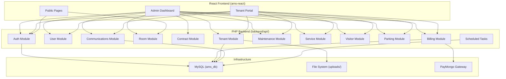
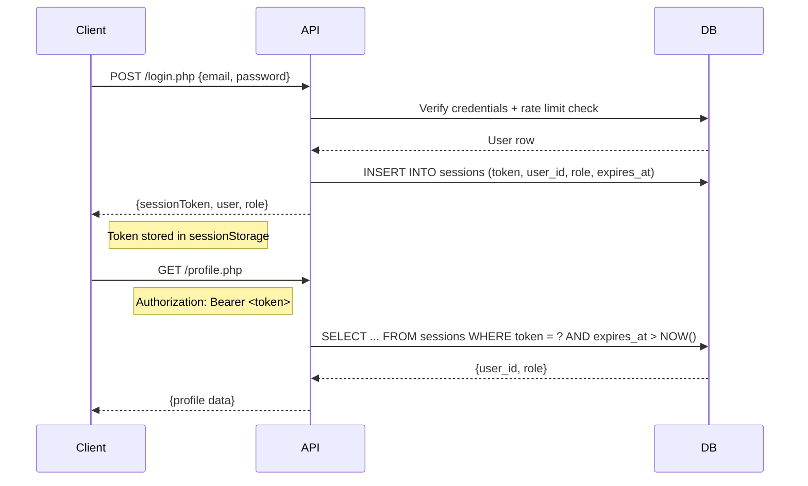
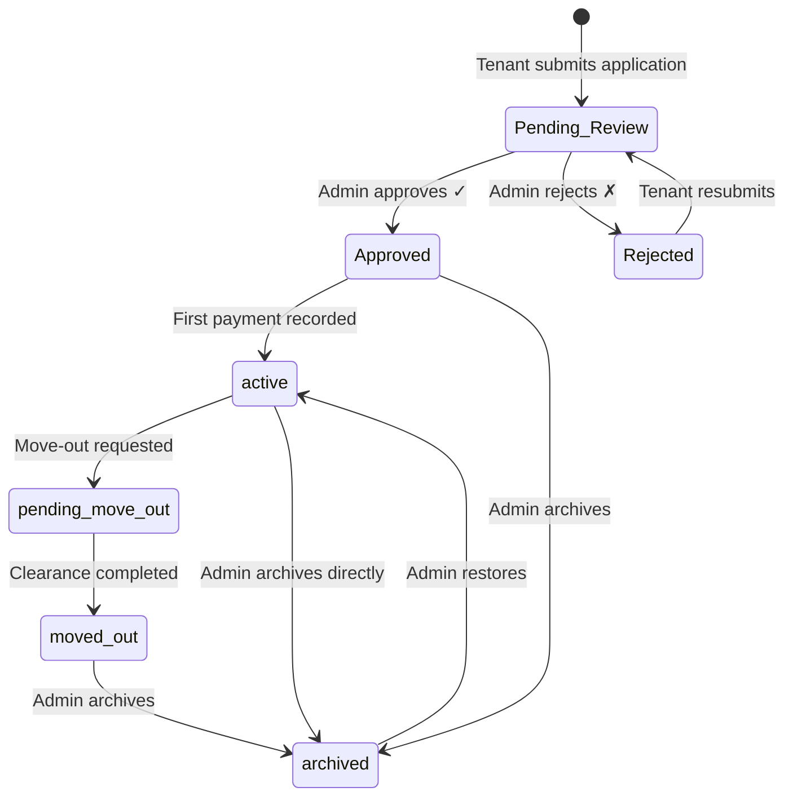
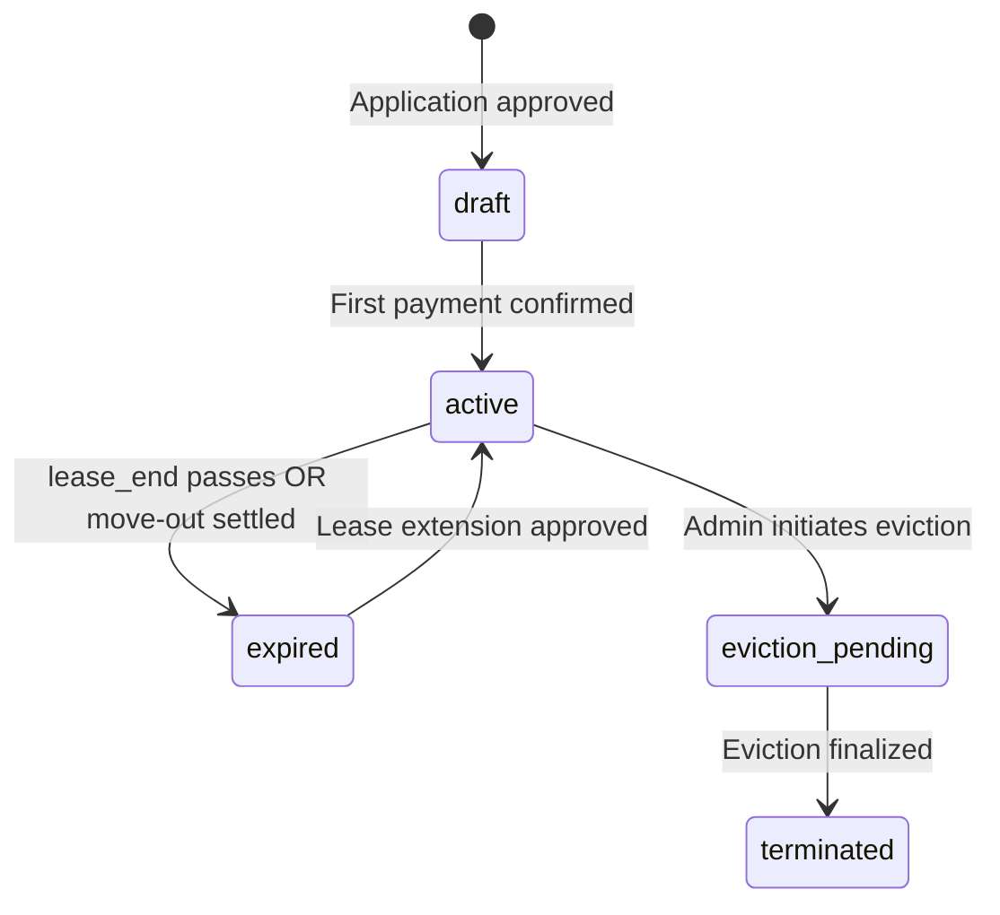
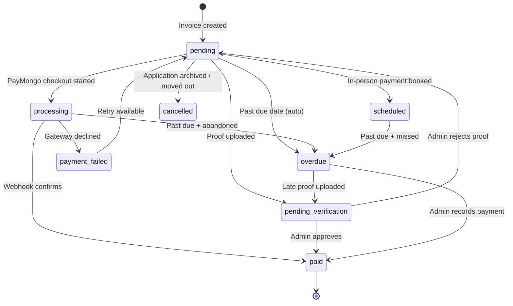
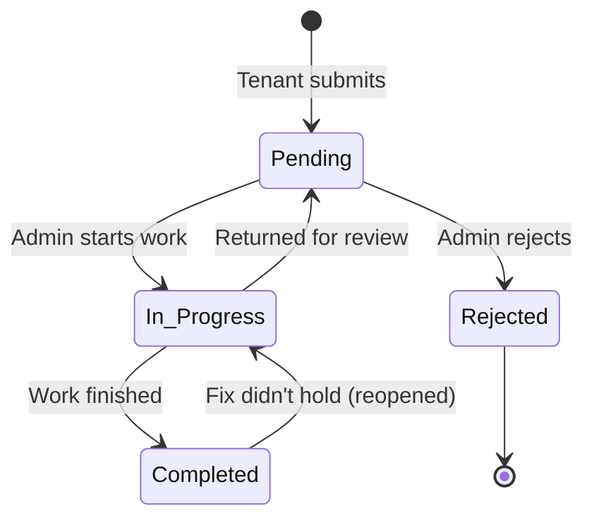
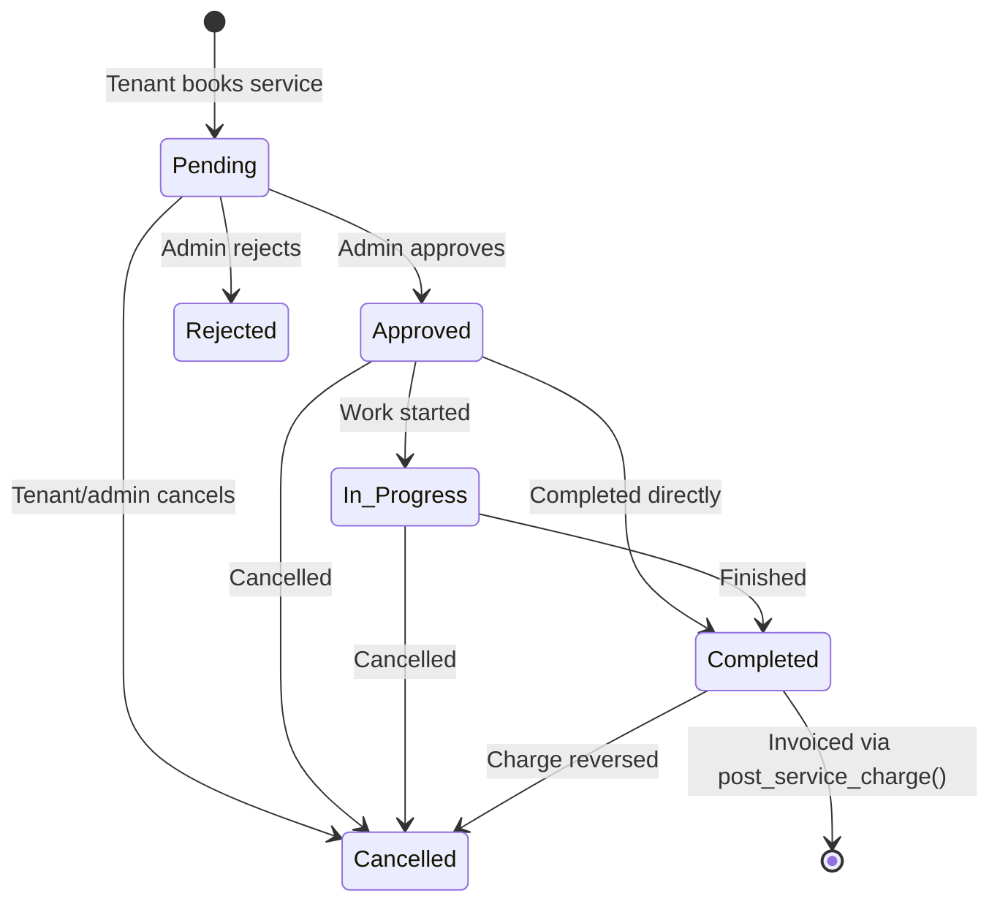

# 📘 AMS Backend API Documentation

> **Base URL:** `http://localhost/ApartmentManagementSystem_React/backend/api/`
> **Content-Type:** `application/json` (unless file upload)
> **Total Endpoints:** 84 PHP files across 12 modules

---

## Table of Contents

| # | Module | Endpoints | Description |
|---|--------|-----------|-------------|
| 1 | [Authentication & Sessions](#1-authentication--sessions) | 6 | Login, registration, password management |
| 2 | [User & Profile Management](#2-user--profile-management) | 4 | User CRUD, profile updates, avatar |
| 3 | [Tenant & Application Management](#3-tenant--application-management) | 10 | Rent applications, tenant lifecycle |
| 4 | [Room / Unit Management](#4-room--unit-management) | 4 | Room CRUD, tenant room view |
| 5 | [Lease & Contract Management](#5-lease--contract-management) | 6 | Contracts, documents, lease extensions |
| 6 | [Billing & Invoices](#6-billing--invoices) | 11 | Invoice generation, payments, PayMongo |
| 7 | [Utility Management](#7-utility-management) | 4 | Meter readings, utility billing sync |
| 8 | [Maintenance Requests](#8-maintenance-requests) | 5 | Tenant maintenance tickets |
| 9 | [Service Requests](#9-service-requests) | 6 | Bookable services, catalog management |
| 10 | [Visitor Management](#10-visitor-management) | 3 | Visitor registration, check-in/out |
| 11 | [Parking Management](#11-parking-management) | 4 | Parking slot reservations |
| 12 | [Communications & System](#12-communications--system) | 12 | Notifications, announcements, settings, reports |
| 13 | [Inquiries & Reservations](#13-inquiries--reservations) | 5 | Pre-lease inquiries, unit reservations |
| 14 | [Scheduled / Cron Tasks](#14-scheduled--cron-tasks) | 4 | Automated expiry and reminder jobs |

---

## Architecture Overview



---

## Authentication Model



### Auth Functions (from [config.php](../../backend/config.php))

| Function | Purpose |
|----------|---------|
| `create_session()` | Issues a 64-char hex token, valid for 7 days |
| `get_bearer_token()` | Reads token from `Authorization` or `X-Session-Token` header |
| `get_authenticated_user()` | Returns `{id, role}` or `null` — **sole source of identity** |
| `require_admin()` | Gate: 401/403 if not an authenticated admin; returns admin ID |
| `require_user()` | Gate: 401 if no valid session; returns `{id, role}` |
| `require_owner_or_admin()` | Gate: 403 if caller is neither the resource owner nor admin |
| `verify_admin()` | Legacy boolean check — does **not** exit on failure |

> [!IMPORTANT]
> `X-User-Id` / `X-Admin-Id` headers are **convenience identifiers only**. The session token is the sole proof of identity. Never trust client-supplied IDs for authorization.

---

## 1. Authentication & Sessions

### `POST` [login.php](../../backend/api/login.php)
Authenticates a user and issues a session token.

| Property | Detail |
|----------|--------|
| **Auth** | None (public) |
| **Rate Limit** | 10 attempts per IP per 15 minutes |

**Request Body:**
| Field | Type | Required | Description |
|-------|------|----------|-------------|
| `email_address` | string | ✅ | User's email |
| `password` | string | ✅ | Plaintext password |

**Response (success):**
| Field | Type | Description |
|-------|------|-------------|
| `valid` | boolean | `true` |
| `sessionToken` | string | 64-char hex session token |
| `user` | object | `{id, first_name, middle_name, last_name, suffix, email_address, role}` |
| `role` | string | `"user"` or `"admin"` |

**Error Codes:** `429` (rate limited), `200` with `valid: false` (bad credentials / archived)

---

### `POST` [logout.php](../../backend/api/logout.php)
Destroys the current session token.

| Property | Detail |
|----------|--------|
| **Auth** | Bearer token (graceful — no error if missing) |
| **Method** | POST |

---

### `POST` [registration.php](../../backend/api/registration.php)
Creates a new tenant user account.

| Property | Detail |
|----------|--------|
| **Auth** | None (public) |
| **Validation** | Password ≥ 8 chars, confirmed, unique email |

**Request Body:**
| Field | Type | Required |
|-------|------|----------|
| `first_name` | string | ✅ |
| `middle_name` | string | ❌ |
| `last_name` | string | ✅ |
| `suffix` | string | ❌ |
| `email_address` | string | ✅ |
| `password` | string | ✅ |
| `conPassword` | string | ✅ |

---

### `POST` [forgot_password.php](../../backend/api/forgot_password.php)
Initiates a password reset flow by generating a SHA-256 hashed token (expires in 30 minutes).

| Property | Detail |
|----------|--------|
| **Auth** | None (public) |
| **Security** | Constant-time response (doesn't reveal email existence) |
| **Dev Mode** | Returns `dev_token` when `APP_ENV=development` |

---

### `POST` [reset_password.php](../../backend/api/reset_password.php)
Completes password reset using the token from forgot_password.

**Request Body:** `{email, token, new_password}` — password ≥ 6 chars

---

### `POST` [change_password.php](../../backend/api/change_password.php)
Authenticated password change for logged-in users.

**Request Body:** `{email_address, current_password, new_password, confirm_password}` — password ≥ 8 chars

---

## 2. User & Profile Management

### `GET` / `POST` [profile.php](../../backend/api/profile.php)
Multi-purpose profile endpoint — fetches, updates text fields, uploads/clears avatar.

| Property | Detail |
|----------|--------|
| **Auth** | `require_user()` — always operates on caller's own account |
| **Methods** | GET (fetch), POST + `$_FILES['avatar']` (upload), POST + JSON (text update / clear) |

**GET Response:** `{first_name, middle_name, last_name, suffix, contact_no, gender, avatar_url}`

**POST (avatar upload):** multipart/form-data with `avatar` file field
- Allowed: JPG, PNG, GIF, WEBP
- MIME type validated server-side via `finfo`
- Saved to `uploads/avatars/`

**POST (text update):** JSON body
| Field | Type | Notes |
|-------|------|-------|
| `email` | string | Can change login email |
| `firstName`, `lastName` | string | Required |
| `middleName`, `suffix` | string | Optional |
| `contactNo` | string | PH mobile format validated |
| `gender` | string | Optional |
| `clearAvatar` | boolean | If `true`, clears avatar only |

> [!NOTE]
> Profile text updates are **transactional** — both `users` and `rent_applications` tables are updated atomically.

---

### `GET` / `POST` [manage_users.php](../../backend/api/manage_users.php)
Admin user management — list, edit, reset password, set role, archive/unarchive.

| Property | Detail |
|----------|--------|
| **Auth** | `verify_admin()` |
| **Self-Protection** | Cannot modify own account |

**GET:** Returns all users with full details (sorted admins first)

**POST Actions (JSON body with `action` + `user_id`):**

| Action | Additional Fields | Notes |
|--------|-------------------|-------|
| `update` | `first_name`, `last_name`, `email`, etc. | Email uniqueness enforced |
| `reset_password` | `new_password` | Min 6 chars |
| `set_role` | `role` (`user` or `admin`) | Max 3 admins enforced |
| `delete` | — | Soft-archives (sets `is_archived=1`); cannot archive admins |
| `unarchive` | — | Restores archived user |

---

### `GET` [get_users.php](../../backend/api/get_users.php)
Lightweight user list for dropdowns (admin only). Returns `{id, name, email}` for non-admin users.

---

### `GET` [get_tenants.php](../../backend/api/get_tenants.php)
Admin-only endpoint returning all rent applications with tenant details, document paths, archive info, and move-out dates.

---

## 3. Tenant & Application Management



### `POST` [rent_application.php](../../backend/api/rent_application.php)
Submit or resubmit a rent/lease application.

| Property | Detail |
|----------|--------|
| **Auth** | `X-User-Id` header |
| **Content-Type** | `multipart/form-data` |
| **Duplicate Guard** | Blocks if user has active/pending application |

**Form Fields:**
| Field | Type | Required |
|-------|------|----------|
| `firstName`, `lastName` | string | ✅ |
| `middleName`, `suffix` | string | ❌ |
| `contactNo`, `email`, `gender` | string | ✅ |
| `occupants` | integer | ✅ |
| `monthsOfRent` | integer | ✅ |
| `roomName` | string | ✅ |
| `monthlyRent` | decimal | ✅ |
| `agreeTerms` | boolean | ✅ |
| `validIdFrontFile` | file | ✅ (first submit) |
| `validIdBackFile` | file | ✅ (first submit) |
| `nbiFile` | file | ✅ (first submit) |
| `appId` | integer | ❌ (for resubmission) |

**File Validation:** JPG/PNG/PDF only, max 10MB, server-side MIME check

**Side Effects:**
- Syncs profile fields to `users` table
- Creates admin notification

---

### `GET` [get_applications.php](../../backend/api/get_applications.php)
Lists all rent applications with user avatars (admin only). Joins `rent_applications` ← `users`.

---

### `POST` [update_tenant_status.php](../../backend/api/update_tenant_status.php)
Admin endpoint for the full tenant lifecycle — approve, reject, schedule move-out, complete clearance.

| Property | Detail |
|----------|--------|
| **Auth** | `require_admin()` |
| **Allowed Statuses** | `Approved`, `Rejected`, `Declined`, `pending-move-out`, `moved-out` |

**On Approval (`Approved`):**
1. Validates documents + terms agreement exist
2. Applies occupant surcharge (>4 occupants → +₱1,000/person)
3. Claims room (race-safe via `status IN ('vacant','reserved')`)
4. Converts any active unit reservation
5. Creates move-in invoice (rent + 1 month deposit)
6. Creates draft lease contract
7. Sends tenant notification

**On Move-Out (`moved-out`):**
1. Vacates room, records condition
2. Settles lease contract deposit allocation
3. Cancels remaining pending invoices
4. Logs clearance notes

**On Rejection:** Records rejection_reason, notifies tenant

---

### `POST` [archive_tenant.php](../../backend/api/archive_tenant.php)
Archives a tenant application — saves pre-archive status, cancels invoices, vacates room, archives user account.

**Request Body:** `{id, archiveReason, archiveNotes}`

---

### `POST` [restore_tenant.php](../../backend/api/restore_tenant.php)
Reverses archival — restores to pre-archive status, unarchives user, undoes move-out settlement, reinstates cancelled invoices, re-occupies room if vacant.

---

### `POST` [record_move_out.php](../../backend/api/record_move_out.php)
Tenant-initiated move-out notice. Requires 15–30 days advance notice.

| Property | Detail |
|----------|--------|
| **Auth** | `require_user()` (tenant's own lease) |
| **Validation** | 15 ≤ days_ahead ≤ 30 |

---

### `POST` [update_occupants.php](../../backend/api/update_occupants.php)
Tenant requests an occupancy change — creates a pending notification for admin approval. Blocks duplicate requests.

---

### `POST` [process_tenant_request.php](../../backend/api/process_tenant_request.php)
Admin processes occupancy change or lease extension requests.

| Property | Detail |
|----------|--------|
| **Auth** | `verify_admin()` |
| **Idempotent** | Claim-first pattern prevents double-processing |

**Handles:**
- **Occupancy change approval:** Recalculates rent with surcharge, updates application + room
- **Lease extension approval:** Extends months, updates room/contract, records in `lease_renewals`

---

### `POST` [cancel_request.php](../../backend/api/cancel_request.php)
Tenant cancels their own pending occupancy/lease request.

---

### `GET` [get_my_requests.php](../../backend/api/get_my_requests.php)
Returns a tenant's pending requests (occupancy, lease extension, CCTV).

---

## 4. Room / Unit Management

### `POST` [create_room.php](../../backend/api/create_room.php)
Creates a new vacant room/unit.

| Property | Detail |
|----------|--------|
| **Auth** | `require_admin()` |

**Request Body:**
| Field | Type | Required | Description |
|-------|------|----------|-------------|
| `id` | string | ✅ | Unit number (e.g., `"A1"`) |
| `type` | string | ✅ | Room type |
| `floor` | string | ✅ | Floor level |
| `rent` | decimal | ✅ | Monthly rent (> 0) |

---

### `GET` [get_rooms.php](../../backend/api/get_rooms.php)
Lists all rooms with rich metadata. **No auth required** (public for browsing).

Automatically calls `release_expired_reservations()` before listing.

**Response per room:**
| Field | Type | Description |
|-------|------|-------------|
| `id`, `type`, `floor` | string | Unit identity |
| `rent` | decimal | Monthly rate |
| `status` | string | `vacant`, `occupied`, `reserved`, `maintenance` |
| `tenant` | string\|null | Current tenant name |
| `leaseStart`, `leaseEnd` | date\|null | Lease period |
| `maintenanceHistory` | array | All maintenance tickets for this unit |
| `occupancyHistory` | array | All past/current tenants with lease periods |
| `leaseHistory` | array | Extension events from `lease_renewals` |

---

### `POST` [update_room.php](../../backend/api/update_room.php)
Dynamically updates room fields — supports direct tenant assignment with identity verification.

| Property | Detail |
|----------|--------|
| **Auth** | `require_admin()` |
| **Transactional** | Room update + synthetic application in single transaction |

**Updatable Fields:** `status`, `tenant_name`, `lease_start`, `lease_end`, `monthly_rent`, `occupants`, `room_condition`, `furnishing_status`, `maintenance_flag`, `last_inspection_date`

**Direct Assignment Flow** (when `status=occupied` + `user_id` provided):
1. Requires `identity_verified: true` attestation
2. Creates synthetic `Approved` rent application
3. Links user to room

---

### `GET` [my_room.php](../../backend/api/my_room.php)
Returns the current tenant's room details, lease info, contract, and pending move-in invoice status.

| Property | Detail |
|----------|--------|
| **Auth** | `require_user()` — own data only; admins can query by `?userId=` |
| **Side Effect** | Calls `expire_lapsed_contracts()` |

---

## 5. Lease & Contract Management



### `GET` [get_contracts.php](../../backend/api/get_contracts.php)
Returns lease contracts — single tenant view or admin-wide list. Includes renewal history, deposit details, document paths.

| Property | Detail |
|----------|--------|
| **Auth** | Session token; non-admin scoped to own contract |
| **Side Effect** | Calls `expire_lapsed_contracts()` |

---

### `POST` [create_contract.php](../../backend/api/create_contract.php)
Manually creates a lease contract for a rent application (admin only).

---

### `POST` [update_contract_status.php](../../backend/api/update_contract_status.php)
Changes contract status (activate, terminate, mark eviction-pending). Admin only.

---

### `POST` [upload_lease_document.php](../../backend/api/upload_lease_document.php)
Uploads signed or notarized lease document PDFs/images to a contract.

| Property | Detail |
|----------|--------|
| **Auth** | `require_user()` + `require_owner_or_admin()` |
| **File Types** | JPG, PNG, PDF, WEBP (max 10MB, MIME validated) |
| **Document Types** | `signed_lease`, `notarized_lease` |

---

### `POST` [extend_lease.php](../../backend/api/extend_lease.php)
Tenant requests a lease extension (creates a pending admin notification).

**Request Body:** `{months}` — 1 to 24 months

---

### `GET` [get_documents.php](../../backend/api/get_documents.php)
Returns all lease-related documents for a tenant (lease PDFs, ID scans, NBI clearance).

---

## 6. Billing & Invoices



### `POST` [create_invoice.php](../../backend/api/create_invoice.php)
Admin creates or re-issues a billing invoice.

| Property | Detail |
|----------|--------|
| **Auth** | `require_admin()` |
| **Idempotent** | Uses `ON DUPLICATE KEY UPDATE` for re-issue |
| **Guard** | Cannot re-issue over `paid`/`cancelled` invoices |

**Request Body:**
| Field | Type | Required |
|-------|------|----------|
| `userId` | integer | ❌ (resolved from unit) |
| `unit` | string | ❌ |
| `baseRent` | decimal | ✅ |
| `water`, `electricity`, `parking`, `lateFee` | decimal | ❌ |
| `dueDate` | date | ❌ (default: +15 days) |
| `billingPeriod` | string | ❌ (default: current month label) |

**Side Effects:** Creates tenant notification with amount + due date

---

### `GET` [get_invoices.php](../../backend/api/get_invoices.php)
Returns invoices — admin sees all, tenant sees own only.

| Property | Detail |
|----------|--------|
| **Auth** | `require_user()` |
| **Side Effect** | Calls `promote_overdue_invoices()` (auto-marks overdue + applies late fee) |
| **Query Param** | `?userId=` (admin can filter by tenant) |

---

### `POST` [pay_bill.php](../../backend/api/pay_bill.php)
Tenant submits a payment declaration. Updates status to `pending` (cash) or `pending-verification` (digital).

| Property | Detail |
|----------|--------|
| **Auth** | `require_user()` — scoped to own invoices |
| **Guard** | Only open-status invoices can be paid |

---

### `POST` [upload_payment_proof.php](../../backend/api/upload_payment_proof.php)
Uploads payment screenshot/receipt with reference number and sender name.

| Property | Detail |
|----------|--------|
| **Auth** | `require_user()` — own invoices; admin can act on any |
| **File Types** | JPG, PNG, WEBP, PDF (max 10MB) |
| **Guard** | Only open-status invoices accept proof |

---

### `POST` [record_payment_admin.php](../../backend/api/record_payment_admin.php)
Admin confirms/records a payment — marks invoice as `paid`, activates occupancy on first payment.

| Property | Detail |
|----------|--------|
| **Auth** | `require_admin()` |
| **Transactional** | Payment + occupancy activation + contract creation |
| **Guard** | Rejects partial payments (amount < total) |

**On First Payment Approval:**
1. Marks invoice `paid`
2. Activates room occupancy
3. Promotes rent application to `active`
4. Creates or activates lease contract

---

### `POST` [schedule_payment.php](../../backend/api/schedule_payment.php)
Books an in-person payment appointment.

| Property | Detail |
|----------|--------|
| **Auth** | `require_user()` |
| **Validation** | Future date (max 60 days); slot: `morning`/`afternoon`/`evening` |

---

### `POST` [create_checkout_session.php](../../backend/api/create_checkout_session.php)
Creates a PayMongo checkout session for online payment.

| Property | Detail |
|----------|--------|
| **Auth** | `require_user()` |
| **Channels** | `gcash`, `paymaya`, `card`, `bank`, sandbox variants |
| **Guard** | Only open-status invoices; re-uses existing unexpired session |

---

### `POST` [release_checkout_session.php](../../backend/api/release_checkout_session.php)
Releases a stale checkout session, allowing the tenant to retry payment.

---

### `POST` [paymongo_webhook.php](../../backend/api/paymongo_webhook.php)
PayMongo webhook receiver — handles `checkout_session.payment.paid` events.

| Property | Detail |
|----------|--------|
| **Auth** | None (webhook) — validates by matching `checkout_session_id` |
| **Idempotent** | Only processes invoices still in `processing` status |

---

### `POST` [send_payment_reminder.php](../../backend/api/send_payment_reminder.php)
Admin sends payment reminders to tenants with overdue/pending invoices. Creates notifications with invoice details.

---

### `GET` [get_payment_channels.php](../../backend/api/get_payment_channels.php)
Returns available payment channels with PayMongo sandbox configuration status.

---

## 7. Utility Management

### `POST` [save_utility_reading.php](../../backend/api/save_utility_reading.php)
Records water/electricity meter readings for a unit. Admin only.

| Property | Detail |
|----------|--------|
| **Auth** | `verify_admin()` |
| **Calculation** | Consumption = current - previous reading; cost = consumption × rate |

**Request Body:**
| Field | Type | Required |
|-------|------|----------|
| `room_name` | string | ✅ |
| `reading_type` | string | ✅ (`water`/`electricity`) |
| `current_reading` | decimal | ✅ |
| `rate_per_unit` | decimal | ✅ |
| `billing_period` | string | ✅ |

---

### `GET` [get_utility_readings.php](../../backend/api/get_utility_readings.php)
Returns utility readings with filtering by room, type, and period. Admin only.

---

### `POST` [sync_utility_to_invoice.php](../../backend/api/sync_utility_to_invoice.php)
Merges utility reading costs into the tenant's invoice for the billing period. Creates invoice if none exists.

| Property | Detail |
|----------|--------|
| **Auth** | `verify_admin()` |
| **Transactional** | Atomic update of water/electricity columns + total_amount |

---

### `GET` [get_utilities_report_data.php](../../backend/api/get_utilities_report_data.php)
Returns aggregated utility data for reporting — consumption trends, costs by period/unit.

---

## 8. Maintenance Requests



### `POST` [maintenance_request.php](../../backend/api/maintenance_request.php)
Tenant submits a maintenance ticket.

| Property | Detail |
|----------|--------|
| **Auth** | `require_user()` |
| **Content-Type** | `multipart/form-data` |
| **Priority** | Always `"Needs Triage"` — admin assigns real urgency |

**Form Fields:**
| Field | Type | Required | Notes |
|-------|------|----------|-------|
| `issueType` | string | ✅ | Normalized to category enum |
| `preferredDate` | date | ✅ | Must be ≥ today |
| `preferredTime` | string | ✅ | `morning` or `afternoon` |
| `description` | string | ✅ | Issue description |
| `permissionToEnter` | boolean | ❌ | Entry consent |
| `attachment` | file | ❌ | Photo/video (max 10MB) |

**Categories:** `Plumbing`, `Electrical`, `Structural/Physical`, `Water Supply`, `General Maintenance`, `Others`

---

### `POST` [create_maintenance_request_admin.php](../../backend/api/create_maintenance_request_admin.php)
Admin creates a maintenance ticket on behalf of a tenant (or for a common area).

---

### `GET` [get_maintenance_requests.php](../../backend/api/get_maintenance_requests.php)
Lists all maintenance tickets sorted by status priority then urgency. Admin only.

---

### `POST` [update_maintenance_status.php](../../backend/api/update_maintenance_status.php)
Admin updates ticket status, assigns urgency/priority, updates estimated cost. Validates state transitions.

**Allowed Transitions:**
| From | To |
|------|----|
| Pending | In Progress, Rejected |
| In Progress | Completed, Pending |
| Completed | In Progress (reopen) |

---

### `POST` [cancel_request.php](../../backend/api/cancel_request.php)
Tenant cancels their own pending maintenance or service request.

---

## 9. Service Requests



### `POST` [service_request.php](../../backend/api/service_request.php)
Tenant books a paid service from the catalog.

| Property | Detail |
|----------|--------|
| **Auth** | `require_user()` |
| **Pricing** | Always re-derived from DB (never from client) |
| **Quantity** | Validated against `min_quantity`/`max_quantity` |
| **Lead Time** | Preferred date must be ≥ today + `lead_time_days` |

---

### `GET` [get_service_requests.php](../../backend/api/get_service_requests.php)
Lists service requests — admin sees all, tenant sees own.

---

### `POST` [update_service_status.php](../../backend/api/update_service_status.php)
Admin updates service request status. On completion, triggers `post_service_charge()` to bill the tenant. On cancellation of a completed request, triggers `reverse_service_charge()`.

---

### `GET` / `POST` [manage_service_catalog.php](../../backend/api/manage_service_catalog.php)
Admin CRUD for the service catalog. Supports categories, pricing units, quantity limits, lead times.

---

### `GET` [get_service_catalog.php](../../backend/api/get_service_catalog.php)
Returns the active service catalog for tenants (filters by `is_active` + category toggles).

---

### `POST` [sync_service_to_invoice.php](../../backend/api/sync_service_to_invoice.php)
Admin manually triggers billing of a completed service request (calls `post_service_charge()`).

---

## 10. Visitor Management

### `GET` [get_visitors.php](../../backend/api/get_visitors.php)
Returns visitor records with overstay detection. Admin sees all; tenant sees own unit's visitors.

| Property | Detail |
|----------|--------|
| **Auth** | Admin or authenticated tenant |
| **Overstay** | Configurable via `system_settings.visitor_overstay_hours` |

---

### `POST` [check_in_visitor.php](../../backend/api/check_in_visitor.php)
Registers a visitor for a tenant's unit. Validates visitor count limits and checks for duplicate active visitors.

---

### `POST` [update_visitor_status.php](../../backend/api/update_visitor_status.php)
Checks out a visitor or updates their status. Records check-out time.

---

## 11. Parking Management

### `POST` [parking_reservation.php](../../backend/api/parking_reservation.php)
Tenant reserves a parking slot for a specific date range.

| Property | Detail |
|----------|--------|
| **Auth** | `require_user()` |
| **Validation** | Checks slot availability, prevents overlapping reservations |

---

### `GET` [get_parking_reservations.php](../../backend/api/get_parking_reservations.php)
Returns parking reservations — admin sees all, tenant sees own.

---

### `GET` [get_available_parking_slots.php](../../backend/api/get_available_parking_slots.php)
Returns currently available parking slots for a given date range.

---

### `POST` [update_parking_status.php](../../backend/api/update_parking_status.php)
Admin approves/rejects/cancels parking reservations.

---

## 12. Communications & System

### `POST` [create_announcement.php](../../backend/api/create_announcement.php)
Admin broadcasts an announcement to all tenants via in-app notifications.

| Property | Detail |
|----------|--------|
| **Auth** | `verify_admin()` |
| **Transactional** | Announcement + per-user notification insert |

**Request Body:**
| Field | Type | Required |
|-------|------|----------|
| `tag` | string | ❌ (default: `General`) |
| `title` | string | ✅ |
| `body` | string | ✅ |
| `sendTo` | string | ❌ |
| `channels` | array | ❌ (default: `['in-app']`) |

---

### `GET` [get_announcements.php](../../backend/api/get_announcements.php)
Returns all announcements ordered by most recent.

---

### `POST` [create_notification.php](../../backend/api/create_notification.php)
Creates a targeted notification for a specific user.

---

### `GET` [get_notifications.php](../../backend/api/get_notifications.php)
Returns unread/all notifications for the authenticated user.

---

### `POST` [mark_notification_read.php](../../backend/api/mark_notification_read.php)
Marks one or all notifications as read for the authenticated user.

---

### `POST` [delete_notification.php](../../backend/api/delete_notification.php)
Deletes a notification (soft or hard delete depending on ownership).

---

### `GET` [get_activity_logs.php](../../backend/api/get_activity_logs.php)
Returns the activity audit log — all logged actions across the system. Admin only.

---

### `GET` / `POST` [get_system_settings.php](../../backend/api/get_system_settings.php) / [update_system_settings.php](../../backend/api/update_system_settings.php)
Read/write system-wide configuration.

**Known Settings:**
| Key | Type | Description |
|-----|------|-------------|
| `late_fee_enabled` | boolean | Enable automatic late fees |
| `late_fee_type` | string | `flat` or `percent` |
| `late_fee_value` | decimal | Fee amount or percentage |
| `occupant_surcharge_per_person` | decimal | Extra rent per person > 4 occupants |
| `visitor_overstay_hours` | integer | Hours before visitor flagged as overstay |

---

### `GET` [dashboard_stats.php](../../backend/api/dashboard_stats.php)
Returns comprehensive dashboard statistics for admin. **363 lines** of aggregation queries.

**Response Stats Include:**
- Revenue totals (current, last month, trend)
- Pending/overdue dues
- Tenant counts (active, pending, archived)
- Occupancy rate
- Maintenance ticket breakdown
- Monthly revenue chart data (12 months)
- Recent activity log

---

### `GET` [get_report_data.php](../../backend/api/get_report_data.php)
Generates detailed report data for exports. **31KB / 700+ lines** — the largest API file.

| Property | Detail |
|----------|--------|
| **Auth** | `verify_admin()` |
| **Report Types** | Financial, occupancy, maintenance, tenant, parking |

---

## 13. Inquiries & Reservations

### `POST` [submit_inquiry.php](../../backend/api/submit_inquiry.php)
Public or tenant-submitted unit inquiry with rate limiting and duplicate detection.

**Request Body:**
| Field | Type | Required |
|-------|------|----------|
| `full_name` | string | ✅ |
| `email` | string | ✅ |
| `contact_no` | string | ✅ |
| `room_name` | string | ❌ |
| `occupants` | integer | ❌ |
| `preferred_move_in` | date | ❌ |
| `message` | string | ❌ |

---

### `GET` [get_inquiries.php](../../backend/api/get_inquiries.php)
Returns all inquiries with contact details and status. Admin only.

---

### `POST` [update_inquiry_status.php](../../backend/api/update_inquiry_status.php)
Admin manages inquiry lifecycle — schedule viewing, add notes, convert to reservation, close.

---

### `POST` [create_reservation.php](../../backend/api/create_reservation.php)
Admin creates a unit reservation (hold) — links to an inquiry, sets hold period, marks room as `reserved`.

---

### `POST` [update_reservation_status.php](../../backend/api/update_reservation_status.php)
Admin cancels or converts a reservation. Releasing a reservation returns the room to `vacant`.

---

## 14. Scheduled / Cron Tasks

These endpoints are designed to be called periodically (cron job or admin-triggered):

### `GET`/`POST` [expire_contracts.php](../../backend/api/expire_contracts.php)
Calls `expire_lapsed_contracts()` — marks active contracts with `lease_end < today` as `expired`.

### `GET`/`POST` [expire_reservations.php](../../backend/api/expire_reservations.php)
Calls `release_expired_reservations()` — marks lapsed unit holds as `Expired`, returns rooms to `vacant`.

### `GET`/`POST` [check_due_date_reminders.php](../../backend/api/check_due_date_reminders.php)
Automated reminder sweep — sends notifications to tenants with invoices due within configurable days.

### CCTV Module

### `POST` [cctv_request.php](../../backend/api/cctv_request.php)
Tenant requests CCTV footage review.

### `GET` [get_cctv_requests.php](../../backend/api/get_cctv_requests.php)
Lists CCTV requests. Admin sees all; tenant sees own.

### `POST` [update_cctv_status.php](../../backend/api/update_cctv_status.php)
Admin approves/rejects CCTV footage requests.

---

## Shared Constants & Helper Functions

Defined in [config.php](../../backend/config.php):

### Invoice Status Constants

```
BILLING_OPEN_STATUSES = ['pending', 'unpaid', 'overdue', 'pending-verification',
                         'scheduled', 'processing', 'payment-failed']

SERVICE_ADJUSTABLE_INVOICE_STATUSES = ['pending', 'unpaid', 'overdue',
                                        'scheduled', 'payment-failed']
```

### Maintenance Constants

| Constant | Values |
|----------|--------|
| `MAINTENANCE_CATEGORIES` | Plumbing, Electrical, Structural/Physical, Water Supply, General Maintenance, Others |
| `MAINTENANCE_URGENCIES` | Low, Medium, High, Urgent |
| `MAINTENANCE_DEFAULT_URGENCY` | "Needs Triage" |
| `MAINTENANCE_TRANSITIONS` | See state diagram above |

### Service Constants

| Constant | Description |
|----------|-------------|
| `SERVICE_TRANSITIONS` | Pending → Approved/Rejected/Cancelled → In Progress → Completed → Cancelled |

### Key Helper Functions

| Function | Purpose |
|----------|---------|
| `log_activity()` | Audit trail — logs user/category/action/details |
| `billing_period_label()` | Formats DateTime as `"September 2026"` |
| `get_active_tenancy()` | Returns user's active rent application |
| `promote_overdue_invoices()` | Auto-marks lapsed invoices as overdue + applies late fee |
| `post_service_charge()` | Accumulates service cost onto tenant's current invoice |
| `reverse_service_charge()` | Backs out a service charge from an unpaid invoice |
| `store_maintenance_attachment()` | Validates + stores maintenance photo/video |

---

## Error Response Format

All endpoints return JSON with this shape on error:

```json
{
  "success": false,
  "message": "Human-readable error description"
}
```

**Common HTTP Status Codes:**
| Code | Meaning |
|------|---------|
| `200` | Success (check `success` field) |
| `400` | Bad request / validation failure |
| `401` | Authentication required |
| `403` | Forbidden (wrong role / not owner) |
| `405` | Method not allowed |
| `409` | Conflict (invoice already settled, duplicate, etc.) |
| `422` | Validation failure (file type, date, etc.) |
| `429` | Rate limited |
| `500` | Server error |

---

## File Upload Summary

| Endpoint | Field Name | Max Size | Formats | Storage Path |
|----------|-----------|----------|---------|-------------|
| [profile.php](../../backend/api/profile.php) | `avatar` | — | JPG, PNG, GIF, WEBP | `uploads/avatars/` |
| [rent_application.php](../../backend/api/rent_application.php) | `validIdFrontFile`, `validIdBackFile`, `nbiFile` | 10MB | JPG, PNG, PDF | `uploads/applications/` |
| [upload_payment_proof.php](../../backend/api/upload_payment_proof.php) | `proof` / `proofImage` | 10MB | JPG, PNG, WEBP, PDF | `uploads/payment_proofs/` |
| [upload_lease_document.php](../../backend/api/upload_lease_document.php) | `document` | 10MB | JPG, PNG, PDF, WEBP | `uploads/lease_documents/` |
| [maintenance_request.php](../../backend/api/maintenance_request.php) | `attachment` | 10MB | JPG, PNG, GIF, WEBP, MP4, WEBM, MOV | `uploads/maintenance/` |

> [!TIP]
> All file uploads validate both extension AND MIME type server-side using `finfo_file()`.

---

## Complete API Index

| # | File | Method | Module | Auth | Description |
|---|------|--------|--------|------|-------------|
| 1 | [login.php](../../backend/api/login.php) | POST | Auth | Public | User login with rate limiting |
| 2 | [logout.php](../../backend/api/logout.php) | POST | Auth | Token | Destroy session |
| 3 | [registration.php](../../backend/api/registration.php) | POST | Auth | Public | Create account |
| 4 | [forgot_password.php](../../backend/api/forgot_password.php) | POST | Auth | Public | Request password reset |
| 5 | [reset_password.php](../../backend/api/reset_password.php) | POST | Auth | Public | Complete password reset |
| 6 | [change_password.php](../../backend/api/change_password.php) | POST | Auth | Token | Change own password |
| 7 | [profile.php](../../backend/api/profile.php) | GET/POST | User | User | View/edit profile + avatar |
| 8 | [manage_users.php](../../backend/api/manage_users.php) | GET/POST | User | Admin | Full user CRUD |
| 9 | [get_users.php](../../backend/api/get_users.php) | GET | User | Admin | Lightweight user list |
| 10 | [get_tenants.php](../../backend/api/get_tenants.php) | GET | Tenant | Admin | All tenant applications |
| 11 | [rent_application.php](../../backend/api/rent_application.php) | POST | Tenant | User | Submit/resubmit application |
| 12 | [get_applications.php](../../backend/api/get_applications.php) | GET | Tenant | Admin | List all applications |
| 13 | [update_tenant_status.php](../../backend/api/update_tenant_status.php) | POST | Tenant | Admin | Approve/reject/move-out |
| 14 | [archive_tenant.php](../../backend/api/archive_tenant.php) | POST | Tenant | Admin | Archive tenant |
| 15 | [restore_tenant.php](../../backend/api/restore_tenant.php) | POST | Tenant | Admin | Restore archived tenant |
| 16 | [record_move_out.php](../../backend/api/record_move_out.php) | POST | Tenant | User | File move-out notice |
| 17 | [update_occupants.php](../../backend/api/update_occupants.php) | POST | Tenant | User | Request occupancy change |
| 18 | [process_tenant_request.php](../../backend/api/process_tenant_request.php) | POST | Tenant | Admin | Approve/reject requests |
| 19 | [cancel_request.php](../../backend/api/cancel_request.php) | POST | Tenant | User | Cancel pending request |
| 20 | [get_my_requests.php](../../backend/api/get_my_requests.php) | GET | Tenant | User | My pending requests |
| 21 | [create_room.php](../../backend/api/create_room.php) | POST | Room | Admin | Create new unit |
| 22 | [get_rooms.php](../../backend/api/get_rooms.php) | GET | Room | Public | List all units |
| 23 | [update_room.php](../../backend/api/update_room.php) | POST | Room | Admin | Update unit details |
| 24 | [my_room.php](../../backend/api/my_room.php) | GET | Room | User | My room details |
| 25 | [get_contracts.php](../../backend/api/get_contracts.php) | GET | Contract | User/Admin | View lease contracts |
| 26 | [create_contract.php](../../backend/api/create_contract.php) | POST | Contract | Admin | Create lease contract |
| 27 | [update_contract_status.php](../../backend/api/update_contract_status.php) | POST | Contract | Admin | Change contract status |
| 28 | [upload_lease_document.php](../../backend/api/upload_lease_document.php) | POST | Contract | Owner/Admin | Upload lease PDF |
| 29 | [extend_lease.php](../../backend/api/extend_lease.php) | POST | Contract | User | Request lease extension |
| 30 | [get_documents.php](../../backend/api/get_documents.php) | GET | Contract | User/Admin | Lease documents |
| 31 | [create_invoice.php](../../backend/api/create_invoice.php) | POST | Billing | Admin | Create/re-issue invoice |
| 32 | [get_invoices.php](../../backend/api/get_invoices.php) | GET | Billing | User/Admin | List invoices |
| 33 | [pay_bill.php](../../backend/api/pay_bill.php) | POST | Billing | User | Declare payment |
| 34 | [upload_payment_proof.php](../../backend/api/upload_payment_proof.php) | POST | Billing | User/Admin | Upload receipt |
| 35 | [record_payment_admin.php](../../backend/api/record_payment_admin.php) | POST | Billing | Admin | Confirm payment |
| 36 | [schedule_payment.php](../../backend/api/schedule_payment.php) | POST | Billing | User | Book in-person payment |
| 37 | [create_checkout_session.php](../../backend/api/create_checkout_session.php) | POST | Billing | User | PayMongo checkout |
| 38 | [release_checkout_session.php](../../backend/api/release_checkout_session.php) | POST | Billing | User | Release stale checkout |
| 39 | [paymongo_webhook.php](../../backend/api/paymongo_webhook.php) | POST | Billing | Webhook | PayMongo callback |
| 40 | [send_payment_reminder.php](../../backend/api/send_payment_reminder.php) | POST | Billing | Admin | Send reminders |
| 41 | [get_payment_channels.php](../../backend/api/get_payment_channels.php) | GET | Billing | User | Available channels |
| 42 | [save_utility_reading.php](../../backend/api/save_utility_reading.php) | POST | Utility | Admin | Record meter reading |
| 43 | [get_utility_readings.php](../../backend/api/get_utility_readings.php) | GET | Utility | Admin | List readings |
| 44 | [sync_utility_to_invoice.php](../../backend/api/sync_utility_to_invoice.php) | POST | Utility | Admin | Merge into invoice |
| 45 | [get_utilities_report_data.php](../../backend/api/get_utilities_report_data.php) | GET | Utility | Admin | Utility reports |
| 46 | [maintenance_request.php](../../backend/api/maintenance_request.php) | POST | Maintenance | User | Submit ticket |
| 47 | [create_maintenance_request_admin.php](../../backend/api/create_maintenance_request_admin.php) | POST | Maintenance | Admin | Create ticket for tenant |
| 48 | [get_maintenance_requests.php](../../backend/api/get_maintenance_requests.php) | GET | Maintenance | Admin | List all tickets |
| 49 | [update_maintenance_status.php](../../backend/api/update_maintenance_status.php) | POST | Maintenance | Admin | Update ticket status |
| 50 | [service_request.php](../../backend/api/service_request.php) | POST | Service | User | Book a service |
| 51 | [get_service_requests.php](../../backend/api/get_service_requests.php) | GET | Service | User/Admin | List service bookings |
| 52 | [update_service_status.php](../../backend/api/update_service_status.php) | POST | Service | Admin | Update service status |
| 53 | [manage_service_catalog.php](../../backend/api/manage_service_catalog.php) | GET/POST | Service | Admin | Catalog CRUD |
| 54 | [get_service_catalog.php](../../backend/api/get_service_catalog.php) | GET | Service | User | Browse catalog |
| 55 | [sync_service_to_invoice.php](../../backend/api/sync_service_to_invoice.php) | POST | Service | Admin | Bill service charge |
| 56 | [get_visitors.php](../../backend/api/get_visitors.php) | GET | Visitor | User/Admin | List visitors |
| 57 | [check_in_visitor.php](../../backend/api/check_in_visitor.php) | POST | Visitor | User | Register visitor |
| 58 | [update_visitor_status.php](../../backend/api/update_visitor_status.php) | POST | Visitor | User/Admin | Check out visitor |
| 59 | [parking_reservation.php](../../backend/api/parking_reservation.php) | POST | Parking | User | Reserve slot |
| 60 | [get_parking_reservations.php](../../backend/api/get_parking_reservations.php) | GET | Parking | User/Admin | List reservations |
| 61 | [get_available_parking_slots.php](../../backend/api/get_available_parking_slots.php) | GET | Parking | User | Available slots |
| 62 | [update_parking_status.php](../../backend/api/update_parking_status.php) | POST | Parking | Admin | Approve/reject parking |
| 63 | [create_announcement.php](../../backend/api/create_announcement.php) | POST | Comms | Admin | Broadcast announcement |
| 64 | [get_announcements.php](../../backend/api/get_announcements.php) | GET | Comms | User | List announcements |
| 65 | [create_notification.php](../../backend/api/create_notification.php) | POST | Comms | Admin | Create notification |
| 66 | [get_notifications.php](../../backend/api/get_notifications.php) | GET | Comms | User | My notifications |
| 67 | [mark_notification_read.php](../../backend/api/mark_notification_read.php) | POST | Comms | User | Mark as read |
| 68 | [delete_notification.php](../../backend/api/delete_notification.php) | POST | Comms | User | Delete notification |
| 69 | [get_activity_logs.php](../../backend/api/get_activity_logs.php) | GET | System | Admin | Audit trail |
| 70 | [get_system_settings.php](../../backend/api/get_system_settings.php) | GET | System | Admin | Read settings |
| 71 | [update_system_settings.php](../../backend/api/update_system_settings.php) | POST | System | Admin | Write settings |
| 72 | [dashboard_stats.php](../../backend/api/dashboard_stats.php) | GET | System | Admin | Dashboard statistics |
| 73 | [get_report_data.php](../../backend/api/get_report_data.php) | GET | System | Admin | Export reports |
| 74 | [submit_inquiry.php](../../backend/api/submit_inquiry.php) | POST | Inquiry | Public | Submit unit inquiry |
| 75 | [get_inquiries.php](../../backend/api/get_inquiries.php) | GET | Inquiry | Admin | List inquiries |
| 76 | [update_inquiry_status.php](../../backend/api/update_inquiry_status.php) | POST | Inquiry | Admin | Manage inquiry lifecycle |
| 77 | [create_reservation.php](../../backend/api/create_reservation.php) | POST | Inquiry | Admin | Reserve unit for prospect |
| 78 | [update_reservation_status.php](../../backend/api/update_reservation_status.php) | POST | Inquiry | Admin | Cancel/convert reservation |
| 79 | [cctv_request.php](../../backend/api/cctv_request.php) | POST | CCTV | User | Request footage |
| 80 | [get_cctv_requests.php](../../backend/api/get_cctv_requests.php) | GET | CCTV | User/Admin | List CCTV requests |
| 81 | [update_cctv_status.php](../../backend/api/update_cctv_status.php) | POST | CCTV | Admin | Process CCTV request |
| 82 | [expire_contracts.php](../../backend/api/expire_contracts.php) | GET/POST | Cron | — | Auto-expire contracts |
| 83 | [expire_reservations.php](../../backend/api/expire_reservations.php) | GET/POST | Cron | — | Auto-expire reservations |
| 84 | [check_due_date_reminders.php](../../backend/api/check_due_date_reminders.php) | GET/POST | Cron | — | Send due date reminders |
