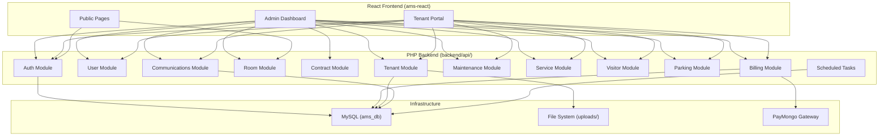
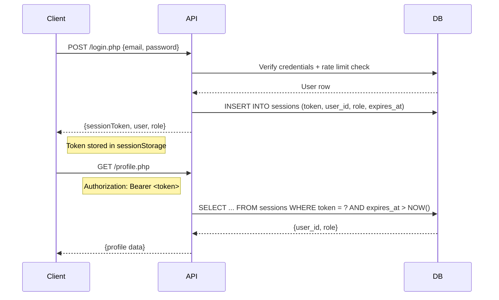
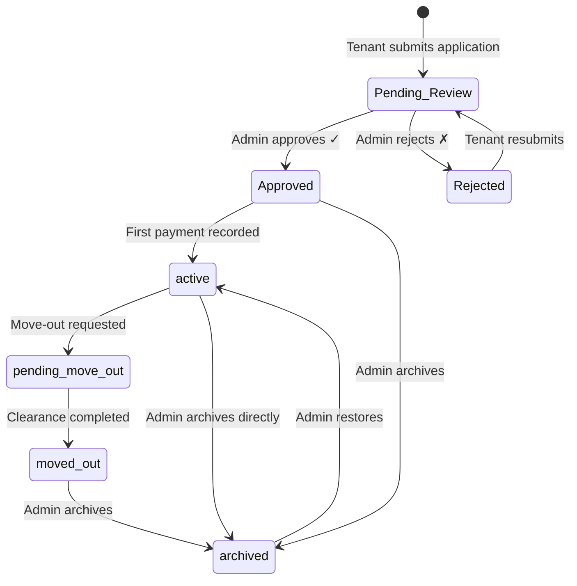
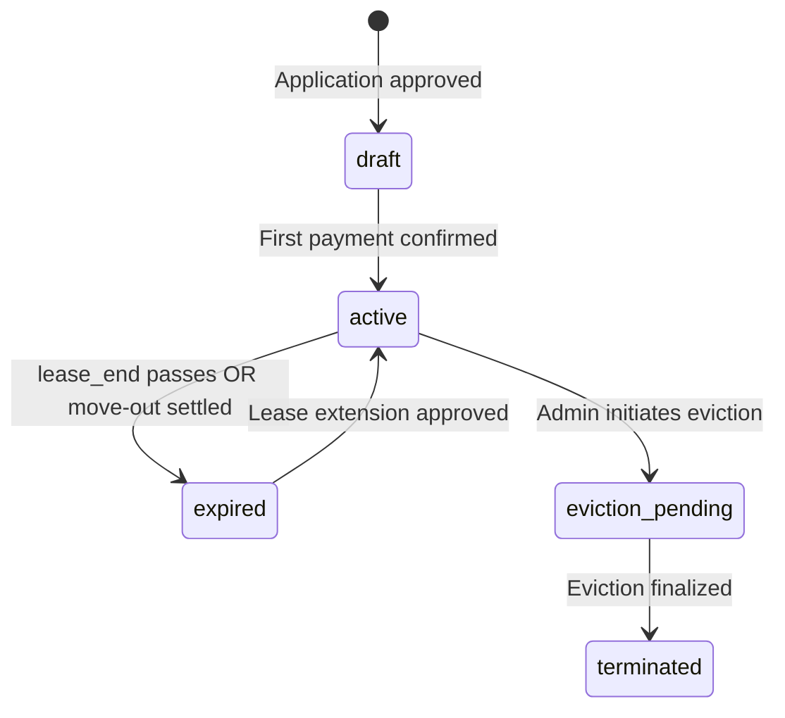
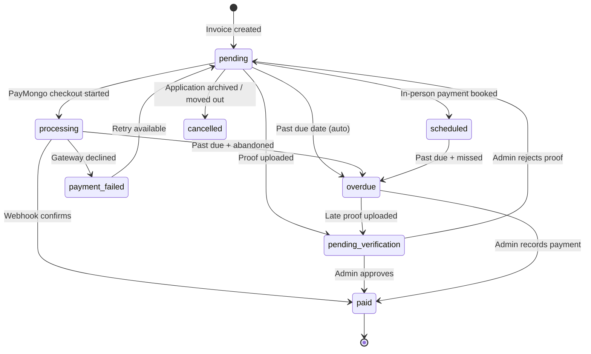
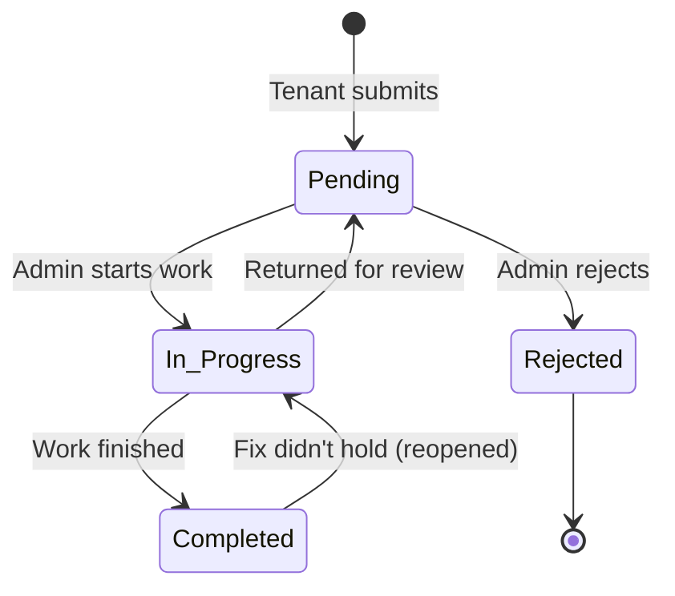
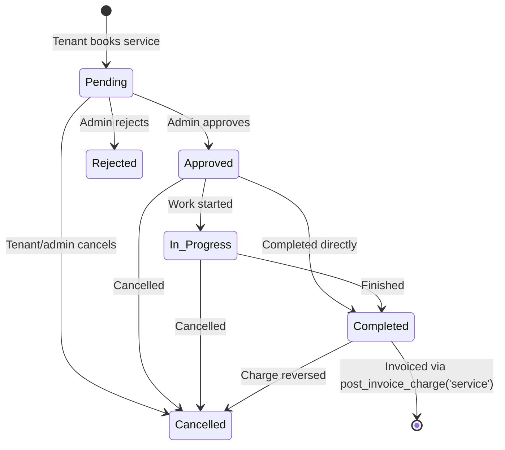

# 📘 AMS Backend API Documentation

> **Base URL:** `http://localhost/ApartmentManagementSystem_React/backend/api/`
> **Content-Type:** `application/json` (unless file upload)
> **Total Endpoints:** 170 PHP files in `backend/api/` (165 HTTP endpoints: `auth_email.php` is a helper and `apply_live_schema_fix`, `audit_live_schema`, `final_schema_patch` and `sync_live` are CLI-only schema scripts; `save_message.php` and `guest_chat_inbox.php` are aliases that include another endpoint; plus `admin/run_migrations.php` and 8 helpers in `services/`) across 15 modules. Modules 1-14 were written first; module 15 lists the endpoints added since 2026-09 and §15.7 corrects behaviour notes for earlier ones. Re-checked 2026-11-18.

---

## Table of Contents

| # | Module | Endpoints | Description |
|---|--------|-----------|-------------|
| 1 | [Authentication & Sessions](#1-authentication--sessions) | 6 | Login, registration, password management |
| 2 | [User & Profile Management](#2-user--profile-management) | 4 | User CRUD, profile updates, avatar |
| 3 | [Tenant & Application Management](#3-tenant--application-management) | 10 | Rent applications, tenant lifecycle |
| 4 | [Room / Unit Management](#4-room--unit-management) | 4 | Room CRUD, tenant room view |
| 5 | [Lease & Contract Management](#5-lease--contract-management) | 6 | Contracts, documents, lease extensions |
| 6 | [Billing & Invoices](#6-billing--invoices) | 11 | Invoice generation, payments, PayMongo |
| 7 | [Utility Management](#7-utility-management) | 5 | Meter readings, corrections, utility billing sync |
| 8 | [Maintenance Requests](#8-maintenance-requests) | 5 | Tenant maintenance tickets |
| 9 | [Service Requests](#9-service-requests) | 6 | Bookable services, catalog management |
| 10 | [Visitor Management](#10-visitor-management) | 3 | Visitor registration, check-in/out |
| 11 | [Parking Management](#11-parking-management) | 5 | Parking slot reservations |
| 12 | [Communications & System](#12-communications--system) | 13 | Notifications, announcements, settings, reports |
| 13 | [Inquiries & Reservations](#13-inquiries--reservations) | 5 | Pre-lease inquiries, unit reservations |
| 14 | [Scheduled / Cron Tasks](#14-scheduled--cron-tasks) | 6 | Automated expiry and reminder jobs, plus the CCTV request endpoints |
| 15 | [Endpoints Added Since 2026-09](#15-endpoints-added-since-2026-09) | 79 | Refunds, split / bundle / advance payments, household, guest chat, sign-in code, CCTV footage, site images |

---

## Architecture Overview



---

## Authentication Model



### Auth Functions (from [config.php](../../backend/config.php))

| Function | Purpose |
|----------|---------|
| `create_session()` | Issues a 64-char hex token, valid for 7 days |
| `get_bearer_token()` | Reads token from `Authorization` or `X-Session-Token` header |
| `get_authenticated_user()` | Returns `{id, role}` or `null` — **sole source of identity**. Role and archive state are read live from `users` |
| `revoke_user_sessions()` | Ends a user's sessions (optionally keeping the caller's) — used on password change/reset, role change, archive |
| `require_admin()` | Gate: 401/403 if not an authenticated admin; returns admin ID |
| `require_user()` | Gate: 401 if no valid session; returns `{id, role}` |
| `require_owner_or_admin()` | Gate: 403 if caller is neither the resource owner nor admin |
| `verify_admin()` | Legacy boolean check — does **not** exit on failure |
| `read_json_input($array_keys)` | The JSON request body as an array. Empty body is `[]`; a body that is not a JSON object, or a top-level field that is an array where the endpoint expects one value, gets **400** `{success:false, message, field}` before any cast (so no "Array to string conversion" warning or `trim()` 500). `$array_keys` lists the fields that really are lists (`channels`, `rules`, `ids`, `payments`, `items`, `deductions`, `vehicle_types`, `preferences`); `'*'` accepts any (settings and contract-template documents). Used by every JSON endpoint |

> [!IMPORTANT]
> The session token is the sole proof of identity. `config.php` overwrites any `X-User-Id` / `X-Admin-Id` header from the verified session before an endpoint runs (and removes them when there is no session), and the frontend no longer sends them. Never trust a client-supplied id for authorization.

---

## 1. Authentication & Sessions

### `POST` [login.php](../../backend/api/login.php)
Authenticates a user and issues a session token.

| Property | Detail |
|----------|--------|
| **Auth** | None (public) |
| **Rate Limit** | 5 failures per account and 20 per IP within 15 minutes (shared with `change_password.php`); a successful login clears that account's failures |
| **Audit** | Admin sign-ins are written to the activity log (`auth`) |

**Request Body:**
| Field | Type | Required | Description |
|-------|------|----------|-------------|
| `email_address` | string | ✅ | User's email |
| `password` | string | ✅ | Plaintext password |

**Response (success):**
| Field | Type | Description |
|-------|------|-------------|
| `valid` | boolean | `true` |
| `sessionToken` | string | 64-char hex session token |
| `user` | object | `{id, first_name, middle_name, last_name, suffix, email_address, role, first_login}`; `first_login` is `true` on the account's first sign-in only (`users.last_login_at` was NULL; 2026-11-07), for "Welcome" vs "Welcome back" |
| `role` | string | `"user"` or `"admin"` |

**Error Codes:** `429` (locked out), `200` with `valid: false` (bad credentials; "archived" is only reported after a correct password)

---

### `POST` [logout.php](../../backend/api/logout.php)
Destroys the current session token.

| Property | Detail |
|----------|--------|
| **Auth** | Bearer token (graceful — no error if missing) |
| **Method** | POST |

---

### `POST` [registration.php](../../backend/api/registration.php)
Creates a new tenant user account.

| Property | Detail |
|----------|--------|
| **Auth** | None (public) |
| **Validation** | First/last name and a valid email required; password ≥ 8 chars, confirmed; unique email. Always creates a `user` (tenant) account |
| **Email verification** | On by default: an emailed link must be opened before the first sign-in. Off (Other Settings → Sign-in & Verification): the account is verified at once and `verification_required` is `false` |

**Request Body:**
| Field | Type | Required |
|-------|------|----------|
| `first_name` | string | ✅ |
| `middle_name` | string | ❌ |
| `last_name` | string | ✅ |
| `suffix` | string | ❌ |
| `email_address` | string | ✅ |
| `password` | string | ✅ |
| `conPassword` | string | ✅ |
| `agree_terms` | boolean | ✅ must be `true` (RA 10173: agreement to the Terms and the Privacy Notice). Refused with "You must agree to the Terms and the Privacy Notice to create an account." before the rate limit is used. Stored as `users.terms_agreed_at` (now) and `users.terms_version` (`TERMS_VERSION` in `registration.php`, the "Last updated" date of `legalContent.js`; `2026-11-03`). Accounts created before 2026-11-13 have `NULL` in both |

---

### `POST` [forgot_password.php](../../backend/api/forgot_password.php)
Initiates a password reset flow by generating a SHA-256 hashed token (expires in 30 minutes).

| Property | Detail |
|----------|--------|
| **Auth** | None (public) |
| **Security** | Constant-time response (doesn't reveal email existence) |
| **Delivery** | Emails the reset link through `send_email()` (needs `notifications_email_enabled` = 1 and a non-`log` `email_driver`). The token is never returned in the response, in any environment |

---

### `POST` [reset_password.php](../../backend/api/reset_password.php)
Completes password reset using the token from forgot_password.

**Request Body:** `{token, new_password, confirm_password}` (all required; the email comes from the stored reset request) — password ≥ 8 chars; a mismatched confirmation is 422 "Passwords do not match." Other failures answer HTTP 200 with `success:false`. On success every session for the account is ended and the reset is logged (`auth`).

---

### `POST` [change_password.php](../../backend/api/change_password.php)
Changes the **caller's own** password.

| Property | Detail |
|----------|--------|
| **Auth** | `require_user()` — the account is the session's; any `email_address` in the body is ignored |
| **Rate Limit** | Wrong current passwords count towards the login lockout |
| **Effect** | Other sessions for the account are ended (this device stays signed in); logged (`auth`) |

**Request Body:** `{current_password, new_password, confirm_password}` — new password ≥ 8 chars and different from the current one.

**Response:** `{success, message, sessions_ended}` · **Errors:** `401`, `422` (wrong current password / too short / mismatch / unchanged), `429`

---

## 2. User & Profile Management

### `GET` / `POST` [profile.php](../../backend/api/profile.php)
Multi-purpose profile endpoint — fetches, updates text fields, uploads/clears avatar.

| Property | Detail |
|----------|--------|
| **Auth** | `require_user()` — always operates on caller's own account |
| **Methods** | GET (fetch), POST + `$_FILES['avatar']` (upload), POST + JSON (text update / clear) |

**GET Response:** `{first_name, middle_name, last_name, suffix, contact_no, gender, avatar_url, emergency_name, emergency_relationship, emergency_phone}`

**POST (text update), emergency contact (2026-11-14):** `emergencyName`, `emergencyRelationship` (one of `EMERGENCY_RELATIONSHIPS`: Spouse/Partner, Parent, Child, Sibling, Relative, Friend, Other) and `emergencyPhone` (Philippine mobile, stored `+639XXXXXXXXX`, not the tenant's own number). Only touched when the body carries at least one of the keys; all three empty clears it; filling only some answers `422` with `errors` per field (`emergency_contact_check()`). The audit log names the changed fields, never the values.

**POST (avatar upload):** multipart/form-data with `avatar` file field
- Allowed: JPG, PNG, GIF, WEBP
- MIME type validated server-side via `finfo`
- Saved to `uploads/avatars/`

**POST (text update):** JSON body
| Field | Type | Notes |
|-------|------|-------|
| `email` | string | Can change login email — must be valid and unused (`409` if taken) |
| `firstName`, `lastName` | string | Required |
| `middleName`, `suffix` | string | Optional |
| `contactNo` | string | PH mobile format validated |
| `gender` | string | Optional |
| `clearAvatar` | boolean | If `true`, clears avatar only |

> [!NOTE]
> Profile text updates are **transactional** — both `users` and `rent_applications` tables are updated atomically.

---

### `GET` / `POST` [manage_users.php](../../backend/api/manage_users.php)
Admin user management — list, edit, reset password, set role, archive/unarchive.

| Property | Detail |
|----------|--------|
| **Auth** | `require_admin()` |
| **Self-Protection** | The session admin cannot modify their own account here (`409`) |

**GET:** Returns all users with full details (sorted admins first), each with `is_self` and `is_anonymized`; plus `max_admins`.

**POST Actions (JSON body with `action` + `user_id`):**

| Action | Additional Fields | Notes |
|--------|-------------------|-------|
| `update` | `first_name`, `last_name`, `email`, etc. | Valid, unused email; PH mobile format; values stored exactly as typed |
| `reset_password` | `new_password` | Min 8 chars; ends the user's sessions |
| `set_role` | `role` (`user` or `admin`) | Max 3 active admins; last admin can't be demoted; archived accounts can't be promoted; ends the user's sessions |
| `delete` | — | Soft-archives (sets `is_archived=1`); cannot archive admins; ends the user's sessions |
| `unarchive` | — | Restores archived user (`409` if not archived, or if the account was anonymized) |
| `anonymize` | `confirm: "ANONYMIZE"` | Erases a former tenant's personal data and keeps invoices, payments and contracts under "Former tenant" (RA 10173, `anonymize_user()`). `422` without the confirmation; `409` unless the account is archived, not an admin, not already anonymized and has nothing open (application, bill, refund request, deposit refund, complaint). Files are removed after the commit; the log holds the account id and counts only. Irreversible |

Every action is logged under the `user` category. **Errors:** `404` unknown user, `409` rule violations, `422` invalid input.

---

### `GET` [get_users.php](../../backend/api/get_users.php)
Tenant accounts for the Units → Assign Tenant search (admin only, session-checked). Returns `{id, name, email, phone, avatar, room, roomStatus}` (`avatar` = `users.avatar_url`, a path or URL, else `null`) for every non-archived non-admin account, sorted by name. `room` / `roomStatus` name the unit the user already rents or has an open application for (`ROOM_CLAIMING_APPLICATION_STATUSES`, the newest one), else `null`; the picker lists those users but cannot pick them, and `update_room.php` refuses them anyway. One query for the whole list. Tests: `users_picker.test.js`.

---

### `GET` [get_tenants.php](../../backend/api/get_tenants.php)
Admin-only (`require_admin()`) list of all rent applications with tenant details, document paths, archive info and move-out dates — plus `emergencyContact` (`{name, relationship, phone}` from the tenant's profile, else the application; `null` for older records) and tenant monitoring fields: `paymentStatus` (`overdue` / `due` / `current`, from unpaid invoices), `outstandingBalance`, `overdueBalance`, `daysOverdue`, `leaseEnd` and `moveIn` from the lease contract when one exists, and `contractStatus`. Also `avatar` (the tenant's profile picture, `users.avatar_url`, or `null`) and `extensionRequest` (`{id, months, requestedAt}`: the tenant's pending rent extension request, a `lease_extension_request` notification, on the tenancy in force only, else `null`; the Tenants page approves or rejects it with `process_tenant_request.php`, 2026-11-23). Runs `promote_overdue_invoices()` first; the extension requests are one extra query for the whole list.

---

## 3. Tenant & Application Management



### `POST` [rent_application.php](../../backend/api/rent_application.php)
Submit or resubmit a rent/lease application.

| Property | Detail |
|----------|--------|
| **Duplicate Guard** | `409` while the account's newest application is still open (`ROOM_CLAIMING_APPLICATION_STATUSES`: Pending Review, Action Required, Approved, active, pending-move-out). The check repeats inside the transaction under a `users` row lock, so two simultaneous submits leave one application |
| **Content-Type** | `multipart/form-data` |
| **Duplicate Guard** | Blocks if user has active/pending application |

**Form Fields:**
| Field | Type | Required |
|-------|------|----------|
| `firstName`, `lastName` | string | ✅ |
| `middleName`, `suffix` | string | ❌ |
| `contactNo`, `email`, `gender` | string | ✅ |
| `occupants` | integer | ✅ |
| `monthsOfRent` | integer | ✅ |
| `roomName` | string | ✅ |
| `monthlyRent` | decimal | ignored (the saved rent is the unit's own) |
| `agreeTerms` | boolean | ✅ |
| `emergencyName`, `emergencyRelationship`, `emergencyPhone` | string | ✅ every new or resubmitted application (2026-11-14): name 1-100 characters, relationship from `EMERGENCY_RELATIONSHIPS`, a Philippine mobile that differs from `contactNo`; `422` with `errors` per field. Saved on the application and copied to the tenant's account (`users.emergency_*`) |
| `doc_<requirementId>` | file | one per active requirement (Settings → Application Requirements); replaces the old `validIdFrontFile` / `validIdBackFile` / `nbiFile` |
| `appId` | integer | ❌ (for resubmission) |

**Other checks:** a field sent as an array is a `400`; text fields are saved trimmed; `monthsOfRent` is the admin minimum to 24 and the rent saved is the unit's own, never `monthlyRent`; an occupied unit is a `409` (`tests/api/application_submit.test.js`).

**File Validation:** JPG/PNG/PDF only, max 10MB, server-side MIME check

**Side Effects:**
- Syncs profile fields to `users` table
- Creates admin notification

---

### `GET` [get_applications.php](../../backend/api/get_applications.php)
Lists all rent applications with user avatars (admin only). Joins `rent_applications` ← `users` and the application's `lease_contracts` row: `contract` is `null` before approval, else `{id, status, signedPath, review, note, uploadedAt, reviewedAt}` (the signed copy and the office's check, `backend/signed_contract.php`; `review` `null` = no copy, a copy from before the review = `accepted`). Each row carries `emergency_contact` (`{name, relationship, phone}` as given on that application, `null` for applications from before 2026-11-14). `my_room.php` returns the three `emergency_*` columns of the tenant's application so the resubmit form can pre-fill them.

---

### `POST` [update_tenant_status.php](../../backend/api/update_tenant_status.php)
Admin endpoint for the full tenant lifecycle — approve, reject, schedule move-out, complete clearance.

| Property | Detail |
|----------|--------|
| **Auth** | `require_admin()` |
| **Allowed Statuses** | `Approved`, `Rejected`, `Declined`, `Cancelled`, `active`, `pending-move-out`, `moved-out`, `Action Required` (further limited by `APPLICATION_TRANSITIONS`) |
| **Clearance guard (2026-11-13)** | `moved-out` returns **409** while one of the tenant's invoices is `pending-verification` (a proof waiting for the admin) or `processing` (an online checkout in progress), naming the invoice: "Invoice X has a payment under verification. Verify or reject it in Payments first, then try again." Checked by `tenancy_payment_in_review()` before the deposit is settled, so a bill is never charged to the deposit and then cancelled. `update_contract_status.php` `terminate` returns the same 409. |

**On Approval (`Approved`):**
1. Validates documents + terms agreement exist
2. Applies occupant surcharge (>4 occupants → +₱1,000/person)
3. Claims room (race-safe via `status IN ('vacant','reserved')`)
4. Converts any active unit reservation
5. Creates move-in invoice (rent + 1 month deposit)
6. Creates draft lease contract
7. Sends tenant notification

**On Move-Out (`moved-out`):**
1. Vacates room, records condition
2. Settles lease contract deposit allocation
3. Cancels remaining pending invoices
4. Logs clearance notes

**On Rejection:** Records rejection_reason, notifies tenant

---

### `POST` [archive_tenant.php](../../backend/api/archive_tenant.php)
Archives a tenant application — saves pre-archive status, cancels invoices, vacates room, archives user account.

**Request Body:** `{id, archiveReason, archiveNotes}`

---

### `POST` [restore_tenant.php](../../backend/api/restore_tenant.php)
Reverses archival — restores to pre-archive status, unarchives user, undoes move-out settlement, reinstates cancelled invoices, re-occupies room if vacant.

---

### `POST` [record_move_out.php](../../backend/api/record_move_out.php)
Tenant-initiated move-out notice. Requires 15–30 days advance notice.

| Property | Detail |
|----------|--------|
| **Auth** | `require_user()` (tenant's own lease) |
| **Validation** | 15 ≤ days_ahead ≤ 30 |

---

### `POST` [update_occupants.php](../../backend/api/update_occupants.php)
Tenant requests an occupancy change — creates a pending notification for admin approval. Blocks duplicate requests.

---

### `POST` [process_tenant_request.php](../../backend/api/process_tenant_request.php)
Admin processes occupancy change or lease extension requests.

| Property | Detail |
|----------|--------|
| **Auth** | `require_admin()` |
| **Idempotent** | Claim-first pattern prevents double-processing |

**Handles:**
- **Occupancy change approval:** Recalculates rent with surcharge, updates application + room
- **Lease extension approval:** Extends months, updates room/contract, records in `lease_renewals`

---

### `POST` [cancel_request.php](../../backend/api/cancel_request.php)
`require_user`. Body `{id (or rawId), type}`; `type` is `Maintenance`, `CCTV`, `Parking` or `Service` (otherwise 422). A Pending row is cancelled directly; an in-progress maintenance ticket or some service bookings become a cancel request instead.

---

### `GET` [get_my_requests.php](../../backend/api/get_my_requests.php)
Returns the caller's maintenance, CCTV, parking and service requests (one UNION; service rows add `can_cancel_free` and `can_rate`; admins may pass `?userId=`).

---

## 4. Room / Unit Management

### `POST` [create_room.php](../../backend/api/create_room.php)
Creates a new vacant room/unit.

| Property | Detail |
|----------|--------|
| **Auth** | `require_admin()` |

**Request Body:**
| Field | Type | Required | Description |
|-------|------|----------|-------------|
| `id` | string | ✅ | Unit number (e.g., `"A1"`) |
| `type` | string | ✅ | Room type |
| `floor` | string | ✅ | Floor level |
| `rent` | decimal | ✅ | Monthly rent (> 0) |

---

### `GET` [get_rooms.php](../../backend/api/get_rooms.php)
Lists all rooms with rich metadata. **No auth required** (public for browsing).

Automatically calls `release_expired_reservations()` before listing.

**Response per room:**
| Field | Type | Description |
|-------|------|-------------|
| `id`, `type`, `floor` | string | Unit identity |
| `rent` | decimal | Monthly rate |
| `status` | string | `vacant`, `occupied`, `reserved`, `maintenance` |
| `tenant` | string\|null | Current tenant name |
| `leaseStart`, `leaseEnd` | date\|null | Lease period |
| `maintenanceHistory` | array | All maintenance tickets for this unit |
| `tenantProfile` | object\|null | Admin only: the tenant now in (or reserving) the unit, `{name, userId, avatar, email, phone, applicationId, applicationStatus}`; email / phone come from the account, else the application |
| `occupancyHistory` | array | All past/current tenants with lease periods; each entry also has `userId`, `avatar`, `email`, `phone` (admin only) |
| `leaseHistory` | array | Extension events from `lease_renewals` |

---

### `POST` [update_room.php](../../backend/api/update_room.php)
Dynamically updates room fields — supports direct tenant assignment with identity verification.

| Property | Detail |
|----------|--------|
| **Auth** | `require_admin()` |
| **Transactional** | Room update + synthetic application in single transaction |

**Updatable Fields:** `status`, `tenant_name`, `lease_start`, `lease_end`, `monthly_rent`, `occupants`, `room_condition`, `furnishing_status`, `maintenance_flag`, `last_inspection_date`

**Validation (2026-11-18, SPRINT 178):** 422 with `errors{field}` for a `furnishing_status` outside Unfurnished / Semi-Furnished / Fully Furnished, a `room_condition` over 100 characters, a `maintenance_flag` that is not 0/1/true/false, an `available_date` / `last_inspection_date` that is not a real date (an inspection cannot be in the future), a `monthly_rent` that is not a number from 0.01 to 99,999,999.99, and in the assign flow a bad tenant id, bad or reversed rent dates, or no `identity_verified` (was a 500).

**Direct Assignment Flow** (when `status=occupied` + `user_id` provided):
1. Requires `identity_verified: true` attestation
2. Creates synthetic `Approved` rent application
3. Links user to room

---

### `GET` [my_room.php](../../backend/api/my_room.php)
Returns the current tenant's room details, lease info, contract, and pending move-in invoice status.

| Property | Detail |
|----------|--------|
| **Auth** | `require_user()` — own data only; admins can query by `?userId=` |
| **Side Effect** | Calls `expire_lapsed_contracts()` |

---

## 5. Lease & Contract Management



### `GET` [get_contracts.php](../../backend/api/get_contracts.php)
Returns lease contracts — single tenant view or admin-wide list. Includes renewal history, deposit details, document paths.

| Property | Detail |
|----------|--------|
| **Auth** | Session token; non-admin scoped to own contract |
| **Side Effect** | Calls `expire_lapsed_contracts()` |

---

### `POST` [create_contract.php](../../backend/api/create_contract.php)
Manually creates a lease contract for a rent application (admin only).

---

### `POST` [update_contract_status.php](../../backend/api/update_contract_status.php)
Changes contract status (activate, terminate, mark eviction-pending). Admin only.

**RA 9653 (2026-11-13).** `flag` and `terminate` require `ground`, one of `arrears`, `sublease`, `owner_use`, `condemnation`, `lease_expired` (Sec. 9; `terminate` also takes `mutual`), checked by `ejectment_ground_refusal()` (422 with the reason): `arrears` needs unpaid rent on past-due rent invoices totalling 3 months (`rent_arrears_months()`); `lease_expired` needs `lease_end` before today; `owner_use` needs an expired term and `notice_date` (YYYY-MM-DD) at least 3 months ago; `sublease` / `condemnation` need `details` (5+ chars). The ground is stored in `lease_contracts.eviction_ground` and named in the log and the tenant notification. `terminate` also takes `damage_deduction`, `utility_deduction` and `deposit_interest`.

`action: set_deposit_refundable` now always returns 422: the unused deposit is always returned (Sec. 7). `terminate` and the move-out clearance (`update_tenant_status.php`, `status: moved-out`) settle the deposit through `settle_deposit()`: unpaid invoices and itemized deductions come off it and the rest, plus `deposit_interest` (bank interest, optional), is returned through a `deposit` refund request. Nothing is forfeited wholesale; for a clearance straight from `active` (no move-out notice) rent for the minimum notice days (monthly / 30 × days) is deducted as an `unpaid_rent` line; send `notice_deduction` to lower it, with `waive_forfeiture_reason` (required when lowered). Clearance response `deposit`: `{status, refund_amount, notice_deduction, notice_days, interest}` (was `forfeited` / `forfeit_reasons`).

**Move-out settlement records (2026-11-14, SPRINT 73).** The same sums are written to the ledger by `apply_deposit_to_invoices()`; no amount changed. The deposit (plus interest) pays the owed invoices oldest first: a covered invoice becomes `paid` with `payment_method` `Security deposit` and a `payment_transactions` row of that method (no reference); a part-covered one keeps its balance and stays open. It is no longer cancelled as "Settled from deposit". What is left covers the deductions in this order: notice rent, electricity, water, damage, other. Deductions the deposit does not reach are billed on one invoice with `billing_period` `Move-out balance`, due `deposit_refund_days` after the clearance (notice rent on `base_rent`, electricity, water, damage and other on `maintenance`; the two-field payload bills `utility_deduction` as electricity). Bills still owed after the deposit stay open (`end_tenancy()` with `keep_owed` cancels only an unpaid advance-rent invoice), so the open balances equal `balance_due`. With no deposit collected the bills stay owed and the deductions are still billed. Clearance response adds `invoices_paid_from_deposit` (count), `balance_invoice` `{id, amount}` and `advance_refund` `{id, amount}` when they apply; `terminate` adds `balance_invoice` and `advance_refund`. `get_invoices.php` adds `paid_from_deposit` (boolean) per invoice.

**Unused advance rent (2026-11-14).** `end_tenancy()` (clearance, termination, `archive_tenant.php`) opens one `advance` refund request for the `refund-due` credits no request holds yet and holds them on it (`advance_credits.refund_request_id`), then queues it for the admins after commit. A month the tenant already asked back is left on the tenant's own request. Rejecting the request frees the credits.

**Undo.** `restore_tenant.php`, when it reactivates the tenancy, reopens the invoices the deposit paid (their `Security deposit` rows are deleted), cancels the move-out balance invoice (`cancel_reason` `Tenancy restored`) and cancels the open advance refund request that `end_tenancy()` raised. It refuses (`success: false`) when the move-out balance invoice already has a payment. `get_refund_requests.php` adds `dueDate` / `overdue` to `deposit` requests (`deposit_refund_days` after the clearance). Settings: `deposit_refundable_default` (only `1` accepted), `deposit_refund_days` (1-90, default 30), `rent_cap_percent` (0-100, default 1), `rent_cap_max_covered_rent` (default 10000), `rent_cap_valid_until` (date), `late_fee_type` (`flat`/`percent`), `late_fee_value` (percent at most 5).

`get_contracts.php` (admin list) adds `rent_arrears_months` per contract and `eviction_ground`, and (2026-11-22) `application_status` (the tenancy behind the contract: Contracts lists `Approved` / `active` / `pending-move-out` as current tenants, the rest as past), `contact_no`, `previous_address` and the signed copy's `signed_lease_review` / `signed_lease_review_note` / `signed_lease_uploaded_at`. `my_room.php` returns the same three review fields for the tenant's own contract, plus `notarized_ready_at`, `notarized_at`, `notarized_required` (the `contract_require_notarized` setting) and `notarized` (marked received or a scan on file). `get_contracts.php` also returns `notarized_ready_at`, `notarized_at` and `notarized_by` (2026-11-22).

---

### `POST` [upload_lease_document.php](../../backend/api/upload_lease_document.php)
Uploads (or with `action=remove` removes) a contract document: the tenant's signed copy, the notarized copy, or a signature image.

| Property | Detail |
|----------|--------|
| **Auth** | `require_user()`; a tenant only on their own contract (by `contractId` or `rentApplicationId`), 403 otherwise |
| **Body** | multipart `contractId` or `rentApplicationId`, `docType` `signedLease` / `notarizedLease` / `tenantSignature` / `ownerSignature`, `file`, optional `action=remove` |
| **File Types** | PDF, JPG, PNG for the copies; JPG, PNG for a signature (max 10 MB, MIME checked) |
| **Tenant limits** | Only while the contract is a draft (409 after), except a signed copy the office sent back, which may be replaced at any time. The notarized copy and the owner's signature are admin-only (403). |
| **Signed copy review (2026-11-22)** | A tenant's `signedLease` upload sets `signed_lease_review` `pending` and `signed_lease_uploaded_at`, and puts one admin queue row (`signed_contract:<contractId>`, replaced on each new copy). An admin's upload is `accepted` at once. Removing the copy clears the review. The response adds `review`. Decided by `review_signed_contract.php` (§15.2). |
| **Notarized scan (2026-11-22)** | A `notarizedLease` upload (admin) counts as notarized and clears the `notarized_contract` queue row. The notarized copy is usually handed in person instead: `notarized_contract.php` (§15.2). |

---

### `POST` [extend_lease.php](../../backend/api/extend_lease.php)
Tenant requests a lease extension (creates a pending admin notification).

**Request Body:** `{additionalMonths}` — 1 to `MAX_RENT_AHEAD_MONTHS_CEILING` (12) months; also subject to `extension_block_reason()` and `extension_deadline_reason()`, one pending request at a time (errors are HTTP 400).

---

### `GET` [get_documents.php](../../backend/api/get_documents.php)
Returns all lease-related documents for a tenant (lease PDFs, ID scans, NBI clearance).

---

## 6. Billing & Invoices



### `POST` [create_invoice.php](../../backend/api/create_invoice.php)
Admin creates or re-issues a billing invoice.

| Property | Detail |
|----------|--------|
| **Auth** | `require_admin()` |
| **Idempotent** | Uses `ON DUPLICATE KEY UPDATE` for re-issue |
| **Guard** | Cannot re-issue over `paid`/`cancelled` invoices |

**Request Body:**
| Field | Type | Required |
|-------|------|----------|
| `userId` | integer | ❌ (resolved from unit) |
| `unit` | string | ❌ |
| `baseRent` | decimal | ✅ |
| `water`, `electricity`, `parking`, `lateFee` | decimal | ❌ |
| `dueDate` | date | ❌ (default: +15 days) |
| `billingPeriod` | string | ❌ (default: current month label) |

**Side Effects:** Creates tenant notification with amount + due date

---

### `GET` [get_invoices.php](../../backend/api/get_invoices.php)
Returns invoices — admin sees all, tenant sees own only.

| Property | Detail |
|----------|--------|
| **Auth** | `require_user()` |
| **Side Effect** | Calls `promote_overdue_invoices()` (auto-marks overdue + applies late fee) |
| **Query Param** | `?userId=` (admin can filter by tenant) |

---

### `POST` [pay_bill.php](../../backend/api/pay_bill.php)
Tenant submits a payment declaration. Updates status to `pending` (cash) or `pending-verification` (digital).

| Property | Detail |
|----------|--------|
| **Auth** | `require_user()` — scoped to own invoices |
| **Guard** | Only open-status invoices can be paid |

---

### `POST` [upload_payment_proof.php](../../backend/api/upload_payment_proof.php)
Uploads payment screenshot/receipt with reference number and sender name.

| Property | Detail |
|----------|--------|
| **Auth** | `require_user()` — own invoices; admin can act on any |
| **File Types** | JPG, PNG, WEBP, PDF (max 10MB) |
| **Guard** | Only open-status invoices accept proof |

---

### `POST` [record_payment_admin.php](../../backend/api/record_payment_admin.php)
Admin confirms/records a payment — marks invoice as `paid`, activates occupancy on first payment.

| Property | Detail |
|----------|--------|
| **Auth** | `require_admin()` |
| **Transactional** | Payment + occupancy activation + contract creation |
| **Guard** | A short amount is refused unless `partial: true` (single invoice), which records an instalment through `record_partial_payment()`; `payments[]` accepts split-method payments; a bill in `processing` returns 409. Admins may record a single cash payment received at the desk on `pending`, `unpaid`, or `overdue` invoices without a reference; online methods still require tenant submission/proof or scheduling. |

Tenant schedule dates are selected in `PayBills.jsx` and posted to `schedule_payment.php` by the tenant; Admin Payments displays the scheduled date but does not edit it.

**On First Payment Approval:**
1. Marks invoice `paid`
2. Activates room occupancy
3. Promotes rent application to `active`
4. Creates or activates lease contract

---

### `POST` [schedule_payment.php](../../backend/api/schedule_payment.php)
Books an in-person payment appointment.

| Property | Detail |
|----------|--------|
| **Auth** | `require_user()` |
| **Validation** | Future date (max 60 days); slot: `morning`/`afternoon`/`evening` |

---

### `POST` [create_checkout_session.php](../../backend/api/create_checkout_session.php)
Creates a PayMongo checkout session for online payment.

| Property | Detail |
|----------|--------|
| **Auth** | `require_user()` |
| **Channels** | `gcash`, `paymaya`, `card`, `bank`, sandbox variants |
| **Guard** | Only open-status invoices; a `processing` invoice is refused ("already in progress"), no session is re-used; non-admins need `payment_mode` `sandbox` or `both` and the pay-bills and channel switches on (403) |

---

### `POST` [release_checkout_session.php](../../backend/api/release_checkout_session.php)
Releases a stale checkout session, allowing the tenant to retry payment.

---

### `POST` [paymongo_webhook.php](../../backend/api/paymongo_webhook.php)
PayMongo webhook receiver — handles `checkout_session.payment.paid` events.

| Property | Detail |
|----------|--------|
| **Auth** | None (webhook) — verifies the `Paymongo-Signature` header (HMAC-SHA256; 400/401/500 on failure), then matches `checkout_session_id` |
| **Idempotent** | Only processes invoices still in `processing` status |

---

### `POST` [send_payment_reminder.php](../../backend/api/send_payment_reminder.php)
Admin sends payment reminders to tenants with overdue/pending invoices. Creates notifications with invoice details.

---

### `GET` [get_payment_channels.php](../../backend/api/get_payment_channels.php)
Returns available payment channels with PayMongo sandbox configuration status.

---

## 7. Utility Management

### `POST` [save_utility_reading.php](../../backend/api/save_utility_reading.php)
Records one unit's water **and** electricity meter readings for a billing month.

| Property | Detail |
|----------|--------|
| **Auth** | `require_admin()` — `recorded_by` is the session admin |
| **Calculation** | Consumption = current − previous reading (the unit's latest earlier period); amount = consumption × rate |
| **Validation** | Unit must exist · period `YYYY-MM` · reading date not in the future or before the period · current ≥ previous · rate > 0 and ≤ 1,000 · fees ≥ 0 |
| **Errors** | `422` validation · `409` a reading already exists for this or a later period |

**Request Body:**
| Field | Type | Required |
|-------|------|----------|
| `room_name` | string | ✅ |
| `billing_period` | string `YYYY-MM` | ✅ |
| `reading_date` | date | — (today) |
| `water_curr_reading` | decimal | ✅ |
| `electric_curr_reading` | decimal | ✅ |
| `water_rate_per_unit` / `electric_rate_per_unit` | decimal | — (unit's previous rate, else 40 / 12) |
| `water_other_fees` / `electric_other_fees` | decimal | — (0) |
| `notes` | string | — |

Response includes `id`, consumption, `total_amount`, and refuses (422) a unit with no billable tenant. Modes: `entry_mode` `metered` (default), `bill` (provider amounts `water_bill_amount` / `electric_bill_amount`, meter values optional) or `total` (`total_amount`), plus extra utility types.

---

### `GET` [get_utility_readings.php](../../backend/api/get_utility_readings.php)
Lists readings. Tenants receive only their own rows (session-scoped); admins receive all and may filter with `room_name` / `billing_period`. Each row carries `water_change_pct`, `electric_change_pct`, `has_spike` (> 30% over the previous period), `billing_period_label` and `invoice_id`.

| Property | Detail |
|----------|--------|
| **Auth** | `require_user()` |

---

### `POST` [delete_utility_reading.php](../../backend/api/delete_utility_reading.php)
Deletes a reading so it can be re-recorded. Only an un-invoiced reading that is the unit's latest.

| Property | Detail |
|----------|--------|
| **Auth** | `require_admin()` |
| **Errors** | `404` · `409` already invoiced, or a later reading exists |

---

### `POST` [sync_utility_to_invoice.php](../../backend/api/sync_utility_to_invoice.php)
Posts a reading's charge onto an invoice. `sync_mode`: `merge` adds it to the tenant's adjustable invoice for that month (a utilities-only invoice is created when there is none — rent is never billed here); `separate` always creates a utilities-only invoice with `due_date` (today to +10 days); `paid` records a cash-settled utilities-only invoice.

| Property | Detail |
|----------|--------|
| **Auth** | `require_admin()` |
| **Transactional** | Reading claimed (`is_invoiced`) first; invoice write, `invoice_id` link and tenant notification commit together |
| **Errors** | `404` · `409` already synced, or the merge target already has water/electricity · `422` no billable tenant, bad mode or due date |

---

## 8. Maintenance Requests



### `POST` [maintenance_request.php](../../backend/api/maintenance_request.php)
Tenant submits a maintenance ticket.

| Property | Detail |
|----------|--------|
| **Auth** | `require_user()` |
| **Content-Type** | `multipart/form-data` |
| **Priority** | Always `"Needs Triage"` — admin assigns real urgency |

**Form Fields:**
| Field | Type | Required | Notes |
|-------|------|----------|-------|
| `issueType` | string | ✅ | Normalized to category enum |
| `preferredDate` | date | ✅ | Must be ≥ today |
| `preferredTime` | string | ✅ | `morning` or `afternoon` |
| `description` | string | ✅ | Issue description |
| `permissionToEnter` | boolean | ❌ | Entry consent |
| `uploadedFile` | file | ❌ | Photo/video (max 10MB; JPG, PNG, GIF, WEBP, MP4, M4V, WEBM, MOV) |

**Categories:** `Plumbing`, `Electrical`, `Structural/Physical`, `Water Supply`, `General Maintenance`, `Others`

---

### `POST` [create_maintenance_request_admin.php](../../backend/api/create_maintenance_request_admin.php)
Multipart `$_POST` fields (not JSON): `title`, `issueType`, `priority`, `unit`, `description`.
Admin creates a maintenance ticket on behalf of a tenant (or for a common area).

---

### `GET` [get_maintenance_requests.php](../../backend/api/get_maintenance_requests.php)
Lists all maintenance tickets sorted by status priority then urgency. Admin only.

---

### `POST` [update_maintenance_status.php](../../backend/api/update_maintenance_status.php)
Admin updates ticket status, assigns urgency/priority, updates estimated cost. Validates state transitions.

**Allowed Transitions:**
| From | To |
|------|----|
| Pending | In Progress, Rejected |
| In Progress | Completed, Pending |
| Completed | In Progress (reopen) |

---

### `POST` [cancel_request.php](../../backend/api/cancel_request.php)
Tenant cancels their own pending maintenance or service request.

---

## 9. Service Requests



### `POST` [service_request.php](../../backend/api/service_request.php)
Tenant books a paid service from the catalog.

| Property | Detail |
|----------|--------|
| **Auth** | `require_user()` |
| **Pricing** | Always re-derived from DB (never from client) |
| **Quantity** | Validated against `min_quantity`/`max_quantity` |
| **Lead Time** | Preferred date must be ≥ today + `lead_time_days` |

---

### `GET` [get_service_requests.php](../../backend/api/get_service_requests.php)
Lists service requests — admin sees all, tenant sees own.

---

### `POST` [update_service_status.php](../../backend/api/update_service_status.php)
Admin updates service request status. On completion, triggers `post_invoice_charge($conn, 'service', $id)` to bill the tenant. On cancellation of a completed request, triggers `reverse_invoice_charge()`. Rejected and Cancelled need `adminNotes` (422, <= 500).

---

### `POST` [manage_service_catalog.php](../../backend/api/manage_service_catalog.php)
Admin CRUD for the service catalog. Supports categories, pricing units, quantity limits, lead times.

---

### `GET` [get_service_catalog.php](../../backend/api/get_service_catalog.php)
Returns the active service catalog (filters by `is_active` + category toggles). No `require_*` call, so it is public; an admin (`verify_admin` on `X-Admin-Id`) also sees inactive rows.

---

### `POST` [sync_service_to_invoice.php](../../backend/api/sync_service_to_invoice.php)
Admin manually triggers billing of a completed service request (calls `post_invoice_charge('service')`).

---

## 10. Visitor Management

### `GET` [get_visitors.php](../../backend/api/get_visitors.php)
Returns visitor records with overstay detection. Admin sees all; tenant sees own unit's visitors.

| Property | Detail |
|----------|--------|
| **Auth** | `require_user()` — a tenant sees only their own visitors and their unit's; `?userId=` is ignored |
| **Overstay** | Configurable via `system_settings.visitor_overstay_hours` |

---

### `POST` [check_in_visitor.php](../../backend/api/check_in_visitor.php)
Registers a visitor. A **tenant** registration goes to `pending_approval`, and the unit and host are always the tenant's own active tenancy (`403` without one). An **admin** walk-in is `checked_in` immediately; the unit must exist, and the host is the unit's current tenant. Optional `idPhoto`: JPG/PNG/WEBP up to 5 MB, validated by extension and content.

| Property | Detail |
|----------|--------|
| **Auth** | `require_user()` |
| **Errors** | `403` no active lease · `422` missing fields, unknown unit, invalid photo |

---

### `POST` [update_visitor_status.php](../../backend/api/update_visitor_status.php)
`action`: `approve` / `reject` (admin only, from `pending_approval`) or `checked_out` (admin or the owning tenant, from `checked_in`).

| Property | Detail |
|----------|--------|
| **Auth** | `require_user()`; a tenant may only act on their own visitor |
| **Errors** | `403` not permitted · `404` unknown visitor · `409` action not valid from the current status · `422` unknown action |

---

## 11. Parking Management

Slots are rows of `parking_slots`; `slot_number` / `slotNumber` everywhere is the slot's id (2026-11-07).

### `POST` [parking_reservation.php](../../backend/api/parking_reservation.php)
A tenant asks for a slot (multipart form), or cancels a pending request.

| Property | Detail |
|----------|--------|
| **Auth** | `require_user()`; a tenant with an active rental; 403 while the parking service is switched off |
| **Fields** | `slotId` (the slot tapped; without it the first free slot for the type), `vehicleType` (one the slot takes), `vehicleModel` (2-100), `plateNumber` (required except for an e-bike; checked when given), `transmission` (`Automatic` / `Manual`, not asked for an e-bike), `durationMonths` (1 to `parking_max_duration_months`), `uploadedFile` (OR/CR, JPG/PNG/PDF ≤ 10 MB, required when the slot requires it) |
| **Errors** | 422 `{errors: {field: message}}` per field; 409 slot taken / under maintenance / none free for the type, `parking_max_per_tenant` open reservations reached, or the same plate already open |
| **Cancel** | `action=cancel`, `id`: the tenant's own Pending request becomes Cancelled (409 otherwise) |
| **Effects** | Pending row with `monthly_fee` = the current fee (0 while parking is free), admin queue item, activity log. A request does not hold the slot. |

---

### `GET` [get_parking_reservations.php](../../backend/api/get_parking_reservations.php)
Admin only. `{reservations[] (with slotLabel, monthlyFee), slots[] (each with occupant {tenant, unit, vehicle, plate, term_ends_at} and requests = pending requests for it), capacity {max_slots, taken_slots, occupied_count, available_slots, maintenance_slots, free_by_type}, monthly_fee, monthly_total, free, billing_mode, max_duration_months, max_per_tenant, current_period}`.

---

### `GET` [get_available_parking_slots.php](../../backend/api/get_available_parking_slots.php)
`require_user()`. The tenant page: `slots[]` (`id, label, icon, vehicle_types, requires_registration, state`), where `state` is `free`, `taken` (someone else's), `mine`, `requested` (the caller's pending request) or `maintenance`; who parks where is never sent. Plus `monthly_fee`, `free`, `billing_mode`, `max_duration_months`, `max_per_tenant`, `open_count`, `free_by_type`, `my_reservations[]` (open first, up to 20, with `slot_label`, `monthly_fee`, `term_ends_at`, `billed_periods`), and for older pages `max_slots`, `available_slots`, `occupied_count`, `my_reservation`. Admin callers also get `taken_slots`.

---

### `GET` / `POST` [parking_slots.php](../../backend/api/parking_slots.php)
Admin only (2026-11-07). GET `{slots[] (with assigned), capacity}`. POST JSON:

| Action | Body | Notes |
|--------|------|-------|
| `create` | `label`, `quantity` (1-20), `icon`, `vehicle_types[]`, `requires_registration` (bool), `status` | Quantity 2-20: `label` is a prefix and slots are numbered after the highest with it (`M` → `M1, M2, M3`). Name 1-20 letters, digits, spaces or dashes; at most 200 slots; 409 duplicate name |
| `update` | `id` + the same fields | 409 when a parked slot would go under maintenance or stop taking the parked vehicle's type |
| `remove` | `id` | Archived; 409 while a vehicle is parked; pending requests for it keep waiting with no slot chosen |

---

### `POST` [update_parking_status.php](../../backend/api/update_parking_status.php)
Admin assigns (`slotNumber` / `slotId` = a slot's id), rejects or releases a reservation. After an assignment, pending requests that no free slot can take any more are closed ("Parking is full") and their tenants notified; their ids are in `closed_full`.

---

## 12. Communications & System

### `POST` [create_announcement.php](../../backend/api/create_announcement.php)
Admin broadcasts an announcement to all tenants via in-app notifications.

| Property | Detail |
|----------|--------|
| **Auth** | `require_admin()` |
| **Transactional** | Announcement + per-user notification insert |

**Request Body:**
| Field | Type | Required |
|-------|------|----------|
| `title` | string | ✅ |
| `tag` | string | ❌ (default: `General`) |
| `sendTo` | string | ❌ (`All tenants` default, `Specific unit` with `unit`, or `Selected tenants` with `tenantIds`) |
| `tenantIds` | int[] (JSON text in a form post) | ✅ for `Selected tenants`: 1 to 100 user ids, all current tenants; stored as the label `Tenants: 2,3,5` in `announcements.send_to` (varchar 600); 422 `tenantIds` otherwise |
| `body` | string | ✅ |
| `channels` | array | ❌ (default: `['in-app']`) |

---

### `POST` [pin_announcement.php](../../backend/api/pin_announcement.php)
`require_admin`. Body `{id, pinned}`. Only a `sent` announcement can be pinned (404 otherwise) and at most 3 are pinned at once (409). Response `{success, pinned, message}`. Logged as `communication` "Pinned Announcement" / "Unpinned Announcement". `get_announcements.php` returns `is_pinned` and lists pinned first.

---

### `GET` [get_announcements.php](../../backend/api/get_announcements.php)
`?public=1` — the tenant feed: `require_user()`, sent announcements only; an announcement addressed to one unit or to chosen tenants is listed only for those people (the audience itself is not returned). Without it — the full list including drafts and channels: `require_admin()`.

---

### `POST` [create_notification.php](../../backend/api/create_notification.php)
Creates a targeted notification for a specific user. `require_admin()`; the user must exist. Body: `{userId, title, message, type}`.

---

### `GET` [get_notifications.php](../../backend/api/get_notifications.php)
`require_user()`. A tenant gets their own inbox (any `?userId=` is ignored). An admin gets the pending action queue (`ADMIN_QUEUE_NOTIFICATION_TYPES`).

---

### `POST` [mark_notification_read.php](../../backend/api/mark_notification_read.php)
`require_user()`. With `notificationId` (or `id`): marks that one, if it is in the caller's scope (`404` otherwise). Without: marks everything in scope. Scope — a tenant's own notifications; for an admin, their own plus the admin action queue. Response includes `updated`.

---

### `POST` [delete_notification.php](../../backend/api/delete_notification.php)
`require_user()`, same scope as above. A single id outside it → `404`. Bulk clear skips anything still `Pending`. Response includes `deleted`.

---

### `GET` [get_activity_logs.php](../../backend/api/get_activity_logs.php)
The audit trail, filtered and paged on the server. `require_admin()`.

| Parameter | Detail |
|-----------|--------|
| `category` | `all` or one of `auth`, `user`, `tenant`, `unit`, `contract`, `billing`, `utilities`, `maintenance`, `service`, `inquiry`, `communication`, `system` (`422` otherwise) |
| `performer` | `all` / `admin` / `tenant` / `system` (no user) |
| `search` | Action, details, performer name or email, or a log id (`LOG-0012`) |
| `from`, `to` | `YYYY-MM-DD`, inclusive |
| `page`, `limit` | Paging; `limit` ≤ 100 (default 25) |
| `export` | `1` returns up to 5,000 matching rows and records an `Exported Activity Log` entry |

**Response:** `{logs[], total, page, limit, pages, categories, categoryCounts}` — each log has `id, category, categoryLabel, action, details, createdAt, performedBy, performerName, performerEmail, performerRole`.

---

### `GET` / `POST` [get_system_settings.php](../../backend/api/get_system_settings.php) / [update_system_settings.php](../../backend/api/update_system_settings.php)
Read/write system-wide configuration. **`get_system_settings.php` answers by caller** (since 2026-11-11; `PUBLIC_SETTING_KEYS` and `ADMIN_ONLY_SETTING_KEYS` in `backend/config.php`): a logged-out visitor gets only the public allowlist (system name, contact details, currency, Home and Preview content, Glass theme, language switch, floor rates, age and occupancy rules, inquiry and move-in limits); a tenant gets everything except the operational keys (SMTP, email driver, SMS, notification schedule and dispatch, sweep timestamps, sign-in code and email-verification switches, landlord details, maintenance budget); an admin gets everything with credentials masked. A key in neither list reaches tenants and admins but stays hidden from visitors until it is added to the allowlist. `update_system_settings.php` is `require_admin()`: keys must match `[A-Za-z0-9_]`, arrays are stored as JSON, only changed values are written, and the activity-log entry names the keys that changed (secret keys shown as "value hidden"). Response includes `changed`. Structured keys are checked and stored canonical, among them `garbage_schedule` (list of up to 14 `{day, what, time, period}`; `period` is `morning`, `afternoon`, `evening` or `""`) and `my_room_layout` (`{sections: [{id, show}]}` over the six My Room section ids; a left-out section is appended shown, `room` is always shown, an unknown or repeated id or a non-boolean `show` is refused with 422); both may be posted as JSON or as JSON text.

**Known Settings:**
| Key | Type | Description |
|-----|------|-------------|
| `late_fee_enabled` | boolean | Enable automatic late fees (saved as `1` / `0`; off by default; Settings → Payment Options → Late fee) |
| `late_fee_type` | string | `flat` or `percent` |
| `late_fee_value` | decimal | Fee amount or percentage |
| `occupant_surcharge_per_person` | decimal | Extra rent per person > 4 occupants |
| `visitor_overstay_hours` | integer | Hours before visitor flagged as overstay |

---

### `GET` [dashboard_stats.php](../../backend/api/dashboard_stats.php)
Returns dashboard statistics for admin. `require_admin()`; runs `promote_overdue_invoices()` first.

**Response Stats Include:**
- Revenue totals (current, last month, trend)
- Pending/overdue dues across every open invoice status (`BILLING_OPEN_STATUSES`)
- Tenant counts (active, pending)
- Occupancy rate
- Maintenance ticket breakdown
- Collection rate for the month (cancelled invoices excluded)
- Monthly income chart data (6 months, cancelled excluded)
- Action queues (applications, open invoices, maintenance) and recent activity log
- `attention`: what the admin has to act on, one count per Dashboard "Needs your attention" line (fixed number of queries, never per row; read-only):
  - Money: `proofs_to_verify`, `cash_visits`, `failed_payments` (distinct tenants), `overdue_invoices`, `overdue_tenants` (a past-due bill; advance-rent invoices are a prepayment and never count), `refunds_to_review`, `readings_to_invoice`.
  - Tenants: `applications_to_review` (Pending Review + Pending Deposit), `move_in_due` (Approved), `move_out_requests`, `extension_requests` (pending rent extension requests, decided on the Tenants page), `requests_to_decide` (pending occupancy and household requests, decided on Notifications; rent extensions counted there until 2026-11-23), `new_inquiries`, `inquiry_messages` (since 2026-11-23: inquiries whose prospect wrote again unread, a guest thread or an account that never applied; tenants' and applicants' chats count on Messages instead). `signed_contracts_to_review` links to Contracts (`?status=to-check`) since 2026-11-23.
  - Contracts: `eviction_pending`, `contracts_missing_docs` (draft/active/eviction-pending without the signed or notarized file), `contracts_draft`, `contracts_ending` within `contracts_ending_days` (setting `lease_end_reminder_days`, 0 allowed).
  - Building: `maintenance_urgent` (Pending/In Progress), `maintenance_triage` (Pending), `visitors_pending`, `visitors_overstayed` (setting `visitor_overstay_hours`), `parking_requests`, `cctv_requests`, `service_requests`.
  - If one group's query fails the group's keys are left out and `attention.incomplete` is `true` (logged server-side); the rest of the response is unaffected. The page then never shows "All caught up".
  - Each count equals the rows of the page its line links to (`/admin-payments?status=overdue`, `/admin-maintenance?priority=Urgent&scope=open`, …).

---

### `GET` [get_reports.php](../../backend/api/get_reports.php)
Admin → Reports (since 2026-11-15). One report over a date range, cut into periods. Logic in `backend/reports.php`.

| Property | Detail |
|----------|--------|
| **Auth** | `require_admin()` (401 without a session, 403 for a tenant); runs `promote_overdue_invoices()` first |
| **Parameters** | `report` = `financial` · `collections` · `billing` · `occupancy` · `maintenance` · `utilities` · `leasing` · `services`; `from`, `to` (`YYYY-MM-DD`, both included); `group` = `day` · `week` (Monday–Sunday) · `month` · `year` |
| **Limits** | At most 366 days, 260 weeks, 120 months or 25 years of periods (`REPORT_MAX_PERIODS`); dates 2000–2099. `utilities` is grouped by month at the least (meter readings are monthly) and says so in `note` |
| **Response** | `{success, report, title, from, to, group, previous: {from, to}, generatedAt, note?, summary: [{key, label, value, format, hint?, previous?}], chart: {kind: bar\|line, format, series: [{key, label, tone}]}, periods: {columns, rows, totals}, tables: [{key, title, note?, columns, rows, totals?}]}`. `format` = `money` · `int` · `number` · `percent` · `hours` · `text` · `date`; a statement row may carry `_style` (`section`, `subtotal`, `total`). Detail lists stop at 2,000 rows with a note |
| **Money rules** | As `dashboard_stats.php`: money is dated by when it arrived (an installment on its own day, each column taking its share; any other paid bill whole on `paid_at`), security deposits are never revenue, advance-rent invoices are left out; expenses = finished repairs the building paid (actual cost, else estimate) + `expenses` + `report_overhead_pct` |
| **Previous range** | The same number of whole months before (a month → the month before, a year → the year before), else the same number of days; each summary figure carries `previous` except the "today" ones (occupancy today, overdue today, open today, parking in use) |
| **Errors** | `422` with `errors.report` / `from` / `to` / `group`; `500` "The report could not be built" |
| **Extra tables** | `collections` has *By channel (pesos)* (Online vs Front desk per method, 2026-11-20); `financial` has *Deposits settled at move-out* (applied, returned, forfeited and deducted by category, moved from the removed `get_report_data.php`, 2026-11-21); `billing` has *Open bills (today)* |
| **Tests** | `tests/api/reports.test.js`, `balance_rules`, `deposit_review`, `expenses_reports` |

The page draws this answer and saves the same answer as Excel (`ams-react/src/utils/xlsx.js`, no library) or PDF (`jspdf` + `jspdf-autotable`, loaded on demand).

## 13. Inquiries & Reservations

### `POST` [submit_inquiry.php](../../backend/api/submit_inquiry.php)
Public or tenant-submitted unit inquiry with rate limiting and duplicate detection.

**Request Body:**
| Field | Type | Required |
|-------|------|----------|
| `full_name` | string | ✅ |
| `email` | string | ✅ |
| `contact_no` | string | ✅ |
| `room_name` | string | ❌ |
| `occupants` | integer | ❌ |
| `preferred_move_in` | date | ❌ |
| `message` | string | ❌ |

`occupants`: a whole number from 1 to `max_occupants_per_unit` (Settings → Rental). `preferred_move_in`: `YYYY-MM-DD` from today up to `inquiry_move_in_max_months` months ahead (default 6; `inquiry_move_in_latest()`). Invalid input → `422` with `errors` keyed by field (`full_name`, `email`, `contact_no`, `room_name`, `occupants`, `preferred_move_in`) via `validation_fail()`; more than 3 inquiries a day per email or IP → `429`.

---

### `GET` [get_inquiries.php](../../backend/api/get_inquiries.php)
Returns all inquiries with contact details and status, and the reservations. Admin only. Each inquiry also has `adminSeenAt` (first opened by an admin; `null` = still New in the list, sidebar and Dashboard), `chatEndedAt`, `channel` (`guest` = a guest chat thread, `account` = the prospect's account conversation, `none` = walk-in / phone or an unverified matched inquiry: no chat) and `unreadCount` (prospect messages not read yet in that chat; for an account, since the inquiry, and only while the account never applied, 2026-11-23). One query (the counts are subqueries).

---

### `POST` [update_inquiry_status.php](../../backend/api/update_inquiry_status.php)
Admin manages inquiry lifecycle — schedule viewing, add notes, convert to reservation, resolve, close. Statuses `New, Contacted, Scheduled, Reserved, Converted, Resolved, Closed` (Resolved since 2026-11-20: their question was answered, a good end; Closed: they dropped out). Resolved, Converted and Closed release waitlist entries; an account holder is notified of each change. Any change also marks the inquiry seen.

---

### `POST` [create_reservation.php](../../backend/api/create_reservation.php)
Admin creates a unit reservation (hold) — links to an inquiry, sets hold period, marks room as `reserved`. The admin recorded in `created_by` / the log is the session's (`require_admin()`); `X-Admin-Id` is ignored, and an anonymous caller gets 401. 422 with `errors{field}` for an over-long name / contact / unit, an invalid email, a fee that is not 0 to 99,999,999.99, or a hold outside 1 to 90 days. `update_reservation_status.php` and `update_inquiry_status.php` follow the same rule (reason 255, notes 5,000 characters).

---

### `POST` [update_reservation_status.php](../../backend/api/update_reservation_status.php)
Admin cancels or converts a reservation. Releasing a reservation returns the room to `vacant`.

---

## 14. Scheduled / Cron Tasks

These endpoints are designed to be called periodically (cron job or admin-triggered):

### `GET`/`POST` [expire_contracts.php](../../backend/api/expire_contracts.php)
Calls `expire_lapsed_contracts()` — marks active contracts with `lease_end < today` as `expired`. **Admin session required** since 2026-11-11 (`require_admin`: 401 without a token, 403 for a tenant). Nothing has to call it: `get_contracts.php` and the daily notification sweep run the same sweep.

### `GET`/`POST` [expire_reservations.php](../../backend/api/expire_reservations.php)
Calls `release_expired_reservations()` — marks lapsed unit holds as `Expired`, returns rooms to `vacant`. **Admin session required** since 2026-11-11 (401 without a token, 403 for a tenant); the admin Inquiries page sends one, and `get_inquiries.php` / `get_rooms.php` run the same sweep.

### `GET`/`POST` [check_due_date_reminders.php](../../backend/api/check_due_date_reminders.php)
Automated reminder sweep — sends notifications to tenants with invoices due within configurable days.

### CCTV Module

### `POST` [cctv_request.php](../../backend/api/cctv_request.php)
Tenant requests CCTV footage review.

### `GET` [get_cctv_requests.php](../../backend/api/get_cctv_requests.php)
Lists CCTV requests. `require_admin` (a tenant's own requests come from `get_my_requests.php`).

### `POST` [update_cctv_status.php](../../backend/api/update_cctv_status.php)
Admin approves/rejects CCTV footage requests.

---

## 15. Endpoints Added Since 2026-09

Endpoints added or split out after the modules above were written (verified against the code on 2026-11-06). Same conventions: JSON body unless noted, `{success:false, message}` on error, `validation_fail()` answers 422 with `{success, message, errors:{field:msg}, field}`. Identity always comes from the session; `X-User-Id` / `X-Admin-Id` are overwritten by `config.php`.

### 15.1 Payments, bundles and refunds

| Endpoint | Auth | Request | Response / errors | Effects |
|---|---|---|---|---|
| `POST` [void_payment.php](../../backend/api/void_payment.php) | admin | `invoiceId`, `reason` (5-220) | `{success, message, invoice_id}`; 401/403; 404; 409 not paid, paid online, part of a combined or advance payment, paid from advance rent or the security deposit, has a refund request, move-in bill of a tenant who has moved in, or changed meanwhile; 422 reason | Reopens a paid desk bill (`pending`, or `overdue` past its due date), deletes its `payment_transactions`, clears method / reference / `paid_at`, puts a held move-in deposit back to `Pending`, adds an `invoice_adjustments` row (`Payment voided: …`, `amount_paid` change), notifies the tenant; log `billing` "Voided Payment" (2026-11-18, SPRINT 182) |
| `POST` [adjust_invoice.php](../../backend/api/adjust_invoice.php) | admin | `invoiceId`, `reason` (5-255), optional `baseRent`, `water`, `electricity`, `parking`, `lateFee` (>= 0), `dueDate` (`Y-m-d`, not in the past unless unchanged) | `{success, message, invoice_id, total_amount}`; 404; 409 advance invoice, status not adjustable (pending, unpaid, overdue, scheduled, payment-failed) or row changed; 422 bad value, total <= `amount_paid`, nothing changed | Updates `invoices` under `FOR UPDATE`, inserts `invoice_adjustments`; tenant notified if the total moved; log `billing` |
| `POST` [reject_payment_proof.php](../../backend/api/reject_payment_proof.php) | admin | `invoiceId` (may be a `payment_group`), `reason` (3-255) | `{success, message}`; 409 no proof awaiting verification; 422 | Invoice back to pending / overdue, clears proof and reference but keeps the file in `rejected_proof_path` (admin-only in `get_invoices.php`, openable through `download_file.php`), sets `proof_rejection_reason`, `clear_payment_proof_parts`, tenant notice + e-mail; log `billing` |
| `POST` [submit_split_payment.php](../../backend/api/submit_split_payment.php) | tenant (admin 403) | multipart: `invoice_id` (invoice or group), `parts` (JSON, 2 portions across cash / GCash / bank), optional `amount` (single bill only), `scheduled_date` (<= +60 days) + `scheduled_time_slot` when a portion is cash, `proof_<i>` (JPG/PNG/WEBP/PDF, 10 MB) | `{success, message}`; 409 bill not open / processing / duplicate / reference reuse blocked; 422 | Replaces `payment_proof_parts`, invoice -> `pending-verification` (`SPLIT_PAYMENT_LABEL`), admin queue `payment_verification`; log `billing` |
| `POST` [bundle_payment.php](../../backend/api/bundle_payment.php) | tenant | `action` `create` or `release` (+ `key` for release) | create: `{key, invoices[{id, billing_period, amount}], total}` (amounts are balances); 409 already awaiting / already submitted; 422 fewer than two unpaid bills or none overdue | Sets `invoices.payment_group` (`BND-`); log `billing` |
| `GET` / `POST` [advance_payment.php](../../backend/api/advance_payment.php) | tenant (admin 403) | GET none. POST `{action:'create', months}` (1-6, `ADVANCE_PAYMENT_MAX_MONTHS`) or `{action:'cancel', invoice}` (legacy `group:'ADV-...'`) | GET `{available, monthly_rent, lease_end, months[], pending, credits}`; create `{invoice_id, months, total, due_date}`; 403 no active tenancy; 409 open advance exists / cannot cancel; 422 | Inserts an advance `invoices` row + `advance_credits` (`reserved`); cancel voids both; log `billing` |
| `POST` [create_refund_request.php](../../backend/api/create_refund_request.php) | tenant (admin must pass `user_id`) | `type` `advance` / `overpayment`, `reason` (<= 1000), `amount` (> 0), `invoice_id` for overpayment | `{success, message, id}`; 400; 404; 409 concurrent claim or not whole months; 422 nothing refundable / over the maximum | `insert_refund_request()` under a user-row lock; advance credits held (`refund_request_id`); admin queue; log `billing` |
| `POST` [request_application_cancellation.php](../../backend/api/request_application_cancellation.php) | user (own application) | `id`, `reason` (3–255), `payout_destination` (1–255) | `{success, id, message}`; 409 not eligible / duplicate; 422 invalid fields | Locks application + paid move-in invoice; creates tenant-origin Pending Review refund request with verified paid/deposit snapshots and payout destination; does not cancel application or release room |
| `GET` [get_refund_requests.php](../../backend/api/get_refund_requests.php) | user (tenant: own; admin: all, optional `status`, `user_id`) | - | `{requests[{id, type, amount, paidAmount, depositAmount, payoutDestination, origin, status, decisionReason, payoutMethod, payoutReference, canRefundOnline, gatewayRefundId, gatewayStatus, raisedByRole, events[] ...}], eligible?}` (max 300) | none |
| `POST` [respond_refund_request.php](../../backend/api/respond_refund_request.php) | tenant (own) | `id`, `action` `reply` / `cancel`, `message` (reply, <= 1000) | `{status}`; 409 not `Info Requested` or transition not allowed | Updates request + `refund_request_events`; cancel frees the credits; log `billing` |
| `POST` [update_refund_request.php](../../backend/api/update_refund_request.php) | admin | (a `deposit` request sets the contract's `deposit_status` only when none of that deposit's requests is still open: `Refunded` if any was paid out, `Refund Rejected` if all were rejected; a review can add a second request, so paying one out leaves the contract at `Refund Pending`) `id`, `action` `approve` / `reject` / `request_info` / `mark_refunded`, optional `amount` on approve (cannot exceed verified paid amount), `message` (reject, request_info), for `mark_refunded` either `gateway:true` (PayMongo refund, >= ₱1.00) or, as multipart/form-data, `payout_method` (GCash, Maya, Bank transfer, Cash or Other; 400 otherwise), `payout_reference` and `payout_proof` (JPG, PNG, WEBP, PDF, 10 MB): reference and proof are required unless the method is Cash (400 / 422); the file is saved as `uploads/refunds/payout_<hex>` only when the payout is recorded (2026-11-18) | `{status}`; 409 illegal transition (`REFUND_TRANSITIONS`) or gateway refund already `requesting`; 422; 502 PayMongo refused; 500 PayMongo accepted but AMS failed to record (do not retry) | Updates request + events, advance credits `refunded` / freed, tenant `refund_update` notice; log `billing` |
| `POST` [sync_maintenance_to_invoice.php](../../backend/api/sync_maintenance_to_invoice.php) | admin | `id` (maintenance request) | `{invoiceId}`; failures are HTTP 200 with `success:false` | `post_invoice_charge('maintenance')`; log `billing` |
| `POST` [sync_parking_to_invoice.php](../../backend/api/sync_parking_to_invoice.php) | admin | `reservation_id`, `period` (`YYYY-MM`, default current), `action` `post` / `reverse` | `{invoice_id, already_billed}`; 404; 409; 422 | `post_invoice_charge` / `reverse_invoice_charge('parking')`; log `billing` |

> Reference lookups: `payment_transactions` and `payment_proof_parts` carry the generated `reference_norm` used by the duplicate-reference policy (see [database_schema.md](database_schema.md)).

### 15.2 Rent, units and applications

| Endpoint | Auth | Request | Response / errors | Effects |
|---|---|---|---|---|
| `POST` [admin_extend_rent.php](../../backend/api/admin_extend_rent.php) | admin | `roomId`, `addMonths`, optional `newRent` (> 0), `overrideConflict` | `{newLeaseEnd, holdoverInvoices}`; 409 no tenant or `ExtensionRefused` (overdue bills, scheduled move-out, or `newRent` above the RA 9653 yearly cap for a covered unit with the most allowed in the message; carries `conflict.applications[]`); 422. `update_room.php` answers 409 to a `monthly_rent` change on a non-vacant unit | `extend_tenancy()` in one transaction, tenant notified, competing applicants notified on override; log `contract` |
| `GET` [get_contract_history.php](../../backend/api/get_contract_history.php) | admin | `contractId` | `{contracts: [{id, status, room, monthlyRent, leaseStart, leaseEnd, generatedAt, terminatedAt, terminationReason, signedLeasePath, signedUploadedAt, signedReview, notarizedLeasePath, notarizedAt, applicationId, applicationStatus, renewals: [{id, addedMonths, previousLeaseEnd, newLeaseEnd, previousRent, rentAtRenewal, previousSignedLeasePath, previousNotarizedLeasePath, createdAt}]}]}`, every contract of the same tenant newest first (only the contract itself when it has no application); 401 / 403 not admin; 404 unknown contract; 422 no `contractId` | Read only; two queries whatever the number of contracts. Contracts → a contract's History tab (2026-11-23) |
| `POST` [schedule_move_in.php](../../backend/api/schedule_move_in.php) | admin | multipart: `id`, `move_in_date` (today to +365 d), `message` (<= 1000), optional `attachment` (JPG/PNG/PDF, 10 MB) | `{success}`; 409 not Approved or deposit invoice unpaid; 422 | Sets `move_in_date`, `move_in_notified_at`, tenant notice + e-mail, admin queue; log `tenant` |
| `POST` [review_signed_contract.php](../../backend/api/review_signed_contract.php) | admin | `contractId`, `decision` `accept` / `reject`, `note` (reject: 3-255), optional `path` (the copy the admin looked at) | `{review: {review, note}}`; 404 no contract; 409 no copy, already checked, or `path` is not the current copy (a newer upload came in); 422 | `signed_lease_review` `accepted` / `rejected` with the note, `reviewed_at` / `_by`; clears the `signed_contract` queue row; tenant notification (`application_update`); log `contract` |
| `POST` [notarized_contract.php](../../backend/api/notarized_contract.php) | tenant (own) for `ready`; admin for `mark` / `unmark` | `contractId`, `action` `ready` / `mark` / `unmark` | `{message}`; 403 wrong role; 404 no contract or not the tenant's; 409 `ready`: notarization not required, contract not in force, no signed copy (or sent back), already notarized, already said; `mark`: already marked; `unmark`: not marked; 422 | `ready`: `notarized_ready_at`, one admin queue row `notarized_contract`, log. `mark`: `notarized_at` / `notarized_by`, clears the queue row, tenant notification (`contract_update`), log. `unmark`: clears the mark, the queue row comes back if the tenant had said it was ready |
| `POST` [cancel_application.php](../../backend/api/cancel_application.php) | applicant (own) | `id`, `reason` (3-255) | `{success}`; 409 not Approved / Pending Review, or part of the move-in bill already paid | `transition_application(..., 'Cancelled')`, `release_application_holds()`, voids move-in invoices, e-mails |
| `POST` [resubmit_date.php](../../backend/api/resubmit_date.php) | applicant (own) | `id`, `preferred_move_in_date` | `{success}`; 400 status changed; 422 | `Action Required` -> `Pending Review`; admin queue; log `tenant` |
| `GET` [get_application_requirements.php](../../backend/api/get_application_requirements.php) | user (admin `?all=1` includes inactive) | - | `{requirements[]}` | none |
| `POST` [manage_application_requirements.php](../../backend/api/manage_application_requirements.php) | admin | `action` `create` / `update` / `reorder` / `deactivate` / `activate`, `label` (2-60), `label_fil`, `is_required`, `sort_order`, `id`, `ids[]` | `{requirements[]}`; 409 already (in)active; 422. Max 12 active, labels unique | Writes `application_requirements`; log `system` |
| `POST` [apply_floor_rate.php](../../backend/api/apply_floor_rate.php) | admin | `floor`, `preview` | `{rate, updated, skippedCustom, skippedOccupied}`; 422 no floor rate | Sets `rooms.monthly_rent` on vacant, non-custom units; log `unit` |
| `POST` [archive_room.php](../../backend/api/archive_room.php) | admin | `id` | `{success}`; 409 occupied, active application or reservation; 503 column missing | Sets `rooms.archived_at` / `archived_by`; log `unit` |
| `POST` [set_unit_maintenance.php](../../backend/api/set_unit_maintenance.php) | admin | `unitId`, `action` `start` / `complete`, `completionDate` (required for start, not in the past), `notes` | `{availableDate, maintenanceFlag}`; 409 occupied; 422 | Updates `rooms` (flag, `available_date`, condition); log `unit` |
| `POST` [upload_room_images.php](../../backend/api/upload_room_images.php) | admin | multipart `room_id`, `images[]` (max 8 per unit) | `{gallery}`; 422 | Updates `rooms.gallery`; log `unit` |
| `POST` [update_room_image.php](../../backend/api/update_room_image.php) | admin | `room_id`, `path`, `alt` (<= `GALLERY_ALT_MAX`), `fit` (`GALLERY_FITS`) | `{gallery}`; 404 | Updates the gallery item |
| `POST` [delete_room_image.php](../../backend/api/delete_room_image.php) | admin | `room_id`, `path` | `{gallery}`; 404 | Removes the item and unlinks the file |
| `POST` [save_contract_template.php](../../backend/api/save_contract_template.php) | admin | `template`, `note`, `base_version` | `{changed, version, id}`; 409 version conflict (carries the current `version`); 422 invalid content, or a `details.owner_signature` that is not a file `upload_contract_signature.php` stored | New `contract_template_versions` row; log `contract` (names an owner e-signature change) |
| `POST` [upload_contract_signature.php](../../backend/api/upload_contract_signature.php) | admin | multipart `file`: PNG or JPG (content checked), 2 MB, 20 x 10 to 4000 x 4000 px | `{path}` (`uploads/contract_signatures/<32 hex>.png` (or `.jpg`)); 401 / 403; 422 with `errors.file` | Stores the file only; it takes effect when the editor saves the template with it as `details.owner_signature`, and is then printed on the owner's signature line of every contract without its own (2026-11-23); log `contract` |
| `GET` [get_contract_template.php](../../backend/api/get_contract_template.php) | user (`history`, `default` and `full` are admin) | `history`, `default`, `version_id` | template + `version`, `terms_version`, `is_default`; 403 a tenant asking for a version that is not theirs; 404; 422 | none |
| `POST` [transfer_room.php](../../backend/api/transfer_room.php) | admin | `applicationId`, `toRoom`, `reason` (5–255), optional `preview` (bool) | `{success, transferId, fromRoom, toRoom, oldRent, newRent, oldDeposit, newDeposit, depositDifference, depositInvoiceId, refundRequestId, effectivePeriodStart, repricedBills}`; 404; 409 occupied/held/payment in review/advance credits; 422 same room/child floor rule | Moves tenancy in place: swaps room occupancy/last_tenant, adjusts `rent_applications` rent/room and contract deposit, creates top-up bill or excess deposit refund, reprices future unstarted bills, cancels old visitor pre-registrations, notifies waitlist and tenant; log `tenant` |
| `GET` [transfer_room.php](../../backend/api/transfer_room.php) | admin | `?applicationId=` | `{success, transfers[]}` | Lists tenancy transfer history (newest first) |

### 15.3 Household, waitlist and expenses

| Endpoint | Auth | Request | Response / errors | Effects |
|---|---|---|---|---|
| `GET` / `POST` [household_members.php](../../backend/api/household_members.php) | user (admin read-only via `?userId=`) | POST `action:'add'` (`fullName` 2-150, `relationship`, optional PH `contactNo`, `age` 0-120, required for a Child who must be <= 17) or `action:'remove'` (`memberId`) | GET `{hasLease, leaseHolder, roomName, occupants, maxOccupants, relationships, ageCategories, minAge, childFloorRule, members[]}`; 403; 404; 409 duplicate / cap / removal pending; 422 (age, floor rules) | Adds a `Pending` row or sets `removal_requested_at`; notice `household_request` for admin approval; log `tenant` |
| `GET` / `POST` [manage_waitlist.php](../../backend/api/manage_waitlist.php) | admin | POST `action:'add'` (`inquiryId`, optional `roomName`) or `'remove'` (`id`) | GET `{entries[]}`; 404; 409 inquiry closed, unit vacant or already waitlisted | `unit_waitlist`; `waitlist_update` notice; log `inquiry` |
| `GET` / `POST` [manage_expenses.php](../../backend/api/manage_expenses.php) | admin | GET `?month=YYYY-MM`; POST `action` `create` / `update` / `delete`, `category` (utilities, supplies, salaries, repairs_common, taxes_fees, insurance, other), `amount` (0-10,000,000), `expenseDate` (<= tomorrow), `description` (<= 255) | `{expenses[], categories}`; 404; 422 | `expenses`; log `billing` |
| `GET` / `POST` [monitor_followups.php](../../backend/api/monitor_followups.php) | admin | POST `kind` `payment` / `document`, `id`; or `action` = `remind_all` (everyone on both lists, same once-a-day rule per item, lapsed skipped; a named lock stops two admins double-sending, 409 while one runs) | GET `{payments[], documents[], counts}`; POST one: 409 reminder already sent today; `remind_all`: `{sent, skipped, message}` | `send_followup_nudge()`; syncs the admin queue; log `billing` |
| `GET` / `POST` / `PUT` / `DELETE` [house_rules.php](../../backend/api/house_rules.php) | GET public; writes admin | GET `?scope=house|parking|minors|all`; POST/PUT `category`, `title` (<= 255), `title_fil`, `description`, `description_fil`, `is_highlight`, `is_active`, `sort_order`, `scope`; PUT `{action:'reorder', rules:[{id}]}`; DELETE `{id}` (soft) | `{rules[]}` / `{id}`; 404; 422. "Visitors & Guests" is hidden from non-admins when visitor management is off | `house_rules` |
| `GET` / `POST` / `PUT` / `DELETE` [manage_utility_types.php](../../backend/api/manage_utility_types.php) | GET user (admin `?all=1`); writes admin | `name` (<= 60), `unit_label` (<= 20), `billing_mode` `metered` / `flat`, `default_rate` (0-100000), `is_active`; DELETE `{id}` (sets inactive) | `{types[]}`; 404; 422 | `utility_types`; log `utilities` |
| `POST` [upload_utility_bill.php](../../backend/api/upload_utility_bill.php) | admin | multipart `reading_id`, `bill` (JPG/PNG/PDF, 10 MB) or `remove=1` | `{bill_file_path}`; 404; 422 | `utility_readings.bill_file_path`; tenant notice on attach; log `utilities` |

### 15.4 Services, maintenance and CCTV

| Endpoint | Auth | Request | Response / errors | Effects |
|---|---|---|---|---|
| `GET` [get_service_categories.php](../../backend/api/get_service_categories.php) | public | - | `{categories[{id, key, label, labelFil, sortOrder, itemCount, builtin}]}` | none |
| `POST` [manage_service_categories.php](../../backend/api/manage_service_categories.php) | admin | `action` `create` / `update` / `delete`, `label` (<= 60, unique), `labelFil`, `id` | `{id, key}` on create; 409 built-in or still has services; 422 | `service_categories`; log `service` |
| `GET` [get_service_availability.php](../../backend/api/get_service_availability.php) | user | `serviceId`, `date` (`Y-m-d`) | `{slots:{morning:{limit, taken, full}, afternoon:{...}}}`; 404; 422 | none |
| `POST` [rate_service_request.php](../../backend/api/rate_service_request.php) | tenant (own) | `id`, `rating` (1-5), `comment` (<= 255) | `{success}`; 409 not Completed, already rated, past `SERVICE_RATING_DAYS`; 422 | Updates `service_requests`; admins notified; log `service` |
| `POST` [reopen_maintenance_request.php](../../backend/api/reopen_maintenance_request.php) | tenant (own) | `id`, `reason` (<= 255) | `{success}`; 409 not Completed, older than `MAINTENANCE_REOPEN_DAYS`, already invoiced | Back to `In Progress`, stores `reopen_reason`; admin queue; log `maintenance` |
| `POST` [attach_cctv_footage.php](../../backend/api/attach_cctv_footage.php) | admin | multipart `id`, exactly one of `file` (mp4, m4v, webm, mov, jpg, png, webp; 25 MB) or `url` (https, <= 500) | `{footageKind, footageExpiresAt}`; 404; 409 not Approved; 413; 422 | Sets footage columns (expiry = `cctv_footage_days`), tenant notified (in-app, SMS, e-mail); log `service` |
| `POST` [remove_cctv_footage.php](../../backend/api/remove_cctv_footage.php) | admin | `id` | `{success}`; 404 none attached | Clears footage, deletes the file; log `service` |
| `GET` [open_cctv_footage.php](../../backend/api/open_cctv_footage.php) | owner or admin (`?token=` accepted) | `?id=` | 302 to `footage_url`; 403; 404; 410 expired | `log_cctv_footage_view` |
| `GET` [download_file.php](../../backend/api/download_file.php) | per file: owner or admin; any signed-in user for the owner e-signature in force on the contract template (an admin may open any upload in `uploads/contract_signatures/`, to preview it before saving); admin only for visitor ID photos; chat participants; notification recipients; guest with `X-Guest-Token` for guest chat media (Bearer header or `?token=`) | `?path=uploads/<folder>/<file>` | the file (inline, `nosniff`); 400; 401; 403; 404 (also when no DB row references the path); 410 CCTV footage expired | none (CCTV views are logged) |
| `GET` / `HEAD` [public_file.php](../../backend/api/public_file.php) | public (no DB) | `?path=<room_images|qr_codes|site_assets>/<file>` (jpg, png, gif, webp) | the image, cached 30 days, ETag / 304; 400; 404 | none |

### 15.5 Chat, guest chat and notifications

| Endpoint | Auth | Request | Response / errors | Effects |
|---|---|---|---|---|
| `POST` [send_message.php](../../backend/api/send_message.php) (`save_message.php` just includes it) | signed-in session; the pair must be one tenant and one admin (403 otherwise), the receiver must not be archived (403), and a sender may send 20 messages per 10 seconds (429 `{code:"rate_limited"}`), see security_audit CH-3 | `receiver_id`, `message`, `reply_to_id`, `attachment` (JPG/PNG/GIF/WEBP 10 MB, MP4/WEBM/MOV 25 MB) | `{message{...}}` (with `complaint_id` when it follows the tenant's unresolved complaint); 400 (including a message over 2,000 characters, the same limit as the socket); 404; 413; 415 | `messages`; log `chat`. Realtime delivery is the Socket.IO sidecar's job; the sidecar authenticates the session token on connect and applies the same checks (see chat_design.md "Security") Optional `inquiry_id` (admin only, an inquiry of the receiver): sent from the Inquiries chat window, it moves that inquiry from New to Contacted (`mark_inquiry_contacted()`, `backend/inquiries.php`); a message without it changes no inquiry. |
| `GET` [get_chat_history.php](../../backend/api/get_chat_history.php) | signed-in session | `other_user_id`, `mark_as_read` | `{messages[]}`; 400; 401 | optionally marks received messages read Rows also carry `kind` (`text` / `resolution_check`), `resolution_answer` and `inquiry_id`. |
| `GET` [get_conversations.php](../../backend/api/get_conversations.php) | signed-in session | `search` | `{conversations[]}` with last message, `unread_count`, `is_active_tenant`, `is_past_tenant` (2026-11-23), `is_admin`, `is_prospect` (an account that never applied; the admin chat widget leaves it out, 2026-11-23), `complaint` (`{id,category,status}` of the tenant's unresolved complaint, else null) and `archived` (not renting now (`active` / `pending-move-out` / `approved`), not an admin, and no message for 6 months) | none Each conversation also has `complaint` (the latest problem report that is open or was resolved in the last 7 days: `{id, category, status, resolvedAt, awaitingAnswer}`) and `inquiry` (the latest inquiry open or finished in the last 7 days: `{id, unit, status, closedReason, awaitingAnswer}`), always of the non-office person; `awaitingAnswer` = the office asked "Is it resolved?" and it is still open. One query per kind for the whole list. |
| `POST` [file_complaint.php](../../backend/api/file_complaint.php) | tenant session | `category` (Billing / Neighbor since 2026-11-23; older reports may hold Maintenance / Noise / Staff / Other), `message` (5-2,000 chars) | `{complaint:{id,category,status:'Open'}, message}`; 422 invalid, 403 not a tenant, 409 an unresolved complaint exists, 429 over 5 an hour | creates the complaint and its first message to the admin, adds a `complaint` queue item, logs `Filed Complaint` |
| `POST` [update_complaint_status.php](../../backend/api/update_complaint_status.php) | admin | `complaintId`, `status` (Open / In Review / Resolved, per `COMPLAINT_TRANSITIONS`) | `{complaint:{id,status,resolvedAt}}`; 422, 404, 409 same status, move not allowed or changed by someone else | resolves the queue item on Resolved, notifies the tenant (`complaint_update`), logs `Updated Complaint Status` |
| `GET` [get_complaints.php](../../backend/api/get_complaints.php) | signed-in session | `open=1` (admin: only Open / In Review) | `{complaints[]}` `{id,category,status,createdAt,resolvedAt,userId,tenantName}`; a tenant sees only their own | none |
| `GET` [get_admin_user.php](../../backend/api/get_admin_user.php) | signed-in session | - | `{user}` (lowest-id admin); 404 | none |
| `GET` / `POST` [guest_chat.php](../../backend/api/guest_chat.php) | guest (`X-Guest-Token`, 64 hex) or admin (`thread_id`) | POST `message` (<= 4000) or `attachment`, `reply_to_id`; or `action`: `resolution_check` (admin; adds "Did this answer your question?" once the admin has replied and no earlier one is unanswered: 422 / 409) and `resolution_answer` (guest; `message_id`, `answer` = `resolved` / `not_yet`; 409 if already answered, 404 another thread's; `not_yet` queues an admin alert), and `end_chat` (guest, only after a resolved answer: sets `guest_chat_ended_at`; every later POST on the thread → 409) | GET `{thread, messages[]}` (`thread.resolved` / `thread.awaiting_answer` from the latest question, `thread.ended`; messages carry `kind`, `resolution_answer`); 401; 403; 404; 409; 413; 415; 422; 429 (20 messages/hour per guest) | `guest_messages`; admin queue; admin reply e-mails the guest once per unseen batch An admin opening the thread marks the inquiry seen (`mark_inquiry_seen()`), and an admin text reply moves a New inquiry to Contacted. The guest answering "Problem resolved" makes the inquiry Resolved; the thread carries `status` / `closed_reason`. |
| `GET` [inquiry_thread.php](../../backend/api/inquiry_thread.php) | admin (401 / 403 before the method check) | `id` | `{inquiry{id, userId, status, adminSeenAt, chatEnded}, channel, canReply, noReplyReason, messages[{id, from: prospect / admin, kind: inquiry / text / resolution_check, text, attachment, createdAt, resolutionAnswer}]}`; 422 no id; 404; 405 not GET | The Inquiries chat window. The first message is the inquiry itself; then the guest chat (`guest_messages`) or the account conversation with the signed-in admin since the inquiry (300 max). Marks the inquiry seen (`admin_seen_at`, resolves its `inquiry` bell entry) and the prospect's messages read. Replies go through `guest_chat.php` / `send_message.php` (`inquiry_id`), which mark a New inquiry Contacted. No chat (`channel:none`, `canReply:false`) for walk-in / phone and unverified matched inquiries, or an ended guest chat. Tests: `inquiry_thread.test.js` |
| `POST` [chat_followup.php](../../backend/api/chat_followup.php) | signed-in session (role per action; the caller is the session) | `{action:'ask', topic:'inquiry'|'complaint', id}` (admin) · `{action:'answer', message_id, answer:'resolved'|'not_yet'}` (the user it was sent to) · `{action:'resolve_report', complaint_id}` (the tenant who filed it) | ask: `{success, message}` (the new chat row); 403 wrong role; 404; 409 already finished or a question still waiting; 422 nothing answered yet, no account chat, bad topic / id / answer. answer: `{success, answer}`; 404 not theirs; 409 answered already. resolve_report: 404 not theirs, 409 already resolved | "Is it resolved?" in an account chat (`backend/followups.php`): ask posts a `messages` row with `kind='resolution_check'` and `inquiry_id` or `complaint_id`; Resolved finishes it (inquiry → Resolved, report → Resolved, queue items cleared), Not yet raises an admin queue item. A guest chat asks through `guest_chat.php`. Tests: `chat_followup.test.js` |
| `GET` [get_guest_conversations.php](../../backend/api/get_guest_conversations.php) (`guest_chat_inbox.php` includes it) | admin | - | `{conversations[]}` de-duplicated by e-mail / phone, with `ended_at`, `resolved`, `archived` and `archive_reason` (`ended`; `resolved` and no guest message since; `inactive` for 6 months) | none |
| `POST` [guest_chat_resume.php](../../backend/api/guest_chat_resume.php) | public | `action:'request'` + `email`, or `action:'redeem'` + `code` (64 hex) | request: always the same message (3/hour per e-mail, 10/hour per IP, 429); redeem: `{guest_token, thread_id}` (a NEW token: the stored one is a hash, so redeeming rotates it and the old browser's token stops working); 410 expired / used | `guest_chat_links` single use; sets `guest_verified_at` |
| `GET` [get_notification_preferences.php](../../backend/api/get_notification_preferences.php) | user | - | `{preferences[], always_on[], channels, sms_opt_out, email_opt_out, ...}` | none |
| `POST` [request_application_documents.php](../../backend/api/request_application_documents.php) | admin | `id` (application), `message` 5-500 characters | `{success, message, notified}`; 404 unknown application; 409 unless the application is Pending Review or Approved; 422 field errors | Notifies the applicant (`application_update`, "More documents needed", links to Track Application); log `tenant` "Requested Application Documents" |
| `GET` [get_notification_log.php](../../backend/api/get_notification_log.php) | user | `limit` 1-50 (10), `offset`, `channel` sms/email, `status` sent/failed/skipped | `{entries[{id, channel, event_type, subject, status, sent_at}], total, limit, offset}` of the caller's own texts and emails (no recipient, provider error or ids); 400 bad query | none |
| `POST` [update_notification_preferences.php](../../backend/api/update_notification_preferences.php) | user | `preferences` (`{category: bool}` or `{category: {in_app, sms, email}}`), `sms_opt_out`, `email_opt_out` | `{changed}`; 422 unknown category | Upserts `notification_preferences`; log `user` |
| `POST` [archive_notification.php](../../backend/api/archive_notification.php) | user (own) | `notificationId` (omit to archive all non-Pending) | `{archived}`; 404; 409 still Pending | `notifications.is_archived = 1` |
| `POST` [send_test_notification.php](../../backend/api/send_test_notification.php) | admin | `channel` `sms` / `email` / `both` | `{dry_run, drivers, results{...}, rendered{...}}` | sends only to the calling admin; log `system` |
| `GET` [get_sms_balance.php](../../backend/api/get_sms_balance.php) | admin | - | `{provider, credit_balance, account_status, cached}`; provider errors are HTTP 200 with `success:false` (cached 60 s) | none |

### 15.6 Sign-in, e-mail and site appearance

| Endpoint | Auth | Request | Response / errors | Effects |
|---|---|---|---|---|
| `POST` [verify_device.php](../../backend/api/verify_device.php) | public (login flow) | `email_address`, `otp` (6 digits) | `{valid:true, role, user, sessionToken}` (`user.first_login` as in `login.php`: the sign-in is recorded here, not when the code is sent) + `ams_trusted_device` cookie (1 year); wrong / expired code is HTTP 200 `valid:false`; 400 malformed | Clears the code, inserts `trusted_devices`, creates the session; 3 wrong tries lock the code; log `auth` "Verified New Device" / "Wrong Sign-in Code" (2026-11-19) |
| `GET` / `POST` [login_otp_settings.php](../../backend/api/login_otp_settings.php) | admin | GET `?q`, `?filter=all|active|past|non_tenant|custom`, `?page` (20 per page); POST `set_global` (`enabled`), `set_user` (`user_id`, `mode` `default` / `on` / `off`), `clear_overrides`, `set_email_verification` (`enabled` bool: new accounts must open the emailed link before signing in) | `{enabled, email_verification, counts, users[], total, page, per_page}`; 404; 422 | `system_settings.login_otp_enabled`, `email_verification_enabled`, `users.login_otp_mode`; log `auth` |
| `POST` [verify_email.php](../../backend/api/verify_email.php) | public | `token` (64 hex) | `{success}`; unknown / used token is HTTP 200 `success:false`; 400 malformed; 429 after 30 tries an hour per address (2026-11-18) | Sets `email_verified_at`, clears the token |
| `GET` [get_glass_backgrounds.php](../../backend/api/get_glass_backgrounds.php) | admin | `kind` `glass` / `preview` | `{backgrounds, limit}` | none |
| `POST` [upload_glass_background.php](../../backend/api/upload_glass_background.php) | admin | multipart `background` (content-checked, 640-8000 px) | `{image_path, backgrounds[]}` | file kept in a rolling list; goes live only when settings are saved; log `system` |
| `POST` [upload_preview_image.php](../../backend/api/upload_preview_image.php) | admin | multipart `image` | same | same, for the Preview hero |
| `POST` [delete_glass_background.php](../../backend/api/delete_glass_background.php) | admin | `path`, `kind` | `{backgrounds}`; 409 it is the live photo; 422 | deletes the file; log `system` |
| `POST` [upload_qr_image.php](../../backend/api/upload_qr_image.php) | admin | multipart `slot` (1-3, `QRPH_SLOT_COUNT`), `qr_image` (JPG/PNG/WEBP/GIF, 5 MB; Payment Options crops it to a square PNG in the browser first, or sends it as is) | `{image_path, slot}`; 422 | file in `qr_codes/`; the path is saved with the settings; log `payment` |

> `auth_email.php` is a helper (`send_auth_email()`, not an endpoint). `apply_live_schema_fix.php`, `audit_live_schema.php`, `final_schema_patch.php` and `sync_live.php` are CLI-only schema scripts that answer 403 over HTTP; they are one-offs superseded by `cron/migrate.php` and candidates for removal.

### 15.7 Corrections and details for earlier modules (2026-11-06)

Behaviour that the sections above no longer describe fully. The code wins; endpoint names link to the module section.

| Endpoint | Current behaviour |
|---|---|
| login.php | Unverified e-mail: HTTP 200 `valid:false`, `email_verification_required:true`. A successful sign-in stamps `users.last_login_at` (`record_sign_in()`, one UPDATE so two at once give one `first_login:true`). A non-admin on an untrusted device gets `{status:'device_verification_required', valid:false}` and a 6-digit code by e-mail (finish with `verify_device.php`); skipped for admins, demo domains (non-production), accounts with codes off and a valid `ams_trusted_device` cookie. Lockout: 5 failures per account + IP, 25 per account across IPs, 20 per IP, 15-minute window. `user` also returns `contact_no`, `gender`. Optional `guest_token` adopts a guest chat. |
| registration.php | Stores a `verification_token` and e-mails a link (`email_delivery_failed` in the response if it could not be sent); sign-in is refused until verified. With `email_verification_enabled` = `0` (2026-11-07) the account is verified at sign-up, no link is sent, and the response has `verification_required: false` (`true` otherwise); `login.php` and `verify_device.php` then also let an unverified account through. Max lengths 30 / 50 / 30 / 20 / 190, `password_policy_error()`, IP rate limit (429). Validation errors are HTTP 200 with `success:false`. |
| rent_application.php | Session auth, tenant role only. Extra fields: `previousAddress` (5-255, required), `isAsap`, `preferredMoveInDate`. `occupants` <= `max_occupants_per_unit`; `monthsOfRent` from `min_lease_duration` to 24; `monthlyRent` is ignored (re-read from the room). Resubmit only from Rejected / Declined (else 409). |
| get_rooms.php | Guests and tenants get `id, type, floor, rent, status, roomCondition, furnishingStatus, images, availableDate, availableFrom`. Admins also get `tenant`, `tenantProfile` (photo and contact of the current tenant), `leaseStart`, `leaseEnd`, `lastTenant`, `maintenanceFlag`, `occupants`, `lastInspectionDate`, `extensionRange`, `maintenanceHistory`, `occupancyHistory`, `leaseHistory`. Expired reservations are released at most once a minute. |
| update_room.php | `status`, `tenant_name`, `occupants`, `last_tenant`, `lease_start`, `lease_end` are refused (422, "Use Extend Rent") outside the assign flow. Assigning a tenant sets the room to `reserved`, creates the move-in invoice and a draft contract (`issue_move_in_billing()`) and notifies the tenant; the unit becomes occupied only after the move-in is paid and confirmed. `monthly_rent` > 0 sets `rent_is_custom`; `available_date` is editable. |
| my_room.php | Admin lookup also by `?email=`; `?summary=1` returns only the latest application status. |
| record_payment_admin.php | 2026-11-18: a part with no reference (cash) equal in method and amount to one this admin recorded on the same bill in the last 10 minutes (`DOUBLE_SUBMIT_MINUTES`) returns 409 "already recorded" (checked under the invoice lock in `record_partial_payment()`); a different amount is a new part. The 409 carries `repeat_part: true`; resend the same body with `confirm_repeat: true` (strictly `true`) to record it anyway (the activity log notes the confirmation, AdminPayments asks "Record it again?", 2026-11-19). A group payment that fails answers 409 "Nothing was settled". A saved payment answers success even when its tenant notice cannot be written afterwards. |
| get_invoices.php | A tenant must send `?userId=<self>` (without it the call is admin-only, 403). The overdue promotion and auto-cancel of invoices of cancelled / rejected applications run at most once a minute. |
| pay_bill.php | A non-cash method needs a proof already stored by `upload_payment_proof.php` (422 otherwise). "In-Person Payment" is stored as `Cash on Hand`. `invoiceId` may be an advance-payment group id. A cash declaration queues an admin item. |
| upload_payment_proof.php | 409 "An online checkout is in progress" while the bill is `processing` (an open PayMongo session; a proof there could be settled twice, 2026-11-18). Also takes `amount` (instalment, checked against the balance), `bank_name` (required for bank methods) and `sender_name`; the proof file is required. Tenants get 403 when pay-bills is off, `payment_mode` is `sandbox` or the channel is off. |
| create_checkout_session.php | Body `{invoice_id, channel}`; channels `gcash`, `gcash_sandbox`, `paymaya`, `maya`, `bank`, `bank_sandbox`, `card`; `invoice_id` may be an advance group id. |
| paymongo_webhook.php | **2026-11-18:** the collected amount is passed into settlement, so `settle_invoice()` re-checks it against the balance under the row lock (a late fee added after the first check is refused, the money goes to a refund request, the bill is not marked paid); a group payment (`ADV-` / `BND-`) is settled in one transaction, all months or none, so when a month fails nothing is applied and the whole collected amount becomes the refund request (`settle_payment_key()`, 2026-11-19); `settle_invoice()` answers `ok` once the payment is committed (a failing notice afterwards is logged, it no longer makes the webhook raise a refund for money that was applied). Authenticated by the `Paymongo-Signature` header (HMAC-SHA256 over `t.payload`, 300 s freshness; 400 / 401 / 500 on failure). Handles `checkout_session.payment.paid` (settles any open, non-paid invoice), `payment.failed` (`processing` -> `payment-failed`, tenant notified) and refund events (`refund_requests.gateway_status`). An amount mismatch goes to `pending-verification` with an admin queue item; stale or cancelled payments call `raise_unapplied_payment`, and so does a paid event on a bill that is already paid with no stored PayMongo payment (a bill paid at the desk: one refund request per payment id, 2026-11-13). |
| service_request.php | Fields `serviceId`, `preferredDate` (<= `SERVICE_MAX_ADVANCE_DAYS`), `preferredTimeSlot` (morning / afternoon), `quantity` (whole for `item`, 1 for `session`), `notes`, optional `uploadedFile` (JPG/PNG/GIF/WEBP/PDF). Needs an active tenancy (403), a duplicate booking is 409, a full slot is 409, a disabled category blocks the booking. |
| maintenance_request.php | File field `uploadedFile`; 403 when `service_maintenance_active` is off or the tenant has no active tenancy; response includes `id`. |
| cancel_request.php | Body `{id, type}` with `type` Maintenance, CCTV, Parking or Service. Only `Pending` rows cancel directly; an `In Progress` maintenance ticket and a service that is not free to cancel become a cancel request (`requested:true`). |
| update_service_status.php | Also takes `assignedTo`, `scheduledDate` + `scheduledWindow`, `finalQuantity`, `declineCancel`. Transitions follow `SERVICE_TRANSITIONS` (Approved -> Rejected is allowed). |
| update_maintenance_status.php | Also takes `scheduledDate` + `scheduledWindow`, `workNotes`, `tenantResponsible`, `estimatedCost`, `actualCost` (required to complete a tenant-billed ticket), `declineCancel`. `In Progress -> Cancelled` is allowed; Cancelled and Rejected are terminal. |
| update_parking_status.php | Statuses `Assigned` (needs `slotNumber` = an active slot that takes the vehicle type, 422 otherwise; legacy `Approved` maps to it), `Rejected` (reason) and `Released` (reason). Only Pending can be assigned or rejected; only Assigned can be released. 409 when the slot is taken or under maintenance, or the tenant has no active tenancy. A free permit (`monthly_fee` 0) is never billed. |
| create_announcement.php | `require_admin`. In-app is always on; `sms` / `email` only when requested (SMS body <= 160, else 422). Extra fields: `unit` (for "Specific unit"), `draft`, `scheduledAt`, `draftId`, `removeAttachment`, `attachment` (JPG/PNG/PDF, 10 MB), `action` `unschedule` / `sendNow`. Recipients are current tenants (`Approved`, `active`, `pending-move-out`). |
| cctv_request.php / update_cctv_status.php | Request: `incidentDate` (not in the future, within `lookbackDays`), `incidentTime`, `locationDetails` (from the settings list), `incidentType`, `reasonRequest` (settings minimum, >= 20 for `other`), `privacyConsent: true`; 403 when the service is off. Decision: only `Approved` / `Rejected`, `note` required (<= 500), only on Pending. |
| get_notifications.php | Admins also receive notifications addressed to them, not only the action queue. Max 100; includes `unread_count`. Runs the notification sweep, lapsed-payment voiding, scheduled announcements, CCTV purge and visitor overstay checks at most once a minute. |
| get_system_settings.php / update_system_settings.php | Reading needs no login but is limited by caller (visitors: public allowlist; tenants: without operational keys; admins: everything; secret keys removed for non-admins, masked for admins). Saving is all-or-nothing in one transaction with per-key `$SETTING_RULES` bounds (for example `min_lease_duration` 1-24, `payment_window_days` 1-30, `visitor_overstay_hours` 1-168); the late-fee keys have no rule and are stored as posted. |
| update_tenant_status.php | **2026-11-18:** `Approved` locks the room row and returns an error when another application (`Approved` / `active` / `pending-move-out`) already holds the unit or an Active hold names someone else (only the applicant's own hold becomes `Converted`); rejecting or cancelling an `Approved` application returns 409 while a bill is `pending-verification` / `processing` (like `moved-out`); `moved-out` fails and rolls back when the unit is held under another name (a unit that is already vacant is fine); the cancellation refund is worked out before the open bills are cancelled, so the fee applies to a part-paid move-in bill; notices after the commit cannot turn a saved change into `success:false`, and a PHP `Error` now rolls back and answers JSON (the same after-commit rule and `Error` handling apply to `update_contract_status.php` `terminate`). Accepted statuses: `Approved`, `Rejected`, `Declined`, `Cancelled`, `active` (confirm move-in), `pending-move-out`, `moved-out`, `Action Required`. Rejected / Declined need a reason and may carry an attachment; `moved-out` accepts itemised `deductions`. The occupant surcharge comes from `occupant_surcharge_per_person` (default 1000). |
| manage_service_catalog.php | POST only, `action` `create` / `update` / `toggle` / `delete`; categories come from `service_categories`; pricing units `session`, `kg`, `hour`, `item`. Listing is `get_service_catalog.php`. |
| update_occupants.php | Body `{occupants}`: between 1 + active household members and `max_occupants_per_unit`, and different from the current count. |

----

### 15.8 Security deposit refunds, reviews and cancellation fee (2026-11-11)

| Endpoint | Auth | Input | Output / errors |
|---|---|---|---|
| `GET` [get_deposit_statement.php](../../backend/api/get_deposit_statement.php) | `require_user` | none | `{data}`: the caller's latest settled deposit (`deposit`, `status`, `refundable`, `refundAmount`, `forfeited`, `deductions[]`, `settledOn`, `review`, `reviewWindowEnds`, `canRequestReview`) or `null` |
| `POST` [request_deposit_review.php](../../backend/api/request_deposit_review.php) | `require_user` | `message` (1-1000) | `{id}`; 422 empty or too long; 404 nothing settled; 409 already asked, period over (`deposit_refund_days` after the settlement) or nothing was deducted. Queues a `deposit_review` admin notice |
| `GET` [get_deposit_reviews.php](../../backend/api/get_deposit_reviews.php) | admin | none | `{data[]}` open first, each with the deposit, `maxAdjustment` and the itemized `deductions[]` |
| `POST` [resolve_deposit_review.php](../../backend/api/resolve_deposit_review.php) | admin | `id`, `outcome` `upheld`/`adjusted`, `response` (required, 1-1000), `amount` (adjusted: more than 0 and at most what was not returned) | `{refundId}`; 400 bad outcome; 422; 404; 409 already answered. `adjusted` opens a `deposit` refund request that is already `Approved` (only the payout is left) and sets the contract to `Refund Pending` |

Also changed: `request_application_cancellation.php` (tenant asks to cancel an approved application after paying) keeps the `cancellation_fee` setting out of the requested amount: the request's `amount` is paid minus the fee, `paid_amount` still holds everything paid so the admin can approve up to it, and the response adds `refund_amount` and `cancellation_fee` (409 when the fee is as much as was paid, nothing would be refunded). A Rejected or Declined application is always refunded in full; an admin `Cancelled` opens no refund. `get_refund_requests.php` adds `dueDate` / `overdue` to `deposit` requests. `get_report_data.php` adds `depositsRefunded` and `depositsForfeited` and keeps `forfeiture` out of `depositDeductions.byCategory`. The daily sweep (`check_due_date_reminders.php` / `run_notification_sweep()`) reports `deposit_refunds_overdue`. New settings: `cancellation_fee` (0-100,000, default 0), `deposit_refundable_default` (default `1`), `deposit_refund_days` (1-90, default 30). **Admin cancels at the tenant's request (2026-11-12):** `update_tenant_status.php` takes `at_tenant_request` (admin; only with `status: Cancelled` on an `Approved` application, else 422; a reason is required). The move-in payment gets the same cancellation refund request as the tenant's own (`open_cancellation_refund()` in `config.php`): the fee is kept out of `amount`, `paid_amount` holds everything paid, and `get_refund_requests.php` reports `origin` `cancelled_by_admin` (`cancelled_by_tenant` for the tenant's own request, `rejected_by_admin` for a rejection). A fee as large as the payment opens no request and is logged (`Cancellation Fee Kept`); a request the tenant already sent is left alone; other paid invoices of the application are refunded in full; `Cancelled` without the flag is a full refund. The response adds `cancellation_fee_kept`.

## Shared Constants & Helper Functions

Defined in [config.php](../../backend/config.php):

### Invoice Status Constants

```
BILLING_OPEN_STATUSES = ['pending', 'unpaid', 'overdue', 'pending-verification',
                         'scheduled', 'processing', 'payment-failed']

SERVICE_ADJUSTABLE_INVOICE_STATUSES = ['pending', 'unpaid', 'overdue',
                                        'scheduled', 'payment-failed']
```

### Maintenance Constants

| Constant | Values |
|----------|--------|
| `MAINTENANCE_CATEGORIES` | Plumbing, Electrical, Structural/Physical, Water Supply, General Maintenance, Others |
| `MAINTENANCE_URGENCIES` | Low, Medium, High, Urgent |
| `MAINTENANCE_DEFAULT_URGENCY` | "Needs Triage" |
| `MAINTENANCE_TRANSITIONS` | See state diagram above |

### Service Constants

| Constant | Description |
|----------|-------------|
| `SERVICE_TRANSITIONS` | Pending → Approved/Rejected/Cancelled → In Progress → Completed → Cancelled |

### Key Helper Functions

| Function | Purpose |
|----------|---------|
| `log_activity()` | Audit trail — logs user/category/action/details |
| `billing_period_label()` | Formats DateTime as `"September 2026"` |
| `get_active_tenancy()` | Returns user's active rent application |
| `promote_overdue_invoices()` | Auto-marks lapsed invoices as overdue + applies late fee |
| `post_invoice_charge($conn, 'service'\|'maintenance'\|'parking', $id)` | Claim-first posting of a charge onto the tenant's invoice (records `invoiced_amount`) |
| `reverse_invoice_charge()` | Backs out the posted `invoiced_amount` from an unpaid invoice |
| `store_maintenance_attachment()` | Validates + stores maintenance photo/video |

---

## Error Response Format

All endpoints return JSON with this shape on error:

```json
{
  "success": false,
  "message": "Human-readable error description"
}
```

**Common HTTP Status Codes:**
| Code | Meaning |
|------|---------|
| `200` | Success (check `success` field) |
| `400` | Bad request / validation failure |
| `401` | Authentication required |
| `403` | Forbidden (wrong role / not owner) |
| `405` | Method not allowed |
| `409` | Conflict (invoice already settled, duplicate, etc.) |
| `422` | Validation failure (file type, date, etc.) |
| `429` | Rate limited |
| `500` | Server error |

---

## File Upload Summary

| Endpoint | Field Name | Max Size | Formats | Storage Path |
|----------|-----------|----------|---------|-------------|
| [profile.php](../../backend/api/profile.php) | `avatar` | — | JPG, PNG, WEBP | `uploads/avatars/` |
| [rent_application.php](../../backend/api/rent_application.php) | `doc_<requirementId>` (one per active requirement) | 10MB | JPG, PNG, PDF | `uploads/applications/` |
| [upload_payment_proof.php](../../backend/api/upload_payment_proof.php) | `proof` / `proofImage` | 10MB | JPG, PNG, WEBP, PDF | `uploads/payment_proofs/` |
| [upload_lease_document.php](../../backend/api/upload_lease_document.php) | `document` | 10MB | JPG, PNG, PDF, WEBP | `uploads/lease_documents/` |
| [maintenance_request.php](../../backend/api/maintenance_request.php) | `uploadedFile` | 10MB | JPG, PNG, GIF, WEBP, MP4, WEBM, MOV | `uploads/maintenance/` |

> [!TIP]
> All file uploads validate both extension AND MIME type server-side using `finfo_file()`.

---

## Complete API Index

| # | File | Method | Module | Auth | Description |
|---|------|--------|--------|------|-------------|
| 1 | [login.php](../../backend/api/login.php) | POST | Auth | Public | User login with rate limiting |
| 2 | [logout.php](../../backend/api/logout.php) | POST | Auth | Token | Destroy session |
| 3 | [registration.php](../../backend/api/registration.php) | POST | Auth | Public | Create account |
| 4 | [forgot_password.php](../../backend/api/forgot_password.php) | POST | Auth | Public | Request password reset |
| 5 | [reset_password.php](../../backend/api/reset_password.php) | POST | Auth | Public | Complete password reset |
| 6 | [change_password.php](../../backend/api/change_password.php) | POST | Auth | Token | Change own password |
| 7 | [profile.php](../../backend/api/profile.php) | GET/POST | User | User | View/edit profile + avatar |
| 8 | [manage_users.php](../../backend/api/manage_users.php) | GET/POST | User | Admin | Full user CRUD |
| 9 | [get_users.php](../../backend/api/get_users.php) | GET | User | Admin | Lightweight user list |
| 10 | [get_tenants.php](../../backend/api/get_tenants.php) | GET | Tenant | Admin | All tenant applications |
| 11 | [rent_application.php](../../backend/api/rent_application.php) | POST | Tenant | User | Submit/resubmit application |
| 12 | [get_applications.php](../../backend/api/get_applications.php) | GET | Tenant | Admin | List all applications |
| 13 | [update_tenant_status.php](../../backend/api/update_tenant_status.php) | POST | Tenant | Admin | Approve/reject/move-out |
| 14 | [archive_tenant.php](../../backend/api/archive_tenant.php) | POST | Tenant | Admin | Archive tenant |
| 15 | [restore_tenant.php](../../backend/api/restore_tenant.php) | POST | Tenant | Admin | Restore archived tenant |
| 16 | [record_move_out.php](../../backend/api/record_move_out.php) | POST | Tenant | User | File move-out notice |
| 17 | [update_occupants.php](../../backend/api/update_occupants.php) | POST | Tenant | User | Request occupancy change |
| 18 | [process_tenant_request.php](../../backend/api/process_tenant_request.php) | POST | Tenant | Admin | Approve/reject requests |
| 19 | [cancel_request.php](../../backend/api/cancel_request.php) | POST | Tenant | User | Cancel pending request |
| 20 | [get_my_requests.php](../../backend/api/get_my_requests.php) | GET | Tenant | User | My pending requests |
| 21 | [create_room.php](../../backend/api/create_room.php) | POST | Room | Admin | Create new unit |
| 22 | [get_rooms.php](../../backend/api/get_rooms.php) | GET | Room | Public | List all units |
| 23 | [update_room.php](../../backend/api/update_room.php) | POST | Room | Admin | Update unit details |
| 24 | [my_room.php](../../backend/api/my_room.php) | GET | Room | User | My room details |
| 25 | [get_contracts.php](../../backend/api/get_contracts.php) | GET | Contract | User/Admin | View lease contracts |
| 26 | [create_contract.php](../../backend/api/create_contract.php) | POST | Contract | Admin | Create lease contract |
| 27 | [update_contract_status.php](../../backend/api/update_contract_status.php) | POST | Contract | Admin | Change contract status |
| 28 | [upload_lease_document.php](../../backend/api/upload_lease_document.php) | POST | Contract | Owner/Admin | Upload lease PDF |
| 29 | [extend_lease.php](../../backend/api/extend_lease.php) | POST | Contract | User | Request lease extension |
| 30 | [get_documents.php](../../backend/api/get_documents.php) | GET | Contract | User/Admin | Lease documents |
| 31 | [create_invoice.php](../../backend/api/create_invoice.php) | POST | Billing | Admin | Create/re-issue invoice |
| 32 | [get_invoices.php](../../backend/api/get_invoices.php) | GET | Billing | User/Admin | List invoices |
| 33 | [pay_bill.php](../../backend/api/pay_bill.php) | POST | Billing | User | Declare payment |
| 34 | [upload_payment_proof.php](../../backend/api/upload_payment_proof.php) | POST | Billing | User/Admin | Upload receipt |
| 35 | [record_payment_admin.php](../../backend/api/record_payment_admin.php) | POST | Billing | Admin | Confirm payment |
| 36 | [schedule_payment.php](../../backend/api/schedule_payment.php) | POST | Billing | User | Book in-person payment |
| 37 | [create_checkout_session.php](../../backend/api/create_checkout_session.php) | POST | Billing | User | PayMongo checkout |
| 38 | [release_checkout_session.php](../../backend/api/release_checkout_session.php) | POST | Billing | User | Release stale checkout |
| 39 | [paymongo_webhook.php](../../backend/api/paymongo_webhook.php) | POST | Billing | Webhook | PayMongo callback |
| — | [reconcile_gateway_payments.php](../../backend/api/reconcile_gateway_payments.php) | POST | Billing | Admin | "Check with PayMongo": asks PayMongo about open checkout sessions and settles the paid ones (same function as the webhook) |
| 40 | [send_payment_reminder.php](../../backend/api/send_payment_reminder.php) | POST | Billing | Admin | Send reminders |
| 41 | [get_payment_channels.php](../../backend/api/get_payment_channels.php) | GET | Billing | User | Available channels |
| 42 | [save_utility_reading.php](../../backend/api/save_utility_reading.php) | POST | Utility | Admin | Record meter reading |
| 43 | [get_utility_readings.php](../../backend/api/get_utility_readings.php) | GET | Utility | User (own) / Admin | List readings |
| 43a | [delete_utility_reading.php](../../backend/api/delete_utility_reading.php) | POST | Utility | Admin | Delete latest un-invoiced reading |
| 44 | [sync_utility_to_invoice.php](../../backend/api/sync_utility_to_invoice.php) | POST | Utility | Admin | Post charge to invoice |
| 46 | [maintenance_request.php](../../backend/api/maintenance_request.php) | POST | Maintenance | User | Submit ticket |
| 47 | [create_maintenance_request_admin.php](../../backend/api/create_maintenance_request_admin.php) | POST | Maintenance | Admin | Create ticket for tenant |
| 48 | [get_maintenance_requests.php](../../backend/api/get_maintenance_requests.php) | GET | Maintenance | Admin | List all tickets |
| 49 | [update_maintenance_status.php](../../backend/api/update_maintenance_status.php) | POST | Maintenance | Admin | Update ticket status |
| 50 | [service_request.php](../../backend/api/service_request.php) | POST | Service | User | Book a service |
| 51 | [get_service_requests.php](../../backend/api/get_service_requests.php) | GET | Service | Admin | List service bookings |
| 52 | [update_service_status.php](../../backend/api/update_service_status.php) | POST | Service | Admin | Update service status |
| 53 | [manage_service_catalog.php](../../backend/api/manage_service_catalog.php) | POST | Service | Admin | Catalog CRUD |
| 54 | [get_service_catalog.php](../../backend/api/get_service_catalog.php) | GET | Service | User | Browse catalog |
| 55 | [sync_service_to_invoice.php](../../backend/api/sync_service_to_invoice.php) | POST | Service | Admin | Bill service charge |
| 56 | [get_visitors.php](../../backend/api/get_visitors.php) | GET | Visitor | User/Admin | List visitors |
| 57 | [check_in_visitor.php](../../backend/api/check_in_visitor.php) | POST | Visitor | User | Register visitor |
| 58 | [update_visitor_status.php](../../backend/api/update_visitor_status.php) | POST | Visitor | User/Admin | Check out visitor |
| 59 | [parking_reservation.php](../../backend/api/parking_reservation.php) | POST | Parking | User | Reserve slot |
| 60 | [get_parking_reservations.php](../../backend/api/get_parking_reservations.php) | GET | Parking | Admin | List reservations |
| 61 | [get_available_parking_slots.php](../../backend/api/get_available_parking_slots.php) | GET | Parking | User | Available slots |
| 62 | [update_parking_status.php](../../backend/api/update_parking_status.php) | POST | Parking | Admin | Approve/reject parking |
| 63 | [create_announcement.php](../../backend/api/create_announcement.php) | POST | Comms | Admin | Broadcast announcement |
| 64 | [get_announcements.php](../../backend/api/get_announcements.php) | GET | Comms | User | List announcements (pinned first, `is_pinned`) |
| 64a | [pin_announcement.php](../../backend/api/pin_announcement.php) | POST | Comms | Admin | Pin or unpin a sent announcement (max 3) |
| 65 | [create_notification.php](../../backend/api/create_notification.php) | POST | Comms | Admin | Create notification |
| 66 | [get_notifications.php](../../backend/api/get_notifications.php) | GET | Comms | User | My notifications |
| 67 | [mark_notification_read.php](../../backend/api/mark_notification_read.php) | POST | Comms | User | Mark as read |
| 68 | [delete_notification.php](../../backend/api/delete_notification.php) | POST | Comms | User | Delete notification |
| 69 | [get_activity_logs.php](../../backend/api/get_activity_logs.php) | GET | System | Admin | Audit trail |
| 70 | [get_system_settings.php](../../backend/api/get_system_settings.php) | GET | System | Public (filtered by caller) | Read settings (visitors: allowlist; tenants: no operational keys; admins: all, secret keys masked) |
| 71 | [update_system_settings.php](../../backend/api/update_system_settings.php) | POST | System | Admin | Write settings |
| 72 | [dashboard_stats.php](../../backend/api/dashboard_stats.php) | GET | System | Admin | Dashboard statistics |
| 73a | [get_reports.php](../../backend/api/get_reports.php) | GET | System | Admin | Reports by range and period (page, Excel, PDF) |
| 74 | [submit_inquiry.php](../../backend/api/submit_inquiry.php) | POST | Inquiry | Public | Submit unit inquiry |
| 75 | [get_inquiries.php](../../backend/api/get_inquiries.php) | GET | Inquiry | Admin | List inquiries |
| 76 | [update_inquiry_status.php](../../backend/api/update_inquiry_status.php) | POST | Inquiry | Admin | Manage inquiry lifecycle |
| 77 | [create_reservation.php](../../backend/api/create_reservation.php) | POST | Inquiry | Admin | Reserve unit for prospect |
| 78 | [update_reservation_status.php](../../backend/api/update_reservation_status.php) | POST | Inquiry | Admin | Cancel/convert reservation |
| 79 | [cctv_request.php](../../backend/api/cctv_request.php) | POST | CCTV | User | Request footage |
| 80 | [get_cctv_requests.php](../../backend/api/get_cctv_requests.php) | GET | CCTV | Admin | List CCTV requests |
| 81 | [update_cctv_status.php](../../backend/api/update_cctv_status.php) | POST | CCTV | Admin | Process CCTV request |
| 82 | [expire_contracts.php](../../backend/api/expire_contracts.php) | GET/POST | Sweep | Admin | Auto-expire contracts |
| 83 | [expire_reservations.php](../../backend/api/expire_reservations.php) | GET/POST | Sweep | Admin | Auto-expire reservations |
| 84 | [check_due_date_reminders.php](../../backend/api/check_due_date_reminders.php) | GET/POST | Cron | Admin | Send due date reminders ("Run reminder check now"; the scheduled sweep is `cron/daily_sweep.php`) |
| 85 | [adjust_invoice.php](../../backend/api/adjust_invoice.php) | POST | Added 2026-09+ | Admin | See §15 |
| 86 | [reject_payment_proof.php](../../backend/api/reject_payment_proof.php) | POST | Added 2026-09+ | Admin | See §15 |
| 87 | [submit_split_payment.php](../../backend/api/submit_split_payment.php) | POST | Added 2026-09+ | User | See §15 |
| 88 | [bundle_payment.php](../../backend/api/bundle_payment.php) | POST | Added 2026-09+ | User | See §15 |
| 89 | [create_refund_request.php](../../backend/api/create_refund_request.php) | POST | Added 2026-09+ | User | See §15 |
| 90 | [get_refund_requests.php](../../backend/api/get_refund_requests.php) | GET | Added 2026-09+ | User | See §15 |
| 91 | [respond_refund_request.php](../../backend/api/respond_refund_request.php) | POST | Added 2026-09+ | User | See §15 |
| 92 | [update_refund_request.php](../../backend/api/update_refund_request.php) | POST | Added 2026-09+ | Admin | See §15 |
| 93 | [sync_maintenance_to_invoice.php](../../backend/api/sync_maintenance_to_invoice.php) | POST | Added 2026-09+ | Admin | See §15 |
| 94 | [sync_parking_to_invoice.php](../../backend/api/sync_parking_to_invoice.php) | POST | Added 2026-09+ | Admin | See §15 |
| 95 | [admin_extend_rent.php](../../backend/api/admin_extend_rent.php) | POST | Added 2026-09+ | Admin | See §15 |
| 96 | [schedule_move_in.php](../../backend/api/schedule_move_in.php) | POST | Added 2026-09+ | Admin | See §15 |
| 97 | [cancel_application.php](../../backend/api/cancel_application.php) | POST | Added 2026-09+ | User | See §15 |
| 98 | [resubmit_date.php](../../backend/api/resubmit_date.php) | POST | Added 2026-09+ | User | See §15 |
| 99 | [get_application_requirements.php](../../backend/api/get_application_requirements.php) | GET | Added 2026-09+ | User | See §15 |
| 100 | [manage_application_requirements.php](../../backend/api/manage_application_requirements.php) | POST | Added 2026-09+ | Admin | See §15 |
| 101 | [apply_floor_rate.php](../../backend/api/apply_floor_rate.php) | POST | Added 2026-09+ | Admin | See §15 |
| 102 | [archive_room.php](../../backend/api/archive_room.php) | POST | Added 2026-09+ | Admin | See §15 |
| 103 | [set_unit_maintenance.php](../../backend/api/set_unit_maintenance.php) | POST | Added 2026-09+ | Admin | See §15 |
| 104 | [upload_room_images.php](../../backend/api/upload_room_images.php) | POST | Added 2026-09+ | Admin | See §15 |
| 105 | [update_room_image.php](../../backend/api/update_room_image.php) | POST | Added 2026-09+ | Admin | See §15 |
| 106 | [delete_room_image.php](../../backend/api/delete_room_image.php) | POST | Added 2026-09+ | Admin | See §15 |
| 107 | [save_contract_template.php](../../backend/api/save_contract_template.php) | POST | Added 2026-09+ | Admin | See §15 |
| 108 | [get_contract_template.php](../../backend/api/get_contract_template.php) | GET | Added 2026-09+ | User | See §15 |
| 109 | [upload_utility_bill.php](../../backend/api/upload_utility_bill.php) | POST | Added 2026-09+ | Admin | See §15 |
| 110 | [get_service_categories.php](../../backend/api/get_service_categories.php) | GET | Added 2026-09+ | Public | See §15 |
| 111 | [manage_service_categories.php](../../backend/api/manage_service_categories.php) | POST | Added 2026-09+ | Admin | See §15 |
| 112 | [get_service_availability.php](../../backend/api/get_service_availability.php) | GET | Added 2026-09+ | User | See §15 |
| 113 | [rate_service_request.php](../../backend/api/rate_service_request.php) | POST | Added 2026-09+ | User | See §15 |
| 114 | [reopen_maintenance_request.php](../../backend/api/reopen_maintenance_request.php) | POST | Added 2026-09+ | User | See §15 |
| 115 | [attach_cctv_footage.php](../../backend/api/attach_cctv_footage.php) | POST | Added 2026-09+ | Admin | See §15 |
| 116 | [remove_cctv_footage.php](../../backend/api/remove_cctv_footage.php) | POST | Added 2026-09+ | Admin | See §15 |
| 117 | [open_cctv_footage.php](../../backend/api/open_cctv_footage.php) | GET | Added 2026-09+ | User | See §15 |
| 118 | [download_file.php](../../backend/api/download_file.php) | GET | Added 2026-09+ | User | See §15 |
| 119 | [send_message.php](../../backend/api/send_message.php) | POST | Added 2026-09+ | User | See §15 |
| 120 | [get_chat_history.php](../../backend/api/get_chat_history.php) | GET | Added 2026-09+ | User | See §15 |
| 121 | [get_conversations.php](../../backend/api/get_conversations.php) | GET | Added 2026-09+ | User | See §15 |
| 122 | [get_admin_user.php](../../backend/api/get_admin_user.php) | GET | Added 2026-09+ | User | See §15 |
| 123 | [get_guest_conversations.php](../../backend/api/get_guest_conversations.php) | GET | Added 2026-09+ | Admin | See §15 |
| 124 | [guest_chat_resume.php](../../backend/api/guest_chat_resume.php) | POST | Added 2026-09+ | Public | See §15 |
| 125 | [get_notification_preferences.php](../../backend/api/get_notification_preferences.php) | GET | Added 2026-09+ | User | See §15 |
| 126 | [update_notification_preferences.php](../../backend/api/update_notification_preferences.php) | POST | Added 2026-09+ | User | See §15 |
| 127 | [archive_notification.php](../../backend/api/archive_notification.php) | POST | Added 2026-09+ | User | See §15 |
| 128 | [send_test_notification.php](../../backend/api/send_test_notification.php) | POST | Added 2026-09+ | Admin | See §15 |
| 129 | [get_sms_balance.php](../../backend/api/get_sms_balance.php) | GET | Added 2026-09+ | Admin | See §15 |
| 130 | [verify_device.php](../../backend/api/verify_device.php) | POST | Added 2026-09+ | Public | See §15 |
| 131 | [verify_email.php](../../backend/api/verify_email.php) | POST | Added 2026-09+ | Public | See §15 |
| 132 | [get_glass_backgrounds.php](../../backend/api/get_glass_backgrounds.php) | GET | Added 2026-09+ | Admin | See §15 |
| 133 | [upload_glass_background.php](../../backend/api/upload_glass_background.php) | POST | Added 2026-09+ | Admin | See §15 |
| 134 | [upload_preview_image.php](../../backend/api/upload_preview_image.php) | POST | Added 2026-09+ | Admin | See §15 |
| 135 | [delete_glass_background.php](../../backend/api/delete_glass_background.php) | POST | Added 2026-09+ | Admin | See §15 |
| 136 | [upload_qr_image.php](../../backend/api/upload_qr_image.php) | POST | Added 2026-09+ | Admin | See §15 |
| 137 | [get_notification_log.php](../../backend/api/get_notification_log.php) | GET | Added 2026-11-14 | User | See §15 |
| 138 | [request_application_documents.php](../../backend/api/request_application_documents.php) | POST | Added 2026-11-14 | Admin | See §15 |
| 139 | [void_payment.php](../../backend/api/void_payment.php) | POST | Added 2026-11-18 | Admin | See §15 |
| 140 | [advance_payment.php](../../backend/api/advance_payment.php) | GET/POST | Payments | User | See §15 |
| 141 | [request_application_cancellation.php](../../backend/api/request_application_cancellation.php) | POST | Applications | User | See §15 |
| 142 | [get_deposit_statement.php](../../backend/api/get_deposit_statement.php) | GET | Deposit | User | See §15 |
| 143 | [request_deposit_review.php](../../backend/api/request_deposit_review.php) | POST | Deposit | User | See §15 |
| 144 | [get_deposit_reviews.php](../../backend/api/get_deposit_reviews.php) | GET | Deposit | Admin | See §15 |
| 145 | [resolve_deposit_review.php](../../backend/api/resolve_deposit_review.php) | POST | Deposit | Admin | See §15 |
| 146 | [household_members.php](../../backend/api/household_members.php) | GET/POST | Household | User | See §15 |
| 147 | [manage_waitlist.php](../../backend/api/manage_waitlist.php) | GET/POST | Inquiries | Admin | See §15 |
| 148 | [manage_expenses.php](../../backend/api/manage_expenses.php) | GET/POST | Reports | Admin | See §15 |
| 149 | [monitor_followups.php](../../backend/api/monitor_followups.php) | GET/POST | Follow-ups | Admin | See §15 |
| 150 | [house_rules.php](../../backend/api/house_rules.php) | GET/POST/PUT/DELETE | Settings | Public read, Admin write | See §15 |
| 151 | [manage_utility_types.php](../../backend/api/manage_utility_types.php) | GET/POST/PUT/DELETE | Utilities | User read, Admin write | See §15 |
| 152 | [public_file.php](../../backend/api/public_file.php) | GET | Files | Public | See §15 |
| 153 | [guest_chat.php](../../backend/api/guest_chat.php) | GET/POST | Guest chat | Guest token | See §15 |
| 154 | [file_complaint.php](../../backend/api/file_complaint.php) | POST | Complaints | User | See §15 |
| 155 | [update_complaint_status.php](../../backend/api/update_complaint_status.php) | POST | Complaints | Admin | See §15 |
| 156 | [get_complaints.php](../../backend/api/get_complaints.php) | GET | Complaints | User/Admin | See §15 |
| 157 | [login_otp_settings.php](../../backend/api/login_otp_settings.php) | GET/POST | Auth | Admin | See §15 |
| 158 | [admin/run_migrations.php](../../backend/api/admin/run_migrations.php) | any | Admin | Admin | Runs pending migrations (`cron/migrate.php`); answers `{success, applied, output}`, 500 on failure |
| 159 | [inquiry_thread.php](../../backend/api/inquiry_thread.php) | GET | Inquiry | Admin | See §15.5 |
| 160 | [chat_followup.php](../../backend/api/chat_followup.php) | POST | Chat | User/Admin | See §15.5 |
| 161 | [review_signed_contract.php](../../backend/api/review_signed_contract.php) | POST | Contract | Admin | See §15.2 |
| 162 | [notarized_contract.php](../../backend/api/notarized_contract.php) | POST | Contract | User/Admin | See §15.2 |
| 163 | [get_contract_history.php](../../backend/api/get_contract_history.php) | GET | Contract | Admin | See §15.2 |
| 164 | [upload_contract_signature.php](../../backend/api/upload_contract_signature.php) | POST | Contract | Admin | See §15 |
| 165 | [transfer_room.php](../../backend/api/transfer_room.php) | GET/POST | Tenants | Admin | See §15.2 |
