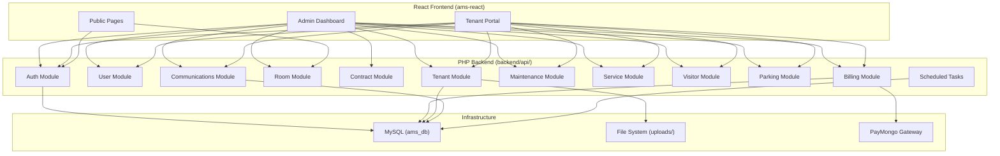
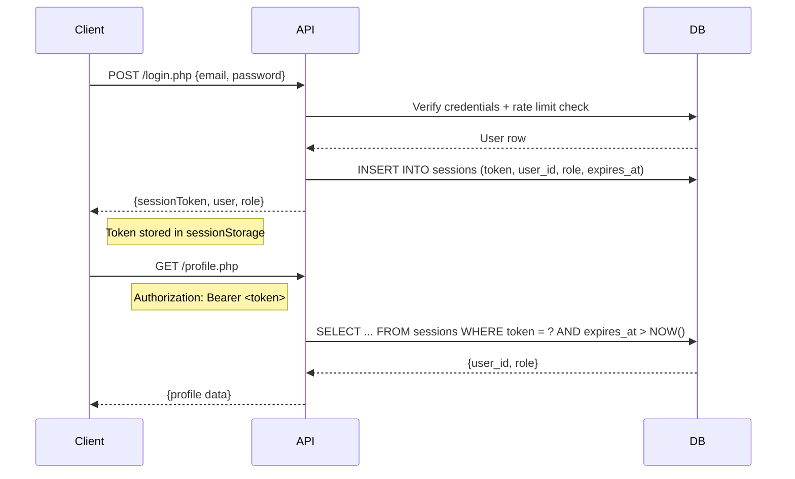
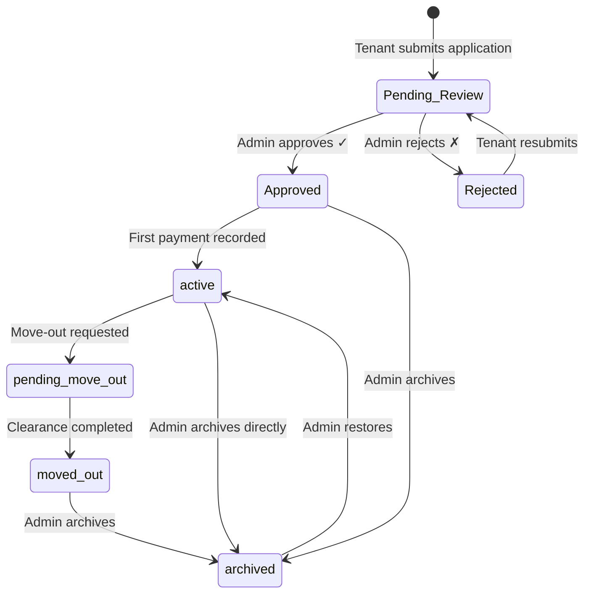
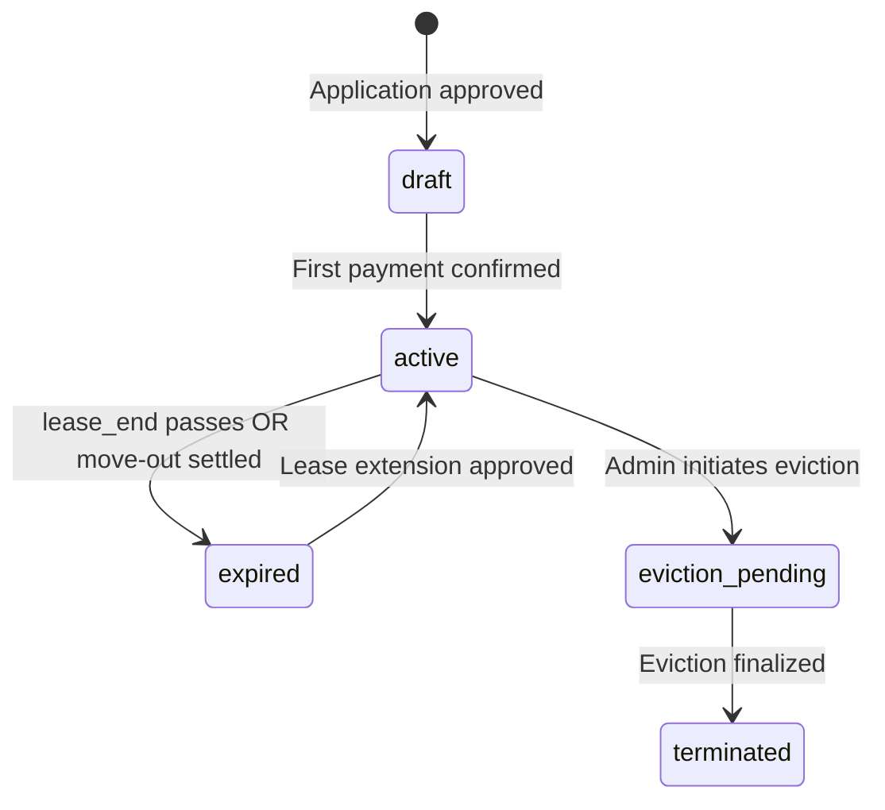
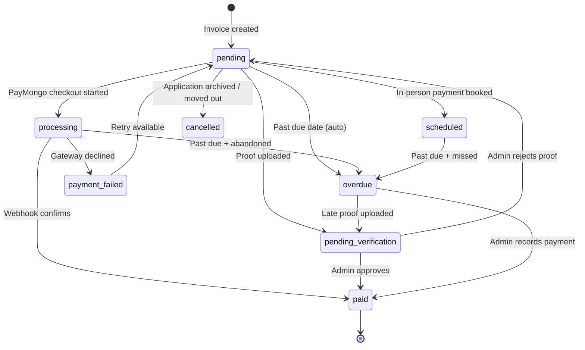
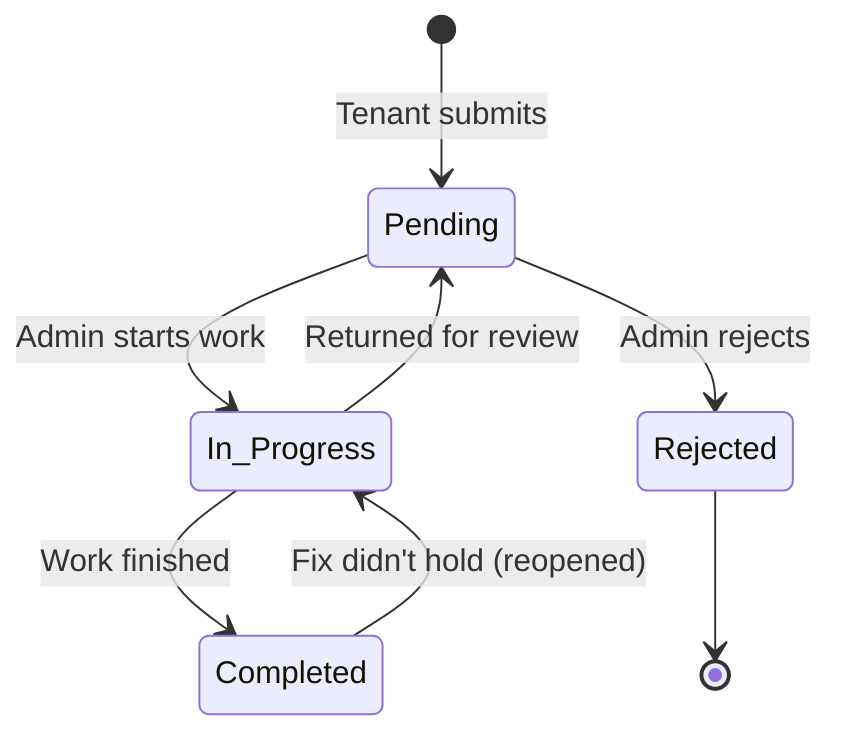
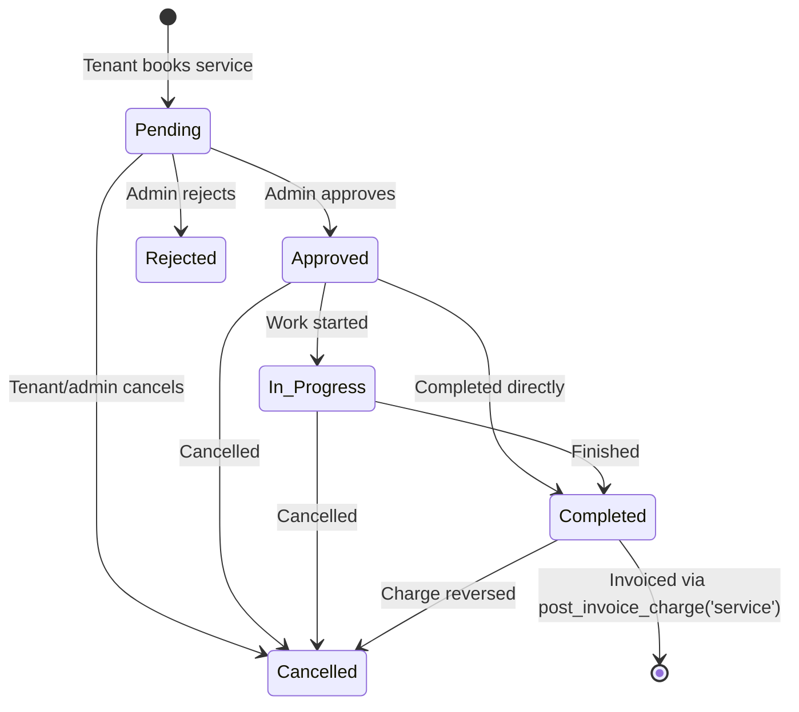

# 📘 AMS Backend API Documentation

> **Base URL:** `http://localhost/ApartmentManagementSystem_React/backend/api/`
> **Content-Type:** `application/json` (unless file upload)
> **Total Endpoints:** 155 PHP files in `backend/api/` (about 146 HTTP endpoints; the rest are helpers, includes and CLI-only schema scripts) across 15 modules. Modules 1-14 were written first; module 15 lists the endpoints added since 2026-09 and §15.7 corrects behaviour notes for earlier ones. Re-checked 2026-11-06.

---

## Table of Contents

| # | Module | Endpoints | Description |
|---|--------|-----------|-------------|
| 1 | [Authentication & Sessions](#1-authentication--sessions) | 6 | Login, registration, password management |
| 2 | [User & Profile Management](#2-user--profile-management) | 4 | User CRUD, profile updates, avatar |
| 3 | [Tenant & Application Management](#3-tenant--application-management) | 10 | Rent applications, tenant lifecycle |
| 4 | [Room / Unit Management](#4-room--unit-management) | 4 | Room CRUD, tenant room view |
| 5 | [Lease & Contract Management](#5-lease--contract-management) | 6 | Contracts, documents, lease extensions |
| 6 | [Billing & Invoices](#6-billing--invoices) | 11 | Invoice generation, payments, PayMongo |
| 7 | [Utility Management](#7-utility-management) | 5 | Meter readings, corrections, utility billing sync |
| 8 | [Maintenance Requests](#8-maintenance-requests) | 4 | Tenant maintenance tickets |
| 9 | [Service Requests](#9-service-requests) | 6 | Bookable services, catalog management |
| 10 | [Visitor Management](#10-visitor-management) | 3 | Visitor registration, check-in/out |
| 11 | [Parking Management](#11-parking-management) | 4 | Parking slot reservations |
| 12 | [Communications & System](#12-communications--system) | 12 | Notifications, announcements, settings, reports |
| 13 | [Inquiries & Reservations](#13-inquiries--reservations) | 5 | Pre-lease inquiries, unit reservations |
| 14 | [Scheduled / Cron Tasks](#14-scheduled--cron-tasks) | 6 | Automated expiry and reminder jobs, plus the CCTV request endpoints |
| 15 | [Endpoints Added Since 2026-09](#15-endpoints-added-since-2026-09) | 62 | Refunds, split / bundle / advance payments, household, guest chat, sign-in code, CCTV footage, site images |

---

## Architecture Overview



---

## Authentication Model



### Auth Functions (from [config.php](../../backend/config.php))

| Function | Purpose |
|----------|---------|
| `create_session()` | Issues a 64-char hex token, valid for 7 days |
| `get_bearer_token()` | Reads token from `Authorization` or `X-Session-Token` header |
| `get_authenticated_user()` | Returns `{id, role}` or `null` — **sole source of identity**. Role and archive state are read live from `users` |
| `revoke_user_sessions()` | Ends a user's sessions (optionally keeping the caller's) — used on password change/reset, role change, archive |
| `require_admin()` | Gate: 401/403 if not an authenticated admin; returns admin ID |
| `require_user()` | Gate: 401 if no valid session; returns `{id, role}` |
| `require_owner_or_admin()` | Gate: 403 if caller is neither the resource owner nor admin |
| `verify_admin()` | Legacy boolean check — does **not** exit on failure |

> [!IMPORTANT]
> The session token is the sole proof of identity. `config.php` overwrites any `X-User-Id` / `X-Admin-Id` header from the verified session before an endpoint runs (and removes them when there is no session), and the frontend no longer sends them. Never trust a client-supplied id for authorization.

---

## 1. Authentication & Sessions

### `POST` [login.php](../../backend/api/login.php)
Authenticates a user and issues a session token.

| Property | Detail |
|----------|--------|
| **Auth** | None (public) |
| **Rate Limit** | 5 failures per account and 20 per IP within 15 minutes (shared with `change_password.php`); a successful login clears that account's failures |
| **Audit** | Admin sign-ins are written to the activity log (`auth`) |

**Request Body:**
| Field | Type | Required | Description |
|-------|------|----------|-------------|
| `email_address` | string | ✅ | User's email |
| `password` | string | ✅ | Plaintext password |

**Response (success):**
| Field | Type | Description |
|-------|------|-------------|
| `valid` | boolean | `true` |
| `sessionToken` | string | 64-char hex session token |
| `user` | object | `{id, first_name, middle_name, last_name, suffix, email_address, role}` |
| `role` | string | `"user"` or `"admin"` |

**Error Codes:** `429` (locked out), `200` with `valid: false` (bad credentials; "archived" is only reported after a correct password)

---

### `POST` [logout.php](../../backend/api/logout.php)
Destroys the current session token.

| Property | Detail |
|----------|--------|
| **Auth** | Bearer token (graceful — no error if missing) |
| **Method** | POST |

---

### `POST` [registration.php](../../backend/api/registration.php)
Creates a new tenant user account.

| Property | Detail |
|----------|--------|
| **Auth** | None (public) |
| **Validation** | First/last name and a valid email required; password ≥ 8 chars, confirmed; unique email. Always creates a `user` (tenant) account |

**Request Body:**
| Field | Type | Required |
|-------|------|----------|
| `first_name` | string | ✅ |
| `middle_name` | string | ❌ |
| `last_name` | string | ✅ |
| `suffix` | string | ❌ |
| `email_address` | string | ✅ |
| `password` | string | ✅ |
| `conPassword` | string | ✅ |

---

### `POST` [forgot_password.php](../../backend/api/forgot_password.php)
Initiates a password reset flow by generating a SHA-256 hashed token (expires in 30 minutes).

| Property | Detail |
|----------|--------|
| **Auth** | None (public) |
| **Security** | Constant-time response (doesn't reveal email existence) |
| **Dev Mode** | Returns `dev_token` when `APP_ENV=development` |

---

### `POST` [reset_password.php](../../backend/api/reset_password.php)
Completes password reset using the token from forgot_password.

**Request Body:** `{email, token, new_password}` — password ≥ 8 chars. On success every session for the account is ended and the reset is logged (`auth`).

---

### `POST` [change_password.php](../../backend/api/change_password.php)
Changes the **caller's own** password.

| Property | Detail |
|----------|--------|
| **Auth** | `require_user()` — the account is the session's; any `email_address` in the body is ignored |
| **Rate Limit** | Wrong current passwords count towards the login lockout |
| **Effect** | Other sessions for the account are ended (this device stays signed in); logged (`auth`) |

**Request Body:** `{current_password, new_password, confirm_password}` — new password ≥ 8 chars and different from the current one.

**Response:** `{success, message, sessions_ended}` · **Errors:** `401`, `422` (wrong current password / too short / mismatch / unchanged), `429`

---

## 2. User & Profile Management

### `GET` / `POST` [profile.php](../../backend/api/profile.php)
Multi-purpose profile endpoint — fetches, updates text fields, uploads/clears avatar.

| Property | Detail |
|----------|--------|
| **Auth** | `require_user()` — always operates on caller's own account |
| **Methods** | GET (fetch), POST + `$_FILES['avatar']` (upload), POST + JSON (text update / clear) |

**GET Response:** `{first_name, middle_name, last_name, suffix, contact_no, gender, avatar_url}`

**POST (avatar upload):** multipart/form-data with `avatar` file field
- Allowed: JPG, PNG, GIF, WEBP
- MIME type validated server-side via `finfo`
- Saved to `uploads/avatars/`

**POST (text update):** JSON body
| Field | Type | Notes |
|-------|------|-------|
| `email` | string | Can change login email — must be valid and unused (`409` if taken) |
| `firstName`, `lastName` | string | Required |
| `middleName`, `suffix` | string | Optional |
| `contactNo` | string | PH mobile format validated |
| `gender` | string | Optional |
| `clearAvatar` | boolean | If `true`, clears avatar only |

> [!NOTE]
> Profile text updates are **transactional** — both `users` and `rent_applications` tables are updated atomically.

---

### `GET` / `POST` [manage_users.php](../../backend/api/manage_users.php)
Admin user management — list, edit, reset password, set role, archive/unarchive.

| Property | Detail |
|----------|--------|
| **Auth** | `require_admin()` |
| **Self-Protection** | The session admin cannot modify their own account here (`409`) |

**GET:** Returns all users with full details (sorted admins first), each with `is_self`; plus `max_admins`.

**POST Actions (JSON body with `action` + `user_id`):**

| Action | Additional Fields | Notes |
|--------|-------------------|-------|
| `update` | `first_name`, `last_name`, `email`, etc. | Valid, unused email; PH mobile format; values stored exactly as typed |
| `reset_password` | `new_password` | Min 8 chars; ends the user's sessions |
| `set_role` | `role` (`user` or `admin`) | Max 3 active admins; last admin can't be demoted; archived accounts can't be promoted; ends the user's sessions |
| `delete` | — | Soft-archives (sets `is_archived=1`); cannot archive admins; ends the user's sessions |
| `unarchive` | — | Restores archived user (`409` if not archived) |

Every action is logged under the `user` category. **Errors:** `404` unknown user, `409` rule violations, `422` invalid input.

---

### `GET` [get_users.php](../../backend/api/get_users.php)
Lightweight user list for dropdowns (admin only). Returns `{id, name, email}` for non-admin users.

---

### `GET` [get_tenants.php](../../backend/api/get_tenants.php)
Admin-only (`require_admin()`) list of all rent applications with tenant details, document paths, archive info and move-out dates — plus tenant monitoring fields: `paymentStatus` (`overdue` / `due` / `current`, from unpaid invoices), `outstandingBalance`, `overdueBalance`, `daysOverdue`, `leaseEnd` and `moveIn` from the lease contract when one exists, and `contractStatus`. Runs `promote_overdue_invoices()` first.

---

## 3. Tenant & Application Management



### `POST` [rent_application.php](../../backend/api/rent_application.php)
Submit or resubmit a rent/lease application.

| Property | Detail |
|----------|--------|
| **Auth** | `require_user()` (session; tenant role only, 403 otherwise) |
| **Content-Type** | `multipart/form-data` |
| **Duplicate Guard** | Blocks if user has active/pending application |

**Form Fields:**
| Field | Type | Required |
|-------|------|----------|
| `firstName`, `lastName` | string | ✅ |
| `middleName`, `suffix` | string | ❌ |
| `contactNo`, `email`, `gender` | string | ✅ |
| `occupants` | integer | ✅ |
| `monthsOfRent` | integer | ✅ |
| `roomName` | string | ✅ |
| `monthlyRent` | decimal | ✅ |
| `agreeTerms` | boolean | ✅ |
| `doc_<requirementId>` | file | one per active requirement (Settings → Application Requirements); replaces the old `validIdFrontFile` / `validIdBackFile` / `nbiFile` |
| `validIdBackFile` | file | ✅ (first submit) |
| `nbiFile` | file | ✅ (first submit) |
| `appId` | integer | ❌ (for resubmission) |

**File Validation:** JPG/PNG/PDF only, max 10MB, server-side MIME check

**Side Effects:**
- Syncs profile fields to `users` table
- Creates admin notification

---

### `GET` [get_applications.php](../../backend/api/get_applications.php)
Lists all rent applications with user avatars (admin only). Joins `rent_applications` ← `users`.

---

### `POST` [update_tenant_status.php](../../backend/api/update_tenant_status.php)
Admin endpoint for the full tenant lifecycle — approve, reject, schedule move-out, complete clearance.

| Property | Detail |
|----------|--------|
| **Auth** | `require_admin()` |
| **Allowed Statuses** | `Approved`, `Rejected`, `Declined`, `pending-move-out`, `moved-out` |

**On Approval (`Approved`):**
1. Validates documents + terms agreement exist
2. Applies occupant surcharge (>4 occupants → +₱1,000/person)
3. Claims room (race-safe via `status IN ('vacant','reserved')`)
4. Converts any active unit reservation
5. Creates move-in invoice (rent + 1 month deposit)
6. Creates draft lease contract
7. Sends tenant notification

**On Move-Out (`moved-out`):**
1. Vacates room, records condition
2. Settles lease contract deposit allocation
3. Cancels remaining pending invoices
4. Logs clearance notes

**On Rejection:** Records rejection_reason, notifies tenant

---

### `POST` [archive_tenant.php](../../backend/api/archive_tenant.php)
Archives a tenant application — saves pre-archive status, cancels invoices, vacates room, archives user account.

**Request Body:** `{id, archiveReason, archiveNotes}`

---

### `POST` [restore_tenant.php](../../backend/api/restore_tenant.php)
Reverses archival — restores to pre-archive status, unarchives user, undoes move-out settlement, reinstates cancelled invoices, re-occupies room if vacant.

---

### `POST` [record_move_out.php](../../backend/api/record_move_out.php)
Tenant-initiated move-out notice. Requires 15–30 days advance notice.

| Property | Detail |
|----------|--------|
| **Auth** | `require_user()` (tenant's own lease) |
| **Validation** | 15 ≤ days_ahead ≤ 30 |

---

### `POST` [update_occupants.php](../../backend/api/update_occupants.php)
Tenant requests an occupancy change — creates a pending notification for admin approval. Blocks duplicate requests.

---

### `POST` [process_tenant_request.php](../../backend/api/process_tenant_request.php)
Admin processes occupancy change or lease extension requests.

| Property | Detail |
|----------|--------|
| **Auth** | `require_admin()` |
| **Idempotent** | Claim-first pattern prevents double-processing |

**Handles:**
- **Occupancy change approval:** Recalculates rent with surcharge, updates application + room
- **Lease extension approval:** Extends months, updates room/contract, records in `lease_renewals`

---

### `POST` [cancel_request.php](../../backend/api/cancel_request.php)
Tenant cancels their own pending occupancy/lease request.

---

### `GET` [get_my_requests.php](../../backend/api/get_my_requests.php)
Returns the caller's maintenance, CCTV, parking and service requests (one UNION; service rows add `can_cancel_free` and `can_rate`; admins may pass `?userId=`).

---

## 4. Room / Unit Management

### `POST` [create_room.php](../../backend/api/create_room.php)
Creates a new vacant room/unit.

| Property | Detail |
|----------|--------|
| **Auth** | `require_admin()` |

**Request Body:**
| Field | Type | Required | Description |
|-------|------|----------|-------------|
| `id` | string | ✅ | Unit number (e.g., `"A1"`) |
| `type` | string | ✅ | Room type |
| `floor` | string | ✅ | Floor level |
| `rent` | decimal | ✅ | Monthly rent (> 0) |

---

### `GET` [get_rooms.php](../../backend/api/get_rooms.php)
Lists all rooms with rich metadata. **No auth required** (public for browsing).

Automatically calls `release_expired_reservations()` before listing.

**Response per room:**
| Field | Type | Description |
|-------|------|-------------|
| `id`, `type`, `floor` | string | Unit identity |
| `rent` | decimal | Monthly rate |
| `status` | string | `vacant`, `occupied`, `reserved`, `maintenance` |
| `tenant` | string\|null | Current tenant name |
| `leaseStart`, `leaseEnd` | date\|null | Lease period |
| `maintenanceHistory` | array | All maintenance tickets for this unit |
| `occupancyHistory` | array | All past/current tenants with lease periods |
| `leaseHistory` | array | Extension events from `lease_renewals` |

---

### `POST` [update_room.php](../../backend/api/update_room.php)
Dynamically updates room fields — supports direct tenant assignment with identity verification.

| Property | Detail |
|----------|--------|
| **Auth** | `require_admin()` |
| **Transactional** | Room update + synthetic application in single transaction |

**Updatable Fields:** `status`, `tenant_name`, `lease_start`, `lease_end`, `monthly_rent`, `occupants`, `room_condition`, `furnishing_status`, `maintenance_flag`, `last_inspection_date`

**Direct Assignment Flow** (when `status=occupied` + `user_id` provided):
1. Requires `identity_verified: true` attestation
2. Creates synthetic `Approved` rent application
3. Links user to room

---

### `GET` [my_room.php](../../backend/api/my_room.php)
Returns the current tenant's room details, lease info, contract, and pending move-in invoice status.

| Property | Detail |
|----------|--------|
| **Auth** | `require_user()` — own data only; admins can query by `?userId=` |
| **Side Effect** | Calls `expire_lapsed_contracts()` |

---

## 5. Lease & Contract Management



### `GET` [get_contracts.php](../../backend/api/get_contracts.php)
Returns lease contracts — single tenant view or admin-wide list. Includes renewal history, deposit details, document paths.

| Property | Detail |
|----------|--------|
| **Auth** | Session token; non-admin scoped to own contract |
| **Side Effect** | Calls `expire_lapsed_contracts()` |

---

### `POST` [create_contract.php](../../backend/api/create_contract.php)
Manually creates a lease contract for a rent application (admin only).

---

### `POST` [update_contract_status.php](../../backend/api/update_contract_status.php)
Changes contract status (activate, terminate, mark eviction-pending). Admin only.

---

### `POST` [upload_lease_document.php](../../backend/api/upload_lease_document.php)
Uploads signed or notarized lease document PDFs/images to a contract.

| Property | Detail |
|----------|--------|
| **Auth** | `require_user()` + `require_owner_or_admin()` |
| **File Types** | JPG, PNG, PDF, WEBP (max 10MB, MIME validated) |
| **Document Types** | `signed_lease`, `notarized_lease` |

---

### `POST` [extend_lease.php](../../backend/api/extend_lease.php)
Tenant requests a lease extension (creates a pending admin notification).

**Request Body:** `{additionalMonths}` — 1 to `MAX_RENT_AHEAD_MONTHS_CEILING` (12) months; also subject to `extension_block_reason()` and `extension_deadline_reason()`, one pending request at a time (errors are HTTP 400).

---

### `GET` [get_documents.php](../../backend/api/get_documents.php)
Returns all lease-related documents for a tenant (lease PDFs, ID scans, NBI clearance).

---

## 6. Billing & Invoices



### `POST` [create_invoice.php](../../backend/api/create_invoice.php)
Admin creates or re-issues a billing invoice.

| Property | Detail |
|----------|--------|
| **Auth** | `require_admin()` |
| **Idempotent** | Uses `ON DUPLICATE KEY UPDATE` for re-issue |
| **Guard** | Cannot re-issue over `paid`/`cancelled` invoices |

**Request Body:**
| Field | Type | Required |
|-------|------|----------|
| `userId` | integer | ❌ (resolved from unit) |
| `unit` | string | ❌ |
| `baseRent` | decimal | ✅ |
| `water`, `electricity`, `parking`, `lateFee` | decimal | ❌ |
| `dueDate` | date | ❌ (default: +15 days) |
| `billingPeriod` | string | ❌ (default: current month label) |

**Side Effects:** Creates tenant notification with amount + due date

---

### `GET` [get_invoices.php](../../backend/api/get_invoices.php)
Returns invoices — admin sees all, tenant sees own only.

| Property | Detail |
|----------|--------|
| **Auth** | `require_user()` |
| **Side Effect** | Calls `promote_overdue_invoices()` (auto-marks overdue + applies late fee) |
| **Query Param** | `?userId=` (admin can filter by tenant) |

---

### `POST` [pay_bill.php](../../backend/api/pay_bill.php)
Tenant submits a payment declaration. Updates status to `pending` (cash) or `pending-verification` (digital).

| Property | Detail |
|----------|--------|
| **Auth** | `require_user()` — scoped to own invoices |
| **Guard** | Only open-status invoices can be paid |

---

### `POST` [upload_payment_proof.php](../../backend/api/upload_payment_proof.php)
Uploads payment screenshot/receipt with reference number and sender name.

| Property | Detail |
|----------|--------|
| **Auth** | `require_user()` — own invoices; admin can act on any |
| **File Types** | JPG, PNG, WEBP, PDF (max 10MB) |
| **Guard** | Only open-status invoices accept proof |

---

### `POST` [record_payment_admin.php](../../backend/api/record_payment_admin.php)
Admin confirms/records a payment — marks invoice as `paid`, activates occupancy on first payment.

| Property | Detail |
|----------|--------|
| **Auth** | `require_admin()` |
| **Transactional** | Payment + occupancy activation + contract creation |
| **Guard** | A short amount is refused unless `partial: true` (single invoice), which records an instalment through `record_partial_payment()`; `payments[]` accepts split-method payments; a bill in `processing` returns 409 |

**On First Payment Approval:**
1. Marks invoice `paid`
2. Activates room occupancy
3. Promotes rent application to `active`
4. Creates or activates lease contract

---

### `POST` [schedule_payment.php](../../backend/api/schedule_payment.php)
Books an in-person payment appointment.

| Property | Detail |
|----------|--------|
| **Auth** | `require_user()` |
| **Validation** | Future date (max 60 days); slot: `morning`/`afternoon`/`evening` |

---

### `POST` [create_checkout_session.php](../../backend/api/create_checkout_session.php)
Creates a PayMongo checkout session for online payment.

| Property | Detail |
|----------|--------|
| **Auth** | `require_user()` |
| **Channels** | `gcash`, `paymaya`, `card`, `bank`, sandbox variants |
| **Guard** | Only open-status invoices; a `processing` invoice is refused ("already in progress"), no session is re-used; non-admins need `payment_mode` `sandbox` or `both` and the pay-bills and channel switches on (403) |

---

### `POST` [release_checkout_session.php](../../backend/api/release_checkout_session.php)
Releases a stale checkout session, allowing the tenant to retry payment.

---

### `POST` [paymongo_webhook.php](../../backend/api/paymongo_webhook.php)
PayMongo webhook receiver — handles `checkout_session.payment.paid` events.

| Property | Detail |
|----------|--------|
| **Auth** | None (webhook) — validates by matching `checkout_session_id` |
| **Idempotent** | Only processes invoices still in `processing` status |

---

### `POST` [send_payment_reminder.php](../../backend/api/send_payment_reminder.php)
Admin sends payment reminders to tenants with overdue/pending invoices. Creates notifications with invoice details.

---

### `GET` [get_payment_channels.php](../../backend/api/get_payment_channels.php)
Returns available payment channels with PayMongo sandbox configuration status.

---

## 7. Utility Management

### `POST` [save_utility_reading.php](../../backend/api/save_utility_reading.php)
Records one unit's water **and** electricity meter readings for a billing month.

| Property | Detail |
|----------|--------|
| **Auth** | `require_admin()` — `recorded_by` is the session admin |
| **Calculation** | Consumption = current − previous reading (the unit's latest earlier period); amount = consumption × rate |
| **Validation** | Unit must exist · period `YYYY-MM` · reading date not in the future or before the period · current ≥ previous · rate > 0 and ≤ 1,000 · fees ≥ 0 |
| **Errors** | `422` validation · `409` a reading already exists for this or a later period |

**Request Body:**
| Field | Type | Required |
|-------|------|----------|
| `room_name` | string | ✅ |
| `billing_period` | string `YYYY-MM` | ✅ |
| `reading_date` | date | — (today) |
| `water_curr_reading` | decimal | ✅ |
| `electric_curr_reading` | decimal | ✅ |
| `water_rate_per_unit` / `electric_rate_per_unit` | decimal | — (unit's previous rate, else 40 / 12) |
| `water_other_fees` / `electric_other_fees` | decimal | — (0) |
| `notes` | string | — |

Response includes `id`, consumption, `total_amount`, and refuses (422) a unit with no billable tenant. Modes: `entry_mode` `metered` (default), `bill` (provider amounts `water_bill_amount` / `electric_bill_amount`, meter values optional) or `total` (`total_amount`), plus extra utility types.

---

### `GET` [get_utility_readings.php](../../backend/api/get_utility_readings.php)
Lists readings. Tenants receive only their own rows (session-scoped); admins receive all and may filter with `room_name` / `billing_period`. Each row carries `water_change_pct`, `electric_change_pct`, `has_spike` (> 30% over the previous period), `billing_period_label` and `invoice_id`.

| Property | Detail |
|----------|--------|
| **Auth** | `require_user()` |

---

### `POST` [delete_utility_reading.php](../../backend/api/delete_utility_reading.php)
Deletes a reading so it can be re-recorded. Only an un-invoiced reading that is the unit's latest.

| Property | Detail |
|----------|--------|
| **Auth** | `require_admin()` |
| **Errors** | `404` · `409` already invoiced, or a later reading exists |

---

### `POST` [sync_utility_to_invoice.php](../../backend/api/sync_utility_to_invoice.php)
Posts a reading's charge onto an invoice. `sync_mode`: `merge` adds it to the tenant's adjustable invoice for that month (a utilities-only invoice is created when there is none — rent is never billed here); `separate` always creates a utilities-only invoice with `due_date` (today to +10 days); `paid` records a cash-settled utilities-only invoice.

| Property | Detail |
|----------|--------|
| **Auth** | `require_admin()` |
| **Transactional** | Reading claimed (`is_invoiced`) first; invoice write, `invoice_id` link and tenant notification commit together |
| **Errors** | `404` · `409` already synced, or the merge target already has water/electricity · `422` no billable tenant, bad mode or due date |

---

### `GET` [get_utilities_report_data.php](../../backend/api/get_utilities_report_data.php)
Aggregated utility data for a `timeframe` (`monthly`/`quarterly`/`yearly`) filtered by billing period: consumption and averages per unit-month, invoiced vs. collected utility charges (cancelled excluded), readings pending sync, spike count, top units with `hasSpike`, and — monthly — occupied units still missing a reading. `require_admin()`.

---

## 8. Maintenance Requests



### `POST` [maintenance_request.php](../../backend/api/maintenance_request.php)
Tenant submits a maintenance ticket.

| Property | Detail |
|----------|--------|
| **Auth** | `require_user()` |
| **Content-Type** | `multipart/form-data` |
| **Priority** | Always `"Needs Triage"` — admin assigns real urgency |

**Form Fields:**
| Field | Type | Required | Notes |
|-------|------|----------|-------|
| `issueType` | string | ✅ | Normalized to category enum |
| `preferredDate` | date | ✅ | Must be ≥ today |
| `preferredTime` | string | ✅ | `morning` or `afternoon` |
| `description` | string | ✅ | Issue description |
| `permissionToEnter` | boolean | ❌ | Entry consent |
| `uploadedFile` | file | ❌ | Photo/video (max 10MB; JPG, PNG, GIF, WEBP, MP4, M4V, WEBM, MOV) |

**Categories:** `Plumbing`, `Electrical`, `Structural/Physical`, `Water Supply`, `General Maintenance`, `Others`

---

### `POST` [create_maintenance_request_admin.php](../../backend/api/create_maintenance_request_admin.php)
Admin creates a maintenance ticket on behalf of a tenant (or for a common area).

---

### `GET` [get_maintenance_requests.php](../../backend/api/get_maintenance_requests.php)
Lists all maintenance tickets sorted by status priority then urgency. Admin only.

---

### `POST` [update_maintenance_status.php](../../backend/api/update_maintenance_status.php)
Admin updates ticket status, assigns urgency/priority, updates estimated cost. Validates state transitions.

**Allowed Transitions:**
| From | To |
|------|----|
| Pending | In Progress, Rejected |
| In Progress | Completed, Pending |
| Completed | In Progress (reopen) |

---

### `POST` [cancel_request.php](../../backend/api/cancel_request.php)
Tenant cancels their own pending maintenance or service request.

---

## 9. Service Requests



### `POST` [service_request.php](../../backend/api/service_request.php)
Tenant books a paid service from the catalog.

| Property | Detail |
|----------|--------|
| **Auth** | `require_user()` |
| **Pricing** | Always re-derived from DB (never from client) |
| **Quantity** | Validated against `min_quantity`/`max_quantity` |
| **Lead Time** | Preferred date must be ≥ today + `lead_time_days` |

---

### `GET` [get_service_requests.php](../../backend/api/get_service_requests.php)
Lists service requests — admin sees all, tenant sees own.

---

### `POST` [update_service_status.php](../../backend/api/update_service_status.php)
Admin updates service request status. On completion, triggers `post_invoice_charge($conn, 'service', $id)` to bill the tenant. On cancellation of a completed request, triggers `reverse_invoice_charge()`. Rejected and Cancelled need `adminNotes` (422, <= 500).

---

### `GET` / `POST` [manage_service_catalog.php](../../backend/api/manage_service_catalog.php)
Admin CRUD for the service catalog. Supports categories, pricing units, quantity limits, lead times.

---

### `GET` [get_service_catalog.php](../../backend/api/get_service_catalog.php)
Returns the active service catalog for tenants (filters by `is_active` + category toggles).

---

### `POST` [sync_service_to_invoice.php](../../backend/api/sync_service_to_invoice.php)
Admin manually triggers billing of a completed service request (calls `post_invoice_charge('service')`).

---

## 10. Visitor Management

### `GET` [get_visitors.php](../../backend/api/get_visitors.php)
Returns visitor records with overstay detection. Admin sees all; tenant sees own unit's visitors.

| Property | Detail |
|----------|--------|
| **Auth** | `require_user()` — a tenant sees only their own visitors and their unit's; `?userId=` is ignored |
| **Overstay** | Configurable via `system_settings.visitor_overstay_hours` |

---

### `POST` [check_in_visitor.php](../../backend/api/check_in_visitor.php)
Registers a visitor. A **tenant** registration goes to `pending_approval`, and the unit and host are always the tenant's own active tenancy (`403` without one). An **admin** walk-in is `checked_in` immediately; the unit must exist, and the host is the unit's current tenant. Optional `idPhoto`: JPG/PNG/WEBP up to 5 MB, validated by extension and content.

| Property | Detail |
|----------|--------|
| **Auth** | `require_user()` |
| **Errors** | `403` no active lease · `422` missing fields, unknown unit, invalid photo |

---

### `POST` [update_visitor_status.php](../../backend/api/update_visitor_status.php)
`action`: `approve` / `reject` (admin only, from `pending_approval`) or `checked_out` (admin or the owning tenant, from `checked_in`).

| Property | Detail |
|----------|--------|
| **Auth** | `require_user()`; a tenant may only act on their own visitor |
| **Errors** | `403` not permitted · `404` unknown visitor · `409` action not valid from the current status · `422` unknown action |

---

## 11. Parking Management

### `POST` [parking_reservation.php](../../backend/api/parking_reservation.php)
Tenant reserves a parking slot for a specific date range.

| Property | Detail |
|----------|--------|
| **Auth** | `require_user()` |
| **Validation** | Checks slot availability, prevents overlapping reservations |

---

### `GET` [get_parking_reservations.php](../../backend/api/get_parking_reservations.php)
Returns parking reservations — admin sees all, tenant sees own.

---

### `GET` [get_available_parking_slots.php](../../backend/api/get_available_parking_slots.php)
Returns `{occupied_count, max_slots, available_slots}` — reservations in `Pending`/`Assigned`/`Approved`/`Active` against the `max_parking_slots` setting. `require_user()`.

---

### `POST` [update_parking_status.php](../../backend/api/update_parking_status.php)
Admin approves/rejects/cancels parking reservations.

---

## 12. Communications & System

### `POST` [create_announcement.php](../../backend/api/create_announcement.php)
Admin broadcasts an announcement to all tenants via in-app notifications.

| Property | Detail |
|----------|--------|
| **Auth** | `require_admin()` |
| **Transactional** | Announcement + per-user notification insert |

**Request Body:**
| Field | Type | Required |
|-------|------|----------|
| `tag` | string | ❌ (default: `General`) |
| `title` | string | ✅ |
| `body` | string | ✅ |
| `sendTo` | string | ❌ |
| `channels` | array | ❌ (default: `['in-app']`) |

---

### `GET` [get_announcements.php](../../backend/api/get_announcements.php)
`?public=1` — the tenant feed: `require_user()`, sent announcements only. Without it — the full list including drafts and channels: `require_admin()`.

---

### `POST` [create_notification.php](../../backend/api/create_notification.php)
Creates a targeted notification for a specific user. `require_admin()`; the user must exist. Body: `{userId, title, message, type}`.

---

### `GET` [get_notifications.php](../../backend/api/get_notifications.php)
`require_user()`. A tenant gets their own inbox (any `?userId=` is ignored). An admin gets the pending action queue (`ADMIN_QUEUE_NOTIFICATION_TYPES`).

---

### `POST` [mark_notification_read.php](../../backend/api/mark_notification_read.php)
`require_user()`. With `notificationId` (or `id`): marks that one, if it is in the caller's scope (`404` otherwise). Without: marks everything in scope. Scope — a tenant's own notifications; for an admin, their own plus the admin action queue. Response includes `updated`.

---

### `POST` [delete_notification.php](../../backend/api/delete_notification.php)
`require_user()`, same scope as above. A single id outside it → `404`. Bulk clear skips anything still `Pending`. Response includes `deleted`.

---

### `GET` [get_activity_logs.php](../../backend/api/get_activity_logs.php)
The audit trail, filtered and paged on the server. `require_admin()`.

| Parameter | Detail |
|-----------|--------|
| `category` | `all` or one of `auth`, `user`, `tenant`, `unit`, `contract`, `billing`, `utilities`, `maintenance`, `service`, `inquiry`, `communication`, `system` (`422` otherwise) |
| `performer` | `all` / `admin` / `tenant` / `system` (no user) |
| `search` | Action, details, performer name or email, or a log id (`LOG-0012`) |
| `from`, `to` | `YYYY-MM-DD`, inclusive |
| `page`, `limit` | Paging; `limit` ≤ 100 (default 25) |
| `export` | `1` returns up to 5,000 matching rows and records an `Exported Activity Log` entry |

**Response:** `{logs[], total, page, limit, pages, categories, categoryCounts}` — each log has `id, category, categoryLabel, action, details, createdAt, performedBy, performerName, performerEmail, performerRole`.

---

### `GET` / `POST` [get_system_settings.php](../../backend/api/get_system_settings.php) / [update_system_settings.php](../../backend/api/update_system_settings.php)
Read/write system-wide configuration. `update_system_settings.php` is `require_admin()`: keys must match `[A-Za-z0-9_]`, arrays are stored as JSON, only changed values are written, and the activity-log entry names the keys that changed (secret keys shown as "value hidden"). Response includes `changed`.

**Known Settings:**
| Key | Type | Description |
|-----|------|-------------|
| `late_fee_enabled` | boolean | Enable automatic late fees |
| `late_fee_type` | string | `flat` or `percent` |
| `late_fee_value` | decimal | Fee amount or percentage |
| `occupant_surcharge_per_person` | decimal | Extra rent per person > 4 occupants |
| `visitor_overstay_hours` | integer | Hours before visitor flagged as overstay |

---

### `GET` [dashboard_stats.php](../../backend/api/dashboard_stats.php)
Returns dashboard statistics for admin. `require_admin()`; runs `promote_overdue_invoices()` first.

**Response Stats Include:**
- Revenue totals (current, last month, trend)
- Pending/overdue dues across every open invoice status (`BILLING_OPEN_STATUSES`)
- Tenant counts (active, pending)
- Occupancy rate
- Maintenance ticket breakdown
- Collection rate for the month (cancelled invoices excluded)
- Monthly income chart data (6 months, cancelled excluded)
- Action queues (applications, open invoices, maintenance) and recent activity log
- `attention`: what the admin has to act on, one count per Dashboard "Needs your attention" line (fixed number of queries, never per row; read-only):
  - Money: `proofs_to_verify`, `cash_visits`, `failed_payments` (distinct tenants), `overdue_invoices`, `overdue_tenants` (a past-due bill; advance-rent invoices are a prepayment and never count), `refunds_to_review`, `readings_to_invoice`.
  - Tenants: `applications_to_review` (Pending Review + Pending Deposit), `move_in_due` (Approved), `move_out_requests`, `requests_to_decide` (admin-queue notifications), `new_inquiries`.
  - Contracts: `eviction_pending`, `contracts_missing_docs` (draft/active/eviction-pending without the signed or notarized file), `contracts_draft`, `contracts_ending` within `contracts_ending_days` (setting `lease_end_reminder_days`, 0 allowed).
  - Building: `maintenance_urgent` (Pending/In Progress), `maintenance_triage` (Pending), `visitors_pending`, `visitors_overstayed` (setting `visitor_overstay_hours`), `parking_requests`, `cctv_requests`, `service_requests`.
  - If one group's query fails the group's keys are left out and `attention.incomplete` is `true` (logged server-side); the rest of the response is unaffected. The page then never shows "All caught up".
  - Each count equals the rows of the page its line links to (`/admin-payments?status=overdue`, `/admin-maintenance?priority=Urgent&scope=open`, …).

---

### `GET` [get_report_data.php](../../backend/api/get_report_data.php)
Generates detailed report data for `/admin-reports` and its exports — the largest API file.

| Property | Detail |
|----------|--------|
| **Auth** | `require_admin()`; runs `promote_overdue_invoices()` first |
| **Parameters** | `timeframe` (`monthly`/`quarterly`/`yearly`), `month`, `quarter`, `year` |
| **Report Types** | Financial (income statement, revenue streams incl. late fees, unit income, 6-month trend), occupancy, maintenance, tenant, parking |
| **Expenses** | Recorded maintenance cost (`COALESCE(actual_cost, estimated_cost)`, tenant-responsible excluded, dated by resolution) + `report_overhead_pct` setting (absent = 0%) |
| **Arrears** | Every `BILLING_OPEN_STATUSES` invoice past its due date |

---

## 13. Inquiries & Reservations

### `POST` [submit_inquiry.php](../../backend/api/submit_inquiry.php)
Public or tenant-submitted unit inquiry with rate limiting and duplicate detection.

**Request Body:**
| Field | Type | Required |
|-------|------|----------|
| `full_name` | string | ✅ |
| `email` | string | ✅ |
| `contact_no` | string | ✅ |
| `room_name` | string | ❌ |
| `occupants` | integer | ❌ |
| `preferred_move_in` | date | ❌ |
| `message` | string | ❌ |

`occupants`: a whole number from 1 to `max_occupants_per_unit` (Settings → Rental). `preferred_move_in`: `YYYY-MM-DD` from today up to `inquiry_move_in_max_months` months ahead (default 6; `inquiry_move_in_latest()`). Invalid input → `422` with `errors` keyed by field (`full_name`, `email`, `contact_no`, `room_name`, `occupants`, `preferred_move_in`) via `validation_fail()`; more than 3 inquiries a day per email or IP → `429`.

---

### `GET` [get_inquiries.php](../../backend/api/get_inquiries.php)
Returns all inquiries with contact details and status. Admin only.

---

### `POST` [update_inquiry_status.php](../../backend/api/update_inquiry_status.php)
Admin manages inquiry lifecycle — schedule viewing, add notes, convert to reservation, close.

---

### `POST` [create_reservation.php](../../backend/api/create_reservation.php)
Admin creates a unit reservation (hold) — links to an inquiry, sets hold period, marks room as `reserved`.

---

### `POST` [update_reservation_status.php](../../backend/api/update_reservation_status.php)
Admin cancels or converts a reservation. Releasing a reservation returns the room to `vacant`.

---

## 14. Scheduled / Cron Tasks

These endpoints are designed to be called periodically (cron job or admin-triggered):

### `GET`/`POST` [expire_contracts.php](../../backend/api/expire_contracts.php)
Calls `expire_lapsed_contracts()` — marks active contracts with `lease_end < today` as `expired`.

### `GET`/`POST` [expire_reservations.php](../../backend/api/expire_reservations.php)
Calls `release_expired_reservations()` — marks lapsed unit holds as `Expired`, returns rooms to `vacant`.

### `GET`/`POST` [check_due_date_reminders.php](../../backend/api/check_due_date_reminders.php)
Automated reminder sweep — sends notifications to tenants with invoices due within configurable days.

### CCTV Module

### `POST` [cctv_request.php](../../backend/api/cctv_request.php)
Tenant requests CCTV footage review.

### `GET` [get_cctv_requests.php](../../backend/api/get_cctv_requests.php)
Lists CCTV requests. Admin sees all; tenant sees own.

### `POST` [update_cctv_status.php](../../backend/api/update_cctv_status.php)
Admin approves/rejects CCTV footage requests.

---

## 15. Endpoints Added Since 2026-09

Endpoints added or split out after the modules above were written (verified against the code on 2026-11-06). Same conventions: JSON body unless noted, `{success:false, message}` on error, `validation_fail()` answers 422 with `{success, message, errors:{field:msg}, field}`. Identity always comes from the session; `X-User-Id` / `X-Admin-Id` are overwritten by `config.php`.

### 15.1 Payments, bundles and refunds

| Endpoint | Auth | Request | Response / errors | Effects |
|---|---|---|---|---|
| `POST` [adjust_invoice.php](../../backend/api/adjust_invoice.php) | admin | `invoiceId`, `reason` (5-255), optional `baseRent`, `water`, `electricity`, `parking`, `lateFee` (>= 0), `dueDate` (`Y-m-d`, not in the past unless unchanged) | `{success, message, invoice_id, total_amount}`; 404; 409 advance invoice, status not adjustable (pending, unpaid, overdue, scheduled, payment-failed) or row changed; 422 bad value, total <= `amount_paid`, nothing changed | Updates `invoices` under `FOR UPDATE`, inserts `invoice_adjustments`; tenant notified if the total moved; log `billing` |
| `POST` [reject_payment_proof.php](../../backend/api/reject_payment_proof.php) | admin | `invoiceId` (may be a `payment_group`), `reason` (3-255) | `{success, message}`; 409 no proof awaiting verification; 422 | Invoice back to pending / overdue, clears proof and reference, sets `proof_rejection_reason`, `clear_payment_proof_parts`, tenant notice + e-mail; log `billing` |
| `POST` [submit_split_payment.php](../../backend/api/submit_split_payment.php) | tenant (admin 403) | multipart: `invoice_id` (invoice or group), `parts` (JSON, 2 portions across cash / GCash / bank), optional `amount` (single bill only), `scheduled_date` (<= +60 days) + `scheduled_time_slot` when a portion is cash, `proof_<i>` (JPG/PNG/WEBP/PDF, 10 MB) | `{success, message}`; 409 bill not open / processing / duplicate / reference reuse blocked; 422 | Replaces `payment_proof_parts`, invoice -> `pending-verification` (`SPLIT_PAYMENT_LABEL`), admin queue `payment_verification`; log `billing` |
| `POST` [bundle_payment.php](../../backend/api/bundle_payment.php) | tenant | `action` `create` or `release` (+ `key` for release) | create: `{key, invoices[{id, billing_period, amount}], total}` (amounts are balances); 409 already awaiting / already submitted; 422 fewer than two unpaid bills or none overdue | Sets `invoices.payment_group` (`BND-`); log `billing` |
| `GET` / `POST` [advance_payment.php](../../backend/api/advance_payment.php) | tenant (admin 403) | GET none. POST `{action:'create', months}` (1-6, `ADVANCE_PAYMENT_MAX_MONTHS`) or `{action:'cancel', invoice}` (legacy `group:'ADV-...'`) | GET `{available, monthly_rent, lease_end, months[], pending, credits}`; create `{invoice_id, months, total, due_date}`; 403 no active tenancy; 409 open advance exists / cannot cancel; 422 | Inserts an advance `invoices` row + `advance_credits` (`reserved`); cancel voids both; log `billing` |
| `POST` [create_refund_request.php](../../backend/api/create_refund_request.php) | tenant (admin must pass `user_id`) | `type` `advance` / `overpayment`, `reason` (<= 1000), `amount` (> 0), `invoice_id` for overpayment | `{success, message, id}`; 400; 404; 409 concurrent claim or not whole months; 422 nothing refundable / over the maximum | `insert_refund_request()` under a user-row lock; advance credits held (`refund_request_id`); admin queue; log `billing` |
| `GET` [get_refund_requests.php](../../backend/api/get_refund_requests.php) | user (tenant: own; admin: all, optional `status`, `user_id`) | - | `{requests[{id, type, amount, status, decisionReason, payoutMethod, payoutReference, canRefundOnline, gatewayRefundId, gatewayStatus, raisedByRole, events[] ...}], eligible?}` (max 300) | none |
| `POST` [respond_refund_request.php](../../backend/api/respond_refund_request.php) | tenant (own) | `id`, `action` `reply` / `cancel`, `message` (reply, <= 1000) | `{status}`; 409 not `Info Requested` or transition not allowed | Updates request + `refund_request_events`; cancel frees the credits; log `billing` |
| `POST` [update_refund_request.php](../../backend/api/update_refund_request.php) | admin | `id`, `action` `approve` / `reject` / `request_info` / `mark_refunded`, `message` (reject, request_info), for `mark_refunded` either `gateway:true` (PayMongo refund, >= ₱1.00) or `payout_method` + `payout_reference` | `{status}`; 409 illegal transition (`REFUND_TRANSITIONS`) or gateway refund already `requesting`; 422; 502 PayMongo refused; 500 PayMongo accepted but AMS failed to record (do not retry) | Updates request + events, advance credits `refunded` / freed, tenant `refund_update` notice; log `billing` |
| `POST` [sync_maintenance_to_invoice.php](../../backend/api/sync_maintenance_to_invoice.php) | admin | `id` (maintenance request) | `{invoiceId}`; failures are HTTP 200 with `success:false` | `post_invoice_charge('maintenance')`; log `billing` |
| `POST` [sync_parking_to_invoice.php](../../backend/api/sync_parking_to_invoice.php) | admin | `reservation_id`, `period` (`YYYY-MM`, default current), `action` `post` / `reverse` | `{invoice_id, already_billed}`; 404; 409; 422 | `post_invoice_charge` / `reverse_invoice_charge('parking')`; log `billing` |

> Reference lookups: `payment_transactions` and `payment_proof_parts` carry the generated `reference_norm` used by the duplicate-reference policy (see [database_schema.md](database_schema.md)).

### 15.2 Rent, units and applications

| Endpoint | Auth | Request | Response / errors | Effects |
|---|---|---|---|---|
| `POST` [admin_extend_rent.php](../../backend/api/admin_extend_rent.php) | admin | `roomId`, `addMonths`, optional `newRent` (> 0), `overrideConflict` | `{newLeaseEnd, holdoverInvoices}`; 409 no tenant or `ExtensionRefused` (overdue bills, scheduled move-out; carries `conflict.applications[]`); 422 | `extend_tenancy()` in one transaction, tenant notified, competing applicants notified on override; log `contract` |
| `POST` [schedule_move_in.php](../../backend/api/schedule_move_in.php) | admin | multipart: `id`, `move_in_date` (today to +365 d), `message` (<= 1000), optional `attachment` (JPG/PNG/PDF, 10 MB) | `{success}`; 409 not Approved or deposit invoice unpaid; 422 | Sets `move_in_date`, `move_in_notified_at`, tenant notice + e-mail, admin queue; log `tenant` |
| `POST` [cancel_application.php](../../backend/api/cancel_application.php) | applicant (own) | `id`, `reason` (3-255) | `{success}`; 409 not Approved / Pending Review, or part of the move-in bill already paid | `transition_application(..., 'Cancelled')`, `release_application_holds()`, voids move-in invoices, e-mails |
| `POST` [resubmit_date.php](../../backend/api/resubmit_date.php) | applicant (own) | `id`, `preferred_move_in_date` | `{success}`; 400 status changed; 422 | `Action Required` -> `Pending Review`; admin queue; log `tenant` |
| `GET` [get_application_requirements.php](../../backend/api/get_application_requirements.php) | user (admin `?all=1` includes inactive) | - | `{requirements[]}` | none |
| `POST` [manage_application_requirements.php](../../backend/api/manage_application_requirements.php) | admin | `action` `create` / `update` / `reorder` / `deactivate` / `activate`, `label` (2-60), `label_fil`, `is_required`, `sort_order`, `id`, `ids[]` | `{requirements[]}`; 409 already (in)active; 422. Max 12 active, labels unique | Writes `application_requirements`; log `system` |
| `POST` [apply_floor_rate.php](../../backend/api/apply_floor_rate.php) | admin | `floor`, `preview` | `{rate, updated, skippedCustom, skippedOccupied}`; 422 no floor rate | Sets `rooms.monthly_rent` on vacant, non-custom units; log `unit` |
| `POST` [archive_room.php](../../backend/api/archive_room.php) | admin | `id` | `{success}`; 409 occupied, active application or reservation; 503 column missing | Sets `rooms.archived_at` / `archived_by`; log `unit` |
| `POST` [set_unit_maintenance.php](../../backend/api/set_unit_maintenance.php) | admin | `unitId`, `action` `start` / `complete`, `completionDate` (required for start, not in the past), `notes` | `{availableDate, maintenanceFlag}`; 409 occupied; 422 | Updates `rooms` (flag, `available_date`, condition); log `unit` |
| `POST` [upload_room_images.php](../../backend/api/upload_room_images.php) | admin | multipart `room_id`, `images[]` (max 8 per unit) | `{gallery}`; 422 | Updates `rooms.gallery`; log `unit` |
| `POST` [update_room_image.php](../../backend/api/update_room_image.php) | admin | `room_id`, `path`, `alt` (<= `GALLERY_ALT_MAX`), `fit` (`GALLERY_FITS`) | `{gallery}`; 404 | Updates the gallery item |
| `POST` [delete_room_image.php](../../backend/api/delete_room_image.php) | admin | `room_id`, `path` | `{gallery}`; 404 | Removes the item and unlinks the file |
| `POST` [save_contract_template.php](../../backend/api/save_contract_template.php) | admin | `template`, `note`, `base_version` | `{changed, version, id}`; 409 version conflict (carries the current `version`) | New `contract_template_versions` row; log `contract` |
| `GET` [get_contract_template.php](../../backend/api/get_contract_template.php) | user (`history`, `default` and `full` are admin) | `history`, `default`, `version_id` | template + `version`, `terms_version`, `is_default`; 403 a tenant asking for a version that is not theirs; 404; 422 | none |

### 15.3 Household, waitlist and expenses

| Endpoint | Auth | Request | Response / errors | Effects |
|---|---|---|---|---|
| `GET` / `POST` [household_members.php](../../backend/api/household_members.php) | user (admin read-only via `?userId=`) | POST `action:'add'` (`fullName` 2-150, `relationship`, optional PH `contactNo`, `age` 0-120, required for a Child who must be <= 17) or `action:'remove'` (`memberId`) | GET `{hasLease, leaseHolder, roomName, occupants, maxOccupants, relationships, ageCategories, minAge, childFloorRule, members[]}`; 403; 404; 409 duplicate / cap / removal pending; 422 (age, floor rules) | Adds a `Pending` row or sets `removal_requested_at`; notice `household_request` for admin approval; log `tenant` |
| `GET` / `POST` [manage_waitlist.php](../../backend/api/manage_waitlist.php) | admin | POST `action:'add'` (`inquiryId`, optional `roomName`) or `'remove'` (`id`) | GET `{entries[]}`; 404; 409 inquiry closed, unit vacant or already waitlisted | `unit_waitlist`; `waitlist_update` notice; log `inquiry` |
| `GET` / `POST` [manage_expenses.php](../../backend/api/manage_expenses.php) | admin | GET `?month=YYYY-MM`; POST `action` `create` / `update` / `delete`, `category` (utilities, supplies, salaries, repairs_common, taxes_fees, insurance, other), `amount` (0-10,000,000), `expenseDate` (<= tomorrow), `description` (<= 255) | `{expenses[], categories}`; 404; 422 | `expenses`; log `billing` |
| `GET` / `POST` [monitor_followups.php](../../backend/api/monitor_followups.php) | admin | POST `kind` `payment` / `document`, `id` | GET `{payments[], documents[], counts}`; 409 reminder already sent today | `send_followup_nudge()`; syncs the admin queue; log `billing` |
| `GET` / `POST` / `PUT` / `DELETE` [house_rules.php](../../backend/api/house_rules.php) | GET public; writes admin | GET `?scope=house|parking|minors|all`; POST/PUT `category`, `title` (<= 255), `title_fil`, `description`, `description_fil`, `is_highlight`, `is_active`, `sort_order`, `scope`; PUT `{action:'reorder', rules:[{id}]}`; DELETE `{id}` (soft) | `{rules[]}` / `{id}`; 404; 422. "Visitors & Guests" is hidden from non-admins when visitor management is off | `house_rules` |
| `GET` / `POST` / `PUT` / `DELETE` [manage_utility_types.php](../../backend/api/manage_utility_types.php) | GET user (admin `?all=1`); writes admin | `name` (<= 60), `unit_label` (<= 20), `billing_mode` `metered` / `flat`, `default_rate` (0-100000), `is_active`; DELETE `{id}` (sets inactive) | `{types[]}`; 404; 422 | `utility_types`; log `utilities` |
| `POST` [upload_utility_bill.php](../../backend/api/upload_utility_bill.php) | admin | multipart `reading_id`, `bill` (JPG/PNG/PDF, 10 MB) or `remove=1` | `{bill_file_path}`; 404; 422 | `utility_readings.bill_file_path`; tenant notice on attach; log `utilities` |

### 15.4 Services, maintenance and CCTV

| Endpoint | Auth | Request | Response / errors | Effects |
|---|---|---|---|---|
| `GET` [get_service_categories.php](../../backend/api/get_service_categories.php) | public | - | `{categories[{id, key, label, labelFil, sortOrder, itemCount, builtin}]}` | none |
| `POST` [manage_service_categories.php](../../backend/api/manage_service_categories.php) | admin | `action` `create` / `update` / `delete`, `label` (<= 60, unique), `labelFil`, `id` | `{id, key}` on create; 409 built-in or still has services; 422 | `service_categories`; log `service` |
| `GET` [get_service_availability.php](../../backend/api/get_service_availability.php) | user | `serviceId`, `date` (`Y-m-d`) | `{slots:{morning:{limit, taken, full}, afternoon:{...}}}`; 404; 422 | none |
| `POST` [rate_service_request.php](../../backend/api/rate_service_request.php) | tenant (own) | `id`, `rating` (1-5), `comment` (<= 255) | `{success}`; 409 not Completed, already rated, past `SERVICE_RATING_DAYS`; 422 | Updates `service_requests`; admins notified; log `service` |
| `POST` [reopen_maintenance_request.php](../../backend/api/reopen_maintenance_request.php) | tenant (own) | `id`, `reason` (<= 255) | `{success}`; 409 not Completed, older than `MAINTENANCE_REOPEN_DAYS`, already invoiced | Back to `In Progress`, stores `reopen_reason`; admin queue; log `maintenance` |
| `POST` [attach_cctv_footage.php](../../backend/api/attach_cctv_footage.php) | admin | multipart `id`, exactly one of `file` (mp4, m4v, webm, mov, jpg, png, webp; 25 MB) or `url` (https, <= 500) | `{footageKind, footageExpiresAt}`; 404; 409 not Approved; 413; 422 | Sets footage columns (expiry = `cctv_footage_days`), tenant notified (in-app, SMS, e-mail); log `service` |
| `POST` [remove_cctv_footage.php](../../backend/api/remove_cctv_footage.php) | admin | `id` | `{success}`; 404 none attached | Clears footage, deletes the file; log `service` |
| `GET` [open_cctv_footage.php](../../backend/api/open_cctv_footage.php) | owner or admin (`?token=` accepted) | `?id=` | 302 to `footage_url`; 403; 404; 410 expired | `log_cctv_footage_view` |
| `GET` [download_file.php](../../backend/api/download_file.php) | per file: owner or admin; admin only for visitor ID photos; chat participants; notification recipients; guest with `X-Guest-Token` for guest chat media (Bearer header or `?token=`) | `?path=uploads/<folder>/<file>` | the file (inline, `nosniff`); 400; 401; 403; 404 (also when no DB row references the path); 410 CCTV footage expired | none (CCTV views are logged) |
| `GET` / `HEAD` [public_file.php](../../backend/api/public_file.php) | public (no DB) | `?path=<room_images|qr_codes|site_assets>/<file>` (jpg, png, gif, webp) | the image, cached 30 days, ETag / 304; 400; 404 | none |

### 15.5 Chat, guest chat and notifications

| Endpoint | Auth | Request | Response / errors | Effects |
|---|---|---|---|---|
| `POST` [send_message.php](../../backend/api/send_message.php) (`save_message.php` just includes it) | signed-in session (no role check; see security_audit CH-3) | `receiver_id`, `message`, `reply_to_id`, `attachment` (JPG/PNG/GIF/WEBP 10 MB, MP4/WEBM/MOV 25 MB) | `{message{...}}`; 400; 404; 413; 415 | `messages`; log `chat`. Realtime delivery is the Socket.IO sidecar's job |
| `GET` [get_chat_history.php](../../backend/api/get_chat_history.php) | signed-in session | `other_user_id`, `mark_as_read` | `{messages[]}`; 400; 401 | optionally marks received messages read |
| `GET` [get_conversations.php](../../backend/api/get_conversations.php) | signed-in session | `search` | `{conversations[]}` with last message and `unread_count` | none |
| `GET` [get_admin_user.php](../../backend/api/get_admin_user.php) | signed-in session | - | `{user}` (lowest-id admin); 404 | none |
| `GET` / `POST` [guest_chat.php](../../backend/api/guest_chat.php) | guest (`X-Guest-Token`, 64 hex) or admin (`thread_id`) | POST `message` (<= 4000) or `attachment`, `reply_to_id` | GET `{thread, messages[]}`; 401; 404; 413; 415; 422; 429 (20 messages/hour per guest) | `guest_messages`; admin queue; admin reply e-mails the guest once per unseen batch |
| `GET` [get_guest_conversations.php](../../backend/api/get_guest_conversations.php) (`guest_chat_inbox.php` includes it) | admin | - | `{conversations[]}` de-duplicated by e-mail / phone | none |
| `POST` [guest_chat_resume.php](../../backend/api/guest_chat_resume.php) | public | `action:'request'` + `email`, or `action:'redeem'` + `code` (64 hex) | request: always the same message (3/hour per e-mail, 10/hour per IP, 429); redeem: `{guest_token, thread_id}`; 410 expired / used | `guest_chat_links` single use; sets `guest_verified_at` |
| `GET` [get_notification_preferences.php](../../backend/api/get_notification_preferences.php) | user | - | `{preferences[], always_on[], channels, sms_opt_out, email_opt_out, ...}` | none |
| `POST` [update_notification_preferences.php](../../backend/api/update_notification_preferences.php) | user | `preferences` (`{category: bool}` or `{category: {in_app, sms, email}}`), `sms_opt_out`, `email_opt_out` | `{changed}`; 422 unknown category | Upserts `notification_preferences`; log `user` |
| `POST` [archive_notification.php](../../backend/api/archive_notification.php) | user (own) | `notificationId` (omit to archive all non-Pending) | `{archived}`; 404; 409 still Pending | `notifications.is_archived = 1` |
| `POST` [send_test_notification.php](../../backend/api/send_test_notification.php) | admin | `channel` `sms` / `email` / `both` | `{dry_run, drivers, results{...}, rendered{...}}` | sends only to the calling admin; log `system` |
| `GET` [get_sms_balance.php](../../backend/api/get_sms_balance.php) | admin | - | `{provider, credit_balance, account_status, cached}`; provider errors are HTTP 200 with `success:false` (cached 60 s) | none |

### 15.6 Sign-in, e-mail and site appearance

| Endpoint | Auth | Request | Response / errors | Effects |
|---|---|---|---|---|
| `POST` [verify_device.php](../../backend/api/verify_device.php) | public (login flow) | `email_address`, `otp` (6 digits) | `{valid:true, role, user, sessionToken}` + `ams_trusted_device` cookie (1 year); wrong / expired code is HTTP 200 `valid:false`; 400 malformed | Clears the code, inserts `trusted_devices`, creates the session; 3 wrong tries lock the code |
| `GET` / `POST` [login_otp_settings.php](../../backend/api/login_otp_settings.php) | admin | GET `?q`, `?filter=all|active|past|non_tenant|custom`, `?page` (20 per page); POST `set_global` (`enabled`), `set_user` (`user_id`, `mode` `default` / `on` / `off`), `clear_overrides` | `{enabled, counts, users[], total, page, per_page}`; 404; 422 | `system_settings.login_otp_enabled`, `users.login_otp_mode`; log `auth` |
| `POST` [verify_email.php](../../backend/api/verify_email.php) | public | `token` (64 hex) | `{success}`; unknown / used token is HTTP 200 `success:false`; 400 malformed | Sets `email_verified_at`, clears the token |
| `GET` [get_glass_backgrounds.php](../../backend/api/get_glass_backgrounds.php) | admin | `kind` `glass` / `preview` | `{backgrounds, limit}` | none |
| `POST` [upload_glass_background.php](../../backend/api/upload_glass_background.php) | admin | multipart `background` (content-checked, 640-8000 px) | `{image_path, backgrounds[]}` | file kept in a rolling list; goes live only when settings are saved; log `system` |
| `POST` [upload_preview_image.php](../../backend/api/upload_preview_image.php) | admin | multipart `image` | same | same, for the Preview hero |
| `POST` [delete_glass_background.php](../../backend/api/delete_glass_background.php) | admin | `path`, `kind` | `{backgrounds}`; 409 it is the live photo; 422 | deletes the file; log `system` |
| `POST` [upload_qr_image.php](../../backend/api/upload_qr_image.php) | admin | multipart `slot` (1-3, `QRPH_SLOT_COUNT`), `qr_image` (JPG/PNG/WEBP/GIF, 5 MB; Payment Options crops it to a square PNG in the browser first, or sends it as is) | `{image_path, slot}`; 422 | file in `qr_codes/`; the path is saved with the settings; log `payment` |

> `auth_email.php` is a helper (`send_auth_email()`, not an endpoint). `apply_live_schema_fix.php`, `audit_live_schema.php`, `final_schema_patch.php` and `sync_live.php` are CLI-only schema scripts that answer 403 over HTTP; they are one-offs superseded by `cron/migrate.php` and candidates for removal.

### 15.7 Corrections and details for earlier modules (2026-11-06)

Behaviour that the sections above no longer describe fully. The code wins; endpoint names link to the module section.

| Endpoint | Current behaviour |
|---|---|
| login.php | Unverified e-mail: HTTP 200 `valid:false`, `email_verification_required:true`. A non-admin on an untrusted device gets `{status:'device_verification_required', valid:false}` and a 6-digit code by e-mail (finish with `verify_device.php`); skipped for admins, demo domains (non-production), accounts with codes off and a valid `ams_trusted_device` cookie. Lockout: 5 failures per account + IP, 25 per account across IPs, 20 per IP, 15-minute window. `user` also returns `contact_no`, `gender`. Optional `guest_token` adopts a guest chat. |
| registration.php | Stores a `verification_token` and e-mails a link (`email_delivery_failed` in the response if it could not be sent); sign-in is refused until verified. Max lengths 30 / 50 / 30 / 20 / 190, `password_policy_error()`, IP rate limit (429). Validation errors are HTTP 200 with `success:false`. |
| rent_application.php | Session auth, tenant role only. Extra fields: `previousAddress` (5-255, required), `isAsap`, `preferredMoveInDate`. `occupants` <= `max_occupants_per_unit`; `monthsOfRent` from `min_lease_duration` to 24; `monthlyRent` is ignored (re-read from the room). Resubmit only from Rejected / Declined (else 409). |
| get_rooms.php | Guests and tenants get `id, type, floor, rent, status, roomCondition, furnishingStatus, images, availableDate, availableFrom`. Admins also get `tenant`, `leaseStart`, `leaseEnd`, `lastTenant`, `maintenanceFlag`, `occupants`, `lastInspectionDate`, `extensionRange`, `maintenanceHistory`, `occupancyHistory`, `leaseHistory`. Expired reservations are released at most once a minute. |
| update_room.php | `status`, `tenant_name`, `occupants`, `last_tenant`, `lease_start`, `lease_end` are refused (422, "Use Extend Rent") outside the assign flow. Assigning a tenant sets the room to `reserved`, creates the move-in invoice and a draft contract (`issue_move_in_billing()`) and notifies the tenant; the unit becomes occupied only after the move-in is paid and confirmed. `monthly_rent` > 0 sets `rent_is_custom`; `available_date` is editable. |
| my_room.php | Admin lookup also by `?email=`; `?summary=1` returns only the latest application status. |
| get_invoices.php | A tenant must send `?userId=<self>` (without it the call is admin-only, 403). The overdue promotion and auto-cancel of invoices of cancelled / rejected applications run at most once a minute. |
| pay_bill.php | A non-cash method needs a proof already stored by `upload_payment_proof.php` (422 otherwise). "In-Person Payment" is stored as `Cash on Hand`. `invoiceId` may be an advance-payment group id. A cash declaration queues an admin item. |
| upload_payment_proof.php | Also takes `amount` (instalment, checked against the balance), `bank_name` (required for bank methods) and `sender_name`; the proof file is required. Tenants get 403 when pay-bills is off, `payment_mode` is `sandbox` or the channel is off. |
| create_checkout_session.php | Body `{invoice_id, channel}`; channels `gcash`, `gcash_sandbox`, `paymaya`, `maya`, `bank`, `bank_sandbox`, `card`; `invoice_id` may be an advance group id. |
| paymongo_webhook.php | Authenticated by the `Paymongo-Signature` header (HMAC-SHA256 over `t.payload`, 300 s freshness; 400 / 401 / 500 on failure). Handles `checkout_session.payment.paid` (settles any open, non-paid invoice), `payment.failed` (`processing` -> `payment-failed`, tenant notified) and refund events (`refund_requests.gateway_status`). An amount mismatch goes to `pending-verification` with an admin queue item; stale or cancelled payments call `raise_unapplied_payment`. |
| service_request.php | Fields `serviceId`, `preferredDate` (<= `SERVICE_MAX_ADVANCE_DAYS`), `preferredTimeSlot` (morning / afternoon), `quantity` (whole for `item`, 1 for `session`), `notes`, optional `uploadedFile` (JPG/PNG/GIF/WEBP/PDF). Needs an active tenancy (403), a duplicate booking is 409, a full slot is 409, a disabled category blocks the booking. |
| maintenance_request.php | File field `uploadedFile`; 403 when `service_maintenance_active` is off or the tenant has no active tenancy; response includes `id`. |
| cancel_request.php | Body `{id, type}` with `type` Maintenance, CCTV, Parking or Service. Only `Pending` rows cancel directly; an `In Progress` maintenance ticket and a service that is not free to cancel become a cancel request (`requested:true`). |
| update_service_status.php | Also takes `assignedTo`, `scheduledDate` + `scheduledWindow`, `finalQuantity`, `declineCancel`. Transitions follow `SERVICE_TRANSITIONS` (Approved -> Rejected is allowed). |
| update_maintenance_status.php | Also takes `scheduledDate` + `scheduledWindow`, `workNotes`, `tenantResponsible`, `estimatedCost`, `actualCost` (required to complete a tenant-billed ticket), `declineCancel`. `In Progress -> Cancelled` is allowed; Cancelled and Rejected are terminal. |
| update_parking_status.php | Statuses `Assigned` (needs `slotNumber` 1..max; legacy `Approved` maps to it), `Rejected` (reason) and `Released` (reason). Only Pending can be assigned or rejected; only Assigned can be released. 409 when the slot is taken, the lot is full or the tenant has no active tenancy. |
| create_announcement.php | `require_admin`. In-app is always on; `sms` / `email` only when requested (SMS body <= 160, else 422). Extra fields: `unit` (for "Specific unit"), `draft`, `scheduledAt`, `draftId`, `removeAttachment`, `attachment` (JPG/PNG/PDF, 10 MB), `action` `unschedule` / `sendNow`. Recipients are current tenants (`Approved`, `active`, `pending-move-out`). |
| cctv_request.php / update_cctv_status.php | Request: `incidentDate` (not in the future, within `lookbackDays`), `incidentTime`, `locationDetails` (from the settings list), `incidentType`, `reasonRequest` (settings minimum, >= 20 for `other`), `privacyConsent: true`; 403 when the service is off. Decision: only `Approved` / `Rejected`, `note` required (<= 500), only on Pending. |
| get_notifications.php | Admins also receive notifications addressed to them, not only the action queue. Max 100; includes `unread_count`. Runs the notification sweep, lapsed-payment voiding, scheduled announcements, CCTV purge and visitor overstay checks at most once a minute. |
| get_system_settings.php / update_system_settings.php | Reading needs no login (secret keys removed for non-admins, masked for admins). Saving is all-or-nothing in one transaction with per-key `$SETTING_RULES` bounds (for example `min_lease_duration` 1-24, `payment_window_days` 1-30, `visitor_overstay_hours` 1-168); the late-fee keys have no rule and are stored as posted. |
| update_tenant_status.php | Accepted statuses: `Approved`, `Rejected`, `Declined`, `Cancelled`, `active` (confirm move-in), `pending-move-out`, `moved-out`, `Action Required`. Rejected / Declined need a reason and may carry an attachment; `moved-out` accepts itemised `deductions`. The occupant surcharge comes from `occupant_surcharge_per_person` (default 1000). |
| manage_service_catalog.php | POST only, `action` `create` / `update` / `toggle` / `delete`; categories come from `service_categories`; pricing units `session`, `kg`, `hour`, `item`. Listing is `get_service_catalog.php`. |
| update_occupants.php | Body `{occupants}`: between 1 + active household members and `max_occupants_per_unit`, and different from the current count. |

----

## Shared Constants & Helper Functions

Defined in [config.php](../../backend/config.php):

### Invoice Status Constants

```
BILLING_OPEN_STATUSES = ['pending', 'unpaid', 'overdue', 'pending-verification',
                         'scheduled', 'processing', 'payment-failed']

SERVICE_ADJUSTABLE_INVOICE_STATUSES = ['pending', 'unpaid', 'overdue',
                                        'scheduled', 'payment-failed']
```

### Maintenance Constants

| Constant | Values |
|----------|--------|
| `MAINTENANCE_CATEGORIES` | Plumbing, Electrical, Structural/Physical, Water Supply, General Maintenance, Others |
| `MAINTENANCE_URGENCIES` | Low, Medium, High, Urgent |
| `MAINTENANCE_DEFAULT_URGENCY` | "Needs Triage" |
| `MAINTENANCE_TRANSITIONS` | See state diagram above |

### Service Constants

| Constant | Description |
|----------|-------------|
| `SERVICE_TRANSITIONS` | Pending → Approved/Rejected/Cancelled → In Progress → Completed → Cancelled |

### Key Helper Functions

| Function | Purpose |
|----------|---------|
| `log_activity()` | Audit trail — logs user/category/action/details |
| `billing_period_label()` | Formats DateTime as `"September 2026"` |
| `get_active_tenancy()` | Returns user's active rent application |
| `promote_overdue_invoices()` | Auto-marks lapsed invoices as overdue + applies late fee |
| `post_invoice_charge($conn, 'service'\|'maintenance'\|'parking', $id)` | Claim-first posting of a charge onto the tenant's invoice (records `invoiced_amount`) |
| `reverse_invoice_charge()` | Backs out the posted `invoiced_amount` from an unpaid invoice |
| `store_maintenance_attachment()` | Validates + stores maintenance photo/video |

---

## Error Response Format

All endpoints return JSON with this shape on error:

```json
{
  "success": false,
  "message": "Human-readable error description"
}
```

**Common HTTP Status Codes:**
| Code | Meaning |
|------|---------|
| `200` | Success (check `success` field) |
| `400` | Bad request / validation failure |
| `401` | Authentication required |
| `403` | Forbidden (wrong role / not owner) |
| `405` | Method not allowed |
| `409` | Conflict (invoice already settled, duplicate, etc.) |
| `422` | Validation failure (file type, date, etc.) |
| `429` | Rate limited |
| `500` | Server error |

---

## File Upload Summary

| Endpoint | Field Name | Max Size | Formats | Storage Path |
|----------|-----------|----------|---------|-------------|
| [profile.php](../../backend/api/profile.php) | `avatar` | — | JPG, PNG, WEBP | `uploads/avatars/` |
| [rent_application.php](../../backend/api/rent_application.php) | `doc_<requirementId>` (one per active requirement) | 10MB | JPG, PNG, PDF | `uploads/applications/` |
| [upload_payment_proof.php](../../backend/api/upload_payment_proof.php) | `proof` / `proofImage` | 10MB | JPG, PNG, WEBP, PDF | `uploads/payment_proofs/` |
| [upload_lease_document.php](../../backend/api/upload_lease_document.php) | `document` | 10MB | JPG, PNG, PDF, WEBP | `uploads/lease_documents/` |
| [maintenance_request.php](../../backend/api/maintenance_request.php) | `uploadedFile` | 10MB | JPG, PNG, GIF, WEBP, MP4, WEBM, MOV | `uploads/maintenance/` |

> [!TIP]
> All file uploads validate both extension AND MIME type server-side using `finfo_file()`.

---

## Complete API Index

| # | File | Method | Module | Auth | Description |
|---|------|--------|--------|------|-------------|
| 1 | [login.php](../../backend/api/login.php) | POST | Auth | Public | User login with rate limiting |
| 2 | [logout.php](../../backend/api/logout.php) | POST | Auth | Token | Destroy session |
| 3 | [registration.php](../../backend/api/registration.php) | POST | Auth | Public | Create account |
| 4 | [forgot_password.php](../../backend/api/forgot_password.php) | POST | Auth | Public | Request password reset |
| 5 | [reset_password.php](../../backend/api/reset_password.php) | POST | Auth | Public | Complete password reset |
| 6 | [change_password.php](../../backend/api/change_password.php) | POST | Auth | Token | Change own password |
| 7 | [profile.php](../../backend/api/profile.php) | GET/POST | User | User | View/edit profile + avatar |
| 8 | [manage_users.php](../../backend/api/manage_users.php) | GET/POST | User | Admin | Full user CRUD |
| 9 | [get_users.php](../../backend/api/get_users.php) | GET | User | Admin | Lightweight user list |
| 10 | [get_tenants.php](../../backend/api/get_tenants.php) | GET | Tenant | Admin | All tenant applications |
| 11 | [rent_application.php](../../backend/api/rent_application.php) | POST | Tenant | User | Submit/resubmit application |
| 12 | [get_applications.php](../../backend/api/get_applications.php) | GET | Tenant | Admin | List all applications |
| 13 | [update_tenant_status.php](../../backend/api/update_tenant_status.php) | POST | Tenant | Admin | Approve/reject/move-out |
| 14 | [archive_tenant.php](../../backend/api/archive_tenant.php) | POST | Tenant | Admin | Archive tenant |
| 15 | [restore_tenant.php](../../backend/api/restore_tenant.php) | POST | Tenant | Admin | Restore archived tenant |
| 16 | [record_move_out.php](../../backend/api/record_move_out.php) | POST | Tenant | User | File move-out notice |
| 17 | [update_occupants.php](../../backend/api/update_occupants.php) | POST | Tenant | User | Request occupancy change |
| 18 | [process_tenant_request.php](../../backend/api/process_tenant_request.php) | POST | Tenant | Admin | Approve/reject requests |
| 19 | [cancel_request.php](../../backend/api/cancel_request.php) | POST | Tenant | User | Cancel pending request |
| 20 | [get_my_requests.php](../../backend/api/get_my_requests.php) | GET | Tenant | User | My pending requests |
| 21 | [create_room.php](../../backend/api/create_room.php) | POST | Room | Admin | Create new unit |
| 22 | [get_rooms.php](../../backend/api/get_rooms.php) | GET | Room | Public | List all units |
| 23 | [update_room.php](../../backend/api/update_room.php) | POST | Room | Admin | Update unit details |
| 24 | [my_room.php](../../backend/api/my_room.php) | GET | Room | User | My room details |
| 25 | [get_contracts.php](../../backend/api/get_contracts.php) | GET | Contract | User/Admin | View lease contracts |
| 26 | [create_contract.php](../../backend/api/create_contract.php) | POST | Contract | Admin | Create lease contract |
| 27 | [update_contract_status.php](../../backend/api/update_contract_status.php) | POST | Contract | Admin | Change contract status |
| 28 | [upload_lease_document.php](../../backend/api/upload_lease_document.php) | POST | Contract | Owner/Admin | Upload lease PDF |
| 29 | [extend_lease.php](../../backend/api/extend_lease.php) | POST | Contract | User | Request lease extension |
| 30 | [get_documents.php](../../backend/api/get_documents.php) | GET | Contract | User/Admin | Lease documents |
| 31 | [create_invoice.php](../../backend/api/create_invoice.php) | POST | Billing | Admin | Create/re-issue invoice |
| 32 | [get_invoices.php](../../backend/api/get_invoices.php) | GET | Billing | User/Admin | List invoices |
| 33 | [pay_bill.php](../../backend/api/pay_bill.php) | POST | Billing | User | Declare payment |
| 34 | [upload_payment_proof.php](../../backend/api/upload_payment_proof.php) | POST | Billing | User/Admin | Upload receipt |
| 35 | [record_payment_admin.php](../../backend/api/record_payment_admin.php) | POST | Billing | Admin | Confirm payment |
| 36 | [schedule_payment.php](../../backend/api/schedule_payment.php) | POST | Billing | User | Book in-person payment |
| 37 | [create_checkout_session.php](../../backend/api/create_checkout_session.php) | POST | Billing | User | PayMongo checkout |
| 38 | [release_checkout_session.php](../../backend/api/release_checkout_session.php) | POST | Billing | User | Release stale checkout |
| 39 | [paymongo_webhook.php](../../backend/api/paymongo_webhook.php) | POST | Billing | Webhook | PayMongo callback |
| 40 | [send_payment_reminder.php](../../backend/api/send_payment_reminder.php) | POST | Billing | Admin | Send reminders |
| 41 | [get_payment_channels.php](../../backend/api/get_payment_channels.php) | GET | Billing | User | Available channels |
| 42 | [save_utility_reading.php](../../backend/api/save_utility_reading.php) | POST | Utility | Admin | Record meter reading |
| 43 | [get_utility_readings.php](../../backend/api/get_utility_readings.php) | GET | Utility | User (own) / Admin | List readings |
| 43a | [delete_utility_reading.php](../../backend/api/delete_utility_reading.php) | POST | Utility | Admin | Delete latest un-invoiced reading |
| 44 | [sync_utility_to_invoice.php](../../backend/api/sync_utility_to_invoice.php) | POST | Utility | Admin | Post charge to invoice |
| 45 | [get_utilities_report_data.php](../../backend/api/get_utilities_report_data.php) | GET | Utility | Admin | Utility reports |
| 46 | [maintenance_request.php](../../backend/api/maintenance_request.php) | POST | Maintenance | User | Submit ticket |
| 47 | [create_maintenance_request_admin.php](../../backend/api/create_maintenance_request_admin.php) | POST | Maintenance | Admin | Create ticket for tenant |
| 48 | [get_maintenance_requests.php](../../backend/api/get_maintenance_requests.php) | GET | Maintenance | Admin | List all tickets |
| 49 | [update_maintenance_status.php](../../backend/api/update_maintenance_status.php) | POST | Maintenance | Admin | Update ticket status |
| 50 | [service_request.php](../../backend/api/service_request.php) | POST | Service | User | Book a service |
| 51 | [get_service_requests.php](../../backend/api/get_service_requests.php) | GET | Service | User/Admin | List service bookings |
| 52 | [update_service_status.php](../../backend/api/update_service_status.php) | POST | Service | Admin | Update service status |
| 53 | [manage_service_catalog.php](../../backend/api/manage_service_catalog.php) | GET/POST | Service | Admin | Catalog CRUD |
| 54 | [get_service_catalog.php](../../backend/api/get_service_catalog.php) | GET | Service | User | Browse catalog |
| 55 | [sync_service_to_invoice.php](../../backend/api/sync_service_to_invoice.php) | POST | Service | Admin | Bill service charge |
| 56 | [get_visitors.php](../../backend/api/get_visitors.php) | GET | Visitor | User/Admin | List visitors |
| 57 | [check_in_visitor.php](../../backend/api/check_in_visitor.php) | POST | Visitor | User | Register visitor |
| 58 | [update_visitor_status.php](../../backend/api/update_visitor_status.php) | POST | Visitor | User/Admin | Check out visitor |
| 59 | [parking_reservation.php](../../backend/api/parking_reservation.php) | POST | Parking | User | Reserve slot |
| 60 | [get_parking_reservations.php](../../backend/api/get_parking_reservations.php) | GET | Parking | User/Admin | List reservations |
| 61 | [get_available_parking_slots.php](../../backend/api/get_available_parking_slots.php) | GET | Parking | User | Available slots |
| 62 | [update_parking_status.php](../../backend/api/update_parking_status.php) | POST | Parking | Admin | Approve/reject parking |
| 63 | [create_announcement.php](../../backend/api/create_announcement.php) | POST | Comms | Admin | Broadcast announcement |
| 64 | [get_announcements.php](../../backend/api/get_announcements.php) | GET | Comms | User | List announcements (pinned first, `is_pinned`) |
| 64a | [pin_announcement.php](../../backend/api/pin_announcement.php) | POST | Comms | Admin | Pin or unpin a sent announcement (max 3) |
| 65 | [create_notification.php](../../backend/api/create_notification.php) | POST | Comms | Admin | Create notification |
| 66 | [get_notifications.php](../../backend/api/get_notifications.php) | GET | Comms | User | My notifications |
| 67 | [mark_notification_read.php](../../backend/api/mark_notification_read.php) | POST | Comms | User | Mark as read |
| 68 | [delete_notification.php](../../backend/api/delete_notification.php) | POST | Comms | User | Delete notification |
| 69 | [get_activity_logs.php](../../backend/api/get_activity_logs.php) | GET | System | Admin | Audit trail |
| 70 | [get_system_settings.php](../../backend/api/get_system_settings.php) | GET | System | Public | Read settings (secret keys removed for non-admins, masked for admins) |
| 71 | [update_system_settings.php](../../backend/api/update_system_settings.php) | POST | System | Admin | Write settings |
| 72 | [dashboard_stats.php](../../backend/api/dashboard_stats.php) | GET | System | Admin | Dashboard statistics |
| 73 | [get_report_data.php](../../backend/api/get_report_data.php) | GET | System | Admin | Export reports |
| 74 | [submit_inquiry.php](../../backend/api/submit_inquiry.php) | POST | Inquiry | Public | Submit unit inquiry |
| 75 | [get_inquiries.php](../../backend/api/get_inquiries.php) | GET | Inquiry | Admin | List inquiries |
| 76 | [update_inquiry_status.php](../../backend/api/update_inquiry_status.php) | POST | Inquiry | Admin | Manage inquiry lifecycle |
| 77 | [create_reservation.php](../../backend/api/create_reservation.php) | POST | Inquiry | Admin | Reserve unit for prospect |
| 78 | [update_reservation_status.php](../../backend/api/update_reservation_status.php) | POST | Inquiry | Admin | Cancel/convert reservation |
| 79 | [cctv_request.php](../../backend/api/cctv_request.php) | POST | CCTV | User | Request footage |
| 80 | [get_cctv_requests.php](../../backend/api/get_cctv_requests.php) | GET | CCTV | User/Admin | List CCTV requests |
| 81 | [update_cctv_status.php](../../backend/api/update_cctv_status.php) | POST | CCTV | Admin | Process CCTV request |
| 82 | [expire_contracts.php](../../backend/api/expire_contracts.php) | GET/POST | Cron | — | Auto-expire contracts |
| 83 | [expire_reservations.php](../../backend/api/expire_reservations.php) | GET/POST | Cron | — | Auto-expire reservations |
| 84 | [check_due_date_reminders.php](../../backend/api/check_due_date_reminders.php) | GET/POST | Cron | — | Send due date reminders |
| 85 | [adjust_invoice.php](../../backend/api/adjust_invoice.php) | POST | Added 2026-09+ | Admin | See §15 |
| 86 | [reject_payment_proof.php](../../backend/api/reject_payment_proof.php) | POST | Added 2026-09+ | Admin | See §15 |
| 87 | [submit_split_payment.php](../../backend/api/submit_split_payment.php) | POST | Added 2026-09+ | User | See §15 |
| 88 | [bundle_payment.php](../../backend/api/bundle_payment.php) | POST | Added 2026-09+ | User | See §15 |
| 89 | [create_refund_request.php](../../backend/api/create_refund_request.php) | POST | Added 2026-09+ | User | See §15 |
| 90 | [get_refund_requests.php](../../backend/api/get_refund_requests.php) | GET | Added 2026-09+ | User | See §15 |
| 91 | [respond_refund_request.php](../../backend/api/respond_refund_request.php) | POST | Added 2026-09+ | User | See §15 |
| 92 | [update_refund_request.php](../../backend/api/update_refund_request.php) | POST | Added 2026-09+ | Admin | See §15 |
| 93 | [sync_maintenance_to_invoice.php](../../backend/api/sync_maintenance_to_invoice.php) | POST | Added 2026-09+ | Admin | See §15 |
| 94 | [sync_parking_to_invoice.php](../../backend/api/sync_parking_to_invoice.php) | POST | Added 2026-09+ | Admin | See §15 |
| 95 | [admin_extend_rent.php](../../backend/api/admin_extend_rent.php) | POST | Added 2026-09+ | Admin | See §15 |
| 96 | [schedule_move_in.php](../../backend/api/schedule_move_in.php) | POST | Added 2026-09+ | Admin | See §15 |
| 97 | [cancel_application.php](../../backend/api/cancel_application.php) | POST | Added 2026-09+ | User | See §15 |
| 98 | [resubmit_date.php](../../backend/api/resubmit_date.php) | POST | Added 2026-09+ | User | See §15 |
| 99 | [get_application_requirements.php](../../backend/api/get_application_requirements.php) | GET | Added 2026-09+ | User | See §15 |
| 100 | [manage_application_requirements.php](../../backend/api/manage_application_requirements.php) | POST | Added 2026-09+ | Admin | See §15 |
| 101 | [apply_floor_rate.php](../../backend/api/apply_floor_rate.php) | POST | Added 2026-09+ | Admin | See §15 |
| 102 | [archive_room.php](../../backend/api/archive_room.php) | POST | Added 2026-09+ | Admin | See §15 |
| 103 | [set_unit_maintenance.php](../../backend/api/set_unit_maintenance.php) | POST | Added 2026-09+ | Admin | See §15 |
| 104 | [upload_room_images.php](../../backend/api/upload_room_images.php) | POST | Added 2026-09+ | Admin | See §15 |
| 105 | [update_room_image.php](../../backend/api/update_room_image.php) | POST | Added 2026-09+ | Admin | See §15 |
| 106 | [delete_room_image.php](../../backend/api/delete_room_image.php) | POST | Added 2026-09+ | Admin | See §15 |
| 107 | [save_contract_template.php](../../backend/api/save_contract_template.php) | POST | Added 2026-09+ | Admin | See §15 |
| 108 | [get_contract_template.php](../../backend/api/get_contract_template.php) | GET | Added 2026-09+ | User | See §15 |
| 109 | [upload_utility_bill.php](../../backend/api/upload_utility_bill.php) | POST | Added 2026-09+ | Admin | See §15 |
| 110 | [get_service_categories.php](../../backend/api/get_service_categories.php) | GET | Added 2026-09+ | Public | See §15 |
| 111 | [manage_service_categories.php](../../backend/api/manage_service_categories.php) | POST | Added 2026-09+ | Admin | See §15 |
| 112 | [get_service_availability.php](../../backend/api/get_service_availability.php) | GET | Added 2026-09+ | User | See §15 |
| 113 | [rate_service_request.php](../../backend/api/rate_service_request.php) | POST | Added 2026-09+ | User | See §15 |
| 114 | [reopen_maintenance_request.php](../../backend/api/reopen_maintenance_request.php) | POST | Added 2026-09+ | User | See §15 |
| 115 | [attach_cctv_footage.php](../../backend/api/attach_cctv_footage.php) | POST | Added 2026-09+ | Admin | See §15 |
| 116 | [remove_cctv_footage.php](../../backend/api/remove_cctv_footage.php) | POST | Added 2026-09+ | Admin | See §15 |
| 117 | [open_cctv_footage.php](../../backend/api/open_cctv_footage.php) | GET | Added 2026-09+ | User | See §15 |
| 118 | [download_file.php](../../backend/api/download_file.php) | GET | Added 2026-09+ | User | See §15 |
| 119 | [send_message.php](../../backend/api/send_message.php) | POST | Added 2026-09+ | User | See §15 |
| 120 | [get_chat_history.php](../../backend/api/get_chat_history.php) | GET | Added 2026-09+ | User | See §15 |
| 121 | [get_conversations.php](../../backend/api/get_conversations.php) | GET | Added 2026-09+ | User | See §15 |
| 122 | [get_admin_user.php](../../backend/api/get_admin_user.php) | GET | Added 2026-09+ | User | See §15 |
| 123 | [get_guest_conversations.php](../../backend/api/get_guest_conversations.php) | GET | Added 2026-09+ | Admin | See §15 |
| 124 | [guest_chat_resume.php](../../backend/api/guest_chat_resume.php) | POST | Added 2026-09+ | Public | See §15 |
| 125 | [get_notification_preferences.php](../../backend/api/get_notification_preferences.php) | GET | Added 2026-09+ | User | See §15 |
| 126 | [update_notification_preferences.php](../../backend/api/update_notification_preferences.php) | POST | Added 2026-09+ | User | See §15 |
| 127 | [archive_notification.php](../../backend/api/archive_notification.php) | POST | Added 2026-09+ | User | See §15 |
| 128 | [send_test_notification.php](../../backend/api/send_test_notification.php) | POST | Added 2026-09+ | Admin | See §15 |
| 129 | [get_sms_balance.php](../../backend/api/get_sms_balance.php) | GET | Added 2026-09+ | Admin | See §15 |
| 130 | [verify_device.php](../../backend/api/verify_device.php) | POST | Added 2026-09+ | Public | See §15 |
| 131 | [verify_email.php](../../backend/api/verify_email.php) | POST | Added 2026-09+ | Public | See §15 |
| 132 | [get_glass_backgrounds.php](../../backend/api/get_glass_backgrounds.php) | GET | Added 2026-09+ | Admin | See §15 |
| 133 | [upload_glass_background.php](../../backend/api/upload_glass_background.php) | POST | Added 2026-09+ | Admin | See §15 |
| 134 | [upload_preview_image.php](../../backend/api/upload_preview_image.php) | POST | Added 2026-09+ | Admin | See §15 |
| 135 | [delete_glass_background.php](../../backend/api/delete_glass_background.php) | POST | Added 2026-09+ | Admin | See §15 |
| 136 | [upload_qr_image.php](../../backend/api/upload_qr_image.php) | POST | Added 2026-09+ | Admin | See §15 |
