# Database Schema Reference

Authoritative reference for the `ams_db` MySQL/MariaDB schema and the SQL files under
[`backend/api/migrations/`](../../backend/api/migrations/).
This document reflects the schema as actually defined in
[`SetupDB.sql`](../../backend/api/migrations/SetupDB.sql) —
verified table-by-table against that file, not against any earlier design doc.

> For workflows, API inventory, and frontend wiring status, see
> [system_design.md](system_design.md). This doc covers only the database layer.

---

## 1. Entity-Relationship Diagram

```mermaid
erDiagram
    USERS {
        int id PK
        varchar first_name
        varchar middle_name
        varchar last_name
        varchar suffix
        varchar contact_no
        varchar gender
        varchar email_address UK
        varchar password "bcrypt hash"
        varchar role "user | admin"
        varchar avatar_url
        tinyint is_archived
    }

    ROOMS {
        varchar id PK "letter-coded: A, B, C..."
        varchar type "Studio"
        varchar floor "1F | 2F | 3F"
        decimal monthly_rent
        varchar status "vacant | occupied | repair"
        varchar tenant_name "display string, not FK"
        date lease_start
        date lease_end
        varchar last_tenant
        tinyint maintenance_flag
        int occupants
        varchar room_condition
        varchar furnishing_status
        date last_inspection_date
        timestamp created_at
    }

    RENT_APPLICATIONS {
        int id PK
        int user_id FK "nullable, ON DELETE SET NULL"
        varchar first_name
        varchar middle_name
        varchar last_name
        varchar suffix
        varchar contact_no
        varchar email
        varchar gender
        int occupants
        int months_of_rent
        varchar room_name FK "-> rooms.id, ON DELETE RESTRICT"
        decimal monthly_rent
        varchar valid_id_front_path
        varchar valid_id_back_path
        varchar nbi_clearance_path
        varchar status "Pending Review | Approved | Rejected | pending-move-out | moved-out | archived"
        varchar rejection_reason
        timestamp created_at
        date archive_date
        varchar archive_reason
        text archive_notes
        date requested_move_out_date
    }

    LEASE_CONTRACTS {
        varchar id PK "e.g. CTR-... or LC-..."
        int rent_application_id FK "ON DELETE CASCADE"
        decimal deposit_amount "one month's rent"
        date lease_start
        date lease_end
        enum status "draft | active | expired | terminated | eviction-pending"
        varchar signed_lease_path
        varchar notarized_lease_path
        varchar eviction_status
        varchar deposit_status "default: Held"
        decimal damage_deduction
        decimal utility_deduction
        decimal refund_amount
        date refund_date
        timestamp generated_at
    }

    LEASE_RENEWALS {
        int id PK
        varchar contract_id FK "-> lease_contracts.id, ON DELETE CASCADE"
        int added_months
        date previous_lease_end
        date new_lease_end
        decimal rent_at_renewal
        int approved_by "admin user id"
        timestamp created_at
    }

    INVOICES {
        varchar id PK "e.g. INV-YYYYMM-userid"
        int user_id FK "ON DELETE CASCADE"
        int rent_application_id FK "nullable, ON DELETE SET NULL"
        decimal base_rent
        decimal water
        decimal electricity
        decimal parking
        decimal services "accumulates completed service bookings"
        decimal total_amount
        decimal security_deposit
        varchar payment_method "GCash | Bank Transfer | Cash"
        varchar payment_reference
        varchar proof_of_payment_path
        varchar sender_name
        varchar billing_period "e.g. 'January 2026'"
        varchar status "pending | paid | overdue | pending-verification"
        timestamp paid_at
        date due_date
        date scheduled_date
        varchar scheduled_time_slot
        varchar checkout_session_id
        varchar payment_gateway
        timestamp created_at
    }

    MAINTENANCE_REQUESTS {
        int id PK
        int user_id FK "ON DELETE CASCADE"
        varchar issue_category "Plumbing | Electrical | Structural | Appliance | Pest Control | Others"
        varchar urgency "High | Medium | Low"
        date preferred_date
        varchar preferred_time
        text description
        tinyint permission_to_enter
        varchar attachment_path
        varchar status "Pending | In Progress | Completed"
        varchar assigned_to
        decimal estimated_cost
        text work_notes
        tinyint tenant_responsible
        timestamp created_at
    }

    CCTV_REQUESTS {
        int id PK
        int user_id FK "ON DELETE CASCADE"
        date incident_date
        varchar incident_time
        varchar location_details
        text reason_request
        varchar status "Pending | Approved | Rejected"
        timestamp created_at
    }

    PARKING_RESERVATIONS {
        int id PK
        int user_id FK "ON DELETE CASCADE"
        varchar vehicle_type "must match parking_allowed_vehicle_types setting"
        varchar vehicle_model
        varchar plate_number
        varchar status "Pending | Assigned | Approved | Active | Rejected"
        varchar transmission
        int duration_months
        decimal total_cost
        varchar document_path
        timestamp created_at
    }

    SERVICE_CATALOG {
        int id PK
        varchar category "cleaning | laundry | other"
        varchar name
        text description
        decimal price
        varchar pricing_unit "session | kg | hour | item"
        decimal min_quantity
        decimal max_quantity
        int lead_time_days
        varchar icon
        tinyint is_active
        int sort_order
        int created_by FK "admin id, ON DELETE SET NULL"
        timestamp created_at
        timestamp updated_at
    }

    SERVICE_REQUESTS {
        int id PK
        int user_id FK "ON DELETE CASCADE"
        int service_id FK "nullable, ON DELETE SET NULL"
        varchar room_name "soft ref, no FK"
        varchar service_name "snapshotted at booking time"
        varchar category "snapshotted"
        decimal unit_price "snapshotted"
        varchar pricing_unit "snapshotted"
        decimal quantity
        decimal total_cost
        date preferred_date
        varchar preferred_time_slot
        text notes
        varchar attachment_path
        varchar status "Pending | Approved | In Progress | Completed | Rejected | Cancelled"
        text admin_notes
        varchar assigned_to
        tinyint is_invoiced
        varchar invoice_id "soft ref to invoices.id"
        varchar billing_period
        datetime completed_at
        varchar cancelled_reason
        int handled_by
        timestamp created_at
        timestamp updated_at
    }

    UTILITY_READINGS {
        int id PK
        varchar room_name "soft ref, no FK; UNIQUE with billing_period"
        int user_id FK "tenant billed; nullable, ON DELETE SET NULL"
        varchar billing_period "YYYY-MM (invoices use 'September 2026')"
        date reading_date
        decimal water_prev_reading
        decimal water_curr_reading
        decimal water_rate_per_unit
        decimal water_consumption
        decimal water_amount
        decimal water_other_fees
        decimal electric_prev_reading
        decimal electric_curr_reading
        decimal electric_rate_per_unit
        decimal electric_consumption
        decimal electric_amount
        decimal electric_other_fees
        tinyint is_invoiced
        varchar invoice_id "soft ref to invoices.id"
        text notes
        int recorded_by "admin id"
        timestamp created_at
        timestamp updated_at
    }

    VISITOR_LOGS {
        int id PK
        int user_id FK "nullable, ON DELETE SET NULL"
        varchar room_name "soft ref, no FK"
        varchar visitor_name
        varchar contact_number
        varchar id_type
        varchar id_number
        varchar id_photo_path "added Sept 2026; check-in failed without it"
        varchar purpose
        varchar vehicle_plate
        enum status "pending_approval | checked_in | checked_out | overstayed | denied"
        datetime check_in_at
        datetime check_out_at
        text checkout_notes
        text admin_notes
        int created_by "admin id"
        timestamp created_at
        timestamp updated_at
    }

    INQUIRIES {
        int id PK
        int user_id FK "nullable, ON DELETE SET NULL"
        varchar full_name
        varchar email
        varchar contact_no
        varchar room_name "soft ref, no FK - inquiry need not name a unit"
        int occupants
        date preferred_move_in
        text message
        varchar source "web | walk-in"
        varchar status "New | Contacted | Scheduled | Reserved | Converted | Closed"
        datetime viewing_date
        text admin_notes
        varchar closed_reason
        int handled_by
        varchar ip_address
        timestamp created_at
        timestamp updated_at
    }

    UNIT_RESERVATIONS {
        int id PK
        int inquiry_id FK "nullable, ON DELETE SET NULL"
        int user_id FK "nullable, ON DELETE SET NULL"
        varchar room_name "soft ref, no FK"
        varchar reserved_for_name
        varchar contact_no
        varchar email
        date hold_expires_at
        decimal reservation_fee
        varchar status "Active | Converted | Expired | Cancelled"
        text notes
        datetime released_at
        varchar released_reason
        int created_by "admin id"
        timestamp created_at
        timestamp updated_at
    }

    ANNOUNCEMENTS {
        int id PK
        varchar tag "Maintenance | Reminder | Policy | Urgent"
        varchar title
        text body
        varchar send_to "default: All Tenants"
        longtext channels "JSON array string: SMS, Email"
        varchar status "default: sent"
        datetime scheduled_date
        int recipient_count
        timestamp created_at
    }

    NOTIFICATIONS {
        int id PK
        int user_id FK "NOT NULL, ON DELETE CASCADE"
        varchar title
        text message
        varchar type "system | announcement | rent_application | maintenance_request | cctv_request | parking_reservation | service_request | inquiry | ..."
        tinyint is_read
        varchar status "Pending | Resolved | Approved | Rejected (ALTER-added)"
        varchar metadata_value "ALTER-added, e.g. 'service_request:12'"
        timestamp created_at
    }

    ACTIVITY_LOGS {
        int id PK
        varchar category "auth | user | tenant | unit | contract | billing | utilities | maintenance | service | inquiry | communication | system"
        varchar action
        text details
        int performed_by FK "nullable, ON DELETE SET NULL"
        timestamp created_at
    }

    SYSTEM_SETTINGS {
        int id PK
        varchar setting_key UK
        text setting_value "string, JSON array, or stringified bool/number"
        timestamp updated_at
    }

    PASSWORD_RESETS {
        int id PK
        varchar email
        varchar token_hash
        datetime expires_at
        timestamp created_at
    }

    SESSIONS {
        char token PK "64 hex"
        int user_id FK "ON DELETE CASCADE"
        varchar role "login snapshot only; access uses users.role"
        timestamp created_at
        timestamp expires_at "7 days"
        timestamp last_seen_at
    }

    LOGIN_ATTEMPTS {
        int id PK
        varchar ip_address
        varchar email "lowercased"
        datetime attempt_time
    }

    USERS ||--o{ RENT_APPLICATIONS : submits
    USERS ||--o{ LEASE_RENEWALS : "approves (approved_by, no FK)"
    USERS ||--o{ MAINTENANCE_REQUESTS : submits
    USERS ||--o{ CCTV_REQUESTS : submits
    USERS ||--o{ PARKING_RESERVATIONS : submits
    USERS ||--o{ SERVICE_REQUESTS : books
    USERS ||--o{ SERVICE_CATALOG : "creates (admin, created_by)"
    USERS ||--o{ INVOICES : owns
    USERS ||--o{ UTILITY_READINGS : "billed for (ON DELETE SET NULL)"
    ROOMS ||--o{ UTILITY_READINGS : "metered (soft ref)"
    USERS ||--o{ NOTIFICATIONS : receives
    USERS ||--o{ ACTIVITY_LOGS : "performs (performed_by)"
    USERS ||--o{ SESSIONS : "signs in"
    USERS ||--o{ VISITOR_LOGS : "hosts / logs (user_id, created_by)"
    USERS ||--o{ INQUIRIES : "files (optional)"
    USERS ||--o{ UNIT_RESERVATIONS : "holds (optional)"
    ROOMS ||--o{ RENT_APPLICATIONS : "for (FK enforced)"
    RENT_APPLICATIONS ||--o{ INVOICES : generates
    RENT_APPLICATIONS ||--o{ LEASE_CONTRACTS : "produces (1 in practice)"
    LEASE_CONTRACTS ||--o{ LEASE_RENEWALS : "extended by"
    INQUIRIES ||--o{ UNIT_RESERVATIONS : "converts to hold"
    SERVICE_CATALOG ||--o{ SERVICE_REQUESTS : "priced by"
```



---

## 2. Tables by Domain

### Identity & Property
| Table | Purpose |
|---|---|
| `users` | Single table for both tenants (`role='user'`) and admins (`role='admin'`). `email_address` is unique; auth is bcrypt (`password`). `is_archived` soft-deletes a tenant without breaking FK history. |
| `rooms` | The 14-unit inventory, PK is a letter code (`A`–`N`), not an integer. Current layout: **1F = A–F (6 rooms, ₱4,000)**, **2F = G–J (4 rooms, ₱4,000)**, **3F = K–N (4 rooms, ₱3,500)** — see §4 "Hardcoded room-letter pricing" below before ever renumbering these. `tenant_name`/`lease_start`/`lease_end` are a denormalized display cache kept in sync by the API layer, not derived live from `rent_applications`. |

### Applications & Leasing
| Table | Purpose |
|---|---|
| `rent_applications` | One row per submitted application. `room_name` is the **only** soft-referenced-room column that's actually FK-enforced (`ON DELETE RESTRICT` — a room can't be deleted while it has application history). `status` drives the whole tenant lifecycle (`Pending Review → Approved/Rejected → pending-move-out → moved-out/archived`). |
| `lease_contracts` | One row per approved application, enforced by a `UNIQUE` key on `rent_application_id` (added September 2026 — the admin "Generate Contract" button used to insert a second row with no check). `status` is a real `ENUM`: `draft` (created on approval, not yet admin-reviewed) → `active` → `expired` (auto-swept, see §4) / `eviction-pending` / `terminated` (ends the tenancy — see `update_contract_status.php`'s `terminate` action). Every transition is gated server-side by `CONTRACT_TRANSITIONS` in `config.php`, not just checked at the UI. `termination_reason`/`terminated_at` and `renewal_reminder_sent_at` (a lease-end-reminder claim column) were added the same cycle. `deposit_amount` is one month's rent; there's deliberately no `monthly_rent` column here — the rate is always read live from `rent_applications.monthly_rent`, so it can never drift from the source of truth. |
| `lease_renewals` | Append-only audit trail for lease extensions. The contract itself is extended **in place** (not versioned as a new row) because every consumer query (`get_contracts.php`, `my_room.php`) assumes one `lease_contracts` row per application; this table exists purely so a renewal's history (old end date, new end date, rate at the time) isn't lost when the contract row is mutated. |

### Billing
| Table | Purpose |
|---|---|
| `invoices` | PK is a formatted string (`INV-YYYYMM-<user_id>`), not an int. One row per tenant per billing month. `base_rent`/`water`/`electricity`/`parking`/`services`/`late_fee` are itemized and summed into `total_amount`; `services` accumulates (can hold more than one completed service booking's cost in the same month). `water`/`electricity` are set once from a single utility reading — `sync_utility_to_invoice.php` refuses to merge into an invoice that already carries them, and adds to `total_amount` rather than recomputing it. A move-in invoice bundles `base_rent + security_deposit` in `total_amount`. |
| `utility_readings` | One row per unit per billing month (`UNIQUE (room_name, billing_period)`). `billing_period` is `YYYY-MM`, while invoices label the same month `"September 2026"` — always convert with `utility_period_label()` before matching. Previous/current readings form a chain per unit, so readings are recorded oldest-first and only the latest un-invoiced one may be deleted. `is_invoiced` is claimed atomically before the charge is posted, and `invoice_id` records the invoice it landed on. |

### Requests & Services
| Table | Purpose |
|---|---|
| `maintenance_requests` | Tenant-submitted tickets. `room_name` is **snapshotted** from the tenant's active application when the ticket is created (a soft reference, no FK), so a later move doesn't reattribute the ticket. |
| `cctv_requests` | Footage-request tickets tied to an incident date/time/location. |
| `parking_reservations` | `vehicle_type` must match the JSON array in the `parking_allowed_vehicle_types` setting; the admin-configured `max_parking_slots` cap counts rows in `Pending`/`Assigned`/`Approved`/`Active`. |
| `service_catalog` | Admin-managed price list for add-on services (cleaning, laundry, pest control, ...). `is_active=0` hides an item from the tenant-facing catalog without deleting history. |
| `service_requests` | Bookings against the catalog. Price/name/category are **snapshotted** at booking time (not joined live) so re-pricing the catalog never rewrites past invoices. `is_invoiced` is claimed atomically before the charge is posted to `invoices.services`, so a double-click can't double-bill. |

### Communication, Access & Audit
| Table | Purpose |
|---|---|
| `visitor_logs` | Front-desk check-in/out log. `status` is a real `ENUM`: `pending_approval` (tenant pre-registration) → `checked_in` → `checked_out`, or `denied`/`cancelled`; `overstayed` is a **derived display value** computed at read time, not a stored status. `expected_at` (a pre-registration's expected arrival) and `overstay_alerted_at` (the once-per-visit claim for `alert_overstayed_visitors()`) were added September 2026. `id_photo_path` (the uploaded government ID) was missing from the schema until September 2026, which made every check-in fail. A tenant's own list is scoped strictly to `user_id` — matching by current room as well used to leak a previous occupant's visitors to the next tenant of the same unit. |
| `inquiries` | Public/walk-in "tell me about a unit" leads. `room_name` is intentionally **not** FK-enforced — an inquiry doesn't have to name a specific unit. |
| `unit_reservations` | A short hold on a room after a promising inquiry. "One active hold per room" is enforced at the application layer (`SELECT ... FOR UPDATE` inside a transaction) rather than a DB constraint, because MySQL has no native partial/conditional unique index. |
| `announcements` | Broadcast messages; `channels` is a JSON array stored as `longtext` with a `CHECK (json_valid(...))` constraint. |
| `notifications` | Shared inbox row for **both** tenant-facing status updates and admin-facing "new request" alerts — disambiguated by `user_id` (whose inbox) and `status`/`type`, not by a separate table. `status` and `metadata_value` were added via `ALTER TABLE` after the initial `CREATE TABLE` (see the file — they're relied on everywhere but weren't in the original dump). |
| `activity_logs` | Audit trail (checklist 8.6), append-only. `performed_by` is always the session user when there is one (set by `log_activity()`), and nullable so a deleted account doesn't cascade-delete history. `category` is one of the 12 keys in `LOG_CATEGORIES`; `normalize_log_category()` maps legacy spellings on write. |

### Settings & Auth Support
| Table | Purpose |
|---|---|
| `system_settings` | Generic `setting_key`/`setting_value` pair store. Every admin-configurable value in the app (lease duration, overdue threshold, payment channel toggles, parking caps, landlord identity for the lease contract, etc.) lives here rather than as dedicated columns — see [`ams-react/src/config/systemSettings.js`](../../ams-react/src/config/systemSettings.js) for the full key list and camelCase↔snake_case mapping. |
| `password_resets` | Token storage for `forgot_password.php`/`reset_password.php`. |
| `sessions` | Server-issued bearer tokens. `role` is a snapshot from login and is **not** used for access decisions — `get_authenticated_user()` joins `users` for the live role and archive state. Rows are deleted by `revoke_user_sessions()` on password change/reset, role change and archive. |
| `login_attempts` | Failed sign-ins and wrong current passwords, counted per account (`email`, lowercased) and per IP over 15 minutes by `login_throttle_message()`. Previously created by `login.php` at request time. |

---

## 3. Migration Files

All migration files live in `backend/api/migrations/`.

### `SetupDB.sql` — the schema, run once per environment
The single source of truth for every `CREATE TABLE`. Structure:
1. `CREATE DATABASE IF NOT EXISTS ams_db` + all `DROP TABLE IF EXISTS` / `CREATE TABLE` statements for the 12 "original" tables (`users`, `rooms`, `invoices`, `lease_contracts`, `maintenance_requests`, `notifications`, `parking_reservations`, `rent_applications`, `cctv_requests`, `announcements`, `activity_logs`, `system_settings`).
2. The one seed row that must exist for the app to be usable at all: the **admin account** (`admin@gmail.com` / `admin123`) and the **14-room inventory**.
3. A block of newer tables added with `CREATE TABLE IF NOT EXISTS` instead of `DROP`+`CREATE` (`lease_renewals`, `visitor_logs`, `inquiries`, `unit_reservations`, `service_catalog`, `service_requests`, `utility_readings`, `sessions`, `login_attempts`, `password_resets`) — additive, so re-running this file against an existing DB won't wipe those.
4. Two `ALTER TABLE ... ADD COLUMN IF NOT EXISTS` statements patching `notifications` (`status`, `metadata_value`) and `invoices` (`services`) — columns the API code depends on that were never added to the original `CREATE TABLE notifications`/`invoices` blocks.
5. The default `system_settings` rows.

**Important:** `users` and `rooms` (and every other "original" table) use `DROP TABLE IF EXISTS` — re-importing this file against a database that already has tenant data **destroys it**. Always run `seed_mock_data.sql` (if wanted) immediately after, in the same session — never re-run `SetupDB.sql` alone against a populated DB.

### `seed_mock_data.sql` — realistic demo data, optional
Populates ~12 tenants across the 14 rooms with a full year-to-date (Jan–Aug 2026) history: applications, contracts, invoices, maintenance, parking, CCTV, service bookings, visitor logs, inquiries/reservations, announcements, notifications, and activity logs. Uses `INSERT IGNORE` throughout so it's safe to re-run without erroring on the primary keys it already inserted (though it won't update rows that already exist either).

The roster is deliberately split into **scripted accounts** — each built to exercise one specific admin feature (an overdue tenant, one flagged for eviction, one with a draft contract awaiting activation, one with a renewal on file, one still `Pending Review`) — and **bulk accounts** that just add realistic volume. The file's own header comment documents exactly which login belongs to which scenario; see that block rather than duplicating it here, since it's the part most likely to drift out of sync with this doc otherwise.

Must run **after** `SetupDB.sql` in the same import — it resolves the admin's id dynamically (`SET @admin_id = (SELECT id FROM users WHERE role = 'admin' LIMIT 1)`) rather than assuming a literal id, and references `service_catalog` rows that only exist once `SetupDB.sql` has seeded them.

### `2026_09_utility_readings.sql` — upgrade for existing databases
`utility_readings` used to be created at request time by `get_utility_readings.php`, so databases set up before September 2026 may have it without the `invoice_id` column, or not at all. This file is idempotent: `CREATE TABLE IF NOT EXISTS` plus `ADD COLUMN IF NOT EXISTS invoice_id`. A fresh `SetupDB.sql` import does not need it.

### `2026_09_rbac_activity_logs.sql` — upgrade for existing databases
Idempotent. It creates `login_attempts` if missing and adds the `(email, attempt_time)` index for the per-account lockout. It adds the missing `visitor_logs.id_photo_path` column. It also rewrites existing `activity_logs.category` values into the 12 standard categories. A fresh `SetupDB.sql` import does not need it.

### `clear_and_seed.sql` and `seed_reset.sql` — ⚠️ currently out of sync
Both predate the current schema and the `seed_mock_data.sql` rewrite above, and have **not** been kept in sync:

- **`clear_and_seed.sql`** seeds tenants with the bcrypt hash `$2y$10$92IXUNpkjO0rOQ5byMi...` — this is the same broken hash that was identified and replaced everywhere else in the project because it does not actually verify against `tenant123`. Logging in with tenants seeded by this file will fail. It also assumes the admin lands on `id=1` (explicitly inserted with that id) and only seeds 13 rooms in the old 5/4/4 layout, not the current 6/4/4 one.
- **`seed_reset.sql`** assumes mock users occupy a contiguous `id BETWEEN 2 AND 9` range, mock `rent_applications` are `id BETWEEN 1 AND 10`, and mock `lease_contracts` are exactly `LC-0001`..`LC-0005` — all of which no longer match `seed_mock_data.sql`'s current ids (12 tenants with non-contiguous ids, 12 applications, 11 contracts) or its announcement titles (this file's `DELETE ... WHERE title IN (...)` list uses the old 2025-dated titles with en-dash characters; the current seed file's titles are 2026-dated with plain hyphens, so none of them match and rooms `A`, `B`, `C`, `F` — occupied by the current seed — are missing from its final "reset rooms to vacant" list).

Both need a rewrite to match the current schema and `seed_mock_data.sql` before they're safe to use again — treat them as reference/historical only until that happens.

### Recommended fresh-setup order
```bash
mysql -u root < backend/api/migrations/SetupDB.sql
mysql -u root < backend/api/migrations/seed_mock_data.sql   # optional, for demo/dev data
```
See the root [README.md](../../README.md) ("Installation & Setup" section) for the full local setup walkthrough, including default login credentials.

---

## 4. Notable Design Conventions

- **Soft references vs. enforced FKs on `room_name`.** Only `rent_applications.room_name` is a real foreign key. `maintenance_requests`, `visitor_logs`, `inquiries`, `unit_reservations`, `service_requests`, and `utility_readings` store `room_name` as a plain string with no constraint, by design (an inquiry or a service booking doesn't have to name a committed unit). Don't assume referential integrity on those columns.
- **Snapshotting over live joins.** `service_requests` copies `service_name`/`category`/`unit_price`/`pricing_unit` from `service_catalog` at booking time instead of joining live, so re-pricing a catalog item never silently rewrites a tenant's past invoice history. The same reasoning is why `lease_contracts` has no `monthly_rent` column — leases intentionally do the opposite (always read live) because the rate is meant to track the tenant's current application, not freeze at signing.
- **Status-as-lifecycle, not boolean flags.** Nearly every operational table drives its workflow off a `status` string/`ENUM` column (`rent_applications.status`, `lease_contracts.status`, `invoices.status`, `visitor_logs.status`, `unit_reservations.status`, ...) rather than separate boolean columns — check the relevant PHP endpoint for the exact allowed transitions before writing a query that filters on status.
- **`system_settings` over schema columns.** Any value an admin might reasonably want to change (thresholds, toggles, payment channels, landlord identity for the printed lease contract) is a row in `system_settings`, not a dedicated column somewhere — extending an existing setting rather than adding a new column is usually the right move.
- **Hardcoded room-letter pricing.** Three places in the codebase — [`RentApplication.jsx`](../../ams-react/src/UserPages/RentApplication.jsx), [`process_tenant_request.php`](../../backend/api/process_tenant_request.php), and [`update_tenant_status.php`](../../backend/api/update_tenant_status.php) — derive the ₱3,500 3rd-floor rate from a hardcoded `['K','L','M','N']` letter check instead of querying `rooms.floor`/`rooms.monthly_rent`. If the room layout is ever changed again, either keep 3F as exactly those four letters, or update all three call sites at the same time.
- **Auto-expiry and auto-overdue are opportunistic sweeps, not triggers.** `expire_lapsed_contracts()` and the "mark overdue" `UPDATE invoices SET status='overdue' WHERE ...due_date < CURDATE()` logic both run as plain PHP functions called at the top of read endpoints (`get_contracts.php`, `my_room.php`, `get_invoices.php`), not as MySQL triggers or a cron job. A contract or invoice can display a stale status until the next time a relevant page is loaded.
