# AMS — Module Verification Guide

> **Document Version:** 1.0 — September 2026
> **Stack:** React 18 (Vite) + PHP 8 + MySQL/MariaDB 10 (XAMPP)
> **Database:** `ams_db`
> **Scope:** Modules that have been audited end-to-end. See [§2 Extending This Guide](#2-extending-this-guide).

---

## Table of Contents

0. [How to Use This Guide](#0-how-to-use-this-guide)
1. [Test Environment Setup](#1-test-environment-setup)
2. [Extending This Guide](#2-extending-this-guide)
3. [Cross-Cutting — Auth & Session Model](#3-cross-cutting--auth--session-model)
4. [Module 1 — Tenant Management](#4-module-1--tenant-management)
   - 4.1 [API Contract](#41-api-contract)
   - 4.2 [API Diagrams](#42-api-diagrams)
   - 4.3 [Step-by-Step Workflow](#43-step-by-step-workflow)
   - 4.4 [Test Conditions](#44-test-conditions)
5. [Module 2 — Unit Management](#5-module-2--unit-management)
   - 5.1 [API Contract](#51-api-contract)
   - 5.2 [API Diagrams](#52-api-diagrams)
   - 5.3 [Step-by-Step Workflow](#53-step-by-step-workflow)
   - 5.4 [Test Conditions](#54-test-conditions)
6. [Module 3 — Rental Payment & Billing](#6-module-3--rental-payment--billing)
   - 6.1 [API Contract](#61-api-contract)
   - 6.2 [API Diagrams](#62-api-diagrams)
   - 6.3 [Step-by-Step Workflow](#63-step-by-step-workflow)
   - 6.4 [Test Conditions](#64-test-conditions)
7. [Module 4 — Maintenance Request](#7-module-4--maintenance-request)
   - 7.1 [API Contract](#71-api-contract)
   - 7.2 [API Diagrams](#72-api-diagrams)
   - 7.3 [Step-by-Step Workflow](#73-step-by-step-workflow)
   - 7.4 [Test Conditions](#74-test-conditions)
8. [Module 5 — Service Management](#8-module-5--service-management)
   - 8.1 [API Contract](#81-api-contract)
   - 8.2 [API Diagrams](#82-api-diagrams)
   - 8.3 [Step-by-Step Workflow](#83-step-by-step-workflow)
   - 8.4 [Test Conditions](#84-test-conditions)
9. [Date-Dependent Testing](#9-date-dependent-testing)
10. [Known Issues & Blocked Tests](#10-known-issues--blocked-tests)
11. [Appendix — Recipes & Reference](#11-appendix--recipes--reference)

---

## 0. How to Use This Guide

This document is the **hands-on verification reference** for the AMS. For each audited module it gives four things, always in the same order:

1. **API contract** — every endpoint, its auth guard, parameters, and failure codes.
2. **API diagrams** — how a request actually travels from the page to the database.
3. **Step-by-step workflow** — the procedure a human follows in the UI.
4. **Test conditions** — a numbered matrix of scenarios (happy path, boundary, negative, security) with runnable SQL/curl and the exact expected result.

### What this guide deliberately does not duplicate

| For… | See instead |
|---|---|
| Full endpoint inventory across **all** modules | [`system_design.md`](system_design.md) §7 |
| Entity-relationship diagram, table-by-table schema | [`database_schema.md`](database_schema.md) |
| Use-case diagrams and Level 0–2 data-flow diagrams | [`system_diagrams.md`](system_diagrams.md) |
| Manipulating dates to trigger overdue / expiry logic | [`date_dependent_testing.md`](../date_dependent_testing.md) |
| Feature-completion claims mapped to panel requirements | [`../features/panelist_feature_checklist.md`](../features/panelist_feature_checklist.md) |
| Security findings and their remediation history | [`../security_audit.md`](../security_audit.md) |

### Reading the test tables

Each condition has a stable ID (`M1-07`, `M3-12`, …) so results can be reported against it. **Sec** rows are security cases — a failure there is a vulnerability, not a cosmetic bug.

> **Golden rule:** every destructive test names its own restore SQL. Run it. The seed database is the shared baseline for every other test in this guide, and a half-restored fixture makes later results meaningless.

---

## 1. Test Environment Setup

### 1.1 Start the stack

```bash
# From a shell (Git Bash). Both must be running before any test.
cmd //c "start /B C:\\xampp\\mysql_start.bat"
cmd //c "start /B C:\\xampp\\apache_start.bat"

# Confirm both are listening (3306 = MySQL, 8080 = Apache)
netstat -ano | grep -E ":8080|:3306"
```

If a start script reports "could not be started" but the port is already listening, the service was **already running** — that message is a bind conflict, not a failure.

### 1.2 Load the database

```bash
# Schema first, then seed data. Order matters.
/c/xampp/mysql/bin/mysql.exe -u root ams_db < backend/api/migrations/SetupDB.sql
/c/xampp/mysql/bin/mysql.exe -u root ams_db < backend/api/migrations/seed_mock_data.sql
```

> `seed_mock_data.sql` uses `INSERT IGNORE` throughout, so re-running it is a **no-op, not a refresh**. To genuinely reset, drop and recreate `ams_db` before importing.
>
> Two other files, `clear_and_seed.sql` and `seed_reset.sql`, are **out of sync with the current schema** — do not use them.

### 1.3 Base URLs

| What | URL |
|---|---|
| API base | `http://localhost:8080/ApartmentManagementSystem_React/backend/api/` |
| Built frontend (Apache) | `http://localhost:8080/ApartmentManagementSystem_React/ams-react/dist/index.html` |
| Dev frontend (Vite) | `http://localhost:5173` — run `npm run dev` in `ams-react/` |

### 1.4 Seed accounts

| Role | Email | Password | User id |
|---|---|---|---|
| Admin | `admin@gmail.com` | `admin123` | 4 |
| Tenant (all 12) | see below | `tenant123` | 2, 3, 5–14 |

| User id | Email | Room | App id | Scenario this fixture exists for |
|---|---|---|---|---|
| 2 | `maria.santos@gmail.com` | A | 1 | Clean baseline — every invoice paid |
| 3 | `jose.reyes@gmail.com` | B | 2 | Two overdue invoices (Jul + Aug 2026) |
| 5 | `rosa.delacruz@gmail.com` | C | 3 | Lease renewed mid-year (`lease_renewals` row) |
| 6 | `ben.flores@gmail.com` | D | 4 | Three overdue invoices; contract `eviction-pending` |
| 7 | `lita.ramos@gmail.com` | E | 5 | Contract still in `draft` — activation fixture |
| 8 | `gloria.tan@gmail.com` | — (wants N) | 6 | **`Pending Review`** — the approval-gate fixture |
| 9 | `dante.abad@gmail.com` | F | 7 | Parking assigned + one invoiced service booking |
| 10 | `pedro.cruz@gmail.com` | G | 8 | Completed maintenance request |
| 11 | `carlo.villanueva@gmail.com` | H | 9 | Paid-up; has a converted inquiry |
| 12 | `ana.bautista@gmail.com` | K | 10 | Completed maintenance request |
| 13 | `mark.santiago@gmail.com` | L | 11 | Paid-up baseline |
| 14 | `grace.mendoza@gmail.com` | M | 12 | Approved CCTV request; Jan-2026 deposit invoice |

**Rooms:** A–H and K–M are `occupied`. `I` is `vacant` but held by an **active reservation** (expires 2026-09-20). `J` and `N` are genuinely free — use these when a test needs an assignable unit.

**Invoice ids** follow `INV-<YYYYMM>-<user_id>`, e.g. `INV-202608-2`. The seeded overdue set is `INV-202607-3`, `INV-202608-3`, `INV-202606-6`, `INV-202607-6`, `INV-202608-6`.

### 1.5 ⚠️ The seed data predates the acceptance-criteria gate

Every seeded application has `valid_id_front_path = 'placeholder'` and `terms_agreed_at = NULL`:

```bash
/c/xampp/mysql/bin/mysql.exe -u root ams_db -e \
  "SELECT id, status, valid_id_front_path, terms_agreed_at FROM rent_applications ORDER BY id;"
```

Because `update_tenant_status.php` now enforces checklist item 1.7, **no seeded application can be approved** — the gate correctly rejects all of them. Applications already sitting at `Approved`/`active` were seeded past the gate and are unaffected.

This is expected behaviour, not a bug. To test a *successful* approval you must first create a fixture that satisfies the gate — see [M1-02](#44-test-conditions).

### 1.6 Restore discipline

After a test run, the database should match the baseline. Quick check:

```bash
/c/xampp/mysql/bin/mysql.exe -u root ams_db -e "
SELECT COUNT(*) AS leftover_test_invoices FROM invoices WHERE id LIKE 'INV-TEST%';
SELECT COUNT(*) AS leftover_test_rooms    FROM rooms    WHERE id LIKE 'TEST%';
SELECT COUNT(*) AS open_sessions          FROM sessions;
SELECT COUNT(*) AS stray_late_fees        FROM invoices WHERE late_fee <> 0;
SELECT setting_key, setting_value FROM system_settings WHERE setting_key LIKE 'late_fee%';
SELECT room_name, status FROM unit_reservations WHERE room_name='I';
SELECT id, status FROM rooms WHERE id IN ('I','J','N');"
```

Expected baseline: all counts `0`, `late_fee_enabled` = `false`, room I's reservation = `Active`, and rooms I/J/N all `vacant`. See [§11.3](#113-standard-restore) for the full restore snippet.

> The reservation and the free rooms are the two fixtures most easily consumed without noticing — approving an application for room I converts Katrina's hold, and the room stays occupied even after the test application is deleted.

---

## 2. Extending This Guide

> **📌 Standing instruction — read this before adding to the document.**
>
> **This guide covers only modules that have been audited end-to-end.** After auditing any further module, **append a new section here** for it, following the same four-part template used by §4–§8. Then update the coverage table below and the Table of Contents.
>
> Do not document a module before it has been audited. An unverified procedure in a testing guide is worse than no procedure, because a reader cannot tell which parts were actually confirmed.

### 2.1 Coverage

| # | Module | Status | Section |
|---|---|---|---|
| 1 | Tenant Management | ✅ Documented | [§4](#4-module-1--tenant-management) |
| 2 | Apartment / Unit Management | ✅ Documented | [§5](#5-module-2--unit-management) |
| 3 | Rental Payment & Billing | ✅ Documented | [§6](#6-module-3--rental-payment--billing) |
| 4 | Maintenance Request | ✅ Documented | [§7](#7-module-4--maintenance-request) |
| 5 | Service Management | ✅ Documented (add-on catalog, bookings, billing, CCTV) | [§8](#8-module-5--service-management) |
| 6 | Notification Module | ⬜ Not yet audited | — |
| 7 | Communication (Two-Way Chat) | ⬜ Not yet audited | — |
| 8 | Admin Dashboard & Reports | ⬜ Not yet audited | — |
| 9 | Contract & Document Generation | ⬜ Not yet audited | — |
| 10 | Parking Reservation | ⬜ Not yet audited | — |
| 11 | Security & Access Control | ⬜ Not yet audited | — |
| 12 | Visitor Management | ⬜ Not yet audited | — |

### 2.2 Section template

````markdown
## N. Module X — <Name>

Audited: <month year>. Remediation summary: <one line, or link to the audit notes>.

### N.1 API Contract

| Endpoint | Method | Auth guard | Key parameters | Success response | Notable failures |
|---|---|---|---|---|---|

### N.2 API Diagrams

```mermaid
sequenceDiagram
%% critical path: actor -> page -> endpoint -> DB -> response
```

```mermaid
flowchart LR
%% surface map: pages -> endpoints -> tables
```

### N.3 Step-by-Step Workflow

1. **<Actor> — <action>** · Route `/x` → `endpoint.php` → *state change*

### N.4 Test Conditions

| ID | Type | Scenario | Precondition | Action | Expected | Verify |
|---|---|---|---|---|---|---|
````

Use `Type` values: **Happy**, **Boundary**, **Negative**, **Sec**. Give every row a restore step if it writes.

---

## 3. Cross-Cutting — Auth & Session Model

**Every test in this guide depends on this section.** Endpoint-level testing is impossible without a token.

### 3.1 How identity works

Identity is a **server-issued bearer token**, not a client-supplied id. On success `login.php` inserts a row into `sessions` (64-hex token, 7-day expiry) and returns it as `sessionToken`. Every subsequent request carries `Authorization: Bearer <token>`.

Helpers in `backend/config.php`:

| Helper | Behaviour |
|---|---|
| `create_session($conn, $user_id, $role)` | Issues the token; 7-day expiry. |
| `get_authenticated_user($conn)` | **The only source of identity truth.** Resolves the token → `['id','role']` or `null`. |
| `require_admin($conn)` | Hard gate. `401` if unauthenticated, `403` if not admin. Returns the real admin id. |
| `require_user($conn)` | Hard gate. `401` if unauthenticated. Returns `['id','role']`. |
| `require_owner_or_admin($conn, $owner_id)` | Hard gate for self-or-admin. |
| `verify_admin($conn, $admin_id)` | **Legacy shape, still session-backed.** The `$admin_id` argument is *ignored* — admin-ness is decided purely by the session. Returns a boolean and never exits, so dual-role endpoints can branch on it. |

> The legacy `X-User-Id` / `X-Admin-Id` headers are still *sent* by the frontend, but the endpoints covered in this guide no longer trust them. Forging them achieves nothing. Some endpoints outside this guide's scope still do trust them — see [§10.2](#102-endpoints-still-on-legacy-header-trust).

### 3.2 Getting a token

```bash
BASE=http://localhost:8080/ApartmentManagementSystem_React/backend/api

ADM=$(curl -s -X POST $BASE/login.php -H "Content-Type: application/json" \
  -d '{"email_address":"admin@gmail.com","password":"admin123"}' \
  | grep -oP '"sessionToken":"\K[^"]+')

TEN=$(curl -s -X POST $BASE/login.php -H "Content-Type: application/json" \
  -d '{"email_address":"maria.santos@gmail.com","password":"tenant123"}' \
  | grep -oP '"sessionToken":"\K[^"]+')

curl -s -H "Authorization: Bearer $ADM" "$BASE/get_invoices.php" | head -c 200
```

Note the login field is `email_address`, **not** `email`. Login is rate-limited to 10 failed attempts per IP per 15 minutes (HTTP 429), and archived accounts are refused.

Clear sessions when finished: `DELETE FROM sessions;`

### 3.3 The frontend/backend trust split

The React guards in `App.jsx` and the backend gates are **independent**, and only the backend is authoritative:

| Guard | Checks | On failure |
|---|---|---|
| `ProtectedRoute` | `sessionStorage.loggedInUser` exists | → `/login` |
| `AdminProtectedRoute` | above, then `role === 'admin'` | → `/home` |
| `TenantProtectedRoute` | above; admins bypass entirely; otherwise requires live room status | → `/home` |

Two consequences that will otherwise waste your time:

- **A hand-written `loggedInUser` in sessionStorage passes every client guard.** It does not pass the backend. This is the correct design — test authorization against the API, not the UI.
- **There is no response interceptor.** An expired or invalid token produces stuck spinners and "failed to load" panels *while the UI still believes you are logged in*. There is no automatic bounce to `/login`. If a page mysteriously shows no data, check the token before hunting for a data bug.

### 3.4 The tenant room gate (precondition for most tenant tests)

`AppContent` re-fetches `my_room.php` **on every route change** and admits a tenant only when **all** of these hold:

- `success === true` and `data` is present
- `data.status` ∈ `('Approved', 'active', 'pending-move-out')` (case-insensitive)
- `data.has_pending_first_payment === false`

`my_room.php` returns only the **most recent** application (`ORDER BY created_at DESC LIMIT 1`), and sets `has_pending_first_payment = true` when an invoice exists for that application with `security_deposit > 0` and status in `('pending','pending-verification')`.

A logged-in tenant is therefore **locked out** of `/my-room`, `/pay-bills`, `/services` etc. when:

| Cause | Detail |
|---|---|
| No application on file | `my_room.php` → `"No room application found for this user."` |
| Latest application is `Pending Review`, `Rejected`, `moved-out`, or `archived` | A newer rejected application masks an older active lease |
| **Approved but the move-in invoice is unsettled** | The common case — a tenant awaiting payment verification is still gated out |
| Token expired | `require_user()` fails → guard treats it as no room |

The escape hatch is `ProtectedRoute`-only: `/track-application`, `/upload-payment`, `/rent-application`, `/view-contract`, `/notifications`, `/profile-settings` stay reachable. Admins can open every tenant route.

---

## 4. Module 1 — Tenant Management

> Audited September 2026. Remediation covered session auth, five IDOR endpoints, status-vocabulary drift, and a real implementation of checklist item 1.7 (acceptance-criteria enforcement).

### 4.1 API Contract

| Endpoint | Method | Auth guard | Key parameters | Success response | Notable failures |
|---|---|---|---|---|---|
| `rent_application.php` | POST (multipart) | ⚠️ `X-User-Id` (legacy) | `firstName`, `lastName`, `contactNo`, `email`, `gender`, `occupants`, `monthsOfRent`, `roomName`, `agreeTerms`, `appId`; files: valid ID front/back, NBI | `success`, `message` | Missing T&C → refused; duplicate open application → refused |
| `get_applications.php` | GET | `verify_admin` gate | — | `success`, `data` | `403` non-admin |
| `update_tenant_status.php` | POST | `require_admin` | `id`, `status`, `rejection_reason`, `requested_move_out_date`, `clearance_notes`, `damage_deduction`, `utility_deduction` | `success` | `422` status not in allowlist; **1.7 gate** → `success:false` with reason; room already taken → refused |
| `get_tenants.php` | GET | `verify_admin` gate | — | `success`, `data` | `403` non-admin |
| `archive_tenant.php` | POST | `verify_admin` gate | `id`, `archiveReason`, `archiveNotes` | `success` | Already archived → refused |
| `restore_tenant.php` | POST | `verify_admin` gate | `id` | `success`, `room_restored` | Not archived → refused |
| `record_move_out.php` | POST | `require_user` | `move_out_date` | `success`, `message` | Not an active tenancy → refused |
| `update_occupants.php` | POST | `require_user` | `occupants` | `success`, `message` | No active application → refused; duplicate pending request → refused |
| `extend_lease.php` | POST | `require_user` | `additionalMonths` | `success`, `message` | Below `minLeaseDuration` → refused; duplicate pending request → refused |
| `get_documents.php` | POST | `require_user` | — (owner from session) | `success`, `documents[]` | `401` unauthenticated |
| `my_room.php` | GET | `require_user` | `userId`, `email` (**admin only**) | `success`, `data` | `401`; non-admin overrides silently ignored |
| `process_tenant_request.php` | POST | `verify_admin` gate | `notificationId`, `action` | `success`, `message` | Replay → refused (claim-first) |

**Status vocabulary** for `rent_applications.status`:
`Pending Review` (default) → `Approved` | `Rejected` | `Declined` → `active` (on first payment) → `pending-move-out` → `moved-out` → `archived`.
The allowlist accepted by `update_tenant_status.php` is `['Approved','Rejected','Declined','pending-move-out','moved-out']`. Note the deliberate case mix: `Approved` vs `active`. Read queries across the app use `IN ('Approved','active','pending-move-out')`.

### 4.2 API Diagrams

Application submission through approval — the path that enforces item 1.7:

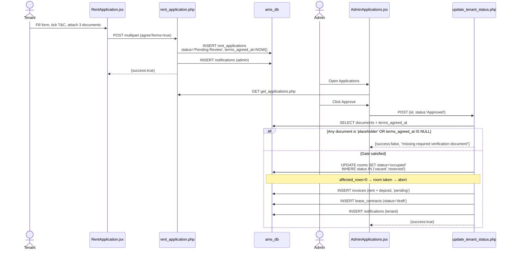

Surface map:

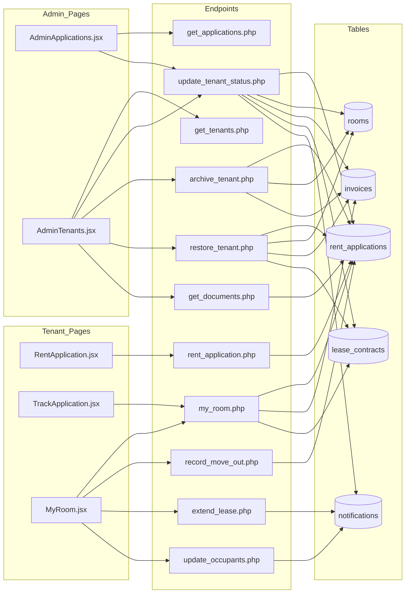

### 4.3 Step-by-Step Workflow

1. **Tenant — register** · `/register` → `registration.php` → row in `users`, role `user`.
2. **Tenant — pick a unit** · `/preview` → `get_rooms.php` → choose a `vacant` unit (use **J** or **N**).
3. **Tenant — submit application** · `/rent-application` → `rent_application.php`
   → `rent_applications` row, `status='Pending Review'`, `terms_agreed_at` stamped, three document paths written, admin notified.
   The T&C checkbox is **required** — submission is refused without it.
4. **Tenant — track** · `/track-application` → `my_room.php`. At this point the tenant is still gated out of `/my-room` (§3.4).
5. **Admin — review** · `/admin-applications` → `get_applications.php`; open the applicant to view ID/NBI documents.
6. **Admin — approve** · → `update_tenant_status.php` with `status='Approved'`. This single call enforces the 1.7 gate, claims the room, raises the move-in invoice (1 month rent + 1 month deposit) and creates a `draft` contract — all in one transaction.
7. **Tenant — pay the move-in invoice** · `/track-application` or `/pay-bills` → see [§6](#6-module-3--rental-payment--billing).
8. **Admin — record the payment** · `/admin-payments` → `record_payment_admin.php` → application flips `Approved` → `active`, contract `draft` → `active`, room occupancy confirmed.
   *Only now does the tenant pass the room gate and gain `/my-room`, `/services`, `/pay-bills`.*
9. **Tenant — occupancy changes** (optional) · `/my-room` → `update_occupants.php` / `extend_lease.php` → creates a `Pending` notification for admin approval.
10. **Admin — action the request** · `/admin-notifications` → `process_tenant_request.php` (claim-first, so replays are no-ops).
11. **Tenant — request move-out** · `/my-room` → `record_move_out.php` → `status='pending-move-out'` (15–30 days' notice enforced).
12. **Admin — complete move-out** · `update_tenant_status.php` with `status='moved-out'` + clearance notes and deductions → room vacated, contract settled, pending invoices cancelled.
13. **Admin — archive / restore** · `/admin-tenants` → `archive_tenant.php` (captures `pre_archive_status`) and `restore_tenant.php` (true inverse — restores prior status, un-settles the contract, reinstates cancelled invoices, re-occupies the room only if still vacant).

### 4.4 Test Conditions

| ID | Type | Scenario | Precondition | Action | Expected | Verify |
|---|---|---|---|---|---|---|
| **M1-01** | Sec | Approval gate blocks placeholder documents | Gloria Tan, app id 6, `Pending Review` | `POST update_tenant_status.php {"id":6,"status":"Approved"}` as admin | `success:false` — *"missing a required verification document"* | `SELECT status FROM rent_applications WHERE id=6;` → still `Pending Review` |
| **M1-02** | Happy | Fully-documented application approves end-to-end | Create the fixture (SQL below) | Approve the new app id as admin | `{"success":true}`; room occupied, invoice `pending`, contract `draft` | See fixture block below |
| **M1-03** | Sec | Approval gate blocks a missing T&C agreement | Fixture from M1-02 with `terms_agreed_at=NULL` | Approve | `success:false` — *"has not agreed to the Terms & Conditions"* | Status unchanged |
| **M1-04** | Negative | Status outside the allowlist is refused | Any app | `POST {"id":6,"status":"Banana"}` | `422` `"Invalid status: Banana"` | Status unchanged |
| **M1-05** | Negative | Room already claimed by a concurrent approval | Two `Pending Review` apps for the same room | Approve both in sequence | Second → *"no longer available"* | `SELECT tenant_name FROM rooms WHERE id='<room>';` → first tenant only |
| **M1-06** | Sec | Unauthenticated document read | — | `POST get_documents.php` with no token | `401 "Authentication required"` | — |
| **M1-07** | Sec | Cross-tenant room read | Tenant A's token | `GET my_room.php?userId=<B>` | Returns **A's** room — the override is ignored for non-admins | Compare `data.room_name` to A's |
| **M1-08** | Happy | Admin may preview another tenant's room | Admin token | `GET my_room.php?userId=6` | Returns Ben's room | `data.room_name` = `D` |
| **M1-09** | Negative | Duplicate application while one is open | Maria (id 2), already `Approved` | Submit a second application | Refused — *"already have an active or pending lease application"* | `SELECT COUNT(*) FROM rent_applications WHERE user_id=2;` unchanged |
| **M1-10** | Boundary | Move-out notice shorter than 15 days | Active tenant | `record_move_out.php` with a date 5 days out | Refused — *"at least 15 days"* | Status unchanged |
| **M1-11** | Boundary | Move-out notice longer than 30 days | Active tenant | Date 45 days out | Refused — *"cannot exceed 30 days"* | Status unchanged |
| **M1-12** | Negative | Duplicate pending occupancy request | One `Pending` occupancy notification exists | Submit another | Refused — one pending request at a time | `SELECT COUNT(*) FROM notifications WHERE type='occupancy_update_request' AND status='Pending';` = 1 |
| **M1-13** | Happy | Archive → restore round trip | Carlo (app id 9, `Approved`) | Archive, then restore | Application returns to `Approved` (not hardcoded `active`); room re-occupied | Compare full row before/after |
| **M1-14** | Negative | Replayed request approval | A `Pending` lease-extension notification | Call `process_tenant_request.php` twice | Second is a no-op | `SELECT COUNT(*) FROM lease_renewals WHERE ...;` = 1 |

**Fixture for M1-02 — an application that satisfies the 1.7 gate**

The seed data cannot be approved (§1.5), so create one. Room `J` is free:

```sql
INSERT INTO rent_applications
  (user_id, first_name, last_name, contact_no, email, gender, occupants, months_of_rent,
   room_name, monthly_rent, valid_id_front_path, valid_id_back_path, nbi_clearance_path,
   status, terms_agreed_at)
VALUES
  (8, 'Gloria', 'Tan', '+639171234567', 'gloria.tan@gmail.com', 'Female', 1, 6,
   'J', 4000, 'uploads/applications/test_front.jpg', 'uploads/applications/test_back.jpg',
   'uploads/applications/test_nbi.jpg', 'Pending Review', NOW());

SELECT LAST_INSERT_ID();   -- use this as <APP_ID>
```

Approve it, then assert:

```sql
SELECT status FROM rent_applications WHERE id = <APP_ID>;      -- 'Approved'
SELECT status, tenant_name FROM rooms WHERE id = 'J';          -- 'occupied', 'Gloria Tan'
SELECT id, status, total_amount FROM invoices  WHERE rent_application_id = <APP_ID>;  -- 'pending'
SELECT id, status FROM lease_contracts WHERE rent_application_id = <APP_ID>;          -- 'draft'
```

**Restore (M1-02 / M1-03 / M1-05):**

```sql
DELETE FROM lease_contracts   WHERE rent_application_id = <APP_ID>;
DELETE FROM invoices          WHERE rent_application_id = <APP_ID>;
DELETE FROM rent_applications WHERE id = <APP_ID>;
UPDATE rooms SET status='vacant', tenant_name=NULL, lease_start=NULL, lease_end=NULL, occupants=0
  WHERE id='J';
```

---

## 5. Module 2 — Unit Management

> Audited September 2026. Remediation covered the non-functional "Add Unit" button, maintenance history misattribution, fabricated occupancy figures, and the unguarded manual tenant-assignment path.

### 5.1 API Contract

| Endpoint | Method | Auth guard | Key parameters | Success response | Notable failures |
|---|---|---|---|---|---|
| `get_rooms.php` | GET | **None** (public browse) | — | `success`, `rooms[]` incl. `maintenanceHistory`, `occupancyHistory`, `leaseHistory` | — |
| `create_room.php` | POST | `require_admin` | `id`, `type`, `floor`, `rent` | `success`, `message` | `400` missing/invalid rent · `409` duplicate id · `401`/`403` |
| `update_room.php` | POST | `require_admin` | `id`, plus any of `status`, `tenant_name`, `lease_start`, `lease_end`, `monthly_rent`, `occupants`, `room_condition`, `furnishing_status`, `maintenance_flag`; for assignment: `user_id` + `identity_verified` | `success`, `message` | `404` unknown room · assignment without `identity_verified` → refused |
| `my_room.php` | GET | `require_user` | `userId`/`email` (admin only) | `success`, `data` | `401` |

`rooms.status` values: `vacant` (default), `occupied`, `reserved`, `maintenance`. There is no server-side allowlist — `update_room.php` accepts `status` as a free-form field, so a typo persists silently. Treat this as a known sharp edge when writing tests.

`get_rooms.php` runs `release_expired_reservations()` on every call, so simply listing rooms frees any lapsed hold.

### 5.2 API Diagrams

Manual admin assignment — the path that bypasses the normal application flow and therefore carries its own attestation gate:

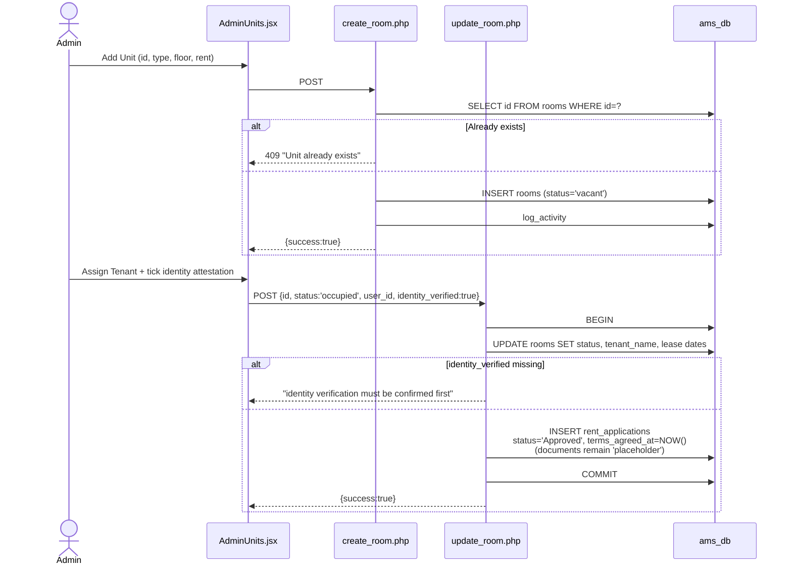

Surface map:

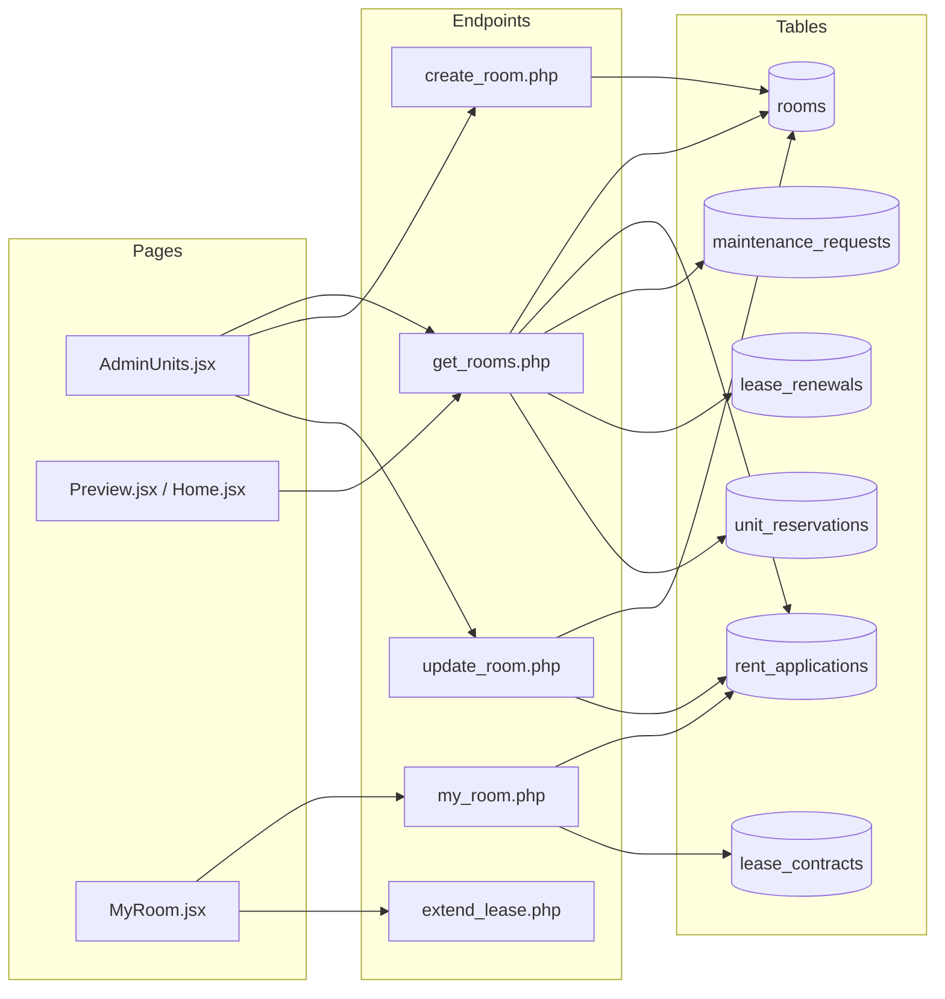

### 5.3 Step-by-Step Workflow

1. **Admin — create a unit** · `/admin-units` → *Add Unit* → `create_room.php` → `rooms` row, `status='vacant'`.
   The unit id is the primary key and is a **VARCHAR** (`'A'`, `'6B'`, `'TEST99'`) — always quote it in SQL.
2. **Public — browse** · `/preview` or `/home` → `get_rooms.php`. Vacant units are offered; expired holds are released automatically on this call.
3. **Admin — hold a unit** (optional) · `/admin-inquiries` → `create_reservation.php` → `rooms.status='reserved'` with an expiry.
4. **Assignment, either route:**
   - *Normal* — via the application flow ([§4](#4-module-1--tenant-management) step 6). Documents were verified during application.
   - *Manual* — `/admin-units` → *Assign Tenant*. Because no documents were uploaded, the admin must tick the **identity-verification attestation**; the synthetic application is stamped `terms_agreed_at=NOW()` to record it.
5. **Admin — maintain the unit** · `/admin-units` detail modal → `update_room.php` for condition, furnishing, inspection date and the maintenance flag.
6. **Review history** · `get_rooms.php` returns three real arrays per unit:
   - `maintenanceHistory` — joined directly on `maintenance_requests.room_name`, snapshotted at ticket creation.
   - `occupancyHistory` — every tenant who has occupied the unit, from `rent_applications`.
   - `leaseHistory` — extension events, from `lease_renewals`.
7. **Vacate** · Completing a move-out ([§4](#4-module-1--tenant-management) step 12) sets `status='vacant'`, records `last_tenant` and stamps `last_inspection_date`.

### 5.4 Test Conditions

| ID | Type | Scenario | Precondition | Action | Expected | Verify |
|---|---|---|---|---|---|---|
| **M2-01** | Happy | Create a unit | Admin token | `POST create_room.php {"id":"TEST99","type":"Studio","floor":"9F","rent":5555}` | `{"success":true}` | `SELECT * FROM rooms WHERE id='TEST99';` → `vacant`, rent 5555.00 |
| **M2-02** | Negative | Duplicate unit id | TEST99 exists | Repeat M2-01 | `409 "Unit TEST99 already exists."` | Row count still 1 |
| **M2-03** | Sec | Unauthenticated create | — | M2-01 with no token | `401 "Authentication required"` | No row created |
| **M2-04** | Sec | Tenant attempts create | Tenant token | M2-01 with `$TEN` | `403 "Forbidden: Admin access required"` | No row created |
| **M2-05** | Negative | Invalid rent | Admin token | `{"id":"TEST98","type":"Studio","floor":"9F","rent":0}` | `400` — positive rent required | No row created |
| **M2-06** | Sec | Manual assignment without attestation | Vacant unit + a user id | `update_room.php` with `status='occupied'`, `user_id`, **no** `identity_verified` | Refused — *"identity verification must be confirmed first"* | No synthetic `rent_applications` row |
| **M2-07** | Happy | Manual assignment with attestation | Same, `identity_verified:true` | — | `{"success":true}` | Synthetic application `Approved` with `terms_agreed_at` set |
| **M2-08** | Happy | Maintenance attributed to its own unit | — | Submit a ticket as a tenant, then `GET get_rooms.php` | Ticket appears under **that unit only** | Compare `maintenanceHistory` across every room |
| **M2-09** | Happy | Occupancy & lease history populated | Rosa (room C) has a renewal | `GET get_rooms.php` | Room C has non-empty `occupancyHistory` **and** `leaseHistory` | Inspect the arrays |
| **M2-10** | Boundary | Expired hold released on browse | Room I held by an **`Active`** reservation — confirm first (see below) | Back-date `hold_expires_at`, call `get_rooms.php` | Reservation flips `Active` → `Expired` | `SELECT status FROM unit_reservations WHERE room_name='I';` |
| **M2-11** | Negative | Unknown unit | Admin token | `update_room.php {"id":"ZZZ","status":"vacant"}` | `404 "Room not found."` | — |

**Restore:**

```sql
DELETE FROM rooms WHERE id LIKE 'TEST%';
-- After M2-06/M2-07, also remove the synthetic application and re-vacate the unit:
DELETE FROM rent_applications WHERE room_name = '<unit>' AND valid_id_front_path = 'placeholder'
  AND id NOT IN (SELECT * FROM (SELECT id FROM rent_applications ORDER BY id LIMIT 12) x);
UPDATE rooms SET status='vacant', tenant_name=NULL, lease_start=NULL, lease_end=NULL, occupants=0
  WHERE id='<unit>';
```

**M2-10 precondition and restore.** Katrina Villareal's hold on room I is `Active` in the seed, but approving any application for room I closes it out to `Converted` — so a previous test run can silently invalidate this fixture. Check before, restore after:

```sql
-- Precondition check — must read 'Active'
SELECT status, hold_expires_at FROM unit_reservations WHERE room_name = 'I';

-- Restore to seed state
UPDATE unit_reservations
SET status='Active', hold_expires_at='2026-09-20', released_at=NULL, released_reason=NULL
WHERE room_name='I' AND reserved_for_name='Katrina Villareal';
```

> Deleting a unit is generally **not possible**: `rent_applications.room_name` references `rooms.id` with `ON DELETE RESTRICT`, so any unit with application history — including rejected applications — cannot be dropped. Only units created and never used (like `TEST99`) delete cleanly.
>
> For the same reason, prefer room **J** over **I** for assignment tests — using I destroys the M2-10 fixture.

---

## 6. Module 3 — Rental Payment & Billing

> Audited September 2026. Remediation covered an unauthenticated billing IDOR, webhook replay, the "stranded invoice" status trap, a phantom late fee, and invoice-id collisions. The matrix in §6.4 was verified live against the running stack.

### 6.1 API Contract

| Endpoint | Method | Auth guard | Key parameters | Success response | Notable failures |
|---|---|---|---|---|---|
| `get_invoices.php` | GET | `require_user` + ownership | `userId` (own id, or any for admin) | `success`, `invoices[]` | `401` no token · `403` other tenant · `403` global list as non-admin |
| `create_invoice.php` | POST | `require_admin` | `userId`, `unit`, `baseRent`, `water`, `electricity`, `parking`, `lateFee`, `dueDate`, `billingPeriod`, `invoiceNumber`, `appId` | `success`, `invoice_id`, `total_amount` | `409` re-issuing a `paid`/`cancelled` invoice |
| `pay_bill.php` | POST | `require_user` | `invoiceId`, `paymentMethod`, `paymentReference`, `proofOfPaymentPath` | `success`, `message` | `409` invoice not open |
| `upload_payment_proof.php` | POST (multipart) | `require_user` | `invoice_id`, `payment_reference`, `sender_name`; file `proof` | `success`, `proof_path` | `422` bad type/>10MB · `409` not open · `500` save failed |
| `record_payment_admin.php` | POST | `require_admin` | `invoiceId`, `paymentMethod`, `paymentReference`, `amountPaid` | `success`, `message` | Short `amountPaid` → refused · already settled → refused |
| `schedule_payment.php` | POST | `require_user` | `invoice_id`, `scheduled_date`, `scheduled_time_slot` | `success`, `message` | `422` past date / >60 days / bad slot · `409` not open |
| `create_checkout_session.php` | POST | `require_user` | `invoice_id`, `channel`, `success_url`, `cancel_url` | `success`, `checkout_url` | Already paid · already `processing` · gateway unconfigured |
| `release_checkout_session.php` | POST | `require_user` | `invoice_id` | `success`, `released` | Never errors on a no-op; `released:false` if not `processing` |
| `paymongo_webhook.php` | POST | HMAC signature | raw payload + `Paymongo-Signature` | `success` | `401` bad/stale signature · `500` on DB write failure (so the gateway retries) |
| `get_payment_channels.php` | GET | `require_user` | — | `success`, `channels[]` | `401` |
| `check_due_date_reminders.php` | GET/POST | `require_admin` | — | `success`, `marked_overdue`, counts | `401`/`403` |
| `send_payment_reminder.php` | POST | `verify_admin` gate | `invoice_id` or `all` | `success`, `count` | `403` non-admin |

**`BILLING_OPEN_STATUSES`** in `backend/config.php` is the single source of truth for "this invoice still owes money":

```
pending · unpaid · overdue · pending-verification · scheduled · processing · payment-failed
```

`paid` and `cancelled` are terminal and deliberately excluded. Use `billing_open_status_sql()` rather than re-listing statuses in a new query — omitting one is exactly how invoices previously went missing from receivables.

### 6.2 API Diagrams

Invoice status lifecycle:

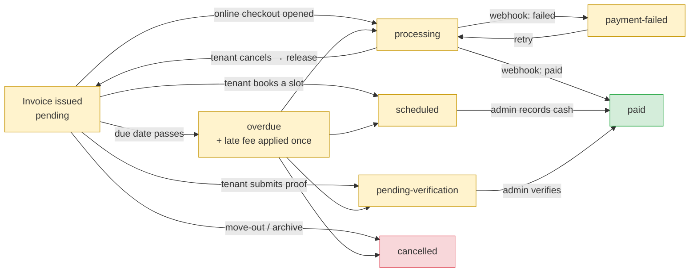

Everything in the amber band counts toward receivables, is eligible for overdue promotion, and appears on the tenant's bill. `scheduled`, `processing` and `payment-failed` were previously excluded from all three — that is the "stranded invoice" bug this module was audited for.

Online payment, including the replay and abandonment paths:

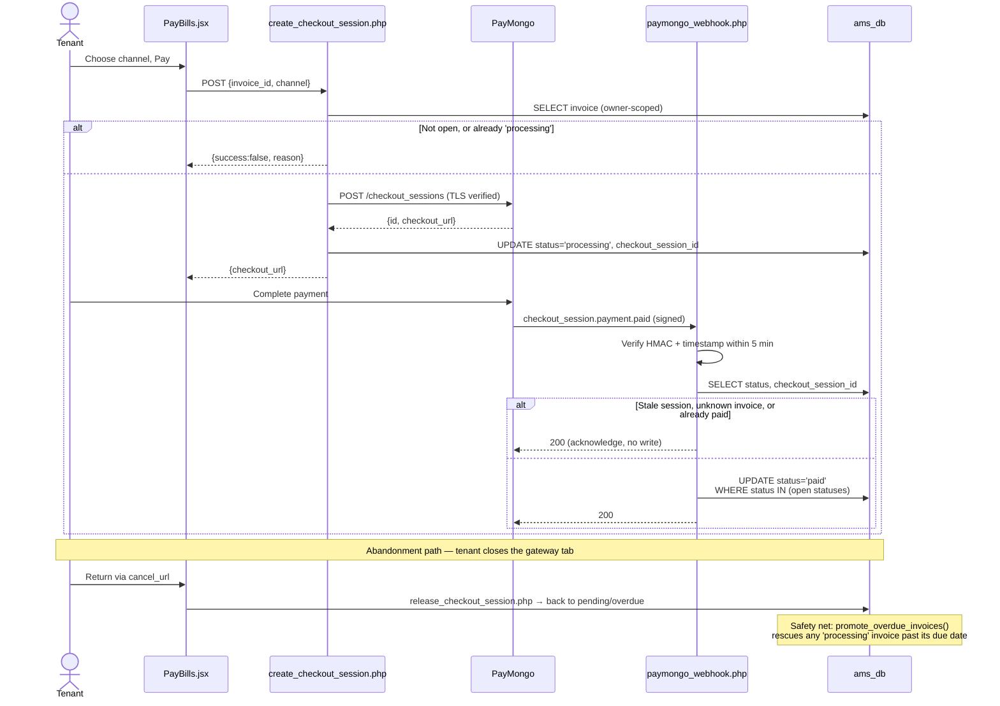

Surface map:

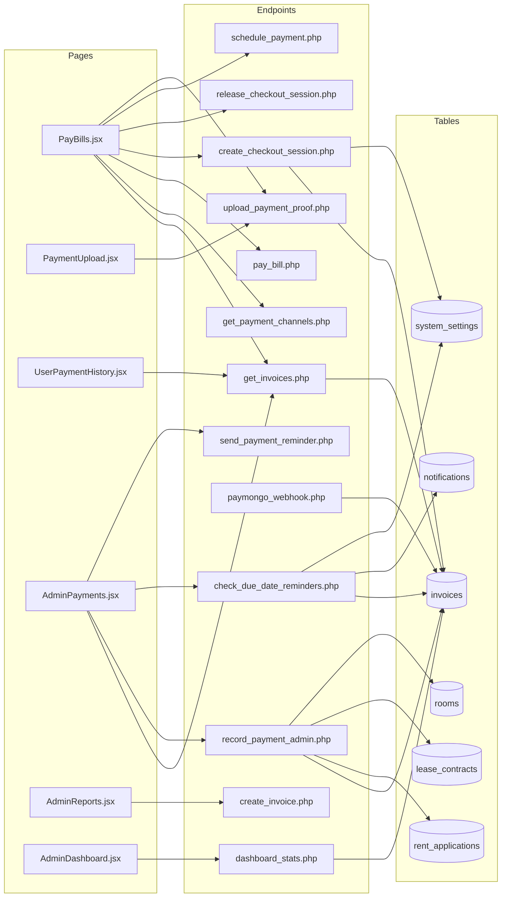

### 6.3 Step-by-Step Workflow

1. **Admin — issue an invoice** · `/admin-reports` → *Generate Invoice* → `create_invoice.php`
   → `invoices` row, `status='pending'`, tenant notified. Line items are real columns and `total_amount` is always their sum.
2. **Tenant — view the bill** · `/pay-bills` → `get_invoices.php`. Every call also runs `promote_overdue_invoices()`, so simply loading the page promotes lapsed invoices and applies the late fee.
3. **Tenant — choose a channel** · `get_payment_channels.php`. In-person cash is always offered; the remote family depends on `payment_mode` (`sandbox` = gateway checkout, `manual` = transfer-and-upload).
4. **Payment, by channel:**
   - **Online (sandbox)** → `create_checkout_session.php` → invoice goes `processing` → gateway → `paymongo_webhook.php` settles it to `paid`. Cancelling returns via `release_checkout_session.php`.
   - **Manual transfer** → `upload_payment_proof.php` with reference + screenshot → `pending-verification`.
   - **In-person cash** → `schedule_payment.php` books a slot → `scheduled` → the tenant pays at the office.
5. **Admin — verify and record** · `/admin-payments` → `record_payment_admin.php` with method, amount tendered and reference → `paid`, `paid_at` stamped.
   Settlement is **all-or-nothing**: a short `amountPaid` is refused, because there is no partial-payment ledger.
6. **First payment only** — settling the move-in invoice also flips the application `Approved` → `active`, the contract `draft` → `active`, and confirms room occupancy.
7. **Overdue handling** · `check_due_date_reminders.php` (admin) or any invoice listing promotes lapsed invoices, applies the configured late fee **once**, and dispatches tenant notifications. Reminder cadence comes from `rent_due_reminder_days` and `overdue_reminder_interval_days`.
8. **Receipt** · `/admin-payments` → *View Receipt* → printable modal rendered from invoice data. No receipt row is persisted and there is no sequential OR number.

### 6.4 Test Conditions

All rows below were executed against the live stack during the September 2026 audit.

| ID | Type | Scenario | Precondition | Action | Expected | Verify |
|---|---|---|---|---|---|---|
| **M3-01** | Sec | Unauthenticated billing read | — | `GET get_invoices.php?userId=2` with **no headers** | `401 "Authentication required"` | Previously leaked full billing history — a regression here is critical |
| **M3-02** | Sec | Cross-tenant billing read | Maria's token | `GET get_invoices.php?userId=6` | `403 "Access denied to other user's invoices"` | — |
| **M3-03** | Sec | Tenant requests the global list | Maria's token | `GET get_invoices.php` (no `userId`) | `403 "Admin access required"` | — |
| **M3-04** | Happy | Tenant reads own invoices | Maria's token | `GET get_invoices.php?userId=2` | `success:true`, only `user_id=2` rows | — |
| **M3-05** | Sec | Unauthenticated reminder dispatch | — | `GET check_due_date_reminders.php` | `401` | No new `notifications` rows |
| **M3-06** | Sec | Unauthenticated proof upload | — | `POST upload_payment_proof.php -F userId=2 …` | `401` — the body `userId` is not accepted as identity | Invoice unchanged |
| **M3-07** | Sec | Reopening a settled invoice | A `paid` invoice owned by the tenant | `POST pay_bill.php` against it | `409 "not open for payment"`; `paid_at` preserved | `SELECT status, paid_at FROM invoices WHERE id='<id>';` |
| **M3-08** | Happy | Late fee, flat mode | `late_fee_enabled=true`, `type=flat`, `value=200` | `GET get_invoices.php` as admin | Each overdue invoice gains exactly `200.00`; total rises by 200 | Line items now sum to `total_amount` |
| **M3-09** | Boundary | Late fee is idempotent | Immediately after M3-08 | Call `get_invoices.php` again | **No** second charge | `late_fee` still `200.00` |
| **M3-10** | Happy | Late fee, percent mode | `type=percent`, `value=5`, fees reset to 0 | Same | `ROUND(recurring × 5%, 2)` — e.g. `5340.00 → 267.00` | Per-invoice arithmetic |
| **M3-11** | Negative | Short payment refused | Any open invoice | `record_payment_admin.php` with `amountPaid` below total | Refused — *"Partial payments are not supported"* | Status unchanged |
| **M3-12** | Happy | Reference number recorded | Open invoice | Record payment, method `GCash`, `paymentReference:"REF-9988776"` | `paid` with the reference stored | `SELECT payment_reference FROM invoices WHERE id='<id>';` |
| **M3-13** | Happy | Scheduled invoice can be settled | Invoice in `scheduled` | `record_payment_admin.php` method `Cash` | `{"success":true}` → `paid` | Regression guard: this was blocked by an over-narrow status set |
| **M3-14** | Negative | Second concurrent checkout | Invoice already `processing` | `create_checkout_session.php` again | Refused — *"already in progress"* | Prevents double payment |
| **M3-15** | Happy | Abandoned checkout released | Invoice `processing`, due date in the future | `release_checkout_session.php` | `released:true` → back to `pending`, session id cleared | `SELECT status, checkout_session_id FROM invoices WHERE id='<id>';` |
| **M3-16** | Sec | Cross-tenant release | Maria's token, Ben's `processing` invoice | `release_checkout_session.php` | `released:false` — no-op | Ben's invoice still `processing` |
| **M3-17** | Boundary | Stranded invoice rescued | Invoice `processing` **past** its due date | Any invoice listing | Promoted to `overdue`, stale session id cleared | Safety net for M3-15 when the return URL fails (§10.1 #4) |
| **M3-18** | Negative | Past scheduling date | Open invoice | `schedule_payment.php` date `2020-01-01` | `422 "cannot be in the past"` | — |
| **M3-19** | Negative | Invalid time slot | Open invoice | slot `"midnight"` | `422 "Invalid time slot."` | Allowed: `morning`, `afternoon`, `evening` |
| **M3-20** | Negative | Re-issuing a paid invoice | A `paid` invoice id | `create_invoice.php` with that id | `409` — create a new invoice instead | Amounts unchanged |
| **M3-21** | Sec | Webhook replay | A previously valid signed payload | Re-POST it after 5 minutes | `401 "timestamp outside the accepted window"` | No status change |
| **M3-22** | Sec | Webhook for a superseded session | Event whose session id ≠ the invoice's | POST it | `200` acknowledged, **no write** | Status unchanged |
| **M3-23** | Happy | Cash and online offered together | `payment_mode='sandbox'` | `GET get_payment_channels.php` | GCash, Bank, Maya **and** In-Person all returned | Previously cash vanished in sandbox mode |
| **M3-24** | Happy | Receivables include every open status | Invoices in `scheduled`/`processing` | `GET dashboard_stats.php` | `pending_dues` includes them | Compare against `SUM` over `BILLING_OPEN_STATUSES` |

**Late-fee test setup and restore (M3-08 → M3-10)**

```sql
-- Enable
UPDATE system_settings SET setting_value='true' WHERE setting_key='late_fee_enabled';
UPDATE system_settings SET setting_value='flat' WHERE setting_key='late_fee_type';
UPDATE system_settings SET setting_value='200'  WHERE setting_key='late_fee_value';

-- Record the originals BEFORE testing
SELECT id, late_fee, total_amount FROM invoices WHERE status='overdue';

-- Restore: subtract the fee back out and disable
UPDATE invoices SET total_amount = total_amount - late_fee, late_fee = 0 WHERE late_fee <> 0;
UPDATE system_settings SET setting_value='false' WHERE setting_key='late_fee_enabled';
UPDATE system_settings SET setting_value='flat'  WHERE setting_key='late_fee_type';
UPDATE system_settings SET setting_value='200'   WHERE setting_key='late_fee_value';
```

**Disposable invoice fixture** (for M3-13 → M3-20, so no seeded invoice is disturbed):

```sql
INSERT INTO invoices (id, user_id, base_rent, total_amount, billing_period, status, due_date)
VALUES ('INV-TEST-001', 6, 4000.00, 4000.00, '2026-09', 'pending',
        DATE_ADD(CURDATE(), INTERVAL 10 DAY));

-- Restore
DELETE FROM invoices WHERE id LIKE 'INV-TEST%';
```

---

## 7. Module 4 — Maintenance Request

> Audited September 2026. Remediation fixed a missing `resolved_at` column that made every status update fail, partial edits that overwrote each other, a local-only approval flow, an unauthenticated request-history endpoint, and category/urgency drift between the tenant form and the admin board. It also added the four-stamp timeline. §7.4 was verified live.
>
> **Updated September 2026:** priority is now an admin decision, not a tenant self-declaration. The tenant form no longer offers a priority field; every submission is server-side forced to `Needs Triage` regardless of anything sent in the request body, and only `update_maintenance_status.php` (admin-only) can move it to a real priority.

Seed fixtures used below: ticket **#6** (Unit L, Pending, Low), **#7** (Unit H, Pending, Medium), **#5** (Unit D, In Progress). Tenant fixtures: Ana (user 12, Unit K) has an active lease; Gloria (user 8) does not.

### 7.1 API Contract

| Endpoint | Method | Auth guard | Key parameters | Success response | Notable failures |
|---|---|---|---|---|---|
| `maintenance_request.php` | POST (multipart) | `require_user` + active lease | `issueType`, `preferredDate`, `preferredTime` (`morning`/`afternoon`), `description`, `permissionToEnter`; file `uploadedFile`. No priority field — any `urgency` sent is ignored | `success`, `id` | `401` · `403` no active lease · `422` bad category, date or file |
| `get_maintenance_requests.php` | GET | `require_admin` | — | `success`, `requests[]` incl. `acknowledgedAt`, `startedAt`, `resolvedAt`, `resolutionHours` | `401` / `403` |
| `update_maintenance_status.php` | POST | `require_admin` | `id`, plus any of `status`, `urgency`, `assignedTo`, `estimatedCost`, `actualCost`, `workNotes`, `tenantResponsible`, `rejectionReason` | `success`, `message` | `400` nothing to update · `404` · `409` invalid transition or concurrent change · `422` reject without reason, negative cost, or `urgency` not one of the four real priorities |
| `create_maintenance_request_admin.php` | POST (multipart) | `require_admin` | `title`, `unit`, `issueType`, `priority`, `description`; file `photo` | `success`, `id` | `422` unknown unit, bad category or file |
| `get_my_requests.php` | GET | `require_user` (an admin may pass `userId`) | — | `success`, `requests[]` across maintenance, CCTV, parking and services | `401` |
| `cancel_request.php` | POST | `require_user` | `id`, `type` (`Maintenance` / `CCTV` / `Parking` / `Service`) | `success` | `409` not your own Pending request · `422` unknown type |

**Vocabulary** — defined once in `backend/config.php` and mirrored for the UI in `ams-react/src/config/maintenanceOptions.js`:

| Constant | Values |
|---|---|
| `MAINTENANCE_CATEGORIES` | Plumbing · Electrical · Structural/Physical · Water Supply · General Maintenance · Others |
| `MAINTENANCE_URGENCIES` | Low · Medium · High · Urgent — **admin-settable only**, via `update_maintenance_status.php` |
| `MAINTENANCE_DEFAULT_URGENCY` | `Needs Triage` — the value every tenant-submitted ticket starts with. Not a member of `MAINTENANCE_URGENCIES`, so it can never be selected again once an admin assigns a real priority; `normalize_maintenance_urgency()` rejects it if sent back |
| `MAINTENANCE_TRANSITIONS` | `Pending → In Progress \| Rejected` · `In Progress → Completed \| Pending` · `Completed → In Progress` (reopen) · `Rejected`, `Cancelled` terminal |

Legacy spellings are normalised rather than rejected: `appliance` and `pest control` become General Maintenance, `structural` and `carpentry` become Structural/Physical, and `emergency` becomes Urgent.

`Needs Triage` sorts **above** Urgent in `urgencyWeight()` (`ams-react/src/config/maintenanceOptions.js`), so untriaged tickets surface at the top of each Kanban column instead of reading as low priority.

### 7.2 API Diagrams

Lifecycle, with the timestamp each move records:

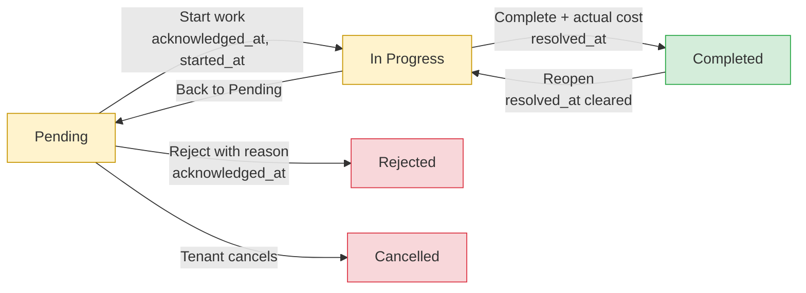

Submission through a status change:

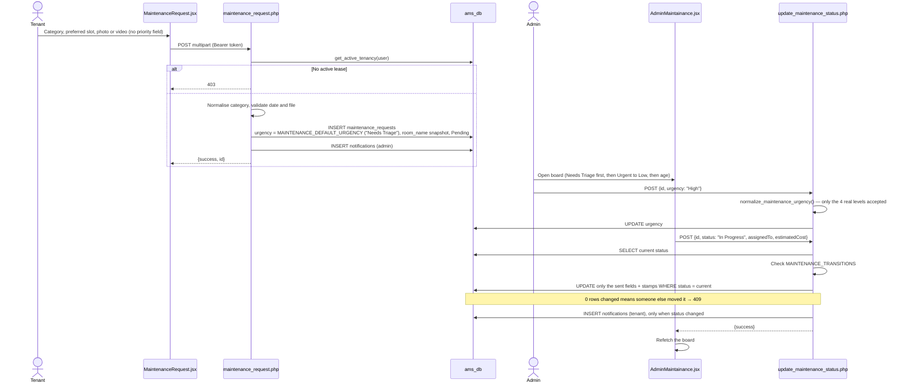

Surface map:

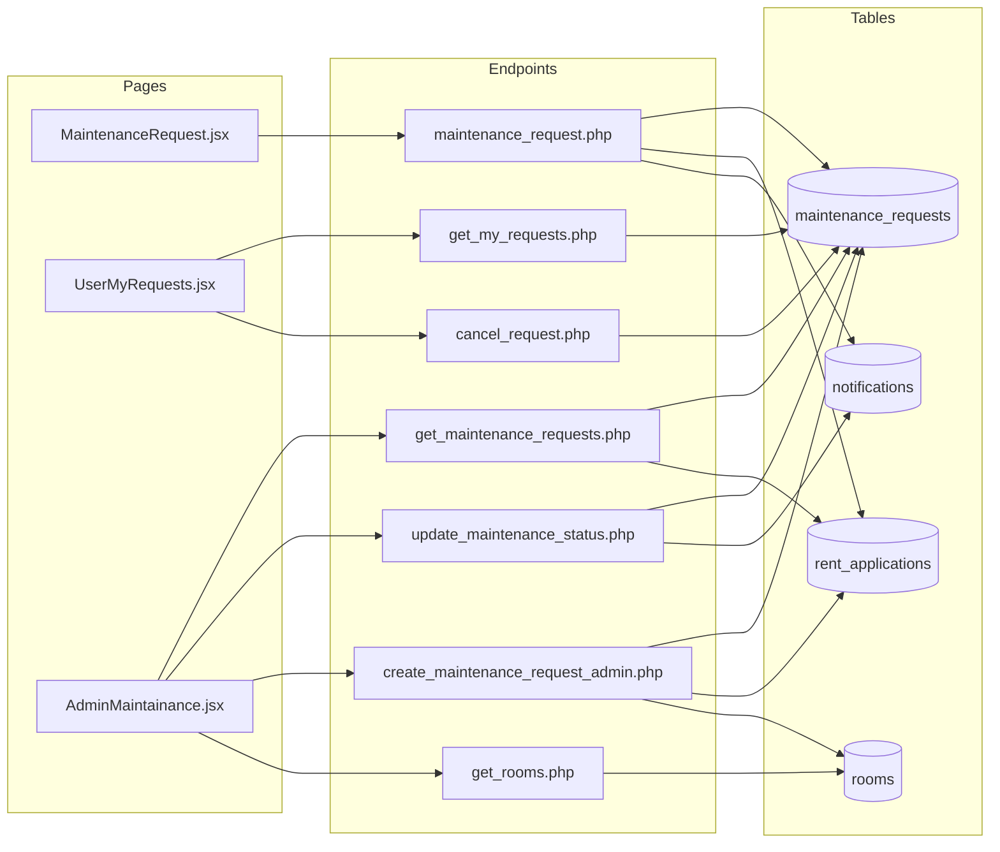

### 7.3 Step-by-Step Workflow

1. **Tenant — report** · `/maintenance-request` → `maintenance_request.php` → Pending ticket stamped with the tenant's unit and priority `Needs Triage`; admin notified. Tenants without an active lease are refused. There is no priority field on this form — the tenant does not set urgency.
2. **Admin — triage** · `/admin-maintenance` → `get_maintenance_requests.php`. Columns are Pending, In Progress, Completed, and Rejected / Cancelled; each is ordered Needs Triage first, then Urgent → Low, oldest first. Opening a ticket's detail modal shows a **Priority** selector (Low/Medium/High/Urgent) — this is the only way a real priority gets set, and it saves immediately on change.
3. **Admin — start work** · *Start Work* (assignee, optional estimate) → `In Progress`; `acknowledged_at` and `started_at` stamped; tenant notified. Setting a priority first is optional — an admin can start work on a still-`Needs Triage` ticket.
4. **Admin — edit details** · Assignee (saved on blur or Enter), estimated cost, work notes and the tenant-responsible toggle each save on their own and notify nobody.
5. **Admin — complete** · *Mark Completed* with the actual cost → `resolved_at` stamped; the detail modal shows total resolution time; tenant notified.
6. **Admin — reject** (from Pending) · requires a reason → `Rejected`; tenant notified with the reason.
7. **Admin — correct a mistake** · *Back to Pending* (from In Progress) or *Reopen* (from Completed; clears `resolved_at`).
8. **Tenant — cancel** · `/my-requests` → `cancel_request.php` while the ticket is still Pending.
9. **Tenant — follow up** · `/my-requests` → `get_my_requests.php`: status, resolved time and any rejection reason.

### 7.4 Test Conditions

| ID | Type | Scenario | Precondition | Action | Expected | Verify |
|---|---|---|---|---|---|---|
| **M4-01** | Happy | Board loads, correctly ordered | Seed data | `GET get_maintenance_requests.php` (admin) | Valid JSON; Pending, then In Progress, then Completed; within each, `Needs Triage` first, then Urgent → Low | Seed order `7, 6, 5, 1, 3, 2, 4` (no seeded `Needs Triage` rows). `FIELD(urgency, 'Urgent','High','Medium','Low')` returns `0` for `Needs Triage`, which sorts before `1` — confirmed live 2026-09 with a throwaway row. Before the `resolved_at` fix, PHP warnings corrupted this response entirely |
| **M4-02** | Sec | Request history with no token | — | `GET get_my_requests.php?userId=12` | `401 "Authentication required"` | Previously returned Ana's history to anyone |
| **M4-03** | Sec | Tenant asks for another tenant's history | Ana's token | `GET get_my_requests.php?userId=6` | Only Ana's own rows | `userId` is ignored for non-admins |
| **M4-04** | Happy | Partial edits keep other fields | #7 Pending | `{"id":7,"workNotes":"…"}`, then `{"id":7,"assignedTo":"Juan Tech"}` | Both `200`; row keeps both values; `tenant_responsible` unchanged | Each edit used to overwrite all five fields |
| **M4-05** | Negative | Skipping a stage | #7 Pending | `{"id":7,"status":"Completed"}` | `409 "A Pending request cannot be moved to Completed."` | — |
| **M4-06** | Negative | Reject without a reason | #7 Pending | `{"id":7,"status":"Rejected"}` | `422 "A reason is required to reject a request."` | — |
| **M4-07** | Happy | Start work | #7 Pending | `{"id":7,"status":"In Progress","estimatedCost":1200}` | `acknowledged_at` and `started_at` set; user 11 notified | `SELECT acknowledged_at, started_at FROM maintenance_requests WHERE id=7;` |
| **M4-08** | Happy | Complete with actual cost | #7 In Progress | `{"id":7,"status":"Completed","actualCost":1350}` | `resolved_at` set; `estimated_cost` stays `1200.00`, `actual_cost` `1350.00`; board returns `resolutionHours` | The final cost no longer overwrites the estimate |
| **M4-09** | Happy | Reopen | #7 Completed | `{"id":7,"status":"In Progress"}` | `resolved_at` cleared | — |
| **M4-10** | Happy | Reject with a reason | #6 Pending | `{"id":6,"status":"Rejected","rejectionReason":"…"}` | `rejection_reason` stored; user 13 notified with the reason | `SELECT message FROM notifications WHERE type='maintenance_update' ORDER BY id DESC LIMIT 1;` |
| **M4-11** | Sec | Priority is ignored from the tenant, identity comes from the session | Ana's token | Submit with body `userId=6`, `Water Supply`, `urgency=Urgent` | Stored with `user_id=12`, `room_name='K'`, `urgency='Needs Triage'` | Spoofed identity **and** spoofed priority both refused — verified live 2026-09 |
| **M4-12** | Negative | Unknown category | Ana's token | `issueType=Roofing` | `422` | — |
| **M4-13** | Sec | No active lease | Gloria's token | Submit | `403 "Only tenants with an active lease can submit maintenance requests."` | — |
| **M4-14** | Sec | Upload filtering; no token | Ana's token | Attach `shell.php`; attach a `.pdf`; submit with no token | `422`, `422`, `401` | Images and MP4/WEBM/MOV only, 10MB max |
| **M4-15** | Sec | Cancelling someone else's ticket | Ana's new Pending ticket | Ben cancels; then Ana cancels | `409`, then `200` | — |
| **M4-16** | Negative | Admin create validates the unit | Admin token | `unit=ZZ`; then `unit=K` | `422 "Unit ZZ does not exist."`; then created, linked to Ana, title stored | — |
| **M4-17** | Happy | Admin assigns a priority | A `Needs Triage` Pending ticket | `{"id":<id>,"urgency":"High"}` | `200`; `urgency='High'`; ticket now sorts below any remaining `Needs Triage` ticket and above Medium/Low | Verified live 2026-09 against the sort function |
| **M4-18** | Negative | Invalid or sentinel priority rejected | Any ticket | `{"id":<id>,"urgency":"Whenever"}`, then `{"id":<id>,"urgency":"Needs Triage"}` | Both `422 "Invalid priority level."` | An admin cannot manually revert a ticket back to `Needs Triage` |

**Restore:**

```sql
UPDATE maintenance_requests
SET status='Pending', assigned_to=NULL, estimated_cost=NULL, actual_cost=NULL, work_notes=NULL,
    tenant_responsible=0, acknowledged_at=NULL, started_at=NULL, resolved_at=NULL, rejection_reason=NULL
WHERE id IN (6, 7);
DELETE FROM maintenance_requests WHERE id > 7;
DELETE FROM notifications WHERE created_at >= NOW() - INTERVAL 1 HOUR;
```

---

## 8. Module 5 — Service Management

> Audited September 2026. Remediation fixed two defects: completing a paid service billed a second month of rent (a billing-period format mismatch), and missing transition rules let cancelled or rejected bookings be billed. It also covered unauthenticated booking, cancel and CCTV endpoints; reversal refusing unpaid invoices; and hardcoded attachment URLs. §8.4 was verified live.
>
> Scope: the priced add-on catalog, bookings, billing and CCTV requests. Parking and visitor flows, which the checklist also lists under 5.1/5.3, are audited with Modules 10 and 12.

### 8.1 API Contract

| Endpoint | Method | Auth guard | Key parameters | Success response | Notable failures |
|---|---|---|---|---|---|
| `get_service_catalog.php` | GET | `verify_admin` branch (admins also see inactive rows) | `active=1` | `success`, `services[]` | — |
| `manage_service_catalog.php` | POST | `require_admin` | `action` = `create` / `update` / `toggle` / `delete`, plus catalog fields | `success`, `id` on create | Validation messages; `delete` deactivates instead when bookings reference the row |
| `service_request.php` | POST (multipart) | `require_user` + active lease | `serviceId`, `quantity`, `preferredDate`, `preferredTimeSlot`, `notes`; file `uploadedFile` | `success`, `id`, `totalCost` | `401` · `403` no active lease · `422` malformed date · inactive service, disabled category or date inside lead time → `success:false` with HTTP 200 |
| `get_service_requests.php` | GET | `require_admin` | `status`, `category` | `success`, `requests[]` | `403` |
| `update_service_status.php` | POST | `require_admin` | `rawId`, `status` | `success`, `billed`, `invoiceId`, `warning` | `409` invalid transition, concurrent change or refused reversal · `422` |
| `sync_service_to_invoice.php` | POST | `require_admin` | `rawId` | `success`, `invoiceId` | Not Completed, or already billed |
| `cancel_request.php` | POST | `require_user` | `id`, `type: "Service"` | `success` | `409` not your own Pending booking |
| `cctv_request.php` | POST (JSON) | `require_user` + active lease | `incidentDate`, `incidentTime`, `locationDetails`, `reasonRequest` | `success`, `id` | `401` · `403` · `422` future date or over-length fields |
| `get_cctv_requests.php` | GET | `require_admin` | — | `success`, `requests[]` | `403` |
| `update_cctv_status.php` | POST | `require_admin` | `id` / `rawId`, `status` (`Approved` / `Rejected`) | `success` | `404` · `409` already decided · `422` |

**Rules** — defined in `backend/config.php`:

| Rule | Definition |
|---|---|
| `SERVICE_TRANSITIONS` | `Pending → Approved \| Rejected \| Cancelled` · `Approved → In Progress \| Completed \| Rejected \| Cancelled` · `In Progress → Completed \| Cancelled` · `Completed → Cancelled` (reverses the charge first) · `Rejected`, `Cancelled` terminal |
| `SERVICE_ADJUSTABLE_INVOICE_STATUSES` | `pending`, `unpaid`, `overdue`, `scheduled`, `payment-failed` — a charge can be added to or reversed from these. Never `processing` (amount already at the gateway) or `pending-verification` (tenant already paid it) |
| `billing_period_label()` | Periods are matched as `"September 2026"`, the format every invoice writer uses; legacy `YYYY-MM` is also matched |

### 8.2 API Diagrams

Booking lifecycle and where money moves:

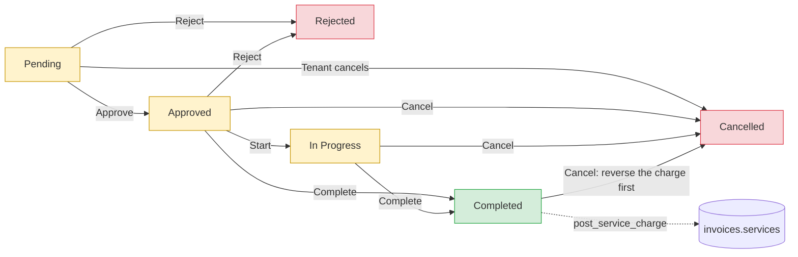

Completion and billing:

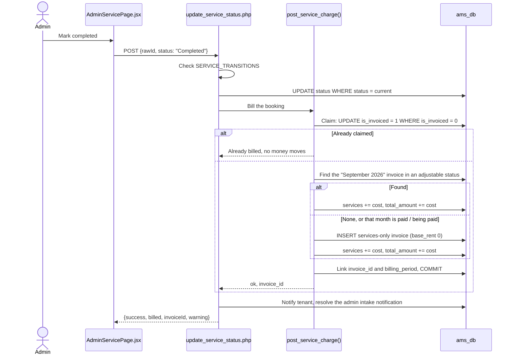

Surface map:

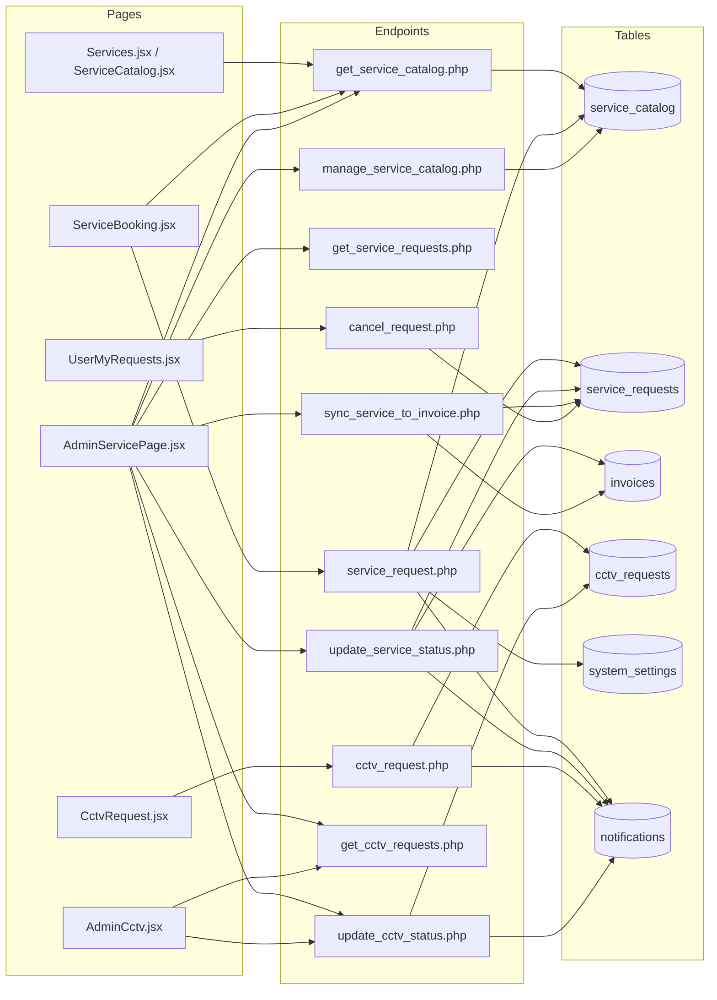

### 8.3 Step-by-Step Workflow

1. **Admin — set up the catalog** · `/admin-services` → *Service Catalog* → `manage_service_catalog.php` (create, edit, toggle, delete). An item with bookings is deactivated rather than deleted.
2. **Admin — switch categories** · the cleaning, laundry and other-services cards write `service_<category>_active`. The cards show the cheapest active catalog price.
3. **Tenant — book** · `/services` → `/service-booking?serviceId=N`. Only active items in enabled categories are offered. `service_request.php` recalculates the price, clamps quantity, enforces lead time and creates a Pending booking; admin notified.
4. **Tenant — cancel** · `/my-requests` → `cancel_request.php` while the booking is Pending.
5. **Admin — decide** · *Approve*, or *Reject* (with a confirmation) → tenant notified.
6. **Admin — deliver** · *Start work*, then *Mark completed* → `post_service_charge()` bills the booking and the admin sees which invoice it landed on.
7. **Admin — retry billing** · if no active lease was found at completion, a banner lists unbilled bookings with a *Post charge* button (`sync_service_to_invoice.php`).
8. **Admin — reverse** · cancelling a Completed booking (with a confirmation) backs the charge out, provided the invoice is still adjustable.
9. **CCTV** · tenant `/cctv-request` → `cctv_request.php` → Pending; admin approves or rejects once, from the CCTV tab or `/admin-cctv`.

### 8.4 Test Conditions

Precondition for M5-05 onward — a pending rent invoice for Ana's current month:

```sql
INSERT INTO invoices (id, user_id, rent_application_id, base_rent, total_amount, billing_period, status, due_date, created_at)
VALUES ('INV-TEST-RENT', 12, 10, 3500, 3500, 'September 2026', 'pending', DATE_ADD(CURDATE(), INTERVAL 10 DAY), NOW() - INTERVAL 1 DAY);
```

Substitute the current month's label if you are testing in a different month.

| ID | Type | Scenario | Precondition | Action | Expected | Verify |
|---|---|---|---|---|---|---|
| **M5-01** | Sec | Tenant opens the admin booking queue | Ana's token | `GET get_service_requests.php` | `403` | — |
| **M5-02** | Sec | Booking without an active lease | Gloria's token | `service_request.php` | `403 "Only tenants with an active lease can book services."` | — |
| **M5-03** | Negative | Category switched off | `service_laundry_active='false'` | Ana books a laundry item | `success:false`, "Laundry services are currently unavailable." (HTTP 200) | Restore the setting afterwards |
| **M5-04** | Money | A cancelled booking cannot be billed | Maria's Pending booking #2 | Maria cancels; admin sets `Completed` | `200`; then `409 "A Cancelled booking cannot be moved to Completed."` | — |
| **M5-05** | Money | Charge merges into that month's rent invoice | `INV-TEST-RENT` pending | Complete Ana's Approved booking #3 (₱900) | `invoiceId: INV-TEST-RENT`; `services 900.00`, `total_amount 4400.00`; **no new invoice** | Regression guard for the double-rent bug |
| **M5-06** | Sec | Spoofed identity, skipped approval, cross-tenant cancel | Ana's token | Book with body `userId=6`; admin Pending → Completed; Ben cancels | Stored as user 12, unit K; `409`; `409` | — |
| **M5-07** | Money | Month already paid → services-only invoice | `INV-TEST-RENT` set to `paid` | Approve and complete the new booking (₱500) | New invoice: `base_rent 0.00`, `services 500.00`, `total_amount 500.00`, same period | Rent is never billed from this path |
| **M5-08** | Money | Reversal from an overdue invoice | That services-only invoice set to `overdue` | Cancel the completed booking | `200`; invoice back to `0.00`; booking `is_invoiced = 0` | Previously refused as "already paid" |
| **M5-09** | Money | Reversal refused on paid and in-verification invoices | Booking #3 billed to `INV-TEST-RENT` | Cancel while the invoice is `paid`, then while `pending-verification` | `409 "…is already paid; issue a manual credit instead."`; `409 "…has a payment under verification."` | — |
| **M5-10** | Money | A reversed booking stays closed | The cancelled booking from M5-08 | Set `Completed` | `409` | It can never be billed again |
| **M5-11** | Negative | CCTV incident in the future | Ana's token | `incidentDate` = today + 3 | `422` | — |
| **M5-12** | Sec | CCTV identity from session | Ana's token | Valid request with body `userId=6` | Stored with `user_id=12` | — |
| **M5-13** | Sec | CCTV without a lease or without a token | Gloria's token; no token | Submit | `403`; `401` | — |
| **M5-14** | Negative | CCTV decided once | A Pending CCTV request | Approve, then Reject | `200`; `409 "This request has already been approved."` | — |

**Restore:**

```sql
UPDATE service_requests SET status='Pending' WHERE id = 2;
UPDATE service_requests SET status='Approved', is_invoiced=0, invoice_id=NULL, billing_period=NULL, completed_at=NULL WHERE id = 3;
DELETE FROM service_requests WHERE id > 3;
DELETE FROM invoices WHERE id = 'INV-TEST-RENT' OR (base_rent = 0 AND created_at >= NOW() - INTERVAL 1 HOUR);
DELETE FROM cctv_requests WHERE id > 2;
UPDATE system_settings SET setting_value='true' WHERE setting_key='service_laundry_active';
DELETE FROM notifications WHERE created_at >= NOW() - INTERVAL 1 HOUR;
```

Completing or cancelling a booking also marks its admin intake notification `Resolved`. Snapshot `notifications.status` before a run if you need that exact state back.

---

## 9. Date-Dependent Testing

Several behaviours here only fire when a date passes: overdue promotion and the late fee ([§6.4](#64-test-conditions) M3-08…M3-10, M3-17), lease expiry, reservation holds ([§5.4](#54-test-conditions) M2-10) and reminder cadence.

The techniques — moving the row versus moving the system clock, and which columns drive which feature — live in **[`date_dependent_testing.md`](../date_dependent_testing.md)** and are not duplicated here.

> Prefer **moving the row** (back-date `due_date`, `lease_end`, `hold_expires_at`). Changing the Windows system clock affects MySQL timestamps and every other process on the machine.

There is **no scheduler**. Nothing runs on a timer: overdue promotion happens when an invoice list is requested or the admin triggers the reminder sweep; reservation expiry happens when rooms are listed; contract expiry happens when `my_room.php` is called. If a state change seems not to have happened, the usual cause is that nothing has invoked the endpoint that performs it.

---

## 10. Known Issues & Blocked Tests

Open defects as of this document's version. Each affects testing, so check here before filing a bug.

### 10.1 Defects

| # | Issue | Evidence | Effect on testing |
|---|---|---|---|
| 1 | **`get_available_parking_slots.php` fatals on every call** | Does `include 'db_connection.php'`, which does not exist in `backend/api/`; `config.php` never loads, so `$conn` is undefined | Parking slot availability cannot be tested at all |
| 2 | **`change_password.php` has no authentication** | No session call; changes any account's password given the email and current password | Security defect. Do not treat a successful password change as evidence that auth works |
| 3 | **Forgot-password dev link does not route** | `Login.jsx:197` builds `/#/reset-password?…` while `App.jsx:256` mounts `BrowserRouter` | The dev reset flow must be exercised by pasting the token into `/reset-password` manually |
| 4 | **PayMongo return URLs never reach the app** | `create_checkout_session.php:87,90` return `…/dist/index.html#/pay-bills?status=…`; `BrowserRouter` has no `basename` and there is no catch-all route | Returning from checkout renders a blank page, so the cancel → `release_checkout_session.php` wiring does not fire in a browser. The endpoint itself is correct (M3-15 passes by curl), and M3-17's overdue promotion still rescues the invoice — but only once it is past due |

### 10.2 Endpoints still on legacy header trust

These accept `X-User-Id` (or a body `userId`) as identity with no session resolution. They are **outside this guide's audited scope** — do not assume the auth guarantees in §3 apply to them:

`rent_application.php` · `parking_reservation.php` · `create_notification.php` · the tenant branches of `get_notifications.php`, `mark_notification_read.php`, `delete_notification.php`, `get_utility_readings.php`, `get_contracts.php`, `get_visitors.php`, `check_in_visitor.php`, `update_visitor_status.php`, `upload_lease_document.php`

Also: `expire_contracts.php` and `expire_reservations.php` mutate rows **before** their admin check runs, so both have an unauthenticated side effect.

### 10.3 Sharp edges (working as designed, but easy to misread)

- **No `status` allowlist on `rooms`** — `update_room.php` writes any string, so a typo persists silently.
- **Seed data predates the 1.7 gate** — see [§1.5](#15--the-seed-data-predates-the-acceptance-criteria-gate). No seeded application can be approved.
- **Some booking refusals return HTTP 200.** `service_request.php` reports an inactive service, a disabled category or a date inside the lead time as `success:false` with HTTP 200. Only a missing tenancy (`403`) and a malformed date (`422`) set an error status, so assert on `success` for the others.
- **`sync_utility_to_invoice.php` was not part of this audit.** It looks up only `status='pending'` invoices for a period and otherwise inserts a new invoice — the same pattern that caused the service double-rent bug. Review it for the same risk in the Utilities audit.
- **No catch-all route** — an unknown path renders a blank page, not a 404.
- **Logout leaves `localStorage`** — only `sessionStorage` is cleared, while every reader falls back to `localStorage`. Clear both when testing session expiry.

---

## 11. Appendix — Recipes & Reference

### 11.1 Curl recipes

```bash
BASE=http://localhost:8080/ApartmentManagementSystem_React/backend/api

# Tokens
ADM=$(curl -s -X POST $BASE/login.php -H "Content-Type: application/json" \
  -d '{"email_address":"admin@gmail.com","password":"admin123"}' | grep -oP '"sessionToken":"\K[^"]+')
TEN=$(curl -s -X POST $BASE/login.php -H "Content-Type: application/json" \
  -d '{"email_address":"maria.santos@gmail.com","password":"tenant123"}' | grep -oP '"sessionToken":"\K[^"]+')

# Authenticated GET / POST
curl -s -H "Authorization: Bearer $ADM" "$BASE/get_invoices.php"
curl -s -X POST -H "Authorization: Bearer $ADM" -H "Content-Type: application/json" \
  -d '{"id":6,"status":"Approved"}' "$BASE/update_tenant_status.php"

# Multipart upload
curl -s -X POST -H "Authorization: Bearer $TEN" \
  -F "invoice_id=INV-202608-2" -F "payment_reference=REF-123" \
  -F "proof=@/c/path/to/receipt.jpg" "$BASE/upload_payment_proof.php"

# Negative control — omit the token entirely
curl -s "$BASE/get_invoices.php?userId=2"      # expect 401
```

PHP has no access to Git Bash's `/tmp`. To parse a response with the PHP CLI, write the file somewhere Windows-visible (e.g. the project directory) and delete it afterwards.

### 11.2 Useful queries

```sql
-- Tenant → room → application → contract, in one view
SELECT u.id, u.email_address, ra.id AS app_id, ra.room_name, ra.status AS app_status,
       lc.id AS contract_id, lc.status AS contract_status
FROM users u
LEFT JOIN rent_applications ra ON ra.user_id = u.id
LEFT JOIN lease_contracts  lc ON lc.rent_application_id = ra.id
WHERE u.role = 'user' ORDER BY u.id;

-- Everything still owed (mirrors BILLING_OPEN_STATUSES)
SELECT id, user_id, status, total_amount, late_fee, due_date FROM invoices
WHERE status IN ('pending','unpaid','overdue','pending-verification',
                 'scheduled','processing','payment-failed')
ORDER BY due_date;

-- Do the line items reconcile with the stored total?
SELECT id, base_rent + water + electricity + parking + services + late_fee + security_deposit AS computed,
       total_amount,
       ROUND(base_rent + water + electricity + parking + services + late_fee + security_deposit
             - total_amount, 2) AS drift
FROM invoices HAVING drift <> 0;
```

This surfaces invoices charging an amount their breakdown does not explain. On the stock seed database it returns **exactly one known row**:

| id | drift | Why |
|---|---|---|
| `INV-202601-14` | `3500.00` | Grace Mendoza's move-in invoice records `security_deposit = 3500.00` but leaves it out of `total_amount` |

That row is a **seed-data inconsistency**, not application behaviour: `update_tenant_status.php` bills the move-in invoice as `monthly_rent × 2` (one month's rent **plus** the deposit), so a real move-in invoice does include it. Treat `INV-202601-14` as the known exception and **any other drifting row as a genuine bug**.

### 11.3 Standard restore

```sql
DELETE FROM invoices          WHERE id LIKE 'INV-TEST%';
DELETE FROM rooms             WHERE id LIKE 'TEST%';
DELETE FROM sessions;
UPDATE invoices SET total_amount = total_amount - late_fee, late_fee = 0 WHERE late_fee <> 0;
UPDATE invoices SET last_reminder_date = NULL, reminder_count = 0;
UPDATE invoices SET checkout_session_id = NULL WHERE checkout_session_id LIKE 'cs_test%';
UPDATE system_settings SET setting_value='false' WHERE setting_key='late_fee_enabled';
DELETE FROM notifications WHERE created_at >= NOW() - INTERVAL 1 HOUR;
DELETE FROM activity_logs WHERE created_at >= NOW() - INTERVAL 1 HOUR;

-- Fixtures that a test run can silently consume
UPDATE unit_reservations
SET status='Active', hold_expires_at='2026-09-20', released_at=NULL, released_reason=NULL
WHERE room_name='I' AND reserved_for_name='Katrina Villareal';
UPDATE rooms SET status='vacant', tenant_name=NULL, lease_start=NULL, lease_end=NULL, occupants=0
WHERE id IN ('I','J','N');

-- Maintenance and service fixtures (§7.4, §8.4)
UPDATE maintenance_requests
SET status='Pending', assigned_to=NULL, estimated_cost=NULL, actual_cost=NULL, work_notes=NULL,
    tenant_responsible=0, acknowledged_at=NULL, started_at=NULL, resolved_at=NULL, rejection_reason=NULL
WHERE id IN (6, 7);
DELETE FROM maintenance_requests WHERE id > 7;
UPDATE service_requests SET status='Pending' WHERE id = 2;
UPDATE service_requests SET status='Approved', is_invoiced=0, invoice_id=NULL, billing_period=NULL, completed_at=NULL WHERE id = 3;
DELETE FROM service_requests WHERE id > 3;
DELETE FROM cctv_requests WHERE id > 2;
DELETE FROM invoices WHERE base_rent = 0 AND created_at >= NOW() - INTERVAL 1 HOUR;
UPDATE system_settings SET setting_value='true' WHERE setting_key IN ('service_cleaning_active', 'service_laundry_active', 'service_other_active');
```

Then re-run the baseline check in [§1.6](#16-restore-discipline).

### 11.4 Settings each module reads

| Module | `system_settings` keys |
|---|---|
| 1 — Tenant | `occupant_surcharge_per_person`, `minLeaseDuration` |
| 2 — Unit | `minLeaseDuration`, `reservation_hold_days`, `max_parking_slots` |
| 3 — Billing | `late_fee_enabled`, `late_fee_type`, `late_fee_value`, `payment_mode`, `payment_sandbox_enabled`, `payment_ch_*`, `paymongo_secret_key`, `paymongo_webhook_secret`, and the reminder keys below |
| 4 — Maintenance | `maintenance_monthly_budget` (admin budget panel; ₱50,000 when unset) |
| 5 — Services | `service_cleaning_active`, `service_laundry_active`, `service_other_active` (a missing key counts as enabled), plus the module cards `service_maintenance_active` and `service_cctv_active` |

Not every key exists as a row. The reminder settings — `rent_due_reminders_enabled`, `rent_due_reminder_days`, `overdue_reminders_enabled`, `overdue_reminder_interval_days` — are **absent from the seed database** and fall back to code defaults (enabled, 3 days, enabled, 3 days) in `check_due_date_reminders.php`. To test a different cadence, `INSERT` the key rather than expecting an `UPDATE` to match a row:

```sql
INSERT INTO system_settings (setting_key, setting_value) VALUES ('rent_due_reminder_days','7')
  ON DUPLICATE KEY UPDATE setting_value='7';
```

---

*Add newly audited modules to this guide following [§2](#2-extending-this-guide).*
