# AMS — Module Verification Guide

> **Document Version:** 1.4 — September 2026 (adds Contract & Document Generation and Visitor Management, renumbering Date-Dependent Testing/Known Issues/Appendix to §17–§19; 1.3 added Notifications & Automation, Parking Reservation, and extended Reports & Activity Log with logging-coverage tests; 1.2 added Reports & Activity Log and Role-Based Access; 1.1 added Financial Tracking and Utility Usage)
> **Stack:** React 19 (Vite 8) + PHP 8 + MySQL/MariaDB 10 (XAMPP), plus a Node.js Socket.IO chat server
> **Database:** `ams_db`
> **Scope:** Modules that have been audited end-to-end. See [§2 Extending This Guide](#2-extending-this-guide).

---

## Table of Contents

0. [How to Use This Guide](#0-how-to-use-this-guide)
1. [Test Environment Setup](#1-test-environment-setup)
2. [Extending This Guide](#2-extending-this-guide)
3. [Cross-Cutting — Auth & Session Model](#3-cross-cutting--auth--session-model)
4. [Module 1 — Tenant Management](#4-module-1--tenant-management)
   - 4.1 [API Contract](#41-api-contract)
   - 4.2 [API Diagrams](#42-api-diagrams)
   - 4.3 [Step-by-Step Workflow](#43-step-by-step-workflow)
   - 4.4 [Test Conditions](#44-test-conditions)
5. [Module 2 — Unit Management](#5-module-2--unit-management)
   - 5.1 [API Contract](#51-api-contract)
   - 5.2 [API Diagrams](#52-api-diagrams)
   - 5.3 [Step-by-Step Workflow](#53-step-by-step-workflow)
   - 5.4 [Test Conditions](#54-test-conditions)
6. [Module 3 — Rental Payment & Billing](#6-module-3--rental-payment--billing)
   - 6.1 [API Contract](#61-api-contract)
   - 6.2 [API Diagrams](#62-api-diagrams)
   - 6.3 [Step-by-Step Workflow](#63-step-by-step-workflow)
   - 6.4 [Test Conditions](#64-test-conditions)
7. [Module 4 — Maintenance Request](#7-module-4--maintenance-request)
   - 7.1 [API Contract](#71-api-contract)
   - 7.2 [API Diagrams](#72-api-diagrams)
   - 7.3 [Step-by-Step Workflow](#73-step-by-step-workflow)
   - 7.4 [Test Conditions](#74-test-conditions)
8. [Module 5 — Service Management](#8-module-5--service-management)
   - 8.1 [API Contract](#81-api-contract)
   - 8.2 [API Diagrams](#82-api-diagrams)
   - 8.3 [Step-by-Step Workflow](#83-step-by-step-workflow)
   - 8.4 [Test Conditions](#84-test-conditions)
9. [Module 8 — Financial Tracking (8.1–8.3)](#9-module-8--financial-tracking)
   - 9.1 [API Contract](#91-api-contract)
   - 9.2 [API Diagrams](#92-api-diagrams)
   - 9.3 [Step-by-Step Workflow](#93-step-by-step-workflow)
   - 9.4 [Test Conditions](#94-test-conditions)
10. [Module 8 — Utility Usage (8.7)](#10-module-8--utility-usage)
   - 10.1 [API Contract](#101-api-contract)
   - 10.2 [API Diagrams](#102-api-diagrams)
   - 10.3 [Step-by-Step Workflow](#103-step-by-step-workflow)
   - 10.4 [Test Conditions](#104-test-conditions)
11. [Module 8 — Reports & Activity Log (8.4–8.6)](#11-module-8--reports--activity-log)
   - 11.1 [API Contract](#111-api-contract)
   - 11.2 [API Diagrams](#112-api-diagrams)
   - 11.3 [Step-by-Step Workflow](#113-step-by-step-workflow)
   - 11.4 [Test Conditions](#114-test-conditions)
12. [Module 11 — Role-Based Access (11.1–11.4)](#12-module-11--role-based-access)
   - 12.1 [API Contract](#121-api-contract)
   - 12.2 [API Diagrams](#122-api-diagrams)
   - 12.3 [Step-by-Step Workflow](#123-step-by-step-workflow)
   - 12.4 [Test Conditions](#124-test-conditions)
13. [Module 6 — Notifications & Automation](#13-module-6--notifications--automation)
   - 13.1 [API Contract](#131-api-contract)
   - 13.2 [API Diagrams](#132-api-diagrams)
   - 13.3 [Step-by-Step Workflow](#133-step-by-step-workflow)
   - 13.4 [Test Conditions](#134-test-conditions)
14. [Module 10 — Parking Reservation](#14-module-10--parking-reservation)
   - 14.1 [API Contract](#141-api-contract)
   - 14.2 [API Diagrams](#142-api-diagrams)
   - 14.3 [Step-by-Step Workflow](#143-step-by-step-workflow)
   - 14.4 [Test Conditions](#144-test-conditions)
15. [Module 9 — Contract & Document Generation](#15-module-9--contract--document-generation)
   - 15.1 [API Contract](#151-api-contract)
   - 15.2 [API Diagrams](#152-api-diagrams)
   - 15.3 [Step-by-Step Workflow](#153-step-by-step-workflow)
   - 15.4 [Test Conditions](#154-test-conditions)
16. [Module 12 — Visitor Management](#16-module-12--visitor-management)
   - 16.1 [API Contract](#161-api-contract)
   - 16.2 [API Diagrams](#162-api-diagrams)
   - 16.3 [Step-by-Step Workflow](#163-step-by-step-workflow)
   - 16.4 [Test Conditions](#164-test-conditions)
17. [Date-Dependent Testing](#17-date-dependent-testing)
18. [Known Issues & Blocked Tests](#18-known-issues--blocked-tests)
19. [Appendix — Recipes & Reference](#19-appendix--recipes--reference)

---

## 0. How to Use This Guide

This document is the **hands-on verification reference** for the AMS. For each audited module it gives four things, always in the same order:

1. **API contract** — every endpoint, its auth guard, parameters, and failure codes.
2. **API diagrams** — how a request actually travels from the page to the database.
3. **Step-by-step workflow** — the procedure a human follows in the UI.
4. **Test conditions** — a numbered matrix of scenarios (happy path, boundary, negative, security) with runnable SQL/curl and the exact expected result.

### What this guide deliberately does not duplicate

| For… | See instead |
|---|---|
| Full endpoint inventory across **all** modules | [`system_design.md`](system_design.md) §7 |
| Entity-relationship diagram, table-by-table schema | [`database_schema.md`](database_schema.md) |
| Use-case diagrams and Level 0–2 data-flow diagrams | [`system_diagrams.md`](system_diagrams.md) |
| Manipulating dates to trigger overdue / expiry logic | [`date_dependent_testing.md`](../date_dependent_testing.md) |
| Feature-completion claims mapped to panel requirements | [`../features/panelist_feature_checklist.md`](../features/panelist_feature_checklist.md) |
| Security findings and their remediation history | [`../security_audit.md`](../security_audit.md) |

### Reading the test tables

Each condition has a stable ID (`M1-07`, `M3-12`, …) so results can be reported against it. **Sec** rows are security cases — a failure there is a vulnerability, not a cosmetic bug.

> **Golden rule:** every destructive test names its own restore SQL. Run it. The seed database is the shared baseline for every other test in this guide, and a half-restored fixture makes later results meaningless.

---

## 1. Test Environment Setup

### 1.1 Start the stack

```bash
# From a shell (Git Bash). Both must be running before any test.
cmd //c "start /B C:\\xampp\\mysql_start.bat"
cmd //c "start /B C:\\xampp\\apache_start.bat"

# Confirm both are listening (3306 = MySQL, 8080 = Apache)
netstat -ano | grep -E ":8080|:3306"
```

If a start script reports "could not be started" but the port is already listening, the service was **already running** — that message is a bind conflict, not a failure.

### 1.2 Load the database

```bash
# Schema first, then seed data. Order matters.
/c/xampp/mysql/bin/mysql.exe -u root ams_db < backend/api/migrations/SetupDB.sql
/c/xampp/mysql/bin/mysql.exe -u root ams_db < backend/api/migrations/seeds/seed_mock_data.sql
```

> `seed_mock_data.sql` uses `INSERT IGNORE` throughout, so re-running it is a **no-op, not a refresh**. To genuinely reset, either drop and recreate `ams_db` before importing, or run `backend/api/migrations/seeds/seed_reset.sql` (removes just the seed rows, keeps the admin and settings) before re-importing.
>
> **Upgrading an existing database** (not needed after a fresh import): run `php backend/cron/migrate.php`, which applies the dated files in `backend/api/migrations/` the database hasn't had yet. Older migrations are deleted once applied everywhere; they're already in `SetupDB.sql` ([database_schema.md §3](database_schema.md)).

### 1.3 Base URLs

| What | URL |
|---|---|
| API base | `http://localhost:8080/ApartmentManagementSystem_React/backend/api/` |
| Built frontend (Apache) | `http://localhost:8080/ApartmentManagementSystem_React/ams-react/dist/index.html` |
| Dev frontend (Vite) | `http://localhost:5173` — run `npm run dev` in `ams-react/` |

### 1.4 Seed accounts

| Role | Email | Password | User id |
|---|---|---|---|
| Admin | `admin@gmail.com` | `admin123` | 4 |
| Tenant (all 15) | see below | `tenant123` | 2, 3, 5–17 |

| User id | Email | Room | App id | Scenario this fixture exists for |
|---|---|---|---|---|
| 2 | `maria.santos@gmail.com` | A | 1 | Clean baseline — every invoice paid |
| 3 | `jose.reyes@gmail.com` | B | 2 | Two overdue invoices (Sep + Oct 2026) |
| 5 | `rosa.delacruz@gmail.com` | C | 3 | Rent term extended mid-year (`lease_renewals` row) |
| 6 | `ben.flores@gmail.com` | D | 4 | Three overdue invoices (Aug–Oct 2026); contract `eviction-pending` |
| 7 | `lita.ramos@gmail.com` | E | 5 | `Approved`, move-in invoice paid, move-in scheduled for 2026-10-05, room `reserved`, contract `draft` — the Confirm Move-In fixture |
| 8 | `gloria.tan@gmail.com` | — (wants N) | 6 | **`Pending Review`** — the approval-gate fixture |
| 9 | `dante.abad@gmail.com` | F | 7 | Parking assigned (Apr 2026 – Mar 2027) + one invoiced service booking |
| 10 | `pedro.cruz@gmail.com` | G | 8 | Completed maintenance request |
| 11 | `carlo.villanueva@gmail.com` | H | 9 | Paid-up; parking assigned (Jun – Nov 2026); has a converted inquiry |
| 12 | `ana.bautista@gmail.com` | K | 10 | Completed maintenance request; term ends 2026-10-15 (rent-end reminder) |
| 13 | `mark.santiago@gmail.com` | L | 11 | Paid up; **`pending-move-out`**, notice filed for 2026-10-20 (admin queue row `move_out_request:11`) |
| 14 | `grace.mendoza@gmail.com` | M | 12 | Approved CCTV request; Jan-2026 deposit invoice |
| 15 | `paolo.garcia@gmail.com` | — (was J) | 13 | Moved out 2026-09-01: application `archived` (`pre_archive_status` `moved-out`), contract `LC-0012` `expired`, deposit `Applied to Rent`; Jan–Aug invoices paid |
| 16 | `ramon.aquino@gmail.com` | — (wanted J) | 14 | `Rejected`, with a reason |
| 17 | `liza.navarro@gmail.com` | — (wanted J) | 15 | `Cancelled` by the applicant (`cancelled_at` set) |

**Rooms:** A–D, F–H and K–M are `occupied`; E is `reserved` for Lita. `I` is `vacant` but held by an **active reservation** (expires 2026-10-10). `J` (last tenant Paolo), `N` and `P` are free — use these when a test needs an assignable unit. `P` is an extra 3F unit at ₱4,000 that mirrors prod; it is not in `SetupDB.sql`, and `seed_reset.sql` removes it.

**Invoice ids** follow `INV-<YYYYMM>-<user_id>`, e.g. `INV-202608-2`. The data runs to 2026-10-02: every tenancy month that began by then is billed (September/October rows are rent + parking only, with `rent_period_start` set; January–August rows are label-matched). The seeded overdue set is `INV-202609-3`, `INV-202610-3`, `INV-202608-6`, `INV-202609-6`, `INV-202610-6`. Parking months already billed have `parking_charges` rows (permit 1: Apr–Sep, permit 2: Jun–Sep); October is left unbilled.

### 1.5 ⚠️ The seed data predates the acceptance-criteria gate

Every seeded application has `valid_id_front_path = 'placeholder'` and `terms_agreed_at = NULL`:

```bash
/c/xampp/mysql/bin/mysql.exe -u root ams_db -e \
  "SELECT id, status, valid_id_front_path, terms_agreed_at FROM rent_applications ORDER BY id;"
```

Because `update_tenant_status.php` now enforces checklist item 1.7, **no seeded application can be approved** — the gate correctly rejects all of them. Applications already sitting at `Approved`/`active` were seeded past the gate and are unaffected.

This is expected behaviour, not a bug. To test a *successful* approval you must first create a fixture that satisfies the gate — see [M1-02](#44-test-conditions).

### 1.6 Restore discipline

After a test run, the database should match the baseline. Quick check:

```bash
/c/xampp/mysql/bin/mysql.exe -u root ams_db -e "
SELECT COUNT(*) AS leftover_test_invoices FROM invoices WHERE id LIKE 'INV-TEST%';
SELECT COUNT(*) AS leftover_test_rooms    FROM rooms    WHERE id LIKE 'TEST%';
SELECT COUNT(*) AS open_sessions          FROM sessions;
SELECT COUNT(*) AS stray_late_fees        FROM invoices WHERE late_fee <> 0;
SELECT setting_key, setting_value FROM system_settings WHERE setting_key LIKE 'late_fee%';
SELECT room_name, status FROM unit_reservations WHERE room_name='I';
SELECT id, status FROM rooms WHERE id IN ('I','J','N');
SELECT COUNT(*) AS utility_readings       FROM utility_readings;
SELECT COUNT(*) AS overhead_setting       FROM system_settings WHERE setting_key='report_overhead_pct';
SELECT COUNT(*) AS notif_pref_rows        FROM notification_preferences;
SELECT COUNT(*) AS parking_charges_rows   FROM parking_charges;
SELECT id, status, slot_number FROM parking_reservations WHERE id IN (1,2,3) ORDER BY id;
SELECT setting_value FROM system_settings WHERE setting_key='notification_sweep_last_run';"
```

Expected baseline: all counts `0` except `utility_readings` = `4` (the seeded July/August rows for rooms A and K), `late_fee_enabled` = `false`, room I's reservation = `Active`, and rooms I/J/N all `vacant`. Parking: rows 1 and 2 `Assigned` (slots 1 and 2), row 3 `Pending`, no `parking_charges` rows. `notification_preferences` empty. See [§19.3](#193-standard-restore) for the full restore snippet.

> The reservation and the free rooms are the two fixtures most easily consumed without noticing — approving an application for room I converts Katrina's hold, and the room stays occupied even after the test application is deleted.

---

## 2. Extending This Guide

> **📌 Standing instruction — read this before adding to the document.**
>
> **This guide covers only modules that have been audited end-to-end.** After auditing any further module, **append a new section here** for it, following the same four-part template used by §4–§8. Then update the coverage table below and the Table of Contents.
>
> Do not document a module before it has been audited. An unverified procedure in a testing guide is worse than no procedure, because a reader cannot tell which parts were actually confirmed.

### 2.1 Coverage

| # | Module | Status | Section |
|---|---|---|---|
| 1 | Tenant Management | ✅ Documented | [§4](#4-module-1--tenant-management) |
| 2 | Apartment / Unit Management | ✅ Documented | [§5](#5-module-2--unit-management) |
| 3 | Rental Payment & Billing | ✅ Documented | [§6](#6-module-3--rental-payment--billing) |
| 4 | Maintenance Request | ✅ Documented | [§7](#7-module-4--maintenance-request) |
| 5 | Service Management | ✅ Documented (add-on catalog, bookings, billing, CCTV) | [§8](#8-module-5--service-management) |
| 6 | Notification Module | ✅ Documented — in-app audited here; the email/SMS pipeline (6.6/6.7, SMS live via Semaphore) is tested in [sms_email_implementation.md §4.3](../features/sms_email_implementation.md#43-verification) | [§13](#13-module-6--notifications--automation) |
| 7 | Communication (Two-Way Chat) | ⬜ Built (Socket.IO + `messages`, PR #8), not yet audited — open security findings in [security_audit.md §6e](../security_audit.md) | — |
| 8 | Admin Dashboard & Reports | ✅ Documented — Financial Tracking (8.1–8.3), Utility Usage (8.7), Reports & Activity Log (8.4–8.6, extended for logging coverage), and demo data (8.8, `seed_mock_data.sql`) | [§9](#9-module-8--financial-tracking), [§10](#10-module-8--utility-usage), [§11](#11-module-8--reports--activity-log) |
| 9 | Contract & Document Generation | ✅ Documented — transition guards, one contract per application, termination ends the tenancy | [§15](#15-module-9--contract--document-generation) |
| 10 | Parking Reservation | ✅ Documented — numbered slots, release on move-out/archive, manual or automatic fee billing | [§14](#14-module-10--parking-reservation) |
| 11 | Security & Access Control | ✅ Documented — role-based access, authentication and password management (11.1–11.4). CCTV requests (11.5) are in §8 | [§12](#12-module-11--role-based-access) |
| 12 | Visitor Management | ✅ Documented — tenant scoping fixed, pre-registration reaches the admin queue, overstay actually alerts | [§16](#16-module-12--visitor-management) |

### 2.2 Section template

````markdown
## N. Module X — <Name>

Audited: <month year>. Remediation summary: <one line, or link to the audit notes>.

### N.1 API Contract

| Endpoint | Method | Auth guard | Key parameters | Success response | Notable failures |
|---|---|---|---|---|---|

### N.2 API Diagrams

```mermaid
sequenceDiagram
%% critical path: actor -> page -> endpoint -> DB -> response
```

```mermaid
flowchart LR
%% surface map: pages -> endpoints -> tables
```

### N.3 Step-by-Step Workflow

1. **<Actor> — <action>** · Route `/x` → `endpoint.php` → *state change*

### N.4 Test Conditions

| ID | Type | Scenario | Precondition | Action | Expected | Verify |
|---|---|---|---|---|---|---|
````

Use `Type` values: **Happy**, **Boundary**, **Negative**, **Sec**. Give every row a restore step if it writes.

---

## 3. Cross-Cutting — Auth & Session Model

**Every test in this guide depends on this section.** Endpoint-level testing is impossible without a token.

### 3.1 How identity works

Identity is a **server-issued bearer token**, not a client-supplied id. On success `login.php` inserts a row into `sessions` (64-hex token, 7-day expiry) and returns it as `sessionToken`. Every subsequent request carries `Authorization: Bearer <token>`.

Helpers in `backend/config.php`:

| Helper | Behaviour |
|---|---|
| `create_session($conn, $user_id, $role)` | Issues the token; 7-day expiry. |
| `get_authenticated_user($conn)` | **The only source of identity truth.** Resolves the token → `['id','role']` or `null`. The role is read **live from `users`**, not from the session row, and an archived account's session is deleted on sight — so a role change or archive takes effect on the very next request. Cached per request. |
| `require_admin($conn)` | Hard gate. `401` if unauthenticated, `403` if not admin. Returns the real admin id. |
| `require_user($conn)` | Hard gate. `401` if unauthenticated. Returns `['id','role']`. |
| `require_owner_or_admin($conn, $owner_id)` | Hard gate for self-or-admin. |
| `verify_admin($conn, $admin_id)` | **Legacy shape, still session-backed.** The `$admin_id` argument is *ignored* — admin-ness is decided purely by the session. Returns a boolean and never exits, so dual-role endpoints can branch on it. |
| `revoke_user_sessions($conn, $user_id, $keep_token)` | Ends a user's sessions (optionally keeping the caller's). Called on password change, password reset, role change and archive. |

> **The `X-User-Id` / `X-Admin-Id` headers carry no identity anywhere.** `config.php` overwrites both from the verified session before any endpoint code runs, and removes them when there is no session. Forging them resolves to nothing in every endpoint, audited or not, and the frontend no longer sends them. See [§12](#12-module-11--role-based-access).

### 3.2 Getting a token

```bash
BASE=http://localhost:8080/ApartmentManagementSystem_React/backend/api

ADM=$(curl -s -X POST $BASE/login.php -H "Content-Type: application/json" \
  -d '{"email_address":"admin@gmail.com","password":"admin123"}' \
  | grep -oP '"sessionToken":"\K[^"]+')

TEN=$(curl -s -X POST $BASE/login.php -H "Content-Type: application/json" \
  -d '{"email_address":"maria.santos@gmail.com","password":"tenant123"}' \
  | grep -oP '"sessionToken":"\K[^"]+')

curl -s -H "Authorization: Bearer $ADM" "$BASE/get_invoices.php" | head -c 200
```

Note the login field is `email_address`, **not** `email`. Login locks out after **5 failed attempts per account** or **20 per IP** within 15 minutes (HTTP 429), and archived accounts are refused. Failed `change_password.php` attempts count towards the same per-account limit.

Clear sessions and lockouts when finished: `DELETE FROM sessions; DELETE FROM login_attempts;`

### 3.3 The frontend/backend trust split

The React guards in `App.jsx` and the backend gates are **independent**, and only the backend is authoritative:

| Guard | Checks | On failure |
|---|---|---|
| `ProtectedRoute` | `sessionStorage.loggedInUser` exists | → `/login` |
| `AdminProtectedRoute` | above, then `role === 'admin'` | → `/home` |
| `TenantProtectedRoute` | above; admins bypass entirely; otherwise requires live room status | → `/home` |

Two consequences that will otherwise waste your time:

- **A hand-written `loggedInUser` in sessionStorage passes every client guard.** It does not pass the backend. This is the correct design — test authorization against the API, not the UI.
- **A 401 signs the browser out.** `axiosConfig.js` has a response interceptor: when a request that carried a token comes back `401` (expired, logged out elsewhere, or ended by a password reset, role change or archive), it clears both `sessionStorage` and `localStorage` and redirects to `/login?expired=1`, which shows "Your session has ended". A `403` does not sign you out — it means the session is valid but the action is not allowed.

### 3.4 The tenant room gate (precondition for most tenant tests)

`AppContent` re-fetches `my_room.php` **on every route change** and admits a tenant only when **all** of these hold:

- `success === true` and `data` is present
- `data.status` ∈ `('Approved', 'active', 'pending-move-out')` (case-insensitive)
- `data.has_pending_first_payment === false`

`my_room.php` returns only the **most recent** application (`ORDER BY created_at DESC LIMIT 1`), and sets `has_pending_first_payment = true` when an invoice exists for that application with `security_deposit > 0` and status in `('pending','pending-verification')`.

A logged-in tenant is therefore **locked out** of `/my-room`, `/pay-bills`, `/services` etc. when:

| Cause | Detail |
|---|---|
| No application on file | `my_room.php` → `"No room application found for this user."` |
| Latest application is `Pending Review`, `Rejected`, `moved-out`, or `archived` | A newer rejected application masks an older active lease |
| **Approved but the move-in invoice is unsettled** | The common case — a tenant awaiting payment verification is still gated out |
| Token expired | `require_user()` fails → guard treats it as no room |

The escape hatch is `ProtectedRoute`-only: `/track-application`, `/upload-payment`, `/rent-application`, `/view-contract`, `/notifications`, `/profile-settings` stay reachable. Admins can open every tenant route.

---

## 4. Module 1 — Tenant Management

> Audited September 2026. Remediation covered session auth, five IDOR endpoints, status-vocabulary drift, and a real implementation of checklist item 1.7 (acceptance-criteria enforcement).

### 4.1 API Contract

| Endpoint | Method | Auth guard | Key parameters | Success response | Notable failures |
|---|---|---|---|---|---|
| `rent_application.php` | POST (multipart) | `require_user`, tenant accounts only | `firstName`, `lastName`, `contactNo`, `email`, `gender`, `occupants`, `monthsOfRent`, `roomName`, `agreeTerms`, `appId`; files: valid ID front/back, NBI | `success`, `message` | Missing T&C → refused; duplicate open application → refused; `monthsOfRent` outside `min_lease_duration`–24 → `422`; `403` admin account, or an `appId` that isn't the caller's |
| `get_applications.php` | GET | `verify_admin` gate | — | `success`, `data` | `403` non-admin |
| `update_tenant_status.php` | POST | `require_admin` | `id`, `status`, `rejection_reason`, `requested_move_out_date`, `clearance_notes`, `damage_deduction`, `utility_deduction` | `success` | `422` status not in allowlist; **1.7 gate** → `success:false` with reason; room already taken → refused |
| `get_tenants.php` | GET | `verify_admin` gate | — | `success`, `data` | `403` non-admin |
| `archive_tenant.php` | POST | `verify_admin` gate | `id`, `archiveReason`, `archiveNotes` | `success` | Already archived → refused |
| `restore_tenant.php` | POST | `verify_admin` gate | `id` | `success`, `room_restored` | Not archived → refused |
| `record_move_out.php` | POST | `require_user` | `move_out_date` | `success`, `message` | Not an active tenancy → refused |
| `update_occupants.php` | POST | `require_user` | `occupants` | `success`, `message` | No active application → refused; duplicate pending request → refused |
| `extend_lease.php` | POST | `require_user` | `additionalMonths` | `success`, `message` | Below `min_lease_duration` (capped at 12) → refused; duplicate pending request → refused |
| `get_documents.php` | POST | `require_user` | — (owner from session) | `success`, `documents[]` | `401` unauthenticated |
| `my_room.php` | GET | `require_user` | `userId`, `email` (**admin only**) | `success`, `data` | `401`; non-admin overrides silently ignored |
| `process_tenant_request.php` | POST | `verify_admin` gate | `notificationId`, `action` | `success`, `message` | Replay → refused (claim-first) |

**Status vocabulary** for `rent_applications.status`:
`Pending Review` (default) → `Approved` | `Rejected` | `Declined` → `active` (on first payment) → `pending-move-out` → `moved-out` → `archived`.
The allowlist accepted by `update_tenant_status.php` is `['Approved','Rejected','Declined','pending-move-out','moved-out']`. Note the deliberate case mix: `Approved` vs `active`. Read queries across the app use `IN ('Approved','active','pending-move-out')`.

### 4.2 API Diagrams

Application submission through approval — the path that enforces item 1.7:

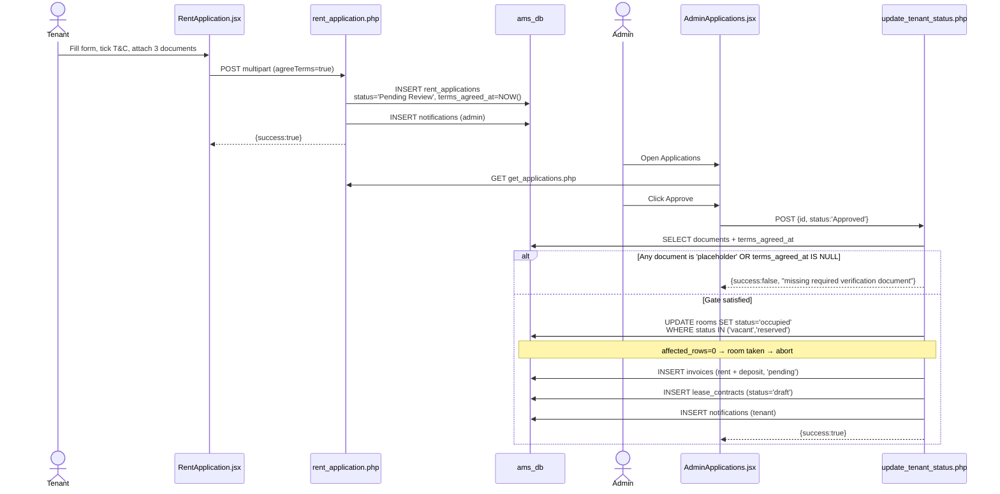

Surface map:

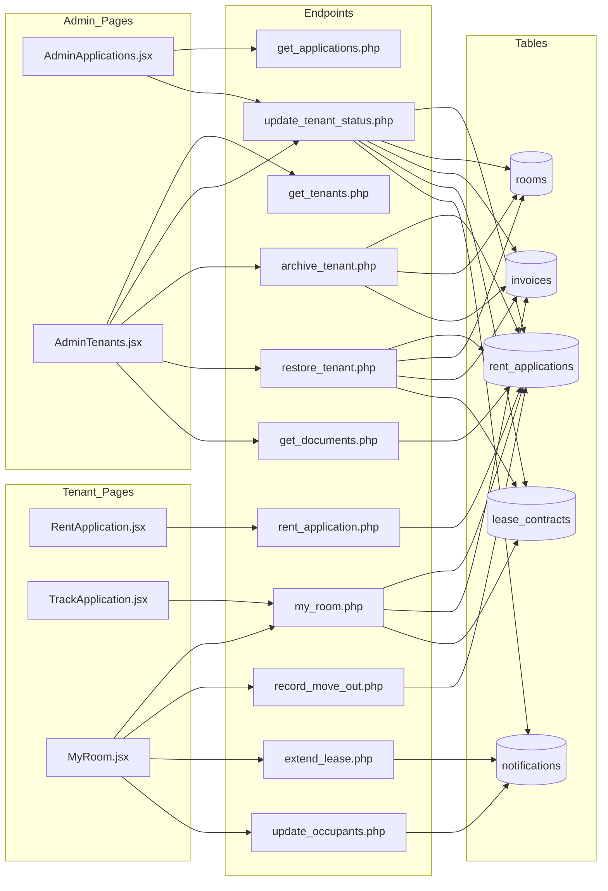

### 4.3 Step-by-Step Workflow

1. **Tenant — register** · `/register` → `registration.php` → row in `users`, role `user`.
2. **Tenant — pick a unit** · `/preview` → `get_rooms.php` → choose a `vacant` unit (use **J** or **N**).
3. **Tenant — submit application** · `/rent-application` → `rent_application.php`
   → `rent_applications` row, `status='Pending Review'`, `terms_agreed_at` stamped, three document paths written, admin notified.
   The T&C checkbox is **required** — submission is refused without it.
4. **Tenant — track** · `/track-application` → `my_room.php`. At this point the tenant is still gated out of `/my-room` (§3.4).
5. **Admin — review** · `/admin-applications` → `get_applications.php`; open the applicant to view ID/NBI documents.
6. **Admin — approve** · → `update_tenant_status.php` with `status='Approved'`. This single call enforces the 1.7 gate, claims the room, raises the move-in invoice (1 month rent + 1 month deposit) and creates a `draft` contract — all in one transaction.
7. **Tenant — pay the move-in invoice** · `/track-application` or `/pay-bills` → see [§6](#6-module-3--rental-payment--billing).
8. **Admin — record the payment, then confirm the move-in** · `/admin-payments` → `record_payment_admin.php` → invoice `paid`, deposit `Held`. The admin then sends the move-in date (`schedule_move_in.php`) and confirms occupancy (`update_tenant_status.php` → `active`): application `Approved` → `active`, contract `draft` → `active` from the move-in date, room `occupied`.
   *Only then does the tenant pass the room gate and gain `/my-room`, `/services`, `/pay-bills`.*
9. **Tenant — occupancy changes** (optional) · `/my-room` → `update_occupants.php` / `extend_lease.php` → creates a `Pending` notification for admin approval.
10. **Admin — action the request** · `/admin-notifications` → `process_tenant_request.php` (claim-first, so replays are no-ops).
11. **Tenant — request move-out** · `/my-room` → `record_move_out.php` → `status='pending-move-out'` (15–30 days' notice enforced).
12. **Admin — complete move-out** · `update_tenant_status.php` with `status='moved-out'` + clearance notes and deductions → room vacated, contract settled, pending invoices cancelled.
13. **Admin — archive / restore** · `/admin-tenants` → `archive_tenant.php` (captures `pre_archive_status`) and `restore_tenant.php` (true inverse — restores prior status, un-settles the contract, reinstates cancelled invoices, re-occupies the room only if still vacant).

### 4.4 Test Conditions

| ID | Type | Scenario | Precondition | Action | Expected | Verify |
|---|---|---|---|---|---|---|
| **M1-01** | Sec | Approval gate blocks placeholder documents | Gloria Tan, app id 6, `Pending Review` | `POST update_tenant_status.php {"id":6,"status":"Approved"}` as admin | `success:false` — *"missing a required verification document"* | `SELECT status FROM rent_applications WHERE id=6;` → still `Pending Review` |
| **M1-02** | Happy | Fully-documented application approves end-to-end | Create the fixture (SQL below) | Approve the new app id as admin | `{"success":true}`; room occupied, invoice `pending`, contract `draft` | See fixture block below |
| **M1-03** | Sec | Approval gate blocks a missing T&C agreement | Fixture from M1-02 with `terms_agreed_at=NULL` | Approve | `success:false` — *"has not agreed to the Terms & Conditions"* | Status unchanged |
| **M1-04** | Negative | Status outside the allowlist is refused | Any app | `POST {"id":6,"status":"Banana"}` | `422` `"Invalid status: Banana"` | Status unchanged |
| **M1-05** | Negative | Room already claimed by a concurrent approval | Two `Pending Review` apps for the same room | Approve both in sequence | Second → *"no longer available"* | `SELECT tenant_name FROM rooms WHERE id='<room>';` → first tenant only |
| **M1-06** | Sec | Unauthenticated document read | — | `POST get_documents.php` with no token | `401 "Authentication required"` | — |
| **M1-07** | Sec | Cross-tenant room read | Tenant A's token | `GET my_room.php?userId=<B>` | Returns **A's** room — the override is ignored for non-admins | Compare `data.room_name` to A's |
| **M1-08** | Happy | Admin may preview another tenant's room | Admin token | `GET my_room.php?userId=6` | Returns Ben's room | `data.room_name` = `D` |
| **M1-09** | Negative | Duplicate application while one is open | Maria (id 2), already `Approved` | Submit a second application | Refused — *"already have an active or pending lease application"* | `SELECT COUNT(*) FROM rent_applications WHERE user_id=2;` unchanged |
| **M1-10** | Boundary | Move-out notice shorter than 15 days | Active tenant | `record_move_out.php` with a date 5 days out | Refused — *"at least 15 days"* | Status unchanged |
| **M1-11** | Boundary | Move-out notice longer than 30 days | Active tenant | Date 45 days out | Refused — *"cannot exceed 30 days"* | Status unchanged |
| **M1-12** | Negative | Duplicate pending occupancy request | One `Pending` occupancy notification exists | Submit another | Refused — one pending request at a time | `SELECT COUNT(*) FROM notifications WHERE type='occupancy_update_request' AND status='Pending';` = 1 |
| **M1-13** | Happy | Archive → restore round trip | Carlo (app id 9, `Approved`) | Archive, then restore | Application returns to `Approved` (not hardcoded `active`); room re-occupied | Compare full row before/after |
| **M1-14** | Negative | Replayed request approval | A `Pending` lease-extension notification | Call `process_tenant_request.php` twice | Second is a no-op | `SELECT COUNT(*) FROM lease_renewals WHERE ...;` = 1 |

**Fixture for M1-02 — an application that satisfies the 1.7 gate**

The seed data cannot be approved (§1.5), so create one. Room `J` is free:

```sql
INSERT INTO rent_applications
  (user_id, first_name, last_name, contact_no, email, gender, occupants, months_of_rent,
   room_name, monthly_rent, valid_id_front_path, valid_id_back_path, nbi_clearance_path,
   status, terms_agreed_at)
VALUES
  (8, 'Gloria', 'Tan', '+639171234567', 'gloria.tan@gmail.com', 'Female', 1, 6,
   'J', 4000, 'uploads/applications/test_front.jpg', 'uploads/applications/test_back.jpg',
   'uploads/applications/test_nbi.jpg', 'Pending Review', NOW());

SELECT LAST_INSERT_ID();   -- use this as <APP_ID>
```

Approve it, then assert:

```sql
SELECT status FROM rent_applications WHERE id = <APP_ID>;      -- 'Approved'
SELECT status, tenant_name FROM rooms WHERE id = 'J';          -- 'occupied', 'Gloria Tan'
SELECT id, status, total_amount FROM invoices  WHERE rent_application_id = <APP_ID>;  -- 'pending'
SELECT id, status FROM lease_contracts WHERE rent_application_id = <APP_ID>;          -- 'draft'
```

**Restore (M1-02 / M1-03 / M1-05):**

```sql
DELETE FROM lease_contracts   WHERE rent_application_id = <APP_ID>;
DELETE FROM invoices          WHERE rent_application_id = <APP_ID>;
DELETE FROM rent_applications WHERE id = <APP_ID>;
UPDATE rooms SET status='vacant', tenant_name=NULL, lease_start=NULL, lease_end=NULL, occupants=0
  WHERE id='J';
```

---

## 5. Module 2 — Unit Management

> Audited September 2026. Remediation covered the non-functional "Add Unit" button, maintenance history misattribution, fabricated occupancy figures, and the unguarded manual tenant-assignment path.

### 5.1 API Contract

| Endpoint | Method | Auth guard | Key parameters | Success response | Notable failures |
|---|---|---|---|---|---|
| `get_rooms.php` | GET | **None** (public browse) | — | `success`, `rooms[]` incl. `maintenanceHistory`, `occupancyHistory`, `leaseHistory` | — |
| `create_room.php` | POST | `require_admin` | `id`, `type`, `floor`, `rent` | `success`, `message` | `400` missing/invalid rent · `409` duplicate id · `401`/`403` |
| `update_room.php` | POST | `require_admin` | `id`, plus any of `status`, `tenant_name`, `lease_start`, `lease_end`, `monthly_rent`, `occupants`, `room_condition`, `furnishing_status`, `maintenance_flag`; for assignment: `status='occupied'` + `user_id` + `identity_verified` | `success`, `message` | `404` unknown room · assignment without `identity_verified` → refused · `422` `status='occupied'` with no `user_id` · `409` the unit is not `vacant`/`reserved`. **Assignment reserves, it does not occupy** (payments audit 2026-09-30): the room is stored `reserved`, and the tenant's application gets the same move-in invoice (1 month advance + 1 month deposit) and draft contract (`deposit_status='Pending'`) that approval issues (`issue_move_in_billing()`). The unit becomes `occupied` only when the move-in is confirmed after that invoice is paid |
| `my_room.php` | GET | `require_user` | `userId`/`email` (admin only) | `success`, `data` | `401` |

`rooms.status` values: `vacant` (default), `occupied`, `reserved`, `maintenance`. There is no server-side allowlist — `update_room.php` accepts `status` as a free-form field, so a typo persists silently. The one exception is `occupied`, which is only accepted as a tenant assignment and is stored as `reserved` (see above). Treat this as a known sharp edge when writing tests.

`get_rooms.php` runs `release_expired_reservations()` on every call, so simply listing rooms frees any lapsed hold.

### 5.2 API Diagrams

Manual admin assignment — the path that bypasses the normal application flow and therefore carries its own attestation gate:

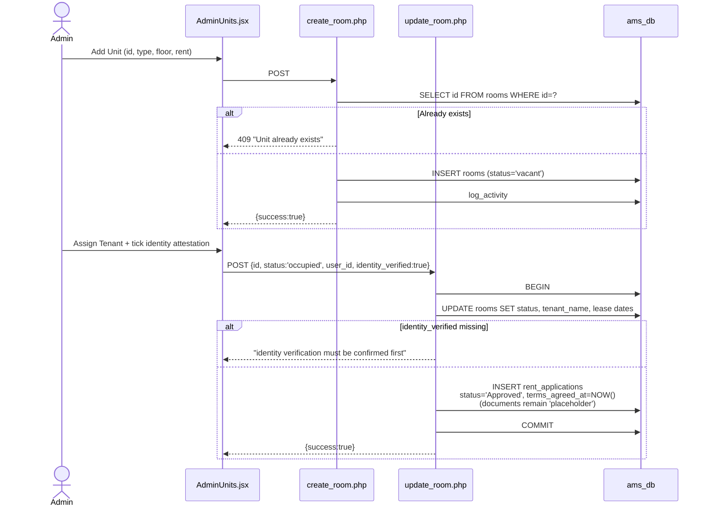

Surface map:

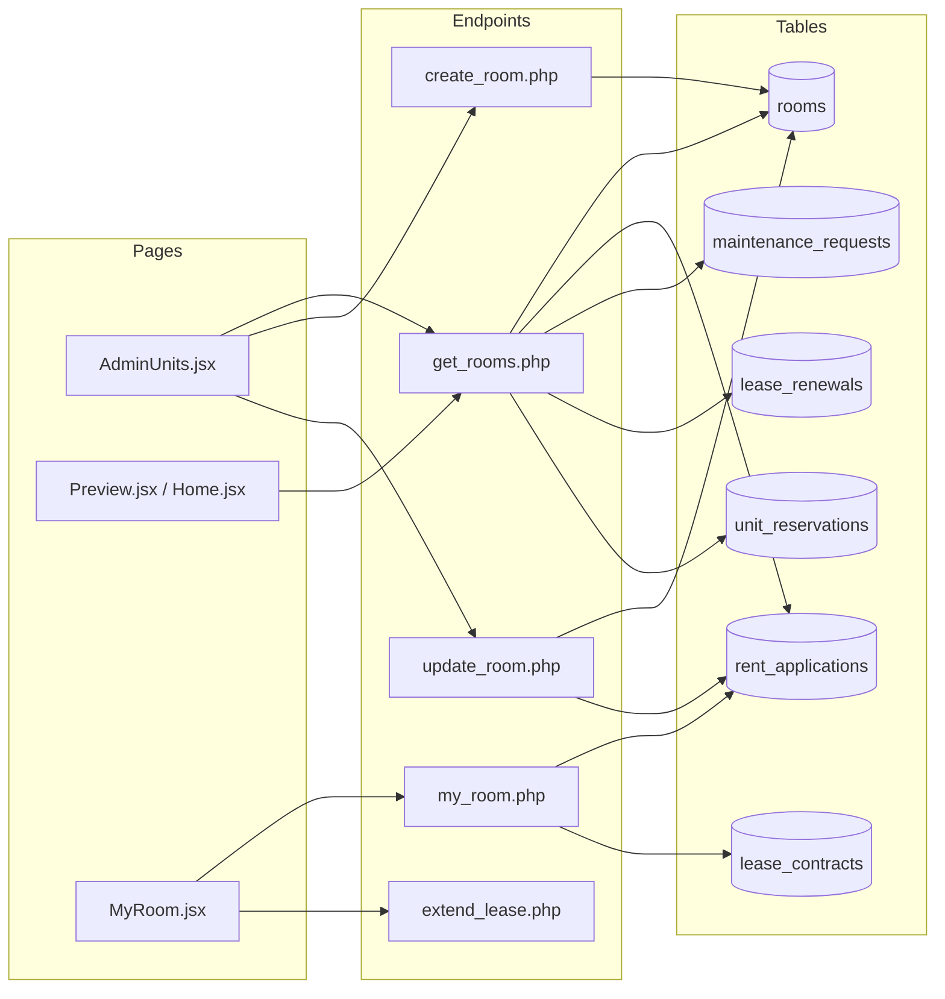

### 5.3 Step-by-Step Workflow

1. **Admin — create a unit** · `/admin-units` → *Add Unit* → `create_room.php` → `rooms` row, `status='vacant'`.
   The unit id is the primary key and is a **VARCHAR** (`'A'`, `'6B'`, `'TEST99'`) — always quote it in SQL.
2. **Public — browse** · `/preview` or `/home` → `get_rooms.php`. Vacant units are offered; expired holds are released automatically on this call.
3. **Admin — hold a unit** (optional) · `/admin-inquiries` → `create_reservation.php` → `rooms.status='reserved'` with an expiry.
4. **Assignment, either route:**
   - *Normal* — via the application flow ([§4](#4-module-1--tenant-management) step 6). Documents were verified during application.
   - *Manual* — `/admin-units` → *Assign Tenant*. Because no documents were uploaded, the admin must tick the **identity-verification attestation**; the synthetic application is stamped `terms_agreed_at=NOW()` to record it.
5. **Admin — maintain the unit** · `/admin-units` detail modal → `update_room.php` for condition, furnishing, inspection date and the maintenance flag.
6. **Review history** · `get_rooms.php` returns three real arrays per unit:
   - `maintenanceHistory` — joined directly on `maintenance_requests.room_name`, snapshotted at ticket creation.
   - `occupancyHistory` — every tenant who has occupied the unit, from `rent_applications`.
   - `leaseHistory` — extension events, from `lease_renewals`.
7. **Vacate** · Completing a move-out ([§4](#4-module-1--tenant-management) step 12) sets `status='vacant'`, records `last_tenant` and stamps `last_inspection_date`.

### 5.4 Test Conditions

| ID | Type | Scenario | Precondition | Action | Expected | Verify |
|---|---|---|---|---|---|---|
| **M2-01** | Happy | Create a unit | Admin token | `POST create_room.php {"id":"TEST99","type":"Studio","floor":"9F","rent":5555}` | `{"success":true}` | `SELECT * FROM rooms WHERE id='TEST99';` → `vacant`, rent 5555.00 |
| **M2-02** | Negative | Duplicate unit id | TEST99 exists | Repeat M2-01 | `409 "Unit TEST99 already exists."` | Row count still 1 |
| **M2-03** | Sec | Unauthenticated create | — | M2-01 with no token | `401 "Authentication required"` | No row created |
| **M2-04** | Sec | Tenant attempts create | Tenant token | M2-01 with `$TEN` | `403 "Forbidden: Admin access required"` | No row created |
| **M2-05** | Negative | Invalid rent | Admin token | `{"id":"TEST98","type":"Studio","floor":"9F","rent":0}` | `400` — positive rent required | No row created |
| **M2-06** | Sec | Manual assignment without attestation | Vacant unit + a user id | `update_room.php` with `status='occupied'`, `user_id`, **no** `identity_verified` | Refused — *"identity verification must be confirmed first"* | No synthetic `rent_applications` row |
| **M2-07** | Happy | Manual assignment with attestation | Same, `identity_verified:true` | — | `{"success":true}` | Synthetic application `Approved` with `terms_agreed_at` set |
| **M2-08** | Happy | Maintenance attributed to its own unit | — | Submit a ticket as a tenant, then `GET get_rooms.php` | Ticket appears under **that unit only** | Compare `maintenanceHistory` across every room |
| **M2-09** | Happy | Occupancy & lease history populated | Rosa (room C) has a renewal | `GET get_rooms.php` | Room C has non-empty `occupancyHistory` **and** `leaseHistory` | Inspect the arrays |
| **M2-10** | Boundary | Expired hold released on browse | Room I held by an **`Active`** reservation — confirm first (see below) | Back-date `hold_expires_at`, call `get_rooms.php` | Reservation flips `Active` → `Expired` | `SELECT status FROM unit_reservations WHERE room_name='I';` |
| **M2-11** | Negative | Unknown unit | Admin token | `update_room.php {"id":"ZZZ","status":"vacant"}` | `404 "Room not found."` | — |
| **M2-12** | Sec | Bare `occupied` refused | Vacant room | `update_room.php {"id":"I","status":"occupied"}` (no `user_id`) | `422` *"Choose the tenant to assign…"* | Room unchanged — verified live 2026-09-30 |
| **M2-13** | Happy | Manual assignment bills the move-in | Vacant room, a user with no tenancy | `update_room.php` with `status='occupied'`, `user_id`, dates, `monthly_rent: 3500`, `identity_verified: true` | `200` *"Room … reserved. The move-in invoice … was issued…"*; room `reserved`; an `Approved` application; move-in invoice `base_rent 3500 + security_deposit 3500 = 7000`, `pending`; draft contract, `deposit_status='Pending'`; tenant notified | Verified live 2026-09-30 (room I, restored after) |

**Restore:**

```sql
DELETE FROM rooms WHERE id LIKE 'TEST%';
-- After M2-06/M2-07, also remove the synthetic application and re-vacate the unit:
DELETE FROM rent_applications WHERE room_name = '<unit>' AND valid_id_front_path = 'placeholder'
  AND id NOT IN (SELECT * FROM (SELECT id FROM rent_applications ORDER BY id LIMIT 12) x);
UPDATE rooms SET status='vacant', tenant_name=NULL, lease_start=NULL, lease_end=NULL, occupants=0
  WHERE id='<unit>';
```

**M2-10 precondition and restore.** Katrina Villareal's hold on room I is `Active` in the seed, but approving any application for room I closes it out to `Converted` — so a previous test run can silently invalidate this fixture. Check before, restore after:

```sql
-- Precondition check — must read 'Active'
SELECT status, hold_expires_at FROM unit_reservations WHERE room_name = 'I';

-- Restore to seed state
UPDATE unit_reservations
SET status='Active', hold_expires_at='2026-10-10', released_at=NULL, released_reason=NULL
WHERE room_name='I' AND reserved_for_name='Katrina Villareal';
```

> Deleting a unit is generally **not possible**: `rent_applications.room_name` references `rooms.id` with `ON DELETE RESTRICT`, so any unit with application history — including rejected applications — cannot be dropped. Only units created and never used (like `TEST99`) delete cleanly.
>
> For the same reason, prefer room **J** over **I** for assignment tests — using I destroys the M2-10 fixture.

---

## 6. Module 3 — Rental Payment & Billing

> Audited September 2026. Remediation covered an unauthenticated billing IDOR, webhook replay, the "stranded invoice" status trap, a phantom late fee, and invoice-id collisions. The matrix in §6.4 was verified live against the running stack.

### 6.1 API Contract

| Endpoint | Method | Auth guard | Key parameters | Success response | Notable failures |
|---|---|---|---|---|---|
| `get_invoices.php` | GET | `require_user` + ownership | `userId` (own id, or any for admin) | `success`, `invoices[]` (each includes `proof_rejection_reason`, `rent_period_start`, `payment_group`, `advance_months`, `paid_from_advance`, and `period_start`/`period_end`: the dates the bill covers, counted from the move-in day — `invoice_covered_period()`); the admin list (no `userId`) also returns `accounts` keyed by user id: `deposit` (`state` = `unpaid` / `held` / `settled` / `not-billed`, `status`, `amount`, `deductions`, `move_in_invoice`) and `advance` (prepaid-rent credits by status: `reserved` / `available` / `refund-due` → `months`, `amount`) | `401` no token · `403` other tenant · `403` global list as non-admin |
| `create_invoice.php` | POST | `require_admin` | `userId`, `unit`, `baseRent`, `water`, `electricity`, `parking`, `lateFee`, `dueDate`, `billingPeriod`, `invoiceNumber` | `success`, `invoice_id`, `total_amount` | `409` id already exists (insert-only since audit H8 — use `adjust_invoice.php` instead) or a second `base_rent > 0` invoice for the same tenant/period · `422` negative amount, past/invalid due date, or a `billingPeriod` not shaped `"Month YYYY"` · `422` no resolvable active tenancy |
| `adjust_invoice.php` | POST | `require_admin` | `invoiceId`, `baseRent`, `water`, `electricity`, `parking`, `lateFee`, `dueDate` | `success`, `invoice_id`, `total_amount` | `409` invoice not in `INVOICE_ADJUSTABLE_STATUSES` (with the reason) or changed concurrently · `422` negative amount/bad date, or a changed `dueDate` in the past (an unchanged lapsed date may be resaved) · `404` unknown id. Recomputes `total_amount` from every column, so `services`/`maintenance`/`security_deposit` can never be dropped (audit H8). |
| `bundle_payment.php` | POST | `require_user`, tenant only | `{action:'create'}` or `{action:'release', key}` (`BND-…`) | create: `key`, `invoices[]` (`id`, `billing_period`, `amount`), `total`. release: `released` (bills ungrouped) | `403` admin · `405` not POST · create: `422` fewer than two unpaid bills or none overdue, `409` the open bundle already has a payment in progress · release: `422` not a `BND-` key, `409` once a payment for it was submitted or recorded |
| `advance_payment.php` | GET / POST | `require_user`, tenant only | GET: none. POST `{action:'create', months}` (1–6), `{action:'cancel', invoice}`, or `{action:'cancel', group}` (legacy `ADV-…` groups) | GET: `available`, `monthly_rent`, `lease_end`, `months[]` (`period_start`, `period_end`, `billing_period`, `amount`; only months starting after the 7-day billing window, not billed and not credited), `pending` (the open advance-rent invoice with its `months[]`), `credits[]` (paid months: `available` or `applied`). create: `invoice_id` (one `INV-…` advance-rent invoice), `months[]`, `total`, `due_date` | `403` admin, or no active contract · `409` another advance payment still open, or a month credited in the meantime · `422` months out of range / more than the lease has left · cancel: `409` once a payment for it is awaiting confirmation or recorded |
| `pay_bill.php` | POST | `require_user` | `invoiceId`, `paymentMethod`, `paymentReference`, `proofOfPaymentPath` | `success`, `message` | `409` invoice not open (re-submitting what `upload_payment_proof.php` already stored is a success, not a `409`). A `"Cash on Hand"` declaration also queues `cash_payment_declared` for the admin bell (audit M12) and sends the tenant a *Cash Payment Declared* notification. |
| `upload_payment_proof.php` | POST (multipart) | `require_user` | `invoice_id`, `payment_reference`, `sender_name`; file `proof` | `success`, `proof_path` | `422` bad type/>10MB · `409` not open · `500` save failed. Clears `proof_rejection_reason`; a tenant upload sends them a *Payment Submitted* notification. |
| `record_payment_admin.php` | POST | `require_admin` | `invoiceId`, `paymentMethod`, `paymentReference`, `amountPaid` (**required**) | `success`, `message` | `422` missing or non-positive `amountPaid` (payments audit 2026-09-30: an omitted amount used to skip the short-payment check and settle the bill in full) · `422` `paymentMethod` not one of `Cash` / `GCash` / `BDO` / `BPI` (`DESK_PAYMENT_METHODS`; BDO and BPI are bank transfers, each its own method), or not a method the proof under verification allows (`desk_methods_for_label()`: `GCash (Manual)` → GCash, `BDO (Manual)` → BDO, `BPI (Manual)` → BPI, an older generic `Bank Transfer (Manual)` → BDO or BPI; 2026-10-01) · `409` a bill in the key is `processing` (online checkout open — release it first) · short `amountPaid` → `409` · already settled → refused. Settles through the shared `settle_invoice()` helper (audit M12) — the same move-in cascade, queue resolution and tenant notification the webhook now uses. |
| `schedule_payment.php` | POST | `require_user` | `invoice_id`, `scheduled_date`, `scheduled_time_slot` | `success`, `message` | `422` past date / >60 days / bad slot · `409` not open. Queues `cash_payment_declared` (a reschedule replaces the earlier row) and sends the tenant a *Payment Scheduled* notification. |
| `create_checkout_session.php` | POST | `require_user` | `invoice_id`, `channel`, `success_url`, `cancel_url` | `success`, `checkout_url` | Already paid · already `processing` · gateway unconfigured |
| `release_checkout_session.php` | POST | `require_user` (tenant: own bills; **admin: any tenant's**, since 2026-10-01) | `invoice_id` (invoice or group key) | `success`, `released` | Never errors on a no-op; `released:false` if not `processing` (or not the caller's). An admin release is logged (*Released Online Checkout*) and the tenant gets *Online Checkout Cancelled*; `checkout_session_id` is cleared, so a late webhook can't settle it |
| `paymongo_webhook.php` | POST | HMAC signature | raw payload + `Paymongo-Signature` | `success` | `401` bad/stale signature · `500` on DB write failure (so the gateway retries) · `200` with the invoice left `pending-verification` when the paid amount doesn't match `total_amount` (audit H9b) — never trusts the invoice's current total; the tenant gets a *Payment Being Verified* notification. Signature key is chosen by the event's own `livemode` flag (audit H9a); a paid event settles through the same shared `settle_invoice()` the desk uses, so an online move-in payment is recorded exactly like a desk payment (audit M12). Payment no longer activates the tenancy: the admin sends the move-in date (`schedule_move_in.php`) and then confirms occupancy (`update_tenant_status.php` → `active`). |
| `get_payment_channels.php` | GET | `require_user` | — | `success`, `channels[]` (manual family: `GCash (Manual)`, `BDO (Manual)`, `BPI (Manual)` — both banks follow the one `payment_ch_bank_manual` switch) | `401` |
| `check_due_date_reminders.php` | GET/POST | `require_admin` | — | `success`, `marked_overdue`, `rent_invoices_created`, counts | `401`/`403` |
| `send_payment_reminder.php` | POST | `verify_admin` gate | `invoice_id` or `all` | `success`, `count` | `403` non-admin |

**`BILLING_OPEN_STATUSES`** in `backend/config.php` is the single source of truth for "this invoice still owes money":

```
pending · unpaid · overdue · pending-verification · scheduled · processing · payment-failed
```

`paid` and `cancelled` are terminal and deliberately excluded. Use `billing_open_status_sql()` rather than re-listing statuses in a new query — omitting one is exactly how invoices previously went missing from receivables.

**Advance payments as monthly credits (2026-09-28, panel feedback).** An advance payment is now **one** advance-rent invoice (`invoices.advance_months = N`, label "Advance rent: Nov 2026 – Dec 2026", due within 3 days and before the first month's billing window), paid through the normal pay endpoints like any invoice. Each month it covers is an `advance_credits` row: `reserved` until the invoice is paid, then `available`. The daily generator still issues every month's rent invoice on its usual date; a month with an `available` credit is billed at the credited amount and settled at once (`payment_method = 'Advance credit'`, `payment_reference` = the advance invoice), the credit becomes `applied`, and the tenant gets *Rent Paid from Advance: <month>*. While the advance awaits confirmation its months are held back; if it is still unpaid when its first month comes due, `expire_unpaid_advances()` cancels it and its credits and the months are billed normally (*Advance Payment Expired*). Reports count rent in the month it covers: advance-rent invoices are left out of revenue, receivables and arrears, and never get a late fee; `adjust_invoice.php` refuses them (`409`). At move-out (`end_tenancy()`) unpaid credits are cancelled and paid-but-unreached months become `refund-due`, with an admin notice naming the amount. Past-due bills show the period they cover (from the move-in day) instead of the lapsed due date, in PayBills, AdminPayments, Payment History and the overdue alert text.

**Combined payment of overdue bills (2026-09-30, panel feedback).** A tenant with two or more unpaid bills, at least one of them overdue, chooses on Pay Bills between paying them **all together** (overdue and current bills) and **one at a time**. *Pay all together* calls `bundle_payment.php {action:'create'}`, which stamps the not-yet-submitted, non-advance bills with one `payment_group = 'BND-…'` (`bundle_candidates()` / `bundle_overdue_invoices()`; an open unpaid bundle takes in newly issued bills). The `BND-` key goes through the same group pipeline as below (proof, cash, schedule, PayMongo, admin record/reject; `settle_payment_key()` settles and receipts each bill on its own). The tenant gets one *Payment Received* for the bundle with `metadata_value = invoice:BND-…`. Payment History shows one **combined receipt** (`RCT-BND-…`, every billing period with its covered dates and amount) plus each bill's own receipt, marked "Paid as part of combined payment BND-…". *Pay separately instead* (`{action:'release', key}`) clears the key while nothing has been submitted (`release_bundle()`), otherwise `409`. AdminPayments shows the group as "Combined payment · N overdue bills".

**Payment keys (groups: legacy advances `ADV-…`, combined payments `BND-…`).** New advances no longer create groups; the following applies to `ADV-…` groups created before 2026-09-28 and to combined payments. `pay_bill`, `upload_payment_proof`, `schedule_payment`, `create_checkout_session`, `release_checkout_session`, `record_payment_admin`, `reject_payment_proof` and the webhook metadata take either an invoice id (`INV-…`) or an advance payment's group id (`ADV-…`) in the same parameter, and target rows with `? IN (id, payment_group)`. A group is paid with one payment: one proof, one cash declaration, or one checkout with a line item per month (all or nothing). Settling it runs `settle_invoice()` once per month (`settle_payment_key()`), so each month is its own `paid` invoice with its own receipt; the tenant gets **one** *Payment Received* notice for the group (months, total, `metadata_value = invoice:<first month>`), sent even for the months already settled when a later one fails. A short `amountPaid` or a webhook amount that doesn't match the group's sum is refused or sent to verification, as for one invoice. Unpaid grouped invoices never receive posted service/parking/utility/maintenance charges.

### 6.2 API Diagrams

Invoice status lifecycle:

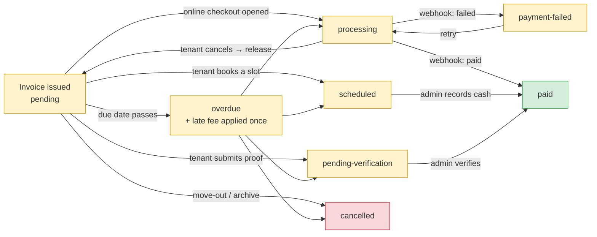

Everything in the amber band counts toward receivables, is eligible for overdue promotion, and appears on the tenant's bill. `scheduled`, `processing` and `payment-failed` were previously excluded from all three — that is the "stranded invoice" bug this module was audited for.

Online payment, including the replay and abandonment paths:

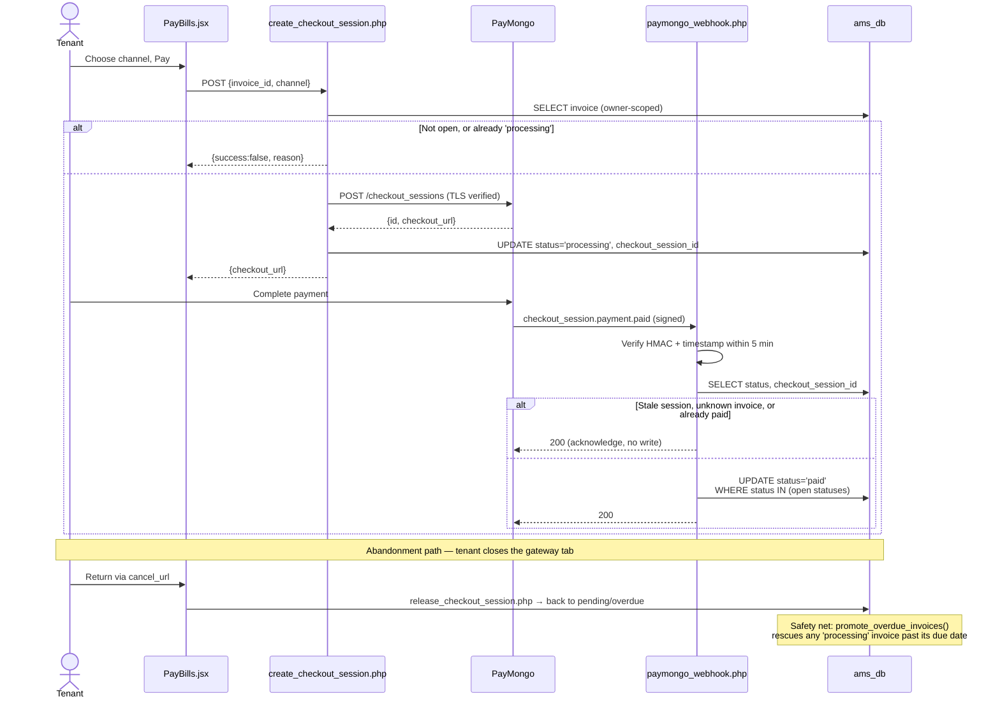

Surface map:

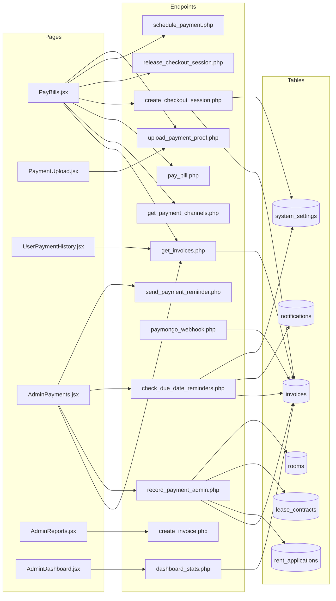

### 6.3 Step-by-Step Workflow

0. **Automatic — monthly rent** · the daily sweep (`generate_due_rent_invoices()`) issues each tenancy month's rent invoice 7 days before it starts: `rent_period_start` = the contract's lease-start day in that month (clamped to month end), due that day, labelled "Month YYYY", tenant notified (`billing`). Month 0 is the move-in invoice's advance rent. A month already started is never back-billed; a month already billed (by its `rent_period_start`, or an older rent invoice with the same label) is skipped.
1. **Admin — issue an invoice** · `/admin-reports` → *Generate Invoice* → `create_invoice.php`
   → `invoices` row, `status='pending'`, tenant notified. Line items are real columns and `total_amount` is always their sum.
2. **Tenant — view the bill** · `/pay-bills` → `get_invoices.php`. Every call also runs `promote_overdue_invoices()`, so simply loading the page promotes lapsed invoices and applies the late fee.
3. **Tenant — choose a channel** · `get_payment_channels.php`. In-person cash is always offered; the remote family depends on `payment_mode` (`sandbox` = gateway checkout, `manual` = transfer-and-upload).
4. **Payment, by channel:**
   - **Online (sandbox)** → `create_checkout_session.php` → invoice goes `processing` → gateway → `paymongo_webhook.php` settles it to `paid`. Cancelling returns via `release_checkout_session.php`.
   - **Manual transfer** → `upload_payment_proof.php` with reference + screenshot → `pending-verification`.
   - **In-person cash** → `schedule_payment.php` books a slot → `scheduled` → the tenant pays at the office.
5. **Admin — verify and record** · `/admin-payments` → `record_payment_admin.php` with method, amount and reference → `paid`, `paid_at` stamped.
   Settlement is **all-or-nothing**: the amount is required for every method and a short `amountPaid` is refused, because there is no partial-payment ledger. The page pre-fills the total; cash may exceed it (change), a transfer must match it.
   The **method follows the tenant's channel** (2026-10-01): the tenant's label (`GCash (Manual)`, `Cash on Hand`, an in-person booking…) is mapped to a desk method. While a proof is under verification it is **locked** (server-enforced) — to record another method, reject the proof. Otherwise it is the default and the admin may change it. While an online checkout is `processing`, recording is blocked; the admin checks PayMongo and uses **Cancel online checkout** (`release_checkout_session.php`) first.
   The cashier panel is read-only on *what is owed* (payments audit 2026-09-30): period, due date and term come from the invoice, and the Security Deposit / Prepaid Rent chips come from `get_invoices.php` `accounts`. The old editable Period, Term, Due Date, deposit/advance toggles, *Use Extended/Prorated Rent* and *Custom Add-ons* were never saved and are gone. **Adjust invoice…** opens a modal that posts to `adjust_invoice.php` (manual lines and due date; logged, tenant notified) for a single open bill.
6. **First payment only** — settling the move-in invoice (`security_deposit > 0`) marks the contract's deposit `Held` (`deposit_status` `Pending` → `Held`) and asks the admin to schedule the move-in. It does **not** start the tenancy: the application, contract and room change only when the admin confirms the move-in (`update_tenant_status.php` → `active`).
7. **Overdue handling** · `check_due_date_reminders.php` (admin) or any invoice listing promotes lapsed invoices, applies the configured late fee **once**, and dispatches tenant notifications. Reminder cadence comes from `rent_due_reminder_days` and `overdue_reminder_interval_days`.
8. **Receipt** · `/admin-payments` → *View Receipt* → printable modal rendered from invoice data. No receipt row is persisted and there is no sequential OR number.
9. **Confirmation loop, admin → tenant** (panel feedback, 2026-09-26) · Every submission notifies the tenant (*Payment Submitted* / *Cash Payment Declared* / *Payment Scheduled*), and PayBills shows a *Payment submitted* modal instead of an `alert()` + reload. While any invoice is `pending-verification`, `scheduled` or `processing`, PayBills shows an "awaiting confirmation" banner, disables *Proceed to Pay*, and `useInvoiceWatch` re-fetches `get_invoices.php` every 20 s (and on every bell change). When the admin settles it (`settle_invoice()` → *Payment Received*), the open page shows *Payment confirmed* with a **View receipt** button that opens that invoice's receipt in Payment History. A rejection (`reject_payment_proof.php`, reason entered in a modal) returns the invoice to `pending`/`overdue`, and PayBills shows the reason from `proof_rejection_reason` until a new proof is uploaded. The admin sees a "tenant notified" toast after each decision. Payment History labels awaiting invoices *Verifying* / *Scheduled* / *Processing* and offers *Pay Now* only on payable ones.
10. **Tenant — pay in advance** (panel feedback 2026-09-26, reworked 2026-09-28) · `/pay-bills` → *Pay in advance* → choose 1–6 upcoming months (months starting after the 7-day billing window, not billed or credited yet, up to the lease end; each shows the dates it covers) → *Continue to payment* → `advance_payment.php {action:'create'}` creates **one** advance-rent invoice and reserves a credit per month → the payment panel pays it with any channel → admin confirms (AdminPayments shows the advance and, afterwards, the tenant's remaining advance credit) → the tenant gets one *Payment Received* and the months appear under *Prepaid months* as credited → each month's rent invoice is still issued by the daily sweep on its usual date and paid from the credit at once, with its own receipt (*Paid from advance payment INV-…*). Only one open advance at a time; *Cancel advance* (while unpaid) cancels it and frees its months. In the payment panel, a small card points here (2026-10-01): *Pay ahead* → **Pay in advance**, or, once months are credited, *N month(s) prepaid* → **View prepaid months**. It replaced an *Automatic Payment* checkbox that was never saved or acted on — paying ahead is the system's only automatic payment.
11. **Live payment alerts, both ways** (panel feedback, 2026-09-27) · The notification bells double as payment watchers, so a decision reaches the other side on **any** page, not only PayBills. When one arrives, the **bell dropdown opens by itself** with the new notice on top, tinted and marked *New*; closing the dropdown clears the highlight. Tenant (`TopBar`, desktop bell; the mobile bell is a link to `/notifications` and only its count updates): *Payment Received* shows green with **View receipt →**, and clicking it opens that invoice's receipt in Payment History (`metadata_value = invoice:<id>`); *Payment Proof Rejected* (with the reason) and *Payment Failed* show red with **Open Pay Bills →**. The bell polls every 20 s while the tenant's newest payment notice is their own submission (*Payment Submitted* / *Cash Payment Declared* / *Payment Scheduled* / *Payment Being Verified*), otherwise every 60 s; PayBills fires the bell refresh right after a submit. On `/pay-bills` a confirmation doesn't open the dropdown (the page's own *Payment confirmed* modal shows instead); a rejection still does, because the bill's rejection banner doesn't cover advance payments. Admin (`AdminDashboardHeader`, polled every 20 s): a new `Pending` `payment_verification` / `cash_payment_declared` row opens the dropdown with it marked *New* and **Review payment →** (click → `/admin-payments`), and AdminPayments reloads its list in place (`admin_payments_updated` event). Each side keeps a per-user high-water mark of seen notification ids in `sessionStorage` (`hooks/usePaymentAlerts.js`): the first load of a tab only sets it, so old notices never open the dropdown and a reload or route change never reopens it.
12. **Tenant — overdue bills: pay all together or one at a time** (panel feedback, 2026-09-30) · `/pay-bills` with two or more unpaid bills, at least one overdue → a card lists them (overdue ones with covered dates and days overdue, current ones with their due date; amounts, total) with **Pay all together** / **Pay one at a time**. *Together* → `bundle_payment.php {action:'create'}` → the ledger shows "Combined payment" and the panel pays the `BND-…` key through any channel (*Pay separately instead* releases it while nothing is submitted) → admin confirms once in AdminPayments ("Combined payment · N overdue bills") → Payment History shows one **Combined receipt** plus each billing period's own receipt ("Paid as part of combined payment BND-…", linking to the combined one). *One at a time* → the earliest overdue bill is shown as today.

### 6.4 Test Conditions

All rows below were executed against the live stack during the September 2026 audit.

| ID | Type | Scenario | Precondition | Action | Expected | Verify |
|---|---|---|---|---|---|---|
| **M3-01** | Sec | Unauthenticated billing read | — | `GET get_invoices.php?userId=2` with **no headers** | `401 "Authentication required"` | Previously leaked full billing history — a regression here is critical |
| **M3-02** | Sec | Cross-tenant billing read | Maria's token | `GET get_invoices.php?userId=6` | `403 "Access denied to other user's invoices"` | — |
| **M3-03** | Sec | Tenant requests the global list | Maria's token | `GET get_invoices.php` (no `userId`) | `403 "Admin access required"` | — |
| **M3-04** | Happy | Tenant reads own invoices | Maria's token | `GET get_invoices.php?userId=2` | `success:true`, only `user_id=2` rows | — |
| **M3-05** | Sec | Unauthenticated reminder dispatch | — | `GET check_due_date_reminders.php` | `401` | No new `notifications` rows |
| **M3-06** | Sec | Unauthenticated proof upload | — | `POST upload_payment_proof.php -F userId=2 …` | `401` — the body `userId` is not accepted as identity | Invoice unchanged |
| **M3-07** | Sec | Reopening a settled invoice | A `paid` invoice owned by the tenant | `POST pay_bill.php` against it | `409 "not open for payment"`; `paid_at` preserved | `SELECT status, paid_at FROM invoices WHERE id='<id>';` |
| **M3-08** | Happy | Late fee, flat mode | `late_fee_enabled=true`, `type=flat`, `value=200` | `GET get_invoices.php` as admin | Each overdue invoice gains exactly `200.00`; total rises by 200 | Line items now sum to `total_amount` |
| **M3-09** | Boundary | Late fee is idempotent | Immediately after M3-08 | Call `get_invoices.php` again | **No** second charge | `late_fee` still `200.00` |
| **M3-10** | Happy | Late fee, percent mode | `type=percent`, `value=5`, fees reset to 0 | Same | `ROUND(recurring × 5%, 2)` — e.g. `5340.00 → 267.00` | Per-invoice arithmetic |
| **M3-11** | Negative | Short payment refused | Any open invoice | `record_payment_admin.php` with `amountPaid` below total | Refused — *"Partial payments are not supported"* | Status unchanged |
| **M3-12** | Happy | Reference number recorded | Open invoice | Record payment, method `GCash`, `paymentReference:"REF-9988776"` | `paid` with the reference stored | `SELECT payment_reference FROM invoices WHERE id='<id>';` |
| **M3-13** | Happy | Scheduled invoice can be settled | Invoice in `scheduled` | `record_payment_admin.php` method `Cash` | `{"success":true}` → `paid` | Regression guard: this was blocked by an over-narrow status set |
| **M3-14** | Negative | Second concurrent checkout | Invoice already `processing` | `create_checkout_session.php` again | Refused — *"already in progress"* | Prevents double payment |
| **M3-15** | Happy | Abandoned checkout released | Invoice `processing`, due date in the future | `release_checkout_session.php` | `released:true` → back to `pending`, session id cleared | `SELECT status, checkout_session_id FROM invoices WHERE id='<id>';` |
| **M3-16** | Sec | Cross-tenant release | Maria's token, Ben's `processing` invoice | `release_checkout_session.php` | `released:false` — no-op | Ben's invoice still `processing` |
| **M3-17** | Boundary | Stranded invoice rescued | Invoice `processing` **past** its due date | Any invoice listing | Promoted to `overdue`, stale session id cleared | Safety net for M3-15 when the return URL fails (§14.1 #4) |
| **M3-18** | Negative | Past scheduling date | Open invoice | `schedule_payment.php` date `2020-01-01` | `422 "cannot be in the past"` | — |
| **M3-19** | Negative | Invalid time slot | Open invoice | slot `"midnight"` | `422 "Invalid time slot."` | Allowed: `morning`, `afternoon`, `evening` |
| **M3-20** | Negative | Re-issuing any existing invoice | An existing invoice id (any status) | `create_invoice.php` with that id | `409` — use `adjust_invoice.php` instead (audit H8: creation is insert-only, not just blocked for `paid`/`cancelled`) | Amounts unchanged |
| **M3-21** | Sec | Webhook replay | A previously valid signed payload | Re-POST it after 5 minutes | `401 "timestamp outside the accepted window"` | No status change |
| **M3-22** | Sec | Webhook for a superseded session | Event whose session id ≠ the invoice's | POST it | `200` acknowledged, **no write** | Status unchanged |
| **M3-23** | Happy | Cash and online offered together | `payment_mode='sandbox'` | `GET get_payment_channels.php` | GCash, Bank, Maya **and** In-Person all returned | Previously cash vanished in sandbox mode |
| **M3-24** | Happy | Receivables include every open status | Invoices in `scheduled`/`processing` | `GET dashboard_stats.php` | `pending_dues` includes them | Compare against `SUM` over `BILLING_OPEN_STATUSES` |
| **M3-25** | Negative | Manual invoice validation (audit M8) | — | `create_invoice.php` with `water:-5`, then with `billingPeriod:"2026-9"` | `422` on each — amounts must be ≥ 0; period must match `"Month YYYY"` | — |
| **M3-26** | Negative | Duplicate rent invoice refused (audit M8) | A tenant with an open rent invoice for the current period | `create_invoice.php` with `baseRent > 0` for the same tenant/period | `409` naming the existing invoice | No second row in `invoices` |
| **M3-27** | Happy | Adjustment preserves posted charges (audit H8) | An invoice with `services`/`maintenance` already posted | `adjust_invoice.php` changing only `baseRent` | `total_amount` recomputed to include the unedited `services`/`maintenance`/`security_deposit` | `SELECT services, maintenance, security_deposit, total_amount FROM invoices WHERE id='<id>';` |
| **M3-28** | Negative | Adjusting a non-adjustable invoice | A `paid`/`processing`/`pending-verification` invoice | `adjust_invoice.php` against it | `409` with the specific reason (e.g. *"is already paid; issue a manual credit instead"*) | Row unchanged |
| **M3-29** | Sec/Happy | Webhook paid-amount check (audit H9b) | A signed sandbox `checkout_session.payment.paid` event | POST with `payments[0].attributes.amount` ≠ `round(total_amount*100)` | `200`, invoice → `pending-verification`, a `payment_verification` queue row created | Invoice **not** marked `paid`; repeat with the correct amount → settles and resolves the queue row |
| **M3-30** | Happy | Online move-in payment is settled like a desk payment (audit M12) | A move-in invoice (`security_deposit > 0`, application `Approved`) | A correctly-signed, correct-amount webhook `paid` event | Invoice `paid`; application stays `Approved`, room stays `reserved`, contract stays `draft` — identical to `record_payment_admin.php`. Occupancy starts only when the admin confirms move-in (`update_tenant_status.php` → `active`, after `schedule_move_in.php`) | Payment and occupancy are separate events since the September 2026 move-in lifecycle |
| **M3-31** | Happy | Cash-on-hand and move-out both reach the queue (audit M12) | A tenant token | `pay_bill.php` with `paymentMethod:"Cash on Hand"`; separately `record_move_out.php` | A `Pending` `cash_payment_declared` / `move_out_request` row each | Settling the invoice, or `end_tenancy()` running the move-out to completion, resolves the matching row |

| **M3-32** | Happy | Tenant told the proof was received | Jose, an `overdue` invoice | `upload_payment_proof.php` (tenant) | Invoice `pending-verification`; tenant notification *Payment Submitted* (`metadata_value = invoice:<id>`) | Verified live 2026-09-26 |
| **M3-33** | Happy | Rejection reason reaches the tenant | Immediately after M3-32 | Admin `reject_payment_proof.php` with a reason, then tenant `get_invoices.php` | Invoice back to `overdue`; `proof_rejection_reason` returned; *Payment Proof Rejected* notification | Verified live 2026-09-26 |
| **M3-34** | Happy | Resubmit clears the reason; admin confirms | After M3-33 | Tenant uploads again, admin `record_payment_admin.php` | `proof_rejection_reason` NULL after the upload; then `paid`, *Payment Received* notification, `payment_verification` queue row resolved | Verified live 2026-09-26 |
| **M3-35** | Happy | Scheduling notifies both sides, once | An open invoice | `schedule_payment.php` twice (different slot) | Tenant *Payment Scheduled*; exactly one `Pending` `cash_payment_declared:<id>` row | Verified live 2026-09-26 |
| **M3-36** | Happy | Monthly rent generated from the lease start | Seed data, today 2026-09-26 | `check_due_date_reminders.php` (admin) | `rent_invoices_created: 4` — October 2026, due 2026-10-01, for Maria, Rosa, Ben, Carlo (contracts starting on the 1st, ending after Oct 1); none for leases ending Oct 1, starting on the 5th/15th, draft or expired | Verified live 2026-09-26 |
| **M3-37** | Boundary | Generation is idempotent | Immediately after M3-36 | Run it again | `rent_invoices_created: 0` | Verified live 2026-09-26 |
| **M3-38** | Boundary | Month-end clamping | — | `rent_period_start('2026-01-31', k)` for k = 1, 2, 3 | 2026-02-28, 2026-03-31, 2026-04-30 | Verified 2026-09-26 |
| **M3-39** | Negative | No past due date on adjustment | An open invoice | `adjust_invoice.php` with a changed `dueDate` before today; then its own lapsed date with a changed amount | `422 "Due date cannot be in the past."`; then `200` | Verified live 2026-09-26 |
| **M3-40** | Happy | Move-in payment starts the tenancy | Lita's move-in invoice reopened (`pending`), contract `draft` | `record_payment_admin.php` | Contract `active` with `lease_start`/`lease_end` = the room's (payment date, +months); invoice `rent_period_start` = that date, label "September 2026" | Verified live 2026-09-26 |
| **M3-41** | Happy | Advance preview and create | Grace (lease to 2027-01-05), today 2026-09-26 | `GET advance_payment.php`, then `POST {action:'create', months:2}` | Preview: Oct 5, Nov 5, Dec 5 2026 at ₱3,500; create: two invoices, rent periods 2026-10-05 / 2026-11-05, one `ADV-…` group | Verified live 2026-09-26 |
| **M3-42** | Negative | One open advance payment; tenant only | After M3-41 | Create again as Grace; create as admin | `409 "You already have an advance payment waiting…"`; admin `403` | Verified live 2026-09-26 |
| **M3-43** | Happy | One proof covers the group; rejection returns all | After M3-41 | `upload_payment_proof.php` with `invoice_id=<ADV-…>`, then admin `reject_payment_proof.php {invoiceId:<ADV-…>}` | Both months `pending-verification`, one `payment_verification:<ADV-…>` queue row, one tenant notice; after reject both `pending` with the reason | Verified live 2026-09-26 |
| **M3-44** | Happy | Desk settles the group per month | After M3-43 | `record_payment_admin.php {invoiceId:<ADV-…>, amountPaid:3500}`, then `7000` | Short → `409` naming the ₱7,000 total; full → both `paid`, **one** *Payment Received* notice naming both months (two before 2026-09-27, see M3-50), no `Pending` queue rows left for the group; preview now offers only December | Verified live 2026-09-26 |
| **M3-45** | Happy | Webhook settles a group | Carlo, a 2-month group in `processing` with one session id | Signed `checkout_session.payment.paid` with metadata `invoice_id=<ADV-…>`, amount = one month; then the full sum; then replay | One month's amount → both `pending-verification` + *Payment Being Verified*; full sum → both `paid`; replay → `"Already recorded"` | Verified live 2026-09-26 (locally signed sandbox event) |
| **M3-46** | Happy | Cancel frees the month | A 1-month group, unpaid | `POST {action:'cancel', group}` | Invoice `cancelled`, `rent_period_key` NULL; preview offers the month again | Verified live 2026-09-26 |
| **M3-47** | Regression | Manual payment submit after proof upload | Jose, an `overdue` invoice | `upload_payment_proof.php`, then `pay_bill.php` with the same method and reference (what PayBills does) | `200` — it used to return `409 "not open for payment"` because the upload had already stored the same values, so the UPDATE changed no rows; paying a `paid` invoice is still `409` (M3-07) | Verified live 2026-09-26 |
| **M3-48** | Happy | Tenant sees the confirmation on another page | Jose: proof uploaded (awaiting); tenant tab on `/home` | Admin `record_payment_admin.php` | Within ~20 s the bell dropdown opens with *Payment Received* on top, marked *New*; clicking it opens `/payment-history` with that invoice's receipt and closes the dropdown; a reload leaves it closed | Verified 2026-09-28 (headless Chrome, 18 s) |
| **M3-49** | Happy | Admin sees a new payment on any page | Admin tab on `/admin-dashboard`, then `/admin-payments` | Tenant uploads a proof (then, after a rejection, re-uploads) | Within ~20 s the bell dropdown opens with *Payment Proof Submitted* marked *New*; clicking it → `/admin-payments`; on that page the alert also reloads `get_invoices.php` without a page reload; the dropdown stays closed on first load | Verified 2026-09-28 (headless Chrome) |
| **M3-50** | Regression | One notice per advance payment | A 2-month `ADV-…` group | Admin `record_payment_admin.php {invoiceId:<ADV-…>, amountPaid:7000}` | Exactly **one** tenant *Payment Received* naming both months and the total, `metadata_value = invoice:<first month>` (was one per month) | Verified live 2026-09-27 |
| **M3-51** | Boundary | Payment alerts on `/pay-bills` | Tenant tab on `/pay-bills`, advance group awaiting | Admin rejects, tenant re-uploads, admin confirms | Rejection opens the bell dropdown, the notice (with the reason) marked *New* with **Open Pay Bills →** (the bill banner doesn't cover groups); confirmation shows the page's *Payment confirmed* modal and the dropdown stays closed; leaving the page reopens nothing | Verified 2026-09-28 (headless Chrome) |
| **M3-52** | Happy | Advance creates one invoice and reserved credits | Rosa (lease_end moved to 2027-03-01 for the test), today 2026-09-28 | `GET advance_payment.php`, then `POST {action:'create', months:2}` | Preview Nov 1 … Feb 1 with `period_end` (Oct 1 is inside the billing window, so not offered); create → **one** invoice, `advance_months = 2`, ₱8,000, label "Advance rent: Nov 2026 – Dec 2026", due 2026-10-01; two `reserved` credits. Creating again → `409` | Verified live 2026-09-28 |
| **M3-53** | Happy | Paying the advance credits the months | After M3-52 | Admin `record_payment_admin.php {invoiceId, amountPaid:8000}` | Invoice `paid`; both credits `available`; one *Payment Received* explaining that each month is still billed on its date; preview now offers only Jan/Feb; `credits[]` lists Nov/Dec | Verified live 2026-09-28 |
| **M3-54** | Happy | The month is billed on its date and paid from the credit | After M3-53, lease day and first credit moved into the 7-day window | `generate_due_rent_invoices()` (daily sweep), run twice | A new rent invoice for that month, `paid`, `payment_method = 'Advance credit'`, `payment_reference` = the advance invoice; credit `applied` with that invoice id; *Rent Paid from Advance: October 2026*; the second run creates nothing | Verified live 2026-09-28 (dates shifted in the test DB) |
| **M3-55** | Boundary | Held while awaiting confirmation; expires when unpaid | A 1-month advance whose month falls inside the window | Sweep with the advance `pending-verification`; then set it `pending` and sweep again | First run bills nothing for that month; second run cancels the advance (`Advance payment expired`) and its credit, sends *Advance Payment Expired*, and bills the month normally (*Rent Invoice*) | Verified live 2026-09-28 |
| **M3-56** | Happy | Past-due bills show the covered period | An overdue rent invoice, lease day the 4th | `get_invoices.php`; admin `send_payment_reminder.php {invoice_id}` | `period_start`/`period_end` = Oct 4 – Nov 3 (label-only invoices use the move-in day in their month: Aug 4 – Sep 3); the alert reads "…covering Oct 4 – Nov 3, 2026, is 8 days overdue" with no due date. PayBills, AdminPayments and Payment History show "Covers …" / "Overdue N days" instead of the due date | Verified live 2026-09-28 (API); UI by build only |
| **M3-57** | Happy | Tenant cancels an unpaid advance | A new 1-month advance | `POST {action:'cancel', invoice}` | Invoice `cancelled`, credit `cancelled`, the month offered again | Verified live 2026-09-28 |
| **M3-58** | Boundary | Move-out with unused credit | Rosa with one `available` credit | `end_tenancy()` (move-out / archive) | Credit `refund-due`; result `advance_refund_due = 4000`; admin notice *Advance Rent Refund Due* naming ₱4,000.00 | Verified live 2026-09-28 |
| **M3-59** | Negative | Combining needs two unpaid bills, one overdue | Maria: one unpaid bill, not overdue | `POST bundle_payment.php {action:'create'}` | `422 "You need at least two unpaid bills, one of them overdue…"` | Verified live 2026-09-30 |
| **M3-60** | Happy | Combine, then split again | Jose: July and August 2026 overdue | `create`, then `{action:'release', key}`, then `create` | create → one `BND-…` key on both, total ₱10,640; release → `released: 2`, both `payment_group` NULL; create → a new key | Verified live 2026-09-30 |
| **M3-61** | Happy | One proof covers the combined payment | After M3-60 | `upload_payment_proof.php` with `invoice_id=<BND-…>`; then `release` | Both `pending-verification`; one admin `payment_verification:<BND-…>` queue row; tenant *Payment Submitted* (`invoice:<BND-…>`); release → `409` | Verified live 2026-09-30 |
| **M3-62** | Happy | Rejection returns both bills | After M3-61 | Admin `reject_payment_proof.php {invoiceId:<BND-…>, reason}` | Both back to `overdue`, still in the bundle | Verified live 2026-09-30 |
| **M3-63** | Happy | Desk settles the combined payment | After M3-62 | `record_payment_admin.php {invoiceId:<BND-…>, amountPaid:5000}`, then `10640` | Short → `409` "…less than the combined payment total (₱10,640.00)"; full → both `paid`; **one** *Payment Received* ("combined payment … A combined receipt and a receipt for each billing period…", `invoice:<BND-…>`); no `Pending` queue rows | Verified live 2026-09-30 |
| **M3-64** | Regression | Bundles stay out of the advance flow | After M3-60 | `GET advance_payment.php` | `pending: null`; a `BND-` bundle is never treated as a legacy advance group, and `{action:'cancel', group:<BND-…>}` → `422` | Verified live 2026-09-30 (GET); UI (choice card, combined receipt) by build only |
| **M3-65** | Happy | Overdue plus current bill combine | Ben: one overdue bill and one current (not yet due) | `POST bundle_payment.php {action:'create'}` | Both bills get one `BND-…` key; total = their sum; PayBills lists the overdue one with its covered dates and the current one with its due date | Verified live 2026-09-30 (August overdue + October current, ₱9,505) |
| **M3-66** | Sec | Amount is required for every method | An open single invoice (₱4,000) | `record_payment_admin.php {invoiceId, paymentMethod:'GCash'}` (no `amountPaid`) | `422` *"Enter the amount received."* with `errors.amountPaid`; invoice still open | Verified live 2026-09-30 (INV-202610-4B413651). Before the fix this settled the bill in full |
| **M3-67** | Negative | Short transfer refused | Same invoice | `… amountPaid: 2000` | `409` *"…less than the invoice total (₱4,000.00). Partial payments are not supported."* | Verified live 2026-09-30 |
| **M3-68** | Happy | Exact amount settles | Same invoice | `… amountPaid: 4000` | `200`, invoice `paid`, method `GCash` | Verified live 2026-09-30 |
| **M3-69** | Happy | Paying the move-in invoice holds the deposit | A draft contract with `deposit_status='Pending'` and its move-in invoice open (e.g. after M2-13) | `record_payment_admin.php {invoiceId:<move-in>, paymentMethod:'Cash', amountPaid:7000}` | Invoice `paid`; `lease_contracts.deposit_status` → `Held` in the same transaction | Verified live 2026-09-30 |
| **M3-70** | Happy | Deposit and prepaid rent come from the database | Admin token | `GET get_invoices.php` | `accounts[<user>].deposit.state` = `held` for a seeded tenant (contract `Held`, no move-in invoice), `unpaid` while a move-in invoice is open, `settled` after move-out/termination; `advance` lists credits by status | Verified live 2026-09-30 (users 12 and 16) |
| **M3-71** | UI | The cashier panel has no unsaved controls | `/admin-payments`, any tenant | Inspect *Billing Details* | Period, Due Date and Term are text; the Security Deposit / Prepaid Rent chips are not clickable; no *Use Extended/Prorated Rent*, *Custom Add-ons* or history delete; *Amount* is pre-filled with the total; *Adjust invoice…* appears only for a single open bill | By build and lint 2026-09-30; click-through not yet done |
| **M3-72** | Sec | Unknown method refused | Open invoice | `record_payment_admin.php {…, paymentMethod:'Bitcoin', amountPaid:<total>}` | `422` *"Choose a payment method: Cash, GCash, BDO, BPI."* (also for `Maya` and the old `Bank Transfer`) | Verified live 2026-10-01 |
| **M3-73** | Sec | A proof locks the method | Invoice `pending-verification`, `payment_method='GCash (Manual)'` | Record as `Cash`, then as `GCash` | `Cash` → `422` *"The tenant submitted this as GCash with a proof…"*; `GCash` → `200`, stored method `GCash`, tenant's reference kept | Verified live 2026-10-01 (INV-202610-CD913AF9) |
| **M3-74** | Sec | Lock applies to a group key | Ben's `BND-…` bills under verification as `Bank Transfer (Manual)` | Record the `BND-` key as `GCash` | `422` *"…Confirm it as BDO or BPI…"* (a generic bank proof allows either bank) | Verified live 2026-10-01 |
| **M3-75** | Sec | Open online checkout blocks the desk | Invoice `processing` with a `checkout_session_id` | Record as `Cash` | `409` *"An online checkout is in progress…"*; invoice unchanged | Verified live 2026-10-01 |
| **M3-76** | Happy | Admin cancels a stale checkout, then records | After M3-75 | Admin `release_checkout_session.php {invoice_id}`, then record | `released:true`; invoice `pending` (or `overdue`), `checkout_session_id` NULL; tenant *Online Checkout Cancelled*; log *Released Online Checkout*; then record → `200` | Verified live 2026-10-01 |
| **M3-78** | Sec | A bank proof locks its bank | Invoice `pending-verification`, `payment_method='BPI (Manual)'` | Record as `BDO`, then `BPI` | `BDO` → `422` *"…Confirm it as BPI…"*; `BPI` → `200`, stored method `BPI` | Verified live 2026-10-01 |
| **M3-79** | Happy | Manual channels split by bank | `payment_mode='manual'` | Tenant `GET get_payment_channels.php` | `GCash (Manual)`, `BDO (Manual)`, `BPI (Manual)`, `In-Person Payment`; no generic bank channel | Verified live 2026-10-01 |
| **M3-80** | UI | Pay-ahead card replaces the fake auto-pay box | Tenant with an open bill on `/pay-bills` | Inspect the payment panel; click its button | No *Automatic Payment* checkbox; the card reads *Pay ahead* (or *N month(s) prepaid* when `advance_credits` are `available`) and scrolls to the *Pay in advance* card; hidden when that card isn't shown | By build and lint 2026-10-01; click-through not yet done |
| **M3-77** | Sec | A tenant can't release another tenant's checkout | Same `processing` invoice, another tenant's token | `release_checkout_session.php {invoice_id}` | `released:false`; invoice still `processing` | Verified live 2026-10-01 (Maria → Grace's bill) |

**Live-verified 2026-09-20:** M3-25 through M3-31 above, plus the maintenance-charge conditions M4-19 → M4-21 below. Sandbox can only exercise the `te` signature branch of H9a (live-mode `livemode:true` selection was verified by inspection, not a real PayMongo live event — see the audit's H9 note).

**Late-fee test setup and restore (M3-08 → M3-10)**

```sql
-- Enable
UPDATE system_settings SET setting_value='true' WHERE setting_key='late_fee_enabled';
UPDATE system_settings SET setting_value='flat' WHERE setting_key='late_fee_type';
UPDATE system_settings SET setting_value='200'  WHERE setting_key='late_fee_value';

-- Record the originals BEFORE testing
SELECT id, late_fee, total_amount FROM invoices WHERE status='overdue';

-- Restore: subtract the fee back out and disable
UPDATE invoices SET total_amount = total_amount - late_fee, late_fee = 0 WHERE late_fee <> 0;
UPDATE system_settings SET setting_value='false' WHERE setting_key='late_fee_enabled';
UPDATE system_settings SET setting_value='flat'  WHERE setting_key='late_fee_type';
UPDATE system_settings SET setting_value='200'   WHERE setting_key='late_fee_value';
```

**Disposable invoice fixture** (for M3-13 → M3-20, so no seeded invoice is disturbed):

```sql
INSERT INTO invoices (id, user_id, base_rent, total_amount, billing_period, status, due_date)
VALUES ('INV-TEST-001', 6, 4000.00, 4000.00, '2026-09', 'pending',
        DATE_ADD(CURDATE(), INTERVAL 10 DAY));

-- Restore
DELETE FROM invoices WHERE id LIKE 'INV-TEST%';
```

---

## 7. Module 4 — Maintenance Request

> Audited September 2026. Remediation fixed a missing `resolved_at` column that made every status update fail, partial edits that overwrote each other, a local-only approval flow, an unauthenticated request-history endpoint, and category/urgency drift between the tenant form and the admin board. It also added the four-stamp timeline. §7.4 was verified live.
>
> **Updated September 2026:** priority is now an admin decision, not a tenant self-declaration. The tenant form no longer offers a priority field; every submission is server-side forced to `Needs Triage` regardless of anything sent in the request body, and only `update_maintenance_status.php` (admin-only) can move it to a real priority.

Seed fixtures used below: ticket **#6** (Unit L, Pending, Low), **#7** (Unit H, Pending, Medium), **#5** (Unit D, In Progress). Tenant fixtures: Ana (user 12, Unit K) has an active lease; Gloria (user 8) does not.

### 7.1 API Contract

| Endpoint | Method | Auth guard | Key parameters | Success response | Notable failures |
|---|---|---|---|---|---|
| `maintenance_request.php` | POST (multipart) | `require_user` + active lease | `issueType`, `preferredDate`, `preferredTime` (`morning`/`afternoon`), `description`, `permissionToEnter`; file `uploadedFile`. No priority field — any `urgency` sent is ignored | `success`, `id` | `401` · `403` no active lease · `422` bad category, date or file |
| `get_maintenance_requests.php` | GET | `require_admin` | — | `success`, `requests[]` incl. `acknowledgedAt`, `startedAt`, `resolvedAt`, `resolutionHours` | `401` / `403` |
| `update_maintenance_status.php` | POST | `require_admin` | `id`, plus any of `status`, `urgency`, `assignedTo`, `estimatedCost`, `actualCost`, `workNotes`, `tenantResponsible`, `rejectionReason` | `success`, `message`, `billing` (null unless a charge was posted/reversed) | `400` nothing to update · `404` · `409` invalid transition or concurrent change · `422` reject without reason, negative cost, or `urgency` not one of the four real priorities. A `Completed` ticket with `tenantResponsible: true` posts its cost onto the tenant's invoice via `post_maintenance_charge()`; clearing the flag, or reopening out of `Completed`, reverses it (audit H10). |
| `sync_maintenance_to_invoice.php` | POST | `require_admin` | `id` | `success`, `invoiceId`, `message` | Retries billing for a `Completed`, tenant-responsible ticket that had no active lease to bill at the time — mirrors `sync_service_to_invoice.php` |
| `create_maintenance_request_admin.php` | POST (multipart) | `require_admin` | `title`, `unit`, `issueType`, `priority`, `description`; file `photo` | `success`, `id` | `422` unknown unit, bad category or file |
| `get_my_requests.php` | GET | `require_user` (an admin may pass `userId`) | — | `success`, `requests[]` across maintenance, CCTV, parking and services | `401` |
| `cancel_request.php` | POST | `require_user` | `id`, `type` (`Maintenance` / `CCTV` / `Parking` / `Service`) | `success` | `409` not your own Pending request · `422` unknown type |

**Vocabulary** — defined once in `backend/config.php` and mirrored for the UI in `ams-react/src/config/maintenanceOptions.js`:

| Constant | Values |
|---|---|
| `MAINTENANCE_CATEGORIES` | Plumbing · Electrical · Structural/Physical · Water Supply · General Maintenance · Others |
| `MAINTENANCE_URGENCIES` | Low · Medium · High · Urgent — **admin-settable only**, via `update_maintenance_status.php` |
| `MAINTENANCE_DEFAULT_URGENCY` | `Needs Triage` — the value every tenant-submitted ticket starts with. Not a member of `MAINTENANCE_URGENCIES`, so it can never be selected again once an admin assigns a real priority; `normalize_maintenance_urgency()` rejects it if sent back |
| `MAINTENANCE_TRANSITIONS` | `Pending → In Progress \| Rejected` · `In Progress → Completed \| Pending` · `Completed → In Progress` (reopen) · `Rejected`, `Cancelled` terminal |

Legacy spellings are normalised rather than rejected: `appliance` and `pest control` become General Maintenance, `structural` and `carpentry` become Structural/Physical, and `emergency` becomes Urgent.

`Needs Triage` sorts **above** Urgent in `urgencyWeight()` (`ams-react/src/config/maintenanceOptions.js`), so untriaged tickets surface at the top of each Kanban column instead of reading as low priority.

### 7.2 API Diagrams

Lifecycle, with the timestamp each move records:

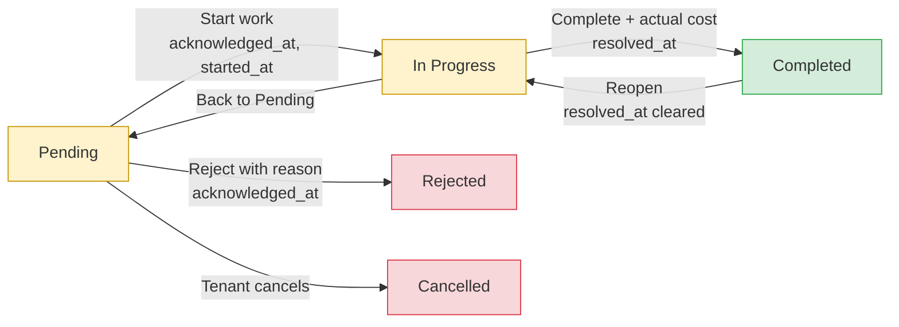

Submission through a status change:

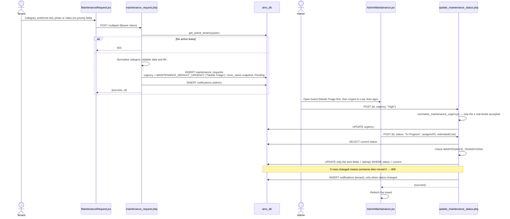

Surface map:

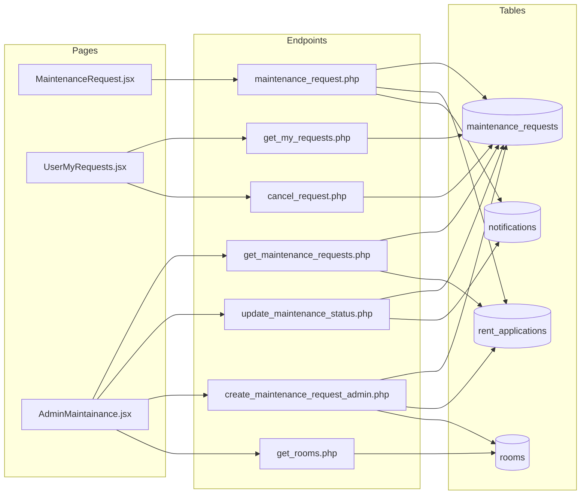

### 7.3 Step-by-Step Workflow

1. **Tenant — report** · `/maintenance-request` → `maintenance_request.php` → Pending ticket stamped with the tenant's unit and priority `Needs Triage`; admin notified. Tenants without an active lease are refused. There is no priority field on this form — the tenant does not set urgency.
2. **Admin — triage** · `/admin-maintenance` → `get_maintenance_requests.php`. Columns are Pending, In Progress, Completed, and Rejected / Cancelled; each is ordered Needs Triage first, then Urgent → Low, oldest first. Opening a ticket's detail modal shows a **Priority** selector (Low/Medium/High/Urgent) — this is the only way a real priority gets set, and it saves immediately on change.
3. **Admin — start work** · *Start Work* (assignee, optional estimate) → `In Progress`; `acknowledged_at` and `started_at` stamped; tenant notified. Setting a priority first is optional — an admin can start work on a still-`Needs Triage` ticket.
4. **Admin — edit details** · Assignee (saved on blur or Enter), estimated cost, work notes and the tenant-responsible toggle each save on their own and notify nobody.
5. **Admin — complete** · *Mark Completed* with the actual cost → `resolved_at` stamped; the detail modal shows total resolution time; tenant notified.
6. **Admin — reject** (from Pending) · requires a reason → `Rejected`; tenant notified with the reason.
7. **Admin — correct a mistake** · *Back to Pending* (from In Progress) or *Reopen* (from Completed; clears `resolved_at`).
8. **Tenant — cancel** · `/my-requests` → `cancel_request.php` while the ticket is still Pending.
9. **Tenant — follow up** · `/my-requests` → `get_my_requests.php`: status, resolved time and any rejection reason.

### 7.4 Test Conditions

| ID | Type | Scenario | Precondition | Action | Expected | Verify |
|---|---|---|---|---|---|---|
| **M4-01** | Happy | Board loads, correctly ordered | Seed data | `GET get_maintenance_requests.php` (admin) | Valid JSON; Pending, then In Progress, then Completed; within each, `Needs Triage` first, then Urgent → Low | Seed order `7, 6, 5, 1, 3, 2, 4` (no seeded `Needs Triage` rows). `FIELD(urgency, 'Urgent','High','Medium','Low')` returns `0` for `Needs Triage`, which sorts before `1` — confirmed live 2026-09 with a throwaway row. Before the `resolved_at` fix, PHP warnings corrupted this response entirely |
| **M4-02** | Sec | Request history with no token | — | `GET get_my_requests.php?userId=12` | `401 "Authentication required"` | Previously returned Ana's history to anyone |
| **M4-03** | Sec | Tenant asks for another tenant's history | Ana's token | `GET get_my_requests.php?userId=6` | Only Ana's own rows | `userId` is ignored for non-admins |
| **M4-04** | Happy | Partial edits keep other fields | #7 Pending | `{"id":7,"workNotes":"…"}`, then `{"id":7,"assignedTo":"Juan Tech"}` | Both `200`; row keeps both values; `tenant_responsible` unchanged | Each edit used to overwrite all five fields |
| **M4-05** | Negative | Skipping a stage | #7 Pending | `{"id":7,"status":"Completed"}` | `409 "A Pending request cannot be moved to Completed."` | — |
| **M4-06** | Negative | Reject without a reason | #7 Pending | `{"id":7,"status":"Rejected"}` | `422 "A reason is required to reject a request."` | — |
| **M4-07** | Happy | Start work | #7 Pending | `{"id":7,"status":"In Progress","estimatedCost":1200}` | `acknowledged_at` and `started_at` set; user 11 notified | `SELECT acknowledged_at, started_at FROM maintenance_requests WHERE id=7;` |
| **M4-08** | Happy | Complete with actual cost | #7 In Progress | `{"id":7,"status":"Completed","actualCost":1350}` | `resolved_at` set; `estimated_cost` stays `1200.00`, `actual_cost` `1350.00`; board returns `resolutionHours` | The final cost no longer overwrites the estimate |
| **M4-09** | Happy | Reopen | #7 Completed | `{"id":7,"status":"In Progress"}` | `resolved_at` cleared | — |
| **M4-10** | Happy | Reject with a reason | #6 Pending | `{"id":6,"status":"Rejected","rejectionReason":"…"}` | `rejection_reason` stored; user 13 notified with the reason | `SELECT message FROM notifications WHERE type='maintenance_update' ORDER BY id DESC LIMIT 1;` |
| **M4-11** | Sec | Priority is ignored from the tenant, identity comes from the session | Ana's token | Submit with body `userId=6`, `Water Supply`, `urgency=Urgent` | Stored with `user_id=12`, `room_name='K'`, `urgency='Needs Triage'` | Spoofed identity **and** spoofed priority both refused — verified live 2026-09 |
| **M4-12** | Negative | Unknown category | Ana's token | `issueType=Roofing` | `422` | — |
| **M4-13** | Sec | No active lease | Gloria's token | Submit | `403 "Only tenants with an active lease can submit maintenance requests."` | — |
| **M4-14** | Sec | Upload filtering; no token | Ana's token | Attach `shell.php`; attach a `.pdf`; submit with no token | `422`, `422`, `401` | Images and MP4/WEBM/MOV only, 10MB max |
| **M4-15** | Sec | Cancelling someone else's ticket | Ana's new Pending ticket | Ben cancels; then Ana cancels | `409`, then `200` | — |
| **M4-16** | Negative | Admin create validates the unit | Admin token | `unit=ZZ`; then `unit=K` | `422 "Unit ZZ does not exist."`; then created, linked to Ana, title stored | — |
| **M4-17** | Happy | Admin assigns a priority | A `Needs Triage` Pending ticket | `{"id":<id>,"urgency":"High"}` | `200`; `urgency='High'`; ticket now sorts below any remaining `Needs Triage` ticket and above Medium/Low | Verified live 2026-09 against the sort function |
| **M4-18** | Negative | Invalid or sentinel priority rejected | Any ticket | `{"id":<id>,"urgency":"Whenever"}`, then `{"id":<id>,"urgency":"Needs Triage"}` | Both `422 "Invalid priority level."` | An admin cannot manually revert a ticket back to `Needs Triage` |
| **M4-19** | Happy | Tenant-responsible repair bills the tenant (audit H10) | A `Completed` ticket, `tenant_responsible=0` | `{"id":<id>,"tenantResponsible":true}` | `200`; `billing` message names the invoice; `invoices.maintenance` rises by the ticket's cost; `maintenance_requests.is_invoiced=1` | `SELECT maintenance, total_amount FROM invoices WHERE id='<invoiceId>';` |
| **M4-20** | Boundary | Charge posts exactly once | Immediately after M4-19 | `sync_maintenance_to_invoice.php` on the same ticket | `success:false` — *"already been billed"* | `maintenance` unchanged |
| **M4-21** | Happy | Reversal on flag-clear or reopen | Ticket billed in M4-19 | `{"id":<id>,"tenantResponsible":false}` | `200`; `maintenance` and `total_amount` reduced back; `is_invoiced=0`, `invoice_id=NULL` | Reversing against a `paid` invoice instead returns the manual-credit message and leaves the row unchanged |

**Restore:**

```sql
UPDATE maintenance_requests
SET status='Pending', assigned_to=NULL, estimated_cost=NULL, actual_cost=NULL, work_notes=NULL,
    tenant_responsible=0, acknowledged_at=NULL, started_at=NULL, resolved_at=NULL, rejection_reason=NULL
WHERE id IN (6, 7);
DELETE FROM maintenance_requests WHERE id > 7;
DELETE FROM notifications WHERE created_at >= NOW() - INTERVAL 1 HOUR;
```

---

## 8. Module 5 — Service Management

> Audited September 2026. Remediation fixed two defects: completing a paid service billed a second month of rent (a billing-period format mismatch), and missing transition rules let cancelled or rejected bookings be billed. It also covered unauthenticated booking, cancel and CCTV endpoints; reversal refusing unpaid invoices; and hardcoded attachment URLs. §8.4 was verified live.
>
> Scope: the priced add-on catalog, bookings, billing and CCTV requests. Parking and visitor flows, which the checklist also lists under 5.1/5.3, are audited with Modules 10 and 12.

### 8.1 API Contract

| Endpoint | Method | Auth guard | Key parameters | Success response | Notable failures |
|---|---|---|---|---|---|
| `get_service_catalog.php` | GET | `verify_admin` branch (admins also see inactive rows) | `active=1` | `success`, `services[]` | — |
| `manage_service_catalog.php` | POST | `require_admin` | `action` = `create` / `update` / `toggle` / `delete`, plus catalog fields | `success`, `id` on create | Validation messages; `delete` deactivates instead when bookings reference the row |
| `service_request.php` | POST (multipart) | `require_user` + active lease | `serviceId`, `quantity`, `preferredDate`, `preferredTimeSlot`, `notes`; file `uploadedFile` | `success`, `id`, `totalCost` | `401` · `403` no active lease · `422` malformed date · inactive service, disabled category or date inside lead time → `success:false` with HTTP 200 |
| `get_service_requests.php` | GET | `require_admin` | `status`, `category` | `success`, `requests[]` | `403` |
| `update_service_status.php` | POST | `require_admin` | `rawId`, `status` | `success`, `billed`, `invoiceId`, `warning` | `409` invalid transition, concurrent change or refused reversal · `422` |
| `sync_service_to_invoice.php` | POST | `require_admin` | `rawId` | `success`, `invoiceId` | Not Completed, or already billed |
| `cancel_request.php` | POST | `require_user` | `id`, `type: "Service"` | `success` | `409` not your own Pending booking |
| `cctv_request.php` | POST (JSON) | `require_user` + active lease | `incidentDate`, `incidentTime`, `locationDetails`, `reasonRequest` | `success`, `id` | `401` · `403` · `422` future date or over-length fields |
| `get_cctv_requests.php` | GET | `require_admin` | — | `success`, `requests[]` | `403` |
| `update_cctv_status.php` | POST | `require_admin` | `id` / `rawId`, `status` (`Approved` / `Rejected`) | `success` | `404` · `409` already decided · `422` |

**Rules** — defined in `backend/config.php`:

| Rule | Definition |
|---|---|
| `SERVICE_TRANSITIONS` | `Pending → Approved \| Rejected \| Cancelled` · `Approved → In Progress \| Completed \| Rejected \| Cancelled` · `In Progress → Completed \| Cancelled` · `Completed → Cancelled` (reverses the charge first) · `Rejected`, `Cancelled` terminal |
| `SERVICE_ADJUSTABLE_INVOICE_STATUSES` | `pending`, `unpaid`, `overdue`, `scheduled`, `payment-failed` — a charge can be added to or reversed from these. Never `processing` (amount already at the gateway) or `pending-verification` (tenant already paid it) |
| `billing_period_label()` | Periods are matched as `"September 2026"`, the format every invoice writer uses; legacy `YYYY-MM` is also matched |

### 8.2 API Diagrams

Booking lifecycle and where money moves:

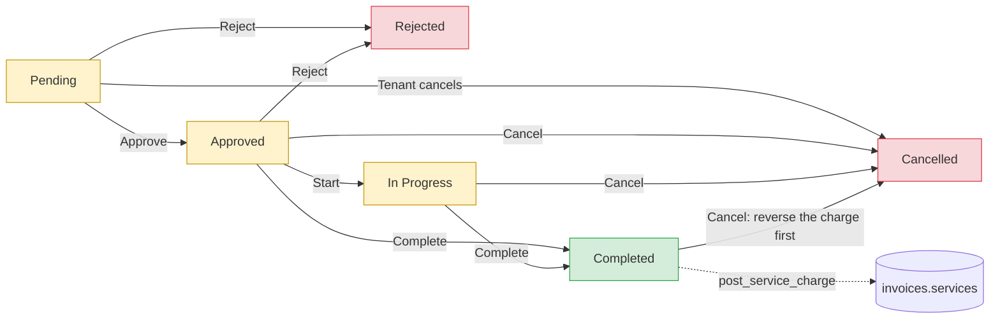

Completion and billing:

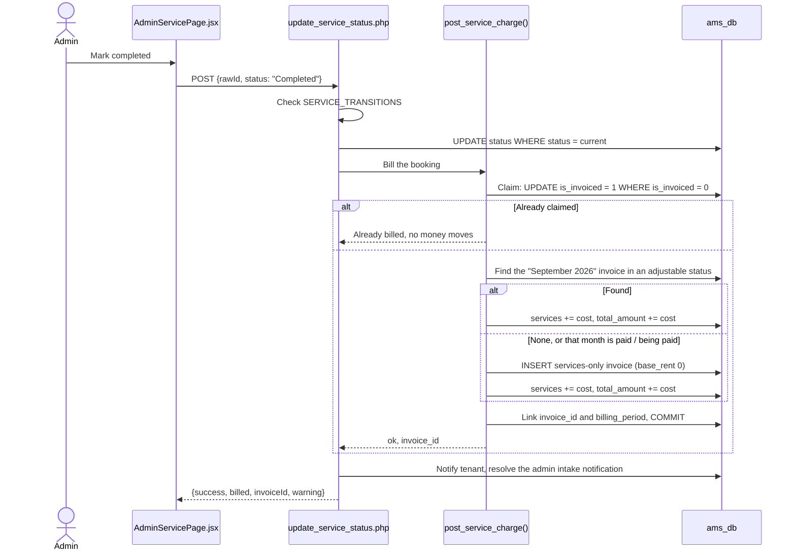

Surface map:

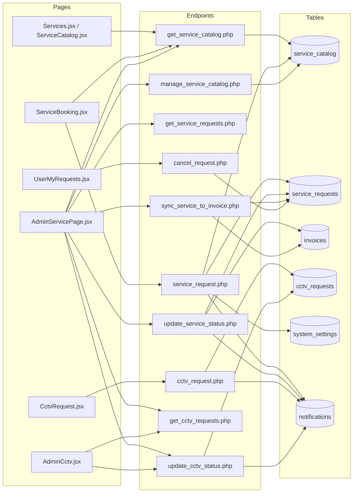

### 8.3 Step-by-Step Workflow

1. **Admin — set up the catalog** · `/admin-services` → *Service Catalog* → `manage_service_catalog.php` (create, edit, toggle, delete). An item with bookings is deactivated rather than deleted.
2. **Admin — switch categories** · the cleaning, laundry and other-services cards write `service_<category>_active`. The cards show the cheapest active catalog price.
3. **Tenant — book** · `/services` → `/service-booking?serviceId=N`. Only active items in enabled categories are offered. `service_request.php` recalculates the price, clamps quantity, enforces lead time and creates a Pending booking; admin notified.
4. **Tenant — cancel** · `/my-requests` → `cancel_request.php` while the booking is Pending.
5. **Admin — decide** · *Approve*, or *Reject* (with a confirmation) → tenant notified.
6. **Admin — deliver** · *Start work*, then *Mark completed* → `post_service_charge()` bills the booking and the admin sees which invoice it landed on.
7. **Admin — retry billing** · if no active lease was found at completion, a banner lists unbilled bookings with a *Post charge* button (`sync_service_to_invoice.php`).
8. **Admin — reverse** · cancelling a Completed booking (with a confirmation) backs the charge out, provided the invoice is still adjustable.
9. **CCTV** · tenant `/cctv-request` → `cctv_request.php` → Pending; admin approves or rejects once, from the CCTV tab or `/admin-cctv`.

### 8.4 Test Conditions

Precondition for M5-05 onward — a pending rent invoice for Ana's current month:

```sql
INSERT INTO invoices (id, user_id, rent_application_id, base_rent, total_amount, billing_period, status, due_date, created_at)
VALUES ('INV-TEST-RENT', 12, 10, 3500, 3500, 'September 2026', 'pending', DATE_ADD(CURDATE(), INTERVAL 10 DAY), NOW() - INTERVAL 1 DAY);
```

Substitute the current month's label if you are testing in a different month.

| ID | Type | Scenario | Precondition | Action | Expected | Verify |
|---|---|---|---|---|---|---|
| **M5-01** | Sec | Tenant opens the admin booking queue | Ana's token | `GET get_service_requests.php` | `403` | — |
| **M5-02** | Sec | Booking without an active lease | Gloria's token | `service_request.php` | `403 "Only tenants with an active lease can book services."` | — |
| **M5-03** | Negative | Category switched off | `service_laundry_active='false'` | Ana books a laundry item | `success:false`, "Laundry services are currently unavailable." (HTTP 200) | Restore the setting afterwards |
| **M5-04** | Money | A cancelled booking cannot be billed | Maria's Pending booking #2 | Maria cancels; admin sets `Completed` | `200`; then `409 "A Cancelled booking cannot be moved to Completed."` | — |
| **M5-05** | Money | Charge merges into that month's rent invoice | `INV-TEST-RENT` pending | Complete Ana's Approved booking #3 (₱900) | `invoiceId: INV-TEST-RENT`; `services 900.00`, `total_amount 4400.00`; **no new invoice** | Regression guard for the double-rent bug |
| **M5-06** | Sec | Spoofed identity, skipped approval, cross-tenant cancel | Ana's token | Book with body `userId=6`; admin Pending → Completed; Ben cancels | Stored as user 12, unit K; `409`; `409` | — |
| **M5-07** | Money | Month already paid → services-only invoice | `INV-TEST-RENT` set to `paid` | Approve and complete the new booking (₱500) | New invoice: `base_rent 0.00`, `services 500.00`, `total_amount 500.00`, same period | Rent is never billed from this path |
| **M5-08** | Money | Reversal from an overdue invoice | That services-only invoice set to `overdue` | Cancel the completed booking | `200`; invoice back to `0.00`; booking `is_invoiced = 0` | Previously refused as "already paid" |
| **M5-09** | Money | Reversal refused on paid and in-verification invoices | Booking #3 billed to `INV-TEST-RENT` | Cancel while the invoice is `paid`, then while `pending-verification` | `409 "…is already paid; issue a manual credit instead."`; `409 "…has a payment under verification."` | — |
| **M5-10** | Money | A reversed booking stays closed | The cancelled booking from M5-08 | Set `Completed` | `409` | It can never be billed again |
| **M5-11** | Negative | CCTV incident in the future | Ana's token | `incidentDate` = today + 3 | `422` | — |
| **M5-12** | Sec | CCTV identity from session | Ana's token | Valid request with body `userId=6` | Stored with `user_id=12` | — |
| **M5-13** | Sec | CCTV without a lease or without a token | Gloria's token; no token | Submit | `403`; `401` | — |
| **M5-14** | Negative | CCTV decided once | A Pending CCTV request | Approve, then Reject | `200`; `409 "This request has already been approved."` | — |

**Restore:**

```sql
UPDATE service_requests SET status='Pending' WHERE id = 2;
UPDATE service_requests SET status='Approved', is_invoiced=0, invoice_id=NULL, billing_period=NULL, completed_at=NULL WHERE id = 3;
DELETE FROM service_requests WHERE id > 3;
DELETE FROM invoices WHERE id = 'INV-TEST-RENT' OR (base_rent = 0 AND created_at >= NOW() - INTERVAL 1 HOUR);
DELETE FROM cctv_requests WHERE id > 2;
UPDATE system_settings SET setting_value='true' WHERE setting_key='service_laundry_active';
DELETE FROM notifications WHERE created_at >= NOW() - INTERVAL 1 HOUR;
```

Completing or cancelling a booking also marks its admin intake notification `Resolved`. Snapshot `notifications.status` before a run if you need that exact state back.

---

## 9. Module 8 — Financial Tracking

> Audited September 2026. This section covers the panel's **Financial Tracking** row: dashboard statistics (8.1), income reports (8.2) and revenue streams (8.3). Issuing and settling invoices is Module 3 ([§6](#6-module-3--rental-payment--billing)); this section is about what the reports *say* about that money.
>
> Remediation:
> - **Arrears matched only `pending` invoices.** `promote_overdue_invoices()` turns a lapsed invoice into `overdue`, so arrears read ₱0 and collection efficiency 100% while ₱21,615 was actually overdue (confirmed live).
> - **Fabricated figures removed.** Overhead was invented at 15% of revenue (25% when there were no costs), and the utility recovery ratio was hardcoded to 100%.
> - **Revenue streams didn't sum to gross revenue.** Late fees were missing from the stream breakdown.
> - **Security deposits counted as revenue** (payments audit 2026-09-30). A deposit is held for the tenant, so gross revenue, the streams, the per-unit ledger, the trend chart and the dashboard's revenue now leave it out; it is shown separately as deposits received.
> - **The tenant list dropped `active` tenants.** It also fed the invoice picker, so those tenants couldn't be picked there either.
> - **Maintenance expense was wrong three ways.** It used estimates instead of actual cost, counted tenant-responsible repairs, and was dated by report date instead of resolution.
> - **Period figures and the trend chart disagreed.** One dated paid invoices by `paid_at`, the other by `COALESCE(paid_at, created_at)`.
> - **Auth tightened.** All three report endpoints moved from the legacy `verify_admin` header pattern to `require_admin`.
> - **Client-side fallback numbers removed from `AdminReports.jsx`.** These were 92% and 95% efficiency, fixed 75/12/6/7 stream splits, ₱1,500 per maintenance ticket, ₱1,200 per parking reservation, and a 24.5-hour resolution time.
>
> §9.4 was verified live.

### 9.1 API Contract

| Endpoint | Method | Auth guard | Key parameters | Success response | Notable failures |
|---|---|---|---|---|---|
| `dashboard_stats.php` | GET | `require_admin` | — | `success`, `stats` (`total_revenue`, `pending_dues`, `overdue_dues`, `overdue_count`, `collection_rate`, …), `income_data[]` (6 months), `pending_actions`, `rooms_summary`, `activity_logs` | `401` no token · `403` tenant |
| `get_report_data.php` | GET | `require_admin` | `timeframe` = `monthly` / `quarterly` / `yearly`, `month`, `quarter`, `year` | `success`, `data` incl. `incomeStatement`, `revenueStreams[]`, `diversification`, `unitIncome[]`, `trendPoints[]`, `outstandingBalances[]`, `paymentRecords[]`, `tenantList[]`, `maintAvgResolutionHours` | `401` · `403` |
| `get_utilities_report_data.php` | GET | `require_admin` | same as above | see [§10.1](#101-api-contract) | `401` · `403` |

`dashboard_stats.php` and `get_report_data.php` both call `promote_overdue_invoices()` before reading, so **opening a report can change invoice status** — the same behaviour as `get_invoices.php`.

**How each figure is computed** — this table is the contract a test asserts against:

| Figure | Definition |
|---|---|
| Gross revenue | `SUM(total_amount − security_deposit)` of `paid` invoices whose `COALESCE(paid_at, created_at)` falls in the period. **Security deposits are excluded** (payments audit 2026-09-30): a deposit is held for the tenant, a liability, until move-out applies it. They are reported on their own as `depositCollected` / *Security deposits received (held, not revenue)*. The dashboard's `total_revenue` uses the same rule |
| Revenue streams | Base rent, electricity, water, parking, add-on services, maintenance recharge, late fees. **Their sum equals gross revenue.** There is no deposit stream, and the per-unit ledger and trend chart leave deposits out too |
| Maintenance expense | `SUM(COALESCE(actual_cost, estimated_cost))` of Completed requests with `tenant_responsible = 0`, dated by `COALESCE(resolved_at, created_at)` |
| Operating overhead | Gross × `report_overhead_pct` ÷ 100. **The setting is absent by default, so overhead is 0.** There is no admin UI for this key yet — set it with SQL |
| Net operating income | Gross − (maintenance expense + overhead) |
| Outstanding arrears | `SUM(total_amount)` of invoices in `BILLING_OPEN_STATUSES` with `due_date < CURDATE()`. **A snapshot as of today, not bound to the selected period** |
| Collection efficiency | Gross ÷ (gross + arrears) |
| Utility recovery ratio | Paid water + electricity ÷ invoiced water + electricity, over non-cancelled invoices created in the period |
| Dashboard collection rate | Paid ÷ all non-cancelled invoices created this calendar month |

### 9.2 API Diagrams

Where each income-statement line comes from:

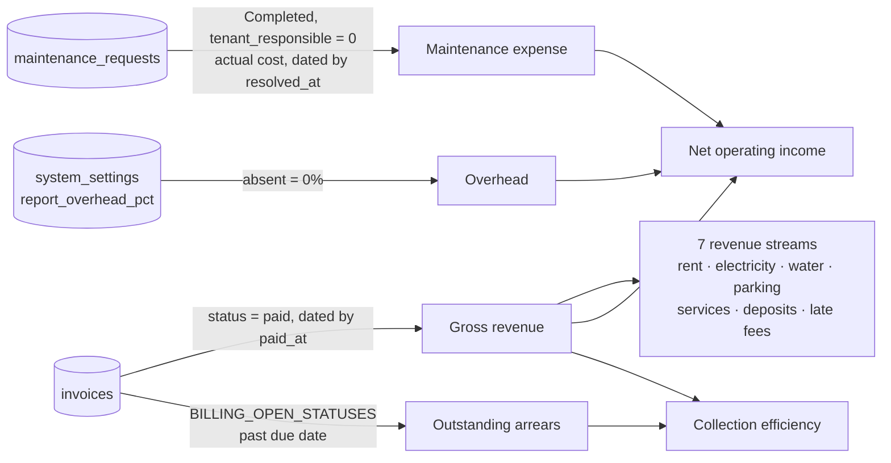

Surface map:

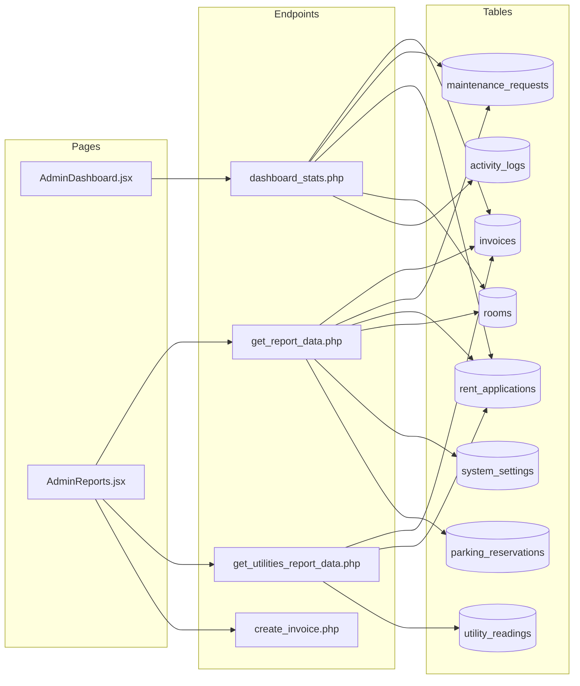

### 9.3 Step-by-Step Workflow

1. **Admin — open the dashboard** · `/admin-dashboard` → `dashboard_stats.php` → revenue, receivables, overdue total and the action queue. Lapsed invoices are promoted to `overdue` on this call.
2. **Admin — open reports** · `/admin-reports` → choose monthly, quarterly or yearly → `get_report_data.php` and `get_utilities_report_data.php` load together.
3. **Income tab (8.2)** · income statement: the revenue lines, including late fees when there are any, then maintenance expense and overhead. The overhead line reads *"not configured"* until `report_overhead_pct` exists.
4. **Streams tab (8.3)** · per-category amounts, shares and growth against the previous period; the categories add up to gross revenue.
5. **Payments tab** · collection efficiency and the arrears list (each row carries its invoice id and status).
6. **Export** · *CSV* or *Print* from the tab being viewed.
7. **Configure overhead (optional)** · no UI yet:
   ```sql
   INSERT INTO system_settings (setting_key, setting_value) VALUES ('report_overhead_pct', '10')
     ON DUPLICATE KEY UPDATE setting_value = '10';
   ```

### 9.4 Test Conditions

Expected values marked *audit DB* came from the database this audit ran against, whose billing state had moved on from the seed (4 overdue invoices instead of the seed's 5). On a fresh seed, compare against the **Verify** query instead of the literal number.

| ID | Type | Scenario | Precondition | Action | Expected | Verify |
|---|---|---|---|---|---|---|
| **M8F-01** | Sec | Report with a forged admin header and no token | — | `GET get_report_data.php` with only `X-Admin-Id: 4` | `401 "Authentication required"` | The header is no longer trusted |
| **M8F-02** | Sec | Tenant opens the financial report | Maria's token | `GET get_report_data.php` | `403` | — |
| **M8F-03** | Sec | Dashboard with a forged admin header | — | `GET dashboard_stats.php` with only `X-Admin-Id: 4` | `401` | — |
| **M8F-04** | Money | Arrears include `overdue` invoices | Seed data | `GET get_report_data.php?timeframe=monthly&month=9&year=2026` | `incomeStatement.totalOutstanding` equals the query; `outstandingBalances` has one row per invoice (*audit DB*: 4 rows, ₱21,615) | `SELECT COUNT(*), SUM(total_amount) FROM invoices WHERE status IN ('pending','unpaid','overdue','pending-verification','scheduled','processing','payment-failed') AND due_date < CURDATE();` — before the fix the report returned ₱0 |
| **M8F-05** | Money | Efficiency is below 100% while arrears exist | M8F-04 | Same call | `collectionEfficiency` < 100 (*audit DB*: 29.9, measured while deposits counted as revenue) | = gross ÷ (gross + arrears) |
| **M8F-06** | Happy | Tenant list includes `active` tenants | Seed data | Same call | `tenantList` length = current tenants (11) | `SELECT COUNT(*) FROM rent_applications WHERE status IN ('Approved','active','pending-move-out');` |
| **M8F-07** | Money | Streams reconcile with gross revenue | Seed data | `GET …?timeframe=monthly&month=8&year=2026` | 7 streams (no deposit stream); their `amount`s sum to `incomeStatement.grossRevenue`, which excludes deposits (*audit DB*: ₱48,345 paid − ₱4,000 deposits = ₱44,345; ₱48,345 before 2026-09-30) | Add the amounts; `SELECT SUM(total_amount - security_deposit) FROM invoices WHERE status='paid' AND advance_months IS NULL AND …` — verified live 2026-09-30 for September (₱32,960 − ₱7,000 = ₱25,960) |
| **M8F-08** | Money | No invented overhead | `report_overhead_pct` absent | Same call | `operatingOverhead` 0, `overheadPct` 0 | Previously 15% of gross |
| **M8F-09** | Money | Configured overhead | Insert `report_overhead_pct = 10` | Same call | `operatingOverhead` = gross × 0.10 (*audit DB*: ₱4,434.50; ₱4,834.50 while deposits counted as revenue) | Restore: delete the setting |
| **M8F-10** | Money | Maintenance expense uses actual cost and resolution date | Seed data — request #4 (Completed, actual ₱800, resolved 2026-05-27) | `GET …?timeframe=monthly&month=5&year=2026` | `maintenanceExpenses` 800, `maintAvgResolutionHours` 217 | `SELECT actual_cost, created_at, resolved_at FROM maintenance_requests WHERE id=4;` |
| **M8F-11** | Money | Utility recovery ratio is computed | Seed data | `GET …?timeframe=monthly&month=8&year=2026` | `diversification.utilityRecoveryRatio` is the real paid ÷ invoiced share (*audit DB*: 75.5), not a fixed 100 | `SELECT SUM(CASE WHEN status='paid' THEN water+electricity END)/SUM(water+electricity) FROM invoices WHERE status<>'cancelled' AND YEAR(created_at)=2026 AND MONTH(created_at)=8;` |
| **M8F-12** | Happy | Dashboard counts overdue invoices | Seed data | `GET dashboard_stats.php` (admin) | `stats.overdue_dues` equals the M8F-04 total; `pending_actions.invoices` lists the `overdue` invoices | — |

**Restore:**

```sql
DELETE FROM system_settings WHERE setting_key = 'report_overhead_pct';
DELETE FROM sessions;
```

M8F-04 and M8F-12 have a side effect: they promote any lapsed invoice to `overdue`. On the seed this changes nothing, because the seeded overdue invoices are already marked.

---

## 10. Module 8 — Utility Usage

> Audited September 2026. This section covers the panel's **Utility Usage** row: water and electricity usage and tracking per unit.
>
> Remediation:
> - **Unauthenticated read of any tenant's readings.** Sending a forged `X-User-Id` header with no token returned that tenant's readings, name and email (confirmed live).
> - **Syncing a reading billed a second month of rent.** Merge looked for billing period `2026-09`, but invoices store `"September 2026"`. It never found the rent invoice, so it created another one with base rent.
> - **A double-click could create two invoices.** Sync claimed the reading only *after* writing the invoice.
> - **Merge dropped late fees.** It recomputed `total_amount` from a subset of the line items.
> - **The table wasn't in `SetupDB.sql`.** It was created when someone opened the readings list, so on a fresh install the first save failed.
> - **Input validation added.** A lower meter value was silently clamped to zero usage, readings could be recorded out of order, and period, rate, fee and date went unvalidated.
> - **Spike detection was computed but never shown.** It also compared by reading date instead of billing period.
> - **The duplicate-reading error pointed to an edit screen that doesn't exist.**
> - **The utilities report counted cancelled invoices.** It also filtered by reading date instead of billing period.
> - **`recorded_by` and the audit log came from the forgeable header.** Without that header they were blank.
>
> §10.4 was verified live.

Seed fixtures: rooms **A** (Maria, user 2) and **K** (Ana, user 12) have July and August 2026 readings, already billed; each reading's amount plus fees equals the matching seeded invoice's line item. No September reading is seeded.

### 10.1 API Contract

| Endpoint | Method | Auth guard | Key parameters | Success response | Notable failures |
|---|---|---|---|---|---|
| `get_utility_readings.php` | GET | `require_user` — tenants get only their own rows by session id; admins get all | `room_name`, `billing_period` (admin only; ignored for tenants) | `success`, `spike_threshold_pct`, `data[]` with `water_change_pct`, `electric_change_pct`, `has_spike`, `billing_period_label`, `invoice_id` | `401` |
| `save_utility_reading.php` | POST JSON | `require_admin` | `room_name`, `billing_period` (`YYYY-MM`), `reading_date`, `water_curr_reading`, `electric_curr_reading`; optional rates (default: the unit's previous rate, else 40 / 12), `water_other_fees`, `electric_other_fees`, `notes` | `success`, `id`, consumption, `total_amount`, plus `warning` when the unit has no billable tenant | `422` bad period, unknown unit, bad or future date, non-numeric or negative reading, rate outside (0, 1000], negative fee, current below previous · `409` reading exists for this or a later period |
| `delete_utility_reading.php` | POST JSON | `require_admin` | `id` | `success` | `404` · `409` already invoiced, or not the unit's latest reading |
| `sync_utility_to_invoice.php` | POST JSON | `require_admin` | `id`, `sync_mode` = `merge` / `separate` / `paid`, `due_date` (for `separate`) | `success`, `invoice_id`, `merged` | `404` · `409` already synced, or the merge target already has water/electricity charges · `422` no billable tenant, bad mode, due date outside today…+10 days |
| `get_utilities_report_data.php` | GET | `require_admin` | `timeframe`, `month`, `quarter`, `year` | `water`, `electric` (totals, average per unit-month, billed), `financials` (`totalBilled`, `totalCollected`, `outstanding`, `recoveryRate`), `pendingSync`, `spikeCount`, `topUnits[]` with `hasSpike`, `coverage` (monthly only: `occupiedUnits`, `unitsRead`, `missingUnits`) | `401` · `403` |

**Rules** — in `backend/config.php` and the endpoints above:

| Rule | Definition |
|---|---|
| Period vs. label | Readings store `2026-09`; invoices store `September 2026`. `utility_period_label()` converts, and merge matches either form |
| Reading chain | "Previous" is the unit's latest earlier billing period. Readings are recorded oldest-first; current must be ≥ previous; only the latest un-invoiced reading may be deleted |
| Merge target | The tenant's invoice for that month in `SERVICE_ADJUSTABLE_INVOICE_STATUSES` (`pending`, `unpaid`, `overdue`, `scheduled`, `payment-failed`), rent invoice preferred. Sets `water`/`electricity` and **adds** to `total_amount`. Refused if the invoice already carries utility charges. None found → a utilities-only invoice (`base_rent = 0`) |
| Spike | Consumption more than `UTILITY_SPIKE_THRESHOLD_PCT` (30) percent above the previous period |
| Tenant privacy | A tenant's change % is computed only against their **own** previous reading, never a previous occupant's |
| Billable tenant | `get_room_tenancy()` — an `Approved`/`active`/`pending-move-out` application whose move-in invoice is settled |

### 10.2 API Diagrams

Reading lifecycle:

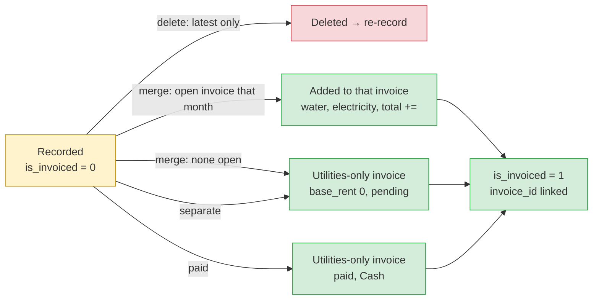

Sync, including both refusal paths:

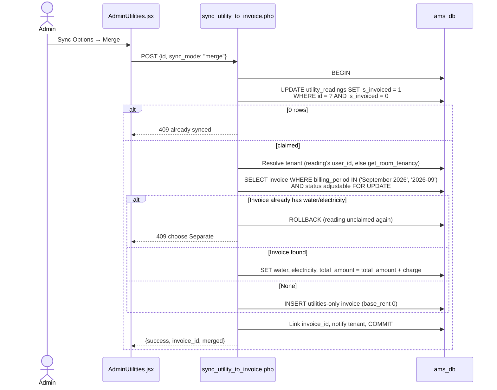

Surface map:

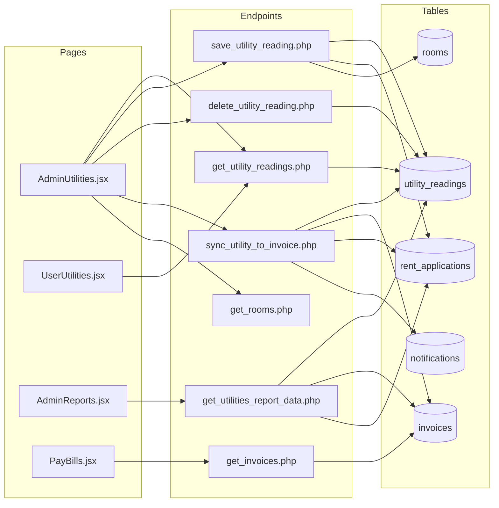

### 10.3 Step-by-Step Workflow

1. **Admin — record a reading** · `/admin-utilities` → *Record Reading* → pick the unit and month. The previous reading and the unit's last rates are filled in; the live preview shows consumption and cost → `save_utility_reading.php`.
2. **Admin — correct a mistake** · the trash icon appears on a unit's latest un-invoiced reading → `delete_utility_reading.php` → record it again.
3. **Admin — review usage** · each row shows the % change per meter against the previous month, and a *Usage spike* badge above 30%.
4. **Admin — bill it** · *Sync Options* → *Merge*, *Separate invoice* or *Mark as paid* → `sync_utility_to_invoice.php`. The row switches to *Invoiced* with its invoice id, and the tenant gets a billing notification.
5. **Tenant — view usage** · `/user-utilities` → their own readings, per-cycle averages, % change against their previous cycle, and "Billed on INV-…" once synced.
6. **Tenant — pay** · `/pay-bills` → see [§6](#6-module-3--rental-payment--billing).
7. **Admin — analyse** · `/admin-reports?tab=utilities` → consumption, recovery rate, units read vs. occupied, spike count, units still missing a reading this month, CSV export.

### 10.4 Test Conditions

Tests assume the current month is **September 2026**; substitute your own month and label otherwise. Fixtures:

```sql
-- M8U-11: Maria's September rent invoice
INSERT INTO invoices (id, user_id, rent_application_id, base_rent, total_amount, billing_period, status, due_date)
VALUES ('INV-TEST-UTIL-A', 2, 1, 4000, 4000, 'September 2026', 'pending', DATE_ADD(CURDATE(), INTERVAL 10 DAY));

-- M8U-13: Ana's September invoice with water already typed in by hand
INSERT INTO invoices (id, user_id, rent_application_id, base_rent, water, total_amount, billing_period, status, due_date)
VALUES ('INV-TEST-UTIL-K', 12, 10, 3500, 250, 3750, 'September 2026', 'pending', DATE_ADD(CURDATE(), INTERVAL 10 DAY));

-- M8U-16: an older, un-invoiced reading for room H
INSERT INTO utility_readings (room_name, user_id, billing_period, reading_date, water_curr_reading, electric_curr_reading, recorded_by)
VALUES ('H', 11, '2026-08', '2026-08-31', 20, 300, 4);
```

| ID | Type | Scenario | Precondition | Action | Expected | Verify |
|---|---|---|---|---|---|---|
| **M8U-01** | Sec | Forged tenant header, no token | — | `GET get_utility_readings.php` with only `X-User-Id: 8` | `401 "Authentication required"` | Previously returned that tenant's readings with name and email |
| **M8U-02** | Sec | Tenant reads only their own rows | Maria's token | `GET get_utility_readings.php?room_name=K` | Only `user_id = 2` rows (rooms A July/August) | The filter is ignored for tenants |
| **M8U-03** | Happy | Month-over-month change | Maria's token | `GET get_utility_readings.php` | August: `water_change_pct` −6.7, `electric_change_pct` −1.4; July: both `null` | — |
| **M8U-04** | Sec | Tenant writes and admin reports | Maria's token; then no token | `save_utility_reading.php`, `sync_utility_to_invoice.php`, `get_utilities_report_data.php`; then sync with no token | `403`, `403`, `403`; `401` | — |
| **M8U-05** | Negative | Invalid input | Admin token | Period `2026-13`; unit `ZZ`; `reading_date` tomorrow | `422` for each | No row written |
| **M8U-06** | Negative | Meter reads backwards | Room A August water = 114.5 | Save A `2026-09` with `water_curr_reading` 110 | `422 "Water reading (110) is lower than the previous reading (114.5)…"` | Previously saved with 0 consumption |
| **M8U-07** | Negative | Out-of-order reading | Room A has August | Save A `2026-06` | `409 "…already has a reading for 2026-08. Readings must be recorded in order…"` | — |
| **M8U-08** | Happy | Save, with rates carried forward | Admin token | Save A `2026-09`, water 124.5, electricity 2230, **no rates sent** | `200`, `total_amount` 1420 | `SELECT water_consumption, water_rate_per_unit, water_amount, electric_consumption, electric_amount, recorded_by FROM utility_readings WHERE room_name='A' AND billing_period='2026-09';` → `10.00, 40.00, 400.00, 85.00, 1020.00, 4` |
| **M8U-09** | Negative | Duplicate reading | M8U-08 | Repeat M8U-08 | `409` | Row count unchanged |
| **M8U-10** | Happy | Usage spike flagged | M8U-08 | `GET get_utility_readings.php?room_name=A&billing_period=2026-09` (admin) | `has_spike` true, `water_change_pct` 42.9, `electric_change_pct` 18.1 | Badge shows on `/admin-utilities` |
| **M8U-11** | Money | Merge into the month's rent invoice — no second rent | `INV-TEST-UTIL-A` fixture | Sync the A reading, `merge` | `200`, `invoice_id` `INV-TEST-UTIL-A`, `merged` true | `base_rent 4000.00, water 400.00, electricity 1020.00, total_amount 5420.00`; `SELECT COUNT(*) FROM invoices WHERE user_id=2 AND billing_period IN ('September 2026','2026-09');` = **2** (the seeded, paid rent-only `INV-202609-2` and the fixture; no third). Regression guard for the double-rent bug |
| **M8U-12** | Money | Replay and delete after billing | M8U-11 | Sync again; delete the reading | `409 "…already been synced…"`; `409 "…already been invoiced…"` | — |
| **M8U-13** | Money | Merge refused onto hand-entered utilities | `INV-TEST-UTIL-K` fixture; save K `2026-09` (water 100.2, electricity 1700) | Sync the K reading, `merge` | `409 "…already carries water/electricity charges…"` | The K reading's `is_invoiced` is still `0` (claim rolled back); invoice total still `3750.00` |
| **M8U-14** | Money | Month already paid → utilities-only invoice | `UPDATE invoices SET status='paid', paid_at=NOW() WHERE id='INV-TEST-UTIL-K';` | Sync the K reading, `merge` | `200`, `merged` false, *"No open invoice for September 2026…"* | New invoice: `base_rent 0.00`, `water 280.00`, `electricity 780.00`, `total 1060.00`, `September 2026`, `pending`, due `2026-10-05` |
| **M8U-15** | Negative | Separate invoice due-date bounds | Save L `2026-09` (water 5, electricity 50) | Sync `separate` with due today + 30; then today + 5 | `422`, reading still unclaimed; then `200` | Invoice `pending`, `base_rent 0.00`, `total 800.00`, due date as sent; latest notification for user 13 = *"Utility Charges Billed: September 2026"* |
| **M8U-16** | Negative | Only the latest reading can be deleted | H fixture; save H `2026-09` (water 26, electricity 360) | Delete H August; then H September | `409 "Only the most recent reading for Unit H…"`; then `200` | — |
| **M8U-17** | Happy | Reading coverage and spikes in the report | After M8U-08…M8U-15 | `GET get_utilities_report_data.php?timeframe=monthly&month=9&year=2026` | `spikeCount` ≥ 1; `coverage.unitsRead` counts A, K, L; `coverage.missingUnits` lists the other occupied units | `financials` exclude cancelled invoices |
| **M8U-18** | Boundary | Average is per unit-month | Seed data | `GET …?timeframe=monthly&month=8&year=2026` | `water.avgM3` = `water.totalM3` ÷ number of readings | For quarterly and yearly views the average stays per month, not ×3 or ×12 |

**Restore:**

```sql
DELETE FROM invoices WHERE id IN (
  SELECT invoice_id FROM utility_readings
  WHERE billing_period = '2026-09' AND invoice_id IS NOT NULL AND invoice_id NOT LIKE 'INV-TEST%');
DELETE FROM invoices WHERE id LIKE 'INV-TEST-UTIL%';
DELETE FROM utility_readings
WHERE (room_name IN ('A','K','L','H') AND billing_period = '2026-09')
   OR (room_name = 'H' AND billing_period = '2026-08');
DELETE FROM notifications WHERE created_at >= NOW() - INTERVAL 1 HOUR;
DELETE FROM activity_logs WHERE created_at >= NOW() - INTERVAL 1 HOUR;
DELETE FROM sessions;
```

After restoring, `SELECT COUNT(*) FROM utility_readings;` should be back to the §1.6 baseline.

---

## 11. Module 8 — Reports & Activity Log

> Audited September 2026. This section covers the panel's **Report Generation / Admin Dashboard** row: tenant monitoring (8.4), maintenance monitoring (8.5) and system activity logs (8.6), plus the report tabs not covered by §9 (occupancy, reservations, management gaps). Financial figures are in §9, utilities in §10.
>
> Remediation — activity log:
> - **Only the newest 100 entries were reachable.** The page received 100 rows and filtered them in the browser, so older history could not be found at all. Filtering, search, date range and paging now run on the server over the whole table.
> - **"Export CSV" was a mock `alert()`**, and **"Clear Logs" said it deleted the log permanently** but only emptied the screen. Export is now real (every matching entry, and the export is itself logged). Clear was removed: the audit trail is append-only.
> - **Categories didn't match the filter tabs.** Call sites wrote a dozen spellings (`payment`, `invoice`, `User Management`, `Tenant Management`, `application`, …), so most tabs showed nothing. There are now 12 standard categories, applied on write and fixed for existing rows by migration.
> - **Entries could be attributed to the wrong person.** Many endpoints passed a client-chosen id as the performer. `log_activity()` now always records the session user.
> - **Settings changes were logged as "Updated multiple configuration keys".** The entry now names the keys that changed, hides secret values, and nothing is logged when nothing changed. Array settings were also being stored as the literal word "Array".
> - **Security events weren't logged.** Admin sign-ins, password changes and resets, role changes and archives are now recorded, with how many sessions were ended.
>
> Remediation — reports and monitoring:
> - **Every tenant's payment status was hardcoded to `'paid'`.** It is now computed from invoices (overdue / due / paid up) and shown as a badge on the Tenants page. Lease end comes from the contract.
> - **Move-ins and move-outs were counted by application submission date.** Move-ins also dropped tenants who had since moved out. They are now counted by lease start and move-out date.
> - **Approvals counted only the literal status `Approved`**, missing applications that had since become `active`.
> - **The tenant list labelled every tenant `active`**, so tenants serving move-out notice never showed as "Ending".
> - **Made-up figures:**
>   - the occupancy gap assumed ₱4,000 per vacant unit
>   - the maintenance budget was a hardcoded ₱50,000
>   - every revenue stream was labelled "Healthy"
>   - the print header named a fictional author
>   - "Average Stay Duration" was actually the contracted lease term (now relabelled)
> - **Maintenance monitoring (8.5) added:** open requests by priority, requests by category, average resolution time and budget use. Urgent and untriaged tickets are now highlighted.
>
> §11.4 was verified live.
>
> **Extended September 2026 — logging coverage.** A follow-up audit (alongside Modules 6 and 10, §13–§14) found the log itself sound but its coverage incomplete:
> - **13 endpoints changed data with no log call at all**, including `parking_reservation.php`, `rent_application.php`, `submit_inquiry.php`, `update_occupants.php`, `extend_lease.php`, `profile.php`, `registration.php`, `logout.php`, `create_checkout_session.php`, `login.php` (both tenant sign-ins and failed sign-ins), and the notification sweep. All now log.
> - **Contract actions were filed under `tenant`** and **room updates under `system`** — both recategorised (`contract`, `unit`) with a migration for existing rows. `cancel_request.php` always logged `service`, even for a cancelled maintenance ticket; it now logs `maintenance` or `service` by type.
> - **Search wasn't escaping LIKE wildcards** (`%`/`_` acted as patterns) and the log-ID parser (`ltrim($s,'LOG-0')`) stripped characters rather than a prefix. Both fixed.
> - **Export silently truncated at 5,000 rows** while the audit entry claimed the full total; it now reports `truncated` and names how many of how many were exported.
> - **CSV export could carry a formula injection** — a value starting with `= + - @` now gets an apostrophe prefix before quoting.
> - **The dashboard's recent-activity widget** keyed its icons on old category names and printed `Admin #null` for system-performed entries; now keyed on the 12 real categories, with "System" as the fallback.
> - Added indexes on `activity_logs(created_at)` and `(category)` — filtering and sorting previously scanned the whole table.

### 11.1 API Contract

| Endpoint | Method | Auth guard | Key parameters | Success response | Notable failures |
|---|---|---|---|---|---|
| `get_activity_logs.php` | GET | `require_admin` | `category` (a key below, or `all`), `performer` = `all` / `admin` / `tenant` / `system`, `search`, `from`, `to` (`YYYY-MM-DD`), `page`, `limit` (≤ 100), `export=1` (up to 5,000 rows, logged) | `logs[]` (`id`, `category`, `categoryLabel`, `action`, `details`, `createdAt`, `performerName`, `performerEmail`, `performerRole`), `total`, `page`, `pages`, `categories`, `categoryCounts` | `401` · `403` · `422` unknown category |
| `update_system_settings.php` | POST | `require_admin` | `{ key: value, … }` — keys `[A-Za-z0-9_]` | `success`, `changed` (count) | `400` empty · `422` invalid key |
| `get_tenants.php` | GET | `require_admin` | — | `data[]` incl. `paymentStatus` (`overdue` / `due` / `current`), `outstandingBalance`, `overdueBalance`, `daysOverdue`, `leaseEnd`, `contractStatus` | `401` · `403` |
| `get_report_data.php` | GET | `require_admin` | `timeframe`, `month`, `quarter`, `year` | Beyond §9: `tenantList[]` (status `active` / `pending-move-out`), `moveIns`, `moveOuts`, `roomApproved`/`Rejected`/`Pending`, `maintOpenByPriority`, `maintCategoryCounts`, `maintAvgResolutionHours`, `maintenanceBudget`, `vacantRentPotential`, `avgStayDuration` (contracted months) | `401` · `403` |
| `dashboard_stats.php` | GET | `require_admin` | — | `activity_logs[]` — the 10 newest entries | `401` · `403` |

**Activity log categories** — `LOG_CATEGORIES` in `backend/config.php`. `normalize_log_category()` maps legacy spellings on write; anything unknown becomes `system`.

| Key | Label | Written by (examples) |
|---|---|---|
| `auth` | Authentication | Admin sign-in, password change, password reset |
| `user` | User Accounts | Edit user, reset user password, role change, archive/restore |
| `tenant` | Tenants | Approvals, move-out, archive tenant, occupancy changes |
| `unit` | Units | Create / update room |
| `contract` | Contracts | Activation, renewal, eviction flag, lease documents |
| `billing` | Billing & Payments | Invoices, payments, reminders, webhooks |
| `utilities` | Utilities | Readings, sync, deletion |
| `maintenance` | Maintenance | Ticket created / updated |
| `service` | Services, CCTV, Parking & Visitors | Bookings, catalog, CCTV and parking decisions, visitors |
| `inquiry` | Inquiries & Reservations | Inquiry status, unit holds |
| `communication` | Announcements | Announcement created |
| `system` | System & Settings | Settings changes, log export, scheduled sweeps |

**Tenant payment status** (`get_tenants.php`): `overdue` when any unpaid invoice (`BILLING_OPEN_STATUSES`) is past its due date; `due` when something is owed but not yet late; otherwise `current`. Invoices counted are those on the application, plus any for the same user with no application.

### 11.2 API Diagrams

How an entry reaches the log:

```mermaid
flowchart LR
    EP["Any endpoint<br/>log_activity(conn, id, category, action, details)"] --> S{"Verified session?"}
    S -->|yes| P1["performer = session user<br/>(the passed id is ignored)"]
    S -->|"no — reset token, webhook"| P2["performer = passed id, or NULL"]
    P1 --> N["normalize_log_category()<br/>12 keys, unknown → system"]
    P2 --> N
    N --> T[(activity_logs)]
```

Filtering and export on the Activity Log page:

```mermaid
sequenceDiagram
    actor A as Admin
    participant P as AdminActivityLogs.jsx
    participant G as get_activity_logs.php
    participant DB as ams_db

    A->>P: Pick category, performer, dates, type a search
    P->>G: GET ?category&performer&from&to&search&page&limit=25
    G->>DB: COUNT(*) and page of rows (whole table, server-side)
    G-->>P: {logs, total, pages, categoryCounts}
    A->>P: Export CSV
    P->>G: GET same filters + export=1
    G->>DB: Up to 5,000 matching rows
    G->>DB: INSERT activity_logs "Exported Activity Log" (filters named)
    G-->>P: {logs}
    P->>P: Build CSV in the browser and download
```

Surface map:

```mermaid
flowchart LR
    subgraph Pages
        AL[AdminActivityLogs.jsx]
        AD[AdminDashboard.jsx]
        AT[AdminTenants.jsx]
        AR[AdminReports.jsx]
        AS[AdminAccountSettings.jsx]
    end
    subgraph Endpoints
        E1[get_activity_logs.php]
        E2[dashboard_stats.php]
        E3[get_tenants.php]
        E4[get_report_data.php]
        E5[update_system_settings.php]
    end
    subgraph Tables
        T1[(activity_logs)]
        T2[(users)]
        T3[(rent_applications)]
        T4[(lease_contracts)]
        T5[(invoices)]
        T6[(maintenance_requests)]
        T7[(rooms)]
        T8[(system_settings)]
    end
    AL --> E1
    AD --> E2
    AT --> E3
    AR --> E4
    AS --> E5
    E1 --> T1 & T2
    E2 --> T1
    E3 --> T3 & T4 & T5
    E4 --> T3 & T4 & T5 & T6 & T7 & T8
    E5 --> T8 & T1
```

### 11.3 Step-by-Step Workflow

1. **Admin — review activity** · `/admin-activity-logs` → `get_activity_logs.php`. Filter by category tab, performer, date range or search; page through 25 at a time. Click an entry for full details and who did it.
2. **Admin — export** · *Export CSV* downloads every entry matching the current filters; the export appears in the log under `system`.
3. **Admin — quick view** · `/admin-dashboard` → *Activity* tab shows the 10 newest entries.
4. **Admin — monitor tenants (8.4)** · `/admin-tenants` → each unit shows **Overdue ₱…**, **Due ₱…** or **Paid up**, with lease end and days remaining.
5. **Admin — monitor maintenance (8.5)** · `/admin-reports` → *Maintenance* tab: tickets by status, open tickets by priority (Needs Triage first), tickets filed by category, cost against the period's budget and average resolution time.
6. **Admin — occupancy and gaps** · *Occupancy* tab (move-ins/move-outs by lease dates, average lease term); *Management Gaps* tab (arrears, pending maintenance, vacant units with the real rent not being collected).
7. **Admin — change a setting** · `/admin-settings` → *Save System Settings* → the log entry lists exactly which keys changed.

### 11.4 Test Conditions

Values marked *audit DB* came from the database this audit ran against (its billing and maintenance state had moved on from the seed); compare against the **Verify** query on a fresh seed.

| ID | Type | Scenario | Precondition | Action | Expected | Verify |
|---|---|---|---|---|---|---|
| **M8L-01** | Sec | Log without a session, or as a tenant | — ; Gloria's token | `GET get_activity_logs.php` | `401`; `403` | — |
| **M8L-02** | Sec | Tenant forges the admin header | Maria's token | `GET get_activity_logs.php` with `X-Admin-Id: 4` | `403` | The header is overwritten from the session |
| **M8L-03** | Sec | Performer comes from the session | Maria's token | Register a visitor with body `userId=6` (M11-10) | Log entry `performed_by = 2` | `SELECT performed_by FROM activity_logs WHERE action='Registered Visitor for Review' ORDER BY id DESC LIMIT 1;` |
| **M8L-04** | Happy | Admin sign-in is logged | — | Log in as admin | Entry `auth` / `Admin Signed In` / `performed_by 4` | `SELECT category, action, performed_by FROM activity_logs WHERE action='Admin Signed In' ORDER BY id DESC LIMIT 1;` |
| **M8L-05** | Happy | Category filter runs over the whole table | Admin token | `GET …?category=user&limit=100` | Every row `category = user`; `total` equals the DB count | `SELECT COUNT(*) FROM activity_logs WHERE category='user';` |
| **M8L-06** | Boundary | Paging | Admin token | `limit=5&page=1`, then `page=2` | 5 rows each, no id repeated, `pages = ceil(total / 5)` | Compare the id lists |
| **M8L-07** | Happy | Search by log id | Admin token | `search=LOG-0001` | Returns entry `1` | — |
| **M8L-08** | Happy | Performer filter | Admin token | `performer=admin&limit=100` | Every row `performerRole = admin` | — |
| **M8L-09** | Boundary | Date range | Admin token | `from=<today>&to=<today>` | Only today's entries | Earliest `createdAt` is today |
| **M8L-10** | Happy | Export returns everything and is audited | Admin token | `export=1&category=user` | All matching rows (not one page); new `Exported Activity Log` entry naming the filters | `SELECT details FROM activity_logs WHERE action='Exported Activity Log' ORDER BY id DESC LIMIT 1;` |
| **M8L-11** | Negative | Unknown category | Admin token | `category=bogus` | `422 "Unknown category."` | — |
| **M8L-12** | Happy | Settings audit names keys and hides secrets | Admin token | `POST update_system_settings.php {"report_overhead_pct":"5","paymongo_webhook_secret":"whsk_test"}`; then resend the first value alone | `changed: 2`, entry *"Changed 2 setting(s): report_overhead_pct, paymongo_webhook_secret (value hidden)"*; then `changed: 0`, no new entry | Restore both settings (§11.4 restore) |
| **M8L-13** | Happy | Legacy categories are normalised | Migration applied | — | Only the 12 category keys remain | `SELECT DISTINCT category FROM activity_logs;` |
| **M8R-01** | Happy | Tenant payment status is real | Admin token | `GET get_tenants.php` | Status follows invoices (*audit DB*: D `overdue` ₱10,975; B `overdue` ₱10,640; A `current`) | `SELECT user_id, SUM(total_amount) FROM invoices WHERE status IN ('pending','unpaid','overdue','pending-verification','scheduled','processing','payment-failed') AND due_date < CURDATE() GROUP BY user_id;` — previously `paid` for everyone |
| **M8R-02** | Sec | Tenant reads the tenant list | Tenant token | `GET get_tenants.php` | `403` | — |
| **M8R-03** | Happy | Maintenance budget comes from the setting | Admin token | `get_report_data.php` monthly, then yearly | `maintenanceBudget` = setting (50,000), then × 12 (600,000) | `SELECT setting_value FROM system_settings WHERE setting_key = 'maintenance_monthly_budget';` |
| **M8R-04** | Happy | Occupancy gap uses real rents | Admin token | Monthly report | `vacantRentPotential` = sum of vacant rooms' rent (*audit DB*: 11,500) | `SELECT SUM(monthly_rent) FROM rooms WHERE LOWER(status)='vacant';` — previously vacant units × ₱4,000 |
| **M8R-05** | Happy | Open maintenance by priority | Admin token | Monthly report | `maintOpenByPriority` matches (*audit DB*: Low 1, Medium 2) | `SELECT urgency, COUNT(*) FROM maintenance_requests WHERE status IN ('Pending','In Progress') GROUP BY urgency;` |
| **M8R-06** | Happy | Tenant list statuses | Admin token | Monthly report | `tenantList` has one row per current tenant; `pending-move-out` tenants show as such | `SELECT status, COUNT(*) FROM rent_applications WHERE status IN ('Approved','active','pending-move-out') GROUP BY status;` |
| **M8R-07** | Happy | Move-ins by lease start | Admin token | `timeframe=yearly&year=2026` | `moveIns` equals the query (*audit DB*: 2) | `SELECT COUNT(*) FROM rent_applications ra LEFT JOIN lease_contracts lc ON lc.rent_application_id=ra.id WHERE ra.status IN ('Approved','active','pending-move-out','moved-out','archived') AND YEAR(COALESCE(lc.lease_start, DATE(ra.created_at)))=2026;` |
| **M8R-08** | Happy | Manual expenses enter the report | Admin token; `expenses` empty | `manage_expenses.php {"action":"create","category":"supplies","amount":1500,"expenseDate":"<today>"}`, then this month's report | `incomeStatement.otherExpenses` = 1500, `expenseBreakdown` = supplies 1500, `operatingExpenses` rises by 1500, current `trendPoints` month includes it | `DELETE FROM expenses;` afterwards |
| **M8R-09** | Negative | Invalid expense | Admin token | `create` with `category:"x"`, `amount:-1` or a date in the future | `422` naming the problem | — |
| **M8R-10** | Sec | Expenses are admin-only | Maria's token; no token | `GET manage_expenses.php` | `403`; `401` | — |
| **M8R-11** | Happy | Inquiry conversion | Two inquiries this month, one `Converted` | This month's report | `inquiryConversion.received` 2, `converted` 1, `conversionRatePct` 50 | `SELECT status, COUNT(*) FROM inquiries WHERE YEAR(created_at)=YEAR(CURDATE()) AND MONTH(created_at)=MONTH(CURDATE()) GROUP BY status;` |

**Restore:**

```sql
DELETE FROM system_settings WHERE setting_key = 'report_overhead_pct';
-- M8L-12 overwrote the webhook secret: put back the value you noted before the test
UPDATE system_settings SET setting_value = '<original>' WHERE setting_key = 'paymongo_webhook_secret';
DELETE FROM activity_logs WHERE created_at >= NOW() - INTERVAL 1 HOUR;
DELETE FROM sessions;
```

### 11.5 Logging Coverage Test Conditions

| ID | Type | Scenario | Precondition | Action | Expected | Verify |
|---|---|---|---|---|---|---|
| **M8L-14** | Happy | Previously-silent endpoints now log | — | Submit a parking reservation, a rent application, and an inquiry | Three new `activity_logs` rows, categories `service`/`tenant`/`inquiry` | `SELECT category, action FROM activity_logs ORDER BY id DESC LIMIT 3;` |
| **M8L-15** | Happy | Tenant sign-in and failed sign-in are logged | — | Sign in as a tenant; then attempt with a wrong password | `Tenant Signed In` (auth, performer = the tenant); `Failed Sign-in` with a masked email, performer NULL | `SELECT category, action, performed_by, details FROM activity_logs ORDER BY id DESC LIMIT 2;` — no password ever appears |
| **M8L-16** | Happy | LIKE wildcards are literal | Any log data | `search=100%25` (a literal `100%`) | Only exact substring matches, not a wildcard scan | Verified live: total dropped to the true count |
| **M8L-17** | Happy | Log-ID search is exact | Log id `1` exists | `search=LOG-0001` and `search=1` | The first returns exactly id 1; the id form matches the numeric value, not a wildcard on the digits | Verified live |
| **M8L-18** | Boundary | Export reports truncation | More than 5,000 matching rows (or simulate with `limit` reasoning) | `export=1` | `truncated:true` when `total > returned`; log entry says "Exported N of M" | `SELECT details FROM activity_logs WHERE action='Exported Activity Log' ORDER BY id DESC LIMIT 1;` |
| **M8L-19** | Sec | CSV injection neutralised | A detail field starting with `=SUM(...)` (e.g. a maintenance work note) | Export CSV, inspect the cell | Cell is prefixed with `'` before the quotes, so spreadsheet software treats it as text | Open the exported file in a text editor, not just a spreadsheet, to confirm the literal prefix |
| **M8L-20** | Happy | Contract and unit actions carry the right category | Activate a contract; update a room | New rows | `contract` / `unit`, not `tenant` / `system` | `SELECT category FROM activity_logs WHERE action IN ('Activated Contract','Updated Unit') ORDER BY id DESC LIMIT 2;` |

---

## 12. Module 11 — Role-Based Access

> Audited September 2026. This section covers the panel's **Role-Based Access** row: role-based access control (11.1), admin and tenant authentication (11.2, 11.3) and password management (11.4). CCTV access requests (11.5) are verified in §8.
>
> Remediation — sessions and roles:
> - **Role changes and archiving didn't take effect for up to 7 days.** Identity used the role stored in the session at login, so a demoted admin kept admin access and an archived tenant stayed signed in. The role is now read live from `users`, and archived accounts are rejected.
> - **Nothing ended existing sessions.** A password change, password reset, role change or archive now signs that user out everywhere.
> - **About 40 endpoints read the client-chosen `X-User-Id` / `X-Admin-Id` headers.** `config.php` now overwrites them from the session before any endpoint runs, and the frontend no longer sends them.
>
> Remediation — endpoints that trusted client-supplied identity:
> - **Read or changed other tenants' data:** notifications (read, mark read, delete), contracts, visitor logs, visitor check-in, lease document upload/removal, parking reservations, rent applications and inquiries.
> - **Had no authentication at all:** `create_notification.php` (in-app phishing) and the full announcement list, drafts included.
> - **Fatal on every call:** `get_available_parking_slots.php` included a file that doesn't exist.
>
> Remediation — notifications:
> - **Any single notification could be marked read or deleted by id**, even without a session.
> - **The admin "mark all read" and "clear all" hit every tenant's inbox.**
> - **The admin header sends `{ id }` but the endpoint only read `notificationId`**, so clicking one notification marked the whole system read.
>
> Remediation — passwords and sign-in:
> - **`change_password.php` had no authentication.** It changed whichever account's email was posted, and was a side door for unthrottled password guessing.
> - **The admin Account Settings forms were fake.** Hardcoded "Admin System" details, and a password form that showed "Password Changed" without calling anything.
> - **The login throttle was easy to reset.** One successful login — even to the attacker's own account — cleared the whole IP's failure count. It is now counted per account and per IP.
> - **Login revealed that an account was archived before checking the password**, confirming the account existed.
> - **Password reset and the admin reset accepted 6 characters** while registration required 8.
>
> Remediation — user management:
> - **The "cannot modify your own account" guard relied on the header.**
> - **Names with apostrophes were saved with a backslash** ("O'Brien" → "O\'Brien").
> - **Archived accounts could be promoted to admin.**
>
> Remediation — visitors and applications:
> - **Tenants could register visitors under any unit and any host.**
> - **The ID photo upload was unvalidated** (security audit B-7).
> - **Every visitor check-in failed.** The `id_photo_path` column had never existed in the schema.
> - **Visitor status changes had no state guard.** A denied or checked-out visitor could be approved again.
> - **A fake `appId` skipped the one-open-application rule** on rent applications.
>
> Remediation — frontend:
> - **No handling for expired or revoked sessions** — pages spun forever.
> - **Logout left the login in `localStorage`.**
> - **The development password-reset link used a `/#/` route that doesn't exist.**
>
> §12.4 was verified live.

### 12.1 API Contract

| Endpoint | Method | Auth guard | Key parameters | Success response | Notable failures |
|---|---|---|---|---|---|
| `login.php` | POST | Public, throttled | `email_address`, `password` | `valid`, `sessionToken`, `user`, `role` | `429` locked out · `valid:false` wrong credentials or archived (archived only after a correct password) |
| `logout.php` | POST | Bearer token | — | `success` | Never errors |
| `change_password.php` | POST | `require_user`, throttled | `current_password`, `new_password`, `confirm_password` | `success`, `sessions_ended` | `401` · `422` wrong current password, fails the password policy, mismatch, unchanged · `429` locked out |
| `reset_password.php` | POST | Emailed token | `email`, `token`, `new_password` | `success` | Invalid/expired token · fails the password policy |
| `registration.php` | POST | Public | `first_name`, `last_name`, `email_address`, `password`, `conPassword` | `success` | Missing names, invalid email, short/mismatched password, email taken |
| `profile.php` | GET/POST | `require_user` (own account) | `firstName`, `lastName`, `email`, `contactNo`, … | `success` | `409` email taken · `422` invalid email or mobile |
| `manage_users.php` | GET/POST | `require_admin` | `action` = `update` / `reset_password` / `set_role` / `delete` / `unarchive`, `user_id` | `success`, `message` | `404` · `409` own account, already that role, archived promote, max 3 admins, last admin, archive an admin · `422` short password, bad email |

Identity is taken from the session in every one of these; the listed body/query id is ignored or checked:

| Endpoint | Rule |
|---|---|
| `get_notifications.php` | Tenant: own inbox (`?userId=` ignored). Admin: the pending action queue |
| `mark_notification_read.php`, `delete_notification.php` | `notificationId` or `id`. Tenant: own only. Admin: own plus admin-queue types. Bulk actions use the same scope; `404` outside it |
| `create_notification.php` | `require_admin`; target user must exist |
| `get_contracts.php` | Tenant: own contract only; another `userId` → `403` |
| `get_visitors.php` | Tenant: own visitors and their unit's |
| `check_in_visitor.php` | Tenant: unit and host forced to their active tenancy (`403` without one). Admin: unit must exist, host resolved from the unit. ID photo: JPG/PNG/WEBP ≤ 5 MB |
| `update_visitor_status.php` | Tenant: own visitor, checkout only. Approve/deny only from `pending_approval`; checkout only from `checked_in` (`409` otherwise) |
| `upload_lease_document.php` | Non-admin must own the contract/application (`403`) |
| `parking_reservation.php` | Tenant with an active lease (`403`) |
| `rent_application.php` | Tenant accounts; `appId` must be the caller's (`403`) |
| `get_announcements.php` | `?public=1`: signed-in users, sent announcements only. Full list: `require_admin` |
| `get_available_parking_slots.php` | `require_user`; returns `occupied_count`, `max_slots`, `available_slots` |
| `submit_inquiry.php` | Linked to an account only when a real session exists |

**Rules** — `backend/config.php` and `manage_users.php`:

| Rule | Value |
|---|---|
| Roles | `admin`, `user` (tenant). Self-registration always creates `user` |
| `MAX_ADMIN_ACCOUNTS` | 3 active admins; the last admin cannot be demoted; an admin cannot change their own account in User Management |
| New passwords | `password_policy_error()` on registration, change, reset and the admin reset: 8+ characters, at most 72 bytes, an uppercase and a lowercase letter, a number and a symbol (same list as `PASSWORD_RULES` in `ams-react/src/utils/validation.js`, shown as a live checklist). Login does not apply it, so older passwords such as the seed `tenant123` still sign in (added 2026-09-26) |
| Lockout | `LOGIN_MAX_FAILURES_PER_ACCOUNT` 5, `LOGIN_MAX_FAILURES_PER_IP` 20, over `LOGIN_LOCKOUT_MINUTES` 15. A successful sign-in clears that account's failures only |
| Sessions end on | Password change (other devices), password reset (all), role change (all), archive (all) |
| Session lifetime | 7 days; role and archive state re-read on every request |

**Access matrix** — who may do what, enforced server-side:

| Capability | Guest | Tenant | Admin |
|---|---|---|---|
| Browse rooms, submit an inquiry, register, request a password reset | ✅ | ✅ | ✅ |
| Own profile, own password, own notifications | — | ✅ | ✅ |
| Submit a rent application | — | ✅ own | ❌ |
| Own contract, visitors, parking, maintenance, services, bills | — | ✅ own; active lease where required | ✅ any |
| Approve/deny visitors, CCTV, parking, services; manage invoices | — | ❌ | ✅ |
| Reports, dashboard, tenant list, activity log, system settings | — | ❌ | ✅ |
| Manage user accounts and roles | — | ❌ | ✅ (not own account) |

### 12.2 API Diagrams

How every request's identity is resolved:

```mermaid
sequenceDiagram
    participant C as Browser (axiosConfig.js)
    participant CFG as config.php
    participant DB as ams_db
    participant EP as Endpoint

    C->>CFG: Request + Authorization: Bearer token (no identity headers)
    CFG->>CFG: unset X-User-Id / X-Admin-Id
    CFG->>DB: SELECT s.user_id, u.role, u.is_archived<br/>FROM sessions s JOIN users u WHERE token AND not expired
    alt No session
        CFG-->>EP: identity = none (headers stay unset)
    else Archived account
        CFG->>DB: DELETE session
        CFG-->>EP: identity = none
    else Valid
        CFG-->>EP: identity = {id, live role}; headers rewritten from it
    end
    EP->>EP: require_user / require_admin / ownership checks
    alt Not signed in
        EP-->>C: 401
        C->>C: Clear both storages → /login?expired=1
    else Signed in but not allowed
        EP-->>C: 403
    else Allowed
        EP-->>C: 200, scoped to the session user
    end
```

What a privilege change does to existing sessions:

```mermaid
flowchart LR
    A[Admin: change role / reset password / archive] --> R["revoke_user_sessions(target)"]
    T[User: change own password] --> R2["revoke_user_sessions(self, keep this device)"]
    P[Password reset by email] --> R
    R --> S[(sessions rows deleted)]
    R2 --> S
    S --> N["Target's next request → 401"]
    N --> L["Frontend signs out → /login?expired=1"]
    L --> I["Signs in again with the new role / password"]
```

Surface map:

```mermaid
flowchart LR
    subgraph Pages
        LG[Login.jsx / Registration.jsx / ResetPassword.jsx]
        CP[ChangePasswordModal.jsx]
        AS[AdminAccountSettings.jsx]
        AU[AdminUsers.jsx]
        AX[axiosConfig.js]
        GU[App.jsx route guards]
    end
    subgraph Endpoints
        E1[login.php / logout.php / registration.php]
        E2[forgot_password.php / reset_password.php]
        E3[change_password.php]
        E4[profile.php]
        E5[manage_users.php]
    end
    subgraph Tables
        T1[(users)]
        T2[(sessions)]
        T3[(login_attempts)]
        T4[(password_resets)]
        T5[(activity_logs)]
    end
    LG --> E1 & E2
    CP --> E3
    AS --> E3 & E4
    AU --> E5
    E1 --> T1 & T2 & T3 & T5
    E2 --> T1 & T2 & T4 & T5
    E3 --> T1 & T2 & T3 & T5
    E4 --> T1
    E5 --> T1 & T2 & T5
```

### 12.3 Step-by-Step Workflow

1. **Anyone — register** · `/register` → `registration.php` → a `user` account (8-character password minimum).
2. **User — sign in** · `/login` → `login.php`. Five wrong passwords lock that account for 15 minutes; admins land on `/admin-dashboard`, tenants on `/home`. Admin sign-ins are logged.
3. **User — change password** · tenant: profile menu → *Change Password*; admin: `/admin-settings` → *Security & Password* → `change_password.php`. Other devices are signed out.
4. **Admin — own profile** · `/admin-settings` → *Administrator Profile* → `profile.php` (loads and saves the real account).
5. **Forgotten password** · `/login` → *Forgot password* → `forgot_password.php` → emailed link to `/reset-password` → `reset_password.php`; every session for that account ends.
6. **Admin — manage accounts** · `/admin-users` → `manage_users.php`: edit details, reset a password, grant or revoke admin (with confirmation), archive or restore. The affected user is signed out. The admin's own row shows *You · Account Settings* instead of actions.
7. **Session ends mid-use** · the next API call returns `401` → the browser is signed out and sent to `/login?expired=1`.
8. **Sign out** · profile menu → *Logout* → `logout.php`; both browser stores are cleared.

### 12.4 Test Conditions

Fixtures: notification **#2** belongs to Jose (user 3); contract **LC-0004** belongs to Ben; application **#6** is Gloria's; Gloria (user 8) has no lease; Mark (user 13) and Carlo (user 11) are plain tenants. Snapshot `users` and `notifications.is_read` first (restore below).

| ID | Type | Scenario | Precondition | Action | Expected | Verify |
|---|---|---|---|---|---|---|
| **M11-01** | Sec | Forged tenant header, no session | — | `GET get_notifications.php?userId=3` with `X-User-Id: 3` | `401` | — |
| **M11-02** | Sec | Forged admin header on a tenant session | Maria's token | Any admin endpoint with `X-Admin-Id: 4` | `403` | Header rewritten from the session |
| **M11-03** | Sec | Another tenant's notification | Notification #2 | `mark_notification_read.php {"notificationId":2}` with no token; with Maria's token | `401`; `404` | `SELECT is_read FROM notifications WHERE id=2;` unchanged |
| **M11-04** | Sec | Delete another tenant's notification | Maria's token | `delete_notification.php {"notificationId":2}` | `404` | Row still exists |
| **M11-05** | Happy | Admin marks one notification with `{id}` | An unread admin-queue notification | `mark_notification_read.php {"id":<id>}` | `updated: 1` | Unread count drops by exactly one — previously the whole system |
| **M11-06** | Sec | Admin "mark all read" leaves tenant inboxes alone | Unread tenant-owned notifications exist | `mark_notification_read.php {"isAdmin":true}` | `200` | Unread count of non-queue notifications for users other than the admin is unchanged |
| **M11-07** | Sec | Create a notification | — ; Maria's token | `create_notification.php` | `401`; `403` | No row inserted |
| **M11-08** | Sec | Another tenant's contract | Maria's token | `GET get_contracts.php?userId=6`; then no parameter | `403`; Maria's own contract (room A) | — |
| **M11-09** | Sec | Visitor log without a session | — | `GET get_visitors.php?userId=6` | `401` | — |
| **M11-10** | Sec | Tenant registers a visitor for someone else's unit | Maria's token | `check_in_visitor.php {"visitorName":"RBAC Test Visitor",…,"unit":"D","userId":6}` | `200`, `pending_approval` | `SELECT room_name, user_id, status, created_by FROM visitor_logs WHERE visitor_name='RBAC Test Visitor';` → `A, 2, pending_approval, 2` |
| **M11-11** | Negative | Visitor state guard | M11-10 visitor | Maria approves; admin approves; admin approves again; Maria checks out; Maria checks out again | `403`; `200`; `409`; `200`; `409` | — |
| **M11-12** | Sec | Remove another tenant's lease document | Maria's token | `upload_lease_document.php` multipart `contractId=LC-0004`, `action=remove` | `403 "You do not own this contract."` | Ben's `signed_lease_path` unchanged |
| **M11-13** | Sec | Parking without a lease | Gloria's token | `parking_reservation.php` multipart | `403` | — |
| **M11-14** | Sec | Rent application with someone else's `appId` | Maria's token | `rent_application.php` multipart `appId=6` | `403 "This application does not belong to your account."` | Gloria's application unchanged; previously skipped the one-open-application rule |
| **M11-15** | Sec | Announcements | — ; Maria's token | Full list with no token; full list as Maria; `?public=1` as Maria | `401`; `403`; `200` with sent announcements only | — |
| **M11-16** | Negative | Parking slot availability | Maria's token | `GET get_available_parking_slots.php` | `200` JSON with `occupied_count`, `max_slots`, `available_slots` | Previously a fatal error |
| **M11-17** | Sec | Change a password without a session | — | `change_password.php` with `email_address` in the body | `401` | Previously changed that account's password |
| **M11-18** | Negative | Wrong current password | Maria's token | `current_password: "wrong-pass"` | `422 "Incorrect current password."` | — |
| **M11-19** | Sec | A password change signs other devices out | Two Maria tokens, T1 and T2 | Change the password with T1 | `sessions_ended: 1`; T2 → `401`; T1 → `200` | Restore the password from `zz_users` (see Restore): the API no longer accepts `tenant123` as a new password |
| **M11-20** | Sec | Per-account lockout | Carlo; `login_attempts` empty | Five wrong passwords, then the right one | `429 "Too many failed attempts for this account…"` | `DELETE FROM login_attempts;` afterwards |
| **M11-21** | Negative | Admin reset with a short password | Admin token | `manage_users.php {"action":"reset_password","user_id":13,"new_password":"short"}` | `422 "Password needs at least 8 characters, one uppercase letter, one number, one symbol."` | — |
| **M11-22** | Negative | Admin changes their own account | Admin token | `set_role` on user 4 | `409 "You cannot change your own account here…"` | — |
| **M11-23** | Sec | Promotion takes effect and signs the user out | Maria's token | Promote Maria; use the old token on an admin endpoint; sign in again and retry | `200`; old token `401`; new token `200` | `SELECT role FROM users WHERE id=2;` → `admin` |
| **M11-24** | Sec | Demotion takes effect at once | Maria's admin token from M11-23 | Demote Maria; use that token | `200`; `401` | — |
| **M11-25** | Sec | Archive ends sessions and hides status from guessers | Mark's token | Archive Mark; use his token; sign in with a wrong password; with the right one; restore | `200`; `401`; *"Invalid email or password"*; *"…archived…"*; `200` | — |
| **M11-26** | Happy | Apostrophes are stored as typed | Admin token | `update` user 13 with `last_name` `O'Brien` | `200` | `SELECT last_name FROM users WHERE id=13;` → `O'Brien`, not `O\'Brien` |
| **M11-27** | Happy | The browser signs out on a revoked session (UI) | Tenant signed in in one browser | In another browser, reset that tenant's password from `/admin-users`; in the first, navigate | Redirected to `/login?expired=1` showing *"Your session has ended…"*; storage cleared | Manual check |
| **M11-28** | Negative | Reset to a password that fails the policy | A fresh reset token for Maria | `reset_password.php` with `new_password: "tenant123"` | `{"success":false,"message":"Password needs one uppercase letter, one symbol."}`; the token still works. (The same-as-current check still applies to a password that passes the policy.) | `SELECT COUNT(*) FROM password_resets WHERE email='maria.santos@gmail.com';` → 1 |
| **M11-29** | Negative | Admin reset to the current password | Admin token | `manage_users.php {"action":"reset_password","user_id":2,"new_password":"tenant123"}` | `422 "Password needs one uppercase letter, one symbol."` (the policy runs before the same-password check) | — |
| **M11-30** | Sec | Reset requests are throttled | `password_reset_requests` empty | `forgot_password.php` four times for one email (registered or not) | 1–3 → `200` with the generic message; 4th → `429 "Too many password reset requests…"` | `DELETE FROM password_reset_requests;` afterwards |
| **M11-31** | Happy | Reset link is valid right after it is issued | `password_resets` empty | `forgot_password.php` for Maria, then `reset_password.php` with the `dev_token` and a new password | `200 "Password successfully reset"` (use a new password that passes the policy, e.g. `Passw0rd!`) | Restore the password from `zz_users` (see Restore) |
| **M11-32** | Negative | Registration rejects a weak password | — | `registration.php` with `password`/`conPassword` `"password123"` | `{"success":false,"message":"Password needs one uppercase letter, one symbol."}`; no user row | `SELECT COUNT(*) FROM users WHERE email_address='<test email>';` → 0 |
| **M11-33** | Negative | Change password rejects a weak new password | Admin token | `change_password.php {"current_password":"admin123","new_password":"weakpass1","confirm_password":"weakpass1"}` | `422 "Password needs one uppercase letter, one symbol."`; password unchanged | — |
| **M11-34** | Happy | An older password still signs in | Seed data | `login.php` as `admin@gmail.com` / `admin123` | `valid: true` — the policy applies only when a password is set | Delete the test session |

**Restore:**

```sql
-- Taken before the run:
--   CREATE TABLE zz_users AS SELECT id, first_name, last_name, role, is_archived, password FROM users;
--   CREATE TABLE zz_notif AS SELECT id, is_read FROM notifications;
UPDATE users u JOIN zz_users z ON z.id = u.id
SET u.first_name = z.first_name, u.last_name = z.last_name, u.role = z.role,
    u.is_archived = z.is_archived, u.password = z.password;
UPDATE notifications n JOIN zz_notif z ON z.id = n.id SET n.is_read = z.is_read;
DROP TABLE zz_users; DROP TABLE zz_notif;
DELETE FROM visitor_logs WHERE visitor_name = 'RBAC Test Visitor';
DELETE FROM notifications WHERE created_at >= NOW() - INTERVAL 1 HOUR;
DELETE FROM activity_logs WHERE created_at >= NOW() - INTERVAL 1 HOUR;
DELETE FROM login_attempts;
DELETE FROM sessions;
```

---

## 13. Module 6 — Notifications & Automation

> Audited September 2026. Remediation: admin "mark all read"/"clear all" could touch tenants' own notifications (shared queue types); `process_tenant_request.php` accepted any notification id, not just occupancy/lease requests; most admin to-do rows were never cleared once decided; reminders had no atomic claim, so two requests could send the same one twice; automation only ran when an admin happened to open Payments, with no scheduler; notification preferences (checklist 6.8) saved only to `localStorage` with a non-functional Save button; several state changes (payment recorded, payment failed, payment proof submitted, contract activated/eviction flagged, move-out completed) sent no notification at all.

### 13.1 API Contract

| Endpoint | Method | Auth guard | Key parameters | Success response | Notable failures |
|---|---|---|---|---|---|
| `get_notifications.php` | GET | `require_user` | — | `success`, `notifications[]`, `unread_count`. Also runs the daily sweep (§17) opportunistically, plus `alert_overstayed_visitors()` (§16) on every call | `401` |
| `mark_notification_read.php` | POST | `require_user` | `id`/`notificationId` (optional — omit for "mark all") | `success`, `updated` | Scope: tenant = own rows; admin = own rows **or** the open (`Pending`) action queue — never a tenant's own decided notice |
| `delete_notification.php` | POST | `require_user` | `id`/`notificationId` (optional — omit for "clear all") | `success`, `deleted` | `409` deleting your own still-open (`Pending`) request; single delete/mark-read scoped to your own rows only, admin or tenant |
| `create_notification.php` | POST | `require_admin` | `userId`, `title`, `message`, `type` (not an admin-queue type) | `success`, `delivered` | `422` bad type or a queue type · `404` unknown user · `delivered:false` when the recipient muted that category |
| `get_notification_preferences.php` | GET | `require_user` | — | `preferences[]` (category, label, `in_app_enabled`), `always_on[]` | `401` |
| `update_notification_preferences.php` | POST | `require_user` | `{ preferences: { <category>: bool, … } }` | `success`, `changed` | `422` unknown category or non-boolean value |
| `check_due_date_reminders.php` | GET/POST | `require_admin` | — | `run_notification_sweep()` result (forced) | `401`/`403` |
| `send_payment_reminder.php` | POST | `require_admin` | `invoice_id` or `all`, optional `custom_message` | `success`, `count`/`reminder_count` | `404` unknown invoice · `409` invoice not remindable, or already reminded today |
| `process_tenant_request.php` | POST | `require_admin` | `notificationId`, `action` (`approve`/`reject`) | `success` | `404` id isn't an `occupancy_request`/`lease_extension_request` · claim-first, so a replay is a no-op |
| `create_announcement.php` | POST | `require_admin` | `tag`, `title`, `body`, `sendTo` (`All tenants` / `Specific unit`), `unit`, `channels[]` (`sms`/`email` optional; in-app always), `draft` | `success`, `recipient_count`, `delivered`, `notification_dispatch` · draft: `success`, `draft:true` (nobody notified) | `422` missing unit for "Specific unit" · `422` no current tenants match |

**Status vocabulary.** `Pending` means "an admin still has to act": the 15 `ADMIN_QUEUE_NOTIFICATION_TYPES` (`rent_application`, `maintenance_request`, `cctv_request`, `parking_reservation`, `service_request`, `inquiry`, `occupancy_request`, `lease_extension_request`, `payment_verification`, `visitor_registration`, `visitor_overstay`, `household_request`, `unit_waitlist`, `move_out_request`, `cash_payment_declared`) plus a tenant's own open occupancy/lease request. Everything else — announcements, billing, rent-due/overdue reminders, every decision notice — is `Resolved`. This is what lets a tenant's "Clear all" remove everything except a request still awaiting a decision, and what stops an admin's "Clear all" from ever reaching a tenant's own inbox (see M6-01 below).

**Notification preference categories** (`NOTIFICATION_PREF_CATEGORIES` in `backend/config.php`) — the only ones a tenant can mute; everything else (`overdue`, `billing`, `payment`, `application_update`, `maintenance_update`, contract and move-out notices, request decisions) is always delivered:

| Category | Covers types |
|---|---|
| `announcements` | `info`, `warning`, `action` |
| `payment_reminders` | `rent_due` |
| `service_updates` | `service_status`, `cctv_request`, `parking_reservation` |
| `visitor_updates` | `visitor_log` |
| `inquiry_updates` | `inquiry_update`, `unit_reservation` |

### 13.2 API Diagrams

The admin action queue, end to end — request in, decision out:

```mermaid
sequenceDiagram
    actor T as Tenant
    participant E as Intake endpoint<br/>(maintenance_request.php, etc.)
    participant DB as ams_db
    actor A as Admin
    participant D as Decision endpoint<br/>(update_maintenance_status.php, etc.)

    T->>E: Submit request
    E->>DB: notify_admins_queue()<br/>INSERT notifications type=X, status='Pending',<br/>metadata_value="X:<id>"
    A->>D: Approve / Reject / Assign
    D->>DB: resolve_admin_queue()<br/>UPDATE notifications SET status='Resolved'<br/>WHERE type=X AND metadata_value="X:<id>"
    D->>DB: create_notification() — tenant decision notice<br/>(skipped if the tenant muted that category, queue rows excepted)
    Note over DB: Every intake type now has a matching resolve call —<br/>previously only service bookings ever cleared the queue
```

The daily sweep (§17 has the scheduling story):

```mermaid
flowchart LR
    G["get_notifications.php<br/>(any signed-in page load)"] -->|"claim: UPDATE system_settings<br/>SET sweep_last_run=CURDATE()<br/>WHERE sweep_last_run < CURDATE()"| C{"Claimed?"}
    CLI["daily_sweep.php (Task Scheduler)"] -->|force=true, skip claim| W
    ADM["check_due_date_reminders.php<br/>(admin 'Run now')"] -->|force=true, skip claim| W
    C -->|"yes (0 rows before today)"| W["run_notification_sweep()"]
    C -->|no — already ran today| SKIP[No-op]
    W --> P["promote_overdue_invoices()"]
    W --> R["Rent-due + overdue reminders<br/>claim_invoice_reminder() per invoice"]
    W --> X["expire_lapsed_contracts()<br/>(notifies each tenant, §15)"]
    W --> N["send_lease_end_reminders()<br/>claim: renewal_reminder_sent_at (§15)"]
    W --> K["release_lapsed_parking()"]
    W --> B["post_parking_charge() per Assigned reservation<br/>(only when parking_billing_mode='auto')"]
    W --> L["log_activity 'system' — only if something happened"]
```

Visitor overstay alerts (§16) are **not** part of this once-a-day sweep — the threshold is in hours, so `alert_overstayed_visitors()` runs on every `get_notifications.php` call instead (and on `get_visitors.php`), claimed per-visit via `overstay_alerted_at`.

Surface map:

```mermaid
flowchart LR
    subgraph Pages
        UN[UserNotifications.jsx]
        TB[TopBar.jsx]
        AN[AdminNotifications.jsx]
        AH[AdminDashboardHeader.jsx]
        AA[AdminAnnouncements.jsx]
    end
    subgraph Endpoints
        E1[get_notifications.php]
        E2[mark_notification_read.php]
        E3[delete_notification.php]
        E4[get_notification_preferences.php]
        E5[update_notification_preferences.php]
        E6[process_tenant_request.php]
        E7[check_due_date_reminders.php]
        E8[send_payment_reminder.php]
        E9[create_announcement.php]
    end
    subgraph Tables
        T1[(notifications)]
        T2[(notification_preferences)]
        T3[(invoices)]
        T4[(announcements)]
        T5[(activity_logs)]
    end
    UN --> E1 & E2 & E3 & E4 & E5
    TB --> E1 & E2
    AN --> E1 & E2 & E3 & E6 & E7
    AH --> E1 & E2
    AA --> E9
    E1 --> T1 & T3
    E2 & E3 --> T1
    E4 & E5 --> T2
    E6 --> T1
    E7 & E8 --> T1 & T3 & T5
    E9 --> T1 & T4
```

### 13.3 Step-by-Step Workflow

1. **Tenant — read notifications** · `/notifications` (or the `TopBar.jsx` bell, polling every 60s) → `get_notifications.php`. Clicking an item marks it read and opens the page the notice is about (`ams-react/src/config/notificationLinks.js`).
2. **Tenant — set preferences** · `/notifications` → Preferences panel → `get_notification_preferences.php` / `update_notification_preferences.php`. Categories that can't be muted are listed under "Always delivered".
3. **Admin — review the action queue** · `/admin-notifications` (or `AdminDashboardHeader.jsx` bell) → `get_notifications.php` returns only `Pending` queue rows plus anything addressed to that admin. Occupancy/lease requests decide inline (`process_tenant_request.php`); everything else has a "Review Request" button routing to the owning admin page, where its own decision endpoint calls `resolve_admin_queue()`.
4. **Admin — reminder settings** · `/admin-notifications` settings panel → `update_system_settings.php` sets `rent_due_reminder_days` / `overdue_reminder_interval_days` and whether each is enabled. "Run reminder check now" force-runs the sweep for immediate feedback.
5. **Automation, unattended** · the first `get_notifications.php` call of the day runs `run_notification_sweep()`: promotes overdue invoices, sends due/overdue reminders (claim-first, so at most one per invoice per day), expires lapsed lease contracts and sends lease-end reminders (§15), releases lapsed parking permits, and — in `auto` billing mode — posts that month's parking fee. For a guarantee independent of anyone opening the app, register `backend/cron/daily_sweep.php` in Windows Task Scheduler (`C:\xampp\php\php.exe C:\xampp\htdocs\ApartmentManagementSystem_React\backend\cron\daily_sweep.php`, daily). Every `get_notifications.php` call (not just the first of the day) also checks for visitor overstays (§16).
6. **Admin — announcements** · `/admin-announcements` → `create_announcement.php` → one row in `announcements`, plus an in-app notice to every current tenant (or just the named unit's tenant), respecting each tenant's `announcements` preference.

### 13.4 Test Conditions

| ID | Type | Scenario | Precondition | Action | Expected | Verify |
|---|---|---|---|---|---|---|
| **M6-01** | Sec | Admin clear-all cannot delete a tenant's decision notice | Pedro (user 10) has a `Resolved` `parking_reservation` notice | Admin `POST delete_notification.php {}` | Admin's own resolved queue rows are removed; Pedro's row survives | `SELECT COUNT(*) FROM notifications WHERE user_id=10;` unchanged — verified live during this audit |
| **M6-02** | Sec | Admin mark-all-read cannot mark a tenant's notice read | Same fixture, unread | Admin `POST mark_notification_read.php {}` | Only admin's own + open queue rows change | Pedro's `is_read` unchanged |
| **M6-03** | Sec | Tenant cannot delete their own open request | Tenant has a `Pending` `occupancy_request` | `POST delete_notification.php {"id":<id>}` as that tenant | `409 "still awaiting a decision"` | Row still present, still `Pending` |
| **M6-04** | Sec | `process_tenant_request` refuses a non-decidable type | A `Pending` `cctv_request`/`rent_due`/`billing` id | `POST process_tenant_request.php {"notificationId":<id>,"action":"approve"}` | `404 "Occupancy or lease extension request not found."` | Row and status unchanged — verified live |
| **M6-05** | Happy | Decision clears the admin queue | A `Pending` `maintenance_request` row | Admin resolves the ticket (any status ≠ Pending) | Queue row → `Resolved` | `SELECT status FROM notifications WHERE type='maintenance_request' AND metadata_value='maintenance_request:<id>';` |
| **M6-06** | Boundary | Reminder claim is atomic | An invoice due within the reminder window | Call the sweep (or `send_payment_reminder.php`) twice same day | Second call sends nothing (`skipped`/no new row) | `SELECT last_reminder_date, reminder_count FROM invoices WHERE id='<id>';` — `reminder_count` +1, not +2 |
| **M6-07** | Boundary | Sweep runs once per day | Fresh `notification_sweep_last_run` | `get_notifications.php` twice | First call may act; second is a no-op | `SELECT setting_value FROM system_settings WHERE setting_key='notification_sweep_last_run';` = today after the first call |
| **M6-08** | Happy | Forced sweep still respects the reminder claim | Force via `check_due_date_reminders.php` twice | — | Second run reports 0 new reminders | Compare `upcoming_reminders_sent`/`overdue_reminders_sent` across calls |
| **M6-09** | Happy | Muted category is skipped | Tenant sets `service_updates:false` | Admin releases that tenant's parking slot | No new notification row | `SELECT COUNT(*) FROM notifications WHERE user_id=<id> AND title LIKE '%Released%';` = 0 — verified live |
| **M6-10** | Negative | Overdue alerts can't be muted | Same tenant, muted | An invoice becomes overdue | Notification still sent | `overdue` is not in any `NOTIFICATION_PREF_CATEGORIES` list |
| **M6-11** | Negative | Unknown preference category | Any tenant | `POST update_notification_preferences.php {"preferences":{"bogus":true}}` | `422 "Unknown notification category: bogus"` | Verified live |
| **M6-12** | Happy | Announcement respects the audience | 2+ current tenants | `create_announcement.php {"sendTo":"Specific unit","unit":"A"}` | Only Unit A's tenant is notified | `recipient_count` = 1; `SELECT COUNT(*) FROM notifications WHERE title=<title>;` = 1 (before preferences) |
| **M6-13** | Sec | Unauthenticated notification creation | — | `POST create_notification.php` with no token | `401` | No row inserted |

**Restore:** see [§19.3](#193-standard-restore) (`notification_preferences`, `notification_sweep_last_run`).

---

## 14. Module 10 — Parking Reservation

> Audited September 2026. The panel's flow calls for a specific slot allocated on approval, the fee added to the monthly invoice, and the slot released on move-out — none of which existed. Remediation: added numbered slots (`slot_number`, unique among `Assigned` rows) and a status-transition map (`Pending → Assigned | Rejected | Cancelled`, `Assigned → Released`) where previously any status could move to any other, including back to `Pending`, which bypassed the capacity check; the tenant's own slot counter called an admin-only endpoint and then a POST-only one, so it always read "3/3 free" — it now calls `get_available_parking_slots.php`; a tenant could hold several open reservations at once (now blocked by a unique key, `open_user`, on top of the application check); the fee was never billed from a reservation, only ever typed in manually — `post_parking_charge()` posts it per calendar month of the permit term, claimed via a `(reservation_id, billing_period)` unique key so a month can never be billed twice, whether by the admin's "Bill this month" button or the automatic daily sweep (admin-configurable `parking_billing_mode`); move-out and archiving never freed the slot — they now call `release_user_parking()`.

### 14.1 API Contract

| Endpoint | Method | Auth guard | Key parameters | Success response | Notable failures |
|---|---|---|---|---|---|
| `parking_reservation.php` | POST (multipart) | `require_user` + active lease | `vehicleType`, `vehicleModel`, `plateNumber`, `transmission` (`Automatic`/`Manual`), `durationMonths` (1–6); file `uploadedFile` (OR/CR, ≤10MB) | `success`, `id` | `403` no active lease, or `service_parking_active=false` · `409` already has an open reservation, or the lot is full · `422` bad plate/transmission/duration/file |
| `get_available_parking_slots.php` | GET | `require_user` | — | `max_slots`, `occupied_count`, `available_slots`, `monthly_fee`, `billing_mode`, `my_reservation` (own latest row, with `term_ends_at`, `billed_periods`); admins also get `taken_slots` | `401` |
| `get_parking_reservations.php` | GET | `require_admin` | — | `reservations[]` (one row per reservation, with `slotNumber`, `assignedAt`, `releasedAt`, `billedPeriods`, `termEndsAt`), `capacity`, `monthly_fee`, `billing_mode`, `current_period` | `401`/`403` |
| `update_parking_status.php` | POST | `require_admin` | `id`, `status` (`Assigned`/`Rejected`/`Released`), `slotNumber` (for Assigned), `reason` (for Rejected/Released) | `success`, `billing` (non-null if auto-billed on assignment) | `404` unknown id · `422` invalid transition, or missing/out-of-range slot/reason · `409` slot taken, lot full, or tenant lease no longer active |
| `sync_parking_to_invoice.php` | POST | `require_admin` | `reservation_id`, optional `period` (`YYYY-MM`, defaults to current), `action:"reverse"` to undo | `success`, `invoice_id`, `already_billed` | `404` unknown reservation · `409` already billed for that month, outside the permit term, no active lease, or (reverse) invoice no longer adjustable |
| `cancel_request.php` (type `Parking`) | POST | `require_user`, owner's own `Pending` row only | `id`, `type:"Parking"` | `success` | `409` not your own Pending request |

**Status vocabulary and transitions** (`PARKING_TRANSITIONS` in `backend/config.php`): `Pending → Assigned \| Rejected \| Cancelled`; `Assigned → Released`; `Rejected`, `Cancelled`, `Released` are terminal. Only `Assigned` holds a slot — a generated column (`active_slot`, unique) means the database itself refuses two `Assigned` rows on the same `slot_number`. A second generated column (`open_user`, unique) means one tenant can never hold two rows in `Pending`/`Assigned` at once.

### 14.2 API Diagrams

Request through decision through billing:

```mermaid
sequenceDiagram
    actor T as Tenant
    participant PR as ParkingReservation.jsx
    participant P as parking_reservation.php
    participant DB as ams_db
    actor A as Admin
    participant AP as AdminParking.jsx
    participant U as update_parking_status.php

    T->>PR: Vehicle details + OR/CR
    PR->>P: POST multipart
    P->>DB: One open reservation? Lot full?
    alt Refused
        P-->>PR: 409
    else
        P->>DB: INSERT parking_reservations status='Pending'
        P->>DB: notify_admins_queue('parking_reservation', id, ...)
        P-->>PR: {success, id}
    end

    A->>AP: Open Pending tab, pick a free slot
    AP->>U: POST {id, status:'Assigned', slotNumber}
    U->>DB: SELECT ... FOR UPDATE (lock Assigned rows)
    alt Slot taken / lot full / lease inactive
        U-->>AP: 409
    else
        U->>DB: UPDATE status='Assigned', slot_number, assigned_at=NOW()
        U->>DB: resolve_admin_queue() + create_notification(tenant)
        alt parking_billing_mode = 'auto'
            U->>DB: post_parking_charge() — this month's fee
        end
        U-->>AP: {success, billing}
    end

    Note over A,DB: Manual mode — admin clicks "Bill this month" separately, any time within the term
    A->>U: sync_parking_to_invoice.php {reservation_id}
    U->>DB: INSERT parking_charges (claim) → post to invoice.parking
```

Surface map:

```mermaid
flowchart LR
    subgraph Pages
        PR[ParkingReservation.jsx]
        AP[AdminParking.jsx]
        AS[AdminServicePage.jsx<br/>read-only summary]
    end
    subgraph Endpoints
        E1[parking_reservation.php]
        E2[get_available_parking_slots.php]
        E3[get_parking_reservations.php]
        E4[update_parking_status.php]
        E5[sync_parking_to_invoice.php]
        E6[cancel_request.php]
    end
    subgraph Tables
        T1[(parking_reservations)]
        T2[(parking_charges)]
        T3[(invoices)]
        T4[(notifications)]
        T5[(activity_logs)]
    end
    PR --> E1 & E2 & E6
    AP --> E3 & E4 & E5
    AS --> E3
    E1 --> T1 & T4 & T5
    E4 --> T1 & T2 & T3 & T4 & T5
    E5 --> T2 & T3 & T5
```

Slot lifecycle:

```mermaid
flowchart LR
    P[Pending] -->|Admin assigns a free slot| A[Assigned]
    P -->|Admin rejects, reason required| R[Rejected]
    P -->|Tenant cancels own Pending| C[Cancelled]
    A -->|Admin releases, reason required| L[Released]
    A -->|Term ends, or tenant's lease ends<br/>daily sweep| L
    A -->|Tenant moves out or is archived| L

    classDef open fill:#fff3cd,stroke:#c69500
    classDef done fill:#d4edda,stroke:#28a745
    classDef dead fill:#f8d7da,stroke:#dc3545
    class P open
    class A done
    class R,C,L dead
```

### 14.3 Step-by-Step Workflow

1. **Tenant — check availability and reserve** · `/parking-reservation` → `get_available_parking_slots.php` shows real capacity and the monthly fee; if the tenant already has an open reservation, the form is replaced by a status card. Otherwise → `parking_reservation.php` → `Pending`, admin notified.
2. **Admin — assign a slot** · `/admin-parking` → Pending tab → *Assign* opens a slot picker limited to free slots → `update_parking_status.php {status:'Assigned', slotNumber}`. Tenant is notified with the slot number; in `auto` billing mode the current month is posted immediately.
3. **Admin — reject** · *Reject* requires a reason, which is shown to the tenant.
4. **Admin — bill (manual mode)** · Assigned row → *Bill this month* → `sync_parking_to_invoice.php` → posts onto the tenant's adjustable invoice for the current month, or a parking-only invoice if none exists. Disabled once that month is already billed.
5. **Admin — release** · Assigned row → *Release* requires a reason → slot freed, tenant notified, the admin queue row (if any) resolved.
6. **Automatic release** · the daily sweep releases an Assigned permit once its term ends (`assigned_at + duration_months`) or the tenant no longer has an active lease — a safety net for tenancies that ended before this release path existed.
7. **Move-out / archive** · `update_tenant_status.php` (`moved-out`) and `archive_tenant.php` both call `release_user_parking()`: an Assigned slot is Released, a Pending request is Cancelled, and the tenant is notified either way. `restore_tenant.php` does **not** re-assign a slot — the tenant files a new request if they still need one.
8. **Settings** · `/admin-settings` → Parking Policy: `max_parking_slots` (can't drop below the highest slot still assigned), `parking_monthly_fee`, `parking_allowed_vehicle_types`, and the Manual/Automatic billing toggle.

### 14.4 Test Conditions

Seed fixtures: reservation **1** (Dante, user 9) Assigned slot 1; reservation **2** (Carlo, user 11) Assigned slot 2; reservation **3** (Pedro, user 10) Pending — approving it fills the 3-slot lot.

| ID | Type | Scenario | Precondition | Action | Expected | Verify |
|---|---|---|---|---|---|---|
| **M10-01** | Happy | Tenant sees real capacity | Seed state | `GET get_available_parking_slots.php` as Dante | `max_slots:3, occupied_count:2, available_slots:1`, `my_reservation.status:'Assigned', slot_number:1` | Verified live during this audit |
| **M10-02** | Sec | One open reservation per tenant | Dante already Assigned | `POST parking_reservation.php` as Dante | `409 "You already have an assigned parking slot."` | Verified live; `open_user` unique key backs this even under a race |
| **M10-03** | Boundary | Lot full refuses new requests | Fill the 3rd slot first (M10-05) | `POST parking_reservation.php` as a 4th tenant | `409 "No parking slots available at this time."` | — |
| **M10-04** | Negative | Invalid plate / duration / transmission | Any tenant, no open reservation | Submit `durationMonths:12`, or `transmission:"awd"`, or a 2-character plate | `422` with a field-specific message | No row inserted |
| **M10-05** | Happy | Assign the pending request | Reservation 3 (Pedro), lot has 1 free slot | Admin `POST update_parking_status.php {"id":3,"status":"Assigned","slotNumber":3}` | `{"success":true}`, `slot_number=3` | Verified live: `capacity.available_slots` → 0 |
| **M10-06** | Sec | Duplicate slot refused | Slot 3 now taken | Admin assigns another Pending row to slot 3 | `409 "Slot #3 is already assigned to another tenant."` | Verified live via re-assigning an already-Assigned row (`422` transition case) |
| **M10-07** | Negative | Invalid transition | Reservation already `Assigned` | `POST update_parking_status.php {"status":"Assigned", ...}` again | `422 "A Assigned reservation cannot be changed to Assigned."` | Verified live |
| **M10-08** | Negative | Unknown reservation id | — | `POST update_parking_status.php {"id":999999,"status":"Assigned",...}` | `404` | — |
| **M10-09** | Negative | Reject/Release without a reason | Any Pending/Assigned row | Omit `reason` | `422` "Give a reason for …" | Status unchanged |
| **M10-10** | Happy | Manual bill posts once | `parking_billing_mode='manual'`, reservation 3 now Assigned | `POST sync_parking_to_invoice.php {"reservation_id":3}` | `{"success":true}`, invoice created/updated with `parking += 300` | Verified live: `INV-202609-…` created for Pedro |
| **M10-11** | Negative | Manual bill twice, same month | Immediately after M10-10 | Same call again | `409 "Parking for September 2026 has already been billed."` | Verified live — `already_billed:true` |
| **M10-12** | Happy | Reverse only while adjustable | Billed invoice still `pending` | `POST sync_parking_to_invoice.php {"reservation_id":3,"action":"reverse"}` | `parking` and `total_amount` reduced; `parking_charges` row removed | `SELECT parking FROM invoices WHERE id='<id>';` |
| **M10-13** | Negative | Reverse refused once paid | Invoice `paid` | Same reverse call | `409` "can no longer be adjusted" | Charge remains on the invoice |
| **M10-14** | Happy | Move-out releases the slot | Dante Assigned slot 1, active tenancy | `update_tenant_status.php {"id":<app_id>,"status":"moved-out",...}` | Reservation → `Released`, `release_reason='Tenant moved out'`; tenant notified | `SELECT status, release_reason FROM parking_reservations WHERE user_id=9;` |
| **M10-15** | Boundary | Sweep releases an expired term | Back-date `assigned_at` so `assigned_at + duration_months` has passed | Run the sweep (forced) | Reservation → `Released`, `release_reason='Permit term ended'` | `parking_released` count in the sweep result |
| **M10-16** | Sec | `service_parking_active=false` refuses new requests | Toggle the setting off | `POST parking_reservation.php` | `403 "Parking reservations are currently unavailable."` | Toggle back on afterward |
| **M10-17** | Negative | `max_parking_slots` can't drop below assigned | Slots 1 and 2 Assigned | `update_system_settings.php {"max_parking_slots":"1"}` | `422 "Slot #2 is still assigned…"` | Setting unchanged |
| **M10-18** | Sec | Tenant cancel doesn't bypass ownership | Row belongs to another tenant | `cancel_request.php {"id":<other's id>,"type":"Parking"}` | `409` "Only your own pending requests…" | Row unchanged |

**Restore:** see [§19.3](#193-standard-restore) — resets `parking_reservations` 1–3 to seed state, clears `parking_charges`, deletes any test rows, and resets `max_parking_slots`/`parking_billing_mode`/`parking_monthly_fee`.

---

## 15. Module 9 — Contract & Document Generation

> Audited September 2026. The panel's contract flow calls for a draft generated on approval, admin review before it binds, and either renewal or termination at the end of the lease. Remediation: `update_contract_status.php` had no transition rules at all — "Clear eviction flag" turned a `draft` contract `active` with no review, and reactivated an already-`terminated` contract; `flag` worked from any status. A `CONTRACT_TRANSITIONS` map (mirroring `PARKING_TRANSITIONS`) now gates every action. The admin "Generate Contract" modal (`create_contract.php`) never checked for an existing contract — every approved application already gets one automatically, so this created a second row that every consumer query (`get_contracts.php`, `my_room.php`, `get_rooms.php`) then joined with `LIMIT 1` and picked between arbitrarily; a `UNIQUE KEY` on `rent_application_id` now makes a duplicate impossible, and the endpoint itself checks first and validates dates. A tenant uploading a document (`upload_lease_document.php`) while their application was still Pending Review used to auto-create a blank, ₱0, dateless contract row — when the application was later approved, the real contract was never created because one "already existed"; the auto-create is gone, and a tenant can only attach documents to a contract behind an approved application. There was no way to reach `Terminated` at all; a new `terminate` action exists, and — since ending a lease early means ending the tenancy — it now vacates the room, cancels pending invoices, releases parking and cancels pending visitor pre-registrations via the same `vacate_tenant_room()` helper the ordinary move-out flow uses. Lease expiry (`expire_lapsed_contracts()`) never notified the tenant it happened to, and nothing implemented the panel flow's "Lease approaching end?" step; both now run from the daily sweep, the second via a new `send_lease_end_reminders()`.

### 15.1 API Contract

| Endpoint | Method | Auth guard | Key parameters | Success response | Notable failures |
|---|---|---|---|---|---|
| `get_contracts.php` | GET | `require_user` | `?userId=` (self, or admin for anyone), `?email=` (admin-only preview), or neither (admin: full list) | `contract`/`contracts[]` including `status`; admin list also carries `overdueInfo` per tenant | `403` a tenant naming another user's id or using `?email=` |
| `create_contract.php` | POST | `require_admin` | `rentApplicationId`, `depositAmount` (defaults to monthly rent), `leaseStart`, `leaseEnd` (≤ 24 months) | `success`, `contractId` (created as `draft`) | `422` application not found, not yet approved, or bad/inverted dates · `409` a contract already exists for this application |
| `update_contract_status.php` | POST | `require_admin` | `contractId`, `action` = `activate` / `flag` / `clear` / `terminate` (+ `reason`) / `edit` (+ `leaseStart`, `leaseEnd`) | `success` | `404` unknown contract · `422` the action isn't valid from the contract's current status (`CONTRACT_TRANSITIONS`), or bad dates · `409` status changed concurrently, or (`terminate`) the tenant already moved out, or (`activate`, payments audit 2026-09-30) the move-in invoice (advance + deposit) is not paid, or the tenant has not moved in yet — confirming the move-in activates the contract from the real start date. `terminate` also records the deposit's disposition (non-refundable): a `Held` deposit becomes *Applied to Bills/Damages* when anything is still open, else *Applied to Rent*; a never-paid one *Not Collected*; `refund_amount` 0, `refund_date` today |
| `upload_lease_document.php` | POST (multipart or form) | `require_user`, owner or admin | `contractId` or `rentApplicationId`, `docType` (`signedLease`/`notarizedLease`), `action` (`upload`/`remove`); file ≤ 10MB, PDF/JPG/PNG | `success`, `filePath`, `contractId` | `403` not your contract · `409` application not yet approved (no contract to attach to), or a tenant removing a document from a non-`draft` contract · `422` bad/oversized/wrong-type file |
| `expire_contracts.php` | GET/POST | **None** — deliberately public, a documented cron target (`docs/deployment/saas_deployment_guide.md` §9), same shape as `expire_reservations.php` | — | `success`, `expired` (count) | Idempotent: a lease either has lapsed or it hasn't |
| `extend_lease.php` | POST | `require_user` | `additionalMonths` (`min_lease_duration`–12; the minimum is capped at 12) | `success` — files a `lease_extension_request` notification | `400` out of range, or an open request already pending |
| `process_tenant_request.php` | POST | `require_admin` | `notificationId`, `action` (`approve`/`reject`) | `success` — approval extends the contract in place and adds a `lease_renewals` row | `404` id isn't an occupancy/lease request |
| `get_contract_template.php` | GET | `require_user` | none → template in force (latest version, else the built-in default); `?version_id=` → that version's clauses merged with the current details/payment accounts/custom values (tenant: only a version one of their own contracts pins); admin only: `?full=1` (the version untouched), `?history=1` (version list), `?default=1` (built-in contract) | `template` (`details`, `payment_accounts[]`, `variables[]`, `terms`), `version` (0 = default), `terms_version`, `is_default`, `updated_at`, `updated_by`, `note` | `401` no session · `403` tenant asks for history/default or another tenant's version · `404` unknown version |
| `save_contract_template.php` | POST | `require_admin` | `template` (whole document), `base_version` (the version the editor loaded), `note` (≤255) | `success`, `changed`, `version` — appends a `contract_template_versions` row, logs *Updated Contract Template* (`contract`) naming what changed | `409` `base_version` is stale (someone saved since) · `422` first invalid field: no sections, a section without clauses, a clause with no text in either language, missing owner name, bad payment-account number, custom placeholder that is malformed/duplicate/built-in, over-length text. Unknown keys are dropped, never stored |

**`CONTRACT_TRANSITIONS`** (`backend/config.php`) — keyed by current status, listing the actions allowed from it:

| Current status | Allowed actions |
|---|---|
| `draft` | `activate` |
| `active` | `flag`, `terminate`, `edit` |
| `eviction-pending` | `clear` (resolves to `active` or `expired`, whichever the lease's own dates now imply), `terminate`, `edit` |
| `expired` | `terminate`, `edit` |
| `terminated` | *(none — terminal)* |

`active → expired` also happens outside this map, via `expire_lapsed_contracts()` (opportunistic and the daily sweep) rather than an admin action.

### 15.2 API Diagrams

Generation through termination:

```mermaid
sequenceDiagram
    actor A as Admin
    participant UT as update_tenant_status.php
    participant DB as ams_db
    participant AC as AdminContracts.jsx
    participant U as update_contract_status.php

    A->>UT: Approve rent application
    UT->>DB: INSERT lease_contracts status='draft'
    A->>AC: Review the draft, Activate
    AC->>U: {action:'activate'}
    U->>DB: UPDATE status='active' WHERE status='draft'

    Note over A,DB: Early termination ends the tenancy, not just the contract
    A->>AC: Terminate Lease (reason required)
    AC->>U: {action:'terminate', reason}
    U->>DB: UPDATE lease_contracts SET status='terminated', termination_reason, terminated_at
    U->>DB: UPDATE rent_applications SET status='moved-out'
    U->>DB: vacate_tenant_room() — room vacant, pending invoices cancelled,<br/>release_user_parking(), cancel_user_visitor_registrations()
    U->>DB: create_notification(tenant, 'Lease Terminated')
```

Surface map:

```mermaid
flowchart LR
    subgraph Pages
        AC[AdminContracts.jsx]
        VC[ViewContract.jsx]
    end
    subgraph Endpoints
        E1[get_contracts.php]
        E2[create_contract.php]
        E3[update_contract_status.php]
        E4[upload_lease_document.php]
        E5[expire_contracts.php]
        E6[extend_lease.php / process_tenant_request.php]
    end
    subgraph Tables
        T1[(lease_contracts)]
        T2[(lease_renewals)]
        T3[(rent_applications)]
        T4[(rooms)]
        T5[(notifications)]
    end
    AC --> E1 & E2 & E3 & E4
    VC --> E1 & E4
    E1 --> T1 & T3
    E2 --> T1 & T3
    E3 --> T1 & T3 & T4 & T5
    E4 --> T1
    E5 --> T1 & T5
    E6 --> T1 & T2 & T3 & T5
```

Status lifecycle:

```mermaid
flowchart LR
    D[draft] -->|Admin activates| Ac[active]
    Ac -->|Admin flags eviction| E[eviction-pending]
    E -->|Admin clears — lease_end future| Ac
    E -->|Admin clears — lease_end past| Ex[expired]
    Ac -->|lease_end passes<br/>sweep / opportunistic| Ex[expired]
    D -->|Admin terminates| T[terminated]
    Ac -->|Admin terminates| T
    E -->|Admin terminates| T
    Ex -->|Admin terminates| T

    classDef open fill:#fff3cd,stroke:#c69500
    classDef done fill:#d4edda,stroke:#28a745
    classDef dead fill:#f8d7da,stroke:#dc3545
    class D,E open
    class Ac done
    class Ex,T dead
```

### 15.3 Step-by-Step Workflow

1. **System — auto-generate on approval** · `update_tenant_status.php {"status":"Approved"}` inserts a `draft` `lease_contracts` row (deposit = one month's rent, dates from the application's `months_of_rent`).
2. **Admin — review and activate** · normally the draft becomes `active` when the admin confirms the move-in (`update_tenant_status.php` → `active`). *Activate Contract* (`update_contract_status.php {action:'activate'}`) is only for a tenant who has already moved in with the move-in invoice paid (e.g. a legacy draft); otherwise it is refused (`409`). Tenant notified.
3. **Tenant — view and print** · `/view-contract` → `get_contracts.php?userId=` then `get_contract_template.php?version_id=<lease_contracts.template_version_id>` → `ContractDocument.jsx`. Clauses come from the pinned version, landlord details and payment accounts from the latest; printing puts *Page N of M* and the tenant signature line on every page. A non-`active` contract shows a status banner on screen (hidden on print) so a draft doesn't read as final.
4. **Tenant or admin — attach signed/notarized documents** · `TrackApplication.jsx` (tenant, once approved) or the Contracts preview modal (admin) → `upload_lease_document.php`. A tenant may remove a document only while the contract is still `draft`.
5. **Admin — edit lease dates** · Contracts preview → *Edit Dates* → `update_contract_status.php {action:'edit'}`. Validated (format, end > start, ≤ 24 months), syncs `rooms.lease_start/lease_end`, and re-derives status if the new end date crosses today.
6. **Admin — flag / clear eviction** · Overdue-payment banner or per-contract panel → `flag` (only from `active`) / `clear` (only from `eviction-pending`, target status date-derived).
7. **Admin — terminate early** · Contracts preview → *Terminate Lease* (reason required, confirmation prompt since it ends the tenancy) → `update_contract_status.php {action:'terminate', reason}` → contract `terminated`, tenant moved out, room vacated, pending invoices cancelled, parking/visitor requests released.
8. **Tenant — request an extension** · `/my-room` → `extend_lease.php` → `lease_extension_request` notification. **Admin — approve** · `/admin-notifications` → `process_tenant_request.php` extends `lease_contracts.lease_end` in place and records the extension in `lease_renewals` (reactivating an `expired` contract if the tenant is continuing occupancy).
9. **System — daily sweep** · `expire_lapsed_contracts()` expires any `active` contract whose `lease_end` has passed and notifies the tenant; `send_lease_end_reminders()` notifies a tenant once, `lease_end_reminder_days` (default 30) before `lease_end`, with a link to request an extension.
10. **Admin — edit the contract** · sidebar → *Edit Contract* (`/admin-contract-editor`). *Clauses & Terms*: bilingual sections/clauses, add/remove/reorder, placeholder chips insert `{{key}}` at the cursor. *Details & Payments*: landlord details, payment accounts, custom values. *Preview* renders sample data; *History* loads an old version back into the editor. Save → `save_contract_template.php` (new version). Contracts issued afterwards pin it (`contract_template_pin_version_id()`, called by `update_tenant_status.php` and `create_contract.php`; the first pin before any save writes the default as version 1).

### 15.4 Test Conditions

Seed fixtures: **LC-0001** (Maria, app 1, `active`, `lease_end` 2026-11-01). **LC-0004** (Ben, app 4, `eviction-pending`, `eviction_status='flagged'`). **LC-0005** (Lita, app 5, `draft`; the application is `Approved` with the move-in invoice paid, awaiting Confirm Move-In). **LC-0009** (Ana, app 10, room K, `active`, `lease_end` 2026-10-15 — the only seeded term ending soon, useful for expiry/reminder tests).

| ID | Type | Scenario | Precondition | Action | Expected | Verify |
|---|---|---|---|---|---|---|
| **M9-01** | Sec | `clear` refused from `draft` | LC-0005 | Admin `POST update_contract_status.php {"contractId":"LC-0005","action":"clear"}` | `422 "A draft contract cannot be cleared."` | Status unchanged — verified live |
| **M9-02** | Happy | `activate` a draft | LC-0005 with Lita's application set `active` first (`UPDATE rent_applications SET status='active' WHERE id=5;` — as seeded it is `Approved`, so `activate` returns `409` until the move-in is confirmed), move-in invoice `paid` | `{"action":"activate"}` | `200`, contract → `active`, tenant notified | Verified live 2026-09-30 |
| **M9-03** | Sec | `create_contract` refuses a duplicate | Application 1 already has LC-0001 | `POST create_contract.php {"rentApplicationId":1,...}` | `409 "A contract already exists for this application (LC-0001)."` | No second row inserted — verified live |
| **M9-04** | Negative | `create_contract` refuses a Pending application | Application 6 (Gloria), status `Pending Review` | `POST create_contract.php {"rentApplicationId":6,...}` | `422 "A contract can only be generated for an approved tenant."` | — |
| **M9-05** | Negative | `edit` refuses inverted dates | Any contract | `{"action":"edit","leaseStart":"2026-05-01","leaseEnd":"2026-01-01"}` | `422 "Lease end must be after lease start."` | Verified live |
| **M9-06** | Negative | `edit` unknown contract | — | `{"contractId":"LC-9999","action":"edit",...}` | `404 "Contract not found."` | Verified live |
| **M9-07** | Sec | `terminate` requires a reason | LC-0004 | `{"contractId":"LC-0004","action":"terminate"}` | `422 "Give a reason for terminating this contract."` | Verified live |
| **M9-08** | Happy | Terminate ends the tenancy | LC-0004 (Ben, app 4, room D) | `{"action":"terminate","reason":"Repeated lease violations"}` | Contract → `terminated` with `termination_reason`; application 4 → `moved-out`; room D → `vacant`; Ben notified | Verified live: `SELECT status FROM lease_contracts WHERE id='LC-0004'; SELECT status FROM rent_applications WHERE id=4; SELECT status,tenant_name FROM rooms WHERE id='D';` |
| **M9-09** | Sec | Terminated contract accepts no further transition | Immediately after M9-08 | `clear`, then `terminate` again | Both `422` (`CONTRACT_TRANSITIONS['terminated'] = []`) | Verified live |
| **M9-10** | Negative | Uploading before approval | Application 6 (Gloria), `Pending Review` | Tenant `POST upload_lease_document.php {rentApplicationId:6,...}` | `409 "Your contract is generated once your application is approved."` | No `lease_contracts` row created for application 6 — verified live |
| **M9-11** | Happy | `expire_contracts.php` needs no login | — | `GET expire_contracts.php` with no `Authorization` header | `200`, `{"success":true,"expired":0}` (deliberate — see §15's summary) | Verified live |
| **M9-12** | Boundary | Lease-end reminder fires once | LC-0009 `lease_end` within `lease_end_reminder_days` | Force the sweep (`check_due_date_reminders.php`) twice | First run notifies Ana and sets `renewal_reminder_sent_at`; second run sends 0 new | Verified live: `lease_end_reminders_sent` in the sweep result, then `0` |
| **M9-13** | Happy | Tenant contract view includes status | Maria (LC-0001, `active`) | `GET get_contracts.php` as Maria | Response `contract.status` present | Verified live |
| **M9-14** | Sec | A tenant cannot read another tenant's contract | — | `GET get_contracts.php?userId=<other>` as a tenant | `403` | — |
| **M9-15** | Boundary | `edit` re-derives status from the new dates | An `expired` contract, application still `active` | `edit` with a `leaseEnd` in the future | Contract → `active` (not left `expired`) | `SELECT status FROM lease_contracts WHERE id='<id>';` |
| **M9-16** | Sec | `activate` refused while the move-in is unpaid | A draft contract whose move-in invoice is open (after M2-13) | `{"action":"activate"}` | `409` *"The move-in invoice (advance rent and security deposit) must be paid…"*; contract stays `draft` | Verified live 2026-09-30. Before the fix an active contract started the monthly rent sweep with no deposit collected |
| **M9-17** | Sec | `activate` refused before move-in | Same contract, move-in invoice now `paid`, application still `Approved` | `{"action":"activate"}` | `409` *"This tenant has not moved in yet. Confirm the move-in instead…"* | Verified live 2026-09-30 |
| **M9-18** | Happy | Termination records the deposit's disposition | LC-0011 (`active`, deposit `Held`, ₱3,500 still open) | `{"action":"terminate","reason":"…"}` | `deposit_status` *Applied to Bills/Damages*, `refund_amount` 0, `refund_date` today; the activity log names the ₱3,500 still open | Verified live 2026-09-30 (restored after) |
| **M9-19** | Sec | Template needs a session | — | `GET get_contract_template.php` with no token | `401` | Verified live |
| **M9-20** | Sec | Tenant cannot edit or list versions | Tenant token | `POST save_contract_template.php {}`; `GET ?history=1` | Both `403` | Verified live |
| **M9-21** | Happy | First save creates version 1; an identical save is a no-op | No saved versions | Admin posts the loaded template with `base_version:0` and a changed GCash number, then posts it again with `base_version:1` | `200 changed:true version:1`, then `200 changed:false`; one activity-log row | Verified live: `SELECT version FROM contract_template_versions;` |
| **M9-22** | Negative | Stale editor is refused | After M9-21 | Post with `base_version:0` | `409` "…changed by someone else (now version 1)…" | Verified live |
| **M9-23** | Negative | Structural validation | After M9-21 | `terms.sections:[]`; a custom value keyed `room`; account number `<script>`; a clause body empty in both languages | `422` with the matching message each time; no row added | Verified live |
| **M9-24** | Sec | Pinned-version access | A contract of the tenant pins version 1, version 2 exists | Tenant `GET ?version_id=1`, then `?version_id=2` | `200 terms_version:1`, then `403` | Verified live |
| **M9-25** | Happy | Issued contract keeps its clauses, not its payment details | M9-24's contract; version 2 adds a section and changes nothing else | Open `/view-contract` for that tenant and print | Version 1's sections; GCash line shows the latest number; every printed page has *Page N of M* and the signature line | Verified live (printed PDF text) |

**Restore:** see [§19.3](#193-standard-restore) — resets LC-0001…LC-0011 to seed status/eviction flags, application 4 and room D back to Ben's seed occupancy, clears `renewal_reminder_sent_at`, and deletes any `LC-`/`CTR-` test rows. For M9-19…M9-25 also run `DELETE FROM contract_template_versions; DELETE FROM activity_logs WHERE action='Updated Contract Template';` (an empty table means the built-in contract is in force).

---

## 16. Module 12 — Visitor Management

> Audited September 2026. The panel flow calls for tenant pre-authorization reaching admin review, a full visitor history, and an actual overstay *alert* — not just a label. Remediation: `get_visitors.php` scoped a tenant's view to `user_id = ? OR room_name IN (their current rooms)` — the room clause meant a new occupant could see a **previous tenant's** visitors for the same unit, names/phone/ID numbers included; it now scopes strictly to `user_id`. A tenant's pre-registration (`check_in_visitor.php`) never reached the admin action queue — `notify_admins_queue()`/`resolve_admin_queue()` now wire it in, the same pattern every other request type uses. "Overstayed" was only a label computed at read time; nobody was actually notified. A new `alert_overstayed_visitors()` (claimed per-visit via `overstay_alerted_at`, since the threshold is in hours rather than a daily cadence) now queues an admin alert and notifies the host, called from `get_notifications.php` on every poll and from `get_visitors.php`. A tenant could not withdraw their own pending registration (new `cancel` action) and a moved-out or archived tenant's pending registrations sat open forever (`cancel_user_visitor_registrations()`, called next to `release_user_parking()`). The module's on/off toggle (`service_visitor_management_active`) only hid the Services card; the endpoint kept accepting registrations. `check_in_visitor.php` had no input validation, which matters because the database has no `STRICT` `sql_mode` and silently truncates over-length values instead of rejecting them.

### 16.1 API Contract

| Endpoint | Method | Auth guard | Key parameters | Success response | Notable failures |
|---|---|---|---|---|---|
| `check_in_visitor.php` | POST (multipart or form) | `require_user` | `visitorName`, `contactNumber` (PH mobile, stored as `+639XXXXXXXXX`), `purpose`, `idType` (allowlisted), `idNumber` (**required**), `vehiclePlate`, `expectedAt` (tenant only — expected check-in, required, `Y-m-d\TH:i`, 1 h ago…+30 days; the form sends separate date and time fields combined); admin walk-in: `unit`, `visitAt` (**required**, `Y-m-d\TH:i`, 24 h ago…+5 min; the form defaults it to now → `check_in_at`); `expectedCheckOutAt` (**required**, both roles — after the check-in, within 30 days of it, and for a walk-in not already past → `expected_check_out_at`; informational, overstay still uses `visitor_overstay_hours`); file `idPhoto` (image, ≤5MB, optional) | `success`, `visitorId`, `status` | `403` no active lease (tenant), or the module is switched off · `422` missing/invalid/oversized field, non-mobile contact number, missing ID number, missing `visitAt` or `expectedCheckOutAt`, either out of range, bad ID photo · `unit does not exist` (admin) |
| `get_visitors.php` | GET | `require_user` | Admin: `unit`, `status`, `search`, date range. Tenant: none — always scoped to the caller | `visitors[]` (own only, for a tenant; each row carries `expectedCheckOutAt`), `stats` | `401` — also runs `alert_overstayed_visitors()` as a side effect |
| `update_visitor_status.php` | POST | `require_user`; role/ownership per action | `id`, `action` = `approve`/`checked_in` (admin), `denied`/`reject` (admin), `cancel` (tenant, own `pending_approval` only), `checked_out`/`checkout` (either, from `checked_in`; `checkoutNotes` ≤1000 chars — the admin picks a preset note or types one under "Other"; the tenant picks a departure preset, stored as "Tenant reported departure: <note>"). The admin deny reason (`adminNotes`) is a preset dropdown with "Other" | `success` | `403` wrong role or not your own record · `404` unknown id · `409` invalid transition, or (`approve`) the tenant's lease has since ended or the visit's expected check-out has already passed |
| `update_system_settings.php` | POST | `require_admin` | `visitor_overstay_hours` (1–168), `service_visitor_management_active` | `success`, `changed` | `422` out-of-range/non-numeric threshold |

**Status vocabulary and transitions** (`visitor_logs.status`): `pending_approval → checked_in \| denied \| cancelled` (tenant pre-registration only; a walk-in starts at `checked_in`); `checked_in → checked_out`; `overstayed` is a **derived display value**, not a stored status — the underlying row stays `checked_in` until checked out. `denied`, `cancelled`, `checked_out` are terminal. Every move is guarded on its `FROM` status (`$guarded_update()`), so a denied or checked-out visitor can't be re-approved.

### 16.2 API Diagrams

Pre-registration through overstay alert:

```mermaid
sequenceDiagram
    actor T as Tenant
    participant UV as UserVisitors.jsx
    participant C as check_in_visitor.php
    participant DB as ams_db
    actor A as Admin
    participant AV as AdminVisitors.jsx
    participant U as update_visitor_status.php
    participant N as get_notifications.php

    T->>UV: Visitor details + expected arrival
    UV->>C: POST (multipart if a photo)
    C->>DB: INSERT visitor_logs status='pending_approval'
    C->>DB: notify_admins_queue('visitor_registration', id)
    C-->>UV: {success, visitorId}

    A->>AV: Pending tab → Approve
    AV->>U: {action:'approve'}
    U->>DB: UPDATE status='checked_in', check_in_at=NOW()
    U->>DB: resolve_admin_queue('visitor_registration', id)
    U->>DB: create_notification(tenant, 'visitor_log')

    Note over N,DB: Every notification poll, not just once a day
    N->>DB: alert_overstayed_visitors()<br/>claim: overstay_alerted_at IS NULL
    N->>DB: notify_admins_queue('visitor_overstay', id) + notify host
```

Surface map:

```mermaid
flowchart LR
    subgraph Pages
        UV[UserVisitors.jsx]
        AV[AdminVisitors.jsx]
    end
    subgraph Endpoints
        E1[check_in_visitor.php]
        E2[get_visitors.php]
        E3[update_visitor_status.php]
    end
    subgraph Tables
        T1[(visitor_logs)]
        T2[(notifications)]
        T3[(activity_logs)]
    end
    UV --> E1 & E2 & E3
    AV --> E1 & E2 & E3
    E1 --> T1 & T2 & T3
    E2 --> T1 & T2
    E3 --> T1 & T2 & T3
```

Status lifecycle:

```mermaid
flowchart LR
    P[pending_approval] -->|Admin approves| C[checked_in]
    P -->|Admin denies| D[denied]
    P -->|Tenant cancels own| X[cancelled]
    C -->|Checkout — tenant or admin| O[checked_out]

    classDef open fill:#fff3cd,stroke:#c69500
    classDef done fill:#d4edda,stroke:#28a745
    classDef dead fill:#f8d7da,stroke:#dc3545
    class P open
    class C done
    class D,X,O dead
```

### 16.3 Step-by-Step Workflow

1. **Tenant — pre-register a visitor** · `/visitor-management` → *Log New Visitor* (name, +63 mobile, purpose, ID type and number — both required, plate, check-in date and time, expected check-out date and time — both required, optional ID photo) → `check_in_visitor.php` → `pending_approval`, admin notified.
2. **Admin — log a walk-in** · `/admin-visitors` → *Log New Visitor* (unit picked from a live list; check-in date and time default to now and may be back-dated up to 24 h; expected check-out date and time required) → same endpoint → `checked_in` immediately, no review needed.
3. **Admin — review a pre-registration** · Pending tab → *Approve* (refused if the tenant's lease has since ended, or once the visit's expected check-out has passed) or *Deny* (reason picked from presets — No valid ID presented, Host tenant unavailable / not home, Visitor not expected by tenant, Details do not match registration, Security concern — or typed under Other; shown to the tenant) → `update_visitor_status.php`; either way the admin queue row resolves.
4. **Tenant — cancel a still-pending registration** · Pending card → *Cancel Registration* → `update_visitor_status.php {action:'cancel'}` → `cancelled`.
5. **Either party — check out** · Active card/row → *Mark Departed* / *Check Out* → `checked_in → checked_out`. The admin checkout note is a dropdown (Left normally, Returned visitor pass / ID, Left together with the tenant, Overstayed – reminded before leaving, Escorted out by security, Other → short text); the tenant's *Mark Departed* opens a dropdown (Left normally, Left together with me, Picked up / fetched by someone, Stayed shorter than planned, Other → short text), stored as "Tenant reported departure: <note>".
6. **Automatic — overstay alert** · once a checked-in visit exceeds `visitor_overstay_hours` (default 24), the next `get_notifications.php` poll or `get_visitors.php` load queues an admin alert and notifies the host — once per visit (`overstay_alerted_at`).
7. **Admin — visitor history** · `/admin-visitors` → search/filter by unit, status, date range; the ID photo link opens via `fileUrl()`.
8. **Move-out / archive** · `update_tenant_status.php` (moved-out, via the shared `vacate_tenant_room()`) and `archive_tenant.php` both cancel the tenant's remaining `pending_approval` registrations.
9. **Admin — settings** · `/admin-settings` → overstay threshold (1–168 hours) and the module on/off toggle (`service_visitor_management_active`) — off refuses new tenant pre-registrations but not admin walk-ins.

### 16.4 Test Conditions

Seed fixtures: visitor **1** (Liza Santos, Maria's unit A, `checked_out`); **2** (Carmen Dela Cruz, Rosa's unit C, `checked_out`); **3** (Ricky Abad, Dante's unit F, `checked_in` since **2026-09-30** — already past the default 24h threshold, useful for overstay tests without back-dating); **4** (Unknown Visitor, Carlo's unit H, `denied`).

| ID | Type | Scenario | Precondition | Action | Expected | Verify |
|---|---|---|---|---|---|---|
| **M12-01** | Sec | A tenant cannot see a previous occupant's visitors | Insert a visitor row for unit F with a different/`NULL` `user_id` | `GET get_visitors.php` as Dante | Dante's list does **not** include the inserted row | Verified live |
| **M12-02** | Happy | Pre-registration reaches the admin queue | Dante, no open registration | `POST check_in_visitor.php` (tenant) with a valid `expectedAt` | `200`; a `Pending` `visitor_registration` notification appears for the admin | Verified live |
| **M12-03** | Negative | `expectedAt` is required for a tenant | Same | Omit `expectedAt` | `422 "Expected check-in date/time is required."` | Verified live |
| **M12-04** | Negative | Over-length name is rejected, not truncated | Same | `visitorName` = 200 characters | `422 "Visitor name must be 150 characters or fewer."` | Verified live — no `sql_mode` truncation |
| **M12-05** | Sec | Cancel is owner-only | Another tenant's `pending_approval` row | `POST update_visitor_status.php {"id":<id>,"action":"cancel"}` | `403 "Forbidden: You cannot cancel another tenant's registration."` | Verified live |
| **M12-06** | Happy | Tenant cancels their own pending registration | The row from M12-02 | Same call as the owning tenant | `200`; row → `cancelled`; admin queue row resolved | Verified live |
| **M12-07** | Sec | Module toggle blocks tenant registration, not walk-ins | `service_visitor_management_active=false` | Tenant `check_in_visitor.php`, then an admin walk-in | Tenant → `403`; admin → `200` | Verified live; toggle restored after |
| **M12-08** | Negative | Overstay threshold validation | — | `update_system_settings.php {"visitor_overstay_hours":"0"}` | `422` | Setting unchanged — verified live |
| **M12-09** | Happy | Overstay alert fires once per visit | Visitor 3 (Ricky, already overstayed in seed data) | `GET get_notifications.php` (admin), then again | First call queues a `Pending` `visitor_overstay` notification and notifies Dante; second call adds none | Verified live: `overstay_alerted_at` claim column |
| **M12-10** | Happy | Checkout resolves the overstay queue | Immediately after M12-09 | `POST update_visitor_status.php {"id":3,"action":"checked_out",...}` | Visitor → `checked_out`; the `visitor_overstay` queue row → `Resolved` | Verified live |
| **M12-11** | Sec | Approving after the tenant moved out is refused | A `pending_approval` row whose tenant has since moved out | Admin `approve` | `409 "This tenant no longer has an active lease — the registration can only be denied."` | — |
| **M12-12** | Boundary | Move-out cancels pending registrations | A tenant with an open `pending_approval` visitor | `update_tenant_status.php {"status":"moved-out",...}` | The registration → `cancelled` | `SELECT status FROM visitor_logs WHERE user_id=<id> AND status='pending_approval';` → 0 rows |
| **M12-13** | Negative | ID photo type/size enforced | — | Upload a 6MB file, or a `.txt` renamed `.jpg` | `422` (size, then content-type mismatch) | — |
| **M12-14** | Negative | ID number is required (tenant and admin) | — | `check_in_visitor.php` with `idNumber:""` | `422 "ID number is required."` | Verified live (both roles), 2026-09-26 |
| **M12-15** | Boundary | Admin walk-in visit time | — | `visitAt` = 2 h ago; then +1 h; then −30 h | 2 h ago → `200`, `check_in_at` = that time; +1 h → `422 "…cannot be in the future."`; −30 h → `422 "…at most 24 hours."` | Verified live, 2026-09-26 |
| **M12-16** | Happy | Contact number normalized | — | Walk-in with `contactNumber:"0917 111 2222"`; tenant with a landline `0288881234` | Stored `+639171112222`; landline → `422` | Verified live, 2026-09-26 |
| **M12-17** | Happy | Checkout "Other" note stored | A `checked_in` visitor | `update_visitor_status.php {"action":"checked_out","checkoutNotes":"Picked up by a family member"}` | `checked_out`, `checkout_notes` = that text | Verified live, 2026-09-26 |
| **M12-18** | Negative | Admin check-in date/time is required | — | Walk-in without `visitAt` | `422 "Check-in date/time is required."` (it used to default to now) | Verified live, 2026-09-28 |
| **M12-19** | Negative | Expected check-out is required (tenant and admin) | — | `check_in_visitor.php` without `expectedCheckOutAt` | `422 "Expected check-out date/time is required."` | Verified live (both roles), 2026-09-28 |
| **M12-20** | Boundary | Expected check-out range | — | Walk-in with `expectedCheckOutAt` 2 h **before** `visitAt`; then +40 days | `422 "…must be after the check-in date/time."`; `422 "…within 30 days of check-in."` | Verified live, 2026-09-28 |
| **M12-21** | Happy | Expected check-out stored | — | Valid walk-in (`visitAt` now, out +3 h); valid tenant registration (in +1 day, out +1 day 4 h) | `200` each; `expected_check_out_at` set on both rows; `get_visitors.php` returns `expectedCheckOutAt` | Verified live, 2026-09-28 |
| **M12-22** | Negative | Approve after the expected check-out passed | A `pending_approval` row with `expected_check_out_at` in the past | `update_visitor_status.php {"action":"approve"}` | `409 "This visit's expected check-out has already passed…"` | Verified live, 2026-09-28 |
| **M12-23** | Happy | Deny with a preset reason | A `pending_approval` row | `{"action":"denied","adminNotes":"No valid ID presented"}` | `denied`, `admin_notes` = that preset | Verified live, 2026-09-28 |

**Restore:** see [§19.3](#193-standard-restore) — deletes visitor test rows beyond id 4, resets visitor 3 to `checked_in` with `overstay_alerted_at=NULL`, and restores `visitor_overstay_hours`/`service_visitor_management_active`.

---

## 17. Date-Dependent Testing

Several behaviours here only fire when a date passes: overdue promotion and the late fee ([§6.4](#64-test-conditions) M3-08…M3-10, M3-17), lease expiry and lease-end reminders ([§15.4](#154-test-conditions) M9-12, M9-15), reservation holds ([§5.4](#54-test-conditions) M2-10), reminder cadence and parking permit expiry ([§14.4](#144-test-conditions) M10-15).

The techniques — moving the row versus moving the system clock, and which columns drive which feature — live in **[`date_dependent_testing.md`](../date_dependent_testing.md)** and are not duplicated here.

> Prefer **moving the row** (back-date `due_date`, `lease_end`, `hold_expires_at`, `assigned_at`). Changing the Windows system clock affects MySQL timestamps and every other process on the machine.

**There is now a daily sweep**, but still no OS-level scheduler doing the calling on its own: `run_notification_sweep()` (`backend/config.php`) runs overdue promotion, rent-due/overdue reminders, contract expiry and lease-end reminders, parking-permit expiry and automatic parking billing together, claimed at most once per calendar day via the `notification_sweep_last_run` setting. Visitor overstay alerts (§16) are the one exception — their threshold is in hours, so they run on every `get_notifications.php`/`get_visitors.php` call instead of once a day. It fires two ways — opportunistically from `get_notifications.php` (so the first signed-in page load of the day runs it) and forced (bypassing the once-a-day claim) from `check_due_date_reminders.php` or the CLI script `backend/cron/daily_sweep.php`, which is meant to be registered in Windows Task Scheduler (see [§14.3](#143-step-by-step-workflow)). To force a re-run within the same day for testing:
> ```sql
> UPDATE system_settings SET setting_value = '2000-01-01' WHERE setting_key = 'notification_sweep_last_run';
> ```
> then call `check_due_date_reminders.php` (forced) or `get_notifications.php` (opportunistic — runs once, then the claim above is needed again).

Room-status expiry is unchanged: reservation expiry happens when rooms are listed. Contract expiry now runs from three places — opportunistically from `get_contracts.php` (after auth) and `my_room.php`, and from the daily sweep — so it no longer depends on any one specific page being opened. If a state change seems not to have happened, the usual cause is that nothing has invoked the endpoint (or the sweep hasn't run yet today) that performs it.

---

## 18. Known Issues & Blocked Tests

Open defects as of this document's version. Each affects testing, so check here before filing a bug.

### 18.1 Defects

| # | Issue | Evidence | Effect on testing |
|---|---|---|---|
| 1 | ✅ **Fixed Sept 2026** — `get_available_parking_slots.php` fataled on every call | It included a `db_connection.php` that doesn't exist | Now loads `config.php` and requires a session — see M11-16 |
| 2 | ✅ **Fixed Sept 2026** — `change_password.php` had no authentication | It changed whichever account's email was posted | Now `require_user` and throttled — see M11-17…M11-19 |
| 3 | ✅ **Fixed Sept 2026** — forgot-password dev link did not route | `Login.jsx` built `/#/reset-password?…` under `BrowserRouter` | The link now opens `/reset-password?email=…&token=…` directly |
| 4 | **PayMongo return URLs never reach the app** | `create_checkout_session.php:87,90` return `…/dist/index.html#/pay-bills?status=…`; `BrowserRouter` has no `basename` and there is no catch-all route | Returning from checkout renders a blank page, so the cancel → `release_checkout_session.php` wiring does not fire in a browser. The endpoint itself is correct (M3-15 passes by curl), and M3-17's overdue promotion still rescues the invoice — but only once it is past due |
| 5 | ✅ **Fixed Sept 2026** — every password-reset link was already expired | `forgot_password.php` wrote `expires_at` from PHP's clock (Europe/Berlin on a default XAMPP) while `reset_password.php` compared it with MySQL's `NOW()` | Expiry is now set by the database — see M11-31 |

### 18.2 Legacy identity headers (resolved)

Every endpoint previously listed here as trusting `X-User-Id` or a body `userId` now takes identity from the session — see the table in [§12.1](#121-api-contract). In addition, `config.php` overwrites both headers from the session before any endpoint code runs, so no endpoint anywhere can be fooled by a forged header. A test that sends one should behave exactly as if it weren't sent.

Also: `expire_contracts.php` and `expire_reservations.php` mutate rows with **no session check at all**. This is deliberate, not a leftover bug — both are documented cron targets (`docs/deployment/saas_deployment_guide.md` §9) meant to be hit by an external scheduler with no login, and the mutation is idempotent (a lease or a hold has either lapsed or it hasn't). `get_contracts.php`'s own opportunistic expiry, by contrast, now runs *after* `require_user()` — it has no reason to mutate before auth, since it isn't a cron target.

### 18.3 Sharp edges (working as designed, but easy to misread)

- **Failed logins lock the account for everyone's tests.** Five wrong passwords — including wrong *current* passwords on `change_password.php` — lock that account for 15 minutes. Run `DELETE FROM login_attempts;` between runs that exercise failures.
- **Changing a role, password or archive state signs the user out.** Any token you captured for that user before the change is dead; sign in again.
- **`sessions.role` is informational.** Access is decided by `users.role`, read live. Editing `sessions.role` in the database changes nothing.
- **Exporting the activity log writes to it.** An `Exported Activity Log` entry appears after every export, so a count taken immediately after an export is one higher.
- **Saving settings with no changes logs nothing.** `update_system_settings.php` only writes and logs keys whose value actually changed.
- **The daily sweep runs at most once per real day, even forced.** `check_due_date_reminders.php` (forced) bypasses the once-a-day claim on the sweep as a whole, but each reminder, each lease-end reminder and each parking month underneath it still claims individually (`claim_invoice_reminder()`, `renewal_reminder_sent_at`, the `parking_charges` unique key), so a forced re-run the same day reports zero new sends rather than duplicating them. Back-date `notification_sweep_last_run` (§17) to force a genuinely fresh run.
- **~~Recording the move-in payment also activates a Draft contract.~~** Resolved by the September 2026 move-in lifecycle: payment no longer touches the contract. The draft becomes `active` only when the admin confirms move-in (`update_tenant_status.php` → `active`), with the confirmed move-in date as `lease_start`.
- **Terminating a contract ends the tenancy, not just the lease record.** `update_contract_status.php`'s `terminate` action calls the same `vacate_tenant_room()` helper as an ordinary move-out: the room is vacated, pending invoices are cancelled, and parking/visitor requests are released. There is no separate "just mark the contract terminated" option.
- **A visitor's overstay alert fires once per visit, not on a timer.** `alert_overstayed_visitors()` claims via `overstay_alerted_at`; clearing that column (as a test might) re-arms the alert for the same visit rather than it firing again on its own.
- **`get_visitors.php`'s tenant scope is `user_id`, not "anyone visiting my current room."** A visitor logged under a previous occupant of the same unit will not appear in the current tenant's list, even though they're in the same physical unit — this is the fix for the M12-01 privacy issue, not a bug.
- **A parking charge is billed per calendar month of the permit term**, not per admin action — `post_parking_charge()` refuses a month outside `[assigned_at, assigned_at + duration_months)`. Testing a later month means back-dating `parking_reservations.assigned_at`, not the invoice.
- **No `status` allowlist on `rooms`** — `update_room.php` writes any string, so a typo persists silently.
- **Seed data predates the 1.7 gate** — see [§1.5](#15--the-seed-data-predates-the-acceptance-criteria-gate). No seeded application can be approved.
- **Some booking refusals return HTTP 200.** `service_request.php` reports an inactive service, a disabled category or a date inside the lead time as `success:false` with HTTP 200. Only a missing tenancy (`403`) and a malformed date (`422`) set an error status, so assert on `success` for the others.
- **Arrears are a snapshot, not a period figure.** `totalOutstanding` in `get_report_data.php` is everything past due *today*, whichever month is selected — so a past month's collection efficiency moves as tenants pay. See [§9.1](#91-api-contract).
- **Overhead is 0 until configured.** `report_overhead_pct` is not seeded and has no admin UI; set it with SQL ([§9.3](#93-step-by-step-workflow)).
- **Older databases can hold orphan utility readings.** Before `utility_readings` was in `SetupDB.sql`, rows could be saved for units that don't exist in `rooms` (the audit machine had units `101`, `102`, `104`). `room_name` has no FK, so they still count in report unit totals. Drop and re-import to clear them.
- **No catch-all route** — an unknown path renders a blank page, not a 404.
- **The occupant count is not simply the household list.** Seeded tenants have counts but no named members. Approving a new household member raises the count only when the named total (lease holder + active members) would exceed it; approving a removal lowers it by one, never below the named total. `update_occupants.php` refuses a count below the named total or above `max_occupants_per_unit`.

### 18.4 Household roster, waitlist and room preview (added Sept 2026)

Built from the 2026-09-16 decisions (`docs/todo.md`). These tests will move into their module sections at the next audit of Modules 1, 2 and 8. Use Jose (`jose.reyes@gmail.com`, application 2, Unit B, 2 occupants) as the tenant, and take a `mysqldump` first — the archive test ends his tenancy.

| ID | Type | Scenario | Precondition | Action | Expected | Verify |
|---|---|---|---|---|---|---|
| **M1H-01** | Happy | Request a household member | Jose's token | `household_members.php {"action":"add","fullName":"Ana Reyes","relationship":"Spouse/Partner","contactNo":"09171234567"}` | `200`; a `Pending` member and a `Pending` `household_request` notification (`add:<id>`) | `SELECT status FROM household_members WHERE full_name='Ana Reyes';` |
| **M1H-02** | Negative | Bad relationship / duplicate name | Jose's token | `add` with `relationship:"Boss"`; `add` "ana reyes" again | `422 "Choose a relationship…"`; `409 "…already on your household list."` | — |
| **M1H-03** | Happy | Approving a name within the count | Admin token | `process_tenant_request.php` approve on the M1H-01 notification | Member `Active`; occupants stay 2, rent 4000 | `SELECT occupants, monthly_rent FROM rent_applications WHERE id=2;` |
| **M1H-04** | Happy | Approving past 4 adds the surcharge | M1H-03 | Add and approve three more members | occupants 5, rent 5000 | same query |
| **M1H-05** | Happy | Removal needs approval | M1H-04 | `{"action":"remove","memberId":<id>}` twice, then approve | 1st `200`; 2nd `409 "…already waiting…"`; after approval member `Removed`, occupants 4, rent 4000 | same query |
| **M1H-06** | Negative | Count below the named household | M1H-05 | `update_occupants.php {"occupants":2}` | `"Your household list names 4 occupant(s)…"` | — |
| **M1H-07** | Happy | Withdraw / reject | Jose's token | `add` then `remove` the pending member; `add` another and have the admin reject it | `Cancelled` with its notification `Rejected`; `Rejected`; counts unchanged | `SELECT full_name, status FROM household_members WHERE rent_application_id=2;` |
| **M1H-08** | Negative | Occupant cap | `max_occupants_per_unit` = 4, M1H-05 | `add` one more | `409 "Your unit is limited to 4 occupants…"` | Set the setting back to 8 |
| **M1H-09** | Sec | Admin reads, doesn't write | Admin token | `GET household_members.php?userId=3`; `POST` any action | `200` roster; `403` | — |
| **M1W-01** | Happy | Waitlist an occupied unit | Two inquiries for Unit B | `manage_waitlist.php {"action":"add","inquiryId":<id>}` for each; add the first again; add it for vacant Unit I | Positions 1 and 2; `409 "…already on the waitlist…"`; `409 "Unit I is vacant…"` | `GET manage_waitlist.php` |
| **M1W-02** | Happy | Vacating notifies the first in line and ends the household | M1W-01, M1H-05 | `archive_tenant.php {"id":2}` | Room B `vacant`; household members `Removed`; entry 1 `Notified`, entry 2 still `Waiting`; a `Pending` `unit_waitlist` admin item for entry 1 | `SELECT status, notified_at FROM unit_waitlist;` |
| **M1W-03** | Happy | Converting the inquiry clears it | M1W-02 | `update_inquiry_status.php` → `Converted` for inquiry 1 | Entry 1 `Removed`; its admin item `Resolved` | `SELECT status FROM notifications WHERE type='unit_waitlist';` |
| **M1W-04** | Negative | Remove twice | M1W-03 | `{"action":"remove","id":<entry 2>}` twice | `200`; `404` | — |
| **M1W-05** | Sec | Waitlist is admin-only | Maria's token | `GET manage_waitlist.php` | `403` | — |
| **M2P-01** | Negative | Preview mode validation | Admin token | `update_system_settings.php {"room_preview_mode":"360"}` | `422 "Room preview mode must be images or floor_plan."` | — |
| **M2P-02** | Happy | Preview follows the setting (UI) | Setting `floor_plan` | Open a unit preview on the public page | Only the 2D floor plan panel shows; with `images`, the admin-uploaded showcase gallery (the View Layout button is hidden for a room with no images) | Manual check |

**Restore:** re-import the dump, then `DELETE FROM expenses; DELETE FROM password_reset_requests; DELETE FROM login_attempts;` and set `room_preview_mode` back to `images`.

---

## 19. Appendix — Recipes & Reference

### 19.1 Curl recipes

```bash
BASE=http://localhost:8080/ApartmentManagementSystem_React/backend/api

# Tokens
ADM=$(curl -s -X POST $BASE/login.php -H "Content-Type: application/json" \
  -d '{"email_address":"admin@gmail.com","password":"admin123"}' | grep -oP '"sessionToken":"\K[^"]+')
TEN=$(curl -s -X POST $BASE/login.php -H "Content-Type: application/json" \
  -d '{"email_address":"maria.santos@gmail.com","password":"tenant123"}' | grep -oP '"sessionToken":"\K[^"]+')

# Authenticated GET / POST
curl -s -H "Authorization: Bearer $ADM" "$BASE/get_invoices.php"
curl -s -X POST -H "Authorization: Bearer $ADM" -H "Content-Type: application/json" \
  -d '{"id":6,"status":"Approved"}' "$BASE/update_tenant_status.php"

# Multipart upload
curl -s -X POST -H "Authorization: Bearer $TEN" \
  -F "invoice_id=INV-202608-2" -F "payment_reference=REF-123" \
  -F "proof=@/c/path/to/receipt.jpg" "$BASE/upload_payment_proof.php"

# Negative control — omit the token entirely
curl -s "$BASE/get_invoices.php?userId=2"      # expect 401
```

PHP has no access to Git Bash's `/tmp`. To parse a response with the PHP CLI, write the file somewhere Windows-visible (e.g. the project directory) and delete it afterwards.

### 19.2 Useful queries

```sql
-- Tenant → room → application → contract, in one view
SELECT u.id, u.email_address, ra.id AS app_id, ra.room_name, ra.status AS app_status,
       lc.id AS contract_id, lc.status AS contract_status
FROM users u
LEFT JOIN rent_applications ra ON ra.user_id = u.id
LEFT JOIN lease_contracts  lc ON lc.rent_application_id = ra.id
WHERE u.role = 'user' ORDER BY u.id;

-- Everything still owed (mirrors BILLING_OPEN_STATUSES)
SELECT id, user_id, status, total_amount, late_fee, due_date FROM invoices
WHERE status IN ('pending','unpaid','overdue','pending-verification',
                 'scheduled','processing','payment-failed')
ORDER BY due_date;

-- Do the line items reconcile with the stored total?
SELECT id, base_rent + water + electricity + parking + services + late_fee + security_deposit AS computed,
       total_amount,
       ROUND(base_rent + water + electricity + parking + services + late_fee + security_deposit
             - total_amount, 2) AS drift
FROM invoices HAVING drift <> 0;
```

This surfaces invoices charging an amount their breakdown does not explain. On the stock seed database it returns **exactly one known row**:

| id | drift | Why |
|---|---|---|
| `INV-202601-14` | `3500.00` | Grace Mendoza's move-in invoice records `security_deposit = 3500.00` but leaves it out of `total_amount` |

That row is a **seed-data inconsistency**, not application behaviour: `update_tenant_status.php` bills the move-in invoice as `monthly_rent × 2` (one month's rent **plus** the deposit), so a real move-in invoice does include it. Treat `INV-202601-14` as the known exception and **any other drifting row as a genuine bug**.

```sql
-- Does every billed utility reading match the water/electricity on its invoice?
SELECT ur.id, ur.room_name, ur.billing_period, ur.invoice_id,
       ur.water_amount + ur.water_other_fees       AS reading_water,    i.water,
       ur.electric_amount + ur.electric_other_fees AS reading_electric, i.electricity
FROM utility_readings ur
JOIN invoices i ON i.id = ur.invoice_id
WHERE ROUND(ur.water_amount + ur.water_other_fees - i.water, 2) <> 0
   OR ROUND(ur.electric_amount + ur.electric_other_fees - i.electricity, 2) <> 0;
```

On the stock seed this returns **no rows**. A row here means a reading and the invoice it was billed on disagree.

### 19.3 Standard restore

```sql
DELETE FROM invoices          WHERE id LIKE 'INV-TEST%';
DELETE FROM rooms             WHERE id LIKE 'TEST%';
DELETE FROM sessions;
DELETE FROM login_attempts;
UPDATE invoices SET total_amount = total_amount - late_fee, late_fee = 0 WHERE late_fee <> 0;
UPDATE invoices SET last_reminder_date = NULL, reminder_count = 0;
UPDATE invoices SET checkout_session_id = NULL WHERE checkout_session_id LIKE 'cs_test%';
UPDATE system_settings SET setting_value='false' WHERE setting_key='late_fee_enabled';
DELETE FROM notifications WHERE created_at >= NOW() - INTERVAL 1 HOUR;
DELETE FROM activity_logs WHERE created_at >= NOW() - INTERVAL 1 HOUR;

-- Fixtures that a test run can silently consume
UPDATE unit_reservations
SET status='Active', hold_expires_at='2026-10-10', released_at=NULL, released_reason=NULL
WHERE room_name='I' AND reserved_for_name='Katrina Villareal';
UPDATE rooms SET status='vacant', tenant_name=NULL, lease_start=NULL, lease_end=NULL, occupants=0
WHERE id IN ('I','J','N');

-- Maintenance and service fixtures (§7.4, §8.4)
UPDATE maintenance_requests
SET status='Pending', assigned_to=NULL, estimated_cost=NULL, actual_cost=NULL, work_notes=NULL,
    tenant_responsible=0, acknowledged_at=NULL, started_at=NULL, resolved_at=NULL, rejection_reason=NULL
WHERE id IN (6, 7);
DELETE FROM maintenance_requests WHERE id > 7;
UPDATE service_requests SET status='Pending' WHERE id = 2;
UPDATE service_requests SET status='Approved', is_invoiced=0, invoice_id=NULL, billing_period=NULL, completed_at=NULL WHERE id = 3;
DELETE FROM service_requests WHERE id > 3;
DELETE FROM cctv_requests WHERE id > 2;
DELETE FROM invoices WHERE base_rent = 0 AND created_at >= NOW() - INTERVAL 1 HOUR;
UPDATE system_settings SET setting_value='true' WHERE setting_key IN ('service_cleaning_active', 'service_laundry_active', 'service_other_active');

-- Financial tracking and utility fixtures (§9.4, §10.4)
DELETE FROM system_settings WHERE setting_key = 'report_overhead_pct';
DELETE FROM invoices WHERE id IN (
  SELECT invoice_id FROM utility_readings
  WHERE billing_period = '2026-09' AND invoice_id IS NOT NULL AND invoice_id NOT LIKE 'INV-TEST%');
DELETE FROM invoices WHERE id LIKE 'INV-TEST-UTIL%';
DELETE FROM utility_readings
WHERE (room_name IN ('A','K','L','H') AND billing_period = '2026-09')
   OR (room_name = 'H' AND billing_period = '2026-08');

-- Reports, activity log and role-based access fixtures (§11.4, §12.4)
DELETE FROM visitor_logs WHERE visitor_name = 'RBAC Test Visitor';
UPDATE users SET role = 'user', is_archived = 0 WHERE id IN (2, 13);
UPDATE users SET last_name = 'Santiago' WHERE id = 13;
-- Passwords changed during §12.4 are restored from the zz_users snapshot shown there.

-- Notifications & automation fixtures (§13.4)
DELETE FROM notification_preferences;
UPDATE system_settings SET setting_value = '2000-01-01' WHERE setting_key = 'notification_sweep_last_run';

-- Parking reservation fixtures (§14.4) — back to the seed's two Assigned + one Pending
-- (keeps the seeded claims: permit 1 Apr–Sep, permit 2 Jun–Sep)
DELETE FROM parking_charges WHERE NOT (reservation_id IN (1, 2) AND billing_period <= '2026-09');
DELETE FROM parking_reservations WHERE id > 3;
UPDATE parking_reservations SET status='Assigned', slot_number=1, assigned_at='2026-04-01 09:00:00',
  released_at=NULL, release_reason=NULL, rejection_reason=NULL, duration_months=12, total_cost=3600.00
  WHERE id = 1;
UPDATE parking_reservations SET status='Assigned', slot_number=2, assigned_at='2026-06-01 10:00:00',
  released_at=NULL, release_reason=NULL, rejection_reason=NULL, duration_months=6, total_cost=1800.00
  WHERE id = 2;
UPDATE parking_reservations SET status='Pending', slot_number=NULL, assigned_at=NULL,
  released_at=NULL, release_reason=NULL, rejection_reason=NULL, duration_months=3, total_cost=900.00
  WHERE id = 3;
UPDATE system_settings SET setting_value='3' WHERE setting_key='max_parking_slots';
UPDATE system_settings SET setting_value='manual' WHERE setting_key='parking_billing_mode';
UPDATE system_settings SET setting_value='300' WHERE setting_key='parking_monthly_fee';

-- Contract & document generation fixtures (§15.4)
DELETE FROM lease_contracts WHERE id NOT IN ('LC-0001','LC-0002','LC-0003','LC-0004','LC-0005','LC-0006','LC-0007','LC-0008','LC-0009','LC-0010','LC-0011');
UPDATE lease_contracts SET renewal_reminder_sent_at = NULL;
-- Seed deposits are all held (a terminate or move-out test records a disposition).
UPDATE lease_contracts SET deposit_status='Held', damage_deduction=0, utility_deduction=0, refund_amount=0, refund_date=NULL;
UPDATE lease_contracts SET status='eviction-pending', eviction_status='flagged', termination_reason=NULL, terminated_at=NULL WHERE id='LC-0004';
UPDATE lease_contracts SET status='draft', lease_start='2026-09-22', lease_end='2027-09-22' WHERE id='LC-0005';
UPDATE rent_applications SET status='Approved', move_in_date='2026-10-05' WHERE id=5; -- Lita, awaiting Confirm Move-In
UPDATE rooms SET status='reserved', tenant_name='Lita Ramos', lease_start='2026-09-22', lease_end='2027-09-22', occupants=1 WHERE id='E';
UPDATE invoices SET rent_period_start=NULL, billing_period='September 2026' WHERE id='INV-202609-7';
UPDATE lease_contracts SET lease_end='2026-10-15' WHERE id='LC-0009';
UPDATE rent_applications SET status='active' WHERE id=4; -- Ben (LC-0004's application)
UPDATE rooms SET status='occupied', tenant_name='Ben Flores', lease_start='2025-11-01', lease_end='2026-11-01', occupants=2, last_tenant=NULL WHERE id='D';
UPDATE system_settings SET setting_value = '2000-01-01' WHERE setting_key = 'notification_sweep_last_run';

-- Visitor management fixtures (§16.4) — back to the seed's 4 rows
DELETE FROM visitor_logs WHERE id > 4;
UPDATE visitor_logs SET status='checked_in', check_out_at=NULL, checkout_notes=NULL, overstay_alerted_at=NULL, check_in_at='2026-09-30 16:00:00' WHERE id=3;
UPDATE system_settings SET setting_value='24' WHERE setting_key='visitor_overstay_hours';
UPDATE system_settings SET setting_value='true' WHERE setting_key='service_visitor_management_active';
```

Then re-run the baseline check in [§1.6](#16-restore-discipline).

### 19.4 Settings each module reads

| Module | `system_settings` keys |
|---|---|
| 1 — Tenant | `occupant_surcharge_per_person`, `min_lease_duration` (rent applications refuse a term below it, or above 24) |
| 2 — Unit | `min_lease_duration` (AdminUnits assign and extend forms), `reservation_hold_days`, `max_parking_slots` |
| 3 — Billing | `late_fee_enabled`, `late_fee_type`, `late_fee_value`, `payment_mode`, `payment_sandbox_enabled`, `payment_ch_*`, `paymongo_secret_key`, `paymongo_webhook_secret`, and the reminder keys below |
| 4 — Maintenance | `maintenance_monthly_budget` (admin budget panel; ₱50,000 when unset) |
| 5 — Services | `service_cleaning_active`, `service_laundry_active`, `service_other_active` (a missing key counts as enabled), plus the module cards `service_maintenance_active` and `service_cctv_active` |
| 8 — Financial tracking | `report_overhead_pct` (absent = 0%), plus the Module 3 `late_fee_*` keys via `promote_overdue_invoices()` |
| 8.7 — Utilities | None. Rates are entered per reading and default to the unit's previous rate (40 / 12 for a unit's first reading); the spike threshold is the `UTILITY_SPIKE_THRESHOLD_PCT` constant (30) in `config.php` |
| 8.4–8.6 — Reports & log | `maintenance_monthly_budget` (₱50,000 when unset) for the maintenance budget in reports |
| 6 — Notifications & automation | `rent_due_reminders_enabled`, `rent_due_reminder_days`, `overdue_reminders_enabled`, `overdue_reminder_interval_days` (see below), `notification_sweep_last_run` (the daily-sweep claim) |
| 10 — Parking | `max_parking_slots`, `parking_allowed_vehicle_types`, `parking_monthly_fee`, `parking_billing_mode` (`manual` / `auto`), `service_parking_active` |
| 11 — Role-based access | None. Limits are constants in `config.php` / `manage_users.php`: `PASSWORD_MIN_LENGTH` 8 plus the complexity rules in `password_policy_error()`, `LOGIN_MAX_FAILURES_PER_ACCOUNT` 5, `LOGIN_MAX_FAILURES_PER_IP` 20, `LOGIN_LOCKOUT_MINUTES` 15, `MAX_ADMIN_ACCOUNTS` 3 |
| 9 — Contracts | `lease_end_reminder_days` (absent = 30, via `send_lease_end_reminders()`) |
| 12 — Visitors | `visitor_overstay_hours` (absent = 24), `service_visitor_management_active` (absent = enabled) |

Not every key exists as a row. The reminder settings — `rent_due_reminders_enabled`, `rent_due_reminder_days`, `overdue_reminders_enabled`, `overdue_reminder_interval_days` — are **absent from the seed database** and fall back to code defaults (enabled, 3 days, enabled, 3 days) in `check_due_date_reminders.php`. To test a different cadence, `INSERT` the key rather than expecting an `UPDATE` to match a row:

```sql
INSERT INTO system_settings (setting_key, setting_value) VALUES ('rent_due_reminder_days','7')
  ON DUPLICATE KEY UPDATE setting_value='7';
```

---

*Add newly audited modules to this guide following [§2](#2-extending-this-guide).*
