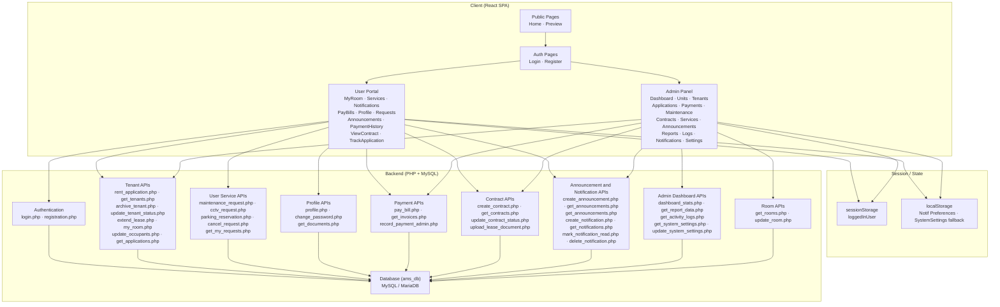
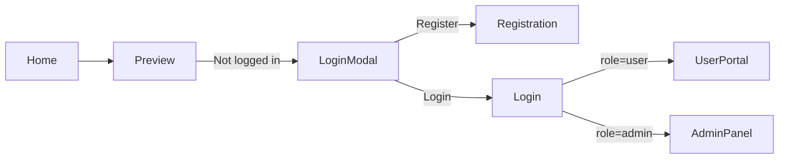
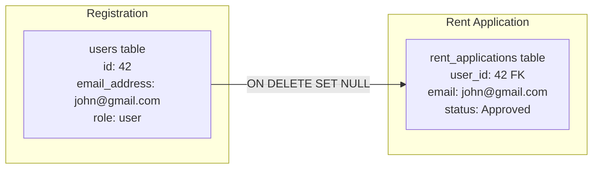

# Apartment Management System — Full System Design

> **Document Version:** 2.1 — status refreshed 2026-09-24 (v2.0: July 2026)
> **Stack:** React 19 + Vite 8 + Tailwind 4 → PHP 8 REST endpoints → MySQL/MariaDB (XAMPP), plus a Node.js Socket.IO chat server

> **Read §0 first.** Sections 2–13 were written for v2.0 and are only partly refreshed: §0 is the current inventory, and where a later section disagrees with §0 or with the code, those win. Authoritative status: [panelist_feature_checklist.md](../features/panelist_feature_checklist.md); schema: [database_schema.md](database_schema.md).

---

## 0. Current State (2026-09-24)

**Auth.** Login creates a session token in `sessions`; the SPA sends `Authorization: Bearer <token>` (`src/api/axiosConfig.js`) and endpoints call `require_admin()` / `require_user()` / `require_owner_or_admin()`. `config.php` overwrites any client-sent `X-User-Id` / `X-Admin-Id` from the session, so older endpoints that still read those headers get the session identity. A 401 signs the user out.

**Processes.** Apache + PHP (API) · MariaDB · `websocket-server/server.js` (Socket.IO, :3001, chat) · cron: `backend/cron/process_queue.php` (every minute — SMS/email queue) and `daily_sweep.php` (reminders, automatic parking billing).

**Tables (31 in `SetupDB.sql`).** users, rooms, rent_applications, lease_contracts, lease_renewals, household_members · invoices, expenses, utility_readings, parking_charges · maintenance_requests, cctv_requests, parking_reservations, service_catalog, service_requests · visitor_logs, inquiries, unit_reservations, unit_waitlist · announcements, notifications, notification_preferences, notification_queue, notification_log, activity_logs · system_settings, sessions, login_attempts, password_resets, password_reset_requests · messages (chat).

**Endpoints (105 in `backend/api/`), by area:**

| Area | Endpoints |
|---|---|
| Auth & users | login, logout, registration, profile, change_password, forgot_password, reset_password, manage_users, get_users |
| Rooms & units | get_rooms, create_room, update_room, upload_room_images, update_room_image, delete_room_image |
| Applications & tenancy | rent_application, get_applications, update_tenant_status, get_tenants, archive_tenant, restore_tenant, my_room, update_occupants, household_members, extend_lease, record_move_out, process_tenant_request |
| Inquiries & holds | submit_inquiry, get_inquiries, update_inquiry_status, create_reservation, update_reservation_status, expire_reservations, manage_waitlist |
| Contracts & documents | create_contract, get_contracts, update_contract_status, expire_contracts, upload_lease_document, get_documents, download_file |
| Billing & payments | get_invoices, create_invoice, adjust_invoice, advance_payment, pay_bill, record_payment_admin, upload_payment_proof, reject_payment_proof, schedule_payment, send_payment_reminder, check_due_date_reminders, get_payment_channels, create_checkout_session, release_checkout_session, paymongo_webhook, manage_expenses |
| Utilities | get_utility_readings, save_utility_reading, delete_utility_reading, sync_utility_to_invoice, get_utilities_report_data |
| Maintenance | maintenance_request, create_maintenance_request_admin, get_maintenance_requests, update_maintenance_status, sync_maintenance_to_invoice |
| Services | get_service_catalog, manage_service_catalog, service_request, get_service_requests, update_service_status, sync_service_to_invoice |
| Parking & CCTV | parking_reservation, get_parking_reservations, update_parking_status, get_available_parking_slots, sync_parking_to_invoice, cctv_request, get_cctv_requests, update_cctv_status |
| Visitors | get_visitors, check_in_visitor, update_visitor_status |
| Requests (tenant) | get_my_requests, cancel_request |
| Announcements & notifications | create_announcement, get_announcements, create_notification, get_notifications, mark_notification_read, delete_notification, get_notification_preferences, update_notification_preferences, send_test_notification, get_sms_balance |
| Chat | get_chat_history, send_message, save_message (alias), get_conversations, get_admin_user |
| Admin & reports | dashboard_stats, get_report_data, get_activity_logs, get_system_settings, update_system_settings, upload_glass_background, get_glass_backgrounds, delete_glass_background |

Shared code: `backend/config.php` (auth, billing, tenancy, notification helpers), `backend/api/services/` (`send_notification.php`, `send_sms.php` — log / Semaphore, `send_email.php` — log / SMTP, `email_templates.php`).

**Routes.** Public/tenant: `/`, `/home`, `/preview`, `/inquire`, `/login`, `/register`, `/reset-password`, `/services`, `/service-catalog`, `/service-booking`, `/pay-bills`, `/upload-payment`, `/payment-history`, `/user-utilities`, `/parking-reservation`, `/cctv-request`, `/maintenance-request`, `/visitor-management`, `/rent-application`, `/track-application`, `/my-room`, `/view-contract`, `/notifications`, `/my-requests`, `/announcements`, `/profile-settings`. Admin: `/admin-dashboard`, `/admin-inquiries`, `/admin-applications`, `/admin-units`, `/admin-tenants`, `/admin-contracts`, `/admin-payments`, `/admin-utilities`, `/admin-maintenance`, `/admin-services`, `/admin-parking`, `/admin-cctv`, `/admin-visitors`, `/admin-announcements`, `/admin-notifications`, `/admin-messages`, `/admin-reports`, `/admin-users`, `/admin-activity-logs`, `/admin-settings` (tabs: Account, Leasing, Payments, Parking, Notifications, Maintenance).

**No module is mock-data backed any more** — every admin page above reads and writes the database.

---

## 1. Overview

This document provides a complete architectural and design reference for the Apartment Management System (AMS). It covers the full data model, all user and admin workflows, currently implemented features, and identified gaps.

AMS has two main actor roles:

| Actor | Access | Entry Point |
|-------|--------|-------------|
| **Guest / Prospective Tenant** | Public pages, registration | `/home`, `/preview`, `/register` |
| **Tenant (User)** | Protected user portal | `/services`, `/my-room`, `/pay-bills`, etc. |
| **Administrator** | Admin panel | `/admin-dashboard`, `/admin-*` |

---

## 2. Database — Entity Relationship Diagram

> [!NOTE]
> *(v2.0 diagram — shows the original 12 tables only; the full 30 + `messages` are in §0 and [database_schema.md](database_schema.md).)* All 12 planned tables now exist in `ams_db`. The `user_id` FK has been added to `rent_applications`, and the `status` column has been added to `parking_reservations`. Remaining structural issues are documented inline.

```mermaid
erDiagram
    USERS {
        int id PK
        varchar first_name
        varchar last_name
        varchar middle_name
        varchar suffix
        varchar contact_no
        varchar gender
        varchar email_address UK
        varchar password
        varchar role "user or admin"
        timestamp created_at
    }

    ROOMS {
        varchar id PK "e.g. letter-coded: 'A', 'B'"
        varchar type "Studio, 1BR"
        varchar floor
        decimal monthly_rent
        varchar status "Vacant, Occupied, Maintenance"
        varchar tenant_name "string, not FK to users"
        int occupants
        date lease_start
        date lease_end
        varchar last_tenant
        tinyint maintenance_flag
        timestamp created_at
    }

    RENT_APPLICATIONS {
        int id PK
        int user_id FK "Added - nullable, references users.id"
        varchar first_name
        varchar middle_name
        varchar last_name
        varchar suffix
        varchar contact_no
        varchar email "duplicates users.email_address"
        varchar gender
        varchar previous_address
        int occupants
        int months_of_rent
        varchar room_name "string ref to rooms.id - no FK constraint"
        decimal monthly_rent
        varchar status "Pending Review, Approved, Rejected, pending-move-out, moved-out, archived"
        date archive_date
        varchar archive_reason
        text archive_notes
        timestamp created_at
    }

    MAINTENANCE_REQUESTS {
        int id PK
        int user_id FK "Exists (nullable)"
        varchar issue_category
        varchar urgency
        date preferred_date
        varchar preferred_time
        text description
        tinyint permission_to_enter
        varchar attachment_path
        varchar status "Pending, In Progress, Approved, Completed, Cancelled"
        timestamp created_at
    }

    CCTV_REQUESTS {
        int id PK
        int user_id FK "Exists (nullable)"
        date incident_date
        varchar incident_time
        varchar location_details
        text reason_request
        varchar status "Pending, Approved, Rejected, Cancelled"
        timestamp created_at
    }

    PARKING_RESERVATIONS {
        int id PK
        int user_id FK "Exists (nullable)"
        varchar vehicle_type
        varchar vehicle_model
        varchar plate_number
        varchar status "Added - Pending, Assigned, Rejected, Cancelled"
        varchar transmission
        int duration_months
        decimal total_cost
        varchar document_path
        timestamp created_at
    }

    INVOICES {
        varchar id PK "e.g. INV-uniqid - not int"
        int user_id FK
        int rent_application_id FK
        decimal base_rent
        decimal water
        decimal electricity
        decimal parking
        decimal security_deposit
        decimal total_amount
        varchar payment_method "GCash, Bank Transfer, Cash on Hand"
        varchar billing_period
        varchar status "pending, paid, overdue"
        timestamp paid_at
        date due_date
        timestamp created_at
    }

    LEASE_CONTRACTS {
        varchar id PK "e.g. LC-uniqid - not int"
        int rent_application_id FK
        decimal deposit_amount
        date lease_start
        date lease_end
        varchar status "active, expired, eviction-pending"
        varchar signed_lease_path
        varchar notarized_lease_path
        varchar eviction_status
        timestamp generated_at
    }

    ANNOUNCEMENTS {
        int id PK
        varchar tag "Urgent, Reminder, General"
        varchar title
        text body
        varchar send_to
        longtext channels "JSON string: in-app, sms, email"
        int recipient_count
        timestamp created_at
    }

    NOTIFICATIONS {
        int id PK
        int user_id FK "NOT NULL"
        varchar title
        text message
        varchar type "info, success, warning, action"
        tinyint is_read
        timestamp created_at
    }

    ACTIVITY_LOGS {
        int id PK
        varchar category "payment, maintenance, tenant, system, communication"
        varchar action
        text details
        int performed_by FK "admin user id - nullable"
        timestamp created_at
    }

    SYSTEM_SETTINGS {
        int id PK
        varchar setting_key UK
        text setting_value
        timestamp updated_at
    }

    USERS ||--o{ RENT_APPLICATIONS : "submits (user_id FK added)"
    USERS ||--o{ MAINTENANCE_REQUESTS : "submits (user_id nullable)"
    USERS ||--o{ CCTV_REQUESTS : "submits (user_id nullable)"
    USERS ||--o{ PARKING_RESERVATIONS : "submits (user_id nullable)"
    USERS ||--o{ INVOICES : "pays"
    USERS ||--o{ NOTIFICATIONS : "receives"
    RENT_APPLICATIONS ||--o{ INVOICES : "generates"
    RENT_APPLICATIONS ||--o| LEASE_CONTRACTS : "has"
    ROOMS ||--o{ RENT_APPLICATIONS : "referenced by room_name string (no FK)"
```



---

## 3. Current Database Tables — Live Schema Status

| Table | DB Status | FK / Schema Notes | Wiring Status |
|-------|-----------|-------------------|---------------|
| `users` | ✅ Exists | — | ✅ Fully wired |
| `rent_applications` | ✅ Exists | `user_id` FK added. `room_name` → `rooms.id` still string-only | ✅ Admin CRUD + user submission wired |
| `maintenance_requests` | ✅ Exists | `user_id` FK nullable. Assignee, estimated/actual cost, timeline and billing columns exist | ✅ Submission and admin board wired (`get_maintenance_requests`, `update_maintenance_status`) |
| `cctv_requests` | ✅ Exists | `user_id` FK nullable | ✅ Submission and admin review wired (`get_cctv_requests`, `update_cctv_status`) |
| `parking_reservations` | ✅ Exists | `user_id` FK nullable. `status` column added; numbered slots; monthly billing via `parking_charges` | ✅ Submission and admin approval wired |
| `rooms` | ✅ Exists | `id` is `varchar` (letter-coded). `tenant_name` is string (not FK) | ✅ `AdminUnits` fully wired to `get_rooms.php` / `update_room.php` |
| `invoices` | ✅ Exists | PK is `varchar(50)` (e.g. `'INV-...'`). Auto-overdue via `promote_overdue_invoices()` | ✅ `AdminPayments` + `PayBills` + `UserPaymentHistory` wired |
| `lease_contracts` | ✅ Exists | PK is `varchar(50)`. No `user_id` FK (only `rent_application_id`) | ✅ `AdminContracts` wired; `ViewContract` derives from `my_room.php` (not this table) |
| `announcements` | ✅ Exists | `channels` stored as `longtext` not JSON type | ✅ `AdminAnnouncements` create/read wired. `UserAnnouncements` wired |
| `notifications` | ✅ Exists | No `related_entity_type`/`related_entity_id` for deep-linking | ✅ `UserNotifications` + `AdminNotifications` + `TopBar` fully wired |
| `activity_logs` | ✅ Exists | `performed_by` nullable. No `ip_address` | ✅ `AdminActivityLogs` fetches from DB; `log_activity()` called on all mutations |
| `system_settings` | ✅ Exists | Uses `setting_key`/`setting_value` pair model | ✅ `AdminAccountSettings` fully wired |

---

## 4. Architecture Overview



---

## 5. User Workflow & Module Map

### 5.1 Public (Guest) Flow



### 5.2 User Portal Modules

| Route | File | Backend API | DB Table | Status |
|-------|------|-------------|----------|--------|
| `/home` | `Home.jsx` | — | — | ✅ |
| `/preview` | `Preview.jsx` | `get_rooms.php` | `rooms` | ✅ |
| `/inquire` | `InquiryForm.jsx` | `submit_inquiry.php`, `get_rooms.php` | `inquiries` | ✅ Public — guests may submit; prefilled when logged in |
| `/rent-application` | `RentApplication.jsx` | `rent_application.php` | `rent_applications` | ✅ (`user_id` stored) |
| `/track-application` | `TrackApplication.jsx` | `my_room.php`, `pay_bill.php` | `rent_applications`, `invoices` | ✅ |
| `/my-room` | `MyRoom.jsx` | `my_room.php`, `extend_lease.php`, `update_occupants.php` | `rent_applications` | ✅ |
| `/view-contract` | `ViewContract.jsx` | `my_room.php` | `rent_applications` | ⚠️ Not from `lease_contracts` table |
| `/services` | `Services.jsx` | — | — | ✅ (Hub with 7 navigation cards) |
| `/pay-bills` | `PayBills.jsx` | `get_invoices.php`, `pay_bill.php` | `invoices` | ✅ |
| `/parking-reservation` | `ParkingReservation.jsx` | `parking_reservation.php` | `parking_reservations` | ✅ |
| `/maintenance-request` | `MaintenanceRequest.jsx` | `maintenance_request.php` | `maintenance_requests` | ✅ |
| `/cctv-request` | `CctvRequest.jsx` | `cctv_request.php` | `cctv_requests` | ✅ |
| `/profile-settings` | `ProfileSettings.jsx` | `profile.php`, `get_documents.php`, `change_password.php` | `users`, `rent_applications` | ✅ |
| `/notifications` | `UserNotifications.jsx` | `get_notifications.php`, `mark_notification_read.php`, `delete_notification.php` | `notifications` | ✅ |
| `/my-requests` | `UserMyRequests.jsx` | `get_my_requests.php`, `cancel_request.php` | `maintenance_requests`, `cctv_requests`, `parking_reservations` | ✅ |
| `/announcements` | `UserAnnouncements.jsx` | `get_announcements.php` | `announcements` | ✅ |
| `/payment-history` | `UserPaymentHistory.jsx` | `get_invoices.php` | `invoices` | ✅ |

**Themes (2026-11).** Every user-side page (sign-in and registration too) renders in **Light**, **Dark** or **Glass**, picked in the account menu (guests: the switch on the TopBar) and kept per browser (`localStorage` `ams_user_theme`, `config/theme.js`). Home is always Glass. Pages are written once in the light palette; `UserThemeScope` (`Components/UserTheme.jsx`) puts `.ut-root .ut-<theme>` on the layout, and `assets/styles/themes.generated.css` (from `ams-react/scripts/gen-theme-css.mjs`) remaps Tailwind's per-property colour variables (`--background-color-white`, `--text-color-slate-800`, …) for Dark and Glass, so hover/opacity variants follow. `ut-native` keeps a piece drawn for a dark backdrop (TopBar bar, Home panel, the contract sheet) in its own colours, and the TopBar stays brand indigo in every theme; `ut-themed` re-applies the theme inside one. The Glass backdrop photo, tint, tint strength and blur are set in Admin → Other Settings → **Glass Mode** (`glass_*` settings, `upload_glass_background.php`); the last 6 uploads stay listed there to switch back to (`get_glass_backgrounds.php`, `delete_glass_background.php`; `prune_glass_bg_files()` deletes older ones, never the live one). The Home page text (badge, heading, location, description) is edited or hidden in Other Settings → **Home Page** (`home_content` setting, checked by `normalize_home_content()` in `config.php`; empty text = the built-in i18n wording, an empty Filipino box falls back to the English text). The admin side is not themed. Route changes fade in (`.ut-route`, honours reduced motion).

### 5.3 Route Protection Summary

| Guard | Applied To | Logic |
|-------|-----------|-------|
| `ProtectedRoute` | `/rent-application`, `/track-application`, `/profile-settings`, `/notifications` | Must be logged in (any role) |
| `TenantProtectedRoute` | `/services`, `/pay-bills`, `/my-room`, `/view-contract`, `/my-requests`, `/announcements`, `/payment-history`, parking, cctv, maintenance | Must be logged in AND have approved+paid room (or admin) |
| `AdminProtectedRoute` | All `/admin-*` routes | Must be logged in AND `role === 'admin'` |
| *(none)* | `/home`, `/preview`, `/inquire`, `/login`, `/register`, `/reset-password` | Public — reachable by guests |

---

## 6. Admin Workflow & Module Map

### 6.1 Admin Panel Modules

| Route | File | Key Features | DB Tables | Status |
|-------|------|--------------|-----------|--------|
| `/admin-dashboard` | `AdminDashboard.jsx` | Live KPIs, "Needs your attention" list (filtered links to the admin pages), Income Chart (6-mo), New Tenants, Activity Feed | `invoices`, `rooms`, `rent_applications`, `maintenance_requests`, `activity_logs` | ✅ Live data |
| `/admin-units` | `AdminUnits.jsx` | Grid/List, Detail Modal, Assign, Vacate, Extend, Maintenance Flag | `rooms` via `get_rooms.php` / `update_room.php` | ✅ DB-backed |
| `/admin-inquiries` | `AdminInquiries.jsx` | Inquiry triage pipeline, unit reservations with auto-expiring holds, walk-in/phone logging, convert to application | `inquiries`, `unit_reservations` via `get_inquiries.php`, `update_inquiry_status.php`, `create_reservation.php`, `update_reservation_status.php` | ✅ DB-backed |
| `/admin-applications` | `AdminApplications.jsx` | View pending/all applications, document preview | `rent_applications` via `get_applications.php` | ✅ DB-backed |
| `/admin-tenants` | `AdminTenants.jsx` | Pending Review, Active, Archive, Verify Docs, Approve/Reject | `rent_applications` | ✅ |
| `/admin-payments` | `AdminPayments.jsx` | Billing grouped by tenant, Settlement, Receipt, History | `invoices` via `get_invoices.php`, `record_payment_admin.php` | ✅ DB-backed |
| `/admin-maintenance` | `AdminMaintainance.jsx` | Kanban, Approval, Status updates, Cost/Assignee | `get_maintenance_requests.php`, `update_maintenance_status.php` | ✅ DB-backed |
| `/admin-contracts` | `AdminContracts.jsx` | Generate, View, Upload Signed/Notarized, Eviction | `lease_contracts` via `create_contract.php`, `get_contracts.php`, `upload_lease_document.php` | ✅ DB-backed |
| `/admin-services` | `AdminServicePage.jsx` | Service catalog, service requests, CCTV review | `get_service_catalog`, `manage_service_catalog`, `get_service_requests`, `update_service_status`, `sync_service_to_invoice`, `get_cctv_requests`, `update_cctv_status` | ✅ DB-backed |
| `/admin-announcements` | `AdminAnnouncements.jsx` | Compose, Send, View history | `announcements` via `create_announcement.php`, `get_announcements.php` | ✅ DB-backed; auto-notifies tenants |
| `/admin-reports` | `AdminReports.jsx` | Financial, Occupancy, Maintenance, Reservations | `get_report_data.php` | ✅ DB-backed; detailed reports wired |
| `/admin-notifications` | `AdminNotifications.jsx` | Read/Delete admin alerts | `notifications` | ✅ DB-backed |
| `/admin-activity-logs` | `AdminActivityLogs.jsx` | System audit trail | `activity_logs` via `get_activity_logs.php` | ✅ DB-backed |
| `/admin-settings` | `AdminAccountSettings.jsx` | Admin profile, password, system config | `system_settings` via `get_system_settings.php`, `update_system_settings.php` | ✅ DB-backed |

---

## 7. API Endpoint Inventory

### 7.1 All Current Backend Endpoints

| Endpoint | Method | Description | Status |
|----------|--------|-------------|--------|
| `registration.php` | POST | Register new user | ✅ |
| `login.php` | POST | Authenticate user | ✅ |
| `profile.php` | GET/POST | Get/update user profile | ✅ |
| `change_password.php` | POST | Change user password | ✅ |
| `get_documents.php` | GET | Fetch uploaded document paths | ✅ |
| `rent_application.php` | POST | Submit rent application (stores `user_id`) | ✅ |
| `get_tenants.php` | GET | Fetch all rent applications | ✅ |
| `get_applications.php` | GET | Fetch pending/all applications for admin | ✅ |
| `submit_inquiry.php` | POST | **Public** — submit a unit inquiry (guest or logged in); honeypot + 24h rate limit | ✅ |
| `get_inquiries.php` | GET | Fetch inquiries and unit reservations for admin; runs the hold-expiry sweep | ✅ |
| `update_inquiry_status.php` | POST | Triage an inquiry (New → Contacted → Scheduled → Reserved → Converted/Closed) | ✅ |
| `create_reservation.php` | POST | Place a hold on a unit; rejects on room status, active hold, or pending application | ✅ |
| `update_reservation_status.php` | POST | Cancel / expire / convert a hold; releases the room on cancel and expire | ✅ |
| `expire_reservations.php` | GET/POST | Cron-style sweep releasing lapsed holds | ✅ |
| `update_tenant_status.php` | POST | Update tenant status; syncs `rooms` + creates initial invoice on Approval | ✅ |
| `archive_tenant.php` | POST | Archive tenant with reason/notes | ✅ |
| `my_room.php` | GET | Fetch tenant room info + pending invoice flag | ✅ |
| `extend_lease.php` | PUT | Extend lease duration | ✅ |
| `update_occupants.php` | POST | Update occupant count | ✅ |
| `maintenance_request.php` | POST | Submit maintenance request (stores `user_id`) | ✅ |
| `cctv_request.php` | POST | Submit CCTV request (stores `user_id`) | ✅ |
| `parking_reservation.php` | POST | Reserve parking slot (stores `user_id`, `status='Pending'`) | ✅ |
| `cancel_request.php` | POST | Cancel a Pending maintenance/CCTV/parking request by `user_id` | ✅ |
| `get_my_requests.php` | GET | Fetch all maintenance/CCTV/parking requests for a `user_id` | ✅ |
| `pay_bill.php` | POST | Record a payment; updates `invoices.status` to `paid` | ✅ |
| `get_invoices.php` | GET | Fetch invoices (all or filtered by `userId`) | ✅ |
| `record_payment_admin.php` | POST | Admin records manual payment for a tenant | ✅ |
| `get_rooms.php` | GET | Fetch all rooms from `rooms` table | ✅ |
| `update_room.php` | POST | Update room status, tenant, lease dates, flags | ✅ |
| `create_contract.php` | POST | Persist a new lease contract | ✅ |
| `get_contracts.php` | GET | Fetch all lease contracts with tenant info | ✅ |
| `update_contract_status.php` | POST | Update contract status / eviction flag | ✅ |
| `upload_lease_document.php` | POST | Upload signed/notarized lease to contract | ✅ |
| `create_announcement.php` | POST | Persist announcement + auto-create notifications for all tenants | ✅ |
| `get_announcements.php` | GET | Fetch all announcements (admin) | ✅ |
| `get_announcements.php` | GET | Fetch sent announcements (tenant-facing) | ✅ |
| `create_notification.php` | POST | Manually insert a notification for a user | ✅ |
| `get_notifications.php` | GET | Fetch notifications for a `userId` | ✅ |
| `mark_notification_read.php` | POST | Mark notification(s) as read | ✅ |
| `delete_notification.php` | POST | Delete a notification | ✅ |
| `dashboard_stats.php` | GET | Aggregate live KPIs + income chart + new tenants | ✅ |
| `get_report_data.php` | GET | Aggregate report data by timeframe/month/year | ✅ |
| `get_activity_logs.php` | GET | Fetch system activity logs | ✅ |
| `get_system_settings.php` | GET | Fetch system settings from DB | ✅ |
| `update_system_settings.php` | POST | Update system settings in DB | ✅ |

### 7.2 Endpoints Still Missing

> **Resolved.** Every endpoint below now exists except `get_my_contract.php`, which was superseded by `get_contracts.php` (used by `ViewContract.jsx`). §0 lists all 105.

| Endpoint | Method | Priority | Description |
|----------|--------|----------|-------------|
| `get_maintenance_requests.php` | GET | 🔴 High | Fetch maintenance requests from DB for `AdminMaintainance.jsx` |
| `update_maintenance_status.php` | POST | 🔴 High | Allow admin to update maintenance status, assignee, cost in DB |
| `get_cctv_requests.php` | GET | 🔴 High | Fetch CCTV requests from DB for `AdminServicePage.jsx` |
| `get_parking_reservations.php` | GET | 🔴 High | Fetch parking reservations from DB for `AdminServicePage.jsx` |
| `update_parking_status.php` | POST | 🔴 High | Allow admin to approve/reject parking reservations in DB |
| `update_cctv_status.php` | POST | 🔴 High | Allow admin to approve/reject CCTV requests in DB |
| `record_move_out.php` | POST | 🟡 Medium | Allow tenant to formally submit move-out intent |
| `get_my_contract.php` | GET | 🟡 Medium | Fetch tenant's lease contract from `lease_contracts` table |
| `upload_payment_proof.php` | POST | 🟡 Medium | Accept proof of payment file upload + store path on invoice |

---

## 8. File & Module Index

### Frontend — User Pages

| File | Route | Purpose |
|------|-------|---------|
| `Home.jsx` | `/home` | Landing/welcome page |
| `Preview.jsx` | `/preview` | Room browsing with rent CTA |
| `Login.jsx` | `/login` | Login form |
| `Registration.jsx` | `/register` | User registration form |
| `Services.jsx` | `/services` | Services hub (7 navigation cards) |
| `RentApplication.jsx` | `/rent-application` | Multi-step rent application with doc upload |
| `TrackApplication.jsx` | `/track-application` | Application status tracker + initial payment |
| `MyRoom.jsx` | `/my-room` | Tenant room status + lease extension |
| `ViewContract.jsx` | `/view-contract` | Tenant contract viewer (derived from room data) |
| `PayBills.jsx` | `/pay-bills` | Monthly bill payment (reads `invoices`, calls `pay_bill.php`) |
| `ParkingReservation.jsx` | `/parking-reservation` | Parking slot form + OR/CR upload |
| `MaintenanceRequest.jsx` | `/maintenance-request` | Maintenance ticket form + attachment |
| `CctvRequest.jsx` | `/cctv-request` | CCTV footage access form |
| `ProfileSettings.jsx` | `/profile-settings` | User profile editor + document viewer + avatar |
| `UserNotifications.jsx` | `/notifications` | Notification center (DB-backed) |
| `UserMyRequests.jsx` | `/my-requests` | All submitted requests with status + cancel action |
| `UserAnnouncements.jsx` | `/announcements` | Read-only tenant announcement board |
| `UserPaymentHistory.jsx` | `/payment-history` | Invoice history + receipt viewer |

### Frontend — Admin Pages

| File | Route | Purpose |
|------|-------|---------|
| `AdminDashboard.jsx` | `/admin-dashboard` | Live KPI cards, income chart, activity feed |
| `AdminUnits.jsx` | `/admin-units` | DB-backed unit CRUD, assignment, lease + payment history |
| `AdminApplications.jsx` | `/admin-applications` | Pending application viewer with doc preview |
| `AdminTenants.jsx` | `/admin-tenants` | Tenant lifecycle management, archive, docs review |
| `AdminPayments.jsx` | `/admin-payments` | Invoice-based billing, settlement, receipts |
| `AdminMaintainance.jsx` | `/admin-maintenance` | Kanban + approval workflow (reads DB stub; writes in-memory) |
| `AdminContracts.jsx` | `/admin-contracts` | Contract generation, upload, eviction tracking (DB-backed) |
| `AdminServicePage.jsx` | `/admin-services` | Service catalog + requests, CCTV review (DB-backed) |
| `AdminAnnouncements.jsx` | `/admin-announcements` | Compose and send announcements (DB-backed) |
| `AdminReports.jsx` | `/admin-reports` | Financial, occupancy, maintenance reports (DB-backed) |
| `AdminNotifications.jsx` | `/admin-notifications` | Admin notification management (DB-backed) |
| `AdminActivityLogs.jsx` | `/admin-activity-logs` | System event audit trail (DB-backed) |
| `AdminAccountSettings.jsx` | `/admin-settings` | Admin profile + system configuration (DB-backed) |

### Frontend — Components

| File | Purpose |
|------|---------|
| `TopBar.jsx` | User nav with DB-backed notification bell + user dropdown |
| `AdminSidebar.jsx` | Collapsible admin navigation |
| `AdminDashboardHeader.jsx` | Admin page headers |
| `Footer.jsx` | Site footer (user pages only) |
| *(removed)* `LogInModal.jsx` | No longer exists. Newer components: `ChatWidget`, `RoomPreviewModal`, `HouseholdPanel`, `AdminHouseholdList`, `WaitlistPanel`, `ExpensesModal`, `ServiceCatalogModal`; context: `context/ChatContext.jsx` |
| `SuccessModal.jsx` | Reusable success confirmation modal |
| `DocumentsModal.jsx` | View uploaded verification documents (ProfileSettings) |
| `ChangePasswordModal.jsx` | Password change modal (ProfileSettings) |
| `RoomPreviewModal.jsx` | Room detail preview modal (Preview page) |

### Backend — Config & Utilities

| File | Purpose |
|------|---------|
| `backend/config.php` | MySQL DB connection + `verify_admin()` + `log_activity()` helpers |
| `config/systemSettings.js` | System-wide configurable settings (DB-backed; localStorage as fallback) |

### Backend — Migration Files

| File | Purpose |
|------|---------|
| `migrations/SetupDB.sql` | Full initial DB schema creation |
| `migrations/2026_10_*.sql` | Current upgrade migrations for existing databases, applied by `backend/cron/migrate.php` — see [database_schema.md §3](database_schema.md) |
| `migrations/2026_10_chat_and_signature_columns.sql` | Chat table and columns, contract signature columns, `invoices.late_fee_waived` (idempotent catch-up) |
| `migrations/seeds/` | Demo data and reset helpers (`seed_mock_data`, `seed_reset`, `clear_and_seed` are CI-checked; `seed_prod_demo` + reset for the live database are local only, gitignored) |
| *(removed)* | Applied migrations are deleted once they've run everywhere: the `2026_09_*` upgrades and the old `add_archive_columns`, `fix_and_fk`, `priority_*` files. Their changes are in `SetupDB.sql` |

---

## 9. Remaining Gaps & Issues

### 9.1 Frontend — Still Mocked or Partially Wired

| Component | Gap | Impact |
|-----------|-----|--------|
| `AdminMaintainance.jsx` | Uses `initialRequests` hardcoded array. Status updates, assignee, and cost are in-memory only. | Admin maintenance data is not persisted across page refreshes. |
| `AdminServicePage.jsx` | Uses `initialCctvRequests` and `initialParkingReservations` mock arrays. Approve/reject does not persist. | CCTV and parking status changes are lost on refresh. |
| `AdminReports.jsx` | Fully wired to live DB data from `get_report_data.php`. Replaced dummy generator. | |
| `ViewContract.jsx` | Derives contract data from `my_room.php` (rent application record), not from the `lease_contracts` table. | Cannot reflect uploaded signed lease or notarized contract status. |

### 9.2 Schema Issues

| Issue | Table | Status |
|-------|-------|--------|
| `invoices.id` is `varchar(50)` (`'INV-<uniqid>'`) | `invoices` | Low risk; format enforced in PHP. |
| `lease_contracts.id` is `varchar(50)` | `lease_contracts` | Same as above. |
| `rooms.id` is `varchar` letter-coded | `rooms` | Prevents proper FK from `rent_applications.room_name`. By design. |
| `rooms.tenant_name` is a string (not FK to `users`) | `rooms` | Synced on approval; breaks referential integrity on user deletion. |
| `maintenance_requests` has no `assigned_to`, `estimated_cost`, `work_notes` columns | `maintenance_requests` | Admin enrichment data cannot be persisted. |
| `announcements.channels` is `longtext` not MySQL `JSON` type | `announcements` | Stored as JSON string; decoded in PHP. Minor inconsistency. |
| No `related_entity_type` / `related_entity_id` in `notifications` | `notifications` | Cannot deep-link notifications to specific requests or invoices. |

### 9.3 User-Facing Missing Features

| Feature | Current State | What Is Needed |
|---------|--------------|----------------|
| Move-Out Request | Admin manually changes status | `/move-out` page or `MyRoom.jsx` modal + `record_move_out.php` endpoint |
| ~~Lease extension conflict handling~~ | ✅ Done — `create_reservation.php` checks room status, active holds, and pending applications | — |
| Lease expiration reminders | Not implemented | Scheduled notification trigger or cron-style check on login |
| Payment reference number | Not stored | Add `payment_reference` column to `invoices`; display in receipt |
| Upload proof of payment | Not implemented | File upload in `PayBills.jsx` → `upload_payment_proof.php` |
| CCTV data privacy consent | Not in form | Add consent checkbox to `CctvRequest.jsx` |

---

## 10. Identity & Session Architecture

### 10.1 User Identity Model



The `user_id` FK is stored on submission from the session (`require_user()`); `config.php` overwrites any client `X-User-Id` header with the session identity. `my_room.php` still queries by email for backward compatibility with pre-migration rows.

### 10.2 Session Storage Structure

```json
{
  "id": 42,
  "first_name": "John",
  "last_name": "Doe",
  "email_address": "john@gmail.com",
  "role": "user"
}
```

Stored in `sessionStorage` under key `loggedInUser`, together with `sessionToken`. `axiosConfig.js` sends only `Authorization: Bearer <sessionToken>`; identity is resolved server-side from the `sessions` table.

---

## 11. Next Implementation Priorities

### Priority A — Admin Maintenance & Services: DB Wiring

**Goal:** Replace all hardcoded mock data in `AdminMaintainance.jsx` and `AdminServicePage.jsx` with live DB reads and writes.

**Required Steps:**
1. Create `get_maintenance_requests.php` — `SELECT * FROM maintenance_requests ORDER BY created_at DESC`.
2. Create `update_maintenance_status.php` — Update `status`, and any new enrichment columns.
3. Create `get_cctv_requests.php` and `get_parking_reservations.php` — Fetch from DB.
4. Create `update_parking_status.php` and `update_cctv_status.php` — Admin approve/reject.
5. Refactor `AdminMaintainance.jsx` — Remove `initialRequests`, fetch from DB, wire status changes.
6. Refactor `AdminServicePage.jsx` — Remove mock arrays, fetch from DB, wire approve/reject.

**Schema Migration Needed:**
```sql
ALTER TABLE maintenance_requests
  ADD COLUMN IF NOT EXISTS assigned_to VARCHAR(100) DEFAULT NULL,
  ADD COLUMN IF NOT EXISTS estimated_cost DECIMAL(10,2) DEFAULT NULL,
  ADD COLUMN IF NOT EXISTS work_notes TEXT DEFAULT NULL;
```

**Affected Files:**
- [NEW] `backend/api/get_maintenance_requests.php`
- [NEW] `backend/api/update_maintenance_status.php`
- [NEW] `backend/api/get_cctv_requests.php`
- [NEW] `backend/api/get_parking_reservations.php`
- [NEW] `backend/api/update_parking_status.php`
- [NEW] `backend/api/update_cctv_status.php`
- [MODIFY] `ams-react/src/AdminPages/AdminMaintainance.jsx`
- [MODIFY] `ams-react/src/AdminPages/AdminServicePage.jsx`
- [SQL MIGRATION] Add enrichment columns to `maintenance_requests`

---

### Priority B — Live Reports: Wire `AdminReports.jsx` to `get_report_data.php`

**Goal:** Replace the deterministic mock data engine in `AdminReports.jsx` with real DB aggregates.

**Current State:** `get_report_data.php` is already created and returns real data from `invoices`, `rooms`, `rent_applications`, `maintenance_requests`, and `parking_reservations`. `AdminReports.jsx` imports `api` and `useEffect` but still calls `generateReportData()` everywhere.

**Required Steps:**
1. Add a `useEffect` in `AdminReports.jsx` that calls `get_report_data.php?timeframe=...&month=...&year=...` when filters change.
2. Replace all `reportData.*` references using the mock engine with API response fields.
3. Extend `get_report_data.php` to return per-month breakdown arrays for yearly chart rendering.
4. Add a loading skeleton while data fetches.

**Affected Files:**
- [MODIFY] `ams-react/src/AdminPages/AdminReports.jsx`
- [MODIFY] `backend/api/get_report_data.php` (extend for yearly breakdown arrays)

---

### Priority C — ViewContract: Wire to `lease_contracts` Table

**Goal:** Make `ViewContract.jsx` display the actual contract record including upload status.

**Required Steps:**
1. Create `get_my_contract.php` — Query `lease_contracts JOIN rent_applications` filtered by `user_id` or email.
2. Update `ViewContract.jsx` to call `get_my_contract.php` and display signed/notarized lease upload status.
3. Allow tenant to see/download the signed lease if `signed_lease_path` is set.

**Affected Files:**
- [NEW] `backend/api/get_my_contract.php`
- [MODIFY] `ams-react/src/UserPages/ViewContract.jsx`

---

### Priority D — Move-Out Request (Tenant Self-Service)

**Goal:** Allow tenants to formally submit a move-out notice.

**Required Steps:**
1. Create `record_move_out.php` — Sets `rent_applications.status = 'pending-move-out'`, logs activity.
2. Add a move-out modal or button to `MyRoom.jsx`.
3. Wire `AdminTenants.jsx` to display `pending-move-out` tenants prominently.

**Affected Files:**
- [NEW] `backend/api/record_move_out.php`
- [MODIFY] `ams-react/src/UserPages/MyRoom.jsx`
- [MODIFY] `ams-react/src/AdminPages/AdminTenants.jsx`

---

### Priority E — Payment Proof Upload & Reference Number

**Goal:** Allow tenants to upload proof of payment and track payments by reference number.

**Required Steps:**
1. Add `payment_reference VARCHAR(100)` and `proof_of_payment_path VARCHAR(255)` to `invoices` table.
2. Create `upload_payment_proof.php` — Accepts file + `invoice_id`, stores path.
3. Update `PayBills.jsx` and `TrackApplication.jsx` to include a reference number input + file upload.
4. Display reference number and proof status in `UserPaymentHistory.jsx` receipts.

**Affected Files:**
- [SQL MIGRATION] Add columns to `invoices`
- [NEW] `backend/api/upload_payment_proof.php`
- [MODIFY] `ams-react/src/UserPages/PayBills.jsx`
- [MODIFY] `ams-react/src/UserPages/TrackApplication.jsx`
- [MODIFY] `ams-react/src/UserPages/UserPaymentHistory.jsx`

---

## 12. Module Status Summary (Current Live State)

| Module | DB Wired | Notes |
|--------|----------|-------|
| AdminUnits | ✅ | `get_rooms.php` / `update_room.php` |
| AdminDashboard | ✅ | `dashboard_stats.php` + `get_activity_logs.php` |
| AdminApplications | ✅ | `get_applications.php` |
| AdminTenants | ✅ | `get_tenants.php` + approve/reject/archive APIs |
| AdminPayments | ✅ | `get_invoices.php` + `record_payment_admin.php` |
| AdminContracts | ✅ | `create_contract.php` + `get_contracts.php` + upload |
| AdminMaintenance | ✅ | `get_maintenance_requests.php` + `update_maintenance_status.php` (+ billing sync) |
| AdminServices | ✅ | Service catalog/requests + CCTV review, DB-backed |
| AdminParking / AdminCctv / AdminVisitors | ✅ | Their own pages, DB-backed |
| AdminInquiries | ✅ | Inquiries, holds, waitlist, conversion |
| AdminUtilities | ✅ | Meter readings → invoices |
| AdminUsers | ✅ | `manage_users.php` (RBAC) |
| AdminMessages / ChatWidget | ✅ | Chat — Socket.IO + `get_chat_history` / `send_message` / `get_conversations` (socket server not yet authenticated — security_audit §6e) |
| SMS / Email | 🔧 | Transactional email and SMTP support implemented; SMTP configured for current deployment. Runtime email still depends on per-database enable/driver settings; SMS go-live remains pending. |
| AdminAnnouncements | ✅ | `create_announcement.php` + `get_announcements.php`; auto-notifies tenants |
| AdminReports | ✅ | `get_report_data.php` fully wired |
| AdminNotifications | ✅ | `get_notifications.php` + mark read/delete |
| AdminActivityLogs | ✅ | `get_activity_logs.php` + `log_activity()` on all mutations |
| AdminSystemSettings | ✅ | `get_system_settings.php` + `update_system_settings.php`; tabbed (`AdminPages/settings/*`) |
| UserNotifications | ✅ | DB-backed; TopBar bell also wired |
| UserPayBills | ✅ | `get_invoices.php` + `pay_bill.php` |
| UserMyRequests | ✅ | `get_my_requests.php` + `cancel_request.php` |
| UserAnnouncements | ✅ | `get_announcements.php` |
| UserPaymentHistory | ✅ | `get_invoices.php` (all invoices with status) |
| ViewContract | ✅ | `get_contracts.php` (`lease_contracts`) |
| TrackApplication | ✅ | Status + initial payment wired |
| Move-Out Request | ✅ | `record_move_out.php` + button in `MyRoom.jsx` + `AdminTenants.jsx` |
| Payment Proof Upload | ✅ | `upload_payment_proof.php` + `PaymentUpload.jsx` + reference number field |

---

## 13. System Requirements

> **Legend:** ✅ = Implemented &nbsp;|&nbsp; 🔲 = Planned (not yet built)

### 13.1 Functional Requirements

#### FR-1: Account Management

| ID | Requirement | Status |
|----|-------------|--------|
| FR-1.1 | The system shall allow guests to register an account with first name, middle name, last name, suffix, email, password, contact number, and gender. | ✅ |
| FR-1.2 | The system shall enforce unique email addresses during registration. | ✅ |
| FR-1.3 | The system shall authenticate users via email and password and redirect them based on role (`user` or `admin`). | ✅ |
| FR-1.4 | The system shall store the authenticated user session in `sessionStorage` and send the session token as `Authorization: Bearer` on all API calls (identity headers were removed 2026-09-14). | ✅ |
| FR-1.5 | The system shall allow users to update their profile information (name, contact, avatar). | ✅ |
| FR-1.6 | The system shall allow users to change their password (requiring current password verification). | ✅ |
| FR-1.7 | The system shall allow users to preview uploaded verification documents (the application requirements the admin defines; default Valid ID front/back) from their profile. | ✅ |
| FR-1.8 | The system shall enforce a configurable password reset/change policy (max changes, cooldown period). | 🔲 |

---

#### FR-2: Rent Application & Onboarding

| ID | Requirement | Status |
|----|-------------|--------|
| FR-2.1 | The system shall allow authenticated users to submit a rent application with personal details, room selection, lease duration, and previous address, and the document uploads the admin requires (Settings → Application Requirements; default Valid ID front/back). | ✅ |
| FR-2.2 | The system shall store the applicant's `user_id` FK on the `rent_applications` record at submission time. | ✅ |
| FR-2.3 | The system shall allow users to preview and retake uploaded images before submission. | ✅ |
| FR-2.4 | The system shall provide an application tracking page (`/track-application`) showing current status and pending initial payment. | ✅ |
| FR-2.5 | The system shall allow rejected applicants to resubmit or update their application. | 🔲 |
| FR-2.6 | The system shall validate all input fields with appropriate min/max limits (plate numbers, contact numbers, etc.). | 🔲 |
| FR-2.7 | The system shall support upload of Police Clearance and Utility Bill (Proof of Billing) as additional application documents. | 🔲 |

---

#### FR-3: Room & Unit Management

| ID | Requirement | Status |
|----|-------------|--------|
| FR-3.1 | The system shall maintain a database-backed room inventory with letter-coded IDs (`A`–`N`), type, floor, monthly rent, and status. | ✅ |
| FR-3.2 | The system shall allow admins to view, filter, and manage all units via a grid/list view with detail modals. | ✅ |
| FR-3.3 | The system shall automatically sync `rooms.tenant_name`, `rooms.lease_start`, and `rooms.lease_end` when a rent application is approved. | ✅ |
| FR-3.4 | The system shall display room occupancy history and lease history in admin unit detail modals. | ✅ |
| FR-3.5 | The system shall allow admins to set a maintenance flag on any unit. | ✅ |
| FR-3.6 | The system shall track room condition and furnishing status per unit. | ✅ |
| FR-3.7 | The system shall display room images in the Preview page and admin modals. | ✅ |
| FR-3.8 | The system shall support occupant count changes with admin approval workflow. | 🔲 |
| FR-3.9 | The system shall support multiple user accounts linked to a single room (shared occupancy). | 🔲 |
| FR-3.10 | The system shall provide a configurable minimum lease duration (default: 3 months). | 🔲 |
| FR-3.11 | The system shall provide a 360° room view option on the Preview page. | 🔲 |

---

#### FR-4: Lease & Contract Management

| ID | Requirement | Status |
|----|-------------|--------|
| FR-4.1 | The system shall allow admins to generate lease contracts linked to approved rent applications. | ✅ |
| FR-4.2 | The system shall allow admins to upload signed and notarized lease agreement documents to a contract record. | ✅ |
| FR-4.3 | The system shall allow tenants to view their lease contract with all terms, including signed/notarized document status. | ✅ |
| FR-4.4 | The system shall allow tenants to extend their lease from the My Room page. | ✅ |
| FR-4.5 | The system shall allow admins to extend a tenant's lease from the unit detail modal. | ✅ |
| FR-4.6 | The system shall track eviction status on lease contracts. | ✅ |
| FR-4.7 | The system shall detect lease extension conflicts when a room is already reserved by another pending applicant. | ✅ — `create_reservation.php` rejects a hold when the room is not `vacant`, already has an `Active` reservation, or has a `Pending Review` rent application |
| FR-4.8 | The system shall send lease expiration reminders (notification + banner) when remaining lease days < 30. | 🔲 |
| FR-4.9 | The system shall maintain a lease extension history tab in the unit detail modal. | 🔲 |

---

#### FR-5: Payment & Billing

| ID | Requirement | Status |
|----|-------------|--------|
| FR-5.1 | The system shall generate an initial invoice (advance + security deposit) when a rent application is approved. | ✅ |
| FR-5.2 | The system shall allow tenants to view and pay pending monthly invoices via GCash, Bank Transfer, or Cash on Hand. | ✅ |
| FR-5.3 | The system shall allow tenants to upload proof of payment with a reference number and sender name. | ✅ |
| FR-5.4 | The system shall set invoice status to `pending-verification` upon proof upload, pending admin review. | ✅ |
| FR-5.5 | The system shall allow admins to verify payment proofs and confirm/reject payments. | ✅ |
| FR-5.6 | The system shall allow admins to manually record payments on behalf of tenants. | ✅ |
| FR-5.7 | The system shall display payment history with receipt viewer, including payment method, reference number, and proof of payment. | ✅ |
| FR-5.8 | The system shall track outstanding balances per tenant with aging analysis (current, 1–15 days, 16–30 days, 60+ days). | ✅ |
| FR-5.9 | The system shall track security deposit status with deductions (fixture damage, unpaid utilities) and applied-to-rent calculations. | ✅ |
| FR-5.10 | The system shall validate GCash reference numbers (exactly 13 digits) and Bank Transfer references (max 55 characters, not purely numeric). | ✅ |
| FR-5.11 | The system shall auto-mark invoices as `overdue` when the `due_date` passes. | 🔲 |
| FR-5.12 | The system shall cross-reference uploaded proof with payment reference number for admin verification. | 🔲 |

---

#### FR-6: Maintenance Management

| ID | Requirement | Status |
|----|-------------|--------|
| FR-6.1 | The system shall allow tenants to submit maintenance requests with issue category, urgency level, description, preferred schedule, and permission-to-enter flag. | ✅ |
| FR-6.2 | The system shall allow tenants to attach photo/document evidence to maintenance requests. | ✅ |
| FR-6.3 | The system shall allow tenants to cancel pending maintenance requests from the My Requests page. | ✅ |
| FR-6.4 | The system shall provide admins a Kanban board view (Pending → In Progress → Completed) with list view alternative. | ✅ |
| FR-6.5 | The system shall allow admins to approve/reject maintenance requests with estimated cost and work notes. | ✅ |
| FR-6.6 | The system shall allow admins to assign a technician and advance request status through the workflow. | ✅ |
| FR-6.7 | The system shall persist all maintenance updates (status, assignee, cost, notes, tenant responsibility) to the database. | ✅ |
| FR-6.8 | The system shall allow admins to toggle the "tenant responsible" flag, indicating repair costs are billed to the tenant. | ✅ |
| FR-6.9 | The system shall display a maintenance budget overview with monthly budget vs. spent, category breakdown, and per-unit cost analysis. | ✅ |
| FR-6.10 | The system shall support video upload for maintenance evidence. | 🔲 |
| FR-6.11 | The system shall automatically notify tenants when their maintenance request status changes. | 🔲 |

---

#### FR-7: CCTV Footage Requests

| ID | Requirement | Status |
|----|-------------|--------|
| FR-7.1 | The system shall allow tenants to submit CCTV footage requests with incident date, time, location, and reason. | ✅ |
| FR-7.2 | The system shall allow tenants to cancel pending CCTV requests. | ✅ |
| FR-7.3 | The system shall allow admins to approve or reject CCTV requests with status persisted to the database. | ✅ |
| FR-7.4 | The system shall include a Data Privacy consent checkbox on the CCTV request form. | 🔲 |
| FR-7.5 | The system shall restrict CCTV requests to incident-related purposes via form validation and admin review. | 🔲 |

---

#### FR-8: Parking Reservation

| ID | Requirement | Status |
|----|-------------|--------|
| FR-8.1 | The system shall allow tenants to reserve parking with vehicle type, model, plate number, transmission, and duration. | ✅ |
| FR-8.2 | The system shall require OR/CR document upload for parking reservations. | ✅ |
| FR-8.3 | The system shall allow tenants to cancel pending parking reservations. | ✅ |
| FR-8.4 | The system shall allow admins to assign or reject parking reservations with status persisted to the database. | ✅ |
| FR-8.5 | The system shall enforce plate number validation (text length limits) on the frontend. | 🔲 |

---

#### FR-9: Tenant Lifecycle Management

| ID | Requirement | Status |
|----|-------------|--------|
| FR-9.1 | The system shall allow admins to manage tenants across three stages: Pending Review, Active, and Archived. | ✅ |
| FR-9.2 | The system shall allow admins to approve or reject rent applications with rejection reasons. | ✅ |
| FR-9.3 | The system shall allow admins to archive tenant accounts with reason and notes, preserving tenant history. | ✅ |
| FR-9.4 | The system shall allow tenants to submit a self-service move-out request from the My Room page. | ✅ |
| FR-9.5 | The system shall highlight `pending-move-out` tenants in the admin tenant management view. | ✅ |
| FR-9.6 | The system shall allow admins to restore archived tenants. | ✅ |
| FR-9.7 | The system shall allow admins to request additional documents from tenants via notifications. | 🔲 |

---

#### FR-10: Announcements & Notifications

| ID | Requirement | Status |
|----|-------------|--------|
| FR-10.1 | The system shall allow admins to create and send announcements with tag (Urgent/Reminder/General), title, and body. | ✅ |
| FR-10.2 | The system shall automatically create in-app notifications for all non-admin users when an announcement is published. | ✅ |
| FR-10.3 | The system shall provide a tenant-facing announcement board showing all published announcements. | ✅ |
| FR-10.4 | The system shall provide a Notification Center with history, read/unread status, and delete functionality. | ✅ |
| FR-10.5 | The system shall display a live notification bell in the TopBar that reads unread count from the database. | ✅ |
| FR-10.6 | The system shall allow admins to schedule announcements for future delivery. | 🔲 (drafts exist; scheduled sending does not) |
| FR-10.7 | The system shall allow admins to target specific tenants for announcements (instead of all non-admin users). | 🔧 (one unit's tenants can be targeted) |
| FR-10.8 | The system shall automatically send notifications when admin updates CCTV/parking/maintenance request status. | ✅ |
| FR-10.9 | The system shall deliver notifications by SMS (Semaphore) and email (SMTP) through a queue with retries, quiet hours, a daily SMS cap and per-user opt-outs. | 🔧 (email SMTP configured for current deployment; verify runtime settings; SMS go-live pending) |
| FR-10.10 | The system shall provide real-time tenant ↔ admin chat with conversation history and unread counts. | ✅ (admin-initiated threads and per-message notifications pending) |

---

#### FR-11: Reporting & Analytics

| ID | Requirement | Status |
|----|-------------|--------|
| FR-11.1 | The system shall generate financial reports with monthly and yearly aggregation from live database data. | ✅ |
| FR-11.2 | The system shall generate occupancy reports showing room utilization rates. | ✅ |
| FR-11.3 | The system shall generate maintenance reports with cost summaries. | ✅ |
| FR-11.4 | The system shall generate income reports with gross/net operating income, profit margin %, and period comparisons (MoM/QoQ/YoY). | ✅ |
| FR-11.5 | The system shall generate revenue stream analysis with 5-category breakdown (Rent, Electricity, Water, Parking, Deposits) and 6-month historical trends. | ✅ |
| FR-11.6 | The system shall support CSV and Print export for all reports. | ✅ |
| FR-11.7 | The system shall generate per-module reservation reports (parking, CCTV, maintenance per unit). | 🔲 |

---

#### FR-12: Admin Dashboard & Audit

| ID | Requirement | Status |
|----|-------------|--------|
| FR-12.1 | The system shall display a live admin dashboard with KPI cards (total units, occupancy rate, monthly revenue, pending requests). | ✅ |
| FR-12.2 | The system shall display a 6-month income chart on the dashboard. | ✅ |
| FR-12.3 | The system shall display recent activity feed and new tenant entries on the dashboard. | ✅ |
| FR-12.4 | The system shall log all admin mutations via `log_activity()` to the `activity_logs` table. | ✅ |
| FR-12.5 | The system shall provide a searchable activity log viewer for system auditing. | ✅ |

---

#### FR-13: System Configuration

| ID | Requirement | Status |
|----|-------------|--------|
| FR-13.1 | The system shall allow admins to configure system-wide settings (system name, contact info, currency, overdue threshold, eviction flag, maintenance budget, lease duration). | ✅ |
| FR-13.2 | The system shall allow admins to toggle modular tenant services (Bill Payments, Parking, Maintenance, CCTV) on/off with state persisted to `system_settings`. | ✅ |
| FR-13.3 | The system shall respect service toggle state in the tenant portal (disabled services are hidden). | ✅ |

---

#### FR-14: Service Module Controls

| ID | Requirement | Status |
|----|-------------|--------|
| FR-14.1 | The system shall provide a service management page displaying all modular services with active/disabled status and toggle switches. | ✅ |
| FR-14.2 | The system shall display pending CCTV and parking request counts in the service management hero banner. | ✅ |
| FR-14.3 | The system shall display incoming CCTV and parking requests in tabbed tables with approve/reject actions. | ✅ |

---

#### FR-15: Housekeeping (Planned)

| ID | Requirement | Status |
|----|-------------|--------|
| FR-15.1 | The system shall provide a garbage collection schedule page or announcement. | 🔲 |
| FR-15.2 | The system shall provide a house rules page (static or served via announcements). | 🔲 |

---

### 13.2 Non-Functional Requirements

#### NFR-1: Performance

| ID | Requirement | Status |
|----|-------------|--------|
| NFR-1.1 | The system shall load all admin and tenant pages within 2 seconds on standard broadband connections. | ✅ |
| NFR-1.2 | The system shall use optimistic UI updates for mutation actions (toggle, approve/reject, status change) to provide instant visual feedback before backend confirmation. | ✅ |
| NFR-1.3 | The system shall display inline loading spinners or skeleton states during data fetches — never blocking the entire page. | ✅ |
| NFR-1.4 | The system shall use `Promise.all` for parallel independent API calls (e.g., fetching CCTV + parking data simultaneously). | ✅ |

---

#### NFR-2: Security

| ID | Requirement | Status |
|----|-------------|--------|
| NFR-2.1 | The system shall hash all user passwords using `bcrypt` before storage. | ✅ |
| NFR-2.2 | The system shall guard all admin API endpoints with `verify_admin($conn, $admin_id)` server-side validation. | ✅ |
| NFR-2.3 | The system shall attach the session token (`Authorization: Bearer`) to all authenticated API requests via a centralized axios interceptor; client identity headers are ignored server-side. | ✅ |
| NFR-2.4 | The system shall implement route-level guards: `ProtectedRoute` (auth required), `TenantProtectedRoute` (approved tenant), `AdminProtectedRoute` (admin role). | ✅ |
| NFR-2.5 | The system shall use parameterized SQL queries (prepared statements) for all database operations to prevent SQL injection. | ✅ |
| NFR-2.6 | The system shall set CORS headers (`Access-Control-Allow-Origin`, `Access-Control-Allow-Methods`, `Access-Control-Allow-Headers`) on all API endpoints. | ✅ |
| NFR-2.7 | The system shall handle OPTIONS preflight requests explicitly on all endpoints. | ✅ |
| NFR-2.8 | The system shall validate file upload types and sizes server-side for all document/image uploads. | ✅ |

---

#### NFR-3: Usability

| ID | Requirement | Status |
|----|-------------|--------|
| NFR-3.1 | The system shall provide a responsive layout that functions on desktop and tablet screen sizes. | ✅ |
| NFR-3.2 | The system shall provide a collapsible sidebar navigation for the admin panel. | ✅ |
| NFR-3.3 | The system shall use consistent status badge styling across all modules (color-coded: amber/pending, emerald/approved, red/rejected). | ✅ |
| NFR-3.4 | The system shall provide modal-based detail views for records (units, requests, contracts) to avoid full-page navigation. | ✅ |
| NFR-3.5 | The system shall provide search and filter controls on all list/table views (tenant lists, request queues, payment records). | ✅ |
| NFR-3.6 | The system shall display currency values in Philippine Peso (₱) format with locale-aware number formatting. | ✅ |
| NFR-3.7 | The system shall provide bilingual contract support (Tagalog / English toggle in ViewContract). | ✅ |
| NFR-3.8 | The system shall provide print-friendly formatting for contracts and receipts via `window.print()`. | ✅ |

---

#### NFR-4: Reliability & Data Integrity

| ID | Requirement | Status |
|----|-------------|--------|
| NFR-4.1 | The system shall revert optimistic UI updates and display an error alert when a backend API call fails. | ✅ |
| NFR-4.2 | The system shall use foreign key constraints with `ON DELETE CASCADE` or `ON DELETE SET NULL` policies to maintain referential integrity. | ✅ |
| NFR-4.3 | The system shall use database transactions where multiple related tables are updated in a single operation (e.g., tenant approval: update application + room + invoice + contract). | ✅ |
| NFR-4.4 | The system shall log all admin write operations to the `activity_logs` table for audit trail. | ✅ |
| NFR-4.5 | The system shall never drop database columns — migrations use `ADD COLUMN IF NOT EXISTS` only. | ✅ |

---

#### NFR-5: Maintainability

| ID | Requirement | Status |
|----|-------------|--------|
| NFR-5.1 | The system shall centralize all API call configuration (base URL, auth headers) in a single `axiosConfig.js` module. | ✅ |
| NFR-5.2 | The system shall centralize database connection and shared helper functions (`verify_admin`, `log_activity`) in a single `config.php` file. | ✅ |
| NFR-5.3 | The system shall separate admin pages (`AdminPages/`) from tenant pages (`UserPages/`) in the frontend directory structure. | ✅ |
| NFR-5.4 | The system shall use a consistent PHP endpoint template pattern across all backend APIs (CORS headers → config include → OPTIONS check → guard → logic → JSON response). | ✅ |
| NFR-5.5 | The system shall store configurable system settings in the database (`system_settings` table) with `localStorage` as a client-side fallback cache. | ✅ |

---

#### NFR-6: Scalability

| ID | Requirement | Status |
|----|-------------|--------|
| NFR-6.1 | The system shall support up to 14 rental units with room for additional seeding. | ✅ |
| NFR-6.2 | The system shall support concurrent admin and tenant sessions via token-based sessions stored in the `sessions` table (no PHP session cookies). | ✅ |
| NFR-6.3 | The system shall paginate large data sets in admin views (payment history, activity logs). | ✅ |

---

#### NFR-7: Deployment & Environment

| ID | Requirement | Status |
|----|-------------|--------|
| NFR-7.1 | The system shall run on XAMPP (Apache + MariaDB 10 + PHP 8) on localhost. | ✅ |
| NFR-7.2 | The system shall use Vite as the React development server (port 5173) with proxy to PHP backend. | ✅ |
| NFR-7.3 | The system shall provide SQL migration scripts for reproducible database setup (`SetupDB.sql` + incremental migrations). | ✅ |
| NFR-7.4 | The system shall provide seed data scripts for initial rooms, admin user, and system settings. | ✅ |
