# AMS — System Diagrams

> **Document Version:** 1.0 — August 2026
> **Stack:** React 18 (Vite) + PHP 8 + MySQL/MariaDB 10 (XAMPP)
> **Database:** `ams_db`

---

## Table of Contents

1. [Entity Relationship Diagram (ERD)](#1-entity-relationship-diagram-erd)
2. [Use Case Diagrams](#2-use-case-diagrams)
   - 2.1 [System-Wide Use Case Overview](#21-system-wide-use-case-overview)
   - 2.2 [Guest / Registration Use Cases](#22-guest--registration-use-cases)
   - 2.3 [Tenant Use Cases](#23-tenant-use-cases)
   - 2.4 [Admin Use Cases](#24-admin-use-cases)
3. [Data Flow Diagrams (DFD)](#3-data-flow-diagrams-dfd)
   - 3.1 [Context Diagram (Level 0)](#31-context-diagram-level-0)
   - 3.2 [Level 1 — Core System Processes](#32-level-1--core-system-processes)
   - 3.3 [Level 2 — Rent Application Flow](#33-level-2--rent-application-flow)
   - 3.4 [Level 2 — Payment Processing Flow](#34-level-2--payment-processing-flow)
   - 3.5 [Level 2 — Maintenance Request Flow](#35-level-2--maintenance-request-flow)
   - 3.6 [Level 2 — Service Request Flow (CCTV & Parking)](#36-level-2--service-request-flow-cctv--parking)

---

## 1. Entity Relationship Diagram (ERD)

> Full database schema reflecting all 12 tables in `ams_db` with their actual column types, primary keys, foreign keys, and relationships as of the current live schema.

```mermaid
erDiagram
    USERS {
        int id PK "AUTO_INCREMENT"
        varchar first_name "NOT NULL"
        varchar last_name "NOT NULL"
        varchar middle_name "NULLABLE"
        varchar suffix "NULLABLE"
        varchar contact_no "NULLABLE"
        varchar gender "NULLABLE"
        varchar email_address UK "NOT NULL, UNIQUE"
        varchar password "NOT NULL, bcrypt"
        varchar role "DEFAULT 'user'"
        varchar avatar_url "NULLABLE"
        tinyint is_archived "DEFAULT 0"
    }

    ROOMS {
        varchar id PK "Letter-coded: A, B, C..."
        varchar type "Studio, 1BR"
        varchar floor "1F, 2F, 3F"
        decimal monthly_rent "NOT NULL"
        varchar status "vacant, occupied, maintenance"
        varchar tenant_name "String, synced on approval"
        int occupants "DEFAULT 0"
        date lease_start "NULLABLE"
        date lease_end "NULLABLE"
        varchar last_tenant "NULLABLE"
        tinyint maintenance_flag "DEFAULT 0"
        varchar room_condition "DEFAULT Good"
        varchar furnishing_status "DEFAULT Unfurnished"
        date last_inspection_date "NULLABLE"
        timestamp created_at
    }

    RENT_APPLICATIONS {
        int id PK "AUTO_INCREMENT"
        int user_id FK "NULLABLE, refs users.id"
        varchar first_name "NOT NULL"
        varchar middle_name "NULLABLE"
        varchar last_name "NOT NULL"
        varchar suffix "NULLABLE"
        varchar contact_no "NOT NULL"
        varchar email "NOT NULL"
        varchar gender "NOT NULL"
        int occupants "NOT NULL"
        int months_of_rent "NOT NULL"
        varchar room_name FK "refs rooms.id"
        decimal monthly_rent "NOT NULL"
        varchar valid_id_front_path "NOT NULL"
        varchar valid_id_back_path "NOT NULL"
        varchar nbi_clearance_path "NOT NULL"
        varchar status "Pending Review, Approved, Rejected, pending-move-out, moved-out, archived"
        varchar rejection_reason "NULLABLE"
        date archive_date "NULLABLE"
        varchar archive_reason "NULLABLE"
        text archive_notes "NULLABLE"
        date requested_move_out_date "NULLABLE"
        timestamp created_at
    }

    INVOICES {
        varchar id PK "e.g. INV-uniqid"
        int user_id FK "refs users.id"
        int rent_application_id FK "refs rent_applications.id"
        decimal base_rent "DEFAULT 0.00"
        decimal water "DEFAULT 0.00"
        decimal electricity "DEFAULT 0.00"
        decimal parking "DEFAULT 0.00"
        decimal security_deposit "DEFAULT 0.00"
        decimal total_amount "DEFAULT 0.00"
        varchar payment_method "GCash, Bank Transfer, Cash"
        varchar payment_reference "NULLABLE"
        varchar proof_of_payment_path "NULLABLE"
        varchar sender_name "NULLABLE"
        varchar billing_period "NOT NULL"
        varchar status "pending, paid, overdue, pending-verification"
        timestamp paid_at "NULLABLE"
        date due_date "NULLABLE"
        decimal late_fee "DEFAULT 0.00"
        timestamp created_at
    }

    LEASE_CONTRACTS {
        varchar id PK "e.g. LC-uniqid"
        int rent_application_id FK "refs rent_applications.id"
        decimal deposit_amount "DEFAULT 0.00"
        date lease_start "NULLABLE"
        date lease_end "NULLABLE"
        varchar status "active, expired, eviction-pending"
        varchar signed_lease_path "NULLABLE"
        varchar notarized_lease_path "NULLABLE"
        varchar eviction_status "NULLABLE"
        varchar deposit_status "DEFAULT Held"
        decimal damage_deduction "DEFAULT 0.00"
        decimal utility_deduction "DEFAULT 0.00"
        decimal refund_amount "DEFAULT 0.00"
        date refund_date "NULLABLE"
        timestamp generated_at
    }

    MAINTENANCE_REQUESTS {
        int id PK "AUTO_INCREMENT"
        int user_id FK "NULLABLE, refs users.id"
        varchar issue_category "NOT NULL"
        varchar urgency "NOT NULL"
        date preferred_date "NOT NULL"
        varchar preferred_time "NOT NULL"
        text description "NOT NULL"
        tinyint permission_to_enter "DEFAULT 0"
        varchar attachment_path "NULLABLE"
        varchar status "Pending, In Progress, Approved, Completed, Cancelled"
        varchar assigned_to "NULLABLE"
        decimal estimated_cost "NULLABLE"
        text work_notes "NULLABLE"
        tinyint tenant_responsible "DEFAULT 0"
        timestamp created_at
    }

    CCTV_REQUESTS {
        int id PK "AUTO_INCREMENT"
        int user_id FK "NULLABLE, refs users.id"
        date incident_date "NOT NULL"
        varchar incident_time "NOT NULL"
        varchar location_details "NOT NULL"
        text reason_request "NOT NULL"
        varchar status "Pending, Approved, Rejected, Cancelled"
        timestamp created_at
    }

    PARKING_RESERVATIONS {
        int id PK "AUTO_INCREMENT"
        int user_id FK "NULLABLE, refs users.id"
        varchar vehicle_type "NOT NULL"
        varchar vehicle_model "NOT NULL"
        varchar plate_number "NOT NULL"
        varchar status "Pending, Assigned, Rejected, Cancelled"
        varchar transmission "NOT NULL"
        int duration_months "NOT NULL"
        decimal total_cost "NOT NULL"
        varchar document_path "NOT NULL (OR/CR)"
        timestamp created_at
    }

    ANNOUNCEMENTS {
        int id PK "AUTO_INCREMENT"
        varchar tag "Urgent, Reminder, General"
        varchar title "NOT NULL"
        text body "NOT NULL"
        varchar send_to "DEFAULT All Tenants"
        longtext channels "JSON: in-app, sms, email"
        varchar status "DEFAULT sent"
        datetime scheduled_date "NULLABLE"
        int recipient_count "DEFAULT 0"
        timestamp created_at
    }

    NOTIFICATIONS {
        int id PK "AUTO_INCREMENT"
        int user_id FK "NOT NULL, refs users.id"
        varchar title "NOT NULL"
        text message "NOT NULL"
        varchar type "info, success, warning, action"
        tinyint is_read "DEFAULT 0"
        timestamp created_at
    }

    ACTIVITY_LOGS {
        int id PK "AUTO_INCREMENT"
        varchar category "payment, maintenance, tenant, system, communication"
        varchar action "NOT NULL"
        text details "NULLABLE"
        int performed_by FK "NULLABLE, refs users.id"
        timestamp created_at
    }

    SYSTEM_SETTINGS {
        int id PK "AUTO_INCREMENT"
        varchar setting_key UK "NOT NULL, UNIQUE"
        text setting_value "NOT NULL"
        timestamp updated_at
    }

    %% ── Relationships ──
    USERS ||--o{ RENT_APPLICATIONS : "submits"
    USERS ||--o{ INVOICES : "pays"
    USERS ||--o{ MAINTENANCE_REQUESTS : "files"
    USERS ||--o{ CCTV_REQUESTS : "files"
    USERS ||--o{ PARKING_RESERVATIONS : "reserves"
    USERS ||--o{ NOTIFICATIONS : "receives"
    USERS ||--o{ ACTIVITY_LOGS : "performed_by"

    ROOMS ||--o{ RENT_APPLICATIONS : "room_name FK"

    RENT_APPLICATIONS ||--o{ INVOICES : "generates"
    RENT_APPLICATIONS ||--o| LEASE_CONTRACTS : "has contract"

    ANNOUNCEMENTS ||--o{ NOTIFICATIONS : "auto-creates"
```

---

## 2. Use Case Diagrams

### 2.1 System-Wide Use Case Overview

> High-level view of all three actors and their primary interaction domains.

```mermaid
flowchart TB
    subgraph Actors
        G["👤 Guest"]
        T["👤 Tenant"]
        A["👤 Admin"]
    end

    subgraph "Public Access"
        UC1["Browse Available Units"]
        UC2["Register Account"]
        UC3["Login"]
    end

    subgraph "Tenant Portal"
        UC4["Submit Rent Application"]
        UC5["Track Application Status"]
        UC6["Pay Bills / Upload Proof"]
        UC7["View My Room & Lease"]
        UC8["Request Maintenance"]
        UC9["Request CCTV Footage"]
        UC10["Reserve Parking"]
        UC11["View Contract"]
        UC12["View Payment History"]
        UC13["View Announcements"]
        UC14["Manage Notifications"]
        UC15["Manage Profile"]
        UC16["Request Move-Out"]
        UC17["Track My Requests"]
    end

    subgraph "Admin Panel"
        UC18["Manage Units"]
        UC19["Review Applications"]
        UC20["Manage Tenants"]
        UC21["Process Payments"]
        UC22["Manage Maintenance"]
        UC23["Manage CCTV Requests"]
        UC24["Manage Parking"]
        UC25["Manage Contracts"]
        UC26["Create Announcements"]
        UC27["Generate Reports"]
        UC28["View Activity Logs"]
        UC29["Configure System Settings"]
        UC30["Toggle Services"]
    end

    G --> UC1
    G --> UC2
    G --> UC3

    T --> UC4
    T --> UC5
    T --> UC6
    T --> UC7
    T --> UC8
    T --> UC9
    T --> UC10
    T --> UC11
    T --> UC12
    T --> UC13
    T --> UC14
    T --> UC15
    T --> UC16
    T --> UC17

    A --> UC18
    A --> UC19
    A --> UC20
    A --> UC21
    A --> UC22
    A --> UC23
    A --> UC24
    A --> UC25
    A --> UC26
    A --> UC27
    A --> UC28
    A --> UC29
    A --> UC30
```

---

### 2.2 Guest / Registration Use Cases

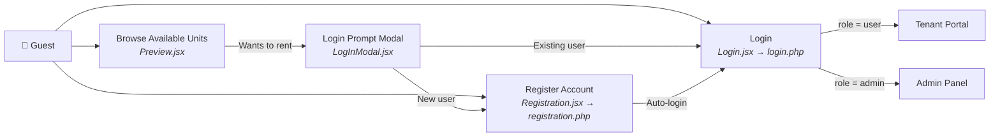

---

### 2.3 Tenant Use Cases

```mermaid
flowchart TB
    Tenant["👤 Tenant"]

    subgraph "Rent & Lease"
        SubmitApp["Submit Rent Application<br/><i>Upload Valid ID + NBI Clearance</i>"]
        TrackApp["Track Application & Pay Initial"]
        ViewRoom["View My Room & Lease Details"]
        ExtendLease["Extend Lease"]
        MoveOut["Request Move-Out"]
        ViewContract["View Lease Contract"]
    end

    subgraph "Payments"
        PayBills["Pay Monthly Bills"]
        UploadProof["Upload Payment Proof<br/><i>w/ Reference Number</i>"]
        PayHistory["View Payment History & Receipts"]
    end

    subgraph "Service Requests"
        Maintenance["Submit Maintenance Request<br/><i>w/ Photo/Video Attachment</i>"]
        CCTV["Request CCTV Footage"]
        Parking["Reserve Parking Slot<br/><i>Upload OR/CR Document</i>"]
        MyRequests["Track All My Requests<br/><i>Cancel Pending Requests</i>"]
    end

    subgraph "Communication"
        Announcements["View Announcements"]
        Notifications["Notification Center<br/><i>Read / Delete</i>"]
    end

    subgraph "Account"
        Profile["Manage Profile<br/><i>Avatar, Contact, Documents</i>"]
        ChangePass["Change Password"]
    end

    Tenant --> SubmitApp
    Tenant --> TrackApp
    Tenant --> ViewRoom
    Tenant --> ExtendLease
    Tenant --> MoveOut
    Tenant --> ViewContract

    Tenant --> PayBills
    PayBills --> UploadProof
    Tenant --> PayHistory

    Tenant --> Maintenance
    Tenant --> CCTV
    Tenant --> Parking
    Tenant --> MyRequests

    Tenant --> Announcements
    Tenant --> Notifications

    Tenant --> Profile
    Profile --> ChangePass
```

---

### 2.4 Admin Use Cases

```mermaid
flowchart TB
    Admin["👤 Administrator"]

    subgraph "Tenant Lifecycle"
        ReviewApps["Review Rent Applications<br/><i>Approve / Reject with Reason</i>"]
        ManageTenants["Manage Active Tenants<br/><i>Pending Review · Active · Archived</i>"]
        ArchiveTenant["Archive Tenant<br/><i>w/ Reason & Notes</i>"]
        ProcessMoveOut["Process Move-Out Requests"]
    end

    subgraph "Unit Management"
        ManageUnits["Manage Units<br/><i>Status, Assignment, Maintenance Flag</i>"]
        ViewOccupancy["View Occupancy & Lease History"]
        ExtendLease["Extend Tenant Lease"]
    end

    subgraph "Financial Management"
        ManagePayments["Manage Payments<br/><i>Per-Tenant Billing & Settlement</i>"]
        RecordPayment["Record Manual Payment"]
        VerifyProof["Verify Payment Proof"]
        DepositLedger["Security Deposit Tracking"]
    end

    subgraph "Maintenance & Services"
        MaintKanban["Maintenance Kanban Board<br/><i>Approve · Assign · Complete</i>"]
        CostTracking["Maintenance Cost & Budget"]
        ReviewCCTV["Review CCTV Requests<br/><i>Approve / Reject</i>"]
        ReviewParking["Review Parking Reservations<br/><i>Assign / Reject</i>"]
        ToggleServices["Toggle Service Modules<br/><i>Persist to system_settings</i>"]
    end

    subgraph "Contracts"
        GenerateContract["Generate Lease Contract"]
        UploadSigned["Upload Signed / Notarized Lease"]
        EvictionTracking["Eviction Status Tracking"]
    end

    subgraph "Communication"
        CreateAnnouncement["Create Announcement<br/><i>Auto-notify All Tenants</i>"]
    end

    subgraph "Reporting & Audit"
        GenReports["Generate Reports<br/><i>Financial · Occupancy · Maintenance<br/>Income · Revenue Streams</i>"]
        ActivityLogs["View Activity Logs"]
        SysSettings["Configure System Settings"]
    end

    Admin --> ReviewApps
    Admin --> ManageTenants
    ManageTenants --> ArchiveTenant
    ManageTenants --> ProcessMoveOut

    Admin --> ManageUnits
    ManageUnits --> ViewOccupancy
    ManageUnits --> ExtendLease

    Admin --> ManagePayments
    ManagePayments --> RecordPayment
    ManagePayments --> VerifyProof
    ManagePayments --> DepositLedger

    Admin --> MaintKanban
    MaintKanban --> CostTracking
    Admin --> ReviewCCTV
    Admin --> ReviewParking
    Admin --> ToggleServices

    Admin --> GenerateContract
    GenerateContract --> UploadSigned
    GenerateContract --> EvictionTracking

    Admin --> CreateAnnouncement
    Admin --> GenReports
    Admin --> ActivityLogs
    Admin --> SysSettings
```

---

## 3. Data Flow Diagrams (DFD)

### 3.1 Context Diagram (Level 0)

> Shows the AMS as a single process with external entities (actors) and the data flows between them.

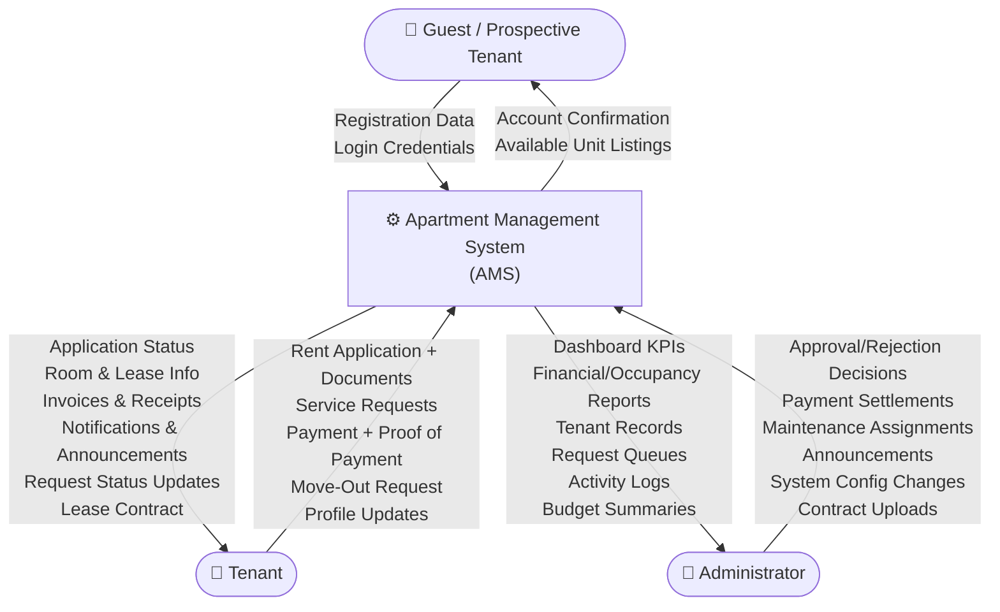

---

### 3.2 Level 1 — Core System Processes

> Decomposition of the AMS into its major functional subsystems and the data stores they interact with.

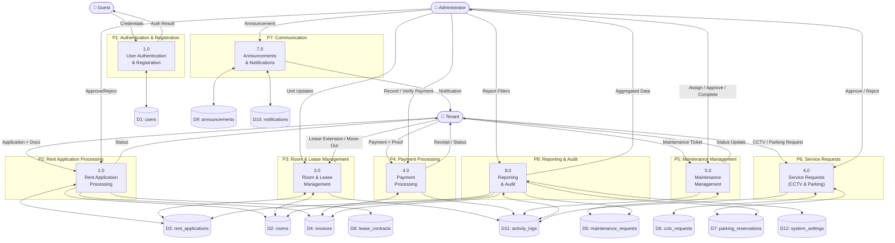

---

### 3.3 Level 2 — Rent Application Flow

> Detailed decomposition of Process 2.0: from tenant application submission through admin review to room assignment and initial invoice generation.

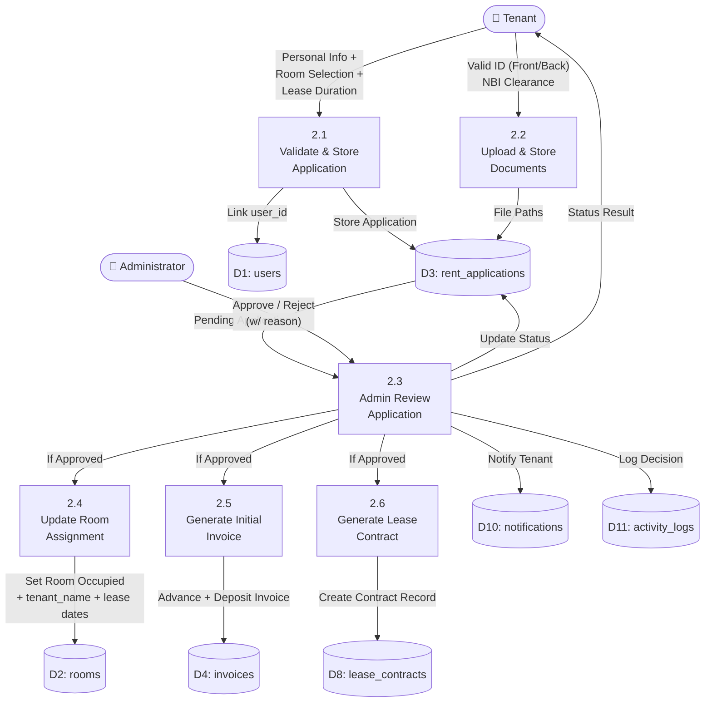

---

### 3.4 Level 2 — Payment Processing Flow

> Detailed decomposition of Process 4.0: tenant bill payment, proof upload, admin verification, and receipt generation.

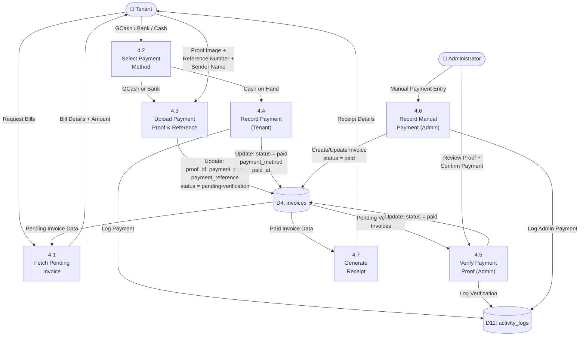

---

### 3.5 Level 2 — Maintenance Request Flow

> Detailed decomposition of Process 5.0: from tenant ticket submission through admin triage, approval, assignment, and completion with cost tracking.

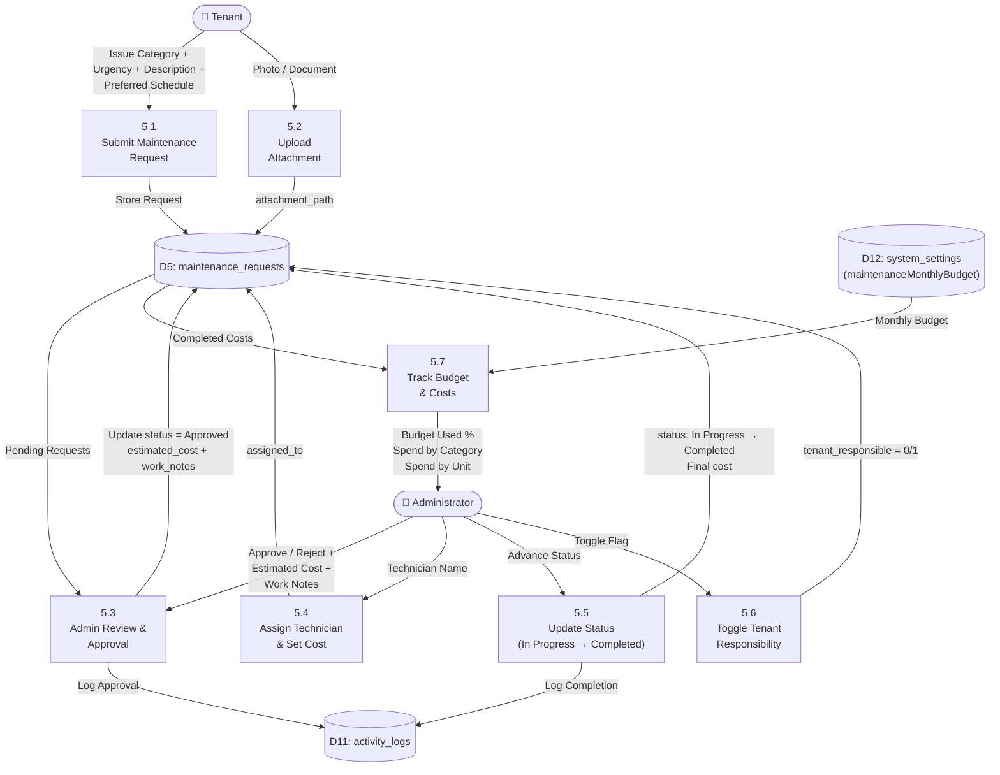

---

### 3.6 Level 2 — Service Request Flow (CCTV & Parking)

> Detailed decomposition of Process 6.0: CCTV footage requests and parking reservation management.

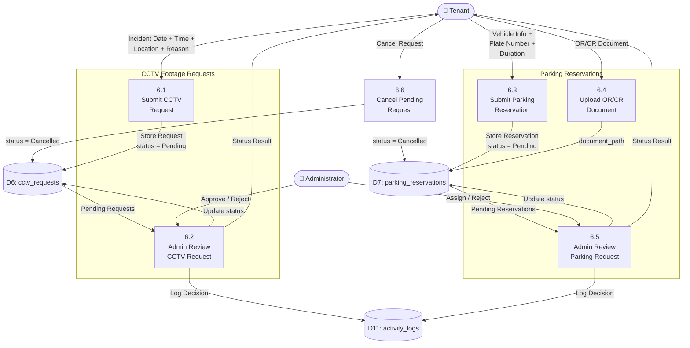

---

> **Note:** All diagrams reflect the current live state of the AMS system as of August 2026. The ERD matches the actual `SetupDB.sql` schema. Use case and data flow diagrams cover all implemented features including DB-wired maintenance, CCTV, parking, payment proof uploads, and move-out requests.
