# AMS — System Diagrams

> **Document Version:** 2.0 — September 2026
> **Stack:** React 19 (Vite 8) SPA → plain PHP 8 endpoints → MariaDB 10.4 (XAMPP); Node Socket.IO sidecar for chat
> **Database:** `ams_db` — 31 tables in `backend/api/migrations/SetupDB.sql` (including chat `messages`)
> **Source of truth:** the schema file and `backend/config.php`. [`database_schema.md`](database_schema.md) explains each table in prose; if a diagram and the code disagree, the code wins.

---

## Table of Contents

1. [Entity Relationship Diagram (ERD)](#1-entity-relationship-diagram-erd)
   - 1.1 [Overview — all entities and relationships](#11-overview--all-entities-and-relationships)
   - 1.2 [Identity, Property & Leasing](#12-identity-property--leasing)
   - 1.3 [Billing & Payments](#13-billing--payments)
   - 1.4 [Requests & Services](#14-requests--services)
   - 1.5 [Leads & Visitors](#15-leads--visitors)
   - 1.6 [Communication](#16-communication)
   - 1.7 [Audit, Settings & Auth Support](#17-audit-settings--auth-support)
   - 1.8 [Relationship reference](#18-relationship-reference)
2. [Use Case Diagrams](#2-use-case-diagrams)
   - 2.1 [Actors](#21-actors)
   - 2.2 [System-wide overview](#22-system-wide-overview)
   - 2.3 [Guest](#23-guest)
   - 2.4 [Applicant (registered, no unit yet)](#24-applicant-registered-no-unit-yet)
   - 2.5 [Tenant](#25-tenant)
   - 2.6 [Administrator — leasing & tenancy](#26-administrator--leasing--tenancy)
   - 2.7 [Administrator — operations, finance & system](#27-administrator--operations-finance--system)
   - 2.8 [System actors (scheduler & gateways)](#28-system-actors-scheduler--gateways)
3. [Data Flow Diagrams (DFD)](#3-data-flow-diagrams-dfd)
   - 3.0 [Notation and data stores](#30-notation-and-data-stores)
   - 3.1 [Context diagram (Level 0)](#31-context-diagram-level-0)
   - 3.2 [Level 1 — core processes](#32-level-1--core-processes)
   - 3.3 [Level 2 — 2.0 Leads & rent applications](#33-level-2--20-leads--rent-applications)
   - 3.4 [Level 2 — 3.0 Tenancy lifecycle](#34-level-2--30-tenancy-lifecycle)
   - 3.5 [Level 2 — 4.0 Billing & payments](#35-level-2--40-billing--payments)
   - 3.6 [Level 2 — 5.0 Maintenance](#36-level-2--50-maintenance)
   - 3.7 [Level 2 — 6.0 Tenant services (CCTV, parking, add-ons)](#37-level-2--60-tenant-services-cctv-parking-add-ons)
   - 3.8 [Level 2 — 7.0 Visitor management](#38-level-2--70-visitor-management)
   - 3.9 [Level 2 — 8.0 Communication & notification delivery](#39-level-2--80-communication--notification-delivery)

---

## 1. Entity Relationship Diagram (ERD)

**Conventions**

- Solid line (`--`): foreign key enforced by the database.
- Dotted line (`..`): soft reference. The column holds the other table's key, but there is no FK constraint (e.g. `room_name` everywhere except `rent_applications`, and every `invoice_id` claim column).
- `users` holds both tenants (`role = 'user'`) and admins (`role = 'admin'`); columns such as `created_by`, `handled_by`, `approved_by`, `recorded_by` point to an admin row.
- Columns added by `ALTER TABLE` further down `SetupDB.sql` (e.g. `invoices.services`, `notifications.status`) are shown on their tables like any other column.

### 1.1 Overview — all entities and relationships

Attributes are omitted here; each domain diagram below shows them.

```mermaid
erDiagram
    USERS ||--o{ SESSIONS : "signs in with"
    USERS ||--o{ RENT_APPLICATIONS : "submits"
    ROOMS ||--o{ RENT_APPLICATIONS : "applied for"
    RENT_APPLICATIONS ||--o| LEASE_CONTRACTS : "produces"
    LEASE_CONTRACTS ||--o{ LEASE_RENEWALS : "extended by"
    RENT_APPLICATIONS ||--o{ HOUSEHOLD_MEMBERS : "houses"

    USERS ||--o{ INVOICES : "billed"
    RENT_APPLICATIONS ||--o{ INVOICES : "tenancy of"
    USERS ||--o{ UTILITY_READINGS : "billed for"
    ROOMS ||..o{ UTILITY_READINGS : "metered"

    USERS ||--o{ MAINTENANCE_REQUESTS : "files"
    USERS ||--o{ CCTV_REQUESTS : "files"
    USERS ||--o{ PARKING_RESERVATIONS : "reserves"
    PARKING_RESERVATIONS ||--o{ PARKING_CHARGES : "billed monthly"
    SERVICE_CATALOG ||--o{ SERVICE_REQUESTS : "priced by"
    USERS ||--o{ SERVICE_REQUESTS : "books"

    INVOICES ||..o{ PARKING_CHARGES : "carries"
    INVOICES ||..o{ SERVICE_REQUESTS : "carries"
    INVOICES ||..o{ MAINTENANCE_REQUESTS : "carries recharge"
    INVOICES ||..o{ UTILITY_READINGS : "carries"

    USERS |o--o{ INQUIRIES : "files"
    INQUIRIES |o--o{ UNIT_RESERVATIONS : "converts to hold"
    INQUIRIES |o--o{ UNIT_WAITLIST : "waits via"
    ROOMS ||..o{ UNIT_RESERVATIONS : "held"
    ROOMS ||..o{ UNIT_WAITLIST : "awaited"
    USERS |o--o{ VISITOR_LOGS : "hosts"
    ROOMS ||..o{ VISITOR_LOGS : "visited"

    USERS ||--o{ NOTIFICATIONS : "receives"
    USERS ||--o{ NOTIFICATION_PREFERENCES : "sets"
    USERS ||--o{ NOTIFICATION_QUEUE : "queued for"
    USERS |o--o{ NOTIFICATION_LOG : "delivered to"
    USERS ||--o{ MESSAGES : "sends / receives"

    USERS |o--o{ ACTIVITY_LOGS : "performs"
    USERS |o..o{ EXPENSES : "records"

    ANNOUNCEMENTS
    SYSTEM_SETTINGS
    LOGIN_ATTEMPTS
    PASSWORD_RESETS
    PASSWORD_RESET_REQUESTS
```

`ANNOUNCEMENTS`, `SYSTEM_SETTINGS` and the three auth-throttle tables have no foreign keys. An announcement becomes `notifications` and `notification_queue` rows when it is sent (see [3.9](#39-level-2--80-communication--notification-delivery)); the throttle tables are keyed by email and IP, not by user id.

### 1.2 Identity, Property & Leasing

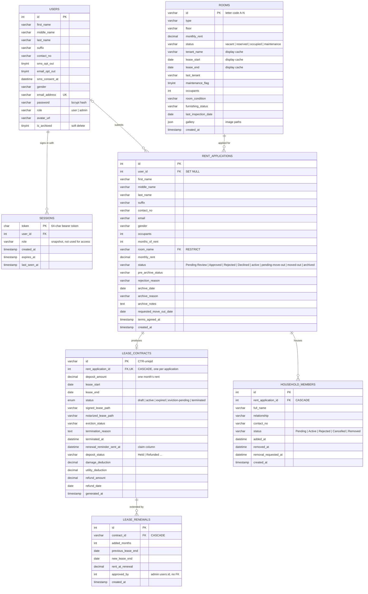

### 1.3 Billing & Payments

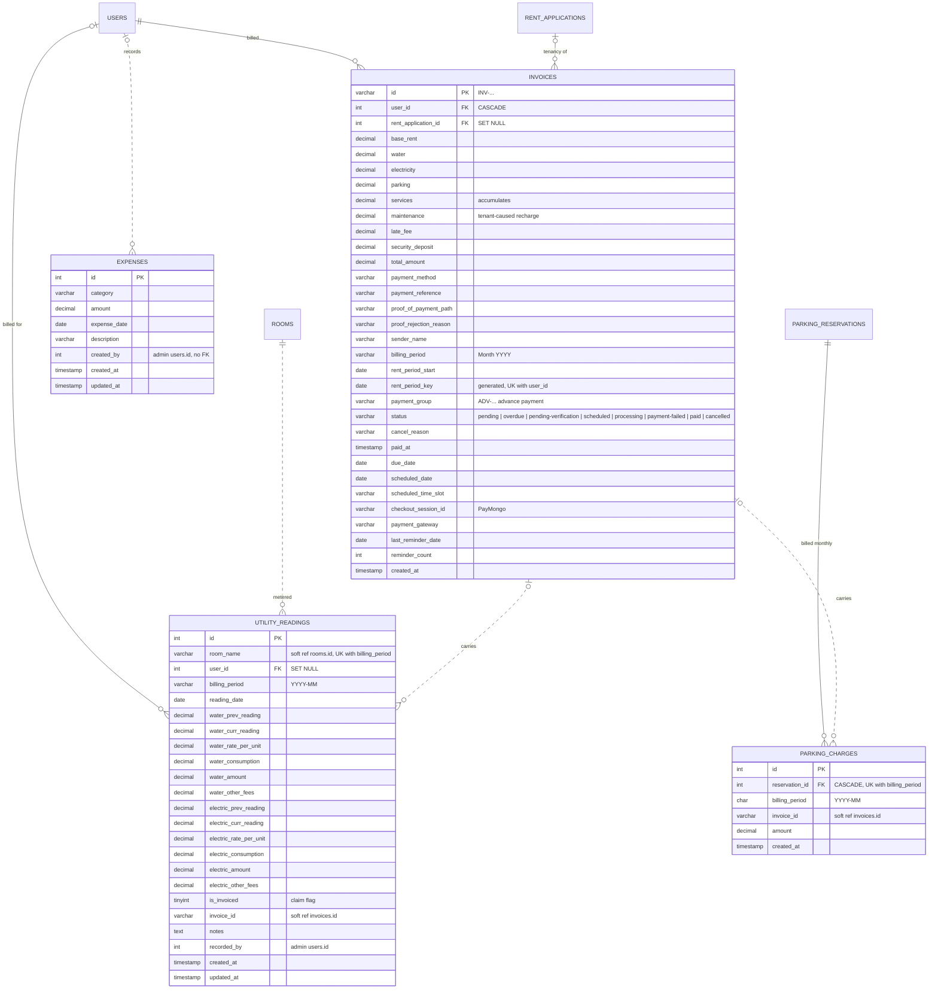

`expenses` has no link to invoices. Reports add it to the maintenance cost taken from `maintenance_requests`.

### 1.4 Requests & Services

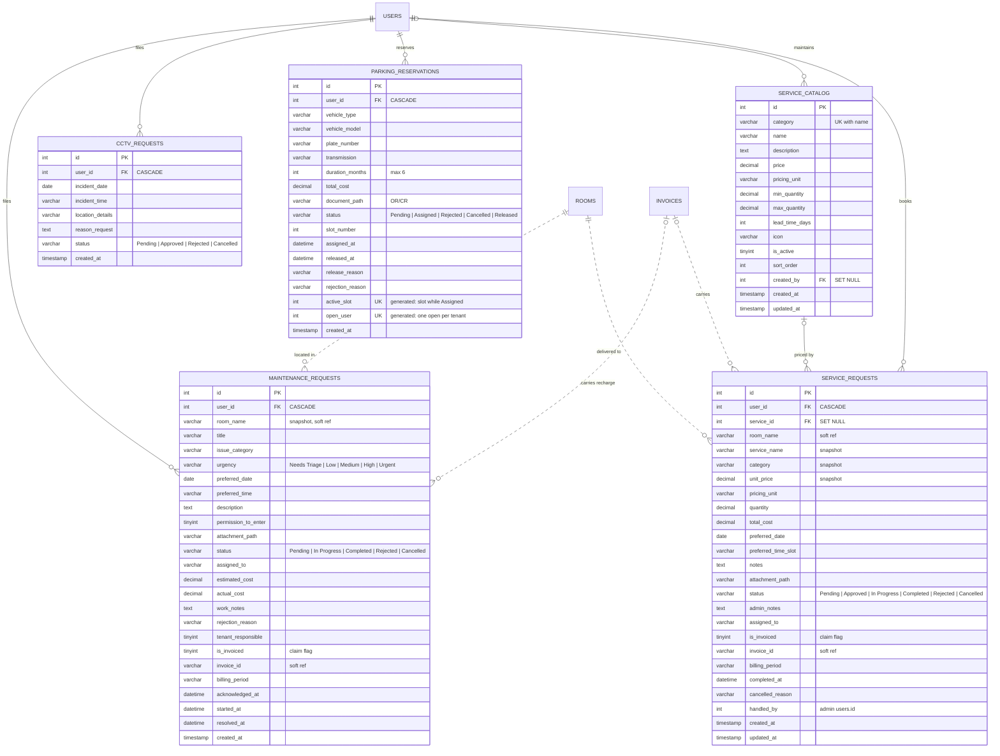

### 1.5 Leads & Visitors

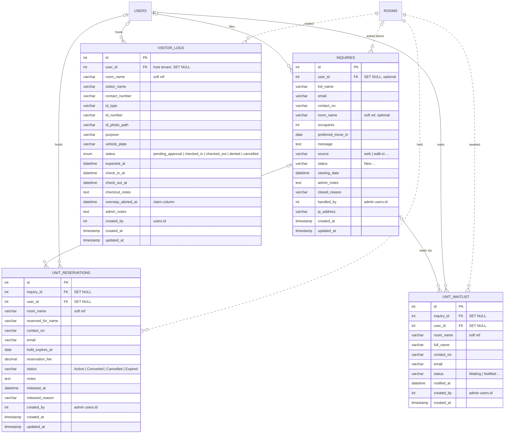

`overstayed` is computed when visitor rows are read; it is never stored as a status.

### 1.6 Communication

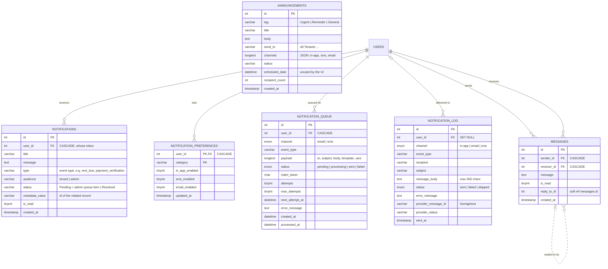

There is no `conversations` table: a chat thread is every `messages` row between two users.

### 1.7 Audit, Settings & Auth Support

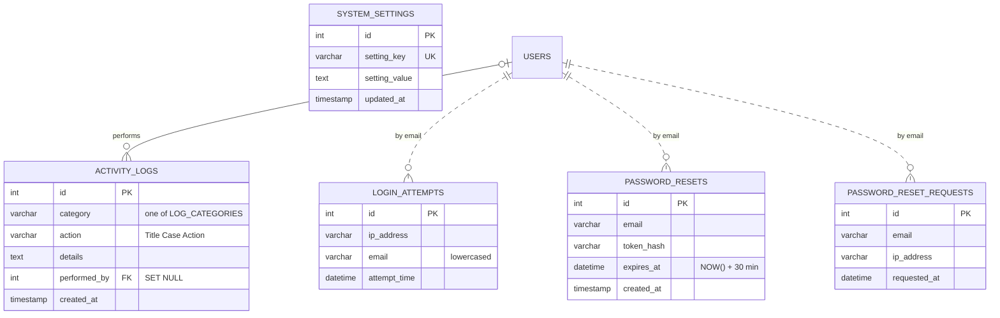

### 1.8 Relationship reference

| Parent → Child | Via | Cardinality | Enforced | On delete |
|---|---|---|---|---|
| users → sessions | `user_id` | 1 : N | FK | CASCADE |
| users → rent_applications | `user_id` | 0..1 : N | FK | SET NULL |
| rooms → rent_applications | `room_name` | 1 : N | FK | RESTRICT |
| rent_applications → lease_contracts | `rent_application_id` (unique) | 1 : 0..1 | FK | CASCADE |
| lease_contracts → lease_renewals | `contract_id` | 1 : N | FK | CASCADE |
| rent_applications → household_members | `rent_application_id` | 1 : N | FK | CASCADE |
| users → invoices | `user_id` | 1 : N | FK | CASCADE |
| rent_applications → invoices | `rent_application_id` | 0..1 : N | FK | SET NULL |
| users → utility_readings | `user_id` | 0..1 : N | FK | SET NULL |
| users → maintenance_requests / cctv_requests / parking_reservations / service_requests | `user_id` | 1 : N | FK | CASCADE |
| parking_reservations → parking_charges | `reservation_id` | 1 : N (one per month) | FK | CASCADE |
| service_catalog → service_requests | `service_id` | 0..1 : N | FK | SET NULL |
| users → service_catalog | `created_by` | 0..1 : N | FK | SET NULL |
| users → inquiries / unit_reservations / unit_waitlist / visitor_logs | `user_id` | 0..1 : N | FK | SET NULL |
| inquiries → unit_reservations / unit_waitlist | `inquiry_id` | 0..1 : N | FK | SET NULL |
| users → notifications / notification_preferences / notification_queue | `user_id` | 1 : N | FK | CASCADE |
| users → notification_log | `user_id` | 0..1 : N | FK | SET NULL |
| users → messages | `sender_id`, `receiver_id` | 1 : N (each) | FK | CASCADE |
| users → activity_logs | `performed_by` | 0..1 : N | FK | SET NULL |
| rooms → utility_readings / maintenance_requests / service_requests / visitor_logs / inquiries / unit_reservations / unit_waitlist | `room_name` | 1 : N | soft | — |
| invoices → utility_readings / parking_charges / maintenance_requests / service_requests | `invoice_id` | 0..1 : N | soft | — |
| users (admin) → lease_renewals, expenses, inquiries, unit_reservations, unit_waitlist, service_requests, utility_readings, visitor_logs | `approved_by` / `created_by` / `handled_by` / `recorded_by` | 0..1 : N | soft | — |

---

## 2. Use Case Diagrams

Mermaid has no UML use-case type, so these diagrams are flowcharts. Actors are rectangles. Use cases are ovals inside a box that stands for the system boundary. A dotted arrow labelled «include» is a step the base use case always performs; one labelled «extend» is optional.

### 2.1 Actors

| Actor | Who | How the system tells them apart |
|---|---|---|
| **Guest** | Anyone not signed in | No session token |
| **Applicant** | Signed-in user with no active tenancy | `role = 'user'`, no `Approved`/`active`/`pending-move-out` application; `ProtectedRoute` pages only |
| **Tenant** | Signed-in user with a unit | `role = 'user'` + active tenancy; unlocks `TenantProtectedRoute` pages |
| **Administrator** | Property staff | `role = 'admin'`; every admin endpoint calls `require_admin()` |
| **Scheduler** | Windows Task Scheduler | Runs `backend/cron/daily_sweep.php` and `process_queue.php` (`run_queue.bat`) |
| **PayMongo** | Online payment gateway | Hosted checkout + `paymongo_webhook.php` |
| **Semaphore / SMTP** | SMS and email providers | Called by the notification queue drain |

A Tenant can do everything an Applicant can; an Applicant can do everything a Guest can once signed out.

### 2.2 System-wide overview

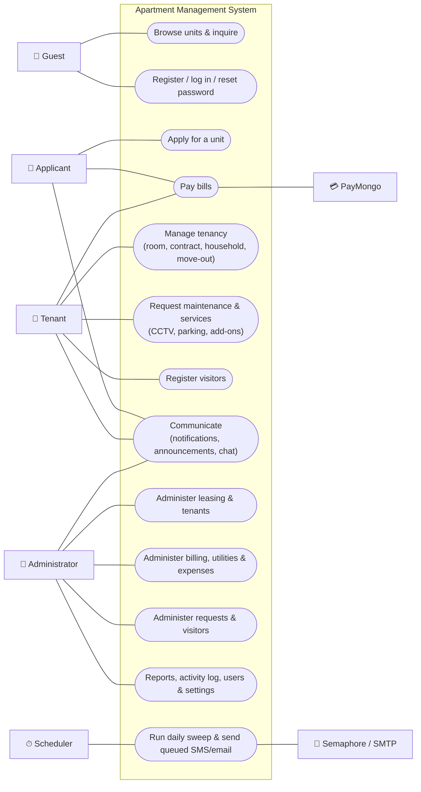

### 2.3 Guest

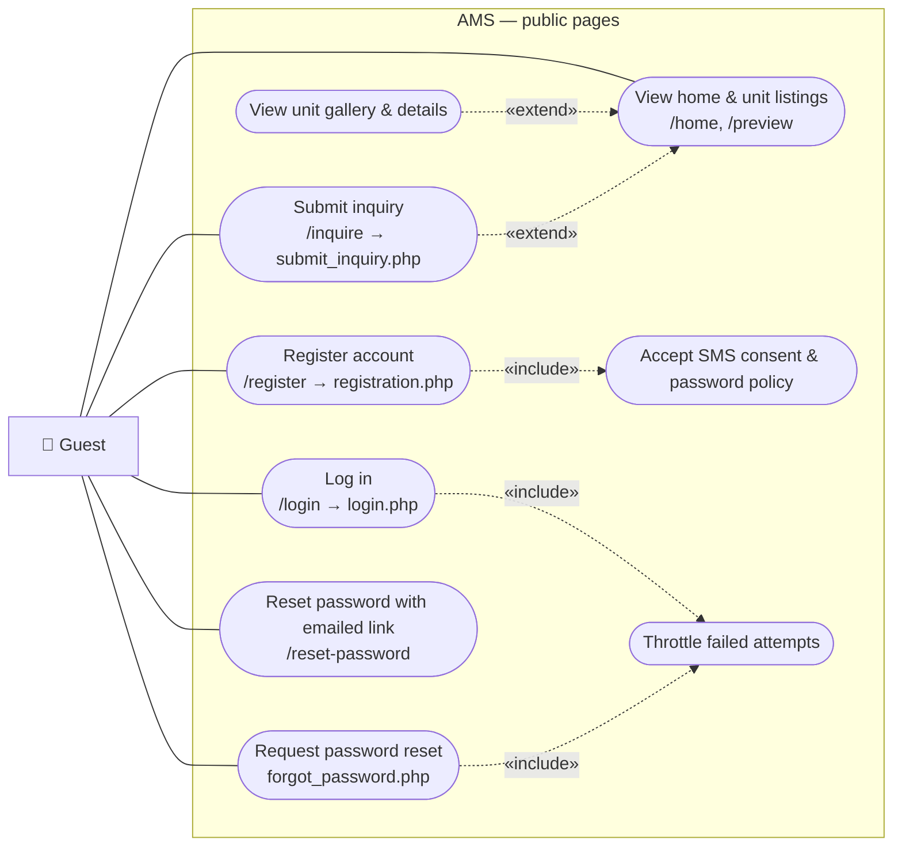

### 2.4 Applicant (registered, no unit yet)

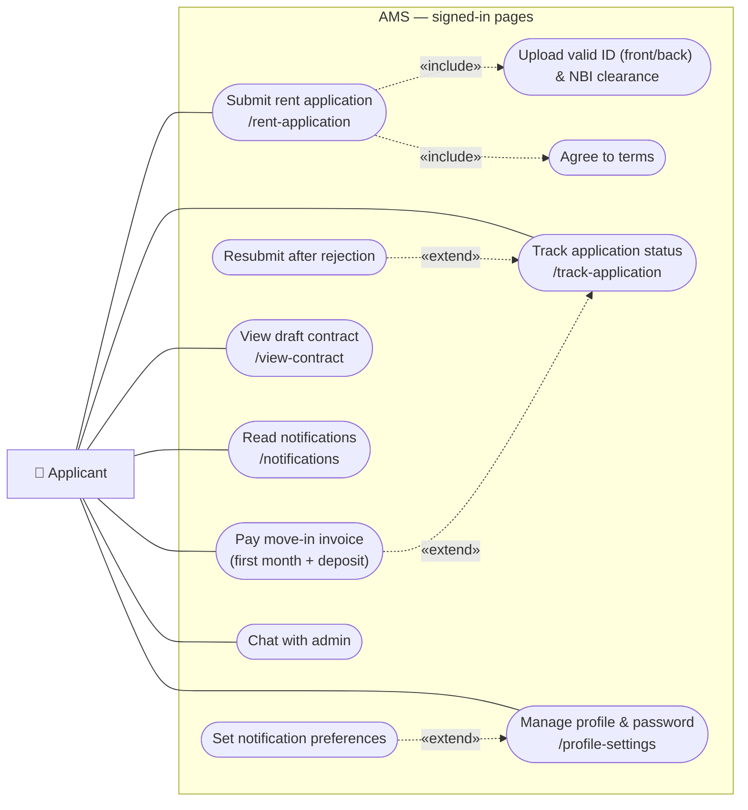

Paying the move-in invoice turns the Applicant into a Tenant: `settle_invoice()` sets the application to `active`, the contract from `draft` to `active` and fixes the room's lease dates.

### 2.5 Tenant

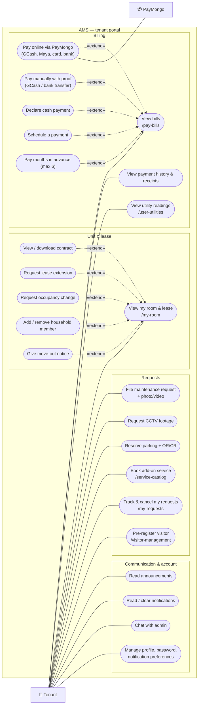

Service pages respect the admin's service toggles in `system_settings`; a disabled module is hidden and its endpoint refuses new requests.

### 2.6 Administrator — leasing & tenancy

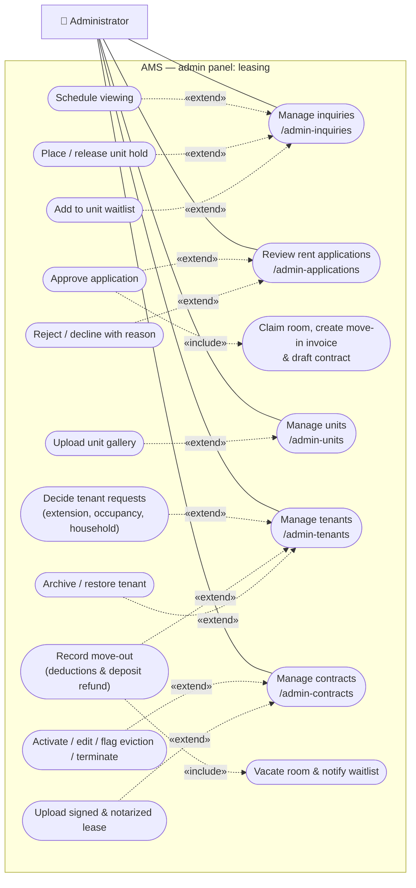

### 2.7 Administrator — operations, finance & system

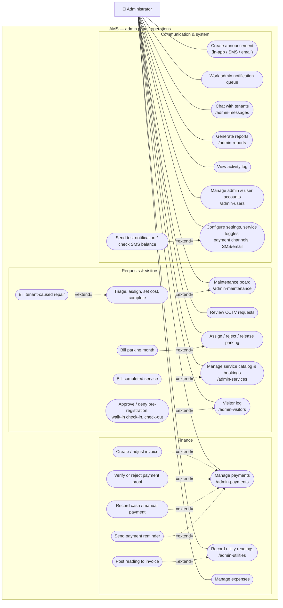

Every admin write above also calls `log_activity()`, which records it in the activity log. That step is left out of the diagram.

### 2.8 System actors (scheduler & gateways)

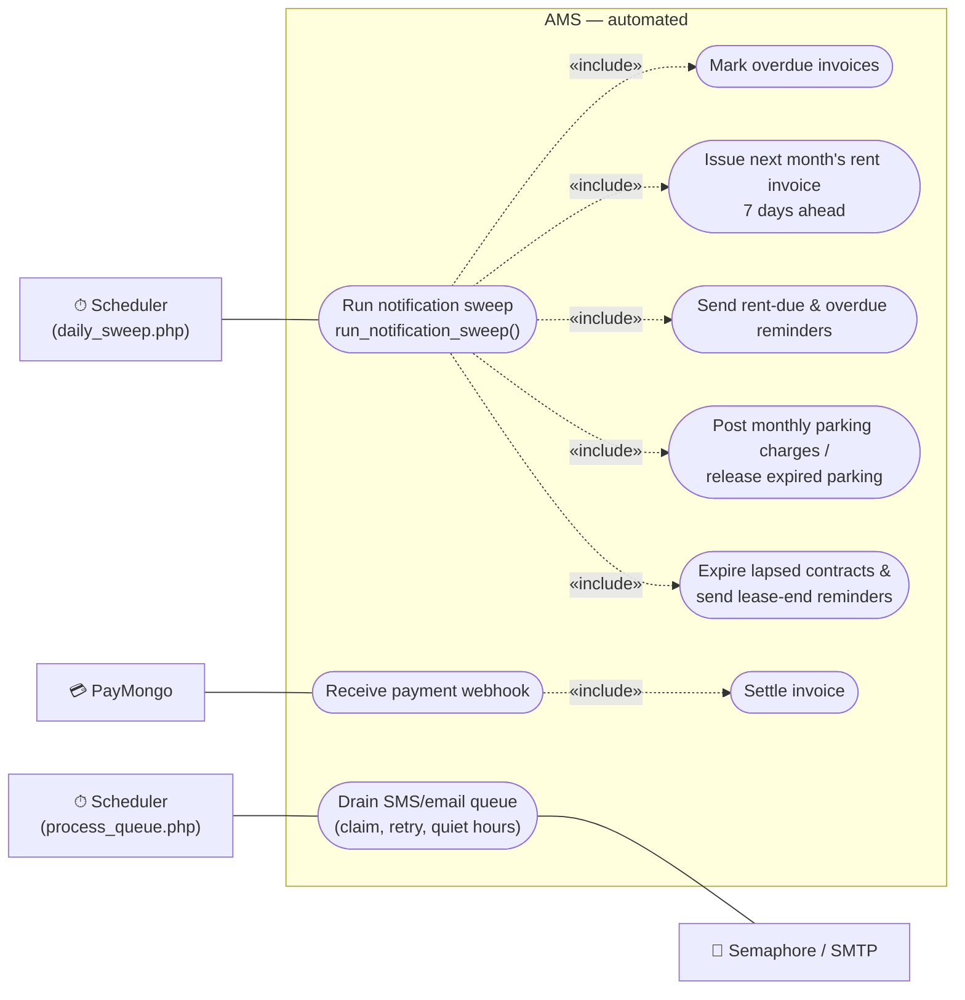

The sweep also runs at most once a day when a user's notification poll happens to trigger it (claimed through `system_settings.notification_sweep_last_run`), so reminders still go out if the scheduled task is not installed.

---

## 3. Data Flow Diagrams (DFD)

### 3.0 Notation and data stores

| Shape | Meaning |
|---|---|
| `[ Rectangle ]` | External entity |
| `( Rounded, numbered )` | Process |
| `[( Cylinder )]` | Data store |
| Arrow label | Data flowing in that direction |

The Level 1 and Level 2 diagrams share these data stores:

| Store | Tables / location |
|---|---|
| D1 Users | `users` |
| D2 Auth | `sessions`, `login_attempts`, `password_resets`, `password_reset_requests` |
| D3 Rooms | `rooms` |
| D4 Leads | `inquiries`, `unit_reservations`, `unit_waitlist` |
| D5 Applications | `rent_applications` |
| D6 Household | `household_members` |
| D7 Contracts | `lease_contracts`, `lease_renewals` |
| D8 Invoices | `invoices` |
| D9 Utilities | `utility_readings` |
| D10 Parking | `parking_reservations`, `parking_charges` |
| D11 Maintenance | `maintenance_requests` |
| D12 CCTV | `cctv_requests` |
| D13 Services | `service_catalog`, `service_requests` |
| D14 Visitors | `visitor_logs` |
| D15 Announcements | `announcements` |
| D16 Notifications | `notifications` (tenant inbox + admin queue) |
| D17 Delivery | `notification_queue`, `notification_log`, `notification_preferences` |
| D18 Messages | `messages` |
| D19 Activity log | `activity_logs` |
| D20 Settings | `system_settings` |
| D21 Expenses | `expenses` |
| F1 Uploads | `backend/uploads/` (IDs, proofs, attachments, leases, gallery) |

### 3.1 Context diagram (Level 0)

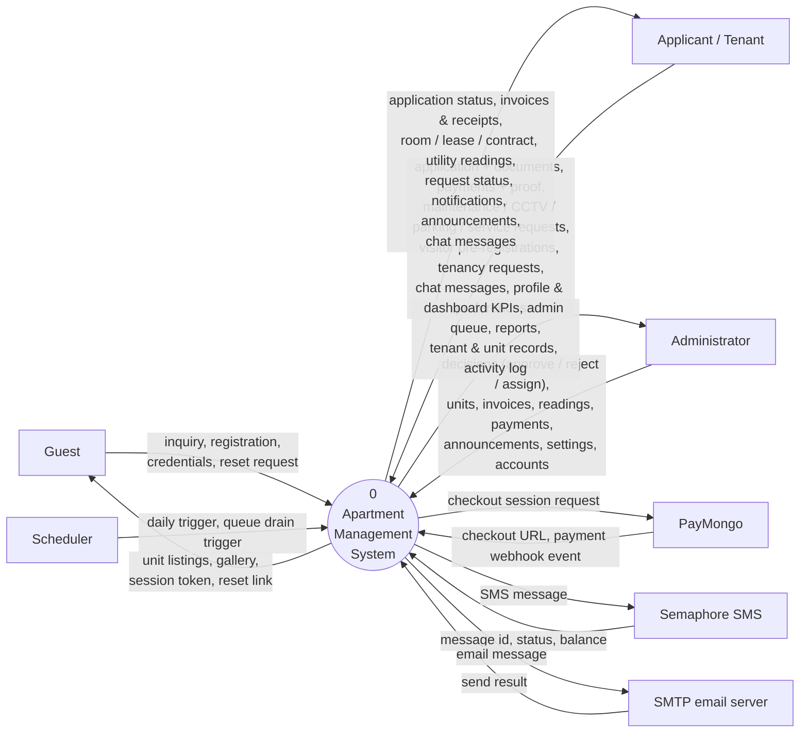

### 3.2 Level 1 — core processes

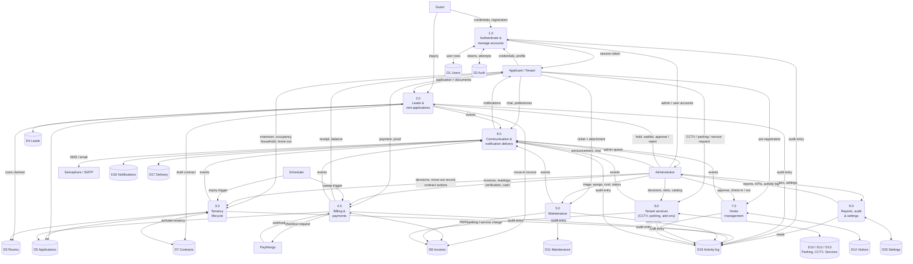

Process 9.0 reads from almost every store (D3, D5, D8, D9, D11, D13, D21) to build reports; those read-only flows are omitted to keep the diagram legible.

### 3.3 Level 2 — 2.0 Leads & rent applications

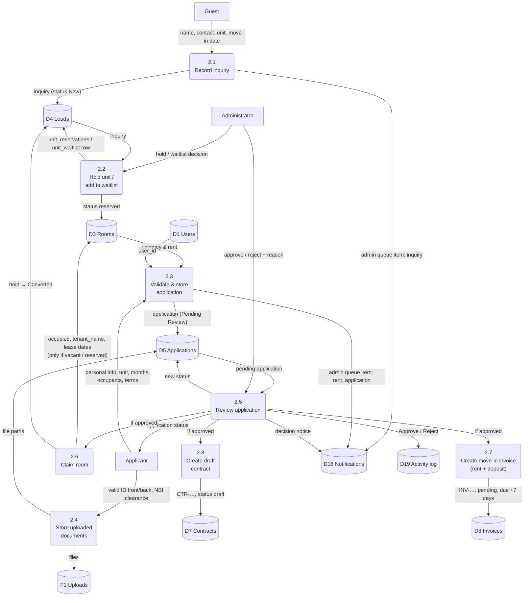

The approval writes in 2.6–2.8 run in one transaction. If another approval already claimed the room, the whole approval fails and nothing is written.

### 3.4 Level 2 — 3.0 Tenancy lifecycle

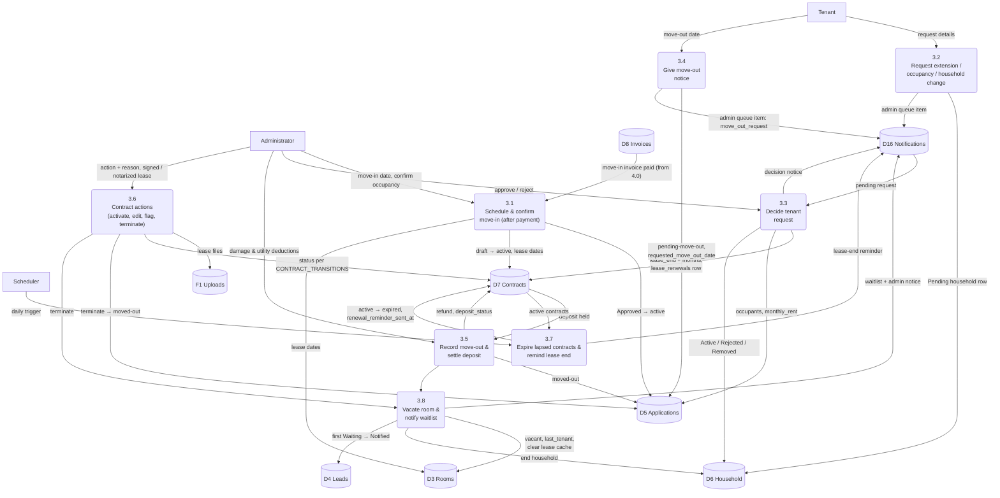

Archiving a tenant (`archive_tenant.php`) follows the same vacate path and saves `pre_archive_status` so `restore_tenant.php` can undo it.

### 3.5 Level 2 — 4.0 Billing & payments

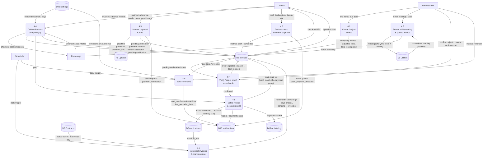

An invoice counts as still owed while its status is in `BILLING_OPEN_STATUSES` (`pending`, `unpaid`, `overdue`, `pending-verification`, `scheduled`, `processing`, `payment-failed`).

### 3.6 Level 2 — 5.0 Maintenance

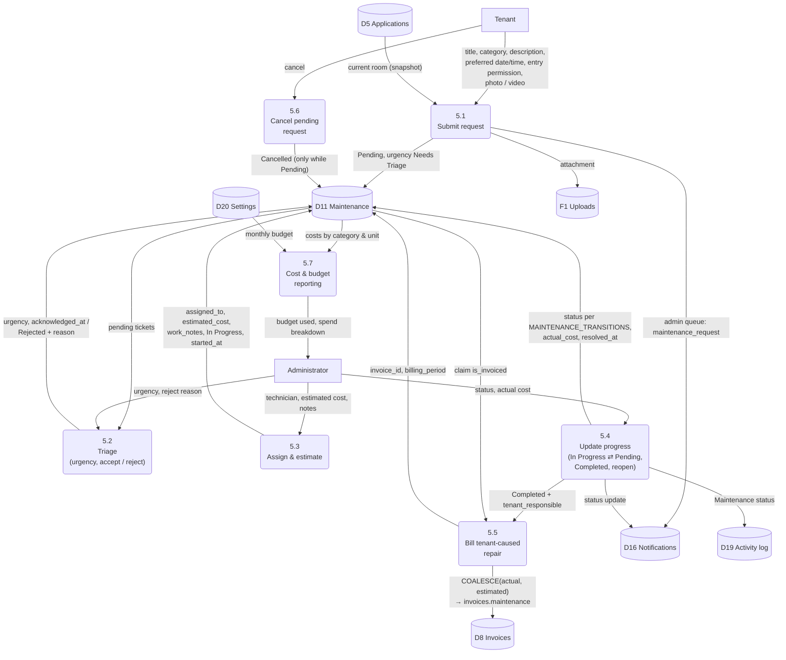

Clearing `tenant_responsible` or reopening the ticket reverses the recharge, but only while the invoice it went to is unpaid.

### 3.7 Level 2 — 6.0 Tenant services (CCTV, parking, add-ons)

```mermaid
flowchart TB
    Tenant["Tenant"]
    Admin["Administrator"]
    Sched["Scheduler"]

    subgraph CCTV["CCTV footage"]
        P61("6.1<br/>Request footage")
        P62("6.2<br/>Approve / reject")
    end

    subgraph Parking["Parking"]
        P63("6.3<br/>Reserve slot<br/>+ OR/CR")
        P64("6.4<br/>Assign slot / reject /<br/>release")
        P65("6.5<br/>Post monthly<br/>parking charge")
    end

    subgraph Addon["Add-on services"]
        P66("6.6<br/>Maintain catalog")
        P67("6.7<br/>Book service")
        P68("6.8<br/>Process booking")
        P69("6.9<br/>Bill completed<br/>service")
    end

    P60("6.0.1<br/>Cancel own<br/>pending request")

    D8[("D8 Invoices")]
    D10[("D10 Parking")]
    D12[("D12 CCTV")]
    D13[("D13 Services")]
    D16[("D16 Notifications")]
    D20[("D20 Settings")]
    F1[("F1 Uploads")]

    Tenant -->|"incident date/time, location, reason"| P61
    D20 -->|"service enabled?"| P61
    P61 -->|"Pending"| D12
    P61 -->|"admin queue: cctv_request"| D16
    Admin -->|"decision"| P62
    D12 -->|"pending"| P62
    P62 -->|"Approved / Rejected"| D12
    P62 -->|"decision notice"| D16

    Tenant -->|"vehicle, plate, transmission,<br/>months, OR/CR"| P63
    D20 -->|"allowed vehicle types,<br/>max slots, rate"| P63
    P63 -->|"OR/CR file"| F1
    P63 -->|"Pending (one open per tenant)"| D10
    P63 -->|"admin queue: parking_reservation"| D16
    Admin -->|"slot / reason"| P64
    P64 -->|"Assigned + slot (unique) /<br/>Rejected / Released"| D10
    P64 -->|"decision notice"| D16
    Sched -->|"daily trigger"| P65
    Admin -->|"Bill this month"| P65
    D10 -->|"Assigned reservations"| P65
    P65 -->|"parking_charges row<br/>(UNIQUE reservation + month)"| D10
    P65 -->|"invoices.parking"| D8

    Admin -->|"name, price, unit, lead time, active"| P66
    P66 --> D13
    D13 -->|"active catalog"| Tenant
    Tenant -->|"service, quantity, date/slot,<br/>notes, attachment"| P67
    P67 -->|"price & name snapshot, Pending"| D13
    P67 -->|"admin queue: service_request"| D16
    Admin -->|"approve, assign, progress"| P68
    P68 -->|"status per SERVICE_TRANSITIONS"| D13
    P68 -->|"status notice"| D16
    P68 -->|"Completed"| P69
    P69 -->|"claim is_invoiced"| D13
    P69 -->|"invoices.services"| D8

    Tenant -->|"cancel"| P60
    P60 -->|"Cancelled"| D12
    P60 -->|"Cancelled"| D10
    P60 -->|"Cancelled"| D13
```

### 3.8 Level 2 — 7.0 Visitor management

```mermaid
flowchart TB
    Tenant["Tenant"]
    Admin["Administrator"]

    P71("7.1<br/>Pre-register<br/>visitor")
    P72("7.2<br/>Approve / deny<br/>pre-registration")
    P73("7.3<br/>Walk-in<br/>check-in")
    P74("7.4<br/>Check out")
    P75("7.5<br/>Detect overstay")
    P76("7.6<br/>Cancel own<br/>pre-registration")

    D3[("D3 Rooms")]
    D14[("D14 Visitors")]
    D16[("D16 Notifications")]
    F1[("F1 Uploads")]

    Tenant -->|"visitor name, contact, purpose,<br/>expected time, vehicle, ID"| P71
    D3 -->|"host room"| P71
    P71 -->|"ID photo"| F1
    P71 -->|"pending_approval"| D14
    P71 -->|"admin queue: visitor_registration"| D16

    Admin -->|"approve / deny + notes"| P72
    D14 -->|"pending"| P72
    P72 -->|"checked_in + check_in_at / denied"| D14
    P72 -->|"decision notice"| Tenant

    Admin -->|"visitor details, host unit, ID photo"| P73
    P73 -->|"ID photo"| F1
    P73 -->|"checked_in"| D14

    Admin -->|"checkout notes"| P74
    P74 -->|"checked_out, check_out_at"| D14

    D14 -->|"checked_in past allowed stay"| P75
    P75 -->|"overstay_alerted_at (once)"| D14
    P75 -->|"visitor_overstay → admin & host"| D16

    Tenant -->|"cancel"| P76
    P76 -->|"cancelled"| D14
```

### 3.9 Level 2 — 8.0 Communication & notification delivery

```mermaid
flowchart TB
    Tenant["Applicant / Tenant"]
    Admin["Administrator"]
    Drain["Scheduler<br/>(process_queue.php)"]
    SMS["Semaphore SMS"]
    Mail["SMTP email"]
    Sock["Socket.IO server<br/>(:3001)"]

    Events["Events from<br/>2.0 – 7.0"]

    P81("8.1<br/>Create<br/>announcement")
    P82("8.2<br/>Create notification<br/>create_notification()")
    P83("8.3<br/>Check channel<br/>permission")
    P84("8.4<br/>Enqueue<br/>SMS / email")
    P85("8.5<br/>Drain queue<br/>(claim, send, retry)")
    P86("8.6<br/>Work admin queue<br/>(resolve item)")
    P87("8.7<br/>Read / clear<br/>notifications")
    P88("8.8<br/>Chat")

    D1[("D1 Users")]
    D15[("D15 Announcements")]
    D16[("D16 Notifications")]
    D17[("D17 Delivery")]
    D18[("D18 Messages")]
    D20[("D20 Settings")]

    Admin -->|"tag, title, body,<br/>audience, channels"| P81
    P81 -->|"announcement, recipient_count"| D15
    P81 -->|"per recipient"| P82
    Events -->|"event type, user, title,<br/>message, record id"| P82

    P82 -->|"inbox row (Pending only for<br/>admin-queue types, else Resolved)"| D16
    P82 --> P83
    D1 -->|"contact, sms/email opt-out"| P83
    D17 -->|"per-category preferences"| P83
    D20 -->|"building-wide channel switches,<br/>daily SMS cap"| P83
    P83 -->|"allowed channels"| P84
    P83 -->|"skipped + reason"| D17
    P84 -->|"notification_queue row (pending)"| D17

    Drain -->|"every few minutes"| P85
    D17 -->|"due pending jobs"| P85
    P85 -->|"claim_token, attempts,<br/>sent / failed, log row"| D17
    P85 -->|"SMS"| SMS
    SMS -->|"message_id, status"| P85
    P85 -->|"email"| Mail

    D16 -->|"Pending admin-queue items"| P86
    Admin -->|"act on request"| P86
    P86 -->|"Resolved"| D16

    D16 -->|"my notifications (polled)"| P87
    Tenant -->|"mark read, delete, clear all"| P87
    P87 -->|"is_read / delete"| D16

    Tenant -->|"message"| P88
    Admin -->|"message"| P88
    P88 <-->|"real-time relay"| Sock
    P88 <-->|"history, is_read, reply_to_id"| D18
```

Notification types that are not in `NOTIFICATION_PREF_CATEGORIES` (e.g. overdue alerts, application decisions, contract notices) ignore the per-category switches in 8.3. Only the global opt-outs and the building-wide switches can stop them.

---

> **Note:** These diagrams reflect `SetupDB.sql` and `backend/config.php` as of September 2026. When a migration adds a table or column, or a status transition map in `config.php` changes, update the matching ERD section and DFD process here in the same change.
