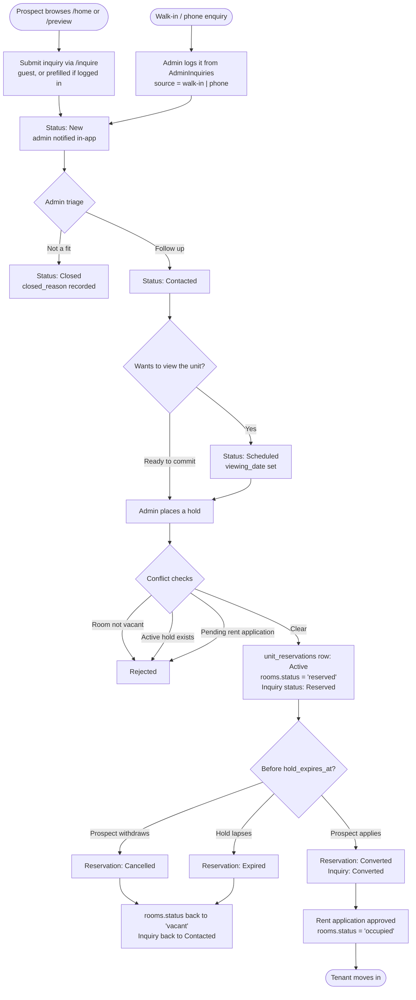

# Inquiry & Reservation Management — Design

> **Module:** 1.8 — Inquiry Handling & Reservation Tracking
> **Status:** ✅ Implemented
> **Last Updated:** September 2026

---

## 1. Purpose

Before this module, a prospective tenant's only path into the system was:
browse `/preview` → **Rent Now** → forced registration → a full rent application
requiring Valid ID front/back and NBI Clearance uploads. There was no way to
simply ask a question, and no way for the admin to hold a unit for someone while
they gathered their documents.

This module adds the pre-application stage of the funnel:

```
Inquiry  →  Triage  →  Reservation (unit held)  →  Rent Application  →  Lease
```

It also resolves a long-standing gap: `rooms.status` now genuinely takes the
value `reserved`, which the old PRD and the panelist checklist had specified
but nothing ever set.

---

## 2. Lifecycle



---

## 3. Status vocabulary

Status strings are string-matched in the frontend for badge styling, so changing
a value means grepping the frontend, not just the DB.

| Table | Column | Values |
|---|---|---|
| `inquiries` | `status` | `New`, `Contacted`, `Scheduled`, `Reserved`, `Converted`, `Closed` |
| `inquiries` | `source` | `web`, `walk-in`, `phone` |
| `unit_reservations` | `status` | `Active`, `Converted`, `Expired`, `Cancelled` |
| `rooms` | `status` | `vacant`, `occupied`, `reserved`, `repair` (all lowercase) |

---

## 4. Schema

Created by `2026_09_inquiries_reservations.sql` and
mirrored into `SetupDB.sql`. `submit_inquiry.php` and `get_inquiries.php` also
carry `CREATE TABLE IF NOT EXISTS` blocks, following the self-provisioning
precedent set by `get_utility_readings.php`.

### `inquiries`

| Column | Type | Notes |
|---|---|---|
| `id` | int PK | |
| `user_id` | int NULL | FK → `users.id` ON DELETE SET NULL. **NULL for guests** |
| `full_name`, `email`, `contact_no` | varchar | Required |
| `room_name` | varchar(50) NULL | References `rooms.id` but **deliberately not an FK**, so an inquiry can name no specific unit |
| `occupants`, `preferred_move_in`, `message` | | Optional |
| `source` | varchar(20) | `web` \| `walk-in` \| `phone` |
| `status` | varchar(20) | Default `New` |
| `viewing_date` | datetime NULL | Set when status becomes `Scheduled` |
| `admin_notes`, `closed_reason`, `handled_by` | | Admin triage fields |
| `ip_address` | varchar(45) | Rate limiting only |

### `unit_reservations`

| Column | Type | Notes |
|---|---|---|
| `id` | int PK | |
| `inquiry_id` | int NULL | FK → `inquiries.id` ON DELETE SET NULL |
| `user_id` | int NULL | Carried over from the source inquiry |
| `room_name` | varchar(50) | The held unit |
| `reserved_for_name`, `contact_no`, `email` | | Who the hold is for |
| `hold_expires_at` | date | The hold's expiry |
| `reservation_fee` | decimal(10,2) | Optional, informational |
| `status` | varchar(20) | Default `Active` |
| `released_at`, `released_reason` | | Set on Cancelled / Expired / Converted |

> **One active hold per room** cannot be a partial unique index in MySQL. It is
> enforced in `create_reservation.php` inside a transaction using
> `SELECT ... FOR UPDATE` on the `rooms` row.

### Notifications drift repair

The same migration adds two columns the API has always depended on but that were
missing from `SetupDB.sql` — every notification INSERT writes `status`, and
`get_notifications.php` filters on it:

```sql
ALTER TABLE `notifications` ADD COLUMN IF NOT EXISTS `status` varchar(20) DEFAULT 'Pending';
ALTER TABLE `notifications` ADD COLUMN IF NOT EXISTS `metadata_value` varchar(255) DEFAULT NULL;
```

---

## 5. Endpoints

| File | Auth | Purpose |
|---|---|---|
| `submit_inquiry.php` | **Public** | Create an inquiry. Reads the optional `X-User-Id` header to link an account |
| `get_inquiries.php` | `verify_admin` | Returns `{ inquiries, reservations }`; runs the expiry sweep first |
| `update_inquiry_status.php` | `verify_admin` | Triage transitions, notes, viewing date |
| `create_reservation.php` | `verify_admin` | Places the hold, with all three conflict checks |
| `update_reservation_status.php` | `verify_admin` | `Cancelled` / `Expired` / `Converted` |
| `expire_reservations.php` | `require_admin` (since 2026-11-11) | Manual sweep from the Inquiries page; the same sweep runs in `get_inquiries.php` and `get_rooms.php` |

`release_expired_reservations($conn)` lives in `backend/config.php` next to
`verify_admin` and `log_activity`. It is UPDATE-only and called explicitly from
`get_inquiries.php`, `get_rooms.php`, and `expire_reservations.php` — never on
every request. Because `get_rooms.php` is the public room listing, holds lapse
correctly even with no admin logged in and nothing scheduled.

### Guest-inquiry notification caveat

`notifications.user_id` is `NOT NULL` with an FK to `users`, so a guest inquiry
has no id to attach. `submit_inquiry.php` addresses the admin notification to the
admin account instead (`SELECT id FROM users WHERE role = 'admin' ORDER BY id
LIMIT 1`); the admin view in `get_notifications.php` selects all non-`Resolved`
rows regardless of recipient, so it surfaces correctly.

### Spam controls on the public endpoint

- **Honeypot** — a hidden `website` field. If filled, the endpoint returns
  success without inserting, so the bot learns nothing.
- **Rate limit** — max 3 inquiries per email *or* IP per 24 hours, returning
  HTTP 429. Mirrors the 24-hour guard in `extend_lease.php`. Skipped for admins
  logging walk-ins on someone's behalf.

---

## 6. Conflict checks when placing a hold

`create_reservation.php` runs all three inside one transaction, rolling back on
any failure:

1. The room exists and its status is `vacant` (row locked with `FOR UPDATE`).
2. No other `unit_reservations` row for that room is `Active`.
3. No `rent_applications` row for that room is `Pending Review`.

Check 3 is the resolution to the open question recorded in the 2026-09-16 decisions in `docs/planning/todo.md` and
`system_design.md` FR-4.7 — *"when the current tenant requests an extension but
the room is already reserved."*

Releases use a guarded update so a stale reservation can never clobber an
occupied unit:

```sql
UPDATE rooms SET status = 'vacant' WHERE id = ? AND status = 'reserved'
```

---

## 7. Frontend

| Route | File | Guard | Notes |
|---|---|---|---|
| `/inquire` | `UserPages/InquiryForm.jsx` | **None** (public, `BaseAppLayout` only) | Prefills from session when logged in; i18n EN/TL; JSON POST, no uploads |
| `/admin-inquiries` | `AdminPages/AdminInquiries.jsx` | `AdminProtectedRoute` | Two views (Inquiries / Reservations), triage modal, reserve modal, walk-in logger |

Entry points: an **Inquire** button on every vacant room card in `Preview.jsx`,
and a secondary CTA on `Home.jsx`. The sidebar entry sits in the **Main** section
directly above *Applications*, since it is the earlier stage of the same funnel.

`AdminUnits.jsx` was extended with the `reserved` status in its `counts`,
`filters`, and `getStatusBadge` map — without that, its `map[status] ||
map.vacant` fallback would have silently rendered held units as **Vacant**.

The hold period is admin-configurable via `reservationHoldDays` (default 7) in
`config/systemSettings.js`, surfaced in `AdminAccountSettings.jsx` under Lease
Policy, and stored as `reservation_hold_days` in `system_settings`.

---

## 8. Planned and deferred

Decided 2026-09-16; the report and the waitlist were built 2026-09-17.

- **Inquiry conversion-rate report — built.** "Inquiry Conversion" on the
  Reports *Reservations* tab (`inquiryConversion` in `get_report_data.php`), for
  the selected period:
  - inquiries received, broken down by status;
  - conversion rate = inquiries that reached `Converted` ÷ inquiries received;
  - unit reservations that converted vs. expired or were cancelled.
- **Basic waitlist — built.** For a guest or tenant who wants a unit that
  isn't vacant:
  - a `unit_waitlist` table (inquiry id, user id, room, contact snapshot,
    status `Waiting` / `Notified` / `Removed`), managed by `manage_waitlist.php`;
  - the admin adds an entry from the inquiry detail view ("Add to waitlist",
    occupied units only) and removes it from the *Unit Waitlist* panel on
    `AdminInquiries.jsx`, in first-come order;
  - when a unit becomes vacant (move-out, contract termination, archive, or a
    hold cancelled/expired), `notify_unit_waitlist()` marks the first `Waiting`
    entry `Notified`. A tenant account gets an in-app notice
    (`waitlist_update`), and the admin always gets a `unit_waitlist` queue item
    to follow up;
  - converting or closing the inquiry removes its entries and clears the queue
    item;
  - no automatic hold — the admin still places a reservation as in §6.
- **Email/SMS on inquiry receipt — TBA.** In-app notification only until
  Modules 6.6 and 6.7 exist.
