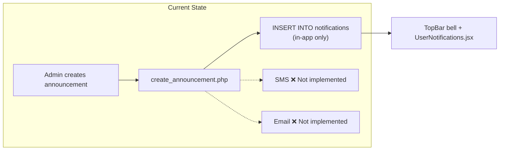
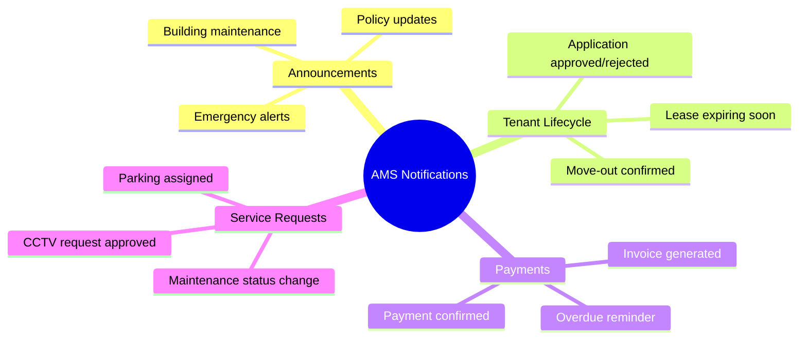
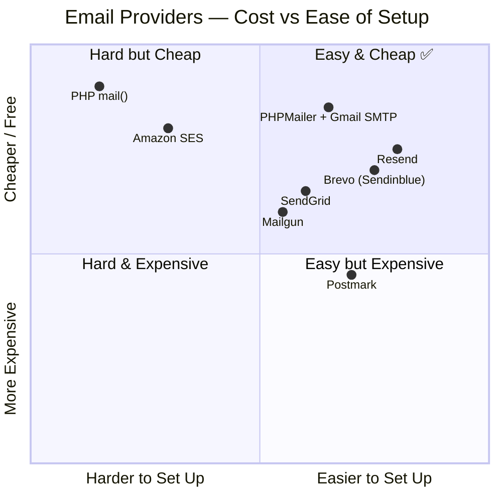
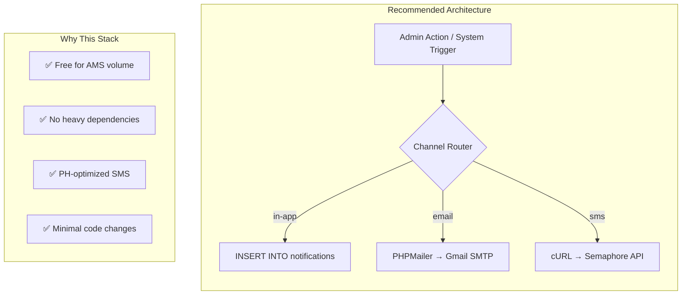
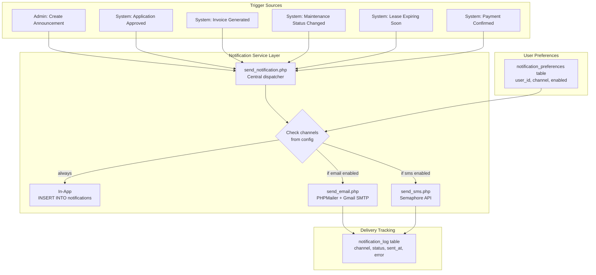
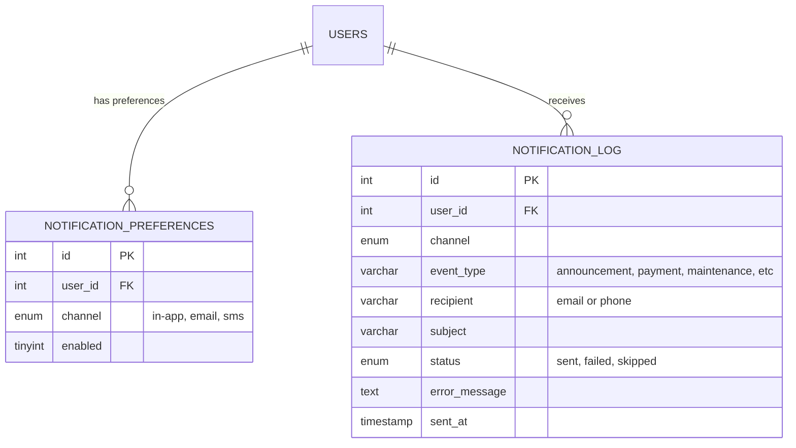
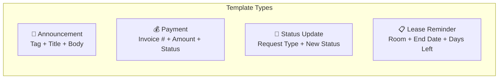
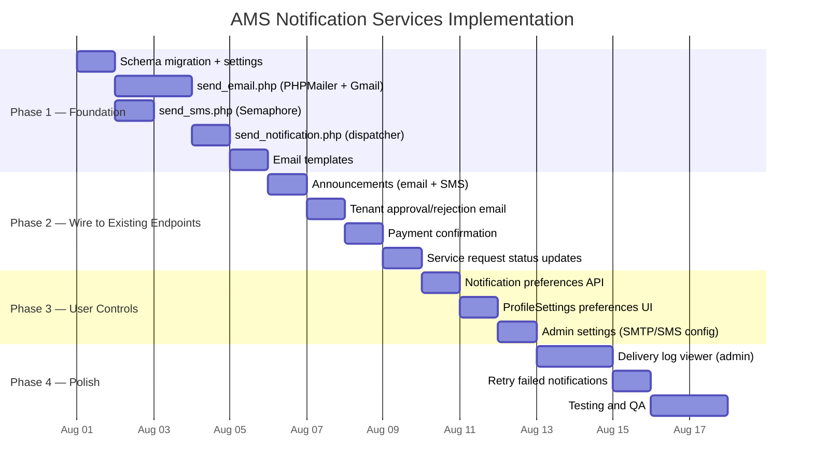
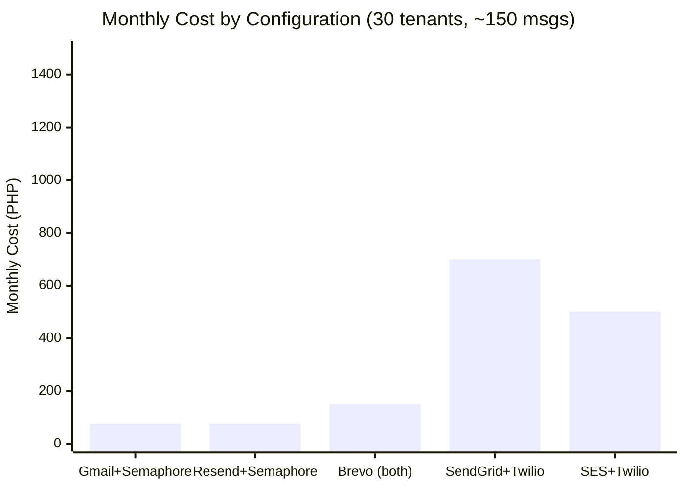

# AMS — SMS & Email Notification Services

> **Document Version:** 1.1 — August 2026
> **Status:** Research & Planning
> **Stack Context:** PHP 8 backend (XAMPP), React SPA frontend, MySQL/MariaDB

---

## 0. Conceptual Architecture

Before diving into providers and code, understand the fundamental separation:

> **XAMPP itself does not send SMS or email.** XAMPP gives you Apache + PHP + MySQL. Your PHP backend then connects to an **external email/SMS service**.

```
                APARTMENT SYSTEM
                       │
              ┌────────┴────────┐
              │                 │
            React              PHP
                                │
                    ┌───────────┼───────────┐
                    │           │           │
                  MySQL      PHPMailer    SMS API
                    │           │           │
              Data/history    Email        SMS
```

### How notifications flow

When an admin records a payment:

```
React
  │
  │ "Payment received"
  ▼
PHP API
  │
  ├──────────────► MySQL
  │                  │
  │                  └── Store notification record
  │
  ├──────────────► Email service (PHPMailer → SMTP)
  │
  └──────────────► SMS service (cURL → Semaphore API)
```

### Email vs SMS — different mechanisms

**Email** uses SMTP. PHPMailer authenticates with an SMTP provider (like Gmail) and the provider delivers the email. Your PHP app doesn't host its own email server.

```
React → PHP → PHPMailer → SMTP server → Tenant's email
```

**SMS** uses an HTTP API. Your PHP backend sends an HTTP POST to an SMS gateway (like Semaphore), which routes the message through the mobile network.

```
React → PHP → cURL POST → SMS API → Mobile network → Tenant's phone
```

You can't do `PHP → MySQL → cellphone`. MySQL stores the notification record; the SMS gateway handles actual delivery.

### API keys stay on the server

React should **never** directly communicate with Twilio, Semaphore, or SMTP credentials. Frontend code is exposed to the browser.

```
✅ Correct:
React → POST /api/send_notification → PHP (has API keys) → External service

❌ Wrong:
React → Twilio API (API key in JavaScript = exposed to anyone)
```

Your secrets stay on the PHP server. React only tells PHP "what happened" (payment recorded, maintenance updated). PHP decides which channels to use and holds all credentials.

### What MySQL does for notifications

MySQL doesn't deliver notifications — it **tracks** them. Every notification attempt gets logged:

| Type               | Channel | Status |
| ------------------ | ------- | ------ |
| Payment Receipt    | Email   | Sent   |
| Payment Reminder   | SMS     | Sent   |
| Maintenance Update | Email   | Sent   |
| Maintenance Update | SMS     | Failed |

This gives your admin a notification history dashboard — not just "fire and forget."

---

## 1. Current State

The AMS already has a **notification infrastructure** that is partially built:

| What Exists | Details |
|---|---|
| `notifications` table | `user_id`, `title`, `message`, `type`, `is_read`, plus `status` (`Pending`/`Resolved` — the admin action queue) and `metadata_value` (links a queue row back to its request, e.g. `"parking_reservation:12"`), added when Module 6 was audited (September 2026) |
| `announcements.channels` | Stores `["in-app", "sms", "email"]` as JSON — **but only `in-app` is implemented** |
| Channel toggle UI | `AdminAnnouncements.jsx` renders SMS/email toggle buttons (non-functional) |
| User contact data | `users.email_address` ✅ and `users.contact_no` ✅ already in DB |
| Notification triggers | Announcements auto-create in-app notifications; status change endpoints _could_ trigger external delivery |



### What's Missing

1. **No email sending** — no SMTP config, no mail library, no templates
2. **No SMS sending** — no provider integration, no API keys
3. **No delivery tracking** — no `sent_at`, `delivered_at`, `failed_at` columns
4. **No opt-in/opt-out** — tenants can't control which channels they receive
5. **No retry/queue** — announcements to 50+ tenants would block the HTTP request

---

## 2. Notification Use Cases for AMS

Before picking providers, here are the **actual notification events** this system needs:



### Estimated Volume (for cost calculations)

| Scenario | Tenants | Messages/Month | Notes |
|---|---|---|---|
| Small building | 15–30 | 50–150 | 2–5 announcements + individual status updates |
| Medium building | 50–100 | 200–600 | More frequent billing + maintenance cycles |
| Large complex | 200+ | 1,000–3,000 | Multiple buildings, higher churn |

> [!NOTE]
> AMS is a **single-building management system** running on XAMPP locally. Realistic volume is **50–200 messages/month** total across SMS and email. Most providers' free tiers cover this.

---

## 3. Email Service Options

### 3.1 Provider Comparison



---

#### Option A: PHPMailer + Gmail SMTP (Recommended for AMS)

| Attribute | Details |
|---|---|
| **Cost** | **Free** (Gmail allows 500 emails/day; Google Workspace allows 2,000/day) |
| **Setup** | Install PHPMailer via Composer, configure Gmail App Password |
| **PHP Integration** | Native — `composer require phpmailer/phpmailer` |
| **Deliverability** | Good for low volume; Gmail may throttle at scale |
| **Auth** | Gmail App Password (2FA required on Google account) |

**Pros:**
- Zero cost for AMS volume (50–200/month is well under 500/day)
- PHPMailer is the most battle-tested PHP email library
- HTML email support with templates
- TLS encryption built-in
- No external API dependency — just SMTP

**Cons:**
- Gmail App Passwords require manual setup
- Gmail rate limits: 500/day personal, 2,000/day Workspace
- Emails may land in spam if Gmail account is new
- Not suitable if AMS scales to 500+ daily emails

---

#### Option B: Resend (Modern API)

| Attribute | Details |
|---|---|
| **Cost** | **Free tier: 3,000 emails/month**, then $20/mo for 50k |
| **Setup** | API key + HTTP POST (no SMTP config needed) |
| **PHP Integration** | Simple cURL/HTTP call — no library needed |
| **Deliverability** | Excellent — built on AWS SES infrastructure |
| **Auth** | API key in header |

**Pros:**
- Generous free tier (3,000/month covers AMS easily)
- Modern REST API — simple `POST` with JSON body
- No Composer dependency needed (plain `curl` in PHP)
- React email templates (if using Node tooling)
- Webhook support for delivery tracking

**Cons:**
- Requires domain verification for production (DNS TXT record)
- External API dependency (internet required)
- Relatively new company (2023)

---

#### Option C: Brevo (formerly Sendinblue)

| Attribute | Details |
|---|---|
| **Cost** | **Free tier: 300 emails/day** (~9,000/month) |
| **Setup** | API key + SMTP or REST API |
| **PHP Integration** | SMTP via PHPMailer or REST API via cURL |
| **Deliverability** | Very good — established provider |

**Pros:**
- 300/day free covers AMS generously
- Both SMTP and API options
- Built-in email templates
- **Also offers SMS** (combined provider — see SMS section)

**Cons:**
- Brevo branding on free tier emails
- SMS pricing is separate and per-country
- Dashboard/analytics may be overkill for AMS

---

#### Option D: SendGrid (Twilio Email)

| Attribute | Details |
|---|---|
| **Cost** | **Free tier: 100 emails/day** forever |
| **Setup** | API key + REST API or SMTP |
| **PHP Integration** | `composer require sendgrid/sendgrid` or PHPMailer SMTP |

**Pros:**
- Industry standard, owned by Twilio
- 100/day free = 3,000/month (sufficient for AMS)
- Dynamic template engine
- Delivery analytics and webhooks

**Cons:**
- Account approval can take days
- Free tier has limited support
- Heavier PHP SDK if not using SMTP mode

---

#### Option E: Amazon SES

| Attribute | Details |
|---|---|
| **Cost** | **$0.10 per 1,000 emails** (essentially free for AMS) |
| **Setup** | AWS account + IAM credentials + domain verification |
| **PHP Integration** | AWS SDK or SMTP |

**Pros:**
- Cheapest at scale ($0.10/1k)
- Best deliverability (it's what Resend uses underneath)
- No daily limit

**Cons:**
- AWS account setup is complex for a XAMPP project
- Sandbox mode requires manual exit approval
- Overkill for single-building management

---

#### Option F: PHP `mail()` (Built-in)

| Attribute | Details |
|---|---|
| **Cost** | **Free** |
| **Setup** | Configure `sendmail_path` in XAMPP's `php.ini` |

**Pros:**
- Zero dependencies
- Already available in XAMPP

**Cons:**
- Almost always lands in spam
- No HTML template support without manual headers
- No delivery tracking
- No TLS by default
- **Not recommended for any production use**

---

### 3.2 Email Provider Summary

| Provider | Free Tier | PHP Setup | Deliverability | Best For |
|---|---|---|---|---|
| **PHPMailer + Gmail** | 500/day | Composer | ⭐⭐⭐ | **AMS (simple, free, reliable)** |
| **Resend** | 3,000/mo | cURL | ⭐⭐⭐⭐ | Modern API, minimal code |
| **Brevo** | 300/day | SMTP/API | ⭐⭐⭐⭐ | Combined email + SMS |
| **SendGrid** | 100/day | SDK/SMTP | ⭐⭐⭐⭐⭐ | Industry standard |
| **Amazon SES** | Pay-as-go | AWS SDK | ⭐⭐⭐⭐⭐ | Scale (overkill for AMS) |
| **PHP mail()** | Unlimited | Built-in | ⭐ | **Never** |

---

## 4. SMS Service Options

### 4.1 Provider Comparison

> [!IMPORTANT]
> SMS pricing is **per-message and per-country**. Prices below are for **Philippines (PH)** since AMS appears to be a Philippine-based apartment system (contact numbers, peso amounts). Adjust for your target country.

---

#### Option A: Semaphore (Recommended for PH)

| Attribute | Details |
|---|---|
| **Cost** | **₱0.35–₱0.50 per SMS** (prepaid credits) |
| **Free Tier** | Free test credits on signup (~50 SMS) |
| **Setup** | API key + simple HTTP POST |
| **PHP Integration** | Plain cURL — no library needed |
| **Coverage** | Philippines: Globe, Smart, TNT, Sun, DITO |

**Pros:**
- **Philippine-focused** — best local deliverability
- Dead-simple API (one HTTP POST)
- No Composer dependency
- Prepaid model — no surprise bills
- Sender name customization
- OTP support built-in

**Cons:**
- PH-only (not international)
- No MMS support
- No built-in queue/retry

**Sample PHP Call:**
```php
$ch = curl_init();
curl_setopt($ch, CURLOPT_URL, 'https://api.semaphore.co/api/v4/messages');
curl_setopt($ch, CURLOPT_POST, 1);
curl_setopt($ch, CURLOPT_POSTFIELDS, http_build_query([
    'apikey' => 'YOUR_API_KEY',
    'number' => '09171234567',
    'message' => 'Your maintenance request has been approved.',
    'sendername' => 'AMS'
]));
curl_setopt($ch, CURLOPT_RETURNTRANSFER, true);
$response = curl_exec($ch);
curl_close($ch);
```

---

#### Option B: Twilio

| Attribute | Details |
|---|---|
| **Cost** | **~$0.05–$0.08/SMS** to PH (~₱2.80–₱4.50/SMS) |
| **Free Tier** | $15 trial credit (~200 SMS to PH) |
| **Setup** | Account SID + Auth Token + phone number purchase |
| **PHP Integration** | `composer require twilio/sdk` or REST API |
| **Coverage** | Global — 180+ countries |

**Pros:**
- Most widely-used SMS API globally
- Excellent documentation and PHP SDK
- Global coverage (if AMS expands)
- Programmable SMS + WhatsApp + Voice
- Delivery status callbacks

**Cons:**
- **5–10x more expensive than Semaphore** for PH numbers
- Requires purchasing a Twilio phone number ($1/month)
- SDK is heavy (~5MB)
- Trial messages include "Sent from a Twilio trial account" prefix

---

#### Option C: Vonage (Nexmo)

| Attribute | Details |
|---|---|
| **Cost** | **~€0.04/SMS** to PH (~₱2.50/SMS) |
| **Free Tier** | €2 credit on signup (~50 SMS) |
| **Setup** | API key + API secret |
| **PHP Integration** | REST API or `composer require vonage/client` |

**Pros:**
- Good global coverage
- Simpler than Twilio
- Delivery receipts (DLR)

**Cons:**
- Still expensive vs. Semaphore for PH
- Less PH-specific optimization
- Documentation can be confusing

---

#### Option D: Brevo SMS (combined with email)

| Attribute | Details |
|---|---|
| **Cost** | **~₱2.00–₱3.00/SMS** to PH (buy credits in packs) |
| **Setup** | Same account as Brevo email — unified API |
| **PHP Integration** | REST API |

**Pros:**
- **Single provider for both email AND SMS**
- Unified dashboard
- No separate account needed

**Cons:**
- SMS pricing is not competitive vs. Semaphore for PH
- Less PH network optimization

---

#### Option E: Engagespark (PH-focused)

| Attribute | Details |
|---|---|
| **Cost** | **₱0.35–₱0.75/SMS** depending on volume |
| **Free Tier** | Limited test credits |
| **Coverage** | Philippines-focused + some APAC |

**Pros:**
- PH-focused like Semaphore
- Also offers IVR (voice calls)
- Good for tenant engagement

**Cons:**
- Smaller community
- Less documentation than Semaphore

---

### 4.2 SMS Provider Summary

| Provider | Cost/SMS (PH) | PHP Setup | PH Coverage | Best For |
|---|---|---|---|---|
| **Semaphore** | ₱0.35–₱0.50 | cURL | ⭐⭐⭐⭐⭐ | **AMS in PH (cheapest, simplest)** |
| **Twilio** | ₱2.80–₱4.50 | SDK/cURL | ⭐⭐⭐⭐ | Global reach, enterprise |
| **Vonage** | ~₱2.50 | SDK/cURL | ⭐⭐⭐ | Alternative to Twilio |
| **Brevo** | ~₱2.50 | API | ⭐⭐⭐ | Combined email + SMS |
| **Engagespark** | ₱0.35–₱0.75 | API | ⭐⭐⭐⭐ | PH + voice calls |

---

## 5. Recommended Stack for AMS



| Channel | Provider | Monthly Cost (30 tenants) | Setup Effort |
|---|---|---|---|
| **In-app** | Already built | ₱0 | None |
| **Email** | PHPMailer + Gmail SMTP | ₱0 | ~2 hours |
| **SMS** | Semaphore | ~₱50–₱150 (100–300 SMS) | ~1 hour |

**Total estimated monthly cost: ₱50–₱150** (~$1–$3 USD)

---

## 6. Architecture — Target State



### Key Design Decisions

1. **Central dispatcher** (`send_notification.php`) — single function all endpoints call, not scattered `mail()` calls
2. **User preferences** — tenants opt-in/out per channel in their profile settings
3. **Delivery log** — track what was sent, when, and if it failed
4. **Fail-open** — if SMS/email fails, the in-app notification still works; failures are logged, not thrown

---

## 7. Database Changes

> [!NOTE]
> Following AMS rules: ADD COLUMN only, never drop. All new tables use `IF NOT EXISTS`.

```sql
-- Store user notification channel preferences
CREATE TABLE IF NOT EXISTS notification_preferences (
    id INT AUTO_INCREMENT PRIMARY KEY,
    user_id INT NOT NULL,
    channel ENUM('in-app', 'email', 'sms') NOT NULL,
    enabled TINYINT(1) DEFAULT 1,
    UNIQUE KEY unique_user_channel (user_id, channel),
    FOREIGN KEY (user_id) REFERENCES users(id) ON DELETE CASCADE
);

-- Default: all channels enabled for all existing users
-- (Run once after table creation)
INSERT IGNORE INTO notification_preferences (user_id, channel, enabled)
SELECT id, 'in-app', 1 FROM users WHERE role != 'admin'
UNION ALL
SELECT id, 'email', 1 FROM users WHERE role != 'admin'
UNION ALL
SELECT id, 'sms', 1 FROM users WHERE role != 'admin';

-- Log all outbound notification attempts
CREATE TABLE IF NOT EXISTS notification_log (
    id INT AUTO_INCREMENT PRIMARY KEY,
    user_id INT,
    channel ENUM('in-app', 'email', 'sms') NOT NULL,
    event_type VARCHAR(50) NOT NULL,
    recipient VARCHAR(255),
    subject VARCHAR(255),
    status ENUM('sent', 'failed', 'skipped') DEFAULT 'sent',
    error_message TEXT,
    sent_at TIMESTAMP DEFAULT CURRENT_TIMESTAMP,
    FOREIGN KEY (user_id) REFERENCES users(id) ON DELETE SET NULL
);

-- Store provider API keys in system_settings (admin-configurable)
INSERT IGNORE INTO system_settings (setting_key, setting_value) VALUES
('smtp_host', 'smtp.gmail.com'),
('smtp_port', '587'),
('smtp_username', ''),
('smtp_password', ''),
('smtp_from_name', 'AMS Notifications'),
('sms_provider', 'semaphore'),
('sms_api_key', ''),
('sms_sender_name', 'AMS'),
('notifications_email_enabled', '0'),
('notifications_sms_enabled', '0');
```

### ER Addition



---

## 8. File Changes — Implementation Map

### New Files

| File | Purpose |
|---|---|
| `backend/api/services/send_notification.php` | Central dispatcher — resolves channels, checks preferences, calls senders |
| `backend/api/services/send_email.php` | PHPMailer wrapper — SMTP config from `system_settings` |
| `backend/api/services/send_sms.php` | Semaphore cURL wrapper — API key from `system_settings` |
| `backend/api/services/email_templates.php` | HTML email template builder (announcement, payment, status update) |
| `backend/api/get_notification_preferences.php` | Fetch user's channel preferences |
| `backend/api/update_notification_preferences.php` | Toggle channel on/off |
| `backend/migrations/add_notification_services.sql` | Schema migration |

### Modified Files

| File | Change |
|---|---|
| `backend/api/create_announcement.php` | After in-app insert, call `send_notification()` for email/SMS |
| `backend/api/update_tenant_status.php` | Notify tenant on approval/rejection |
| `backend/api/pay_bill.php` | Confirm payment via email/SMS |
| `backend/api/process_tenant_request.php` | Notify on occupancy-change / lease-extension decisions — the only two request types this endpoint handles; maintenance, CCTV and parking status changes each notify from their own decision endpoint (`update_maintenance_status.php`, `update_cctv_status.php`, `update_parking_status.php`) |
| `ams-react/src/UserPages/ProfileSettings.jsx` | Add notification preferences toggle UI |
| `ams-react/src/AdminPages/AdminAccountSettings.jsx` | Add SMTP/SMS provider config section |

### Dependency

```
composer require phpmailer/phpmailer
```

> No other dependencies. Semaphore uses plain cURL (already in XAMPP PHP).

---

## 9. Email Templates



Each template is a simple PHP function returning HTML:

```
┌─────────────────────────────────────┐
│  🏢 Apartment Management System    │
├─────────────────────────────────────┤
│                                     │
│  Hello {first_name},                │
│                                     │
│  {message_body}                     │
│                                     │
│  ─────────────────────────────────  │
│  This is an automated notification  │
│  from your apartment management.    │
│                                     │
│  If you have questions, contact     │
│  the admin office.                  │
└─────────────────────────────────────┘
```

---

## 10. Implementation Plan — Phased



### Phase 1 — Foundation (3–4 days)

| Task | Details |
|---|---|
| Run migration SQL | Creates `notification_preferences`, `notification_log`, seeds `system_settings` |
| Install PHPMailer | `composer require phpmailer/phpmailer` in `backend/` |
| Create `send_email.php` | Reads SMTP config from `system_settings`, wraps PHPMailer |
| Create `send_sms.php` | Reads Semaphore API key from `system_settings`, cURL POST |
| Create `send_notification.php` | Central function: resolve user → check preferences → dispatch to channels |
| Create `email_templates.php` | 4 template functions (announcement, payment, status, lease) |

### Phase 2 — Wire to Endpoints (3–4 days)

This is where notifications become genuinely useful — not just "we added SMS because the panel wanted SMS" but actual business events that tenants care about.

| Trigger Point | What Gets Sent |
|---|---|
| `create_announcement.php` | Email + SMS to all tenants (based on channel selection) |
| `update_tenant_status.php` | "Your application has been approved/rejected" |
| `pay_bill.php` | "Payment of ₱X received for invoice #INV-xxx" |
| `process_tenant_request.php` | "Your occupancy/lease extension request has been approved/declined" (maintenance/CCTV/parking each notify from their own decision endpoint, not this one) |
| `extend_lease.php` | "Your lease has been extended to [date]" |

#### Concrete examples of what tenants receive

When a payment is recorded:

```
Email:
  Subject: Payment Received — Unit H
  Body: ₱12,500 payment received for Unit H.
        Date: August 11, 2026
        Reference: PAY-00123

SMS:
  Apartment System: ₱12,500 payment received for Unit H. Ref: PAY-00123
```

When a maintenance request status changes:

```
Email:
  Subject: Maintenance Request Updated — REQ-003
  Body: Your maintenance request REQ-003 is now In Progress.
        Our team will begin work as scheduled.

SMS:
  AMS: Your maintenance request REQ-003 is now In Progress.
```

When rent is due tomorrow:

```
Email:
  Subject: Rent Payment Reminder — Unit H
  Body: Your ₱12,500 rent payment for Unit H is due on August 15.
        Please settle through the tenant portal.

SMS:
  AMS: Your ₱12,500 rent for Unit H is due Aug 15.
```

The system flow for an automatic trigger:

```
             Payment Due
                  │
                  ▼
          PHP detects event
                  │
         ┌────────┴────────┐
         ▼                 ▼
       MySQL            Notification
         │                 │
         │           ┌─────┴─────┐
         │           ▼           ▼
         │         Email        SMS
         │           │           │
         ▼           ▼           ▼
     Record       Tenant      Tenant
     saved       inbox        phone
```

### Phase 3 — User Controls (2–3 days)

| Task | Details |
|---|---|
| Preferences API | GET/POST endpoints for user notification preferences |
| ProfileSettings UI | Toggle switches: "Receive email notifications" / "Receive SMS notifications" |
| Admin config UI | SMTP host/port/user/pass fields + SMS API key field in AdminAccountSettings |
| Test toggles | Disable email → verify only in-app fires |

### Phase 4 — Polish (3–4 days)

| Task | Details |
|---|---|
| Delivery log viewer | New section in AdminActivityLogs or AdminNotifications showing sent/failed |
| Retry mechanism | Button to re-send failed notifications |
| Testing | End-to-end: create announcement → verify in-app + email + SMS arrive |

**Total estimated effort: 11–15 days**

> [!WARNING]
> ### Practical warning about SMS for capstone
>
> **SMS is the expensive/awkward part.** Email is comparatively easy to implement for a school project. SMS requires an external provider, credentials, sender configuration, and usually paid messaging once you're beyond testing.
>
> Semaphore gives free test credits (~50 SMS), but after that it's prepaid. Twilio trial accounts prefix every message with "Sent from a Twilio trial account."
>
> If your panel says the system needs **"SMS and email notifications,"** clarify whether they expect:
> - **Real SMS delivery** during the demo, or
> - A **notification module that is architecturally capable** of SMS but demonstrates with email only
>
> Build both into the architecture regardless — but for the actual demo, make sure email works reliably first. SMS can be shown working with test credits.

### Architecture to defend at capstone panel

This is the clean mental model:

```
                APARTMENT SYSTEM
                       │
              ┌────────┴────────┐
              │                 │
            React              PHP
           (frontend)       (backend)
                                │
                    ┌───────────┼───────────┐
                    │           │           │
                  MySQL      PHPMailer    SMS API
                    │           │           │
              Data/history    Email        SMS
                    │           │           │
              notification   tenant's     tenant's
              records        inbox         phone
```

Key points to articulate:
- React tells PHP **what happened** ("payment recorded"). React never touches API keys.
- PHP decides **how to notify** (check preferences, pick channels, dispatch).
- MySQL tracks **what was sent** (delivery log, not just fire-and-forget).
- External services handle **actual delivery** (SMTP for email, HTTP API for SMS).
- Tenants control **what they receive** (notification preferences).

---

## 11. Cost Summary — All Configurations



| Configuration | Email Cost | SMS Cost | Total/Month (30 tenants) | Notes |
|---|---|---|---|---|
| **PHPMailer + Gmail + Semaphore** | ₱0 | ~₱75 | **~₱75** | **Recommended** |
| Resend + Semaphore | ₱0 | ~₱75 | ~₱75 | Modern API alternative |
| Brevo (email + SMS) | ₱0 | ~₱150 | ~₱150 | Single provider convenience |
| SendGrid + Twilio | ₱0 | ~₱700 | ~₱700 | Enterprise grade, expensive SMS |
| Amazon SES + Twilio | ~₱15 | ~₱700 | ~₱715 | Best at scale, overkill for AMS |

---

## 12. Security Considerations

> [!WARNING]
> API keys and SMTP passwords are stored in `system_settings` table. This is acceptable for a XAMPP local deployment but should be encrypted or moved to environment variables for production.

| Concern | Mitigation |
|---|---|
| SMTP credentials in DB | Store as `system_settings`; admin-only access via `verify_admin()` |
| SMS API key exposure | Same — never return in GET responses to non-admin users |
| Email spoofing | Use SPF/DKIM records on the sending domain (Gmail handles this) |
| Tenant phone number privacy | Only system sends SMS; phone numbers never exposed to other tenants |
| Rate limiting | Semaphore has built-in; Gmail has 500/day; add a simple counter in `notification_log` |
| Opt-out compliance | `notification_preferences` table lets users disable channels (Data Privacy Act compliance) |

---

## 13. Alternative Approaches

### WhatsApp Business API (via Twilio or direct)

| Pros | Cons |
|---|---|
| Higher open rates than SMS (~98%) | Requires Facebook Business verification |
| Rich media (images, buttons) | More expensive than SMS (~₱3–₱5/msg) |
| Two-way conversation | Template messages must be pre-approved |
| Filipino users heavily use WhatsApp/Viber | Setup complexity is significantly higher |

**Verdict:** Not recommended for Phase 1. Consider for Phase 5 if tenants request it.

### Push Notifications (Web Push via Service Worker)

| Pros | Cons |
|---|---|
| Free | Only works when browser is open (or with PWA) |
| Instant delivery | Requires HTTPS (not available on XAMPP localhost) |
| No phone/email needed | Users must grant permission |

**Verdict:** Not viable for XAMPP deployment. Revisit if AMS moves to hosted HTTPS.

### Viber Business Messages

| Pros | Cons |
|---|---|
| Very popular in PH | Requires Viber Business account approval |
| Rich messages | ~₱0.50–₱1.00/msg |
| Read receipts | API integration more complex than SMS |

**Verdict:** Possible future addition via Semaphore (they support Viber too).

---

## 14. Decision Matrix

| Criteria | Weight | Gmail+Semaphore | Resend+Semaphore | Brevo | SendGrid+Twilio |
|---|---|---|---|---|---|
| Cost (lower = better) | 30% | ⭐⭐⭐⭐⭐ | ⭐⭐⭐⭐⭐ | ⭐⭐⭐⭐ | ⭐⭐ |
| PHP setup simplicity | 25% | ⭐⭐⭐⭐ | ⭐⭐⭐⭐⭐ | ⭐⭐⭐⭐ | ⭐⭐⭐ |
| PH SMS deliverability | 20% | ⭐⭐⭐⭐⭐ | ⭐⭐⭐⭐⭐ | ⭐⭐⭐ | ⭐⭐⭐⭐ |
| No external dependency | 15% | ⭐⭐⭐⭐ | ⭐⭐⭐ | ⭐⭐⭐ | ⭐⭐ |
| Scalability | 10% | ⭐⭐ | ⭐⭐⭐⭐ | ⭐⭐⭐⭐ | ⭐⭐⭐⭐⭐ |
| **Weighted Score** | | **4.35** | **4.45** | **3.70** | **3.05** |

> [!TIP]
> **Recommendation:** Start with **PHPMailer + Gmail SMTP** for email and **Semaphore** for SMS. Total setup is ~4 hours, zero monthly cost for email, and ~₱75/month for SMS. If Gmail becomes limiting, swap email to Resend without changing the dispatcher — the `send_email.php` wrapper isolates the provider.

---

## 15. Quick-Start Checklist

- [ ] Run `add_notification_services.sql` migration
- [ ] `cd backend && composer require phpmailer/phpmailer`
- [ ] Create Gmail App Password (Google Account → Security → 2FA → App Passwords)
- [ ] Sign up at [semaphore.co](https://semaphore.co) and get API key
- [ ] Add SMTP + SMS credentials to `system_settings` via admin panel
- [ ] Create `send_email.php`, `send_sms.php`, `send_notification.php`
- [ ] Wire `create_announcement.php` to call `send_notification()`
- [ ] Test: create announcement with email + SMS channels selected
- [ ] Add notification preferences to ProfileSettings
- [ ] Ship it

---

## 16. Alternative Approaches — Extended Analysis

Section 13 covers WhatsApp Business API, Web Push, and Viber Business Messages briefly. This section expands with **additional alternatives not covered above**, each with detailed technical and performance cost analysis for the AMS stack.

---

### Alt A — Telegram Bot API (Free Messaging Channel)

Use a Telegram Bot to push notifications to tenants who subscribe via a `/start` command. The admin sends through the AMS panel; PHP's `send_sms.php`-equivalent calls the Telegram Bot API instead.

```
Tenant: opens Telegram → messages @AMS_BuildingBot → /start
PHP: stores tenant's Telegram chat_id in users table
On event: PHP cURL → https://api.telegram.org/bot<TOKEN>/sendMessage
```

| Dimension | Cost |
|---|---|
| **Monetary cost** | **₱0 forever.** Telegram Bot API is completely free with no rate limits for bots under 30 messages/sec. |
| **Technical complexity** | **Low.** Create bot via @BotFather (2 minutes). One cURL call per message. No SDK needed. |
| **PHP integration** | Trivial — same pattern as Semaphore (HTTP POST with JSON body). ~15 lines of PHP. |
| **User onboarding** | **This is the friction point.** Each tenant must: (1) have Telegram installed, (2) search for the bot, (3) send `/start`. You need a registration flow that links `telegram_chat_id` → `users.id`. |
| **Deliverability** | Excellent — messages arrive instantly, with rich formatting (bold, links, inline buttons). Higher open rates than email. |
| **Two-way capability** | Telegram bots can receive messages. You could build a lightweight "reply to admin" flow via webhook, but this adds server complexity (Telegram sends POST to your server — needs a public URL, not localhost). |
| **Reach in PH** | **Low-moderate.** Telegram adoption in the Philippines is growing but still behind Messenger, Viber, and SMS. Not all tenants will use it. |
| **LAN / offline** | Requires internet (Telegram is cloud-based). Same limitation as Firebase. |
| **DB changes** | `ALTER TABLE users ADD COLUMN telegram_chat_id VARCHAR(50) NULL` |

**Cost comparison vs SMS:**

| | Semaphore SMS | Telegram Bot |
|---|---|---|
| Per-message cost | ₱0.35–₱0.50 | ₱0 |
| Monthly (150 msgs) | ~₱75 | ₱0 |
| Tenant adoption effort | None (they have phones) | Must install Telegram + link account |
| Works without internet | Yes (SMS) | No |
| Rich media | No | Yes (images, buttons, markdown) |

**Verdict:** Excellent as a **supplementary free channel** alongside SMS, not a replacement. Add it as a fourth channel option (`in-app`, `email`, `sms`, `telegram`) in `notification_preferences`. Zero cost makes it attractive for budget-conscious deployments. But don't rely on it alone — PH Telegram adoption isn't universal enough.

---

### Alt B — Facebook Messenger Platform (Via Page)

Use a Facebook Page + Messenger Platform API to message tenants. Requires a Facebook Business Page and approved Messenger bot.

| Dimension | Cost |
|---|---|
| **Monetary cost** | **₱0** for standard messages within 24-hour window. Paid for "message tags" outside the window (~$0.01–$0.03 each). |
| **Technical complexity** | **High.** Facebook Business verification, Page creation, Messenger Platform app review, webhook setup, access token management. Meta's API changes frequently and docs are dense. |
| **PHP integration** | cURL to Graph API. Moderate — must handle page-scoped user IDs (PSIDs), token refresh, and webhook verification. |
| **User onboarding** | Tenant must message the Facebook Page first (24-hour engagement window rule). You cannot proactively message users who haven't initiated contact. |
| **24-hour window rule** | **Critical limitation.** After a user's last message, you have 24 hours to respond freely. After that, you can only send "message tags" (limited categories like `CONFIRMED_EVENT_UPDATE`). A rent reminder 3 days after last contact requires a tag — and Meta audits tag usage. |
| **Reach in PH** | **Very high.** Facebook Messenger is the #1 messaging app in the Philippines. Nearly 100% adoption among smartphone users. |
| **Privacy** | Messages route through Facebook's servers. Tenant identities are linked to Facebook profiles. Data Privacy Act implications. |
| **Maintenance burden** | Meta regularly deprecates API versions (every ~2 years). Messenger Platform has had 3 major API changes since 2020. Ongoing maintenance cost is non-trivial. |

**Verdict:** The reach is unbeatable in PH, but the **24-hour window**, **app review process**, and **ongoing API maintenance** make this one of the highest-effort integrations. Not worth it for a XAMPP-based local apartment system. **Consider only if AMS becomes a SaaS product** where a dedicated team can maintain the Meta integration.

---

### Alt C — Cron-Based Async Queue (Deferred Dispatch)

Instead of sending email/SMS **inline** during the HTTP request (which blocks the admin's browser until all messages are sent), write notification jobs to a `notification_queue` table and process them via a **cron job** that runs every minute.

```
Admin action → INSERT INTO notification_queue (pending) → HTTP 200 immediately
Cron (every 1 min) → process_queue.php → sends email/SMS → marks as sent/failed
```

```sql
CREATE TABLE IF NOT EXISTS notification_queue (
    id INT AUTO_INCREMENT PRIMARY KEY,
    user_id INT NOT NULL,
    channel ENUM('email', 'sms', 'telegram') NOT NULL,
    event_type VARCHAR(50) NOT NULL,
    payload JSON NOT NULL,
    status ENUM('pending', 'processing', 'sent', 'failed') DEFAULT 'pending',
    attempts TINYINT DEFAULT 0,
    max_attempts TINYINT DEFAULT 3,
    next_attempt_at DATETIME DEFAULT CURRENT_TIMESTAMP,
    error_message TEXT,
    created_at DATETIME DEFAULT CURRENT_TIMESTAMP,
    processed_at DATETIME,
    FOREIGN KEY (user_id) REFERENCES users(id) ON DELETE CASCADE,
    INDEX idx_pending (status, next_attempt_at)
);
```

| Dimension | Cost |
|---|---|
| **Technical complexity** | **Moderate.** Requires: (1) a `notification_queue` table, (2) a `process_queue.php` CLI script, (3) a Windows Task Scheduler or XAMPP cron entry to run it every minute. |
| **Performance — admin UX** | **Much better.** Admin clicks "Send Announcement" → instant response. No waiting for 30 emails to send sequentially. Current inline approach would take ~15–30 seconds for 30 tenants. |
| **Performance — delivery latency** | **Slightly worse.** Messages arrive within 0–60 seconds instead of immediately. Acceptable for announcements and status updates (not chat). |
| **Retry capability** | **Built-in.** Failed sends stay in queue with `attempts < max_attempts`. Next cron run picks them up with exponential backoff (`next_attempt_at`). The current inline approach has **no retry** — a failed email is silently lost. |
| **Monitoring** | Queue table doubles as a delivery log. Admin can see pending/failed messages in a dashboard. |
| **XAMPP cron setup** | On Windows: Task Scheduler → run `php C:\xampp\htdocs\...\process_queue.php` every minute. On Linux: standard crontab. Not hard, but one more thing to configure. |
| **Concurrency** | Must ensure only one `process_queue.php` runs at a time (use `SELECT ... FOR UPDATE` or a lock file). Without this, two overlapping crons can double-send. |

**process_queue.php sketch:**

```php
<?php
// CLI only — run via cron/Task Scheduler
require_once __DIR__ . "/../config.php";
require_once __DIR__ . "/services/send_email.php";
require_once __DIR__ . "/services/send_sms.php";

$batch = $conn->query("
    SELECT * FROM notification_queue
    WHERE status = 'pending' AND next_attempt_at <= NOW()
    ORDER BY created_at ASC LIMIT 20
");

while ($job = $batch->fetch_assoc()) {
    $conn->query("UPDATE notification_queue SET status='processing' WHERE id={$job['id']}");
    $payload = json_decode($job['payload'], true);

    $success = match($job['channel']) {
        'email' => send_email_notification($conn, $payload),
        'sms'   => send_sms_notification($conn, $payload),
        default => false
    };

    if ($success) {
        $conn->query("UPDATE notification_queue SET status='sent', processed_at=NOW() WHERE id={$job['id']}");
    } else {
        $attempts = $job['attempts'] + 1;
        $status = $attempts >= $job['max_attempts'] ? 'failed' : 'pending';
        $backoff = min(60 * pow(2, $attempts), 3600); // exponential backoff, max 1hr
        $conn->query("UPDATE notification_queue SET status='$status', attempts=$attempts,
                      next_attempt_at=DATE_ADD(NOW(), INTERVAL $backoff SECOND) WHERE id={$job['id']}");
    }
}
$conn->close();
```

**Verdict:** **Strongly recommended as an enhancement to ANY notification approach** (including the current Gmail + Semaphore recommendation). The queue decouples sending from the admin's HTTP request, adds retry, and prevents the UI from hanging. The cost is one cron job + one table — minimal for a significant reliability gain. This isn't an alternative to the current provider choices; it's an **architectural improvement** that sits between the dispatcher and the senders.

> [!IMPORTANT]
> Whether you use Gmail, Resend, Semaphore, or Telegram — running sends through a queue is almost always better than inline dispatch. The only exception is if you need guaranteed instant delivery (rare for AMS use cases).

---

### Alt D — Supabase (BaaS — Postgres + Realtime + Edge Functions)

Use Supabase as a hosted backend for notifications. Supabase offers a Postgres database with built-in real-time subscriptions and Edge Functions for serverless compute.

```
Admin action → PHP calls Supabase REST API → INSERT notification row
Supabase Realtime → pushes to subscribed React clients instantly
Supabase Edge Function (Deno) → sends email via Resend / SMS via Semaphore
```

| Dimension | Cost |
|---|---|
| **Monetary cost** | **Free tier:** 500 MB DB, 2 GB bandwidth, 500K edge function invocations/month. AMS would never exceed this. |
| **Technical complexity** | **High.** Supabase project setup, Row Level Security policies, Deno-based Edge Functions (not PHP), React `@supabase/supabase-js` integration. Fundamentally different paradigm from PHP + MySQL. |
| **Performance** | **Excellent for real-time.** Supabase Realtime uses WebSockets under the hood. Notifications appear instantly in the React UI without polling. |
| **Data split** | Same problem as Firebase — notification data lives in Supabase Postgres, not in your `ams_db` MySQL. Two databases to manage, no cross-joins. |
| **PHP integration** | Awkward. PHP would call Supabase's REST API to insert rows, essentially treating Supabase as an external service. Edge Functions are Deno, not PHP — you'd rewrite senders in TypeScript. |
| **Learning curve** | Supabase, Deno, Row Level Security, and Realtime subscriptions are all new concepts if the team only knows PHP + MySQL. |
| **LAN / offline** | Requires internet. Same limitation as Firebase. |
| **Vendor lock-in** | Supabase is open source — you could self-host, but that requires Docker + Postgres + GoTrue + Realtime server. Heavier than XAMPP. |

**Verdict:** Supabase is a powerful modern platform, but it's a **paradigm shift** from the XAMPP + PHP + MySQL stack. The benefit is real-time without polling, but you pay with data fragmentation and a split tech stack. **Not recommended for AMS** — the team would spend more time learning Supabase than the notification feature is worth. Relevant only if AMS is being rebuilt from scratch on a modern stack.

---

### Alt E — Local SMTP Relay (hMailServer, Mailpit, or Mercury Mail)

Instead of sending through Gmail SMTP (which requires internet + Google account), run a **local SMTP server** on the same Windows machine as XAMPP. PHPMailer connects to `localhost:25` instead of `smtp.gmail.com:587`.

| Tool | Type | Windows Support | Notes |
|---|---|---|---|
| **hMailServer** | Full SMTP server | Native Windows | Can actually deliver to real inboxes |
| **Mailpit** | Dev mail catcher | Windows binary | Catches all emails for local testing (doesn't deliver) |
| **Mercury Mail** | XAMPP bundled | Already in XAMPP | Basic, comes with XAMPP but rarely configured |

| Dimension | Cost |
|---|---|
| **Monetary cost** | ₱0 — all tools are free. |
| **Technical complexity** | **Low-Moderate.** Install hMailServer → point PHPMailer to `localhost:25`. No internet needed for send step. |
| **Deliverability** | **Very poor for production.** Emails from a local server without proper DNS (SPF, DKIM, DMARC) will be rejected or spam-binned by Gmail, Yahoo, Outlook. Works only for **testing** or **internal LAN email** (if tenants have email on the same network). |
| **For development/testing** | **Excellent.** Mailpit catches all outbound email and shows it in a web UI (`localhost:8025`). No emails leak to real inboxes during testing. |
| **Internet dependency** | **None for send.** But delivery to external inboxes still requires internet + DNS resolution. |
| **DNS requirements** | To actually deliver to `tenant@gmail.com`, you need: (1) public IP, (2) reverse DNS (PTR record), (3) SPF record, (4) DKIM signing. Most residential ISPs block port 25. |

**Verdict:** Two different use cases:
- **For development/testing:** Use **Mailpit** — it's invaluable. Install it, point PHPMailer to `localhost:1025`, and see all outbound emails at `http://localhost:8025`. Add this to the dev setup guide.
- **For production delivery:** **Do not use a local SMTP server.** Gmail/Resend/SendGrid exist specifically because delivering email reliably from a local server is a solved problem you shouldn't re-solve. Stick with the Gmail SMTP recommendation.

---

### Alt F — Unified Notification via Existing In-App System Only (No External Services)

The most conservative alternative: **don't add email or SMS at all**. Keep everything in-app and improve the existing notification UX so tenants don't miss important messages.

Enhancements to make in-app sufficient:

1. **Urgency levels** — `ALTER TABLE notifications ADD COLUMN urgency ENUM('normal','important','urgent') DEFAULT 'normal'` — urgent notifications get a red badge and persistent toast.
2. **Sound/vibration** — play a notification sound when new urgent notifications arrive (browser `Audio` API).
3. **Unread count in browser tab** — `document.title = \`(${count}) AMS\`` — tenant sees count even when tab is in background.
4. **Daily digest email as a cron** — one email per day summarizing unread notifications, instead of real-time per-event emails. Much simpler than event-driven email and covers the "I forgot to check the app" case.

| Dimension | Cost |
|---|---|
| **Monetary cost** | ₱0 — no external services. |
| **Technical complexity** | **Very low.** Tiny changes to existing code. No new dependencies. |
| **Reach** | **Limited.** Only works when tenants open the app. If they don't log in for a week, they miss urgent notices. |
| **UX improvements** | Browser tab badge + notification sound can make in-app feel more real-time without any backend changes. |
| **When it breaks down** | Emergency announcements (water shutoff, fire drill) need to reach tenants who aren't currently in the app. In-app alone can't do this. |
| **Daily digest option** | Sending one summary email/day via cron is dramatically simpler than per-event email dispatch. Works well for non-urgent reminders (overdue invoices, lease expiry). |

**Verdict:** This is the **ponytail answer** — do you actually need external notifications right now, or does improving in-app notifications cover 80% of the need? Ship the urgency levels + tab badge first (~2 hours of work). If tenants still miss critical announcements, add email/SMS. The daily digest cron is a pragmatic middle ground between "nothing" and "real-time email per event."

---

### Alternative Approaches — Summary Matrix

| Approach | Cost/Month | Setup Effort | PH Reach | AMS Fit | Best For |
|---|---|---|---|---|---|
| **Gmail + Semaphore** (current rec) | ~₱75 | ~4 hrs | ⭐⭐⭐⭐⭐ | ⭐⭐⭐⭐⭐ | Production deployment — best balance |
| **Alt A: Telegram Bot** | ₱0 | ~1 hr | ⭐⭐ | ⭐⭐⭐ | Free supplementary channel |
| **Alt B: Messenger Platform** | ₱0–₱50 | ~2 days | ⭐⭐⭐⭐⭐ | ⭐⭐ | SaaS product with dedicated team |
| **Alt C: Cron Queue** | ₱0 (infra) | ~3 hrs | N/A | ⭐⭐⭐⭐⭐ | **Add to ANY approach** — reliability layer |
| **Alt D: Supabase** | ₱0 (free tier) | ~2 days | N/A | ⭐ | Full rebuild on modern stack |
| **Alt E: Local SMTP** | ₱0 | ~30 min | N/A | ⭐⭐ (test only) | Development/testing setup |
| **Alt F: In-App Only** | ₱0 | ~2 hrs | ⭐ (app users only) | ⭐⭐⭐⭐ | YAGNI validation — ship first |

> [!TIP]
> **Actionable takeaways:**
> 1. **Alt C (Cron Queue) is not optional** — add it to the current Gmail + Semaphore plan. It prevents admin UI hangs and adds retry for free.
> 2. **Alt A (Telegram)** is worth adding as a fourth channel — zero cost, one hour of work.
> 3. **Alt F (In-App Only + digest)** is the right first step if you're unsure whether tenants need external notifications at all.
> 4. Everything else (Messenger, Supabase, local SMTP for production) is either too complex or architecturally mismatched for AMS on XAMPP.
