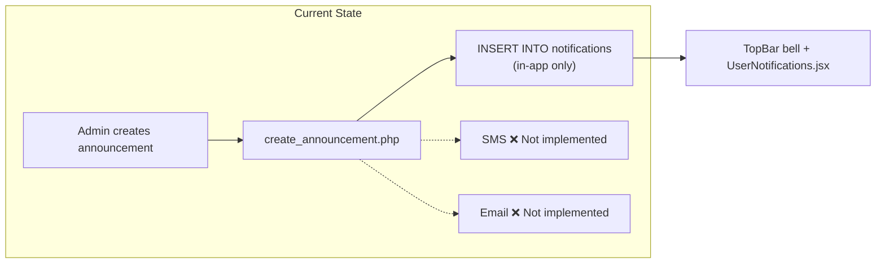
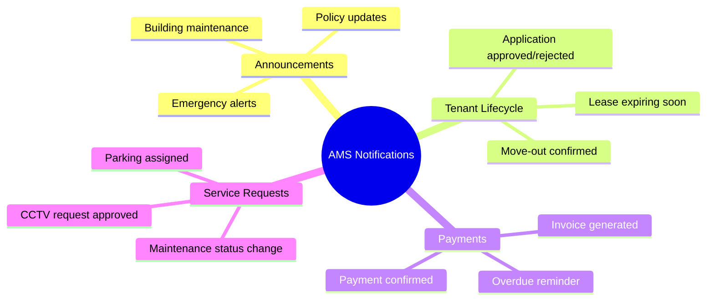
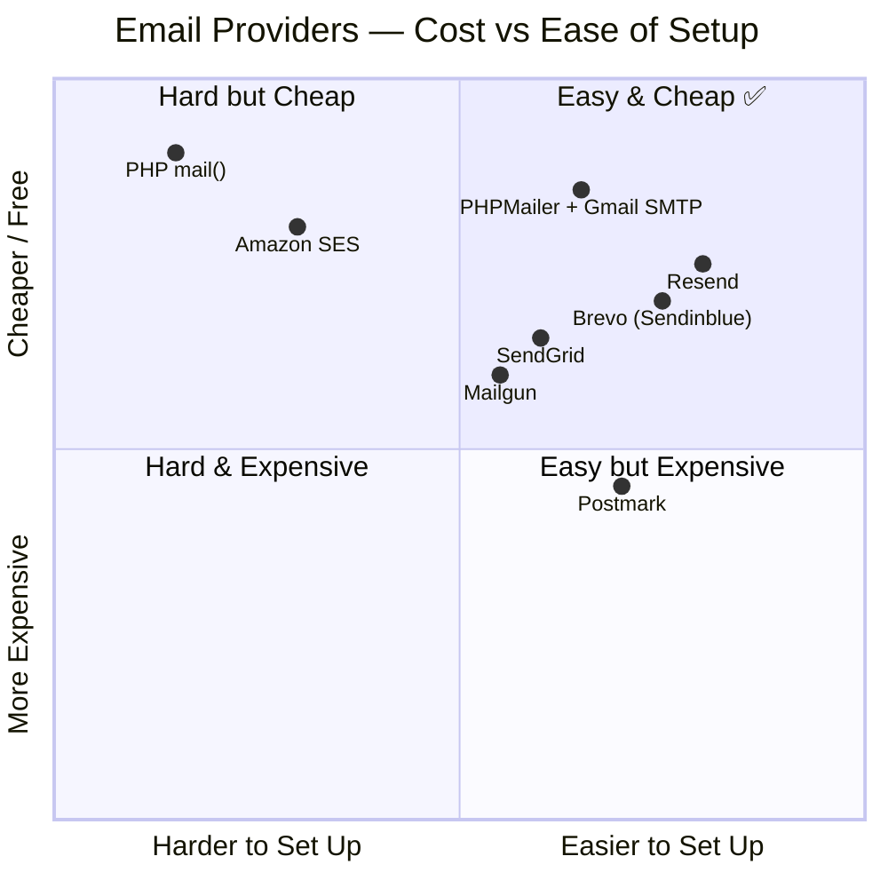
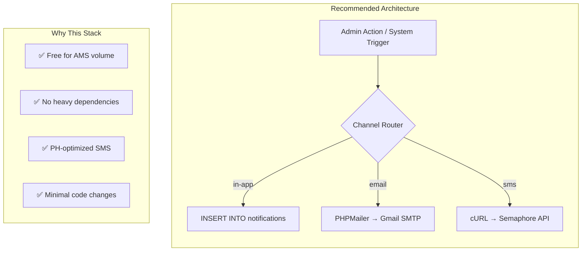
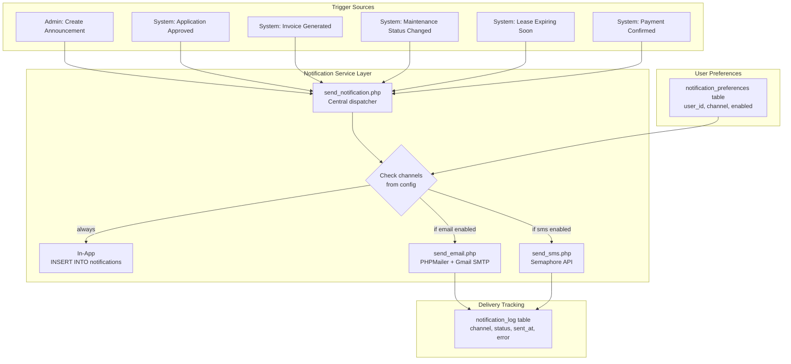
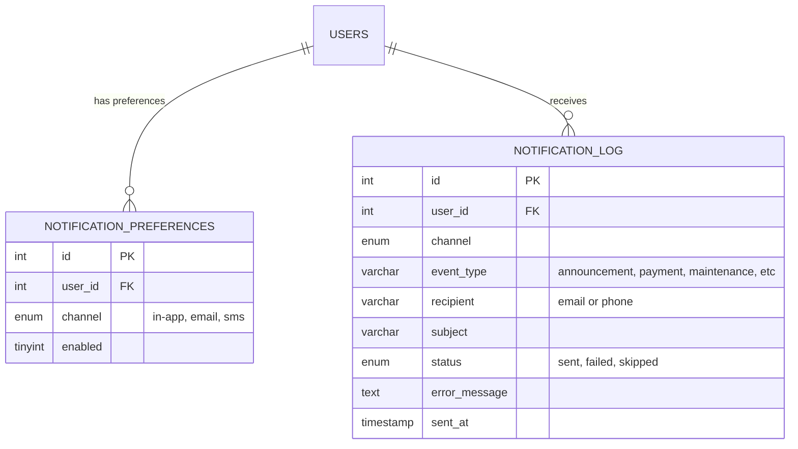
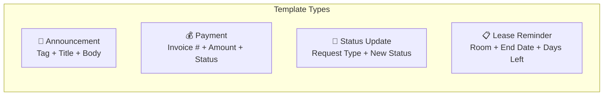
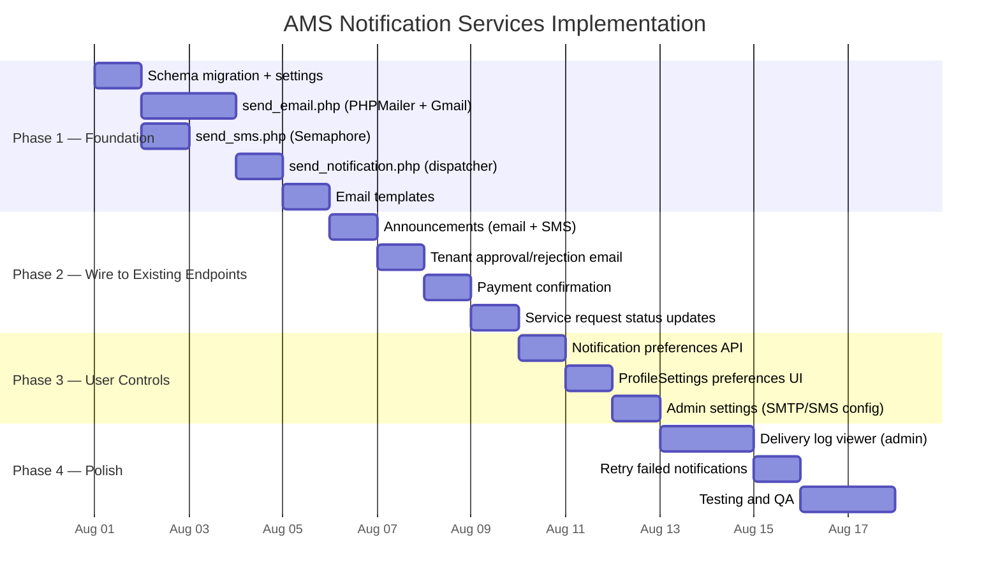
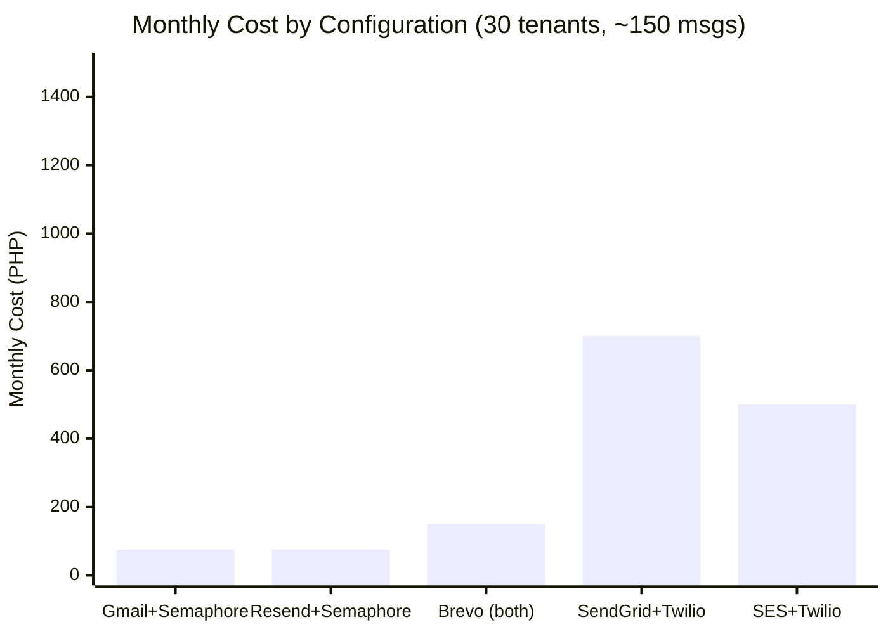

# AMS — SMS & Email Notification Services

> **Document Version:** 1.0 — July 2026
> **Status:** Research & Planning
> **Stack Context:** PHP 8 backend (XAMPP), React SPA frontend, MySQL/MariaDB

---

## 1. Current State

The AMS already has a **notification infrastructure** that is partially built:

| What Exists | Details |
|---|---|
| `notifications` table | `user_id`, `title`, `message`, `type`, `is_read` |
| `announcements.channels` | Stores `["in-app", "sms", "email"]` as JSON — **but only `in-app` is implemented** |
| Channel toggle UI | `AdminAnnouncements.jsx` renders SMS/email toggle buttons (non-functional) |
| User contact data | `users.email_address` ✅ and `users.contact_no` ✅ already in DB |
| Notification triggers | Announcements auto-create in-app notifications; status change endpoints _could_ trigger external delivery |



### What's Missing

1. **No email sending** — no SMTP config, no mail library, no templates
2. **No SMS sending** — no provider integration, no API keys
3. **No delivery tracking** — no `sent_at`, `delivered_at`, `failed_at` columns
4. **No opt-in/opt-out** — tenants can't control which channels they receive
5. **No retry/queue** — announcements to 50+ tenants would block the HTTP request

---

## 2. Notification Use Cases for AMS

Before picking providers, here are the **actual notification events** this system needs:



### Estimated Volume (for cost calculations)

| Scenario | Tenants | Messages/Month | Notes |
|---|---|---|---|
| Small building | 15–30 | 50–150 | 2–5 announcements + individual status updates |
| Medium building | 50–100 | 200–600 | More frequent billing + maintenance cycles |
| Large complex | 200+ | 1,000–3,000 | Multiple buildings, higher churn |

> [!NOTE]
> AMS is a **single-building management system** running on XAMPP locally. Realistic volume is **50–200 messages/month** total across SMS and email. Most providers' free tiers cover this.

---

## 3. Email Service Options

### 3.1 Provider Comparison



---

#### Option A: PHPMailer + Gmail SMTP (Recommended for AMS)

| Attribute | Details |
|---|---|
| **Cost** | **Free** (Gmail allows 500 emails/day; Google Workspace allows 2,000/day) |
| **Setup** | Install PHPMailer via Composer, configure Gmail App Password |
| **PHP Integration** | Native — `composer require phpmailer/phpmailer` |
| **Deliverability** | Good for low volume; Gmail may throttle at scale |
| **Auth** | Gmail App Password (2FA required on Google account) |

**Pros:**
- Zero cost for AMS volume (50–200/month is well under 500/day)
- PHPMailer is the most battle-tested PHP email library
- HTML email support with templates
- TLS encryption built-in
- No external API dependency — just SMTP

**Cons:**
- Gmail App Passwords require manual setup
- Gmail rate limits: 500/day personal, 2,000/day Workspace
- Emails may land in spam if Gmail account is new
- Not suitable if AMS scales to 500+ daily emails

---

#### Option B: Resend (Modern API)

| Attribute | Details |
|---|---|
| **Cost** | **Free tier: 3,000 emails/month**, then $20/mo for 50k |
| **Setup** | API key + HTTP POST (no SMTP config needed) |
| **PHP Integration** | Simple cURL/HTTP call — no library needed |
| **Deliverability** | Excellent — built on AWS SES infrastructure |
| **Auth** | API key in header |

**Pros:**
- Generous free tier (3,000/month covers AMS easily)
- Modern REST API — simple `POST` with JSON body
- No Composer dependency needed (plain `curl` in PHP)
- React email templates (if using Node tooling)
- Webhook support for delivery tracking

**Cons:**
- Requires domain verification for production (DNS TXT record)
- External API dependency (internet required)
- Relatively new company (2023)

---

#### Option C: Brevo (formerly Sendinblue)

| Attribute | Details |
|---|---|
| **Cost** | **Free tier: 300 emails/day** (~9,000/month) |
| **Setup** | API key + SMTP or REST API |
| **PHP Integration** | SMTP via PHPMailer or REST API via cURL |
| **Deliverability** | Very good — established provider |

**Pros:**
- 300/day free covers AMS generously
- Both SMTP and API options
- Built-in email templates
- **Also offers SMS** (combined provider — see SMS section)

**Cons:**
- Brevo branding on free tier emails
- SMS pricing is separate and per-country
- Dashboard/analytics may be overkill for AMS

---

#### Option D: SendGrid (Twilio Email)

| Attribute | Details |
|---|---|
| **Cost** | **Free tier: 100 emails/day** forever |
| **Setup** | API key + REST API or SMTP |
| **PHP Integration** | `composer require sendgrid/sendgrid` or PHPMailer SMTP |

**Pros:**
- Industry standard, owned by Twilio
- 100/day free = 3,000/month (sufficient for AMS)
- Dynamic template engine
- Delivery analytics and webhooks

**Cons:**
- Account approval can take days
- Free tier has limited support
- Heavier PHP SDK if not using SMTP mode

---

#### Option E: Amazon SES

| Attribute | Details |
|---|---|
| **Cost** | **$0.10 per 1,000 emails** (essentially free for AMS) |
| **Setup** | AWS account + IAM credentials + domain verification |
| **PHP Integration** | AWS SDK or SMTP |

**Pros:**
- Cheapest at scale ($0.10/1k)
- Best deliverability (it's what Resend uses underneath)
- No daily limit

**Cons:**
- AWS account setup is complex for a XAMPP project
- Sandbox mode requires manual exit approval
- Overkill for single-building management

---

#### Option F: PHP `mail()` (Built-in)

| Attribute | Details |
|---|---|
| **Cost** | **Free** |
| **Setup** | Configure `sendmail_path` in XAMPP's `php.ini` |

**Pros:**
- Zero dependencies
- Already available in XAMPP

**Cons:**
- Almost always lands in spam
- No HTML template support without manual headers
- No delivery tracking
- No TLS by default
- **Not recommended for any production use**

---

### 3.2 Email Provider Summary

| Provider | Free Tier | PHP Setup | Deliverability | Best For |
|---|---|---|---|---|
| **PHPMailer + Gmail** | 500/day | Composer | ⭐⭐⭐ | **AMS (simple, free, reliable)** |
| **Resend** | 3,000/mo | cURL | ⭐⭐⭐⭐ | Modern API, minimal code |
| **Brevo** | 300/day | SMTP/API | ⭐⭐⭐⭐ | Combined email + SMS |
| **SendGrid** | 100/day | SDK/SMTP | ⭐⭐⭐⭐⭐ | Industry standard |
| **Amazon SES** | Pay-as-go | AWS SDK | ⭐⭐⭐⭐⭐ | Scale (overkill for AMS) |
| **PHP mail()** | Unlimited | Built-in | ⭐ | **Never** |

---

## 4. SMS Service Options

### 4.1 Provider Comparison

> [!IMPORTANT]
> SMS pricing is **per-message and per-country**. Prices below are for **Philippines (PH)** since AMS appears to be a Philippine-based apartment system (contact numbers, peso amounts). Adjust for your target country.

---

#### Option A: Semaphore (Recommended for PH)

| Attribute | Details |
|---|---|
| **Cost** | **₱0.35–₱0.50 per SMS** (prepaid credits) |
| **Free Tier** | Free test credits on signup (~50 SMS) |
| **Setup** | API key + simple HTTP POST |
| **PHP Integration** | Plain cURL — no library needed |
| **Coverage** | Philippines: Globe, Smart, TNT, Sun, DITO |

**Pros:**
- **Philippine-focused** — best local deliverability
- Dead-simple API (one HTTP POST)
- No Composer dependency
- Prepaid model — no surprise bills
- Sender name customization
- OTP support built-in

**Cons:**
- PH-only (not international)
- No MMS support
- No built-in queue/retry

**Sample PHP Call:**
```php
$ch = curl_init();
curl_setopt($ch, CURLOPT_URL, 'https://api.semaphore.co/api/v4/messages');
curl_setopt($ch, CURLOPT_POST, 1);
curl_setopt($ch, CURLOPT_POSTFIELDS, http_build_query([
    'apikey' => 'YOUR_API_KEY',
    'number' => '09171234567',
    'message' => 'Your maintenance request has been approved.',
    'sendername' => 'AMS'
]));
curl_setopt($ch, CURLOPT_RETURNTRANSFER, true);
$response = curl_exec($ch);
curl_close($ch);
```

---

#### Option B: Twilio

| Attribute | Details |
|---|---|
| **Cost** | **~$0.05–$0.08/SMS** to PH (~₱2.80–₱4.50/SMS) |
| **Free Tier** | $15 trial credit (~200 SMS to PH) |
| **Setup** | Account SID + Auth Token + phone number purchase |
| **PHP Integration** | `composer require twilio/sdk` or REST API |
| **Coverage** | Global — 180+ countries |

**Pros:**
- Most widely-used SMS API globally
- Excellent documentation and PHP SDK
- Global coverage (if AMS expands)
- Programmable SMS + WhatsApp + Voice
- Delivery status callbacks

**Cons:**
- **5–10x more expensive than Semaphore** for PH numbers
- Requires purchasing a Twilio phone number ($1/month)
- SDK is heavy (~5MB)
- Trial messages include "Sent from a Twilio trial account" prefix

---

#### Option C: Vonage (Nexmo)

| Attribute | Details |
|---|---|
| **Cost** | **~€0.04/SMS** to PH (~₱2.50/SMS) |
| **Free Tier** | €2 credit on signup (~50 SMS) |
| **Setup** | API key + API secret |
| **PHP Integration** | REST API or `composer require vonage/client` |

**Pros:**
- Good global coverage
- Simpler than Twilio
- Delivery receipts (DLR)

**Cons:**
- Still expensive vs. Semaphore for PH
- Less PH-specific optimization
- Documentation can be confusing

---

#### Option D: Brevo SMS (combined with email)

| Attribute | Details |
|---|---|
| **Cost** | **~₱2.00–₱3.00/SMS** to PH (buy credits in packs) |
| **Setup** | Same account as Brevo email — unified API |
| **PHP Integration** | REST API |

**Pros:**
- **Single provider for both email AND SMS**
- Unified dashboard
- No separate account needed

**Cons:**
- SMS pricing is not competitive vs. Semaphore for PH
- Less PH network optimization

---

#### Option E: Engagespark (PH-focused)

| Attribute | Details |
|---|---|
| **Cost** | **₱0.35–₱0.75/SMS** depending on volume |
| **Free Tier** | Limited test credits |
| **Coverage** | Philippines-focused + some APAC |

**Pros:**
- PH-focused like Semaphore
- Also offers IVR (voice calls)
- Good for tenant engagement

**Cons:**
- Smaller community
- Less documentation than Semaphore

---

### 4.2 SMS Provider Summary

| Provider | Cost/SMS (PH) | PHP Setup | PH Coverage | Best For |
|---|---|---|---|---|
| **Semaphore** | ₱0.35–₱0.50 | cURL | ⭐⭐⭐⭐⭐ | **AMS in PH (cheapest, simplest)** |
| **Twilio** | ₱2.80–₱4.50 | SDK/cURL | ⭐⭐⭐⭐ | Global reach, enterprise |
| **Vonage** | ~₱2.50 | SDK/cURL | ⭐⭐⭐ | Alternative to Twilio |
| **Brevo** | ~₱2.50 | API | ⭐⭐⭐ | Combined email + SMS |
| **Engagespark** | ₱0.35–₱0.75 | API | ⭐⭐⭐⭐ | PH + voice calls |

---

## 5. Recommended Stack for AMS



| Channel | Provider | Monthly Cost (30 tenants) | Setup Effort |
|---|---|---|---|
| **In-app** | Already built | ₱0 | None |
| **Email** | PHPMailer + Gmail SMTP | ₱0 | ~2 hours |
| **SMS** | Semaphore | ~₱50–₱150 (100–300 SMS) | ~1 hour |

**Total estimated monthly cost: ₱50–₱150** (~$1–$3 USD)

---

## 6. Architecture — Target State



### Key Design Decisions

1. **Central dispatcher** (`send_notification.php`) — single function all endpoints call, not scattered `mail()` calls
2. **User preferences** — tenants opt-in/out per channel in their profile settings
3. **Delivery log** — track what was sent, when, and if it failed
4. **Fail-open** — if SMS/email fails, the in-app notification still works; failures are logged, not thrown

---

## 7. Database Changes

> [!NOTE]
> Following AMS rules: ADD COLUMN only, never drop. All new tables use `IF NOT EXISTS`.

```sql
-- Store user notification channel preferences
CREATE TABLE IF NOT EXISTS notification_preferences (
    id INT AUTO_INCREMENT PRIMARY KEY,
    user_id INT NOT NULL,
    channel ENUM('in-app', 'email', 'sms') NOT NULL,
    enabled TINYINT(1) DEFAULT 1,
    UNIQUE KEY unique_user_channel (user_id, channel),
    FOREIGN KEY (user_id) REFERENCES users(id) ON DELETE CASCADE
);

-- Default: all channels enabled for all existing users
-- (Run once after table creation)
INSERT IGNORE INTO notification_preferences (user_id, channel, enabled)
SELECT id, 'in-app', 1 FROM users WHERE role != 'admin'
UNION ALL
SELECT id, 'email', 1 FROM users WHERE role != 'admin'
UNION ALL
SELECT id, 'sms', 1 FROM users WHERE role != 'admin';

-- Log all outbound notification attempts
CREATE TABLE IF NOT EXISTS notification_log (
    id INT AUTO_INCREMENT PRIMARY KEY,
    user_id INT,
    channel ENUM('in-app', 'email', 'sms') NOT NULL,
    event_type VARCHAR(50) NOT NULL,
    recipient VARCHAR(255),
    subject VARCHAR(255),
    status ENUM('sent', 'failed', 'skipped') DEFAULT 'sent',
    error_message TEXT,
    sent_at TIMESTAMP DEFAULT CURRENT_TIMESTAMP,
    FOREIGN KEY (user_id) REFERENCES users(id) ON DELETE SET NULL
);

-- Store provider API keys in system_settings (admin-configurable)
INSERT IGNORE INTO system_settings (setting_key, setting_value) VALUES
('smtp_host', 'smtp.gmail.com'),
('smtp_port', '587'),
('smtp_username', ''),
('smtp_password', ''),
('smtp_from_name', 'AMS Notifications'),
('sms_provider', 'semaphore'),
('sms_api_key', ''),
('sms_sender_name', 'AMS'),
('notifications_email_enabled', '0'),
('notifications_sms_enabled', '0');
```

### ER Addition



---

## 8. File Changes — Implementation Map

### New Files

| File | Purpose |
|---|---|
| `backend/api/services/send_notification.php` | Central dispatcher — resolves channels, checks preferences, calls senders |
| `backend/api/services/send_email.php` | PHPMailer wrapper — SMTP config from `system_settings` |
| `backend/api/services/send_sms.php` | Semaphore cURL wrapper — API key from `system_settings` |
| `backend/api/services/email_templates.php` | HTML email template builder (announcement, payment, status update) |
| `backend/api/get_notification_preferences.php` | Fetch user's channel preferences |
| `backend/api/update_notification_preferences.php` | Toggle channel on/off |
| `backend/migrations/add_notification_services.sql` | Schema migration |

### Modified Files

| File | Change |
|---|---|
| `backend/api/create_announcement.php` | After in-app insert, call `send_notification()` for email/SMS |
| `backend/api/update_tenant_status.php` | Notify tenant on approval/rejection |
| `backend/api/pay_bill.php` | Confirm payment via email/SMS |
| `backend/api/process_tenant_request.php` | Notify on maintenance/CCTV/parking status change |
| `ams-react/src/UserPages/ProfileSettings.jsx` | Add notification preferences toggle UI |
| `ams-react/src/AdminPages/AdminAccountSettings.jsx` | Add SMTP/SMS provider config section |

### Dependency

```
composer require phpmailer/phpmailer
```

> No other dependencies. Semaphore uses plain cURL (already in XAMPP PHP).

---

## 9. Email Templates



Each template is a simple PHP function returning HTML:

```
┌─────────────────────────────────────┐
│  🏢 Apartment Management System    │
├─────────────────────────────────────┤
│                                     │
│  Hello {first_name},                │
│                                     │
│  {message_body}                     │
│                                     │
│  ─────────────────────────────────  │
│  This is an automated notification  │
│  from your apartment management.    │
│                                     │
│  If you have questions, contact     │
│  the admin office.                  │
└─────────────────────────────────────┘
```

---

## 10. Implementation Plan — Phased



### Phase 1 — Foundation (3–4 days)

| Task | Details |
|---|---|
| Run migration SQL | Creates `notification_preferences`, `notification_log`, seeds `system_settings` |
| Install PHPMailer | `composer require phpmailer/phpmailer` in `backend/` |
| Create `send_email.php` | Reads SMTP config from `system_settings`, wraps PHPMailer |
| Create `send_sms.php` | Reads Semaphore API key from `system_settings`, cURL POST |
| Create `send_notification.php` | Central function: resolve user → check preferences → dispatch to channels |
| Create `email_templates.php` | 4 template functions (announcement, payment, status, lease) |

### Phase 2 — Wire to Endpoints (3–4 days)

| Trigger Point | What Gets Sent |
|---|---|
| `create_announcement.php` | Email + SMS to all tenants (based on channel selection) |
| `update_tenant_status.php` | "Your application has been approved/rejected" |
| `pay_bill.php` | "Payment of ₱X received for invoice #INV-xxx" |
| `process_tenant_request.php` | "Your [maintenance/CCTV/parking] request status: [status]" |
| `extend_lease.php` | "Your lease has been extended to [date]" |

### Phase 3 — User Controls (2–3 days)

| Task | Details |
|---|---|
| Preferences API | GET/POST endpoints for user notification preferences |
| ProfileSettings UI | Toggle switches: "Receive email notifications" / "Receive SMS notifications" |
| Admin config UI | SMTP host/port/user/pass fields + SMS API key field in AdminAccountSettings |
| Test toggles | Disable email → verify only in-app fires |

### Phase 4 — Polish (3–4 days)

| Task | Details |
|---|---|
| Delivery log viewer | New section in AdminActivityLogs or AdminNotifications showing sent/failed |
| Retry mechanism | Button to re-send failed notifications |
| Testing | End-to-end: create announcement → verify in-app + email + SMS arrive |

**Total estimated effort: 11–15 days**

---

## 11. Cost Summary — All Configurations



| Configuration | Email Cost | SMS Cost | Total/Month (30 tenants) | Notes |
|---|---|---|---|---|
| **PHPMailer + Gmail + Semaphore** | ₱0 | ~₱75 | **~₱75** | **Recommended** |
| Resend + Semaphore | ₱0 | ~₱75 | ~₱75 | Modern API alternative |
| Brevo (email + SMS) | ₱0 | ~₱150 | ~₱150 | Single provider convenience |
| SendGrid + Twilio | ₱0 | ~₱700 | ~₱700 | Enterprise grade, expensive SMS |
| Amazon SES + Twilio | ~₱15 | ~₱700 | ~₱715 | Best at scale, overkill for AMS |

---

## 12. Security Considerations

> [!WARNING]
> API keys and SMTP passwords are stored in `system_settings` table. This is acceptable for a XAMPP local deployment but should be encrypted or moved to environment variables for production.

| Concern | Mitigation |
|---|---|
| SMTP credentials in DB | Store as `system_settings`; admin-only access via `verify_admin()` |
| SMS API key exposure | Same — never return in GET responses to non-admin users |
| Email spoofing | Use SPF/DKIM records on the sending domain (Gmail handles this) |
| Tenant phone number privacy | Only system sends SMS; phone numbers never exposed to other tenants |
| Rate limiting | Semaphore has built-in; Gmail has 500/day; add a simple counter in `notification_log` |
| Opt-out compliance | `notification_preferences` table lets users disable channels (Data Privacy Act compliance) |

---

## 13. Alternative Approaches

### WhatsApp Business API (via Twilio or direct)

| Pros | Cons |
|---|---|
| Higher open rates than SMS (~98%) | Requires Facebook Business verification |
| Rich media (images, buttons) | More expensive than SMS (~₱3–₱5/msg) |
| Two-way conversation | Template messages must be pre-approved |
| Filipino users heavily use WhatsApp/Viber | Setup complexity is significantly higher |

**Verdict:** Not recommended for Phase 1. Consider for Phase 5 if tenants request it.

### Push Notifications (Web Push via Service Worker)

| Pros | Cons |
|---|---|
| Free | Only works when browser is open (or with PWA) |
| Instant delivery | Requires HTTPS (not available on XAMPP localhost) |
| No phone/email needed | Users must grant permission |

**Verdict:** Not viable for XAMPP deployment. Revisit if AMS moves to hosted HTTPS.

### Viber Business Messages

| Pros | Cons |
|---|---|
| Very popular in PH | Requires Viber Business account approval |
| Rich messages | ~₱0.50–₱1.00/msg |
| Read receipts | API integration more complex than SMS |

**Verdict:** Possible future addition via Semaphore (they support Viber too).

---

## 14. Decision Matrix

| Criteria | Weight | Gmail+Semaphore | Resend+Semaphore | Brevo | SendGrid+Twilio |
|---|---|---|---|---|---|
| Cost (lower = better) | 30% | ⭐⭐⭐⭐⭐ | ⭐⭐⭐⭐⭐ | ⭐⭐⭐⭐ | ⭐⭐ |
| PHP setup simplicity | 25% | ⭐⭐⭐⭐ | ⭐⭐⭐⭐⭐ | ⭐⭐⭐⭐ | ⭐⭐⭐ |
| PH SMS deliverability | 20% | ⭐⭐⭐⭐⭐ | ⭐⭐⭐⭐⭐ | ⭐⭐⭐ | ⭐⭐⭐⭐ |
| No external dependency | 15% | ⭐⭐⭐⭐ | ⭐⭐⭐ | ⭐⭐⭐ | ⭐⭐ |
| Scalability | 10% | ⭐⭐ | ⭐⭐⭐⭐ | ⭐⭐⭐⭐ | ⭐⭐⭐⭐⭐ |
| **Weighted Score** | | **4.35** | **4.45** | **3.70** | **3.05** |

> [!TIP]
> **Recommendation:** Start with **PHPMailer + Gmail SMTP** for email and **Semaphore** for SMS. Total setup is ~4 hours, zero monthly cost for email, and ~₱75/month for SMS. If Gmail becomes limiting, swap email to Resend without changing the dispatcher — the `send_email.php` wrapper isolates the provider.

---

## 15. Quick-Start Checklist

- [ ] Run `add_notification_services.sql` migration
- [ ] `cd backend && composer require phpmailer/phpmailer`
- [ ] Create Gmail App Password (Google Account → Security → 2FA → App Passwords)
- [ ] Sign up at [semaphore.co](https://semaphore.co) and get API key
- [ ] Add SMTP + SMS credentials to `system_settings` via admin panel
- [ ] Create `send_email.php`, `send_sms.php`, `send_notification.php`
- [ ] Wire `create_announcement.php` to call `send_notification()`
- [ ] Test: create announcement with email + SMS channels selected
- [ ] Add notification preferences to ProfileSettings
- [ ] Ship it
