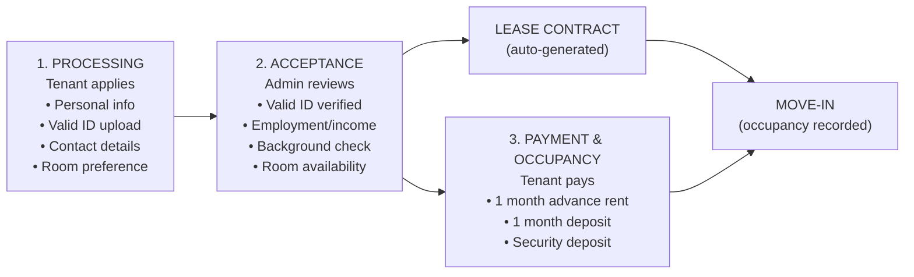
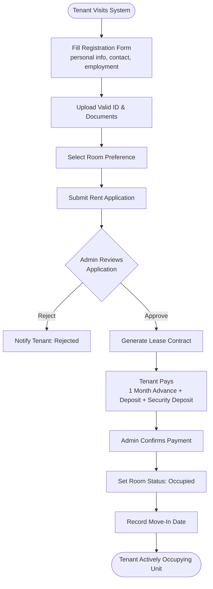
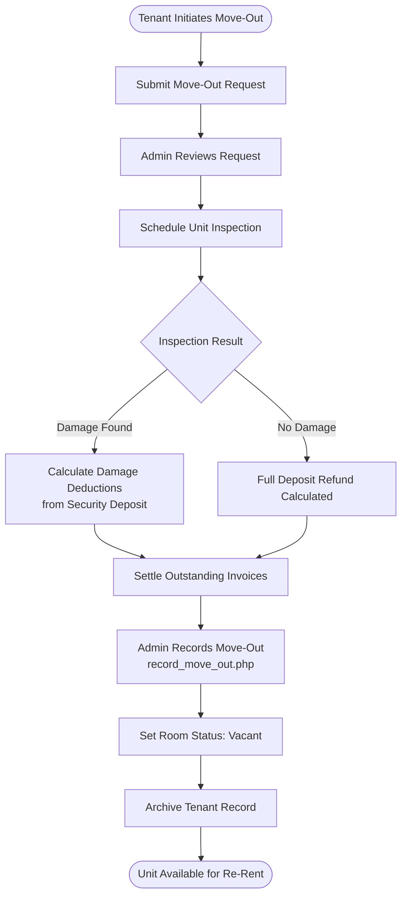
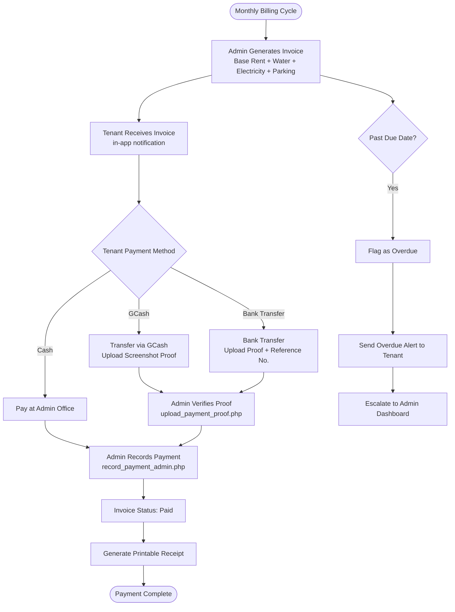
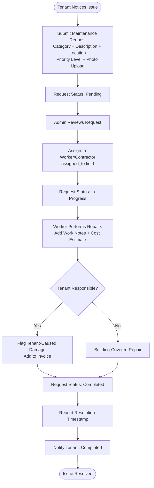
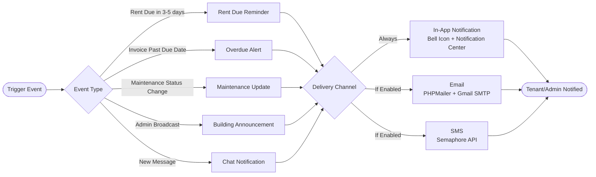
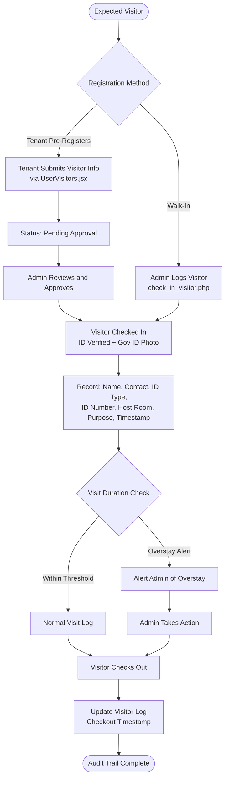
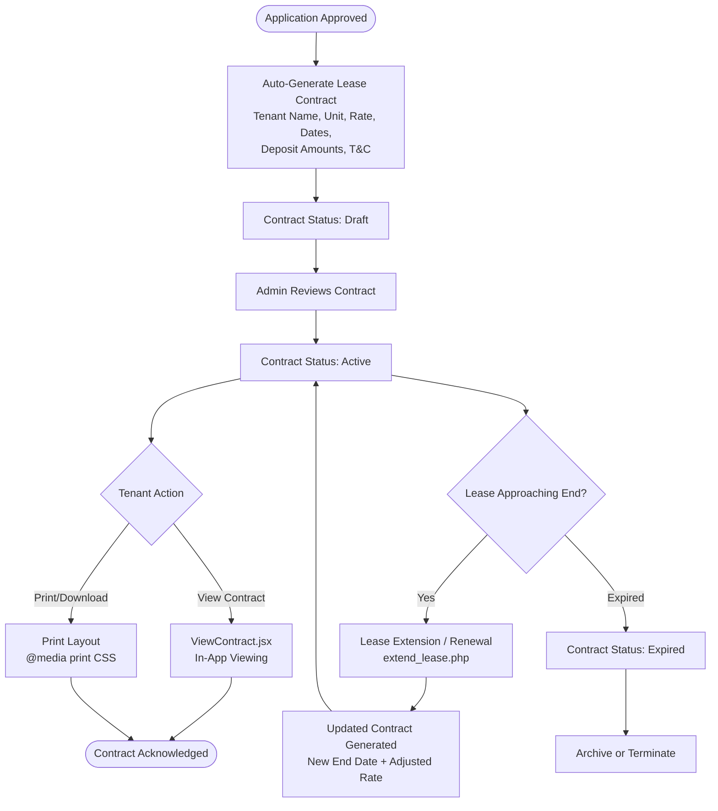
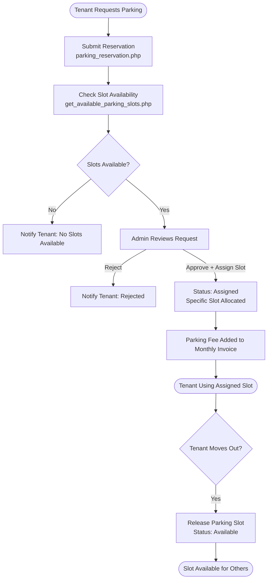
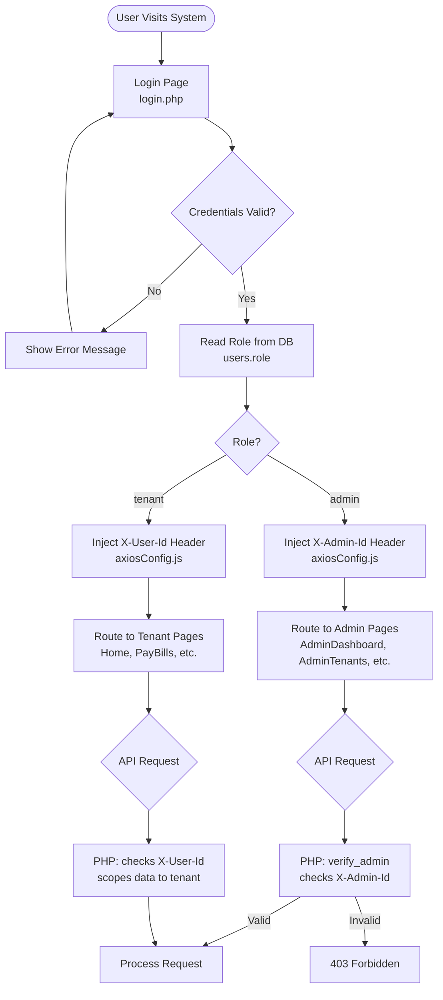

# AMS — Panelist Feature Checklist

> **Project:** Apartment Management System
> **Stack:** React 18 + Vite → PHP 8 → MySQL/MariaDB (XAMPP)
> **Context:** Small-to-medium scale apartment building (15–100 units)
> **Last Updated:** September 2026 (Modules 4, 5, 10, 11 re-verified against current code)

---

## Combined Scope Table

| Status | **Main Module / Area**                  | **Features / Included Functions**                                                                                                                                                                                                                                       |
| :---: | --------------------------------------- | ----------------------------------------------------------------------------------------------------------------------------------------------------------------------------------------------------------------------------------------------------------------------- |
| [x] | **Tenant Management**                   | [x] Tenant registration, [x] tenant profile, [x] ID/document upload, [x] occupancy records, [x] move-in/move-out tracking, [x] payment records                                                                                                                          |
| [x] | **Apartment / Unit Management**         | [x] Room/unit availability, [x] set occupancy, [x] unit status monitoring, [x] occupancy tracking, [x] extended rent                                                                                                                                                  |
| [x] | **Rental Payment & Billing**            | [x] Monthly billing, [x] payment recording, [x] payment history, [x] receipt generation, [x] balance monitoring, [x] due-date reminders, [ ] extended rent, [x] term of payment, [x] security deposit, [x] base rent, [x] water, [x] electricity, [x] parking if applicable |
| [x] | **Payment Methods**                     | [x] GCash, [x] cash, [x] bank transfer                                                                                                                                                                                                                                  |
| [x] | **Maintenance Management**              | [x] Issue type: plumbing, electrical, structural/physical, water supply, general repair, others; [x] problem description, [x] location, [x] priority level: low/medium/high/urgent, [x] photo upload, [x] status: pending/in progress/completed, [x] date and time reported, [x] date and time resolved |
| [x] | **Service Management**                  | [x] Cleaning, [x] laundry, [x] other services, [x] priced catalog, [x] tenant booking, [x] billing integration                                                                                                                                                          |
| [ ] | **Communication Management**            | [x] Announcements, [x] requests, [ ] complaints, [ ] two-way chat (admin ↔ tenant messaging)                                                                                                                                                                            |
| [ ] | **Notification / Automation**           | [x] Rent due reminders, [x] overdue alerts, [x] maintenance updates (in-app), [ ] SMS notifications, [ ] email notifications, [ ] automated reports, [ ] notification preferences                                                                                      |
| [x] | **Inquiry & Reservation Management**    | [x] Inquiry handling, [x] reservation tracking, [x] room/unit availability tracking, [x] reservation module                                                                                                                                                             |
| [x] | **Parking Reservation**                 | [x] Parking slot listing, [x] reservation requests, [~] slot assignment management (status-based, no numbered slots), [~] parking fee integration into billing (manual admin entry, not auto-synced)                                                                   |
| [x] | **Financial Tracking**                  | [x] Rent, [x] utilities, [x] invoices, [x] payment records, [x] revenue stream, [x] income reports, [x] balance monitoring                                                                                                                                              |
| [x] | **Utility Usage**                       | [x] Water usage, [x] electricity usage, [x] utility tracking per unit                                                                                                                                                                                                   |
| [x] | **Report Generation / Admin Dashboard** | [x] Occupancy statistics, [x] income reports, [x] tenant monitoring, [x] maintenance monitoring, [x] utility usage, [x] system activity logs, [x] reports, [x] revenue stream analysis                                                                                  |
| [x] | **Role-Based Access**                   | [x] Role-based access and permissions, [x] admin authentication, [x] tenant authentication, [x] password management                                                                                                                                                     |
| [x] | **CCTV Access Requests**                | [x] Tenant CCTV footage request, [x] admin approval/rejection, [x] request status tracking                                                                                                                                                                              |
| [x] | **Visitor Management**                  | [x] Visitor records / management, [x] tenant pre-authorization, [x] visitor history, [x] overstay alerts                                                                                                                                                                |
| [x] | **Contract Management**                 | [x] Contract generation (auto on approval, as Draft), [x] contract viewing, [x] status management (Draft → Active → Expired, auto-expiring), [x] renewal (extends contract + audit trail in `lease_renewals`), [x] printable (PDF via browser print dialog)             |

---

## Contrast Table: Panelist 3 vs. Chair Panel & Panel 2

### Panelist 3 — Suggested Features

| # | **Panelist 3 Feature / Module**                                    | **Mapped to Combined Scope**                          |
| :-: | ------------------------------------------------------------------ | ----------------------------------------------------- |
| 1 | Payment Tracking & Billing                                         | Module 3 — Rental Payment & Billing                   |
| 2 | Communication Management                                           | Module 7 — Communication (Two-Way Chat)               |
| 3 | Maintenance Management                                             | Module 4 — Maintenance Request                        |
| 4 | Inquiry & Reservation                                              | Module 1.8 — Inquiry & Reservation Management         |
| 5 | Report Generation                                                  | Module 8 — Admin Dashboard & Reports                  |
| 6 | Modular Services                                                   | Module 5 — Service Management                         |
| 7 | Revenue Stream                                                     | Module 8.3 — Revenue Stream Analysis                  |
| 8 | Utility Usage                                                      | Utility Usage row — Module 8.7                        |
| 9 | Improve Tracking Reservation Module                                | Module 1.8 — Reservation Tracking (enhanced)          |
| 10 | Security Deposit                                                   | Module 3.9 — Security Deposit Tracking               |
| 11 | Tenant Management (Profile, Payments)                              | Module 1 — Tenant Management                         |
| 12 | Apartment Unit Management (Availability, Occupancy)                | Module 2 — Apartment / Unit Management               |
| 13 | Financial Tracking (Rent, Utilities, Invoices)                     | Financial Tracking row — Modules 3 & 8               |
| 14 | Communication Tools (Announcements, Requests, Complaints)          | Module 6.5 & Module 7.7 — Announcements & Complaints |
| 15 | Automation (Reminders, Notifications, Reports)                     | Module 6 — Notification / Automation                 |
| 16 | Role-Based Access                                                  | Module 11 — Security & Access Control                |
| 17 | Online Payment → GCash, Cash, Bank                                 | Module 3.11 — Payment Methods                        |
| 18 | Visitor Management                                                 | Module 12 — Visitor Management                       |
| 19 | SMS Notification                                                   | Module 6.7 — SMS Notifications                       |
| 20 | Contract Generation                                                | Module 9 — Contract & Document Generation            |

---

### Chair Panel & Panel 2 — Suggested Modules & Features

| # | **Module**                         | **Features Suggested**                                                                                                                                                                                       | **Mapped to Combined Scope**                         |
| :-: | ---------------------------------- | ------------------------------------------------------------------------------------------------------------------------------------------------------------------------------------------------------------ | ---------------------------------------------------- |
| 1 | Tenant Management Module           | Tenant Registration, Tenant Profile, ID/Document Upload, Occupancy Records, Move-In/Move-Out Tracking                                                                                                        | Module 1 — Tenant Management                        |
| 2 | Apartment / Unit Management Module | Room/Unit Availability, Set Occupancy, Unit Status Monitoring, Occupancy Tracking, Extended Rent                                                                                                             | Module 2 — Apartment / Unit Management              |
| 3 | Rental Payment Module              | Monthly Billing, Payment Recording, Payment History, Receipt Generation, Balance Monitoring, Due Date Reminders, Extended Rent, Term of Payment, Deposit, Base Rent, Water, Electricity, Parking if applies  | Module 3 — Rental Payment & Billing                 |
| 4 | Maintenance Management Module      | Issue type (plumbing, electrical, structural/physical, water supply, general repair, others), problem description, location, priority level (low/medium/high/urgent), photo upload, status (pending/in progress/completed), date & time reported, date & time resolved | Module 4 — Maintenance Request |
| 5 | Service Management Module          | Cleaning, Laundry, Others                                                                                                                                                                                    | Module 5 — Service Management                       |
| 6 | Notification Module                | Rent due reminder, overdue alerts, maintenance updates, SMS/email notifications                                                                                                                              | Module 6 — Notification / Automation               |
| 7 | Admin Dashboard                    | Occupancy statistics, income reports, tenant monitoring, maintenance monitoring, system activity logs, contract generation                                                                                    | Module 8 — Admin Dashboard & Reports + Module 9    |
| 8 | Payment Methods                    | GCash, Cash, Bank Transfer                                                                                                                                                                                   | Module 3.11 — Payment Methods                       |
| 9 | SMS & Email Notifications          | SMS and email notification delivery channels                                                                                                                                                                 | Module 6.6 & 6.7 — Email & SMS Notifications        |
| 10 | Contract Management                | Auto-generated contracts on approval                                                                                                                                                                         | Module 9 — Contract & Document Generation           |
| 11 | Visitor Management                 | Visitor records, pre-authorization by tenants, visitor history, overstay alerts                                                                                                                              | Module 12 — Visitor Management                      |

---

### Feature Alignment Summary — Panelist 3 vs. Chair Panel & Panel 2

| **Panelist 3**                                             | **Chair Panel & Panel 2**                                  | **In Combined Scope?** |
| ---------------------------------------------------------- | ---------------------------------------------------------- | :--------------------: |
| Payment Tracking & Billing                                 | Rental Payment Module (billing, history, receipt, balance) | ✅ Module 3            |
| Communication Management                                   | *(implicit — Admin Dashboard messaging)*                   | ✅ Module 7            |
| Maintenance Management                                     | Maintenance Management Module                              | ✅ Module 4            |
| Inquiry & Reservation / Improve Tracking Reservation       | *(not explicitly mentioned)*                               | ✅ Module 1.8          |
| Report Generation                                          | Admin Dashboard (occupancy stats, income, logs)            | ✅ Module 8            |
| Modular Services                                           | Service Management Module (cleaning, laundry, others)      | ✅ Module 5            |
| Revenue Stream                                             | *(not explicitly mentioned)*                               | ✅ Module 8.3          |
| Utility Usage                                              | *(not explicitly mentioned)*                               | ✅ Utility Usage row   |
| Security Deposit                                           | Deposit (under Rental Payment Module)                      | ✅ Module 3.9          |
| Tenant Management (Profile, Payments)                      | Tenant Management Module                                   | ✅ Module 1            |
| Apartment Unit Management (Availability, Occupancy)        | Apartment / Unit Management Module                         | ✅ Module 2            |
| Financial Tracking (Rent, Utilities, Invoices)             | Base Rent, Water, Electricity under Rental Payment         | ✅ Financial Tracking  |
| Communication Tools (Announcements, Requests, Complaints)  | *(Notification Module covers announcements)*               | ✅ Module 6 & 7        |
| Automation (Reminders, Notifications, Reports)             | Notification Module                                        | ✅ Module 6            |
| Role-Based Access                                          | *(not explicitly mentioned)*                               | ✅ Module 11           |
| Online Payment → GCash, Cash, Bank                         | Payment: GCash, Cash, Bank Transfer                        | ✅ Module 3.11         |
| Visitor Management                                         | Visitor Management                                         | ✅ Module 12           |
| SMS Notification                                           | SMS & Email Notifications                                  | ✅ Module 6.7          |
| Contract Generation                                        | Contract Generation (under Admin Dashboard)                | ✅ Module 9            |
| *(CCTV Access Request — unique to system)*                 | *(not mentioned)*                                          | ✅ Module 11.5         |
| *(Parking Reservation — unique to system)*                 | *(not mentioned)*                                          | ✅ Module 10           |

---

## System Context

This system manages the **day-to-day operations of a small-to-medium apartment building**, covering the full tenant lifecycle from application through move-out. The target scale determines which features are essential vs. nice-to-have:

| Scale | Units | Tenants | Admin Staff | Monthly Transactions |
|---|---|---|---|---|
| **Small** | 5–20 | 10–40 | 1 admin | 20–80 payments |
| **Medium** | 20–100 | 40–200 | 1–3 admins | 80–400 payments |

---

## Core Operational Flow

---

## Operation Flow Diagrams

### Tenant Application & Onboarding Flow

### Move-Out Flow

### Payment & Billing Flow

### Maintenance Request Flow

### Notification & Alert Flow

### Visitor Management Flow

### Contract Generation Flow

### Parking Reservation Flow

### Admin Dashboard & Reports Flow

### Role-Based Access & Authentication Flow

---

## Master Checklist — Implementation Status

### Legend

| Symbol | Meaning |
|---|---|
| ✅ | Implemented and functional |
| 🔧 | Partially implemented / needs wiring |
| 📋 | Designed but not yet built |
| ❌ | Not started |

---

### Module 1 — Tenant Management

> Admin Pages: [AdminTenants.jsx](file:///c:/xampp/htdocs/ApartmentManagementSystem_React/ams-react/src/AdminPages/AdminTenants.jsx) · [AdminApplications.jsx](file:///c:/xampp/htdocs/ApartmentManagementSystem_React/ams-react/src/AdminPages/AdminApplications.jsx)
> Tenant Pages: [Registration.jsx](file:///c:/xampp/htdocs/ApartmentManagementSystem_React/ams-react/src/UserPages/Registration.jsx) · [RentApplication.jsx](file:///c:/xampp/htdocs/ApartmentManagementSystem_React/ams-react/src/UserPages/RentApplication.jsx) · [TrackApplication.jsx](file:///c:/xampp/htdocs/ApartmentManagementSystem_React/ams-react/src/UserPages/TrackApplication.jsx) · [ProfileSettings.jsx](file:///c:/xampp/htdocs/ApartmentManagementSystem_React/ams-react/src/UserPages/ProfileSettings.jsx)

- [x] **1.1 Tenant Registration** ✅ — `registration.php` + React form
- [x] **1.2 Tenant Profile** ✅ — `profile.php` with edit
- [x] **1.3 ID / Document Upload** ✅ — Valid ID (front/back) + NBI clearance via `rent_application.php`/`upload_lease_document.php`. No "proof of income" field exists — not part of this system's application flow.
- [x] **1.4 Occupancy Record** ✅ — Via `rent_applications` approval. No dedicated `move_in_date` column; the application's `created_at` (or lease_contracts.lease_start once approved) stands in for it.
- [x] **1.5 Move-In / Move-Out Tracking** ✅ — Tenant initiates, admin inspects and approves (`record_move_out.php`)
- [x] **1.6 Application Processing Flow** ✅ — Pending Review → Approved/Rejected
- [x] **1.7 Acceptance Criteria Enforcement** ✅ — `update_tenant_status.php` rejects approval unless valid ID (front/back), NBI clearance, and a recorded `terms_agreed_at` (checked at submission via a required Terms & Conditions checkbox in `RentApplication.jsx`) are all present.
- [x] **1.8 Inquiry Handling & Reservation Tracking** ✅ — Public inquiry form (guest or prefilled), admin triage pipeline, and unit reservations that hold a room with an auto-expiring hold (`inquiries` + `unit_reservations` tables, `AdminInquiries.jsx`, `InquiryForm.jsx`)

---

### Module 2 — Apartment / Unit Management

> Admin Pages: [AdminUnits.jsx](file:///c:/xampp/htdocs/ApartmentManagementSystem_React/ams-react/src/AdminPages/AdminUnits.jsx)
> Tenant Pages: [MyRoom.jsx](file:///c:/xampp/htdocs/ApartmentManagementSystem_React/ams-react/src/UserPages/MyRoom.jsx)

- [x] **2.1 Room / Unit Listing** ✅ — `get_rooms.php`, `create_room.php`. No `capacity`/`max_occupants` column on `rooms` — occupant count is capped only implicitly via the per-excess-occupant surcharge.
- [x] **2.2 Unit Availability Dashboard** ✅ — Room status in admin panel
- [x] **2.3 Set Occupancy** ✅ — Via application approval. There is no per-unit "max occupants" cap; the ₱1,000/excess-occupant surcharge (configurable in `system_settings`) is the only occupancy-related rule enforced.
- [x] **2.4 Unit Status Monitoring** ✅ — DB-backed condition, furnishing, inspection logs & inline edit
- [x] **2.5 Occupancy Tracking** ✅ — Dynamic stay durations, active counts, and a 6-month occupancy trend (`get_report_data.php`). No dedicated "vacancy rate" metric — occupancy and vacancy are complementary, so this is covered by the same trend data rather than a separate figure.
- [x] **2.6 Extended Rent / Lease Renewal** ✅ — `extend_lease.php`
- [x] **2.7 Unit Rate Configuration** ✅ — `update_room.php` sets base monthly rent per unit. There are no separate water/electricity/parking *rate* columns on `rooms` — those utilities are billed per-reading/per-reservation (`save_utility_reading.php`, parking reservations), not configured as a fixed per-unit allocation.

---

### Module 3 — Rental Payment & Billing

> Admin Pages: [AdminPayments.jsx](file:///c:/xampp/htdocs/ApartmentManagementSystem_React/ams-react/src/AdminPages/AdminPayments.jsx)
> Tenant Pages: [PayBills.jsx](file:///c:/xampp/htdocs/ApartmentManagementSystem_React/ams-react/src/UserPages/PayBills.jsx) · [PaymentUpload.jsx](file:///c:/xampp/htdocs/ApartmentManagementSystem_React/ams-react/src/UserPages/PaymentUpload.jsx) · [UserPaymentHistory.jsx](file:///c:/xampp/htdocs/ApartmentManagementSystem_React/ams-react/src/UserPages/UserPaymentHistory.jsx)
> Related Docs: [payment_system_design.md](file:///c:/xampp/htdocs/ApartmentManagementSystem_React/docs/features/payment_system_design.md) · [notification_services.md](file:///c:/xampp/htdocs/ApartmentManagementSystem_React/docs/features/notification_services.md)

- [x] **3.1 Monthly Billing / Invoice Generation** ✅ — `invoices` table
- [x] **3.2 Payment Recording** ✅ — `record_payment_admin.php`
- [x] **3.3 Payment History** ✅ — `get_invoices.php`
- [x] **3.4 Receipt Generation** ✅ — Printable official receipts with admin signature placeholder
- [x] **3.5 Balance Monitoring** ✅ — Status filter select and full balance tracking metrics & aging ledger
- [x] **3.6 Due Date Reminders** ✅ — Automatic countdown alerts + `check_due_date_reminders.php` + manual admin dispatch
- [x] **3.7 Overdue Alerts** ✅ — Auto-overdue status + `overdue` notification dispatch + banner in `PayBills.jsx`
- [x] **3.8 Payment Proof Upload** ✅ — `upload_payment_proof.php`
- [x] **3.9 Security Deposit Tracking** ✅ — Non-refundable deposit tracking applied to rent, bills, or damages
- [ ] **3.10 Extended Rent Terms** 🔧 — Lease extension exists; billing adjustment pending
- [x] **3.11 Payment Methods (GCash, Cash, Bank)** ✅ — Online & offline payment method support
- [x] **3.12 Term of Payment Rules** ✅ — Enforcement of payment terms (1 mo advance, 1 mo deposit, etc)

---

### Module 4 — Maintenance Request

> Admin Pages: [AdminMaintainance.jsx](file:///c:/xampp/htdocs/ApartmentManagementSystem_React/ams-react/src/AdminPages/AdminMaintainance.jsx)
> Tenant Pages: [MaintenanceRequest.jsx](file:///c:/xampp/htdocs/ApartmentManagementSystem_React/ams-react/src/UserPages/MaintenanceRequest.jsx) · [UserMyRequests.jsx](file:///c:/xampp/htdocs/ApartmentManagementSystem_React/ams-react/src/UserPages/UserMyRequests.jsx)
> Related Docs: [notification_services.md](file:///c:/xampp/htdocs/ApartmentManagementSystem_React/docs/features/notification_services.md)

- [x] **4.1 Submit Maintenance Request** ✅ — `maintenance_request.php`
- [x] **4.2 Issue Categories** ✅ — `issue_category` field (Plumbing, Electrical, Structural/Physical, Water Supply, General Repair, Others)
- [x] **4.3 Priority Levels** ✅ — `urgency` field (Low / Medium / High / Urgent)
- [x] **4.4 Photo Upload** ✅ — Drag & drop, live preview, video/photo support, backend storage
- [x] **4.5 Status Tracking** ✅ — Pending → In Progress → Completed
- [x] **4.6 Date / Time Tracking** ✅ — Tracks `created_at` and `resolved_at` resolution timestamps
- [x] **4.7 Admin Assignment** ✅ — `assigned_to` field
- [x] **4.8 Cost Estimation** ✅ — `estimated_cost`, `tenant_responsible` fields
- [x] **4.9 Work Notes** ✅ — `work_notes` field
- [ ] **4.10 Tenant Notification on Update** 🔧 — In-app works; external channels pending

---

### Module 5 — Service Management

> Admin Pages: [AdminServicePage.jsx](file:///c:/xampp/htdocs/ApartmentManagementSystem_React/ams-react/src/AdminPages/AdminServicePage.jsx) · [AdminCctv.jsx](file:///c:/xampp/htdocs/ApartmentManagementSystem_React/ams-react/src/AdminPages/AdminCctv.jsx) · [AdminParking.jsx](file:///c:/xampp/htdocs/ApartmentManagementSystem_React/ams-react/src/AdminPages/AdminParking.jsx)
> Tenant Pages: [Services.jsx](file:///c:/xampp/htdocs/ApartmentManagementSystem_React/ams-react/src/UserPages/Services.jsx) · [ServiceBooking.jsx](file:///c:/xampp/htdocs/ApartmentManagementSystem_React/ams-react/src/UserPages/ServiceBooking.jsx) · [CctvRequest.jsx](file:///c:/xampp/htdocs/ApartmentManagementSystem_React/ams-react/src/UserPages/CctvRequest.jsx) · [ParkingReservation.jsx](file:///c:/xampp/htdocs/ApartmentManagementSystem_React/ams-react/src/UserPages/ParkingReservation.jsx)
> Related Docs: [service_management_design.md](file:///c:/xampp/htdocs/ApartmentManagementSystem_React/docs/features/service_management_design.md)

- [x] **5.1 Service Request Submission** ✅ — Priced add-on booking via `service_request.php` (multipart, re-derives price server-side), plus `cctv_request.php`, `parking_reservation.php`, `maintenance_request.php`, `check_in_visitor.php`
- [x] **5.2 Service Catalog & Modular Controls** ✅ — Two-level gating: `system_settings.service_<category>_active` toggles a whole category, `service_catalog.is_active` toggles an individual priced item; full CRUD via `manage_service_catalog.php` + `ServiceCatalogModal.jsx` on `AdminServicePage.jsx`
- [x] **5.3 Service Status Tracking** ✅ — `Pending → Approved → In Progress → Completed`, plus `Rejected`/`Cancelled`; booking queue on `AdminServicePage.jsx` (`get_service_requests.php`), tenant-side cancel via `cancel_request.php`, mirrored per-service status views on `AdminCctv.jsx`/`AdminParking.jsx`
- [x] **5.4 Service Billing Integration** ✅ — Completed add-on services post to `invoices.services` via `post_service_charge()` (claim-then-bill, anti-double-billing), accumulating across bookings in a month; reversible via `reverse_service_charge()` while the invoice is unpaid; manual retry via `sync_service_to_invoice.php` when no active lease was found at completion time
- [x] **5.5 Cleaning & Laundry Services** ✅ — `service_catalog` (price, unit, quantity range, lead time) + `service_requests` (snapshots price/name at booking time) tables; `ServiceBooking.jsx` booking form; catalog CRUD and booking queue on `AdminServicePage.jsx`; charges posted to `invoices.services`

---

### Module 6 — Notification Module

> Admin Pages: [AdminNotifications.jsx](file:///c:/xampp/htdocs/ApartmentManagementSystem_React/ams-react/src/AdminPages/AdminNotifications.jsx) · [AdminAnnouncements.jsx](file:///c:/xampp/htdocs/ApartmentManagementSystem_React/ams-react/src/AdminPages/AdminAnnouncements.jsx)
> Tenant Pages: [UserNotifications.jsx](file:///c:/xampp/htdocs/ApartmentManagementSystem_React/ams-react/src/UserPages/UserNotifications.jsx) · [UserAnnouncements.jsx](file:///c:/xampp/htdocs/ApartmentManagementSystem_React/ams-react/src/UserPages/UserAnnouncements.jsx)
> Related Docs: [notification_services.md](file:///c:/xampp/htdocs/ApartmentManagementSystem_React/docs/features/notification_services.md)

- [x] **6.1 In-App Notifications** ✅ — Bell icon + notification center
- [x] **6.2 Rent Due Reminders** ✅ — Implemented via `check_due_date_reminders.php` and `send_payment_reminder.php`
- [x] **6.3 Overdue Alerts** ✅ — Implemented with overdue status transitions & recurring in-app alerts
- [ ] **6.4 Maintenance Status Updates** 🔧 — In-app works; external channels pending
- [x] **6.5 Building Announcements** ✅ — `create_announcement.php`
- [ ] **6.6 Email Notifications** 📋 — PHPMailer + Gmail SMTP designed
- [ ] **6.7 SMS Notifications** 📋 — Semaphore API designed
- [ ] **6.8 Notification Preferences** 📋 — Schema designed

---

### Module 7 — Communication (Two-Way Chat)

> Related Docs: [chat_design.md](file:///c:/xampp/htdocs/ApartmentManagementSystem_React/docs/features/chat_design.md)

- [ ] **7.1 Admin → Tenant Messaging** 📋 — Design complete (`send_message.php`, `AdminChat.jsx`)
- [ ] **7.2 Tenant → Admin Messaging** 📋 — Design complete (`TenantChat.jsx`, `start_conversation.php`)
- [ ] **7.3 Conversation History** 📋 — Design complete (`get_messages.php`, `ChatWindow.jsx`)
- [ ] **7.4 Unread Message Badge** 📋 — Design complete (`get_conversations.php` → unread_count)
- [ ] **7.5 Admin Inbox** 📋 — Design complete (`AdminChat.jsx` sidebar)
- [ ] **7.6 New Message Notification** 📋 — Design complete (triggers notification row on send)
- [ ] **7.7 Complaints Management** 📋 — Dedicated channel for filing and tracking tenant complaints

---

### Module 8 — Admin Dashboard & Reports

> Admin Pages: [AdminDashboard.jsx](file:///c:/xampp/htdocs/ApartmentManagementSystem_React/ams-react/src/AdminPages/AdminDashboard.jsx) · [AdminReports.jsx](file:///c:/xampp/htdocs/ApartmentManagementSystem_React/ams-react/src/AdminPages/AdminReports.jsx) · [AdminActivityLogs.jsx](file:///c:/xampp/htdocs/ApartmentManagementSystem_React/ams-react/src/AdminPages/AdminActivityLogs.jsx)

- [x] **8.1 Dashboard Statistics** ✅ — `dashboard_stats.php`
- [x] **8.2 Income Reports** ✅ — Financial income statement, unit income rankings, period comparisons, CSV/Print export (`get_report_data.php` + `AdminReports.jsx`)
- [x] **8.3 Revenue Stream Analysis** ✅ — Category stream breakdown (Rent, Utilities, Parking, Deposits), 100% DB-backed 6-month historical trends, diversification index
- [x] **8.4 Tenant Monitoring** ✅ — `get_tenants.php`
- [x] **8.5 Maintenance Monitoring** ✅ — `get_maintenance_requests.php`
- [x] **8.6 System Activity Logs** ✅ — `activity_logs` table, `get_activity_logs.php`, `AdminActivityLogs.jsx`
- [x] **8.7 Utility Usage Tracking** ✅ — `utility_readings` table, `AdminUtilities.jsx`, `UserUtilities.jsx`
- [ ] **8.8 Sampling Data / Demo Data** 📋 — Needed for demo (SQL seed script)

---

### Module 9 — Contract & Document Generation

> Admin Pages: [AdminContracts.jsx](file:///c:/xampp/htdocs/ApartmentManagementSystem_React/ams-react/src/AdminPages/AdminContracts.jsx)
> Tenant Pages: [ViewContract.jsx](file:///c:/xampp/htdocs/ApartmentManagementSystem_React/ams-react/src/UserPages/ViewContract.jsx)

- [x] **9.1 Lease Contract Generation** ✅ — Auto-generated on application approval (`update_tenant_status.php`), created as `draft`; rent, security deposit, lease start/end and tenant details all bound to real DB values in `ViewContract.jsx`; landlord identity comes from `system_settings`
- [x] **9.2 Contract Viewing** ✅ — Fully wired to `lease_contracts` via `ViewContract.jsx`, scoped to the logged-in tenant (`?userId=` + `X-User-Id`); `?email=` lookup is admin-only
- [x] **9.3 Contract Status Management** ✅ — `Draft → Active → Expired`, plus `Eviction Pending`, all implemented; auto-expiry via `expire_lapsed_contracts()` (`backend/config.php`), run opportunistically from `get_contracts.php`/`my_room.php` and on-demand via `expire_contracts.php`, same pattern as `release_expired_reservations()`. `Terminated` is a valid ENUM state but still has no admin action to reach it.
- [x] **9.4 Contract Renewal** ✅ — `process_tenant_request.php` extends the tenant's existing `lease_contracts` row (transaction-wrapped, resolves the application once instead of two divergent queries, reactivates an `expired` contract on renewal) and records every extension in the new `lease_renewals` audit table (added months, previous/new end date, rent at time of renewal). Renewal still amends the one contract row per application rather than creating a separate versioned document — the schema has no per-contract rate column to version in the first place (rate is always read live from `rent_applications.monthly_rent`).
- [x] **9.5 Printable** ✅ — High-fidelity 4-page `@media print` CSS in `ViewContract.jsx`. **Note:** "Downloadable" is via the browser's *Save as PDF* in the print dialog; there is no PDF library or server-side PDF export in the project
- [x] **9.6 Eviction Monitoring** ✅ — `AdminContracts.jsx`'s overdue-payment banner, per-contract eviction panel, and Flag/Clear actions were previously unreachable dead UI (`overdueInfo` was hardcoded `null`). `get_contracts.php` now computes real per-tenant overdue totals and days-overdue from `invoices`, so the eviction workflow is fully wired end to end.

---

### Module 10 — Parking Reservation

> Admin Pages: [AdminParking.jsx](file:///c:/xampp/htdocs/ApartmentManagementSystem_React/ams-react/src/AdminPages/AdminParking.jsx)
> Tenant Pages: [ParkingReservation.jsx](file:///c:/xampp/htdocs/ApartmentManagementSystem_React/ams-react/src/UserPages/ParkingReservation.jsx)

- [x] **10.1 Parking Slot Listing** ✅ — `get_available_parking_slots.php`
- [x] **10.2 Reservation Request** ✅ — `parking_reservation.php`
- [ ] **10.3 Parking Fee Integration** 🔧 — `invoices.parking` column exists and flows through billing/reporting, but the amount is still typed in manually on `create_invoice.php`; nothing auto-copies a reservation's `total_cost` onto the tenant's invoice
- [ ] **10.4 Slot Assignment Management** 🔧 — `update_parking_status.php` lets admin move a reservation to `Assigned`/`Approved`/`Rejected` and notifies the tenant, but there is no numbered-slot column — "assignment" is a status change, not allocation of a specific physical slot

---

### Module 11 — Security & Access Control

> Admin Pages: [AdminUsers.jsx](file:///c:/xampp/htdocs/ApartmentManagementSystem_React/ams-react/src/AdminPages/AdminUsers.jsx) · [AdminAccountSettings.jsx](file:///c:/xampp/htdocs/ApartmentManagementSystem_React/ams-react/src/AdminPages/AdminAccountSettings.jsx) · [AdminCctv.jsx](file:///c:/xampp/htdocs/ApartmentManagementSystem_React/ams-react/src/AdminPages/AdminCctv.jsx)
> Tenant Pages: [Login.jsx](file:///c:/xampp/htdocs/ApartmentManagementSystem_React/ams-react/src/UserPages/Login.jsx) · [Registration.jsx](file:///c:/xampp/htdocs/ApartmentManagementSystem_React/ams-react/src/UserPages/Registration.jsx) · [ResetPassword.jsx](file:///c:/xampp/htdocs/ApartmentManagementSystem_React/ams-react/src/UserPages/ResetPassword.jsx) · [CctvRequest.jsx](file:///c:/xampp/htdocs/ApartmentManagementSystem_React/ams-react/src/UserPages/CctvRequest.jsx)

- [x] **11.1 Role-Based Access Control** ✅ — Admin/tenant route guards
- [x] **11.2 Admin Authentication** ✅ — `login.php`
- [x] **11.3 Tenant Authentication** ✅ — `login.php`
- [x] **11.4 Password Management** ✅ — `change_password.php`
- [x] **11.5 CCTV Access Requests** ✅ — Tenant submits via `cctv_request.php`; admin approves/rejects via `update_cctv_status.php` (`AdminCctv.jsx`), which also notifies the tenant and logs the action; queue and counts via `get_cctv_requests.php`

---

### Module 12 — Visitor Management

> Admin Pages: [AdminVisitors.jsx](file:///c:/xampp/htdocs/ApartmentManagementSystem_React/ams-react/src/AdminPages/AdminVisitors.jsx)
> Tenant Pages: [UserVisitors.jsx](file:///c:/xampp/htdocs/ApartmentManagementSystem_React/ams-react/src/UserPages/UserVisitors.jsx)

- [x] **12.1 Visitor Log Entry** ✅ — `check_in_visitor.php`, `visitor_logs` table (with ID type, ID number & Gov ID photo upload)
- [x] **12.2 Tenant Pre-Authorization / Registration** ✅ — Tenant self-registration with `pending_approval` admin review
- [x] **12.3 Visitor History & Overstay Alerts** ✅ — `get_visitors.php` role-scoped query, status/date/unit filters, overstay threshold alerts

---

## Summary — Implementation Progress

| Module | Total Features | ✅ Done | 🔧 Partial | 📋 Designed | ❌ Not Started |
|---|---|---|---|---|---|
| 1. Tenant Management | 8 | 8 | 0 | 0 | 0 |
| 2. Unit Management | 7 | 7 | 0 | 0 | 0 |
| 3. Payment & Billing | 12 | 9 | 1 | 2 | 0 |
| 4. Maintenance Request | 10 | 9 | 1 | 0 | 0 |
| 5. Service Management | 5 | 5 | 0 | 0 | 0 |
| 6. Notification | 8 | 2 | 1 | 5 | 0 |
| 7. Communication | 7 | 0 | 0 | 7 | 0 |
| 8. Dashboard & Reports | 8 | 6 | 0 | 2 | 0 |
| 9. Contracts | 6 | 6 | 0 | 0 | 0 |
| 10. Parking | 4 | 2 | 2 | 0 | 0 |
| 11. Security & Access | 5 | 5 | 0 | 0 | 0 |
| 12. Visitor Management | 3 | 3 | 0 | 0 | 0 |
| **TOTAL** | **83** | **60** | **6** | **17** | **0** |

### Core Functionality Coverage

| Core Requirement | Covered By |
|---|---|
| Payment Tracking & Billing | Module 3 (10 features) |
| Communication Management | Module 7 (6 features) + Module 6 (8 features) |
| Maintenance Request | Module 4 (10 features) |
| Inquiry and Reservation | Module 1.8 (inquiries + unit reservations), Module 10, Module 11.5, Module 12 |
| Report Generation | Module 8 (8 features) |
| Modular Services | Module 5 (5 features) + Module 12 (3 features) |

---

## Detailed Module Feature Tables

### Module 1 — Tenant Management

**Context:** In a small/medium apartment, the admin personally handles tenant screening. The system must track the full tenant lifecycle: application → screening → approval → occupancy → move-out.

| # | Feature | Details | Scale | Implementation | Related Doc |
|---|---|---|---|---|---|
| 1.1 | **Tenant Registration** | Online application form: personal info (name, contact, email). No emergency-contact or employment/income fields exist in this system | Small+ | `registration.php`, `rent_application.php` | [system_design.md](file:///c:/xampp/htdocs/ApartmentManagementSystem_React/docs/system_design.md) |
| 1.2 | **Tenant Profile** | View/edit tenant details, profile photo, contact info, lease status, room assignment | Small+ | `profile.php`, `get_tenants.php` | [system_design.md](file:///c:/xampp/htdocs/ApartmentManagementSystem_React/docs/system_design.md) |
| 1.3 | **ID / Document Upload** | Upload valid government ID (front/back) and NBI clearance; stored securely on server. No "proof of income" field exists | Small+ | `rent_application.php`, `upload_lease_document.php`, `get_documents.php` | — |
| 1.4 | **Occupancy Record** | Track which tenant occupies which unit, expected stay duration, number of occupants. No dedicated `move_in_date` column — `created_at`/`lease_start` stand in for it | Small+ | `rent_applications` table (status: Approved/active), `update_occupants.php` | [system_design.md](file:///c:/xampp/htdocs/ApartmentManagementSystem_React/docs/system_design.md) |
| 1.5 | **Move-In / Move-Out Tracking** | Record move-in date on approval, move-out with unit inspection notes, deposit refund status, archive tenant record | Small+ | `record_move_out.php`, `archive_tenant.php`, `restore_tenant.php` | [move_in_move_out_design.md](file:///c:/xampp/htdocs/ApartmentManagementSystem_React/docs/features/move_in_move_out_design.md) |
| 1.6 | **Application Processing Flow** | Status pipeline: Pending Review → Approved/Rejected. Admin sees pending applications, reviews documents, sets acceptance criteria | Small+ | `rent_application.php`, `get_applications.php` | — |
| 1.7 | **Acceptance Criteria Enforcement** | Before approval: verify valid ID (front/back) and NBI clearance are real uploads (not placeholders), and the applicant recorded a Terms & Conditions agreement (`terms_agreed_at`). Manual admin unit-assignment (`update_room.php`) requires an explicit in-person identity-verification attestation instead, since no self-service upload exists in that flow | Medium | `update_tenant_status.php`, `rent_application.php` (captures `terms_agreed_at` on submit), `rent_applications.terms_agreed_at` column | — |
| 1.8 | **Inquiry Handling & Reservation Tracking** | Prospective tenants (guest or logged in) submit inquiries from `/preview` or `/home`; admin triages New → Contacted → Scheduled → Reserved → Converted/Closed, places an auto-expiring hold on a unit, and converts an inquiry into a rent application | Small+ | `inquiries` + `unit_reservations` tables, `submit_inquiry.php`, `get_inquiries.php`, `update_inquiry_status.php`, `create_reservation.php`, `update_reservation_status.php`, `expire_reservations.php`, `AdminInquiries.jsx`, `InquiryForm.jsx` | [inquiry_reservation_design.md](file:///c:/xampp/htdocs/ApartmentManagementSystem_React/docs/features/inquiry_reservation_design.md) |

#### Acceptance Terms (Small/Medium Scale)

`update_tenant_status.php` actually bills two components on approval, not three — the move-in invoice's `total_amount` is `monthly_rent * 2`:

| Term | Amount | When Due | Purpose |
|---|---|---|---|
| **1 Month Advance Rent** | Base rent amount (`invoices.base_rent`) | Before move-in | First month payment |
| **Security Deposit** | One month's rent (`invoices.security_deposit`, same value as `lease_contracts.deposit_amount`) | Before move-in | Property damage guarantee |

There is no separate "1 month deposit" line distinct from the security deposit — that was a documentation-only discrepancy, not a missing feature.

---

### Module 2 — Apartment / Unit Management

**Context:** Small/medium apartments have a fixed number of units with varying types (studio, 1BR, 2BR). The admin needs a real-time view of which units are occupied, vacant, or under maintenance.

| # | Feature | Details | Scale | Implementation | Related Doc |
|---|---|---|---|---|---|
| 2.1 | **Room / Unit Listing** | List all units with: room ID, type, floor, monthly rate, current status. No `capacity`/`max_occupants` column exists on `rooms` | Small+ | `get_rooms.php`, `create_room.php`, `rooms` table | [system_design.md](file:///c:/xampp/htdocs/ApartmentManagementSystem_React/docs/system_design.md) |
| 2.2 | **Unit Availability Dashboard** | Visual overview: which rooms are Vacant / Occupied / Under Maintenance / Reserved | Small+ | `get_rooms.php` returns status per room | — |
| 2.3 | **Set Occupancy** | Assign tenant to unit on approval, update room status to Occupied. There is no per-unit "max occupants" cap column — occupancy is only implicitly bounded by a ₱1,000-per-excess-occupant surcharge (configurable via `system_settings.occupant_surcharge_per_person`) applied above 4 occupants | Small+ | `update_tenant_status.php` (approval flow), `update_room.php` (manual admin assignment) | — |
| 2.4 | **Unit Status Monitoring** | Track room condition, last inspection date, maintenance history per unit, furnishing status | Medium | `rooms` table + `maintenance_requests` join (via `maintenance_requests.room_name`) | — |
| 2.5 | **Occupancy Tracking** | Dashboard: occupancy rate, average stay duration, and a 6-month occupancy trend. No separate "vacancy rate" metric exists — occupancy and vacancy are complementary (vacancy = 100% − occupancy), so this is covered by the same trend data rather than a distinct figure | Medium | `get_report_data.php` | — |
| 2.6 | **Extended Rent / Lease Renewal** | Admin extends lease end date, generates updated contract, adjusts rent if rate changed | Small+ | `extend_lease.php` | — |
| 2.7 | **Unit Rate Configuration** | Set per-unit base monthly rent. No separate water/electricity/parking *rate* columns exist on `rooms` — those utilities are billed per-reading or per-reservation (`save_utility_reading.php`, parking reservations), not configured as a fixed per-unit allocation | Small+ | `update_room.php`, `rooms.monthly_rent` | — |

#### Room Status Values

| Status | Meaning | Trigger |
|---|---|---|
| **Vacant** | No tenant assigned, ready to rent | After move-out + inspection |
| **Occupied** | Active tenant with valid lease | After application approval + payment |
| **Under Maintenance** | Temporarily unavailable for occupancy | Admin sets during repairs |
| **Reserved** | Held for a prospect from an inquiry; hidden from the public listing | Admin places a hold via `create_reservation.php`; auto-released when `hold_expires_at` passes |

---

### Module 3 — Rental Payment & Billing

**Context:** In a small/medium apartment, billing is monthly. Each tenant's total rent includes base rent plus utilities and optional charges. The admin needs to track who has paid, who is overdue, and generate receipts.

| # | Feature | Details | Scale | Implementation | Related Doc |
|---|---|---|---|---|---|
| 3.1 | **Monthly Billing / Invoice Generation** | Auto-generate monthly invoice per tenant: base rent + water + electricity + parking (if applicable) | Small+ | `invoices` table, invoice generation in admin panel | — |
| 3.2 | **Payment Recording** | Admin records payment: amount, date, method (GCash / Cash / Bank Transfer), reference number | Small+ | `record_payment_admin.php`, `pay_bill.php` | — |
| 3.3 | **Payment History** | Tenant views their payment history; admin views all payments with filters by date, tenant, status | Small+ | `get_invoices.php` | — |
| 3.4 | **Receipt Generation** | Generate printable/downloadable receipt after payment confirmation: invoice #, amount, date, method, admin signature | Small+ | React print/PDF component from invoice data | — |
| 3.5 | **Balance Monitoring** | Dashboard showing: total receivables, overdue amounts, per-tenant balance summary | Small+ | `get_invoices.php` (filter by status: Pending) | — |
| 3.6 | **Due Date Reminders** | Automatic in-app notification before rent due date (e.g., 3 days before). Optional SMS/email | Small+ | `check_due_date_reminders.php`, `send_payment_reminder.php`, `PayBills.jsx` | [notification_services.md](file:///c:/xampp/htdocs/ApartmentManagementSystem_React/docs/features/notification_services.md) |
| 3.7 | **Overdue Alerts** | Flag overdue invoices, notify tenant, escalate to admin dashboard. Optional late fee calculation | Small+ | `check_due_date_reminders.php`, `AdminPayments.jsx`, `PayBills.jsx` | [notification_services.md](file:///c:/xampp/htdocs/ApartmentManagementSystem_React/docs/features/notification_services.md) |
| 3.8 | **Payment Proof Upload** | Tenant uploads screenshot/photo of GCash/bank transfer receipt for admin verification | Small+ | `upload_payment_proof.php` | [todo.md](file:///c:/xampp/htdocs/ApartmentManagementSystem_React/docs/todo.md) |
| 3.9 | **Security Deposit Tracking** | Record deposit on move-in, track deductions (damages, unpaid rent), calculate refund on move-out | Medium | Deposit fields in `lease_contracts` or `invoices` | — |
| 3.10 | **Extended Rent Terms** | Handle lease extension billing: prorated amounts, adjusted rates, updated payment schedule | Medium | `extend_lease.php` + new invoice generation | — |
| 3.11 | **Payment Methods (GCash, Cash, Bank)** | Support and track multiple payment channels; verify online transfer references | Small+ | `record_payment_admin.php`, `upload_payment_proof.php` | [payment_system_design.md](file:///c:/xampp/htdocs/ApartmentManagementSystem_React/docs/features/payment_system_design.md) |
| 3.12 | **Term of Payment Rules** | System enforcement of payment terms including advance rent and multi-month deposit requirements | Small+ | DB validation rules | — |

#### Billing Breakdown Structure

| Line Item | Source | Frequency | Notes |
|---|---|---|---|
| **Base Rent** | `rooms.monthly_rate` | Monthly | Fixed per unit type |
| **Water** | Meter reading or flat rate | Monthly | Per-unit or shared allocation |
| **Electricity** | Meter reading or flat rate | Monthly | Per-unit sub-meter preferred |
| **Parking** | Assigned slot fee | Monthly | Optional — only if tenant has parking |
| **Late Fee** | System-calculated | On overdue | Configurable % or flat amount |

#### Payment Methods

| Method | How It Works | Verification |
|---|---|---|
| **Cash** | Tenant pays at admin office | Admin records directly |
| **GCash** | Tenant transfers via GCash | Tenant uploads proof screenshot; admin verifies |
| **Bank Transfer** | Tenant transfers to building bank account | Tenant uploads proof + reference number; admin verifies |

---

### Module 4 — Maintenance Request

**Context:** Tenants in a small/medium apartment report issues (plumbing, electrical, structural) through the system rather than informal messages. The admin tracks resolution from report to completion.

| # | Feature | Details | Scale | Implementation | Related Doc |
|---|---|---|---|---|---|
| 4.1 | **Submit Maintenance Request** | Tenant fills form: issue category, description, location (unit/common area), priority level, photo upload | Small+ | `maintenance_request.php` | [system_design.md](file:///c:/xampp/htdocs/ApartmentManagementSystem_React/docs/system_design.md) |
| 4.2 | **Issue Categories** | Plumbing, Electrical, Structural/Physical, Water Supply, General Maintenance, Others | Small+ | `issue_category` field in `maintenance_requests` | — |
| 4.3 | **Priority Levels** | Low, Medium, High, Urgent — determines order in admin queue | Small+ | `urgency` field | — |
| 4.4 | **Photo Upload** | Tenant attaches photo of the issue to help admin assess severity before dispatching | Small+ | File upload to `backend/uploads/maintenance/` | — |
| 4.5 | **Status Tracking** | Pipeline: Pending → In Progress → Completed. Admin updates status as work proceeds | Small+ | `update_maintenance_status.php` | — |
| 4.6 | **Date/Time Tracking** | Record: date reported, date acknowledged, date work started, date resolved, total resolution time | Small+ | `created_at`, `updated_at` + new timestamp columns | — |
| 4.7 | **Admin Assignment** | Admin assigns maintenance worker/contractor to the request, tracks who handled it | Medium | `assigned_to` field in `maintenance_requests` | — |
| 4.8 | **Cost Estimation** | Admin enters estimated cost; flag if tenant-responsible (e.g., tenant-caused damage) | Medium | `estimated_cost`, `tenant_responsible` fields | — |
| 4.9 | **Work Notes** | Admin/worker adds resolution notes: what was done, materials used, follow-up needed | Medium | `work_notes` field | — |
| 4.10 | **Tenant Notification on Update** | When status changes, tenant receives in-app notification (+ optional SMS/email) | Small+ | `process_tenant_request.php` → notification dispatch | [notification_services.md](file:///c:/xampp/htdocs/ApartmentManagementSystem_React/docs/features/notification_services.md) |

#### Issue Category Reference

| Category | Examples |
|---|---|
| **Plumbing** | Leaking faucet, clogged drain, toilet issue, pipe burst |
| **Electrical** | Power outlet failure, flickering lights, circuit breaker trip |
| **Structural / Physical** | Cracked wall, broken window, door hinge, ceiling damage |
| **Water Supply** | No water, low pressure, discolored water, water heater issue |
| **General Maintenance** | Pest control, repainting, lock replacement, appliance repair |
| **Others** | Anything not covered above — tenant describes in free text |

---

### Module 5 — Service Management

**Context:** Some small/medium apartments offer add-on services (cleaning, laundry). These are separate from maintenance — they're optional paid services tenants can request.

| # | Feature | Details | Scale | Implementation | Related Doc |
|---|---|---|---|---|---|
| 5.1 | **Service Request Submission** | Tenant books a priced add-on (date, time slot, quantity, optional photo) or requests other special services (CCTV footage, Parking, Maintenance, Visitor check-in) | Small+ | `service_request.php`, `cctv_request.php`, `parking_reservation.php`, `maintenance_request.php`, `check_in_visitor.php` | [service_management_design.md](file:///c:/xampp/htdocs/ApartmentManagementSystem_React/docs/features/service_management_design.md) |
| 5.2 | **Service Catalog & Modular Controls** | Two independent switches per item: `system_settings.service_<category>_active` turns a whole category on/off (also hides tenant cards); `service_catalog.is_active` turns an individual priced item on/off. Full admin CRUD on price, unit, quantity range, lead time, icon | Small+ | `AdminServicePage.jsx`, `ServiceCatalogModal.jsx`, `manage_service_catalog.php`, `get_service_catalog.php`, `system_settings` toggles | [service_management_design.md](file:///c:/xampp/htdocs/ApartmentManagementSystem_React/docs/features/service_management_design.md) |
| 5.3 | **Service Status Tracking** | Pipeline: Pending → Approved → In Progress → Completed, plus Rejected / Cancelled. Dedicated status views per service, tenant self-cancel while Pending | Small+ | `update_service_status.php`, `get_service_requests.php`, `cancel_request.php`, `AdminServicePage.jsx`, `AdminCctv.jsx`, `AdminParking.jsx`, `AdminVisitors.jsx`, `AdminMaintainance.jsx` | [service_management_design.md](file:///c:/xampp/htdocs/ApartmentManagementSystem_React/docs/features/service_management_design.md) |
| 5.4 | **Service Billing Integration** | Completing an add-on service posts its cost to the tenant invoice for the delivery month, accumulating in `invoices.services`. Row is claimed (`is_invoiced`) before money moves to prevent double-billing; a missing active lease leaves it unbilled with a manual retry button. Reversible while the invoice is unpaid, refused once paid. | Medium | `post_service_charge()` / `reverse_service_charge()` in `config.php`, `update_service_status.php`, `sync_service_to_invoice.php` | [service_management_design.md](file:///c:/xampp/htdocs/ApartmentManagementSystem_React/docs/features/service_management_design.md) |
| 5.5 | **Cleaning & Laundry Services** | Admin-managed priced catalog (cleaning / laundry / other; price + unit + quantity range + lead time) that tenants book with a date, time slot and quantity. Price is re-derived server-side from the catalog, never trusted from the client; catalog rows are snapshotted onto the booking so re-pricing never rewrites history | Medium | `service_catalog` + `service_requests`, `get_service_catalog.php`, `manage_service_catalog.php`, `service_request.php`, `get_service_requests.php`, `update_service_status.php`, `ServiceBooking.jsx`, `ServiceCatalogModal.jsx` | [service_management_design.md](file:///c:/xampp/htdocs/ApartmentManagementSystem_React/docs/features/service_management_design.md) |

---

### Module 6 — Notification Module

**Context:** Tenants need to be informed about rent due dates, overdue payments, maintenance updates, and building announcements. The system supports three channels: in-app, email, and SMS.

| # | Feature | Details | Scale | Implementation | Related Doc |
|---|---|---|---|---|---|
| 6.1 | **In-App Notifications** | Bell icon with unread count; notification center listing all notifications with read/unread status | Small+ | `notifications` table, `get_notifications.php`, TopBar bell | [system_design.md](file:///c:/xampp/htdocs/ApartmentManagementSystem_React/docs/system_design.md) |
| 6.2 | **Rent Due Reminders** | Automatic notification 3-5 days before rent due date: "Your rent for Unit H is due soon" | Small+ | `check_due_date_reminders.php`, `send_payment_reminder.php`, `AdminPayments.jsx` | [notification_services.md](file:///c:/xampp/htdocs/ApartmentManagementSystem_React/docs/features/notification_services.md) |
| 6.3 | **Overdue Alerts** | When invoice passes due date: "Your rent payment is overdue. Please settle immediately." | Small+ | `check_due_date_reminders.php`, `AdminPayments.jsx`, `PayBills.jsx` | [notification_services.md](file:///c:/xampp/htdocs/ApartmentManagementSystem_React/docs/features/notification_services.md) |
| 6.4 | **Maintenance Status Updates** | When admin changes maintenance request status: "Your request REQ-003 is now In Progress" | Small+ | `process_tenant_request.php` triggers notification | [notification_services.md](file:///c:/xampp/htdocs/ApartmentManagementSystem_React/docs/features/notification_services.md) |
| 6.5 | **Building Announcements** | Admin broadcasts to all tenants: building maintenance schedule, policy updates, emergency alerts | Small+ | `create_announcement.php` → creates notification per tenant | — |
| 6.6 | **Email Notifications** | Send email via PHPMailer + Gmail SMTP for important events (payment receipt, lease expiry, announcements) | Small+ | `send_email.php`, PHPMailer + Gmail SMTP | [notification_services.md](file:///c:/xampp/htdocs/ApartmentManagementSystem_React/docs/features/notification_services.md) |
| 6.7 | **SMS Notifications** | Send SMS via Semaphore API for urgent alerts (overdue rent, emergency announcements) | Medium | `send_sms.php`, Semaphore cURL | [notification_services.md](file:///c:/xampp/htdocs/ApartmentManagementSystem_React/docs/features/notification_services.md) |
| 6.8 | **Notification Preferences** | Tenant opts in/out per channel: "I want email but not SMS for payment reminders" | Medium | `notification_preferences` table | [notification_services.md](file:///c:/xampp/htdocs/ApartmentManagementSystem_React/docs/features/notification_services.md) |

---

### Module 7 — Communication (Two-Way Chat)

**Context:** Instead of tenants calling or texting the admin's personal phone, the system provides a built-in messaging feature. Admin can message individual tenants; tenants can message admin.

| # | Feature | Details | Scale | Implementation | Related Doc |
|---|---|---|---|---|---|
| 7.1 | **Admin → Tenant Messaging** | Admin selects a tenant and sends a direct message through the chat interface | Small+ | `send_message.php`, `AdminChat.jsx` | [chat_design.md](file:///c:/xampp/htdocs/ApartmentManagementSystem_React/docs/features/chat_design.md) |
| 7.2 | **Tenant → Admin Messaging** | Tenant opens chat, messages the property manager. No need to select — fixed admin partner | Small+ | `TenantChat.jsx` → `start_conversation.php` | [chat_design.md](file:///c:/xampp/htdocs/ApartmentManagementSystem_React/docs/features/chat_design.md) |
| 7.3 | **Conversation History** | Full message thread preserved; scrollable chat window with timestamps | Small+ | `get_messages.php`, `ChatWindow.jsx` | [chat_design.md](file:///c:/xampp/htdocs/ApartmentManagementSystem_React/docs/features/chat_design.md) |
| 7.4 | **Unread Message Badge** | Nav shows unread message count; updates on poll cycle | Small+ | `get_conversations.php` → unread_count | [chat_design.md](file:///c:/xampp/htdocs/ApartmentManagementSystem_React/docs/features/chat_design.md) |
| 7.5 | **Admin Inbox** | Admin sees list of all tenant conversations, sorted by most recent, with unread badges | Small+ | `AdminChat.jsx` sidebar | [chat_design.md](file:///c:/xampp/htdocs/ApartmentManagementSystem_React/docs/features/chat_design.md) |
| 7.6 | **New Message Notification** | When a message arrives, the recipient gets an in-app notification | Small+ | `send_message.php` creates notification row | [chat_design.md](file:///c:/xampp/htdocs/ApartmentManagementSystem_React/docs/features/chat_design.md) |
| 7.7 | **Complaints Management** | Dedicated process/tagging for tracking tenant complaints separate from general chat | Medium | Complaint category in chat/requests | — |

---

### Module 8 — Admin Dashboard & Reports

**Context:** The admin needs a single-screen overview of building operations: occupancy, income, pending maintenance, and recent activity. Reports support decision-making for a small/medium apartment.

| # | Feature | Details | Scale | Implementation | Related Doc |
|---|---|---|---|---|---|
| 8.1 | **Dashboard Statistics** | Cards showing: total tenants, occupancy rate, total revenue (this month), pending maintenance, overdue payments | Small+ | `dashboard_stats.php` | — |
| 8.2 | **Income Reports** | Monthly/quarterly revenue breakdown: rent collected, utilities, parking fees, outstanding balances | Small+ | `get_report_data.php` | [todo.md](file:///c:/xampp/htdocs/ApartmentManagementSystem_React/docs/todo.md) |
| 8.3 | **Revenue Stream Analysis** | Breakdown by source: base rent vs. water vs. electricity vs. parking vs. deposits. 100% database-backed 6-month category trends with no mock fallbacks. | Medium | `get_report_data.php` with real category breakdowns | — |
| 8.4 | **Tenant Monitoring** | List view: all tenants with lease status, payment status (current/overdue), lease end date | Small+ | `get_tenants.php` | — |
| 8.5 | **Maintenance Monitoring** | Overview: open requests by priority, average resolution time, requests by category | Small+ | `get_maintenance_requests.php` with aggregation | — |
| 8.6 | **System Activity Logs** | Audit trail: who did what, when. Admin actions logged (tenant approved, payment recorded, settings changed) | Small+ | `get_activity_logs.php`, `activity_logs` table | [system_design.md](file:///c:/xampp/htdocs/ApartmentManagementSystem_React/docs/system_design.md) |
| 8.7 | **Utility Usage Tracking** | Track water/electricity consumption per unit over time; identify unusual usage patterns | Medium | New `utility_readings` table or extend `invoices` | — |
| 8.8 | **Sampling Data / Demo Data** | Pre-populated realistic data for demo: 10-20 tenants, 6 months of payment history, maintenance records | Small+ | SQL seed script in `backend/api/migrations/` | — |

---

### Module 9 — Contract & Document Generation

**Context:** When a tenant is approved, the system auto-generates a lease contract with terms, rates, and duration. This replaces manual Word document editing.

| # | Feature | Details | Scale | Implementation | Related Doc |
|---|---|---|---|---|---|
| 9.1 | **Lease Contract Generation** | Auto-fill contract template: tenant name, unit, rate, lease dates, deposit amounts, terms & conditions | Small+ | `create_contract.php`, `lease_contracts` table | [todo.md](file:///c:/xampp/htdocs/ApartmentManagementSystem_React/docs/todo.md) |
| 9.2 | **Contract Viewing** | Tenant can view their active contract in-app; admin can view any tenant's contract | Small+ | `get_contracts.php`, `ViewContract.jsx` | — |
| 9.3 | **Contract Status Management** | Track: Draft → Active → Expired → Terminated. Auto-expire when lease end date passes | Small+ | `update_contract_status.php`, `AdminContracts.jsx` | — |
| 9.4 | **Contract Renewal** | On lease extension, generate updated contract with new end date and any rate changes | Medium | `extend_lease.php`, `process_tenant_request.php` | — |
| 9.5 | **Downloadable / Printable** | Export contract as PDF or printable HTML for tenant/admin records | Medium | `ViewContract.jsx` print layout | — |

---

### Module 10 — Parking Reservation

**Context:** Small/medium apartments with limited parking spaces need a system to fairly assign and manage parking slots.

| # | Feature | Details | Scale | Implementation | Related Doc |
|---|---|---|---|---|---|
| 10.1 | **Parking Slot Listing** | View all parking slots with status: Available / Assigned / Reserved / Under Maintenance | Small+ | `get_available_parking_slots.php` | — |
| 10.2 | **Reservation Request** | Tenant requests a parking slot; admin approves/rejects based on availability | Small+ | `parking_reservation.php` | [system_design.md](file:///c:/xampp/htdocs/ApartmentManagementSystem_React/docs/system_design.md) |
| 10.3 | **Parking Fee Integration** | `invoices.parking` line item exists and flows through billing/reporting/reversal like other charges, but the amount is a manual field on invoice creation — a reservation's `total_cost` is not auto-copied onto the invoice | Small+ | `create_invoice.php` (`parking` input field), `sync_utility_to_invoice.php` (carries it forward) | — |
| 10.4 | **Slot Assignment Management** | Admin moves a reservation to Assigned/Approved/Rejected and the tenant is notified; there is no numbered-slot column, so a specific physical slot is not tracked or transferred on move-out | Small+ | `parking_reservations` table (status field only, no `slot_number`), `update_parking_status.php`, `AdminParking.jsx` | — |

---

### Module 11 — Security & Access Control

**Context:** The system has two roles (admin and tenant) with strict separation of what each can see and do.

| # | Feature | Details | Scale | Implementation | Related Doc |
|---|---|---|---|---|---|
| 11.1 | **Role-Based Access Control** | Admin sees admin pages; tenant sees tenant pages. Routes guarded by role check | Small+ | `loggedInUser.role` check, `verify_admin()` in PHP | [system_design.md](file:///c:/xampp/htdocs/ApartmentManagementSystem_React/docs/system_design.md) |
| 11.2 | **Admin Authentication** | Admin login with email/password; session-based auth via `sessionStorage` | Small+ | `login.php`, `axiosConfig.js` (X-Admin-Id header) | — |
| 11.3 | **Tenant Authentication** | Tenant login with email/password; same auth mechanism, different role | Small+ | `login.php`, `axiosConfig.js` (X-User-Id header) | — |
| 11.4 | **Password Management** | Change password functionality for both roles | Small+ | `change_password.php` | — |
| 11.5 | **CCTV Access Requests** | Tenant requests to view CCTV footage; admin approves/rejects, tenant is notified either way, queue shows live approved/rejected counts | Medium | `cctv_request.php`, `get_cctv_requests.php`, `update_cctv_status.php`, `AdminCctv.jsx` | [system_design.md](file:///c:/xampp/htdocs/ApartmentManagementSystem_React/docs/system_design.md) |

---

### Module 12 — Visitor Management

**Context:** Track visitors to the apartment building for security purposes.

| # | Feature | Details | Scale | Implementation | Related Doc |
|---|---|---|---|---|---|
| 12.1 | **Visitor Log Entry** | Record visitor: full name, contact, ID type/number, vehicle plate, host room, purpose, timestamp | Small+ | `check_in_visitor.php`, `visitor_logs` table, `AdminVisitors.jsx`, `UserVisitors.jsx` | — |
| 12.2 | **Tenant Pre-Authorization / Registration** | Tenant pre-registers expected guest via tenant portal; enters `pending_approval` state for admin review | Small+ | `UserVisitors.jsx`, `check_in_visitor.php`, `update_visitor_status.php` | — |
| 12.3 | **Visitor History & Overstay Alerts** | Admin views visitor log with unit/status/date filters, search, checkout action, and configurable overstay alerts (1h to 7d) | Small+ | `get_visitors.php`, `update_visitor_status.php`, `AdminVisitors.jsx` | — |

---

## Related Documentation

| Document | Path | Content |
|---|---|---|
| System Design | [system_design.md](file:///c:/xampp/htdocs/ApartmentManagementSystem_React/docs/system_design.md) | DB schema, API inventory, auth design |
| Todo / Backlog | [todo.md](file:///c:/xampp/htdocs/ApartmentManagementSystem_React/docs/todo.md) | Prioritized backlog (A-E priorities) |
| Chat Design | [chat_design.md](file:///c:/xampp/htdocs/ApartmentManagementSystem_React/docs/features/chat_design.md) | Two-way chat architecture, schema, endpoints, React components |
| Notification Services | [notification_services.md](file:///c:/xampp/htdocs/ApartmentManagementSystem_React/docs/features/notification_services.md) | SMS/email provider comparison, architecture, implementation plan |
| Payment System Design | [payment_system_design.md](file:///c:/xampp/htdocs/ApartmentManagementSystem_React/docs/features/payment_system_design.md) | Payment flow, GCash/bank/cash handling, proof upload |
| Move-In / Move-Out | [move_in_move_out_design.md](file:///c:/xampp/htdocs/ApartmentManagementSystem_React/docs/features/move_in_move_out_design.md) | Move-in/move-out lifecycle, inspection, archiving |
| Inquiry & Reservation | [inquiry_reservation_design.md](file:///c:/xampp/htdocs/ApartmentManagementSystem_React/docs/features/inquiry_reservation_design.md) | Inquiry funnel, unit reservation holds, expiry, conflict checks |
