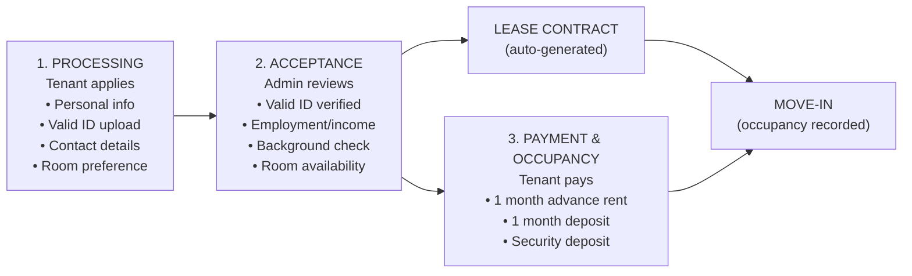
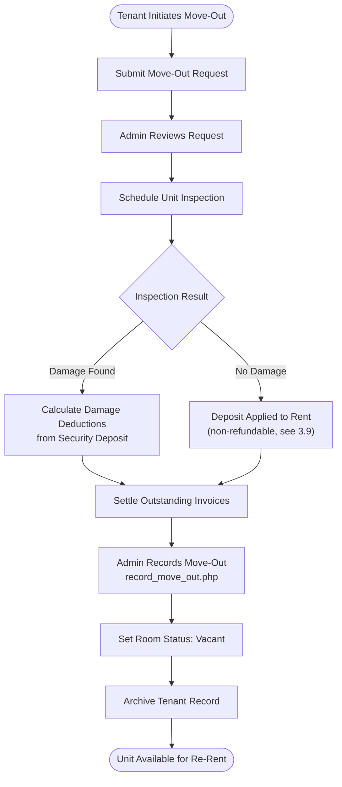
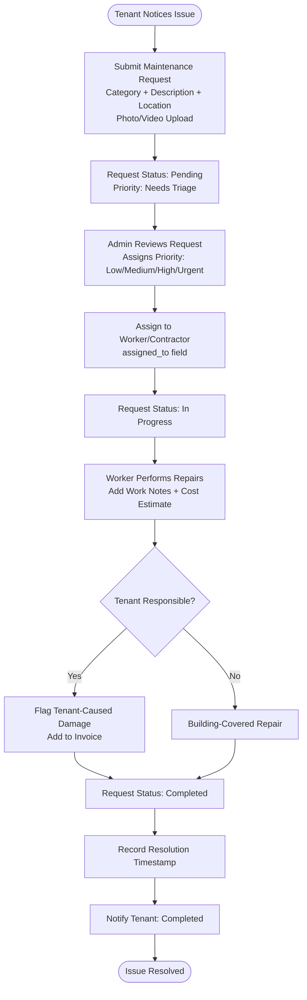
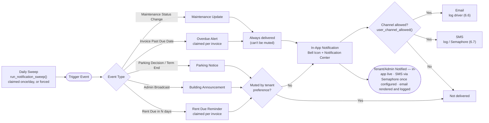
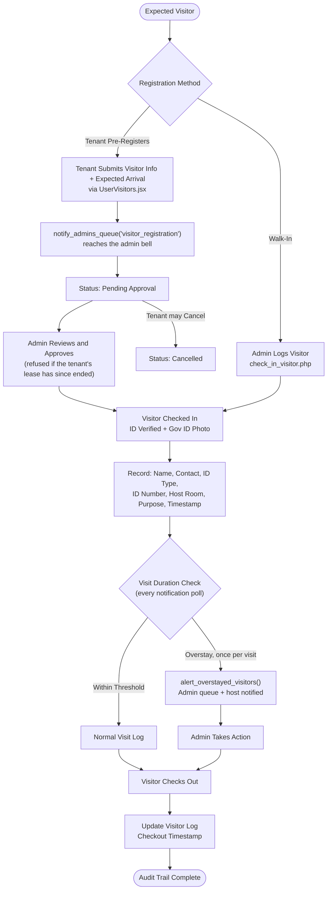
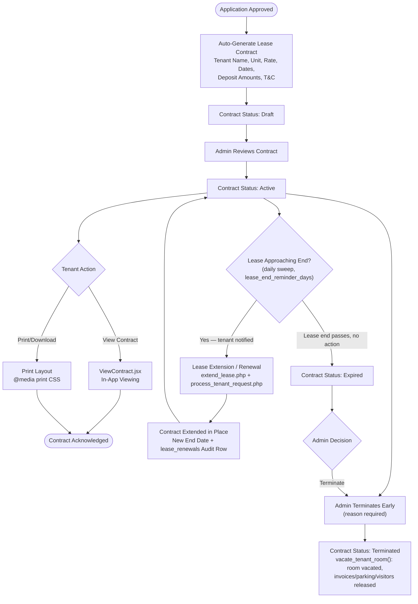
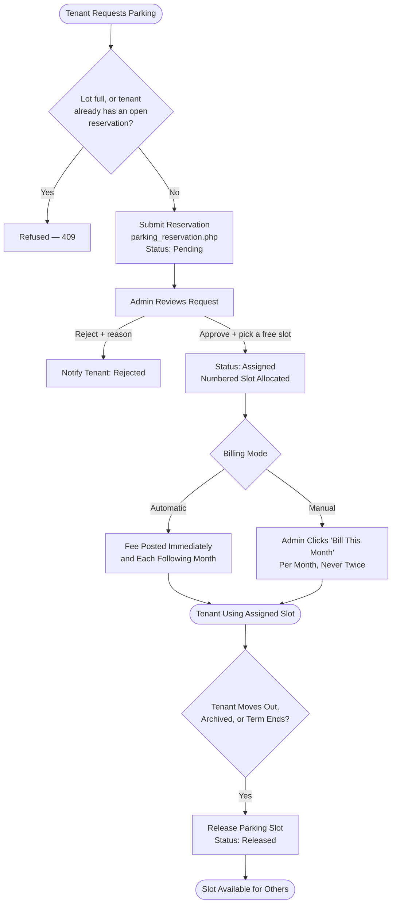
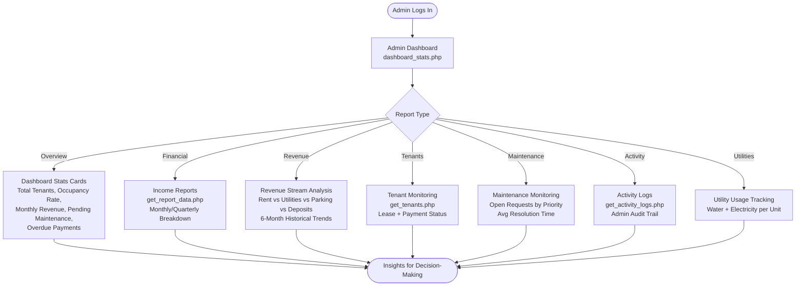
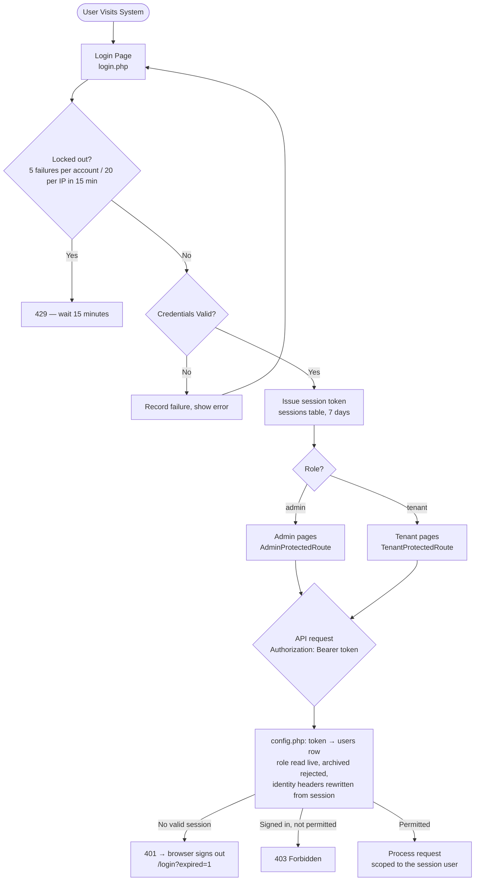

# AMS — Panelist Feature Checklist

> **Project:** Apartment Management System
> **Stack:** React 19 + Vite 8 → PHP 8 → MySQL/MariaDB (XAMPP), plus a Node.js Socket.IO chat server
> **Context:** Small-to-medium scale apartment building (15–100 units)
> **Last Updated:** September 2026 (Modules 4, 5, 10, 11 re-verified against current code; Financial Tracking, Utility Usage, Reports & Activity Log, Role-Based Access, Notification/Automation, Parking Reservation, Contract & Document Generation, and Visitor Management audited; 2026-09-21: Combined Scope Table's "extended rent" checkbox synced to the already-✅ 3.10 detail row; 2026-09-24: Module 7 re-marked after the chat merge (PR #8), announcements gained drafts and honoured SMS/email channels, room showcase images noted, settings split into tabs)

---

## Combined Scope Table

| Status | **Main Module / Area**                  | **Features / Included Functions**                                                                                                                                                                                                                                       |
| :---: | --------------------------------------- | ----------------------------------------------------------------------------------------------------------------------------------------------------------------------------------------------------------------------------------------------------------------------- |
| [x] | **Tenant Management**                   | [x] Tenant registration, [x] tenant profile, [x] ID/document upload, [x] occupancy records, [x] move-in/move-out tracking, [x] payment records                                                                                                                          |
| [x] | **Apartment / Unit Management**         | [x] Room/unit availability, [x] set occupancy, [x] unit status monitoring, [x] occupancy tracking, [x] extended rent                                                                                                                                                  |
| [x] | **Rental Payment & Billing**            | [x] Monthly billing, [x] payment recording, [x] payment history, [x] receipt generation, [x] balance monitoring, [x] due-date reminders, [x] extended rent, [x] term of payment, [x] security deposit, [x] base rent, [x] water, [x] electricity, [x] parking if applicable |
| [x] | **Payment Methods**                     | [x] GCash, [x] cash, [x] bank transfer                                                                                                                                                                                                                                  |
| [x] | **Maintenance Management**              | [x] Issue type: plumbing, electrical, structural/physical, water supply, general repair, others; [x] problem description, [x] location, [x] priority level: low/medium/high/urgent (admin-assigned during triage, not tenant-selected), [x] photo upload, [x] status: pending/in progress/completed, [x] date and time reported, [x] date and time resolved |
| [x] | **Service Management**                  | [x] Cleaning, [x] laundry, [x] other services, [x] priced catalog, [x] tenant booking, [x] billing integration                                                                                                                                                          |
| [~] | **Communication Management**            | [x] Announcements, [x] requests, [ ] complaints, [x] two-way chat (admin ↔ tenant messaging — built, socket server not yet authenticated)                                                                                                                                                                            |
| [~] | **Notification / Automation**           | [x] Rent due reminders, [x] overdue alerts, [x] maintenance updates (in-app), [x] notification preferences (per-category; per-channel on the server, tenant UI pending), [x] a daily automated sweep drives reminders/overdue/parking, [~] SMS notifications (Semaphore driver live, go-live pending), [~] email notifications (built and wired, on the dry-run driver), [ ] automated reports         |
| [x] | **Inquiry & Reservation Management**    | [x] Inquiry handling, [x] reservation tracking, [x] room/unit availability tracking, [x] reservation module                                                                                                                                                             |
| [x] | **Parking Reservation**                 | [x] Parking slot listing, [x] reservation requests, [x] slot assignment management (numbered slots, admin picks a free one, released on move-out/archive/term end), [x] parking fee integration into billing (manual "Bill this month" or automatic monthly posting, admin-configurable, never billed twice) |
| [x] | **Financial Tracking**                  | [x] Rent, [x] utilities, [x] invoices, [x] payment records, [x] revenue stream, [x] income reports, [x] balance monitoring                                                                                                                                              |
| [x] | **Utility Usage**                       | [x] Water usage, [x] electricity usage, [x] utility tracking per unit, [x] month-over-month change & usage-spike flags, [x] billing sync to invoices                                                                                                                  |
| [x] | **Report Generation / Admin Dashboard** | [x] Occupancy statistics, [x] income reports, [x] tenant monitoring, [x] maintenance monitoring, [x] utility usage, [x] system activity logs, [x] reports, [x] revenue stream analysis                                                                                  |
| [x] | **Role-Based Access**                   | [x] Role-based access and permissions, [x] admin authentication, [x] tenant authentication, [x] password management, [x] account lockout, [x] sessions ended on role/password change                                                                                     |
| [x] | **CCTV Access Requests**                | [x] Tenant CCTV footage request, [x] admin approval/rejection, [x] request status tracking                                                                                                                                                                              |
| [x] | **Visitor Management**                  | [x] Visitor records / management (own-tenant scoped), [x] tenant pre-authorization (reaches the admin queue, cancellable), [x] visitor history, [x] overstay alerts (actually notify admin + host, once per visit)                                                     |
| [x] | **Contract Management**                 | [x] Contract generation (auto on approval, as Draft; one per application), [x] contract viewing (with status banner), [x] status management (Draft → Active → Eviction Pending → Expired → Terminated, transition-guarded, auto-expiring), [x] renewal (extends contract + audit trail in `lease_renewals`), [x] termination (ends the tenancy) + lease-end reminders, [x] printable (PDF via browser print dialog) |

---

## Contrast Table: Panelist 3 vs. Chair Panel & Panel 2

### Panelist 3 — Suggested Features

| # | **Panelist 3 Feature / Module**                                    | **Mapped to Combined Scope**                          |
| :-: | ------------------------------------------------------------------ | ----------------------------------------------------- |
| 1 | Payment Tracking & Billing                                         | Module 3 — Rental Payment & Billing                   |
| 2 | Communication Management                                           | Module 7 — Communication (Two-Way Chat)               |
| 3 | Maintenance Management                                             | Module 4 — Maintenance Request                        |
| 4 | Inquiry & Reservation                                              | Module 1.8 — Inquiry & Reservation Management         |
| 5 | Report Generation                                                  | Module 8 — Admin Dashboard & Reports                  |
| 6 | Modular Services                                                   | Module 5 — Service Management                         |
| 7 | Revenue Stream                                                     | Module 8.3 — Revenue Stream Analysis                  |
| 8 | Utility Usage                                                      | Utility Usage row — Module 8.7                        |
| 9 | Improve Tracking Reservation Module                                | Module 1.8 — Reservation Tracking (enhanced)          |
| 10 | Security Deposit                                                   | Module 3.9 — Security Deposit Tracking               |
| 11 | Tenant Management (Profile, Payments)                              | Module 1 — Tenant Management                         |
| 12 | Apartment Unit Management (Availability, Occupancy)                | Module 2 — Apartment / Unit Management               |
| 13 | Financial Tracking (Rent, Utilities, Invoices)                     | Financial Tracking row — Modules 3 & 8               |
| 14 | Communication Tools (Announcements, Requests, Complaints)          | Module 6.5 & Module 7.7 — Announcements & Complaints |
| 15 | Automation (Reminders, Notifications, Reports)                     | Module 6 — Notification / Automation                 |
| 16 | Role-Based Access                                                  | Module 11 — Security & Access Control                |
| 17 | Online Payment → GCash, Cash, Bank                                 | Module 3.11 — Payment Methods                        |
| 18 | Visitor Management                                                 | Module 12 — Visitor Management                       |
| 19 | SMS Notification                                                   | Module 6.7 — SMS Notifications                       |
| 20 | Contract Generation                                                | Module 9 — Contract & Document Generation            |

---

### Chair Panel & Panel 2 — Suggested Modules & Features

| # | **Module**                         | **Features Suggested**                                                                                                                                                                                       | **Mapped to Combined Scope**                         |
| :-: | ---------------------------------- | ------------------------------------------------------------------------------------------------------------------------------------------------------------------------------------------------------------ | ---------------------------------------------------- |
| 1 | Tenant Management Module           | Tenant Registration, Tenant Profile, ID/Document Upload, Occupancy Records, Move-In/Move-Out Tracking                                                                                                        | Module 1 — Tenant Management                        |
| 2 | Apartment / Unit Management Module | Room/Unit Availability, Set Occupancy, Unit Status Monitoring, Occupancy Tracking, Extended Rent                                                                                                             | Module 2 — Apartment / Unit Management              |
| 3 | Rental Payment Module              | Monthly Billing, Payment Recording, Payment History, Receipt Generation, Balance Monitoring, Due Date Reminders, Extended Rent, Term of Payment, Deposit, Base Rent, Water, Electricity, Parking if applies  | Module 3 — Rental Payment & Billing                 |
| 4 | Maintenance Management Module      | Issue type (plumbing, electrical, structural/physical, water supply, general repair, others), problem description, location, priority level (low/medium/high/urgent, assigned by the admin during triage), photo upload, status (pending/in progress/completed), date & time reported, date & time resolved | Module 4 — Maintenance Request |
| 5 | Service Management Module          | Cleaning, Laundry, Others                                                                                                                                                                                    | Module 5 — Service Management                       |
| 6 | Notification Module                | Rent due reminder, overdue alerts, maintenance updates, SMS/email notifications                                                                                                                              | Module 6 — Notification / Automation               |
| 7 | Admin Dashboard                    | Occupancy statistics, income reports, tenant monitoring, maintenance monitoring, system activity logs, contract generation                                                                                    | Module 8 — Admin Dashboard & Reports + Module 9    |
| 8 | Payment Methods                    | GCash, Cash, Bank Transfer                                                                                                                                                                                   | Module 3.11 — Payment Methods                       |
| 9 | SMS & Email Notifications          | SMS and email notification delivery channels                                                                                                                                                                 | Module 6.6 & 6.7 — Email & SMS Notifications        |
| 10 | Contract Management                | Auto-generated contracts on approval                                                                                                                                                                         | Module 9 — Contract & Document Generation           |
| 11 | Visitor Management                 | Visitor records, pre-authorization by tenants, visitor history, overstay alerts                                                                                                                              | Module 12 — Visitor Management                      |

---

### Feature Alignment Summary — Panelist 3 vs. Chair Panel & Panel 2

| **Panelist 3**                                             | **Chair Panel & Panel 2**                                  | **In Combined Scope?** |
| ---------------------------------------------------------- | ---------------------------------------------------------- | :--------------------: |
| Payment Tracking & Billing                                 | Rental Payment Module (billing, history, receipt, balance) | ✅ Module 3            |
| Communication Management                                   | *(implicit — Admin Dashboard messaging)*                   | ✅ Module 7            |
| Maintenance Management                                     | Maintenance Management Module                              | ✅ Module 4            |
| Inquiry & Reservation / Improve Tracking Reservation       | *(not explicitly mentioned)*                               | ✅ Module 1.8          |
| Report Generation                                          | Admin Dashboard (occupancy stats, income, logs)            | ✅ Module 8            |
| Modular Services                                           | Service Management Module (cleaning, laundry, others)      | ✅ Module 5            |
| Revenue Stream                                             | *(not explicitly mentioned)*                               | ✅ Module 8.3          |
| Utility Usage                                              | *(not explicitly mentioned)*                               | ✅ Utility Usage row   |
| Security Deposit                                           | Deposit (under Rental Payment Module)                      | ✅ Module 3.9          |
| Tenant Management (Profile, Payments)                      | Tenant Management Module                                   | ✅ Module 1            |
| Apartment Unit Management (Availability, Occupancy)        | Apartment / Unit Management Module                         | ✅ Module 2            |
| Financial Tracking (Rent, Utilities, Invoices)             | Base Rent, Water, Electricity under Rental Payment         | ✅ Financial Tracking  |
| Communication Tools (Announcements, Requests, Complaints)  | *(Notification Module covers announcements)*               | ✅ Module 6 & 7        |
| Automation (Reminders, Notifications, Reports)             | Notification Module                                        | ✅ Module 6            |
| Role-Based Access                                          | *(not explicitly mentioned)*                               | ✅ Module 11           |
| Online Payment → GCash, Cash, Bank                         | Payment: GCash, Cash, Bank Transfer                        | ✅ Module 3.11         |
| Visitor Management                                         | Visitor Management                                         | ✅ Module 12           |
| SMS Notification                                           | SMS & Email Notifications                                  | ✅ Module 6.7          |
| Contract Generation                                        | Contract Generation (under Admin Dashboard)                | ✅ Module 9            |
| *(CCTV Access Request — unique to system)*                 | *(not mentioned)*                                          | ✅ Module 11.5         |
| *(Parking Reservation — unique to system)*                 | *(not mentioned)*                                          | ✅ Module 10           |

---

## System Context

This system manages the **day-to-day operations of a small-to-medium apartment building**, covering the full tenant lifecycle from application through move-out. The target scale determines which features are essential vs. nice-to-have:

| Scale | Units | Tenants | Admin Staff | Monthly Transactions |
|---|---|---|---|---|
| **Small** | 5–20 | 10–40 | 1 admin | 20–80 payments |
| **Medium** | 20–100 | 40–200 | 1–3 admins | 80–400 payments |

---

## Core Operational Flow

---

## Operation Flow Diagrams

### Tenant Application & Onboarding Flow

### Move-Out Flow

### Payment & Billing Flow

### Maintenance Request Flow

### Notification & Alert Flow

### Visitor Management Flow

### Contract Generation Flow

### Parking Reservation Flow

### Admin Dashboard & Reports Flow

### Role-Based Access & Authentication Flow

---

## Master Checklist — Implementation Status

### Legend

| Symbol | Meaning |
|---|---|
| ✅ | Implemented and functional |
| 🔧 | Partially implemented / needs wiring |
| 📋 | Designed but not yet built |
| ❌ | Not started |

---

### Module 1 — Tenant Management

> Admin Pages: [AdminTenants.jsx](file:///c:/xampp/htdocs/ApartmentManagementSystem_React/ams-react/src/AdminPages/AdminTenants.jsx) · [AdminApplications.jsx](file:///c:/xampp/htdocs/ApartmentManagementSystem_React/ams-react/src/AdminPages/AdminApplications.jsx)
> Tenant Pages: [Registration.jsx](file:///c:/xampp/htdocs/ApartmentManagementSystem_React/ams-react/src/UserPages/Registration.jsx) · [RentApplication.jsx](file:///c:/xampp/htdocs/ApartmentManagementSystem_React/ams-react/src/UserPages/RentApplication.jsx) · [TrackApplication.jsx](file:///c:/xampp/htdocs/ApartmentManagementSystem_React/ams-react/src/UserPages/TrackApplication.jsx) · [ProfileSettings.jsx](file:///c:/xampp/htdocs/ApartmentManagementSystem_React/ams-react/src/UserPages/ProfileSettings.jsx)

- [x] **1.1 Tenant Registration** ✅ — `registration.php` + React form
- [x] **1.2 Tenant Profile** ✅ — `profile.php` with edit
- [x] **1.3 ID / Document Upload** ✅ — Valid ID (front/back) + NBI clearance via `rent_application.php`/`upload_lease_document.php`. No "proof of income" field exists — not part of this system's application flow.
- [x] **1.4 Occupancy Record** ✅ — Via `rent_applications` approval. No dedicated `move_in_date` column; the application's `created_at` (or lease_contracts.lease_start once approved) stands in for it.
- [x] **1.5 Move-In / Move-Out Tracking** ✅ — Tenant initiates, admin inspects and approves (`record_move_out.php`)
- [x] **1.6 Application Processing Flow** ✅ — Pending Review → Approved/Rejected
- [x] **1.7 Acceptance Criteria Enforcement** ✅ — `update_tenant_status.php` rejects approval unless valid ID (front/back), NBI clearance, and a recorded `terms_agreed_at` (checked at submission via a required Terms & Conditions checkbox in `RentApplication.jsx`) are all present.
- [x] **1.8 Inquiry Handling & Reservation Tracking** ✅ — Public inquiry form (guest or prefilled), admin triage pipeline, and unit reservations that hold a room with an auto-expiring hold (`inquiries` + `unit_reservations` tables, `AdminInquiries.jsx`, `InquiryForm.jsx`)

---

### Module 2 — Apartment / Unit Management

> Admin Pages: [AdminUnits.jsx](file:///c:/xampp/htdocs/ApartmentManagementSystem_React/ams-react/src/AdminPages/AdminUnits.jsx)
> Tenant Pages: [MyRoom.jsx](file:///c:/xampp/htdocs/ApartmentManagementSystem_React/ams-react/src/UserPages/MyRoom.jsx)

- [x] **2.1 Room / Unit Listing** ✅ — `get_rooms.php`, `create_room.php`. No per-room capacity column; a building-wide cap, `max_occupants_per_unit` (default 8, Settings → Leasing), is enforced on applications, occupant changes and household requests. Rooms can have admin-uploaded showcase images (`upload_room_images.php`, `delete_room_image.php`, `rooms.gallery`, public `backend/room_images/`).
- [x] **2.2 Unit Availability Dashboard** ✅ — Room status in admin panel
- [x] **2.3 Set Occupancy** ✅ — Via application approval. A building-wide cap, `max_occupants_per_unit` (default 8, Settings → Leasing), is enforced on application, occupant change and household requests; separately, a ₱1,000/excess-occupant surcharge (configurable) applies above 4 occupants.
- [x] **2.4 Unit Status Monitoring** ✅ — DB-backed condition, furnishing, inspection logs & inline edit
- [x] **2.5 Occupancy Tracking** ✅ — Dynamic stay durations, active counts, and a 6-month occupancy trend (`get_report_data.php`). No dedicated "vacancy rate" metric — occupancy and vacancy are complementary, so this is covered by the same trend data rather than a separate figure.
- [x] **2.6 Extended Rent / Lease Renewal** ✅ — `extend_lease.php`
- [x] **2.7 Unit Rate Configuration** ✅ — `update_room.php` sets base monthly rent per unit. There are no separate water/electricity/parking *rate* columns on `rooms` — those utilities are billed per-reading/per-reservation (`save_utility_reading.php`, parking reservations), not configured as a fixed per-unit allocation.

---

### Module 3 — Rental Payment & Billing

> Admin Pages: [AdminPayments.jsx](file:///c:/xampp/htdocs/ApartmentManagementSystem_React/ams-react/src/AdminPages/AdminPayments.jsx)
> Tenant Pages: [PayBills.jsx](file:///c:/xampp/htdocs/ApartmentManagementSystem_React/ams-react/src/UserPages/PayBills.jsx) · [PaymentUpload.jsx](file:///c:/xampp/htdocs/ApartmentManagementSystem_React/ams-react/src/UserPages/PaymentUpload.jsx) · [UserPaymentHistory.jsx](file:///c:/xampp/htdocs/ApartmentManagementSystem_React/ams-react/src/UserPages/UserPaymentHistory.jsx)
> Related Docs: [payment_system_design.md](file:///c:/xampp/htdocs/ApartmentManagementSystem_React/docs/features/payment_system_design.md) · [notification_services.md](file:///c:/xampp/htdocs/ApartmentManagementSystem_React/docs/features/notification_services.md)

- [x] **3.1 Monthly Billing / Invoice Generation** ✅ — `invoices` table, `create_invoice.php` (base rent + water + electricity + parking + services + late fee). Since 2026-09-26 (panel feedback) monthly rent is also **generated automatically**: the daily sweep issues each tenancy month's rent invoice 7 days before it starts, due on the contract's lease-start day (`generate_due_rent_invoices()`, `invoices.rent_period_start`, a unique key per tenant and month). Billing starts from the tenancy start, a month that has already started is never back-billed, and no invoice can get a due date in the past (`create_invoice.php`, `adjust_invoice.php` and the admin date inputs all refuse it). The move-in payment now sets the contract's dates to the payment date, matching the room. **Past-due bills (2026-09-28, panel feedback):** a bill past its due date no longer shows that date; PayBills, AdminPayments, Payment History and the overdue alert show the period it covers, counted from the tenant's move-in day (e.g. "Oct 4 – Nov 3, 2026"), and how many days it is overdue (`invoice_covered_period()`; verification guide M3-56).
- [x] **3.2 Payment Recording** ✅ — `record_payment_admin.php` records method, reference number, amount tendered and timestamp. Invoices settle in full; there is no partial-payment ledger, and a short amount is rejected rather than recorded as paid. The amount is required for every method (2026-09-30 payments audit: an omitted amount used to settle the bill in full), and the cashier screen is read-only on what is owed — its old editable Period/Term/Due Date, deposit/advance toggles, *Prorated Rent* and *Add-ons* controls were never saved and were removed; changes go through *Adjust invoice* (`adjust_invoice.php`). Panel feedback (2026-09-26): the payment now closes the loop with the tenant — every submission notifies them, PayBills shows an "awaiting confirmation" banner (Pay disabled) and polls every 20 s, and the admin's accept or reject reaches the open page as a *Payment confirmed* modal (with a link to the receipt) or a rejection banner showing the admin's reason. The admin gets a "tenant notified" toast; the reject reason is entered in a modal. Live alerts (2026-09-27): on any tenant page the admin's decision opens the notification bell dropdown with the notice highlighted as *New* (confirmed → click opens the receipt; rejected/failed → Pay Bills), and a tenant's proof upload or cash declaration does the same in the admin's bell on any admin page (→ AdminPayments) and refreshes AdminPayments; both sides poll every 20 s while waiting. An advance payment now sends one *Payment Received* notice instead of one per month (verification guide M3-48…51).
- [x] **3.3 Payment History** ✅ — `get_invoices.php` (session-authenticated; a tenant can only ever read their own). **Combined payments (2026-09-30, panel feedback):** a tenant with two or more unpaid bills, at least one overdue, chooses on Pay Bills to pay them all together (overdue and current bills) (`bundle_payment.php`, one `BND-…` payment through any channel) or one billing period at a time. A combined payment gets one combined receipt listing every billing period, and each period still keeps its own invoice and receipt (verification guide M3-59…64).
- [x] **3.4 Receipt Generation** ✅ — Printable receipt modal rendered from invoice data with an admin signature placeholder. Note: receipts are generated on demand for printing — no separate receipt table or sequential OR number is persisted.
- [x] **3.5 Balance Monitoring** ✅ — Total receivables, overdue totals, per-tenant outstanding balance and a 30/60/60+ aging ledger, all computed from real invoice rows across every unpaid status
- [x] **3.6 Due Date Reminders** ✅ — Automatic countdown alerts + `check_due_date_reminders.php` (admin-authenticated) + manual admin dispatch
- [x] **3.7 Overdue Alerts** ✅ — Auto-overdue promotion + configurable late fee (flat or % via `late_fee_*` settings, applied once per invoice by `promote_overdue_invoices()`) + `overdue` notification dispatch + banner in `PayBills.jsx`. Tenants are notified directly; the admin sees overdue totals on the dashboard rather than receiving a separate escalation notification.
- [x] **3.8 Payment Proof Upload** ✅ — `upload_payment_proof.php` (10MB cap, MIME-validated, session-scoped to the invoice owner)
- [x] **3.9 Security Deposit Tracking** ✅ — Deposit recorded at move-in and tracked through to move-out, where it is applied to rent, unpaid bills or damages. It is **non-refundable by design** — `refund_amount` is always 0.00 — so there is no refund calculation step. `lease_contracts.deposit_status` follows the money (2026-09-30): `Pending` on the draft contract → `Held` when the move-in invoice is paid → *Applied to Rent* / *Applied to Bills/Damages* at move-out or termination (*Not Collected* if a terminated tenancy never paid it). The admin payment screen shows it read-only, and reports treat deposits as held, not revenue (8.3). *Legal note:* for units covered by the Rent Control Act (RA 9653 §7), the deposit must be returned at lease end less unpaid rent, utilities and damages; confirm current coverage before relying on a non-refundable deposit.
- [x] **3.10 Extended Rent Terms** ✅ — (The admin payment screen's former *Use Extended/Prorated Rent* checkbox was not this feature: it was never saved and was removed 2026-09-30.) Approving a tenant's lease-extension request (`process_tenant_request.php`) extends the contract; the added months are then billed like every other tenancy month by the monthly rent generator (each a week before it starts, due on the lease-start day), and a month starting within that week is billed at approval. Until 2026-09-26 all added months were pre-billed at once, due on the 1st. Scoped to the tenant-request → admin-approval flow (the one with a `lease_renewals` audit trail); the separate admin-direct extend in `AdminUnits.jsx` (via `update_room.php`) is unchanged
- [x] **3.11 Payment Methods (GCash, Cash, Bank)** ✅ — Manual payments are Cash, GCash, BDO or BPI (BDO and BPI are bank transfers with separate options, for tenants uploading a proof and at the desk), and the recorded method follows the tenant's chosen channel: locked while their proof is under verification, and no desk recording while an online checkout is open (the admin can cancel a stale one) — 2026-10-01. Online (PayMongo sandbox: GCash/Maya/card/online banking) or manual transfer channels, **plus** in-person cash, which is always offered alongside whichever remote family is active
- [x] **3.12 Term of Payment Rules** ✅ — The move-in invoice bills 1 month advance rent + 1 month security deposit, and approval is gated on documents + terms agreement (see 1.7). Enforcement lives in the approval/invoice endpoints, not in DB constraints. Since 2026-09-30 no path skips it: a manual unit assignment issues the same move-in invoice and leaves the unit `reserved`, and a contract cannot be activated until that invoice is paid and the move-in confirmed. **Advance payment (2026-09-26, panel feedback):** a tenant can prepay 1–6 upcoming months from Pay Bills (`advance_payment.php`). **Reworked 2026-09-28 (panel feedback: no lump sum):** the tenant pays one advance-rent invoice, and each month it covers is stored as a credit (`advance_credits`). The system still generates every month's rent invoice on its usual date and pays it from the credit at once, so each month keeps its own invoice and receipt ("Paid from advance payment INV-…"). Reports count the rent in the month it covers. An advance unpaid by its first month expires; unused credit at move-out is flagged as a refund (verification guide M3-52…58).

---

### Module 4 — Maintenance Request

> Admin Pages: [AdminMaintainance.jsx](file:///c:/xampp/htdocs/ApartmentManagementSystem_React/ams-react/src/AdminPages/AdminMaintainance.jsx)
> Tenant Pages: [MaintenanceRequest.jsx](file:///c:/xampp/htdocs/ApartmentManagementSystem_React/ams-react/src/UserPages/MaintenanceRequest.jsx) · [UserMyRequests.jsx](file:///c:/xampp/htdocs/ApartmentManagementSystem_React/ams-react/src/UserPages/UserMyRequests.jsx)
> Related Docs: [notification_services.md](file:///c:/xampp/htdocs/ApartmentManagementSystem_React/docs/features/notification_services.md)

- [x] **4.1 Submit Maintenance Request** ✅ — `maintenance_request.php` (session-authenticated; only tenants with an active lease; the ticket is stamped with the tenant's unit). Requests are per unit — there is no common-area location field. The tenant does not choose a priority; every new ticket starts as `Needs Triage`.
- [x] **4.2 Issue Categories** ✅ — Plumbing, Electrical, Structural/Physical, Water Supply, General Maintenance, Others — enforced server-side (`MAINTENANCE_CATEGORIES` in `config.php`) and shared by the tenant form, admin create form and filters
- [x] **4.3 Priority Levels** ✅ — Low / Medium / High / Urgent, **assigned by the admin during triage** (a tenant cannot self-declare urgency). New tickets start as `Needs Triage`, which sorts above Urgent in the admin queue so untriaged tickets surface first rather than being mistaken for low priority; the queue is ordered by priority, then age
- [x] **4.4 Photo Upload** ✅ — Drag & drop with live preview; images (JPG/PNG/GIF/WEBP) or short videos (MP4/WEBM/MOV) up to 10MB, extension- and MIME-checked
- [x] **4.5 Status Tracking** ✅ — Pending → In Progress → Completed, plus Rejected (admin, with a reason) and Cancelled (tenant, while Pending); invalid transitions are refused
- [x] **4.6 Date / Time Tracking** ✅ — `created_at`, `acknowledged_at`, `started_at` and `resolved_at` are stamped automatically on status changes, and the total resolution time is shown to the admin
- [x] **4.7 Admin Assignment** ✅ — `assigned_to`, editable independently of status
- [x] **4.8 Cost Estimation** ✅ — `estimated_cost`, plus a separate `actual_cost` recorded at completion; `tenant_responsible` flag. Flagging a *Completed* ticket tenant-responsible now actually bills `COALESCE(actual_cost, estimated_cost)` onto the tenant's invoice (`invoices.maintenance`, `post_maintenance_charge()`) — until 2026-09-20 (audit H10) the flag was stored and excluded from building expenses, but nothing posted the charge
- [x] **4.9 Work Notes** ✅ — `work_notes`, appended as timestamped entries
- [x] **4.10 Tenant Notification on Update** ✅ — In-app notification on every status change (including the rejection reason) via `update_maintenance_status.php`, and the same change now dispatches SMS + email through `dispatch_admin_action_notification()`, gated by the tenant's opt-outs. Email still runs on the mock (`log`) driver; SMS can go live through Semaphore — see 6.6 / 6.7

---

### Module 5 — Service Management

> Admin Pages: [AdminServicePage.jsx](file:///c:/xampp/htdocs/ApartmentManagementSystem_React/ams-react/src/AdminPages/AdminServicePage.jsx) · [AdminCctv.jsx](file:///c:/xampp/htdocs/ApartmentManagementSystem_React/ams-react/src/AdminPages/AdminCctv.jsx) · [AdminParking.jsx](file:///c:/xampp/htdocs/ApartmentManagementSystem_React/ams-react/src/AdminPages/AdminParking.jsx)
> Tenant Pages: [Services.jsx](file:///c:/xampp/htdocs/ApartmentManagementSystem_React/ams-react/src/UserPages/Services.jsx) · [ServiceBooking.jsx](file:///c:/xampp/htdocs/ApartmentManagementSystem_React/ams-react/src/UserPages/ServiceBooking.jsx) · [CctvRequest.jsx](file:///c:/xampp/htdocs/ApartmentManagementSystem_React/ams-react/src/UserPages/CctvRequest.jsx) · [ParkingReservation.jsx](file:///c:/xampp/htdocs/ApartmentManagementSystem_React/ams-react/src/UserPages/ParkingReservation.jsx)
> Related Docs: [service_management_design.md](file:///c:/xampp/htdocs/ApartmentManagementSystem_React/docs/features/service_management_design.md)

- [x] **5.1 Service Request Submission** ✅ — Priced add-on booking via `service_request.php` (multipart, session-authenticated, active lease required, re-derives price server-side), plus `cctv_request.php` (session-authenticated, incident date validated), `parking_reservation.php`, `maintenance_request.php`, `check_in_visitor.php`
- [x] **5.2 Service Catalog & Modular Controls** ✅ — Two-level gating: `system_settings.service_<category>_active` toggles a whole category, `service_catalog.is_active` toggles an individual priced item; full CRUD via `manage_service_catalog.php` + `ServiceCatalogModal.jsx` on `AdminServicePage.jsx`
- [x] **5.3 Service Status Tracking** ✅ — `Pending → Approved → In Progress → Completed`, plus `Rejected`/`Cancelled`, enforced as a transition map (`SERVICE_TRANSITIONS` in `config.php`) so a cancelled or rejected booking can never be completed or billed; the booking queue on `AdminServicePage.jsx` offers only the actions valid for each status; tenant-side cancel via `cancel_request.php` (own Pending requests only); CCTV requests are decided once, from Pending (`update_cctv_status.php`)
- [x] **5.4 Service Billing Integration** ✅ — Completed add-on services post to `invoices.services` via `post_service_charge()` (claim-then-bill, so one booking is never charged twice). The charge lands on the tenant's still-adjustable invoice for the month of delivery, matched by its "September 2026"-style billing-period label; if there is none — or that month's rent invoice is already paid or being paid — a services-only invoice (`base_rent = 0`) is created, so rent is never billed twice. Reversible via `reverse_service_charge()` while the invoice is pending, overdue, scheduled or payment-failed (refused once paid, under verification, or mid-checkout); manual retry via `sync_service_to_invoice.php` when no active lease was found at completion time
- [x] **5.5 Cleaning & Laundry Services** ✅ — `service_catalog` (price, unit, quantity range, lead time) + `service_requests` (snapshots price/name at booking time) tables; `ServiceBooking.jsx` booking form; catalog CRUD and booking queue on `AdminServicePage.jsx`; charges posted to `invoices.services`

---

### Module 6 — Notification Module

> Admin Pages: [AdminNotifications.jsx](file:///c:/xampp/htdocs/ApartmentManagementSystem_React/ams-react/src/AdminPages/AdminNotifications.jsx) · [AdminAnnouncements.jsx](file:///c:/xampp/htdocs/ApartmentManagementSystem_React/ams-react/src/AdminPages/AdminAnnouncements.jsx)
> Tenant Pages: [UserNotifications.jsx](file:///c:/xampp/htdocs/ApartmentManagementSystem_React/ams-react/src/UserPages/UserNotifications.jsx) · [UserAnnouncements.jsx](file:///c:/xampp/htdocs/ApartmentManagementSystem_React/ams-react/src/UserPages/UserAnnouncements.jsx)
> Related Docs: [notification_services.md](file:///c:/xampp/htdocs/ApartmentManagementSystem_React/docs/features/notification_services.md)

- [x] **6.1 In-App Notifications** ✅ — Bell icon (polling every 60s) + notification center, scoped so an admin's "mark all read"/"clear all" can never touch a tenant's own notices
- [x] **6.2 Rent Due Reminders** ✅ — Sent by a daily automated sweep (`run_notification_sweep()` in `backend/config.php`), claimed per invoice so the same reminder is never sent twice; also available on demand via `check_due_date_reminders.php` / `send_payment_reminder.php`
- [x] **6.3 Overdue Alerts** ✅ — Same daily sweep promotes lapsed invoices and sends the alert, with the same once-per-invoice claim
- [x] **6.4 Maintenance Status Updates** ✅ — In-app on every status change, plus SMS/email dispatch on the same change (see 4.10); email on the mock driver, SMS live through Semaphore once configured (6.6/6.7)
- [x] **6.5 Building Announcements** ✅ — `create_announcement.php`, targets all current tenants or one unit's tenants (unit picker), respects each tenant's announcement preference; SMS/email go out only when ticked, and drafts are saved without notifying anyone
- [ ] **6.6 Email Notifications** 🔧 — Pipeline built and wired end to end: templates, dispatcher, queue with retry/quiet-hours/retention, admin settings UI, and all seven admin endpoints dispatching. Runs on the `log` (dry-run) driver — every message is rendered, gated and recorded, nothing is delivered. Remaining: install PHPMailer and set `email_driver = smtp` with Gmail App Password credentials
- [ ] **6.7 SMS Notifications** 🔧 — Same pipeline, same wiring, including PH mobile normalisation and a one-segment GSM-7 cap so a message cannot silently cost triple. **Semaphore driver built** (2026-09-24) with a daily send cap, live credit-balance check and sender-name approval gate; Semaphore is the only SMS provider (the four planned stubs were removed). It follows Semaphore's API rules: "TEST"-prefixed text is re-prefixed, the balance check is cached for its 2/min limit, and 429s are reported. Remaining: a verified live delivery (M6-27), the queue drain scheduled in Task Scheduler, and `AMS` sender-name approval — until then messages use Semaphore's shared sender
- [x] **6.8 Notification Preferences** ✅ — Server-side per-category opt-out (`notification_preferences` table, `get_/update_notification_preferences.php`) now carries **per-channel** flags plus a global `sms_opt_out` / `email_opt_out`; critical notices (overdue, billing, decisions, maintenance/contract/move-out updates) can't be muted. `user_channel_allowed()` is the single gate every dispatch passes through. Tenant-facing UI for the channel toggles is still to come
- **Automation** ✅ — A daily sweep (opportunistic on the first sign-in of the day, plus a CLI script `backend/cron/daily_sweep.php` for Windows Task Scheduler) drives reminders, overdue alerts, parking-permit expiry and automatic parking billing — see Module 10

---

### Module 7 — Communication (Two-Way Chat)

> Related Docs: [chat_design.md](file:///c:/xampp/htdocs/ApartmentManagementSystem_React/docs/features/chat_design.md) (read its "As built" section)
>
> ⚠️ The Socket.IO server does not authenticate connections yet — see [security_audit.md §6e](../security_audit.md) CH-1.

- [ ] **7.1 Admin → Tenant Messaging** 🔧 — Admin replies from the `/admin-messages` inbox (`AdminMessages.jsx`, socket or `send_message.php`); cannot yet start a thread with a tenant who hasn't written first
- [x] **7.2 Tenant → Admin Messaging** ✅ — `ChatWidget.jsx` "support chat" opens the admin thread (`get_admin_user.php`), live over Socket.IO with HTTP fallback
- [x] **7.3 Conversation History** ✅ — `get_chat_history.php` (caller's own thread, timestamps, marks as read), stored in `messages`
- [x] **7.4 Unread Message Badge** ✅ — per-thread unread from `get_conversations.php`, total on the chat widget launcher; live via socket + polling
- [x] **7.5 Admin Inbox** ✅ — `AdminMessages.jsx`: threads sorted by most recent, searchable, unread badges
- [ ] **7.6 New Message Notification** 🔧 — Real-time push to an open widget/inbox only; no `notifications` row is written on send
- [ ] **7.7 Complaints Management** 📋 — Design complete: conversation flagged `is_complaint` + `complaint_status` tracking, additive to §1–§11 — must be rebased onto the built `messages` table, since `conversations` does not exist (see [chat_design.md §12](file:///c:/xampp/htdocs/ApartmentManagementSystem_React/docs/features/chat_design.md))

---

### Module 8 — Admin Dashboard & Reports

> Admin Pages: [AdminDashboard.jsx](file:///c:/xampp/htdocs/ApartmentManagementSystem_React/ams-react/src/AdminPages/AdminDashboard.jsx) · [AdminReports.jsx](file:///c:/xampp/htdocs/ApartmentManagementSystem_React/ams-react/src/AdminPages/AdminReports.jsx) · [AdminActivityLogs.jsx](file:///c:/xampp/htdocs/ApartmentManagementSystem_React/ams-react/src/AdminPages/AdminActivityLogs.jsx)

- [x] **8.1 Dashboard Statistics** ✅ — `dashboard_stats.php` (session-authenticated). Receivables and the action queue cover every unpaid invoice status; the collection rate leaves cancelled invoices out
- [x] **8.2 Income Reports** ✅ — Financial income statement, unit income rankings, period comparisons, CSV/Print export (`get_report_data.php` + `AdminReports.jsx`). Expenses are recorded maintenance costs (actual cost, excluding tenant-responsible repairs) plus an **optional** overhead percentage (`report_overhead_pct`, 0% unless an admin sets it). No overhead is invented. Outstanding arrears count every unpaid status past its due date, so collection efficiency reflects real overdue balances. Other building costs (supplies, salaries, utilities, taxes…) are entered by the admin in an `expenses` table ("Manage" on the income statement, `manage_expenses.php`) and added to the maintenance figure, with a per-category breakdown. The Reservations tab also shows inquiry conversion (received, converted, rate, holds converted vs expired)
- [x] **8.3 Revenue Stream Analysis** ✅ — Category stream breakdown (Rent, Electricity, Water, Parking, Add-On Services, Maintenance Recharge, Late Fees) that sums exactly to gross revenue — security deposits are held, not earned, so they are left out and shown separately (2026-09-30) — 100% DB-backed 6-month historical trends, diversification index and a computed utility recovery ratio (paid ÷ invoiced water and electricity)
- [x] **8.4 Tenant Monitoring** ✅ — `get_tenants.php`. Lease status, lease end (from the contract) and a real payment status per tenant (**Overdue / Due / Paid up**, from unpaid invoices), shown on `AdminTenants.jsx`. It had been hardcoded to "paid" for everyone
- [x] **8.5 Maintenance Monitoring** ✅ — `get_maintenance_requests.php` board, plus the Reports *Maintenance* tab: tickets by status, open tickets by priority (untriaged first), tickets filed by category, average resolution time, and cost against the admin-configured monthly budget
- [x] **8.6 System Activity Logs** ✅ — `activity_logs` table, `get_activity_logs.php`, `AdminActivityLogs.jsx`.
  - **Search:** filters (12 categories, performer, date range, text search) and paging run on the server over the whole log.
  - **Export:** real CSV export, and each export is itself logged.
  - **Append-only:** there is no way to clear the log from the UI.
  - **Attribution:** the performer always comes from the verified session.
  - **What's logged:** admin **and tenant** sign-ins (and failed sign-ins, masked, no password), password changes and resets, role changes, archives, which settings changed, plus (as of this round) rental applications, inquiries, occupancy/lease requests, profile changes, registration, sign-out, checkout starts, and parking activity — 13 previously-silent endpoints now log
  - **Search fixed:** LIKE wildcards (`%`/`_`) are escaped so they match literally, and log-id search (`LOG-0012`) matches the exact id instead of stripping characters
  - **Export honesty:** a `truncated` flag and "Exported N of M" wording replace the old claim of exporting everything when a search actually hit the 5,000-row cap; CSV cells starting with `= + - @` are now escaped against formula injection
- [x] **8.7 Utility Usage Tracking** ✅ — `utility_readings` table (now in `SetupDB.sql`), `AdminUtilities.jsx`, `UserUtilities.jsx`. Each unit has one water and electricity reading per billing month. Readings are validated: a meter can't read lower than last month, readings are recorded oldest-first, and rates carry forward. Each reading shows the change from the previous month and flags a usage spike above 30%. A mistyped reading is corrected by deleting the latest un-invoiced one. `sync_utility_to_invoice.php` posts the charge onto the tenant's open invoice for that month, or onto a utilities-only invoice — rent is never billed twice. Reports show units read vs. occupied and which units are still unread. Tenants see only their own readings (session-scoped)
- [x] **8.8 Sampling Data / Demo Data** ✅ — `backend/api/migrations/seeds/seed_mock_data.sql`: 12 tenants across 14 rooms (2 vacant, 1 with a pending application), 8 months of invoices (Jan–Aug 2026, mixing paid/overdue/pending-verification and all three payment methods), plus maintenance requests, parking reservations, CCTV requests, service bookings, visitor logs, inquiries/waitlist, announcements, notifications and activity-log rows — enough to demo every Module 8 report tab without an empty state. `seed_reset.sql` removes it cleanly and `clear_and_seed.sql` restores the bare `SetupDB.sql` defaults; both are exercised by CI (`.github/workflows/ci.yml`, the `database` job)

---

### Module 9 — Contract & Document Generation

> Admin Pages: [AdminContracts.jsx](file:///c:/xampp/htdocs/ApartmentManagementSystem_React/ams-react/src/AdminPages/AdminContracts.jsx)
> Tenant Pages: [ViewContract.jsx](file:///c:/xampp/htdocs/ApartmentManagementSystem_React/ams-react/src/UserPages/ViewContract.jsx)
> Template Editor: [AdminContractEditor.jsx](file:///c:/xampp/htdocs/ApartmentManagementSystem_React/ams-react/src/AdminPages/AdminContractEditor.jsx) (sidebar → *Edit Contract*)

- [x] **9.1 Lease Contract Generation** ✅ — Auto-generated on application approval (`update_tenant_status.php`), created as `draft`; rent, security deposit, lease start/end and tenant details all bound to real DB values in `ViewContract.jsx`; landlord identity, payment accounts and every clause come from the admin-editable contract template (9.8). The admin "Generate Contract" button (`create_contract.php`) now refuses to create a second contract for an application that already has one (`UNIQUE KEY` on `rent_application_id`) and only accepts an approved application
- [x] **9.2 Contract Viewing** ✅ — Fully wired to `lease_contracts` via `ViewContract.jsx`, scoped to the logged-in tenant (session-verified `?userId=`); `?email=` lookup is admin-only. The page now shows a status banner (screen only) when the contract is `draft`, `eviction-pending`, `expired` or `terminated`, so a draft doesn't read as final
- [x] **9.3 Contract Status Management** ✅ — `Draft → Active → Eviction Pending → Expired → Terminated`, every transition gated by a `CONTRACT_TRANSITIONS` map in `backend/config.php` (previously unenforced — "Clear eviction flag" could activate a still-unreviewed draft, or reactivate an already-terminated lease). Auto-expiry via `expire_lapsed_contracts()`, run opportunistically from `get_contracts.php`/`my_room.php` and from the daily sweep (§17), same pattern as `release_expired_reservations()`. `Terminated` is now reachable via a `terminate` action, which also ends the tenancy — see 9.7
- [x] **9.4 Contract Renewal** ✅ — `process_tenant_request.php` extends the tenant's existing `lease_contracts` row (transaction-wrapped, resolves the application once instead of two divergent queries, reactivates an `expired` contract on renewal) and records every extension in the new `lease_renewals` audit table (added months, previous/new end date, rent at time of renewal). Renewal still amends the one contract row per application rather than creating a separate versioned document — the schema has no per-contract rate column to version in the first place (rate is always read live from `rent_applications.monthly_rent`).
- [x] **9.5 Printable** ✅ — `@media print` layout in `ContractDocument.jsx` (rendered by `ViewContract.jsx`); the page count follows the clauses, and every printed page carries *Page N of M* and the tenant's signature line through CSS page-margin boxes. **Note:** "Downloadable" is via the browser's *Save as PDF* in the print dialog; there is no PDF library or server-side PDF export in the project
- [x] **9.6 Eviction Monitoring** ✅ — `AdminContracts.jsx`'s overdue-payment banner, per-contract eviction panel, and Flag/Clear actions were previously unreachable dead UI (`overdueInfo` was hardcoded `null`). `get_contracts.php` now computes real per-tenant overdue totals and days-overdue from `invoices`, so the eviction workflow is fully wired end to end. Flagging is now only offered/accepted from an `active` contract.
- [x] **9.7 Lease-End Reminders & Termination** ✅ — New: a tenant is notified once, `lease_end_reminder_days` (default 30) before `lease_end` (`send_lease_end_reminders()`, daily sweep), covering the panel flow's "Lease approaching end?" step. A new admin *Terminate Lease* action ends a lease early (reason required) and, since ending a lease means ending the tenancy, also vacates the room, cancels pending invoices, and releases parking/visitor requests — the same `vacate_tenant_room()` helper the ordinary move-out flow uses.
- [x] **9.8 Editable Contract Template** ✅ — New: *Edit Contract* (`/admin-contract-editor`) lets an admin add, remove, reorder and reword sections and clauses in English and Tagalog, edit the landlord details and payment accounts (GCash, banks, cash) and define custom `{{placeholders}}` for figures that change (occupancy limit, fees, notice days). Each save is a new version in `contract_template_versions` (change note, author, activity log, optimistic lock). A contract pins the version in force when it is issued (`lease_contracts.template_version_id`), so later edits don't rewrite a lease already offered; landlord details and payment accounts always show the latest values. The same payment accounts replace the hardcoded numbers on the payment-proof upload page and printed invoices

---

### Module 10 — Parking Reservation

> Admin Pages: [AdminParking.jsx](file:///c:/xampp/htdocs/ApartmentManagementSystem_React/ams-react/src/AdminPages/AdminParking.jsx)
> Tenant Pages: [ParkingReservation.jsx](file:///c:/xampp/htdocs/ApartmentManagementSystem_React/ams-react/src/UserPages/ParkingReservation.jsx)

- [x] **10.1 Parking Slot Listing** ✅ — `get_available_parking_slots.php` returns real capacity, the monthly fee and the caller's own reservation; a tenant page that used to always read "3/3 free" now shows the true count
- [x] **10.2 Reservation Request** ✅ — `parking_reservation.php`, one open reservation per tenant (enforced by a unique key, not just an application check), refused once the lot is full or the parking module is switched off
- [x] **10.3 Parking Fee Integration** ✅ — `post_parking_charge()` posts the fee onto the tenant's invoice per calendar month of the permit term, claimed by a `(reservation_id, billing_period)` unique key so a month is never billed twice. Admin-configurable: **manual** ("Bill this month" button, reversible while unpaid) or **automatic** (posted on assignment and by the daily sweep each following month)
- [x] **10.4 Slot Assignment Management** ✅ — Numbered slots (`slot_number`, 1..`max_parking_slots`); the admin picks a free slot from a live picker, and the database itself refuses two `Assigned` rows on one slot. Status transitions are enforced (`Pending → Assigned \| Rejected \| Cancelled`, `Assigned → Released`). The slot is released automatically on move-out, on archiving, or when its term ends (daily sweep) — previously a moved-out tenant's slot stayed occupied forever

---

### Module 11 — Security & Access Control

> Admin Pages: [AdminUsers.jsx](file:///c:/xampp/htdocs/ApartmentManagementSystem_React/ams-react/src/AdminPages/AdminUsers.jsx) · [AdminAccountSettings.jsx](file:///c:/xampp/htdocs/ApartmentManagementSystem_React/ams-react/src/AdminPages/AdminAccountSettings.jsx) · [AdminCctv.jsx](file:///c:/xampp/htdocs/ApartmentManagementSystem_React/ams-react/src/AdminPages/AdminCctv.jsx)
> Tenant Pages: [Login.jsx](file:///c:/xampp/htdocs/ApartmentManagementSystem_React/ams-react/src/UserPages/Login.jsx) · [Registration.jsx](file:///c:/xampp/htdocs/ApartmentManagementSystem_React/ams-react/src/UserPages/Registration.jsx) · [ResetPassword.jsx](file:///c:/xampp/htdocs/ApartmentManagementSystem_React/ams-react/src/UserPages/ResetPassword.jsx) · [CctvRequest.jsx](file:///c:/xampp/htdocs/ApartmentManagementSystem_React/ams-react/src/UserPages/CctvRequest.jsx)

- [x] **11.1 Role-Based Access Control** ✅ — Two roles (`admin`, `user`), enforced server-side on every endpoint from the verified session; the React route guards are convenience only.
  - **Role changes apply immediately:** the role is read live, so a demotion or archive takes effect on the next request, and the user's sessions are ended.
  - **Forged identity headers do nothing:** client-supplied `X-User-Id` / `X-Admin-Id` values are overwritten from the session.
  - **Admin limits:** at most 3 admins; the last admin can't be demoted; an admin can't change their own role in User Management
- [x] **11.2 Admin Authentication** ✅ — `login.php` session token. Admin sign-ins are recorded in the activity log. The account locks for 15 minutes after 5 failed attempts (20 per IP)
- [x] **11.3 Tenant Authentication** ✅ — `login.php`, same lockout. Archived accounts are refused, and only after the correct password is given
- [x] **11.4 Password Management** ✅ — `change_password.php` (own account only, verifies the current password, signs out other devices); email reset via `forgot_password.php` / `reset_password.php` (ends all sessions); admin reset in User Management; the admin's own password and profile in Account Settings. 8-character minimum on every path
- [x] **11.5 CCTV Access Requests** ✅ — Tenant submits via `cctv_request.php`; admin approves/rejects via `update_cctv_status.php` (`AdminCctv.jsx`), which also notifies the tenant and logs the action; queue and counts via `get_cctv_requests.php`

---

### Module 12 — Visitor Management

> Admin Pages: [AdminVisitors.jsx](file:///c:/xampp/htdocs/ApartmentManagementSystem_React/ams-react/src/AdminPages/AdminVisitors.jsx)
> Tenant Pages: [UserVisitors.jsx](file:///c:/xampp/htdocs/ApartmentManagementSystem_React/ams-react/src/UserPages/UserVisitors.jsx)

- [x] **12.1 Visitor Log Entry** ✅ — `check_in_visitor.php`, `visitor_logs` table (with ID type, ID number & Gov ID photo upload). The photo column was missing from the schema, so check-in failed until September 2026. A tenant can only register visitors for their own unit, and every field is now validated server-side (length caps, contact format, an allowlisted ID type) — the database has no `STRICT` `sql_mode`, so an over-length value used to be silently truncated rather than rejected. A tenant's registration also records an `expected_at` arrival time and can be switched off entirely via `service_visitor_management_active`. Panel feedback (2026-09-26): the ID number is now **required** (both forms and the server), the contact number is a fixed-+63 PH mobile stored as `+639XXXXXXXXX`, the tenant form has separate arrival date and time pickers, an admin walk-in has its own visit date and time (default now, back-dated up to 24 h, saved as `check_in_at`), and the admin checkout note is a dropdown of preset notes with an "Other" text option. Panel feedback, second round (2026-09-28):
  - The check-in date/time is required on the server too. A walk-in without `visitAt` used to silently default to now.
  - Every visit records a **required expected check-out date/time** (`expected_check_out_at`). It must be after check-in and within 30 days of it, and it is shown on both visitor pages. It is informational only: overstay still uses `visitor_overstay_hours`, and a registration can't be approved once its expected check-out has passed.
  - The admin deny reason and the tenant's *Mark Departed* note are now preset dropdowns with "Other".
- [x] **12.2 Tenant Pre-Authorization / Registration** ✅ — Tenant self-registration with `pending_approval` admin review, which now actually reaches the admin action queue (`notify_admins_queue()`/`resolve_admin_queue()` — previously a pre-registration sat with nothing telling an admin it was waiting). A tenant can cancel their own still-pending registration, and a moved-out or archived tenant's pending registrations are cancelled automatically
- [x] **12.3 Visitor History** ✅ — `get_visitors.php`, status/date/unit filters. A tenant's view is scoped strictly to visitors they registered (`user_id`) — it previously also matched by current room, which surfaced a **previous occupant's** visitors (names, phone numbers, ID numbers) to whoever rents the unit next
- [x] **12.4 Overstay Alerts** ✅ — Previously "overstayed" was only a label computed when the list was read; nobody was actually notified. `alert_overstayed_visitors()` now queues an admin alert and notifies the host once per visit (claimed via `overstay_alerted_at`), checked on every notification poll rather than the once-a-day sweep, since the threshold is in hours

---

## Summary — Implementation Progress

| Module | Total Features | ✅ Done | 🔧 Partial | 📋 Designed | ❌ Not Started |
|---|---|---|---|---|---|
| 1. Tenant Management | 8 | 8 | 0 | 0 | 0 |
| 2. Unit Management | 7 | 7 | 0 | 0 | 0 |
| 3. Payment & Billing | 12 | 12 | 0 | 0 | 0 |
| 4. Maintenance Request | 10 | 10 | 0 | 0 | 0 |
| 5. Service Management | 5 | 5 | 0 | 0 | 0 |
| 6. Notification | 8 | 6 | 2 | 0 | 0 |
| 7. Communication | 7 | 4 | 2 | 1 | 0 |
| 8. Dashboard & Reports | 8 | 8 | 0 | 0 | 0 |
| 9. Contracts | 8 | 8 | 0 | 0 | 0 |
| 10. Parking | 4 | 4 | 0 | 0 | 0 |
| 11. Security & Access | 5 | 5 | 0 | 0 | 0 |
| 12. Visitor Management | 4 | 4 | 0 | 0 | 0 |
| **TOTAL** | **86** | **81** | **4** | **1** | **0** |

> Row counts were recomputed from the ✅/🔧/📋 markers above in September 2026 — first when Modules 3, 6 and 8 and the totals had drifted out of step with the item list, then again after auditing Notification/Automation and Parking Reservation, then again after auditing Contract & Document Generation (added 9.7) and Visitor Management (split 12.3 into 12.3/12.4), then again after closing 8.8 (Sampling Data / Demo Data), then again after closing 3.10 (Extended Rent Terms) on 2026-09-20, and again on 2026-09-23 when the SMS/email pipeline was wired into the admin endpoints — 4.10 closed, and 6.6 / 6.7 moved from 📋 to 🔧 (built and wired, still on the dry-run drivers), and on 2026-09-24 when Module 7 was re-marked after the chat merge (PR #8): 7.2–7.5 ✅, 7.1 and 7.6 🔧, 7.7 still 📋.

### Core Functionality Coverage

| Core Requirement | Covered By |
|---|---|
| Payment Tracking & Billing | Module 3 (12 features) |
| Communication Management | Module 7 (7 features) + Module 6 (8 features) |
| Maintenance Request | Module 4 (10 features) |
| Inquiry and Reservation | Module 1.8 (inquiries + unit reservations), Module 10, Module 11.5, Module 12 |
| Report Generation | Module 8 (8 features) |
| Modular Services | Module 5 (5 features) + Module 12 (4 features) |

---

## Detailed Module Feature Tables

### Module 1 — Tenant Management

**Context:** In a small/medium apartment, the admin personally handles tenant screening. The system must track the full tenant lifecycle: application → screening → approval → occupancy → move-out.

| # | Feature | Details | Scale | Implementation | Related Doc |
|---|---|---|---|---|---|
| 1.1 | **Tenant Registration** | Online application form: personal info (name, contact, email). No emergency-contact or employment/income fields exist in this system | Small+ | `registration.php`, `rent_application.php` | [system_design.md](file:///c:/xampp/htdocs/ApartmentManagementSystem_React/docs/system_design.md) |
| 1.2 | **Tenant Profile** | View/edit tenant details, profile photo, contact info, lease status, room assignment | Small+ | `profile.php`, `get_tenants.php` | [system_design.md](file:///c:/xampp/htdocs/ApartmentManagementSystem_React/docs/system_design.md) |
| 1.3 | **ID / Document Upload** | Upload valid government ID (front/back) and NBI clearance; stored securely on server. No "proof of income" field exists | Small+ | `rent_application.php`, `upload_lease_document.php`, `get_documents.php` | — |
| 1.4 | **Occupancy Record** | Track which tenant occupies which unit, expected stay duration, number of occupants. No dedicated `move_in_date` column — `created_at`/`lease_start` stand in for it | Small+ | `rent_applications` table (status: Approved/active), `update_occupants.php` | [system_design.md](file:///c:/xampp/htdocs/ApartmentManagementSystem_React/docs/system_design.md) |
| 1.5 | **Move-In / Move-Out Tracking** | Record move-in date on approval, move-out with unit inspection notes, deposit refund status, archive tenant record | Small+ | `record_move_out.php`, `archive_tenant.php`, `restore_tenant.php` | [move_in_move_out_design.md](file:///c:/xampp/htdocs/ApartmentManagementSystem_React/docs/features/move_in_move_out_design.md) |
| 1.6 | **Application Processing Flow** | Status pipeline: Pending Review → Approved/Rejected. Admin sees pending applications, reviews documents, sets acceptance criteria | Small+ | `rent_application.php`, `get_applications.php` | — |
| 1.7 | **Acceptance Criteria Enforcement** | Before approval: verify valid ID (front/back) and NBI clearance are real uploads (not placeholders), and the applicant recorded a Terms & Conditions agreement (`terms_agreed_at`). Manual admin unit-assignment (`update_room.php`) requires an explicit in-person identity-verification attestation instead, since no self-service upload exists in that flow | Medium | `update_tenant_status.php`, `rent_application.php` (captures `terms_agreed_at` on submit), `rent_applications.terms_agreed_at` column | — |
| 1.8 | **Inquiry Handling & Reservation Tracking** | Prospective tenants (guest or logged in) submit inquiries from `/preview` or `/home`; admin triages New → Contacted → Scheduled → Reserved → Converted/Closed, places an auto-expiring hold on a unit, and converts an inquiry into a rent application | Small+ | `inquiries` + `unit_reservations` tables, `submit_inquiry.php`, `get_inquiries.php`, `update_inquiry_status.php`, `create_reservation.php`, `update_reservation_status.php`, `expire_reservations.php`, `AdminInquiries.jsx`, `InquiryForm.jsx` | [inquiry_reservation_design.md](file:///c:/xampp/htdocs/ApartmentManagementSystem_React/docs/features/inquiry_reservation_design.md) |

#### Acceptance Terms (Small/Medium Scale)

`update_tenant_status.php` actually bills two components on approval, not three — the move-in invoice's `total_amount` is `monthly_rent * 2`:

| Term | Amount | When Due | Purpose |
|---|---|---|---|
| **1 Month Advance Rent** | Base rent amount (`invoices.base_rent`) | Before move-in | First month payment |
| **Security Deposit** | One month's rent (`invoices.security_deposit`, same value as `lease_contracts.deposit_amount`) | Before move-in | Property damage guarantee |

There is no separate "1 month deposit" line distinct from the security deposit — that was a documentation-only discrepancy, not a missing feature.

---

### Module 2 — Apartment / Unit Management

**Context:** Small/medium apartments have a fixed number of units with varying types (studio, 1BR, 2BR). The admin needs a real-time view of which units are occupied, vacant, or under maintenance.

| # | Feature | Details | Scale | Implementation | Related Doc |
|---|---|---|---|---|---|
| 2.1 | **Room / Unit Listing** | List all units with: room ID, type, floor, monthly rate, current status. No per-room capacity column (building-wide `max_occupants_per_unit` applies); optional admin-uploaded showcase gallery | Small+ | `get_rooms.php`, `create_room.php`, `rooms` table | [system_design.md](file:///c:/xampp/htdocs/ApartmentManagementSystem_React/docs/system_design.md) |
| 2.2 | **Unit Availability Dashboard** | Visual overview: which rooms are Vacant / Occupied / Under Maintenance / Reserved | Small+ | `get_rooms.php` returns status per room | — |
| 2.3 | **Set Occupancy** | Assign tenant to unit on approval, update room status to Occupied. Occupancy is capped building-wide by `max_occupants_per_unit` (default 8) — checked in `rent_application.php`, `update_occupants.php`, `household_members.php`, `process_tenant_request.php`; a ₱1,000-per-excess-occupant surcharge (`occupant_surcharge_per_person`) applies above 4 occupants | Small+ | `update_tenant_status.php` (approval flow), `update_room.php` (manual admin assignment) | — |
| 2.4 | **Unit Status Monitoring** | Track room condition, last inspection date, maintenance history per unit, furnishing status | Medium | `rooms` table + `maintenance_requests` join (via `maintenance_requests.room_name`) | — |
| 2.5 | **Occupancy Tracking** | Dashboard: occupancy rate, average stay duration, and a 6-month occupancy trend. No separate "vacancy rate" metric exists — occupancy and vacancy are complementary (vacancy = 100% − occupancy), so this is covered by the same trend data rather than a distinct figure | Medium | `get_report_data.php` | — |
| 2.6 | **Extended Rent / Lease Renewal** | Admin extends lease end date, generates updated contract, adjusts rent if rate changed | Small+ | `extend_lease.php` | — |
| 2.7 | **Unit Rate Configuration** | Set per-unit base monthly rent. No separate water/electricity/parking *rate* columns exist on `rooms` — those utilities are billed per-reading or per-reservation (`save_utility_reading.php`, parking reservations), not configured as a fixed per-unit allocation | Small+ | `update_room.php`, `rooms.monthly_rent` | — |

#### Room Status Values

| Status | Meaning | Trigger |
|---|---|---|
| **Vacant** | No tenant assigned, ready to rent | After move-out + inspection |
| **Occupied** | Active tenant with valid lease | After application approval + payment |
| **Under Maintenance** | Temporarily unavailable for occupancy | Admin sets during repairs |
| **Reserved** | Held for a prospect from an inquiry; hidden from the public listing | Admin places a hold via `create_reservation.php`; auto-released when `hold_expires_at` passes |

---

### Module 3 — Rental Payment & Billing

**Context:** In a small/medium apartment, billing is monthly. Each tenant's total rent includes base rent plus utilities and optional charges. The admin needs to track who has paid, who is overdue, and generate receipts.

| # | Feature | Details | Scale | Implementation | Related Doc |
|---|---|---|---|---|---|
| 3.1 | **Monthly Billing / Invoice Generation** | Auto-generate monthly invoice per tenant: base rent + water + electricity + parking (if applicable) | Small+ | `invoices` table, invoice generation in admin panel | — |
| 3.2 | **Payment Recording** | Admin records payment: amount tendered, date, method (GCash / Cash / Bank Transfer), reference number. Settlement is all-or-nothing — a short amount is refused, since no partial-payment ledger exists | Small+ | `record_payment_admin.php`, `pay_bill.php` | — |
| 3.3 | **Payment History** | Tenant views their own payment history; admin views all payments with filters by date, tenant, status. Session-authenticated — a tenant cannot read another tenant's billing data | Small+ | `get_invoices.php` | — |
| 3.4 | **Receipt Generation** | Printable receipt rendered from invoice data after payment confirmation: invoice #, amount, date, method, admin signature placeholder. Not persisted as its own record and not sequentially numbered | Small+ | React print component in `AdminPayments.jsx` | — |
| 3.5 | **Balance Monitoring** | Dashboard showing total receivables, overdue amounts, per-tenant balance summary and a 30/60/60+ aging ledger. Counts every unpaid status — including an abandoned online checkout or a failed payment | Small+ | `get_invoices.php`, `dashboard_stats.php`, `BILLING_OPEN_STATUSES` in `config.php` | — |
| 3.6 | **Due Date Reminders** | Automatic in-app notification before rent due date (e.g., 3 days before). Optional SMS/email | Small+ | `check_due_date_reminders.php`, `send_payment_reminder.php`, `PayBills.jsx` | [notification_services.md](file:///c:/xampp/htdocs/ApartmentManagementSystem_React/docs/features/notification_services.md) |
| 3.7 | **Overdue Alerts** | Flag overdue invoices, notify tenant, surface overdue totals on the admin dashboard, and apply a configurable late fee (flat peso amount or % of recurring charges, applied once per invoice) | Small+ | `promote_overdue_invoices()` in `config.php`, `check_due_date_reminders.php`, `AdminPayments.jsx`, `PayBills.jsx`, `late_fee_*` system settings | [notification_services.md](file:///c:/xampp/htdocs/ApartmentManagementSystem_React/docs/features/notification_services.md) |
| 3.8 | **Payment Proof Upload** | Tenant uploads screenshot/photo of GCash/bank transfer receipt for admin verification | Small+ | `upload_payment_proof.php` | [todo.md](file:///c:/xampp/htdocs/ApartmentManagementSystem_React/docs/todo.md) |
| 3.9 | **Security Deposit Tracking** | Record deposit on move-in, track deductions (damages, unpaid utilities) and apply the balance to rent at move-out. The deposit is non-refundable by design — `refund_amount` is always 0.00, so there is no refund calculation. `deposit_status`: Pending → Held (move-in invoice paid) → Applied at move-out/termination | Medium | `invoices.security_deposit`, `lease_contracts.deposit_amount`/`deposit_status`/`damage_deduction`/`utility_deduction`, `update_tenant_status.php` | — |
| 3.10 | **Extended Rent Terms** | Lease extension billed on approval: whole months at the current rent (no proration), recorded in `lease_renewals` | Medium | `extend_lease.php` (files the request) → `process_tenant_request.php` (approval bills the months) | — |
| 3.11 | **Payment Methods (GCash, Cash, Bank)** | Support and track multiple payment channels; verify online transfer references. In-person cash is always available alongside the active remote family (sandbox gateway or manual transfer), each channel individually toggleable | Small+ | `get_payment_channels.php`, `create_checkout_session.php`, `record_payment_admin.php`, `upload_payment_proof.php`, `schedule_payment.php` | [payment_system_design.md](file:///c:/xampp/htdocs/ApartmentManagementSystem_React/docs/features/payment_system_design.md) |
| 3.12 | **Term of Payment Rules** | Move-in billing is 1 month advance rent + 1 month security deposit, and approval is gated on complete documents plus a recorded terms agreement (item 1.7). Enforced in the approval and invoicing endpoints rather than by DB constraints, including manual unit assignment and contract activation | Small+ | `update_tenant_status.php`, `create_invoice.php`, `update_room.php`, `update_contract_status.php` (`issue_move_in_billing()` / `move_in_paid()` in `config.php`) | — |

#### Billing Breakdown Structure

Each line item is a real column on `invoices`, and `total_amount` is always their sum — so the tenant's breakdown reconciles with the amount charged.

| Line Item | Source | Frequency | Notes |
|---|---|---|---|
| **Base Rent** | `rooms.monthly_rent` | Monthly | Fixed per unit, set via `update_room.php` |
| **Water** | Per-unit sub-meter reading × rate + other fees | Monthly | Recorded via `save_utility_reading.php`, posted by `sync_utility_to_invoice.php` (added to the month's open invoice, or a utilities-only invoice) |
| **Electricity** | Per-unit sub-meter reading × rate + other fees | Monthly | Same flow as water; both come from one reading row per unit per month |
| **Parking** | Assigned slot fee | Monthly | Optional — only if tenant has parking |
| **Services** | Completed service requests | Monthly | Accumulates via `post_service_charge()` |
| **Security Deposit** | One month's rent | Move-in only | Non-refundable (see 3.9); held, not counted as revenue |
| **Late Fee** | System-calculated on overdue promotion | On overdue | Configurable flat amount or % via `late_fee_enabled` / `late_fee_type` / `late_fee_value`; applied once per invoice |

#### Payment Methods

Cash is always offered; the remote channels depend on whether `payment_mode` is `sandbox` (live gateway checkout) or `manual` (transfer-and-upload).

| Method | How It Works | Verification |
|---|---|---|
| **Cash / In-Person** | Tenant books a slot (`schedule_payment.php`) and pays at the admin office | Admin records directly, with amount tendered |
| **GCash / Maya / Card (sandbox)** | Tenant is redirected to a PayMongo checkout session | Settled automatically by the signed `paymongo_webhook.php` callback |
| **GCash (manual)** | Tenant transfers via GCash | Tenant uploads proof screenshot; admin verifies |
| **BDO / BPI (manual)** | Tenant transfers to the building's BDO or BPI account (separate options) | Tenant uploads proof + reference number; admin verifies and records that same bank |

---

### Module 4 — Maintenance Request

**Context:** Tenants in a small/medium apartment report issues (plumbing, electrical, structural) through the system rather than informal messages. The admin tracks resolution from report to completion.

| # | Feature | Details | Scale | Implementation | Related Doc |
|---|---|---|---|---|---|
| 4.1 | **Submit Maintenance Request** | Tenant fills form: issue category, description, preferred date/time, permission to enter, photo or video. Priority is set later by the admin, not by the tenant. The ticket is tied to the tenant's own unit (there is no common-area location); only tenants with an active lease may submit | Small+ | `maintenance_request.php` | [system_design.md](file:///c:/xampp/htdocs/ApartmentManagementSystem_React/docs/system_design.md) |
| 4.2 | **Issue Categories** | Plumbing, Electrical, Structural/Physical, Water Supply, General Maintenance, Others | Small+ | `issue_category`, validated against `MAINTENANCE_CATEGORIES` in `config.php`; mirrored for the UI in `ams-react/src/config/maintenanceOptions.js` | — |
| 4.3 | **Priority Levels** | Low, Medium, High, Urgent — assigned by the admin during triage (a tenant cannot self-declare urgency); determines order in admin queue. New tickets start as `Needs Triage` until an admin assigns a real priority; that state sorts above Urgent so it surfaces first rather than reading as low priority | Small+ | `urgency`; `MAINTENANCE_DEFAULT_URGENCY`/`normalize_maintenance_urgency()` in `config.php`; `get_maintenance_requests.php` orders by status, then urgency, then age | — |
| 4.4 | **Photo Upload** | Tenant attaches a photo or short video of the issue (JPG/PNG/GIF/WEBP or MP4/WEBM/MOV, up to 10MB) to help admin assess severity before dispatching | Small+ | `store_maintenance_attachment()` in `config.php` → `backend/uploads/maintenance/` | — |
| 4.5 | **Status Tracking** | Pipeline: Pending → In Progress → Completed, plus Rejected (with a reason) and tenant Cancelled; a Completed ticket can be reopened. Invalid moves are refused | Small+ | `update_maintenance_status.php`, `MAINTENANCE_TRANSITIONS` in `config.php` | — |
| 4.6 | **Date/Time Tracking** | Record: date reported, date acknowledged, date work started, date resolved, total resolution time | Small+ | `created_at`, `acknowledged_at`, `started_at`, `resolved_at` (stamped by `update_maintenance_status.php`); resolution time computed in `get_maintenance_requests.php` | — |
| 4.7 | **Admin Assignment** | Admin assigns maintenance worker/contractor to the request, tracks who handled it | Medium | `assigned_to` field in `maintenance_requests` | — |
| 4.8 | **Cost Estimation** | Admin enters estimated cost and records the actual cost separately at completion; flag if tenant-responsible (e.g., tenant-caused damage) | Medium | `estimated_cost`, `actual_cost`, `tenant_responsible` fields | — |
| 4.9 | **Work Notes** | Admin/worker adds resolution notes: what was done, materials used, follow-up needed | Medium | `work_notes` field | — |
| 4.10 | **Tenant Notification on Update** | When status changes, tenant receives in-app notification, including the reason when a request is rejected, and the same change dispatches SMS + email (SMS via Semaphore once configured; email on the mock driver) | Small+ | `update_maintenance_status.php` → `notifications`, `dispatch_admin_action_notification()` | [sms_email_implementation.md](file:///c:/xampp/htdocs/ApartmentManagementSystem_React/docs/features/sms_email_implementation.md) |

#### Issue Category Reference

| Category | Examples |
|---|---|
| **Plumbing** | Leaking faucet, clogged drain, toilet issue, pipe burst |
| **Electrical** | Power outlet failure, flickering lights, circuit breaker trip |
| **Structural / Physical** | Cracked wall, broken window, door hinge, ceiling damage |
| **Water Supply** | No water, low pressure, discolored water, water heater issue |
| **General Maintenance** | Pest control, repainting, lock replacement, appliance repair |
| **Others** | Anything not covered above — tenant describes in free text |

---

### Module 5 — Service Management

**Context:** Some small/medium apartments offer add-on services (cleaning, laundry). These are separate from maintenance — they're optional paid services tenants can request.

| # | Feature | Details | Scale | Implementation | Related Doc |
|---|---|---|---|---|---|
| 5.1 | **Service Request Submission** | Tenant books a priced add-on (date, time slot, quantity, optional photo) or requests other special services (CCTV footage, Parking, Maintenance, Visitor check-in) | Small+ | `service_request.php`, `cctv_request.php`, `parking_reservation.php`, `maintenance_request.php`, `check_in_visitor.php` | [service_management_design.md](file:///c:/xampp/htdocs/ApartmentManagementSystem_React/docs/features/service_management_design.md) |
| 5.2 | **Service Catalog & Modular Controls** | Two independent switches per item: `system_settings.service_<category>_active` turns a whole category on/off (also hides tenant cards); `service_catalog.is_active` turns an individual priced item on/off. Full admin CRUD on price, unit, quantity range, lead time, icon | Small+ | `AdminServicePage.jsx`, `ServiceCatalogModal.jsx`, `manage_service_catalog.php`, `get_service_catalog.php`, `system_settings` toggles | [service_management_design.md](file:///c:/xampp/htdocs/ApartmentManagementSystem_React/docs/features/service_management_design.md) |
| 5.3 | **Service Status Tracking** | Pipeline: Pending → Approved → In Progress → Completed, plus Rejected / Cancelled, enforced by a transition map — a cancelled or rejected booking can never be completed. Dedicated status views per service, tenant self-cancel of their own Pending requests | Small+ | `update_service_status.php`, `SERVICE_TRANSITIONS` in `config.php`, `get_service_requests.php`, `cancel_request.php`, `AdminServicePage.jsx`, `AdminCctv.jsx`, `AdminParking.jsx`, `AdminVisitors.jsx`, `AdminMaintainance.jsx` | [service_management_design.md](file:///c:/xampp/htdocs/ApartmentManagementSystem_React/docs/features/service_management_design.md) |
| 5.4 | **Service Billing Integration** | Completing an add-on service posts its cost to the tenant's adjustable invoice for the delivery month (matched on the "Month YYYY" billing-period label), accumulating in `invoices.services`. When no such invoice exists, a services-only invoice (`base_rent = 0`) is created, so rent is never duplicated. The row is claimed (`is_invoiced`) before money moves, so one booking is never charged twice; a missing active lease leaves it unbilled with a manual retry button. Reversible while the invoice is pending, overdue, scheduled or payment-failed; refused once paid, under verification, or mid-checkout. | Medium | `post_service_charge()` / `reverse_service_charge()` in `config.php`, `update_service_status.php`, `sync_service_to_invoice.php` | [service_management_design.md](file:///c:/xampp/htdocs/ApartmentManagementSystem_React/docs/features/service_management_design.md) |
| 5.5 | **Cleaning & Laundry Services** | Admin-managed priced catalog (cleaning / laundry / other; price + unit + quantity range + lead time) that tenants book with a date, time slot and quantity. Price is re-derived server-side from the catalog, never trusted from the client; catalog rows are snapshotted onto the booking so re-pricing never rewrites history | Medium | `service_catalog` + `service_requests`, `get_service_catalog.php`, `manage_service_catalog.php`, `service_request.php`, `get_service_requests.php`, `update_service_status.php`, `ServiceBooking.jsx`, `ServiceCatalogModal.jsx` | [service_management_design.md](file:///c:/xampp/htdocs/ApartmentManagementSystem_React/docs/features/service_management_design.md) |

---

### Module 6 — Notification Module

**Context:** Tenants need to be informed about rent due dates, overdue payments, maintenance updates, and building announcements. In-app delivery is live. Email and SMS are built and wired into every admin endpoint and gated by each tenant's opt-outs. SMS has a live Semaphore driver; until an API key is saved and the provider switched off `log`, it runs on the dry-run driver like email — messages are rendered and recorded, and nothing is sent.

| # | Feature | Details | Scale | Implementation | Related Doc |
|---|---|---|---|---|---|
| 6.1 | **In-App Notifications** | Bell icon (polling every 60s) with unread count; notification center with per-type links. Scoped so an admin's bulk actions never reach a tenant's own inbox — previously "mark all read"/"clear all" shared the same queue types as tenant decision notices | Small+ | `notifications` table, `get_notifications.php`, `mark_notification_read.php`, `delete_notification.php`, `TopBar.jsx`, `AdminDashboardHeader.jsx` | [system_design.md](file:///c:/xampp/htdocs/ApartmentManagementSystem_React/docs/system_design.md) |
| 6.2 | **Rent Due Reminders** | Sent by the daily automated sweep before the configured due-date window; each invoice is claimed so it is reminded at most once per day, whichever trigger fires it | Small+ | `run_notification_sweep()` / `claim_invoice_reminder()` in `backend/config.php`, `check_due_date_reminders.php`, `send_payment_reminder.php`, `backend/cron/daily_sweep.php` | [notification_services.md](file:///c:/xampp/htdocs/ApartmentManagementSystem_React/docs/features/notification_services.md) |
| 6.3 | **Overdue Alerts** | Same sweep promotes lapsed invoices and alerts the tenant, same per-invoice claim | Small+ | `run_notification_sweep()`, `promote_overdue_invoices()`, `AdminPayments.jsx`, `PayBills.jsx` | [notification_services.md](file:///c:/xampp/htdocs/ApartmentManagementSystem_React/docs/features/notification_services.md) |
| 6.4 | **Maintenance Status Updates** | On every status change: "Your request … is now In Progress", including the rejection reason | Small+ | `update_maintenance_status.php` → `create_notification()` | [notification_services.md](file:///c:/xampp/htdocs/ApartmentManagementSystem_React/docs/features/notification_services.md) |
| 6.5 | **Building Announcements** | Admin broadcasts to all current tenants or one unit's tenants; respects each tenant's announcement preference; optional SMS/email channels (honoured, `channels` records what was delivered); drafts notify nobody | Small+ | `create_announcement.php` → `create_notification()` per recipient | — |
| 6.6 | **Email Notifications** | Templates, dispatcher, queue and all seven admin endpoints wired; runs on the `log` dry-run driver. Remaining: PHPMailer + `email_driver = smtp` | Small+ | `services/send_email.php`, `email_templates.php` | [sms_email_implementation.md](file:///c:/xampp/htdocs/ApartmentManagementSystem_React/docs/features/sms_email_implementation.md) |
| 6.7 | **SMS Notifications** | Same pipeline, with PH number normalisation and a one-segment GSM-7 cap; Semaphore driver built (daily cap, balance check, sender-approval gate); Semaphore is the only provider. Remaining: verified live send, scheduled queue drain, sender-name approval | Medium | `services/send_sms.php`, `send_notification.php` | [sms_email_implementation.md](file:///c:/xampp/htdocs/ApartmentManagementSystem_React/docs/features/sms_email_implementation.md) |
| 6.8 | **Notification Preferences** | Tenant opts out per category (announcements, rent-due reminders, service/CCTV/parking updates, visitor updates, inquiry updates) in-app; overdue alerts, billing, and any decision notice can't be muted. Per-channel (email/SMS) flags and global opt-outs exist on the server (`user_channel_allowed()`); the tenant UI toggles are not built yet | Medium | `notification_preferences` table, `get_/update_notification_preferences.php`, `NOTIFICATION_PREF_CATEGORIES` in `backend/config.php` | [notification_services.md](file:///c:/xampp/htdocs/ApartmentManagementSystem_React/docs/features/notification_services.md) |
| — | **Automation** | Reminders, overdue alerts, parking-permit expiry and automatic parking billing all run from one daily sweep, claimed once per calendar day. It fires opportunistically (the first signed-in page load of the day) and can be forced (admin "Run now", or the CLI script for Windows Task Scheduler) | Small+ | `run_notification_sweep()` in `backend/config.php`, `backend/cron/daily_sweep.php` | [module_verification_guide.md §13](../documentation/module_verification_guide.md) |

---

### Module 7 — Communication (Two-Way Chat)

**Context:** Instead of tenants calling or texting the admin's personal phone, the system provides a built-in messaging feature. Admin can message individual tenants; tenants can message admin.

| # | Feature | Details | Scale | Implementation | Related Doc |
|---|---|---|---|---|---|
| 7.1 | **Admin → Tenant Messaging** | Admin replies to tenant threads from the Messages inbox; starting a new thread with a tenant is not built yet | Small+ | `AdminMessages.jsx`, `ChatContext.jsx`, `send_message.php` / Socket.IO `websocket-server/server.js` | [chat_design.md](file:///c:/xampp/htdocs/ApartmentManagementSystem_React/docs/features/chat_design.md) |
| 7.2 | **Tenant → Admin Messaging** | Tenant opens the chat widget and messages the admin; no selection needed | Small+ | `ChatWidget.jsx` → `get_admin_user.php`, `ChatContext.jsx` | [chat_design.md](file:///c:/xampp/htdocs/ApartmentManagementSystem_React/docs/features/chat_design.md) |
| 7.3 | **Conversation History** | Full thread preserved in `messages`; scrollable chat with timestamps; read receipts via `is_read` | Small+ | `get_chat_history.php`, `ChatWidget.jsx` / `AdminMessages.jsx` | [chat_design.md](file:///c:/xampp/htdocs/ApartmentManagementSystem_React/docs/features/chat_design.md) |
| 7.4 | **Unread Message Badge** | Unread count per thread and in total; live over the socket, polled every 6 s as fallback | Small+ | `get_conversations.php` → unread_count, `ChatWidget.jsx` | [chat_design.md](file:///c:/xampp/htdocs/ApartmentManagementSystem_React/docs/features/chat_design.md) |
| 7.5 | **Admin Inbox** | Admin sees all threads sorted by most recent, searchable, with unread badges | Small+ | `AdminMessages.jsx` (`/admin-messages`) | [chat_design.md](file:///c:/xampp/htdocs/ApartmentManagementSystem_React/docs/features/chat_design.md) |
| 7.6 | **New Message Notification** | Real-time push to an open chat only; an in-app `notifications` row on send is not built | Small+ | `websocket-server/server.js` (push); `send_message.php` (no notification yet) | [chat_design.md](file:///c:/xampp/htdocs/ApartmentManagementSystem_React/docs/features/chat_design.md) |
| 7.7 | **Complaints Management** | Planned: flag a thread as a complaint with category and status (Open → In Review → Resolved) — design must be rebased onto the flat `messages` table | Medium | Design only (chat_design.md §12) | [chat_design.md §12](file:///c:/xampp/htdocs/ApartmentManagementSystem_React/docs/features/chat_design.md) |

---

### Module 8 — Admin Dashboard & Reports

**Context:** The admin needs a single-screen overview of building operations: occupancy, income, pending maintenance, and recent activity. Reports support decision-making for a small/medium apartment.

| # | Feature | Details | Scale | Implementation | Related Doc |
|---|---|---|---|---|---|
| 8.1 | **Dashboard Statistics** | Cards showing: total tenants, occupancy rate, total revenue (this month), pending maintenance, overdue payments. Receivables span every unpaid status; the collection rate excludes cancelled invoices | Small+ | `dashboard_stats.php` | — |
| 8.2 | **Income Reports** | Monthly/quarterly/yearly revenue breakdown: rent collected, utilities, parking fees, services, late fees, outstanding arrears (every unpaid status past due) and collection efficiency. Expenses = recorded maintenance cost (actual cost, tenant-responsible repairs excluded, dated by resolution) + an optional configured overhead % (`report_overhead_pct`, default 0) | Small+ | `get_report_data.php`, `AdminReports.jsx` | [module_verification_guide.md §9](../documentation/module_verification_guide.md) |
| 8.3 | **Revenue Stream Analysis** | Breakdown by source: base rent vs. water vs. electricity vs. parking vs. services vs. maintenance recharge vs. late fees, summing exactly to gross revenue (deposits held, not revenue). 100% database-backed 6-month category trends with no mock fallbacks, and a computed utility recovery ratio | Medium | `get_report_data.php` with real category breakdowns | [module_verification_guide.md §9](../documentation/module_verification_guide.md) |
| 8.4 | **Tenant Monitoring** | List view: all tenants with lease status, payment status (overdue / due / paid up, computed from unpaid invoices), outstanding and overdue amounts, lease end date from the contract | Small+ | `get_tenants.php`, `AdminTenants.jsx` | [module_verification_guide.md §11](../documentation/module_verification_guide.md) |
| 8.5 | **Maintenance Monitoring** | Overview: open requests by priority (untriaged first), average resolution time, requests by category, cost vs. monthly budget | Small+ | `get_maintenance_requests.php`, `get_report_data.php` (`maintOpenByPriority`, `maintCategoryCounts`, `maintAvgResolutionHours`, `maintenanceBudget`) | [module_verification_guide.md §11](../documentation/module_verification_guide.md) |
| 8.6 | **System Activity Logs** | Audit trail: who did what, when. The performer comes from the session and categories are standardised (12). Server-side search and filters; CSV export (itself logged); append-only. Logs admin actions plus security events (admin sign-in, password change/reset, role change, archive, settings keys changed) | Small+ | `get_activity_logs.php`, `activity_logs` table, `log_activity()` / `LOG_CATEGORIES` in `config.php` | [module_verification_guide.md §11](../documentation/module_verification_guide.md) |
| 8.7 | **Utility Usage Tracking** | Track water/electricity consumption per unit over time and identify unusual usage patterns. Monthly sub-meter readings per unit are validated: no backwards meters, recorded in order, rates carried forward. Each shows the change from the previous month, with a spike flag above 30%. Readings are billed onto invoices without ever re-billing rent, and a mistake is corrected by deleting the latest un-invoiced reading. Reports show consumption, recovery, and occupied units not yet read. Tenants see their own history and averages | Medium | `utility_readings` table, `save_utility_reading.php`, `get_utility_readings.php`, `delete_utility_reading.php`, `sync_utility_to_invoice.php`, `get_utilities_report_data.php`, `AdminUtilities.jsx`, `UserUtilities.jsx` | [module_verification_guide.md §10](../documentation/module_verification_guide.md) |
| 8.8 | **Sampling Data / Demo Data** | Pre-populated realistic data for demo: 10-20 tenants, 6 months of payment history, maintenance records | Small+ | `seed_mock_data.sql`, `seed_reset.sql`, `clear_and_seed.sql` in `backend/api/migrations/` | — |

---

### Module 9 — Contract & Document Generation

**Context:** When a tenant is approved, the system auto-generates a lease contract with terms, rates, and duration. This replaces manual Word document editing.

| # | Feature | Details | Scale | Implementation | Related Doc |
|---|---|---|---|---|---|
| 9.1 | **Lease Contract Generation** | Auto-fill contract template on approval: tenant name, unit, rate, lease dates, deposit amounts, terms & conditions, created as `draft`. Admin can also generate one manually (`create_contract.php`), refused if the application isn't approved yet or already has a contract | Small+ | `update_tenant_status.php`, `create_contract.php`, `lease_contracts` table (`UNIQUE` on `rent_application_id`) | [module_verification_guide.md §15](../documentation/module_verification_guide.md) |
| 9.2 | **Contract Viewing** | Tenant can view their own contract in-app, with a status banner when it isn't `active`; admin can view any tenant's contract | Small+ | `get_contracts.php`, `ViewContract.jsx` | [module_verification_guide.md §15](../documentation/module_verification_guide.md) |
| 9.3 | **Contract Status Management** | Track: Draft → Active → Eviction Pending → Expired → Terminated, every transition gated by `CONTRACT_TRANSITIONS`. Auto-expire when lease end date passes | Small+ | `update_contract_status.php`, `CONTRACT_TRANSITIONS` in `config.php`, `expire_lapsed_contracts()`, `AdminContracts.jsx` | [module_verification_guide.md §15](../documentation/module_verification_guide.md) |
| 9.4 | **Contract Renewal** | On lease extension, extend the existing contract's end date and any rate changes, with an audit trail | Medium | `extend_lease.php`, `process_tenant_request.php`, `lease_renewals` table | — |
| 9.5 | **Downloadable / Printable** | Export contract as PDF or printable HTML for tenant/admin records | Medium | `ViewContract.jsx` print layout | — |
| 9.6 | **Eviction Monitoring** | Flag/clear an eviction review from overdue-payment data, only while the lease is `active` | Medium | `update_contract_status.php` (`flag`/`clear`), `get_contracts.php`'s `overdueInfo`, `AdminContracts.jsx` | [module_verification_guide.md §15](../documentation/module_verification_guide.md) |
| 9.7 | **Lease-End Reminders & Termination** | Tenant is reminded once before `lease_end`; admin can terminate a lease early (reason required), which also ends the tenancy — vacates the room, cancels pending invoices, releases parking/visitor requests | Small+ | `send_lease_end_reminders()`, `update_contract_status.php` (`terminate`), `vacate_tenant_room()` in `config.php` | [module_verification_guide.md §15](../documentation/module_verification_guide.md) |
| 9.8 | **Editable Contract Template** | Admin edits the contract's clauses (bilingual), landlord details, payment accounts and custom placeholder values; versioned, and issued contracts keep their version's clauses | Medium | `get_contract_template.php`, `save_contract_template.php`, `backend/contract_template.php`, `AdminContractEditor.jsx`, `ContractDocument.jsx` | [module_verification_guide.md §15](../documentation/module_verification_guide.md) |

---

### Module 10 — Parking Reservation

**Context:** Small/medium apartments with limited parking spaces need a system to fairly assign and manage parking slots.

| # | Feature | Details | Scale | Implementation | Related Doc |
|---|---|---|---|---|---|
| 10.1 | **Parking Slot Listing** | Real slot counts: max slots, occupied count, free count and the caller's own reservation (status, slot number, term, billed months). The tenant page previously read this from an admin-only endpoint and always showed every slot free | Small+ | `get_available_parking_slots.php` | — |
| 10.2 | **Reservation Request** | Tenant requests a slot; only one open reservation per tenant (backed by a database unique key, not just an application check), refused once the lot is full or the module is switched off | Small+ | `parking_reservation.php` | [system_design.md](file:///c:/xampp/htdocs/ApartmentManagementSystem_React/docs/system_design.md) |
| 10.3 | **Parking Fee Integration** | The fee is posted onto the tenant's invoice per calendar month of the permit term, claimed by a unique `(reservation, month)` key so a month can never be billed twice. Admin chooses **manual** ("Bill this month" per month, reversible while unpaid) or **automatic** (posted on assignment and by the daily sweep thereafter) | Small+ | `post_parking_charge()` / `reverse_parking_charge()` in `backend/config.php`, `sync_parking_to_invoice.php`, `parking_charges` table, `system_settings.parking_billing_mode` / `parking_monthly_fee` | — |
| 10.4 | **Slot Assignment Management** | Numbered slots (`slot_number`, 1..`max_parking_slots`); the admin picks a free slot, and the database refuses two `Assigned` rows on one slot. Enforced transitions (`Pending → Assigned \| Rejected \| Cancelled`, `Assigned → Released`); the slot releases automatically on move-out, archive, or when its term ends | Small+ | `parking_reservations.slot_number`/`assigned_at`/`released_at`, `PARKING_TRANSITIONS` in `config.php`, `update_parking_status.php`, `release_user_parking()`, `release_lapsed_parking()`, `AdminParking.jsx` | — |

---

### Module 11 — Security & Access Control

**Context:** The system has two roles (admin and tenant) with strict separation of what each can see and do.

| # | Feature | Details | Scale | Implementation | Related Doc |
|---|---|---|---|---|---|
| 11.1 | **Role-Based Access Control** | Admin sees admin pages; tenant sees tenant pages. Every API call is authorised server-side from the session, with the role read live. Role changes and archiving end the user's sessions. Forged identity headers are overwritten | Small+ | `require_admin()` / `require_user()` / `get_authenticated_user()` in `config.php`, `manage_users.php`, route guards in `App.jsx` | [module_verification_guide.md §12](../documentation/module_verification_guide.md) |
| 11.2 | **Admin Authentication** | Admin login with email/password → server-issued bearer session token (7 days). Per-account and per-IP lockout. Admin sign-ins logged | Small+ | `login.php`, `sessions` / `login_attempts` tables, `axiosConfig.js` (Authorization header, 401 → sign-out) | [module_verification_guide.md §12](../documentation/module_verification_guide.md) |
| 11.3 | **Tenant Authentication** | Tenant login with email/password; same mechanism and lockout, different role. Archived accounts refused | Small+ | `login.php` | [module_verification_guide.md §12](../documentation/module_verification_guide.md) |
| 11.4 | **Password Management** | Change own password (current password required, other devices signed out); forgot/reset by email (all sessions ended); admin reset of a user's password; admin profile & password in Settings → Account tab; 8-character minimum everywhere | Small+ | `change_password.php`, `forgot_password.php`, `reset_password.php`, `manage_users.php`, `profile.php`, `AdminAccountSettings.jsx` + `settings/AccountPanel.jsx`, `ChangePasswordModal.jsx` | [module_verification_guide.md §12](../documentation/module_verification_guide.md) |
| 11.5 | **CCTV Access Requests** | Tenant requests to view CCTV footage; admin approves/rejects, tenant is notified either way, queue shows live approved/rejected counts | Medium | `cctv_request.php`, `get_cctv_requests.php`, `update_cctv_status.php`, `AdminCctv.jsx` | [system_design.md](file:///c:/xampp/htdocs/ApartmentManagementSystem_React/docs/system_design.md) |

---

### Module 12 — Visitor Management

**Context:** Track visitors to the apartment building for security purposes.

| # | Feature | Details | Scale | Implementation | Related Doc |
|---|---|---|---|---|---|
| 12.1 | **Visitor Log Entry** | Record visitor: full name, contact, ID type/number, vehicle plate, expected arrival, host room, purpose, timestamp. Every field validated server-side (length, format, an allowlisted ID type); registration can be switched off via `service_visitor_management_active` | Small+ | `check_in_visitor.php`, `visitor_logs` table, `AdminVisitors.jsx`, `UserVisitors.jsx` | [module_verification_guide.md §16](../documentation/module_verification_guide.md) |
| 12.2 | **Tenant Pre-Authorization / Registration** | Tenant pre-registers expected guest via tenant portal; enters `pending_approval` state for admin review, reaching the admin action queue; the tenant can cancel their own pending registration, and it's cancelled automatically on move-out/archive | Small+ | `UserVisitors.jsx`, `check_in_visitor.php`, `update_visitor_status.php`, `cancel_user_visitor_registrations()` | [module_verification_guide.md §16](../documentation/module_verification_guide.md) |
| 12.3 | **Visitor History** | Admin views visitor log with unit/status/date filters, search, checkout action. A tenant's own view is scoped strictly to visitors they registered | Small+ | `get_visitors.php`, `update_visitor_status.php`, `AdminVisitors.jsx` | [module_verification_guide.md §16](../documentation/module_verification_guide.md) |
| 12.4 | **Overstay Alerts** | A checked-in visitor past the configurable threshold (1h–168h) actually alerts the admin queue and notifies the host, once per visit | Small+ | `alert_overstayed_visitors()` in `config.php`, called from `get_notifications.php`/`get_visitors.php` | [module_verification_guide.md §16](../documentation/module_verification_guide.md) |

---

## Related Documentation

| Document | Path | Content |
|---|---|---|
| System Design | [system_design.md](file:///c:/xampp/htdocs/ApartmentManagementSystem_React/docs/system_design.md) | DB schema, API inventory, auth design |
| Todo / Backlog | [todo.md](file:///c:/xampp/htdocs/ApartmentManagementSystem_React/docs/todo.md) | Prioritized backlog (A-E priorities) |
| Chat Design | [chat_design.md](file:///c:/xampp/htdocs/ApartmentManagementSystem_React/docs/features/chat_design.md) | Two-way chat architecture, schema, endpoints, React components |
| Notification Services | [notification_services.md](file:///c:/xampp/htdocs/ApartmentManagementSystem_React/docs/features/notification_services.md) | *Historical* (Aug 2026) — the original SMS/email provider research; superseded by sms_email_implementation.md |
| Payment System Design | [payment_system_design.md](file:///c:/xampp/htdocs/ApartmentManagementSystem_React/docs/features/payment_system_design.md) | Payment flow, GCash/bank/cash handling, proof upload |
| Move-In / Move-Out | [move_in_move_out_design.md](file:///c:/xampp/htdocs/ApartmentManagementSystem_React/docs/features/move_in_move_out_design.md) | Move-in/move-out lifecycle, inspection, archiving |
| Inquiry & Reservation | [inquiry_reservation_design.md](file:///c:/xampp/htdocs/ApartmentManagementSystem_React/docs/features/inquiry_reservation_design.md) | Inquiry funnel, unit reservation holds, expiry, conflict checks |
| Module Verification — Notifications & Automation | [module_verification_guide.md §13](../documentation/module_verification_guide.md#13-module-6--notifications--automation) | Audited API contract, diagrams, workflow and test matrix for Module 6 |
| Module Verification — Parking Reservation | [module_verification_guide.md §14](../documentation/module_verification_guide.md#14-module-10--parking-reservation) | Audited API contract, diagrams, workflow and test matrix for Module 10 |
| Module Verification — Reports & Activity Log | [module_verification_guide.md §11](../documentation/module_verification_guide.md#11-module-8--reports--activity-log) | Includes the §11.5 logging-coverage remediation and tests |
