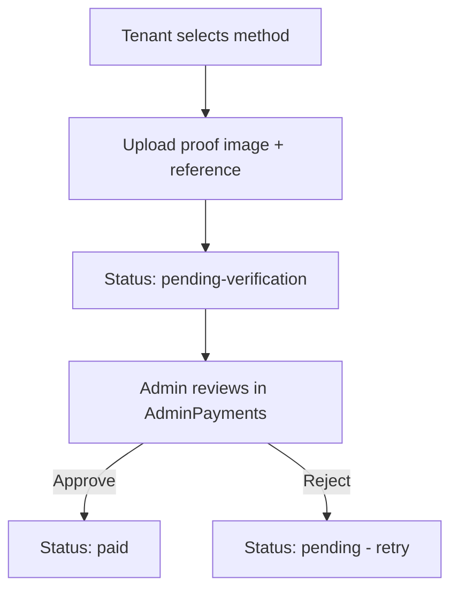
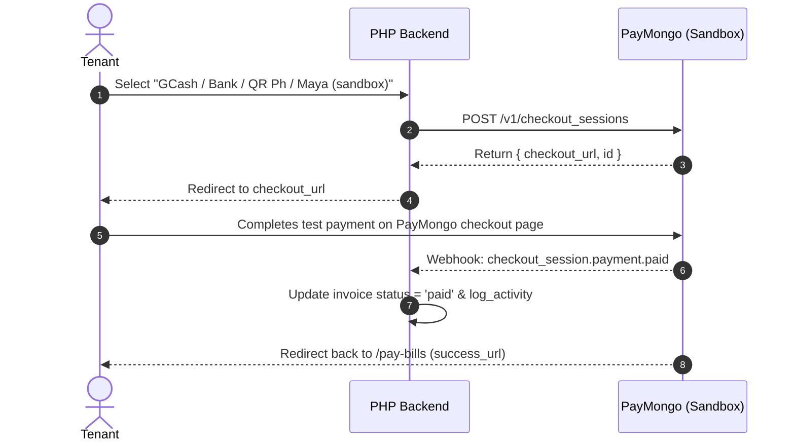
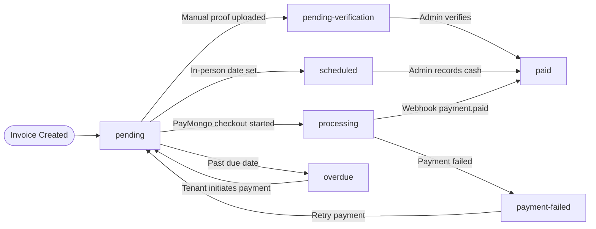

# Modular Payment System — Design Document

> **Stack context:** React 19 + Vite 8 → PHP 8 (XAMPP) → MySQL/MariaDB  
> **Core Principle:** Admin-controlled channel activation. One toggle decides whether the tenant sees sandbox (PayMongo) options, manual options, or both.  
> **Last Updated:** November 7, 2026

---

## 1. Overview

The payment system is **modular** — each payment channel is an independent unit that can be enabled or disabled by the admin without code changes. Channels are grouped into two families:

The Pay Bills advance-rent preview keeps a detailed date-range row for one month. When multiple months are selected, it consolidates them into one row showing the covered range and total; an equal monthly rent is additionally expressed as a per-month multiplier.

| Family | Provider | Requires Internet Gateway? | Status |
|---|---|---|---|
| **Sandbox (Experimental)** | PayMongo Test Mode | Yes — PayMongo API | 🔧 New |
| **Manual** | Self-service upload | No | ✅ Exists |
| **In-Person** | Walk-in / office visit | No | 📋 New |

The admin picks which family is active (or enables both). Within each family, individual channels can be toggled.

---

## 2. Channel Inventory

### 2.1 Sandbox Channels (PayMongo Test Mode)

These channels use [PayMongo's Checkout / Payment Intent API](https://developers.paymongo.com/reference) in **test/sandbox mode**. No real money moves. The tenant is redirected to PayMongo's hosted checkout page, and a webhook confirms the result.

| Channel | PayMongo Source Type | Payment Flow | Notes |
|---|---|---|---|
| **Bank Transfer** | `bank_transfer` | Redirect → PayMongo checkout → webhook callback | Supported banks: BPI, UnionBank, etc. |
| **GCash** | `gcash` | Redirect → GCash authorization → webhook callback | Mobile wallet |
| **QR Ph** | `qrph` | Redirect → QR code display → scan & pay → webhook callback | InstaPay / PESONet QR standard |
| **Maya** | `paymaya` | Redirect → Maya authorization → webhook callback | Formerly PayMaya |

All four follow the same integration pattern (see §4).

### 2.2 Manual Channels (Existing)

These are already implemented and working.

| Channel | Tenant Action | Admin Action | Key Files |
|---|---|---|---|
| **Manual GCash** | Upload proof screenshot + 13-digit reference number (Pay Bills continues to the upload page for QR Ph, GCash and bank, 2026-11-07) | Verify proof → approve payment | `upload_payment_proof.php`, `PayBills.jsx` → `PaymentUpload.jsx` |
| **Manual Bank Transfer** | Upload deposit slip/screenshot + reference number | Verify proof → approve payment | Same files as above |

Current flow:



### 2.3 In-Person Channel (New)

| Channel | Tenant Action | Admin Action |
|---|---|---|
| **In-Person Payment** | Request a payment schedule (date + time slot) | Accept/reject schedule → record cash payment on visit |

This channel is for tenants who pay at the admin office with cash. It adds a **scheduling step** so the admin knows when to expect the tenant.

If cash has already been physically received at the desk, an admin may record a single cash payment against an open `pending`, `unpaid`, or `overdue` invoice without a tenant schedule or reference number. Online payments continue to require tenant submission/proof or an online payment attempt; the admin cannot clear a `processing` checkout.

In Admin Payments, the tenant sidebar defaults to Latest Bill, sorting tenants by the newest active invoice's creation timestamp first. Tenants without an active invoice sort last; Due ↑ and Due ↓ remain available as separate options.

The billing-details column stays empty until the admin explicitly selects a tenant. On first load it shows an instructional placeholder instead of opening the first tenant's account; an explicit selection is preserved during refreshes when that tenant is still present.
The no-selection placeholder is scoped to the right billing column; summary metrics, the reminder alert, tenant sidebar and payment dashboard stay visible.
The payment confirmation modal also requires a current tenant selection, so stale modal state cannot dereference a missing tenant.
For a QR Ph proof under review, Admin Payments offers the supported GCash and Bank Transfer recording methods and prompts the admin to choose the route the funds arrived through; the API does not store a distinct QR Ph transaction method. Non-cash desk payments require a transaction reference, while cash at the desk does not.

---

## 3. Admin Configuration

### 3.1 Settings Model

Payment channel settings live in the existing `system_settings` table (same pattern as service toggles in `AdminServicePage.jsx`).

```sql
-- No new table needed. Uses existing system_settings key-value store.
-- Keys follow the pattern: payment_channel_<channel_id>

-- Example rows:
-- ('payment_mode',             'manual')        -- 'manual' | 'sandbox' | 'both'
-- ('payment_sandbox_enabled',  '0')             -- master sandbox kill switch
-- ('payment_ch_gcash_sandbox', '1')             -- individual channel toggles
-- ('payment_ch_bank_sandbox',  '1')
-- ('payment_ch_qrph',         '1')
-- ('payment_ch_maya',         '1')
-- ('payment_ch_gcash_manual', '1')
-- ('payment_ch_bank_manual',  '1')
-- ('payment_ch_in_person',    '1')
-- ('paymongo_secret_key',     'sk_test_...')    -- sandbox API key (encrypted)
-- ('paymongo_public_key',     'pk_test_...')    -- sandbox public key
```

### 3.2 Admin UI — Payment Settings Panel

A new section inside the existing admin settings page (or a dedicated tab):

```
┌─────────────────────────────────────────────────────┐
│  💳 Payment Channels                                │
│                                                     │
│  Mode: ○ Manual Only  ○ Sandbox Only  ● Both        │
│                                                     │
│  ── Sandbox (PayMongo Test Mode) ──────────────── │
│  [✓] Bank Transfer (sandbox)                        │
│  [✓] GCash (sandbox)                                │
│  [✓] QR Ph (sandbox)                                │
│  [ ] Maya (sandbox)                  ← disabled     │
│                                                     │
│  ── Manual ─────────────────────────────────────── │
│  [✓] GCash (proof upload)           ← already done  │
│  [✓] Bank Transfer (proof upload)   ← already done  │
│                                                     │
│  ── In-Person ─────────────────────────────────── │
│  [✓] In-Person Payment (scheduled)                  │
│                                                     │
│  PayMongo API Keys (sandbox):                       │
│  Secret Key: [sk_test_•••••••••••••]                │
│  Public Key: [pk_test_•••••••••••••]                │
│                                                     │
│  [Save Changes]                                     │
└─────────────────────────────────────────────────────┘
```

### 3.3 Tenant-Side Channel Resolution

When `PayBills.jsx` loads, it fetches active channels:

```
GET /get_payment_channels.php → returns only enabled channels for the current mode

Response:
{
  "success": true,
  "channels": [
    { "id": "gcash_sandbox",  "label": "GCash",          "family": "sandbox", "icon": "gcash" },
    { "id": "bank_sandbox",   "label": "Bank Transfer",   "family": "sandbox", "icon": "bank" },
    { "id": "qrph",           "label": "QR Ph",           "family": "sandbox", "icon": "qr" },
    { "id": "gcash_manual",   "label": "GCash (Manual)",   "family": "manual",  "icon": "gcash" },
    { "id": "bank_manual",    "label": "Bank Transfer (Manual)", "family": "manual", "icon": "bank" },
    { "id": "in_person",      "label": "In-Person Payment", "family": "in_person", "icon": "cash" }
  ]
}
```

The `paymentMethods` array in `PayBills.jsx` (line 60-64) currently hardcodes three options. This will be replaced with the dynamic list from the API.

---

## 4. PayMongo Sandbox Integration

### 4.1 Flow (All Sandbox Channels)

All four sandbox channels follow the same PayMongo Checkout Session pattern:



### 4.2 Backend Endpoints

| Endpoint | Method | Purpose |
|---|---|---|
| `create_checkout_session.php` | POST | Create PayMongo checkout session; return `checkout_url` |
| `paymongo_webhook.php` | POST | Receive PayMongo webhook events; update invoice status |
| `get_payment_channels.php` | GET | Return enabled channels based on `system_settings` |

#### `create_checkout_session.php` — Pseudocode

```php
// Input: invoice_id, channel (gcash|bank_transfer|qrph|paymaya)
// 1. Fetch invoice from DB (amount, description, tenant info) and JOIN users table (using email_address)
// 2. Build PayMongo Checkout Session request:
//    - line_items: [{ amount: invoice_total * 100, currency: 'PHP', name: 'Invoice #INV-xxx' }]
//    - payment_method_types: map frontend channel to valid PayMongo types (e.g. 'gcash', 'paymaya', 'qrph', 'dob', 'card')
//    - success_url: passed dynamically from frontend (e.g. /pay-bills?status=success&invoice_id=…)
//    - cancel_url: passed dynamically from frontend (e.g. /pay-bills?status=cancelled&invoice_id=…)
//    - metadata: { invoice_id, user_id }
// 3. cURL POST to https://api.paymongo.com/v1/checkout_sessions (SSL verify disabled for localhost)
// 4. Store checkout_session_id in invoices table (new column)
// 5. Return checkout_url to frontend
```

#### `paymongo_webhook.php` — Pseudocode

```php
// 1. Read raw POST body
// 2. Verify webhook signature (paymongo-signature header)
// 3. Parse event type:
//    - 'checkout_session.payment.paid' → mark invoice as 'paid', set paid_at = NOW()
//    - 'payment.failed' → mark invoice as 'payment-failed'
// 4. Extract invoice_id from metadata
// 5. Update invoices table
// 6. log_activity()
```

### 4.3 PayMongo API Keys

- **Test Secret Key:** `sk_test_...` — used server-side in PHP (never exposed to frontend)
- **Test Public Key:** `pk_test_...` — used if client-side PayMongo.js is needed (optional)
- Stored in `system_settings` table, only readable by admin endpoints
- In production: swap to live keys (`sk_live_...`) — **no code changes needed**

### 4.4 Database Changes

```sql
-- Add to invoices table (migration pattern: ADD COLUMN IF NOT EXISTS)
ALTER TABLE invoices
  ADD COLUMN IF NOT EXISTS checkout_session_id VARCHAR(100) DEFAULT NULL,
  ADD COLUMN IF NOT EXISTS payment_gateway VARCHAR(50) DEFAULT NULL;

-- checkout_session_id: PayMongo session ID for tracking
-- payment_gateway: 'paymongo_sandbox' | 'manual' | 'in_person' | NULL (legacy)
```

---

## 5. In-Person Payment Flow

### 5.1 Tenant Flow

```
1. Tenant selects "In-Person Payment" on /pay-bills
2. Tenant picks a preferred date + time slot:
   ┌──────────────────────────────────┐
   │  Schedule In-Person Payment      │
   │                                  │
   │  Date:  [Aug 28, 2026      ▾]   │
   │  Time:  ○ Morning (9am–12pm)    │
   │         ● Afternoon (1pm–5pm)   │
   │                                  │
   │  [Request Schedule]              │
   └──────────────────────────────────┘
3. Invoice status → 'scheduled'
4. Admin sees scheduled visit in AdminPayments
```

### 5.2 Admin Flow

```
1. Admin sees "Scheduled Payments" tab/section in AdminPayments
2. On the scheduled date, tenant visits office
3. Admin opens invoice → clicks "Record Cash Payment"
4. Existing record_payment_admin.php flow handles the rest
5. Invoice status → 'paid', payment_method → 'In-Person Cash'
```

### 5.3 Database Changes

```sql
ALTER TABLE invoices
  ADD COLUMN IF NOT EXISTS scheduled_date DATE DEFAULT NULL,
  ADD COLUMN IF NOT EXISTS scheduled_time_slot VARCHAR(20) DEFAULT NULL;

-- scheduled_time_slot values: 'morning' | 'afternoon'
-- Only populated when payment channel is 'in_person'
```

---

## 6. File Map — New & Modified

### New Files

| File | Purpose |
|---|---|
| `backend/api/create_checkout_session.php` | Create PayMongo checkout session |
| `backend/api/paymongo_webhook.php` | Handle PayMongo webhook callbacks |
| `backend/api/get_payment_channels.php` | Return enabled payment channels |
| `backend/api/schedule_payment.php` | Schedule in-person payment visit |
| `backend/api/migrations/payment_channels.sql` | New columns for `invoices` |

### Modified Files

| File | Changes |
|---|---|
| `PayBills.jsx` | Replace hardcoded `paymentMethods` array with dynamic fetch; add sandbox redirect flow + in-person scheduling UI |
| `AdminPayments.jsx` | Add "Scheduled Payments" section; show payment gateway info on receipts |
| `pay_bill.php` | Add `payment_gateway` field on update |
| `AdminServicePage.jsx` or Settings | New "Payment Channels" configuration panel |

### Unchanged Files (No Touch)

| File | Reason |
|---|---|
| `upload_payment_proof.php` | Manual flow works as-is |
| `record_payment_admin.php` | In-person reuses this endpoint |
| `axiosConfig.js` | No changes needed |

---

## 7. Invoice Status Lifecycle (Updated)



| Status | Meaning | Set By |
|---|---|---|
| `pending` | Invoice created, no action yet | System |
| `pending-verification` | Tenant uploaded proof (manual) | `pay_bill.php` / `upload_payment_proof.php` |
| `scheduled` | Tenant booked in-person visit | `schedule_payment.php` |
| `processing` | PayMongo checkout started | `create_checkout_session.php` |
| `paid` | Payment confirmed | Admin or PayMongo webhook |
| `payment-failed` | PayMongo payment failed | `paymongo_webhook.php` |
| `overdue` | Past due date, unpaid | Future: cron / manual |

---

## 8. Security Considerations

| Concern | Mitigation |
|---|---|
| PayMongo secret key exposure | Stored server-side only; never sent to frontend |
| Webhook spoofing | Verify `paymongo-signature` header using webhook secret |
| Double payment | Check invoice status before creating checkout session; idempotent webhook handler |
| Sandbox → Production confusion | `payment_gateway` column tracks environment; admin UI clearly labels "TEST MODE" |
| API key storage | Keys in `system_settings` table, accessible only via admin-guarded endpoints |

---

## 9. Implementation Priority

| Phase | Scope | Depends On | Status |
|---|---|---|---|
| **Phase 1** | `get_payment_channels.php` + admin settings UI + dynamic `PayBills.jsx` | Existing `system_settings` infrastructure | ✅ Completed |
| **Phase 2** | In-person scheduling flow (new column + `schedule_payment.php` + UI) | Phase 1 | ✅ Completed |
| **Phase 3** | PayMongo sandbox integration (checkout session + webhook + all 4 channels) | Phase 1 + PayMongo test account | ✅ Completed |
| **Phase 4** | Production readiness (signature verification, error handling, locked live keys) | Phase 3 + PayMongo live approval | ✅ Completed (Live locked) |

---

## 10. PayMongo Quick Reference

| Item | Value |
|---|---|
| API Base URL | `https://api.paymongo.com/v1` |
| Auth | HTTP Basic Auth (secret key as username, empty password) |
| Checkout Session | `POST /v1/checkout_sessions` |
| Webhook Registration | PayMongo Dashboard → Webhooks → Add endpoint |
| Test Cards | `4343 4343 4343 4345` (Visa, always succeeds) |
| Test GCash | Auto-approved in sandbox |
| PHP HTTP Client | `cURL` (already available in XAMPP) |
| SDK | None needed — raw cURL is sufficient for this scale |

## Tenant payment screens (2026-11)
Details in [tenant_pages.md](tenant_pages.md) §4. Pay Bills lays out the statement and the "how to pay" column side by side and offers: manual (GCash / bank with reference and proof), in person (scheduled date, morning / afternoon), online PayMongo checkout, **split payment** (portions kept in `payment_proof_parts` until the admin confirms; each confirmed portion becomes a `payment_transactions` row), partial amounts capped at the balance, **pay all together** (bundle, `BND-` key, one combined receipt) and **pay in advance** (`advance_payment.php`, `advance_credits`). Payment History groups open, paid (by year) and cancelled bills with printable receipts. Online payments can be refunded through PayMongo (My Refunds, `refund_requests`).
