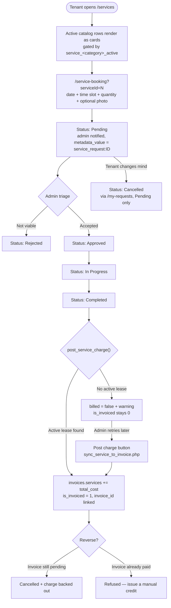

# Service Management — Design

> **Module:** 5.4 / 5.5 — Add-On Service Catalog, Booking & Billing
> **Status:** ✅ Implemented
> **Last Updated:** September 2026

---

## 1. Purpose

Before this module, "Service Management" was only a **feature-flag toggle board**.
`AdminServicePage.jsx` switched existing modules (Parking, Maintenance, CCTV,
Visitors) on and off via `system_settings` keys and showed read-only CCTV and
parking queues. There was no priced catalog, no way for a tenant to *book* an
add-on service, and nothing that turned a delivered service into revenue.

This module closes panelist checklist item **5.5 Cleaning & Laundry Services**
and completes **5.4 Service Billing Integration** for add-ons:

```
Admin defines catalog  →  Tenant books  →  Admin delivers  →  Charge posts to invoice
```

Cleaning and laundry are deliberately **separate from maintenance**. Maintenance
is a fault the landlord must fix; an add-on service is optional paid work the
tenant elects to buy.

---

## 2. Two levels of availability

A service is only bookable when **both** switches are on. This is intentional —
one is a business decision, the other an operational one.

| Switch | Where | Meaning |
|---|---|---|
| `system_settings.service_<category>_active` | Toggle cards on `/admin-services` | Is this whole category offered at all? Also hides the tenant cards. |
| `service_catalog.is_active` | Catalog table on `/admin-services` | Is this individual priced item bookable right now? |

Categories are fixed at `cleaning`, `laundry`, `other` because they map 1:1 to
the three `system_settings` keys. Everything else about a service — name, price,
unit, quantity range, lead time, icon — is admin-editable data.

---

## 3. Lifecycle



**Status vocabulary:** `Pending → Approved → In Progress → Completed`, plus
`Rejected` and `Cancelled`. These strings are matched in React badge maps, so
changing them means grepping first.

---

## 4. Money

### Where the charge lands

`invoices` has no line-item table — charges are fixed columns (`base_rent`,
`water`, `electricity`, `parking`). This module adds **`services`**, mirroring
`parking`. Billing through `invoices` rather than a separate ledger means service
charges inherit due-date reminders and overdue flags from
`check_due_date_reminders.php` for free, and surface in
`get_report_data.php` revenue reporting.

Unlike `water` / `electricity` — which `sync_utility_to_invoice.php` **overwrites**
— `services` **accumulates**. Several completed bookings in one month add into
the same column on the same invoice.

### Billing period is the month of *delivery*

A booking made in late January but completed in February bills to February.
The charge is for work done, not for the intent to buy it. The tenant-facing
`serviceBooking.billingNotice` string says so on the booking form, and
`service_requests.billing_period` records which invoice period it actually hit.

### Anti-double-billing

`post_service_charge()` (in `backend/config.php`) claims the row **first**, inside
the transaction, before any money moves:

```php
UPDATE service_requests SET is_invoiced = 1 WHERE id = ? AND is_invoiced = 0
// affected_rows === 0  ->  rollback, "already billed"
```

A rollback un-claims it, so a request that failed to bill (no active lease) stays
billable and the admin queue shows a **Post charge** retry button.

> This is deliberately stricter than `sync_utility_to_invoice.php`, which claims
> *last* and is racy. Copy the pattern here, not there.

### Reversal

`reverse_service_charge()` only succeeds while the invoice is unpaid — the
`AND status = 'pending'` guard means a paid invoice matches zero rows:

```php
UPDATE invoices SET services = GREATEST(services - ?, 0),
                    total_amount = GREATEST(total_amount - ?, 0)
WHERE id = ? AND status = 'pending'
```

If reversal fails, `update_service_status.php` **aborts the whole transition**.
Status and money never drift apart: a request that still says `Completed` is
always one whose charge is still on an invoice.

### Invoice writers that had to learn about `services`

Both of these recompute `total_amount` from a fixed list of parts and would
otherwise **silently erase** a posted service charge:

| File | Fix |
|---|---|
| `sync_utility_to_invoice.php` | `SELECT`s `services` and adds it to `$new_total` |
| `create_invoice.php` | reads existing `services` before an `ON DUPLICATE KEY UPDATE` re-issue |

`PayBills.jsx` and `AdminPayments.jsx` render the new line, so the tenant never
sees a total that does not match its parts.

---

## 5. Pricing model

One table covers both "₱500 per cleaning session" and "₱60/kg laundry, 1–20 kg":

| Column | Role |
|---|---|
| `price` + `pricing_unit` | `session` \| `kg` \| `hour` \| `item` |
| `min_quantity` / `max_quantity` | Booking form shows a quantity input only when `pricing_unit != 'session'`; a session is always quantity 1 |
| `lead_time_days` | Earliest bookable date; the form's 14-day ceiling is unchanged |

`service_request.php` **re-derives price server-side** from the catalog row and
ignores any client-supplied amount, then clamps quantity to the catalog range.

`service_requests` **snapshots** `service_name`, `category`, `unit_price` and
`pricing_unit` at booking time, and `service_id` is `ON DELETE SET NULL`, so
re-pricing the catalog never rewrites history. Deleting a catalog row that has
bookings soft-deletes it (`is_active = 0`) instead.

---

## 6. Files

### Schema — `backend/api/migrations/SetupDB.sql`
`service_catalog`, `service_requests`, `ALTER TABLE invoices ADD services`,
6 seed catalog rows, and the three `service_<category>_active` settings.
Additive only, per `.agents/CLAUDE.md`.

### Backend — `backend/api/`
| File | Auth | Role |
|---|---|---|
| `get_service_catalog.php` | tenant / admin | `?active=1` for tenants; admins also see inactive rows |
| `manage_service_catalog.php` | `verify_admin` | `create` / `update` / `toggle` / `delete` (soft-delete when referenced) |
| `service_request.php` | tenant | Multipart booking; re-derives price, clamps quantity, enforces lead time and both availability switches |
| `get_service_requests.php` | `verify_admin` | Booking queue with tenant name and unit |
| `update_service_status.php` | `verify_admin` | The state machine; bills on Completed, reverses on Cancelled |
| `sync_service_to_invoice.php` | `verify_admin` | Manual retry for a completed-but-unbilled booking |
| `cancel_request.php` | tenant | Tenant cancellation for all four request types (**new file — the UI had been calling a 404**) |

Helpers `post_service_charge()` and `reverse_service_charge()` live in
`backend/config.php` beside `log_activity` and `verify_admin`.

Uploads go to `backend/uploads/services/` and are stored **web-relative**
(`uploads/services/…`), not with the `../` prefix that `parking_reservation.php`
uses and `AdminServicePage.jsx` had to strip.

### Frontend — `ams-react/src/`
| File | Change |
|---|---|
| `UserPages/ServiceBooking.jsx` | **New.** Booking form at `/service-booking`, modelled on `MaintenanceRequest.jsx` |
| `Components/ServiceCatalogModal.jsx` | **New.** Create/edit catalog form; parent passes a `key` so it reseeds on remount |
| `AdminPages/AdminServicePage.jsx` | 3 new toggle cards, a Service Catalog CRUD section, and a Service Bookings tab beside CCTV/Parking |
| `UserPages/Services.jsx` | Renders active catalog rows as cards alongside the static module list |
| `UserPages/UserMyRequests.jsx` | `Service` type icon, `In Progress` badge, service fee line |
| `AdminPages/AdminReports.jsx` | "Add-On Services" revenue stream, per-unit Services column, CSV columns |
| `config/i18n.js` | 34 keys × EN + Tagalog |

---

## 7. Reporting

`get_report_data.php` aggregates revenue **column-wise**, so a new stream is
invisible unless every aggregate learns about it. Updated: current and previous
period sums, `incomeStatement.serviceRevenue`, a fifth `revenueStreams` entry,
the per-unit ledger, and the 6-month trend fallback.

The one that matters most is `diversification.ancillaryPct` — it is now
`parking + services + deposit`. Without that, the three diversification
percentages stop summing to 100.

---

## 8. Known limitations

- **One-off bookings only.** No recurring subscriptions (e.g. "clean every
  Monday"). That would need a cron-style generator like
  `check_due_date_reminders.php`.
- **No staff assignment workflow.** `service_requests.assigned_to` is a free-text
  column the API accepts but no UI currently writes.
- **Reversal after payment is manual.** By design — see §4.
- **`parking_reservation.php` still stores `../uploads/…`.** Left alone
  deliberately; fixing it would orphan existing rows. New service uploads do not
  inherit the bug.
