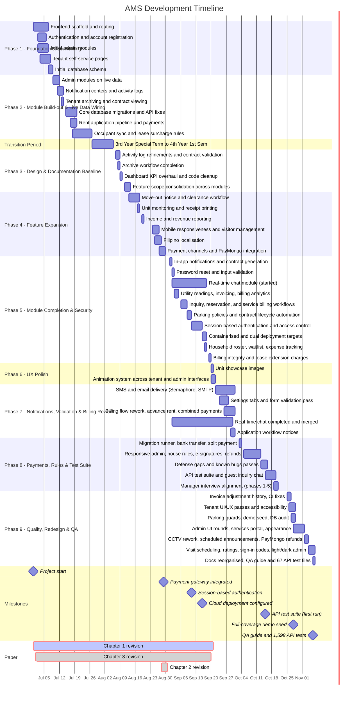
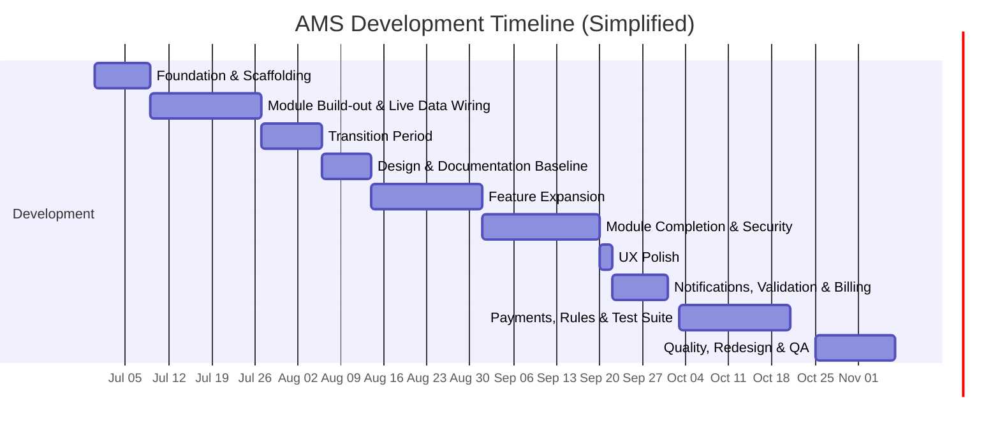

# AMS Development Progress Report

**Reporting period:** 2026-06-30 → 2026-11-06 (approx. 18 weeks, about 500 commits). Last updated 2026-11-06. Task-level detail is in [SPRINT.md](../../SPRINT.md).

This report tracks the development of the Apartment Management System — a React + Vite tenant/admin portal backed by a plain PHP 8 API and MariaDB — as a chronological timeline of work phases, from initial scaffolding through to the current state. It is a project timeline, not a code-metrics report.

## Timeline

## Simplified Timeline

## Phase summary

| Phase | Name | Range | Duration | Focus |
|---|---|---|---|---|
| 1 | Foundation & Scaffolding | 2026-06-30 → 2026-07-08 | ~1.5 weeks | Stand up the React/Tailwind frontend and PHP backend skeleton, and build the first working routes for both tenant and admin sides. |
| 2 | Module Build-out & Live Data Wiring | 2026-07-09 → 2026-07-26 | ~2.5 weeks | Replace mock data with real database-backed modules across reports, payments, applications, and notifications. |
| — | Transition period — 3rd Year Special Term → 4th Year 1st Sem | 2026-07-27 → 2026-08-05 | ~1.5 weeks | Academic term transition; no development activity. |
| 3 | Design & Documentation Baseline | 2026-08-06 → 2026-08-13 | ~1 week | Refine core modules — activity logs, contracts, archiving, dashboards — and consolidate feature scope across the system. |
| 4 | Feature Expansion | 2026-08-14 → 2026-08-31 | ~2.5 weeks | Add new operational modules — move-out handling, visitor management, localisation, and live payment processing. |
| 5 | Module Completion & Security | 2026-09-01 → 2026-09-19 | ~2.5 weeks | Round out remaining modules (utilities, inquiries, contracts) and strengthen authentication, access control, and deployment infrastructure. |
| 6 | UX Polish | 2026-09-20 → 2026-09-21 | ~0.5 week | Visual and interaction polish across tenant and admin interfaces. |
| 7 | Notifications, Validation & Billing Rework | 2026-09-22 → 2026-09-30 | ~1.5 weeks | Real SMS and e-mail delivery, shared form validation, and a reworked billing flow (advance rent, combined payments). |
| 8 | Payments, Rules & Test Suite | 2026-10-03 → 2026-10-24 | ~3 weeks | Bank and split payments, refunds, e-signatures, house rules, guest chat, manager-interview changes and the first automated API test suite. |
| 9 | Quality, Redesign & QA | 2026-10-25 → 2026-11-06 | ~2 weeks | Tenant and admin UI redesign and accessibility, demo seed, CCTV, services and maintenance workflows, PayMongo refunds, QA guide and test expansion, docs reorganisation. |

A **Paper deliverable** column can be appended to this table using the phase rows as the shared timeline anchor with the Paper Track below.

## Phase detail

### Phase 1 — Foundation & Scaffolding (2026-06-30 → 2026-07-08)

Goal: get a working application skeleton with both user roles able to navigate and authenticate.

- Project scaffolded with Vite, React, and Tailwind CSS.
- Guest and tenant navigation, routing, and page layouts established.
- Registration and login implemented, with validation and error handling.
- First admin pages built: tenant management, unit management, payments, maintenance, and dashboard.
- Tenant self-service pages added: services, parking reservation, CCTV requests, maintenance requests, rent application.
- My Room, profile settings, and document upload pages introduced.
- Initial database schema created for users and rent applications.

### Phase 2 — Module Build-out & Live Data Wiring (2026-07-09 → 2026-07-26)

Goal: move admin and tenant modules off mock data and onto the real database.

- Admin reports, units, and payments pages rebuilt against live data.
- Dedicated notification pages added for both tenants and admins.
- System activity logs and tenant archiving introduced.
- Contract viewing added to the tenant My Room flow.
- Structural database migrations landed, linking user accounts to rent applications.
- Cross-origin and API base-URL issues resolved so the frontend and backend communicate reliably.
- A Kanban-style pipeline built for reviewing rent applications.
- Initial payment enforcement added before a tenancy becomes active.
- Occupant counts synced between rent applications and room records.
- Lease rules enforced: surcharges and late fees calculated automatically.

### Transition Period (2026-07-27 → 2026-08-05)

Academic transition from 3rd Year Special Term into 4th Year 1st Semester. No development activity in this window.

### Phase 3 — Design & Documentation Baseline (2026-08-06 → 2026-08-13)

Goal: refine existing modules and consolidate feature scope before expanding further.

- Activity logs page refined; lease contract date validation added.
- Tenant and user account archiving workflows completed.
- Admin dashboard KPIs and cash-flow visualization overhauled; unused code removed.
- Feature scope consolidated across modules ahead of the next expansion phase.

### Phase 4 — Feature Expansion (2026-08-14 → 2026-08-31)

Goal: add the operational modules needed for day-to-day property management.

- Move-out notice validation (15–30 day window) and a clearance workflow added.
- Unit status monitoring and official receipt printing introduced.
- Income and revenue-stream reporting built out.
- Mobile-responsive layouts applied across tenant and admin pages.
- Visitor management module added, including government ID capture.
- Filipino language support introduced across tenant-facing pages.
- Modular payment channels implemented (manual, sandbox, in-person).
- PayMongo payment gateway integrated in sandbox mode.

### Phase 5 — Module Completion & Security (2026-09-01 → 2026-09-19)

Goal: finish the remaining functional modules and harden the system for real usage.

- In-app notifications and full lease contract generation completed.
- Secure password reset flow, input validation, and file-upload verification added.
- Utility meter readings and other fees wired into invoicing.
- Utilities and financial analytics added to reporting.
- Inquiry and reservation management workflow introduced.
- Service management and billing integration completed.
- Configurable parking policies added.
- Lease contract lifecycle completed, including auto-expiry and renewal tracking.
- Server-side session token authentication implemented for tenant and admin endpoints.
- Endpoint-level security and access control strengthened across billing, maintenance, financial reporting, and notification modules.
- Containerised deployment configuration added for cloud hosting.
- Household roster, unit waitlist, and expense tracking introduced.
- Dual deployment targets (local, cloud, self-hosted) supported with build-time guardrails.
- Billing integrity checks and immediate billing for lease extensions completed.
- Real-time chat module started on the `WS-Chat-test` branch — a Node.js socket.io WebSocket service, a tenant/admin chat widget, message and conversation endpoints, and a `messages` table. Ongoing: the branch is still in development and not yet merged into `main`.

### Phase 6 — UX Polish (2026-09-20 → 2026-09-21)

Goal: refine the visual and interaction quality of the finished system.

- Admin-managed showcase images added for unit previews.
- Animation system applied across tenant-facing pages.
- Animation system extended across admin pages, modals, and navigation chrome.

### Phase 7 — Notifications, Validation & Billing Rework (2026-09-22 → 2026-09-30)

Goal: make the system talk to real people and tighten the money flow.

- SMS (Semaphore) and e-mail (SMTP) drivers with mock modes, templates and per-category notification preferences; announcements can go out by SMS and e-mail.
- Admin settings split into side tabs.
- Shared form validation with field-level errors on every form; +63 phone numbers.
- Billing flow reworked: payment confirmation loop, rent from tenancy start, advance rent and credits, combined payments for overdue bills.
- Archive notifications, cancel and resubmit of applications, rejection attachments.
- Real-time chat finished (attachments, replies, search, unread counts) and merged into `main`.

### Phase 8 — Payments, Rules & Test Suite (2026-10-03 → 2026-10-24)

Goal: close the gaps found by the panel and the manager interview, and start testing automatically.

- Migration runner (`cron/migrate.php`) and contract template versions; bank transfer, transaction log and tenant split payment.
- Responsive admin drawer and phone cards; house, children/pets and parking rules with Filipino text; showcase photo captions.
- Extension rules and holdover billing, e-signatures, refund workflow, per-floor rent, utility types and bill upload.
- Defense-gaps and known-bugs passes (failed-payment webhook, atomic settings save, announcement drafts).
- API test suite (Vitest, scratch `ams_test` database, `php -S`), later wired into the docs.
- Guest inquiry chat with one-time e-mailed links.
- Manager-interview alignment: admin-defined application documents, children-by-floor rule, provider-bill utilities, itemised deposit deductions, instalment payments.

### Phase 9 — Quality, Redesign & QA (2026-10-25 → 2026-11-06)

Goal: raise quality across both portals and document and test what exists.

- Invoice adjustment history and a duplicate payment-reference policy; CI blockers cleared (idempotent migrations, ESLint).
- Tenant UI/UX passes (correct amounts and dates, dialogs and keyboard access, contrast, English/Filipino) and admin accessibility and UI rounds (grouped sidebar, shared components, light/dark mode).
- Parking slot guards, full-coverage demo seed, database audit (46 tables, legacy document columns dropped); later 49 tables.
- Resident services portal, appearance customizer (Glass Mode photos, Home Page text), Preview rooms-first layout, repository cleanup.
- CCTV rework (incident types, footage clip or private link), scheduled and pinned announcements, extension conflict check, PayMongo refunds.
- Service and maintenance workflows: confirmed visits, cancel requests, "not fixed" reopen, ratings, capacity, categories; sign-in code on new devices with trusted devices.
- My Room redesign (important info panel, household cards, rent term, house rules) and an account area with side menu.
- QA guide and gap audit with 17 new API test files (67 files, 1,598 tests), bugs found by them fixed.
- `docs/` reorganised into folders; database, API and tenant page docs refreshed (49 tables, 62 endpoints added to the API reference).

## Branches in progress

None. Everything goes straight to `main` (the former `WS-Chat-test` chat branch was merged in September).

## Milestones

| Date | Milestone | Significance |
|---|---|---|
| 2026-06-30 | Project start | Initial scaffold committed. |
| 2026-08-29 | Payment gateway integrated | Live sandbox payment processing became available. |
| 2026-09-11 | Session-based authentication | Server-side session tokens replaced client-trusted identity headers. |
| 2026-09-16 | Cloud deployment configured | Containerised, environment-based deployment made available alongside local hosting. |
| 2026-10-15 | API test suite | First automated backend tests on a scratch database that cannot touch dev data. |
| 2026-10-28 | Full-coverage demo seed | Demo accounts and data for every workflow state, safe to load next to real data. |
| 2026-11-06 | QA guide and 1,598 API tests | Per-module QA method, 67 test files, docs reorganised and refreshed. |

## Paper Track

| Milestone | Start | End | Status |
|---|---|---|---|
| Chapter 1 revision | 2026-06-30 | 2026-09-21 | Ongoing |
| Chapter 3 revision | 2026-07-01 | 2026-09-20 | Done |
| Chapter 2 revision | 2026-08-28 | 2026-08-31 | Done |

Chapter status was not updated in the 2026-11-06 refresh. These three entries are already rendered on the detailed Gantt above (`section Paper`, styled red for contrast against the code phases). Add rows here and to that section as more chapters are drafted or revised.

## Exporting the Diagram

Neither Excel nor Word renders Mermaid natively, so pick the route that matches what you need:

- **Fastest — image export (Mermaid Live Editor).** Paste either Gantt block above into [mermaid.live](https://mermaid.live), then export as PNG or SVG and insert it as a picture into Word or Excel. Good for a static report; the chart itself isn't editable afterward.
- **From VS Code.** If a Mermaid preview extension (e.g. "Markdown Preview Mermaid Support") is installed, open this file's preview and right-click the rendered chart to copy/export it as an image — same result as above, no browser needed.
- **Editable in Word.** Skip the chart image and use the **Phase summary table** instead — paste it directly into Word as a table, or use Insert → SmartArt → Process/Timeline and type the phase names and dates in by hand. Slower to set up, but stays editable and matches Word's native styling.
- **Editable in Excel — a real Gantt chart.** Build a small data table with columns `Phase | Start Date | Duration (days)` (the values are already in the Phase summary table above), then select it and go Insert → Bar Chart → Stacked Bar. Set the Start Date series to "No Fill" so only the Duration bars are visible — this is the standard technique for turning a stacked bar chart into a Gantt chart in Excel. The result is a genuine, editable native chart, not a picture.

Use the image export when you just need to drop a finished-looking chart into a document once; use the Excel/Word table routes when you expect to keep adjusting dates or reflowing the chart as the paper track changes.
